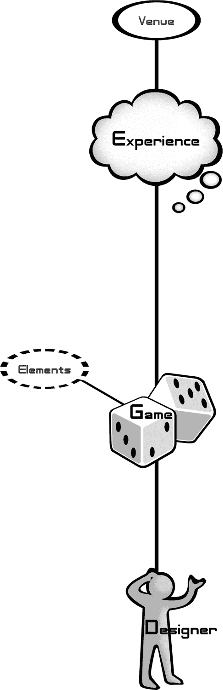
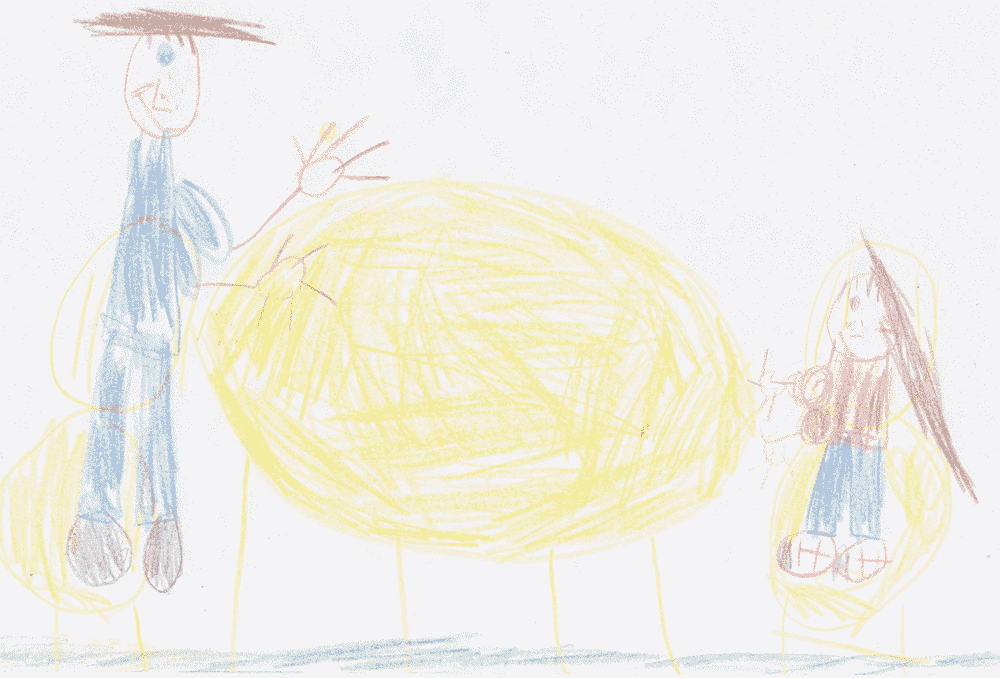
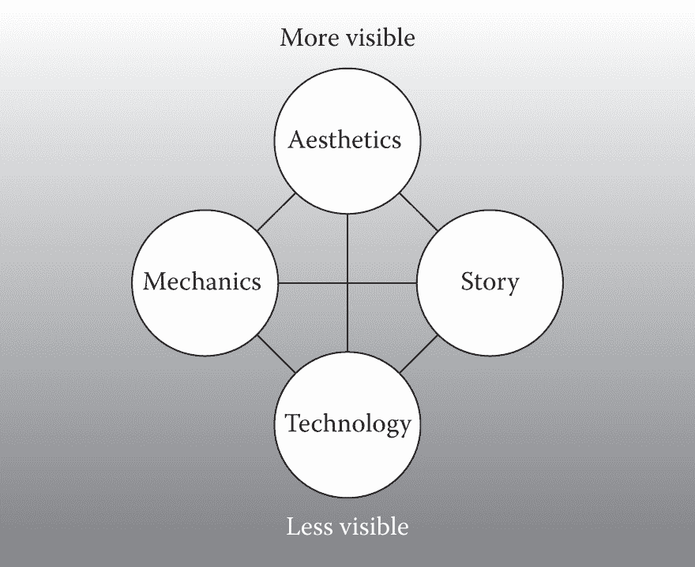
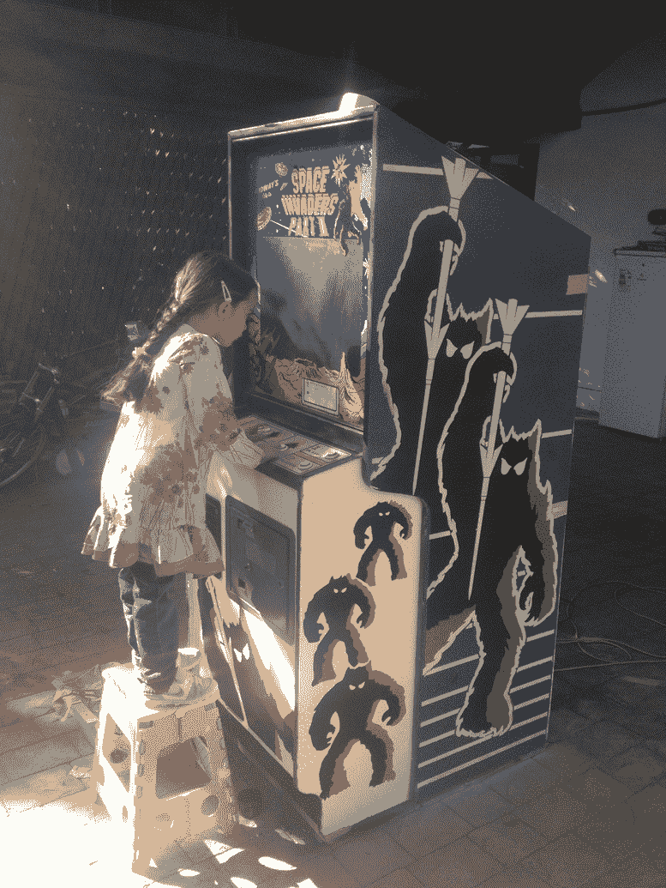

# 第五章

## 游戏由元素构成

**图 5.1**

### 小游戏是由什么构成的？

**图 5.2**

当我女儿三岁时，有一天她对不同事物的构成产生了浓厚的兴趣。她在房间里跑来跑去，兴奋地指着东西，试图用问题难倒我：

*   “爸爸，桌子是由什么做的？”
*   “木头。”
*   “爸爸，勺子是由什么做的？”
*   “金属。”
*   “爸爸，这个玩具是由什么做的？”
*   “塑料。”

当她四处寻找新物体时，我反问了她一个我自己的问题。

*   “你是由什么做的？”

她停下来思考。她低头看着自己的手，翻来覆去地研究。然后，兴高采烈地宣布：

*   “我是由皮肤做的！”

对于一个三岁的孩子来说，这是一个完全合理的结论。随着年龄增长，我们当然会更多地了解人到底是由什么构成的——骨骼、肌肉、器官及其他之间复杂的关系。即使作为成年人，我们对人体解剖学的理解也是不完整的（例如，你能指出你的脾脏在哪里吗，或者描述它有什么作用、如何运作？），这对我们大多数人来说是可以接受的，因为我们通常知道足够多的知识来应付生活。

但我们对医生要求更高。医生需要知道，真正地知道，我们体内一切如何运作，它们如何相互关联，以及当出问题时，如何找出病因并加以修复。

如果你直到现在只是一个玩家，你可能没怎么想过游戏是由什么构成的。例如，想到电子游戏，你可能和大多数人一样，只有一个模糊的概念，认为游戏是一种故事世界，有一些规则，还有一个计算机程序潜伏在某处，以某种方式让一切运转起来。这对大多数人来说已经足够应付了。

但猜猜看？你现在是医生了。你需要知道，深入地知道，你的病人（游戏）到底是由什么构成的，它们的各个部分如何组合在一起，是什么让它们运转。当事情出错时，你需要找出真正的原因并想出最好的解决方案，否则你的游戏必将夭折。如果这还不够难，你还会被要求做大多数医生从未被要求做的事：创造以前从未见过的新型有机体（彻底的新游戏）并赋予它们生命。

本书的大部分内容都致力于建立这种基本理解。我们的解剖学研究始于了解构成每个游戏的四个基本元素。

### 四大基本元素

分解和分类构成游戏的众多元素有很多方法。我发现图 5.3 中所示的类别，我称之为**元素四重奏**，非常有用。让我们简要地看看这四个元素中的每一个，以及它们如何相互关联：

## 1. 机制

这些是你游戏的程序和规则。机制描述了游戏的目标、玩家可以且不可以如何尝试达成目标，以及当他们尝试时会发生什么。如果你将游戏与更线性的娱乐体验（书籍、电影等）进行比较，你会注意到，虽然线性体验涉及技术、故事和美学，但它们不涉及机制，因为正是机制让游戏成为游戏。当你选择一组对游戏玩法至关重要的机制时，你需要选择能够支持它们的技术、能清晰地向玩家强调它们的美学，以及一个能让你（有时很奇怪的）游戏机制在玩家眼中讲得通的故事。机制将在第 12 章至第 14 章中得到详细阐述。

**图 5.3**

## 2. 故事

这是在你游戏中展开的事件序列。它可能是线性且预设脚本的，也可能是分支的和涌现的。当你有一个想通过游戏讲述的故事时，你必须选择既能强化该故事又能让该故事涌现的机制。像任何讲故事的人一样，你会想选择有助于强化故事理念的美学，以及最适合你游戏中将呈现的特定故事的技术。故事及其与游戏机制的特殊关系将在第 17 章和第 18 章中进行研究。

## 3. 美学

这是你的游戏的外观、声音、气味、味道和手感。美学是游戏设计中极其重要的一个方面，因为它与玩家的体验有着最直接的关系。当你有一种希望玩家体验并沉浸其中的特定外观或基调时，你需要选择一种技术，它不仅能让美学呈现出来，还能放大和强化它们。你会想选择让玩家感觉身处美学所定义的世界中的机制，并且你会想要一个拥有一系列事件的故事，让你的美学以合适的节奏涌现并产生最大的冲击力。选择能强化游戏其他元素以创造真正难忘体验的美学的技巧将在第 23 章中进行探讨。

## 4. 技术

这里我们不仅仅指“高科技”，而是指任何使你的游戏成为可能的材料和交互，例如纸和笔、塑料筹码或高能激光。你为游戏选择的技术使其能够做某些事情，同时也限制它做其他事情。技术本质上是美学发生、机制运作以及故事讲述的媒介。我们将在第 29 章中详细讨论如何为你的游戏选择合适的技术。

## 四元素结构：元素的平等性

重要的是要理解，没有任何一个元素比其他元素更重要。四元素结构此处呈菱形排列，并非为了显示任何相对重要性，而只是为了帮助说明“可见性梯度”，即技术元素往往对玩家来说最不可见，美学最可见，而机制和故事处于中间位置。它也可以用其他方式排列。例如，为了突出技术和机制是“左脑”元素，而故事和美学是“右脑”元素这一事实，你可以将四元素结构排列成正方形。为了强调元素之间的紧密联系，它们可以排列成四面体金字塔——这真的不重要。

关于这四个元素要理解的重要事情是，它们都是必不可少的。无论你设计什么游戏，你都会对这四个元素做出重要决策。没有哪一个比其他的更重要，每一个都强烈地影响着其他每一个。我发现很难让人们相信这四个元素是平等的。游戏设计师倾向于认为机制是首要的；艺术家倾向于认为美学是首要的；工程师认为是技术；作家认为是故事。我想这是人性，总认为自己负责的部分最重要。但相信我，作为一名游戏设计师，它们都是你的部分。每一个对玩家的游戏体验都有着同样强大的影响，因此，每一个都值得同等的关注。当使用`透镜 #9`时，这一观点至关重要。

## 案例研究：《太空侵略者》

考虑一下西角友宏设计的游戏《太空侵略者》（Taito，1978）的设计。如果（不知怎么）你不熟悉这款游戏，快速搜索一下网络以了解基本情况。我们将从四个基本元素的角度来考虑该设计。

### 技术

所有新游戏都需要在某些方面进行创新。《太空侵略者》背后的技术是为该游戏专门设计的。它是第一款允许玩家对抗推进军队的视频游戏，这仅得益于为其专门创建的定制主板。一套全新的游戏玩法机制因这项技术而成为可能。它是专门为此目的而创建的。

### 机制

《太空侵略者》的游戏玩法机制是新颖的，这总是令人兴奋的。但不仅如此，它还有趣且平衡性良好。玩家不仅要向会还击的推进外星人射击，还可以躲在外星人可以摧毁的掩体后面（或者玩家可以选择自己摧毁掩体）。此外，还可以通过击落神秘的飞碟来获得奖励分数。不需要时间限制，因为游戏有两种结束方式：玩家的飞船被外星人炸弹摧毁，或者推进的外星人最终到达玩家的母星。离玩家最近的外星人最容易射击，分值最低。离得越远的外星人分值越高。还有一个有趣的游戏机制是，你消灭的 48 个外星人越多，入侵军队的速度就越快。这增加了紧张感，并使一些有趣的故事得以涌现。基本上，《太空侵略者》背后的游戏机制非常扎实、平衡良好，在当时极具创新性。

### 故事

这款游戏本不需要故事。它本可以是一个三角形射击方块的抽象游戏。但有了故事，它变得更加刺激，也更容易理解。然而，《太空侵略者》最初的故事根本不是关于外星入侵者的。它最初是一款向推进的人类士兵军队开火的游戏。据说 Taito 认为这传递了不良信息，因此更改了故事。新故事，一个关于推进外星人的故事，由于几个原因效果好得多：

*   已经发布了几款战争主题游戏（例如《海狼》，1976）。当时，一款让你体验太空战斗的游戏其实是新颖的。
*   有些人对射击人的战争游戏感到反感（《死刑赛车》，1976，曾使电子游戏中的暴力成为一个敏感问题）。
*   “高科技”计算机图形非常适合未来主题的游戏。
*   行进的士兵必然是在走地面，这意味着游戏将采用“俯视”视角。《太空侵略者》给人一种外星人正逐渐降向你星球表面、而你向上射击它们的感觉。不知为何，悬浮飞行的外星人更可信，也构成了更具戏剧性的故事——“如果他们着陆，我们就完了！”故事的改变允许视角的改变，从而对美学产生了戏剧性的影响。

### 美学

有些人可能会对画面嗤之以鼻，因为现在看起来非常原始，但设计师用很少的资源做出了很多东西。外星人并非全都相同。共有三种不同的设计，每种对应不同的分数。它们各自执行一个简单的两帧“行进”动画，效果非常好。显示器不支持彩色——但一个简单的技术改动解决了这个问题！由于玩家被限制在屏幕底部，外星人在中间，飞碟在顶部，于是将彩色半透明塑料条粘贴在屏幕上，使得你的飞船和护盾呈绿色，外星人呈白色，飞碟呈红色。游戏技术的这一简单变革之所以奏效，仅仅是因为游戏机制的特性，并极大地改善了游戏的美学效果。音频是美学的另一个重要组成部分。行进的入侵者发出一种类似心跳的声音，随着它们加速，心跳声也随之加快，这对玩家产生了强烈的生理心理冲击。还有其他音效帮助讲述故事。最令人难忘的是当你的飞船被外星导弹击中时，那种惩罚性的、嗡嗡作响的碎裂声。但并非所有美学都在游戏内部！《太空侵略者》的街机外壳拥有吸引人且引人注目的设计，有助于讲述邪恶外星入侵者的故事。

《太空侵略者》成功的关键部分在于，四大基本要素都在为同一个目标努力——让玩家体验与外星军队战斗的幻想。每个要素都为其他要素做出了妥协，显然，某一要素的缺陷往往会激发设计师对另一要素进行修改。当你透过**元素四透镜**审视你的设计时，很可能会获得这类巧妙的洞见。

**图 5.4**

### 皮肤与骨架

我们将在本书中更详细地讨论这四大基本要素，以及游戏解剖学的许多其他方面。学会透过游戏的**皮肤**（玩家的体验）洞察其**骨架**（构成游戏的要素）是一件很棒的事。但你必须警惕一个许多设计师会陷入的可怕陷阱。一些设计师整天思考游戏的详细内部运作，却忘记了玩家体验。仅仅理解各种游戏要素及其相互关系是不够的——你必须时刻考虑它们如何与体验相关联。这是游戏设计的一大挑战：既要同时感受你游戏的体验，又要理解是哪些要素及要素间的相互作用导致了这种体验，以及为什么。你必须同时看到皮肤和骨架。如果你只关注皮肤，你可以思考体验的感受，但无法理解为什么会有这种感受，也不知如何改进。如果你只关注骨架，你可以在理论上构建一个完美的游戏结构，但在实践中可能极其糟糕。如果你能同时关注两者，你就能在感受游戏体验力量的同时，洞悉一切是如何运作的。

在第 2 章中，我们讨论了观察和分析自身体验的重要性与挑战。尽管这很有挑战性，但还远远不够。你还必须能够思考游戏中使这种体验成为可能的要素。这需要练习，正如第 2 章的观察技巧需要练习一样。本质上，你需要培养的技能是在思考体验深层成因的同时，观察你自己的体验。

这项重要技能被称为**全息设计**，详见透镜 #10。

在后续章节中，我们将更多地谈论构成游戏的要素。现在，让我们把注意力转向这些要素需要协同工作的原因。
