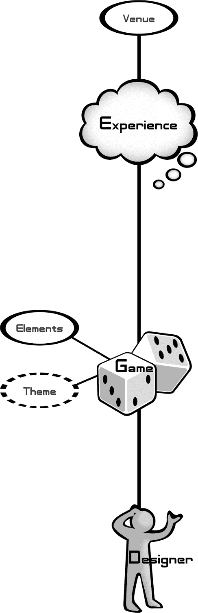
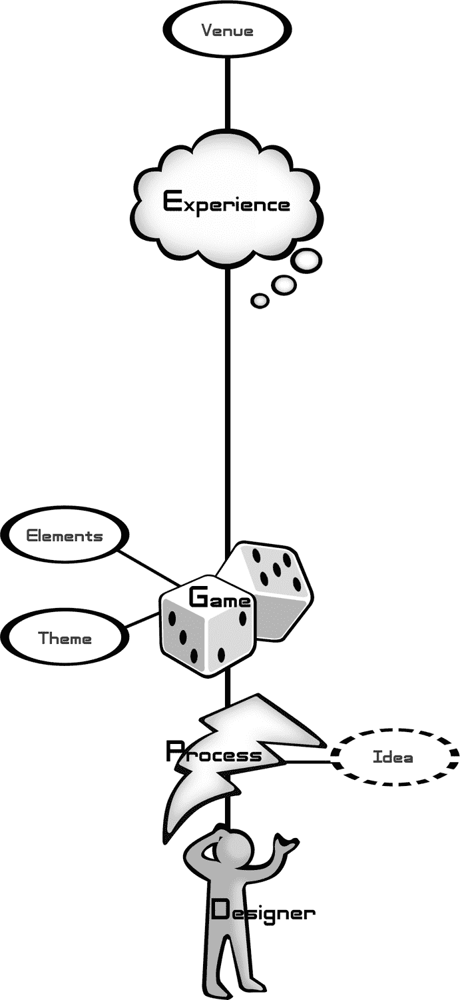
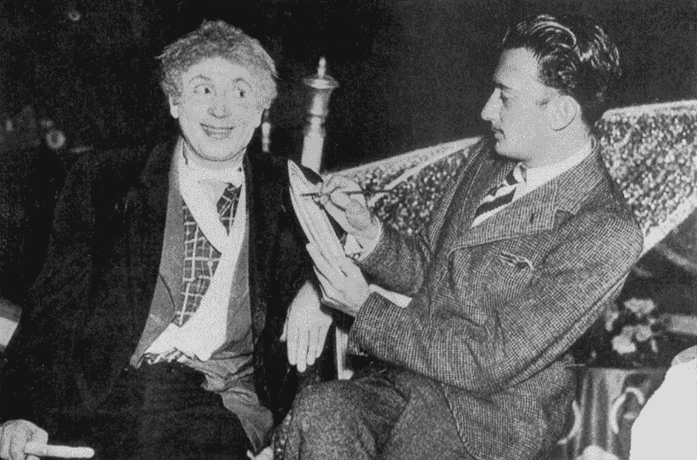
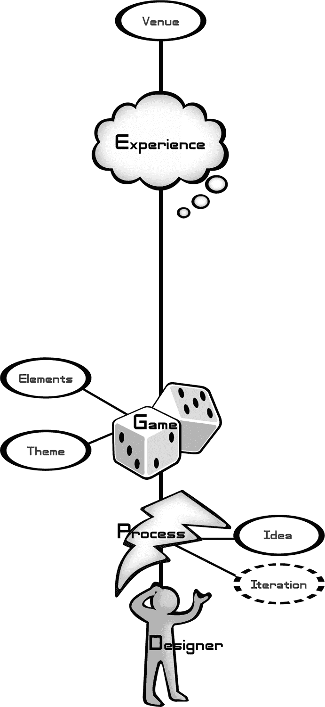
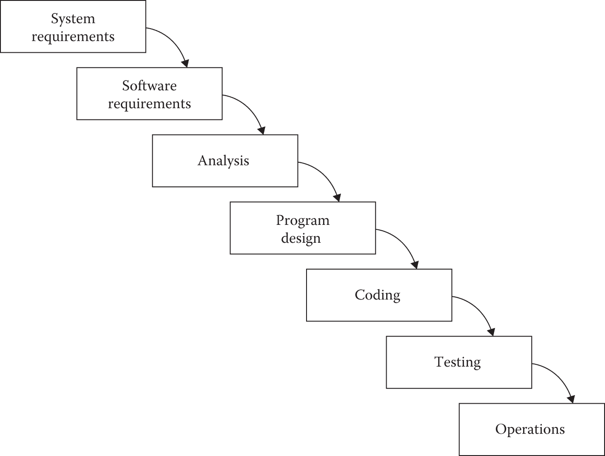
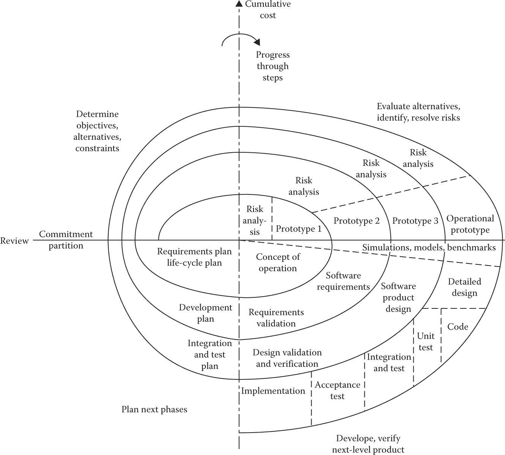

# 第 6 章：要素支撑主题

**图 6.1**

> *要写一部伟大的书，你必须选择一个伟大的主题。*
>
> ——赫尔曼·梅尔维尔

### “仅仅是游戏”

伟大的主题和深刻的意义通常与文学或伟大的艺术作品联系在一起。“仅仅是游戏”渴望达到同样的伟大高度，这是否自命不凡？

作为游戏设计师，我们必须面对一个痛苦的真相：许多人将各种形式的游戏视为无意义的消遣。通常，当我逼问持这种观点的人时，我能让他们承认有某个游戏对他们非常重要。有时是一项运动，无论是他们亲自参与的，还是他们虔诚观看的。有时是一款纸牌或桌游，构成了他们与重要他人关系的基石。有时是一款他们认同其故事情节和角色的电子游戏。当我指出“游戏无意义”却又“某游戏有意义”的虚伪性时，他们会解释：“我真正在乎的不是游戏本身——而是伴随游戏的体验。”但正如我们所讨论的，体验并非随机地与游戏相关联；它们是玩家与游戏互动时涌现出来的。对人们重要的体验部分，如体育赛事的戏剧性、桥牌玩家间的友谊、国际象棋爱好者间的竞争，全都由游戏的设计决定。

有人争辩说游戏，尤其是电子游戏，不可能深刻而有意义，因为它们本质上太过原始。二十世纪初无声黑白电影诞生时，也有人提出过同样的论点。随着技术进步，这种论调逐渐消失。游戏也正在发生同样的情况。在 20 世纪 70 年代，电子游戏被简化得近乎完全抽象。如今，它们可以包含文本、图片、视频、声音和音乐。随着技术进步，人类生活和表达的更多方面将被整合进游戏。没有什么不能成为游戏的一部分。你可以把一幅画、一段广播或一部电影放进游戏里，但你不能把游戏放进这些其他事物里。所有这些其他类型的媒体，以及未来将出现的所有媒体，都是游戏的子集。在技术极限上，游戏将包容所有其他媒体。

真正的问题是，游戏直到最近才作为一种严肃的表达媒介出现。世界需要时间来适应这个观念。但我们没有理由等待。我们现在就可以创作具有强大主题的游戏。但为什么？为什么要这么做？出于艺术表达的自私需求？不。因为我们是设计师。艺术表达不是我们的目标。我们的目标是创造强大的体验。创作没有主题或主题薄弱的游戏是可能的。然而，如果我们的游戏拥有统一、共鸣的主题，我们创造的体验将强大得多、多得多。

### 统一主题

将设计建立在单一主题基础上的主要好处是，游戏的所有要素将相互强化，因为它们都在为一个共同的目标而努力。有时，最好让主题在创作游戏的过程中自然浮现。你越早确定主题，事情对你就越容易，因为你将拥有一个简单的方法来决定某样东西是否属于你的游戏：如果它强化主题，就保留；如果不强化，就舍弃。

利用主题增强游戏体验力量，只需两个简单步骤：

*   **步骤 1**：弄清你的主题是什么。
*   **步骤 2**：利用一切可能的手段强化该主题。

# 什么是主题？

主题是你的游戏所要表达的核心。它是将整个游戏凝聚在一起的思想——所有元素都必须服务于这一思想。如果你不知道你的主题是什么，那么你的游戏很可能无法像它本可以的那样吸引玩家。大多数游戏主题都是基于体验的；也就是说，设计的目标是向玩家传递一种核心体验。

## 《丰盈》中的大象书示例

设计师 Rich Gold 在其著作 *The Plenitude* 中描述了一个主题设计的基本例子。小时候，他有一本关于大象的书。这本书的想法很简单：给孩子们一种体验，让他们了解大象是什么。从某种意义上说，你可以说主题是“大象是什么？”。于是，第一步完成了。这带我们进入第二步：利用一切可能的手段来强化这一主题。作者们做了显而易见的事——书里包含关于大象的文字和大象的图片。但他们更进一步，将整本书（封面和页面）都剪成了大象的形状。在每一个环节，你都需要寻找以巧妙且意想不到的方式强化主题的机会。

## 案例研究：《加勒比海盗：争夺海盗金》VR 游戏

让我基于一个我为迪士尼开发的虚拟现实游戏 *Pirates of the Caribbean: Battle for the Buccaneer Gold* 给出一个更详细的例子。我们的团队（迪士尼 VR 工作室）被指派创建一个流行的“加勒比海盗”主题公园游乐设施的互动改编版，该设施可在所有迪士尼乐园的各种版本中看到。我们知道我们要把它放在一个计算机增强虚拟环境（CAVE）中，这基本上是一个在 DisneyQuest（迪士尼世界的迪士尼虚拟现实中心）墙壁上有 3D 投影的小房间，且体验时长必须在五分钟左右，但尚未设定具体的故事情节或游戏目标。

我们已经有了主题的雏形：这个项目将关于海盗，这缩小了范围，但我们希望更具体。我们想从什么视角切入海盗？有几个可选的视角：

*   关于海盗的历史纪录片。
*   竞争海盗船之间的战斗。
*   寻找隐藏的海盗宝藏。
*   海盗是反派，必须被消灭。

还有其他几个想法。你可以看到，即使像“海盗”这样狭窄的题材，我们仍然没有真正的主题，因为围绕海盗这一概念我们可以创造许多可能的体验。我们开始做研究，寻找游戏创意、美学创意，并希望能找到一个清晰、统一的主题。

我们阅读了大量关于海盗历史的资料，研究了其他人制作的海盗主题视频游戏。我们采访了参与原版“加勒比海盗”游乐设施创作的人员。我们得到了很多好的细节，但在主题上并没有更进一步。一天，我们全体挤进一辆车前往迪士尼乐园近距离研究该设施。在公园开放前，我们乘坐了几十次，疯狂地记笔记、拍照。游乐设施中有大量细节——它极具吸引力。我们意识到细节将非常重要。但故事呢？奇怪的是，*加勒比海盗* 游乐设施并不讲述一个连贯的故事。它只是呈现了几个海盗做海盗之事的沉浸式场景。从某种意义上说，这是一个真正的优势：故事留给了乘客的想象。

因此，我们从乘坐体验中学到了一些好东西，但仍然没有主题。我们采访了公园员工，公园开门后，我们与游客聊天了解他们对该设施的感受。我们得到了很多关于设施外观、给人感受以及最喜欢部分的精彩细节，但这些都没有真正指引我们找到一个坚实的主题视角。

在回家的车上，当我们讨论观察到的数千个细节时，我们有点担心仍然没有清晰的前进道路。当我们坐下来思考时，几乎不可能不哼唱那个从游乐设施中听到无数次的朗朗上口的主题曲……“Yo ho, yo ho, a pirate's life for me.” 突然一切变得清晰了！*加勒比海盗* 游乐设施不是关于海盗的；它是关于**做一名海盗**的！游乐设施的全部目标是实现抛开社会规则、直接开始做海盗的幻想！事后看来这可能显而易见，但这种思维转变让一切凝聚成型。这不是历史重现，也不是关于消灭海盗。它是关于实现每个人内心深处沸腾的海盗幻想，而通过沉浸式互动体验来创造这种做海盗的感觉，还有什么比这更好的方式呢？我们现在有了基于体验的主题：做海盗的幻想。

于是第一步完成了。我们知道了我们的主题。现在进行第二步，利用一切可能的手段强化这一主题。我们确实努力利用一切资源来做到这一点。一些例子包括：

### 强化主题的具体措施

*   **CAVE 形状**：过去我们使用方形和六边形的 CAVE。我们创建了一个新的四屏 CAVE 形状，更适合海盗船模拟。
*   **立体光学**：并非每个 CAVE 体验都使用立体光学，但我们选择使用，因为它带来的纵深感。让眼睛聚焦在无限远处，真的有助于营造身处大海之上的感觉。
*   **改装 3D 眼镜**：许多现成的影院 3D 眼镜侧面有遮光罩，以减少看电影时的干扰。我们知道一个人的运动感强烈受周边视觉影响，所以这些遮光罩是个问题——它们削弱了我们的主题，因为玩家没有足够的在海上航行的感觉。我们安排制造商切除遮光罩。
*   **动感平台**：我们想给人一种摇晃的船的感觉。动感平台似乎是个好主意，但用哪种？最终，我们用气动装置定制了一个平台，因为它最像在海上的船。
*   **界面**：海盗幻想的一部分是驾驶船只，另一部分是发射大炮。我们本可以用操纵杆或其他现成硬件，但那主题感不强。相反，船只用舵轮驾驶，我们有真正的金属大炮供玩家瞄准和发射。
*   **视觉效果**：我们必须让事物看起来很美。游乐设施有一种“超现实”的外观，完美契合我们的主题。我们使用高端图形硬件、丰富的纹理和模型来达到类似的效果。
*   **音乐**：经过一番周折，我们获得了使用游乐设施音乐的许可。它完美捕捉了主题，并以强烈的怀旧方式将游戏与游乐设施联系起来。
*   **音频**：我们的声音设计师创建了一个定制的十扬声器音响系统，可从各个方向播放声音，让你感觉身在大海之中。一些扬声器专门播放大炮爆炸声，并精确放置在距离船只适当的位置，使波形在你的胃部崩塌，这样你不仅能听到，还能感受到大炮发射。
*   **自由感**：海盗的核心是自由。我们的游戏机制设计让玩家可以选择航向任何地方，同时确保玩家拥有刺激的体验。如何实现这一点的细节将在 `第 18 章` *间接控制* 中详细讨论。

*   **死人不说谎**：如何在游戏中处理死亡是个真问题。有人主张这是电子游戏，我们应该按电子游戏的传统方式处理：如果你死了，会有某种惩罚，然后你复活，继续游戏。这与我们“体验海盗幻想”的主题不符——在幻想中，你不会死，或者如果你死了，那也是以一种极其戏剧化的方式，而且你不会回来。此外，我们非常努力地想要为我们的五分钟体验维持一条戏剧性的兴趣曲线（详见第 16 章），因为戏剧性是海盗幻想的一部分。如果玩家在游戏中途突然死亡，就会破坏这一点。我们的解决方案是让玩家在游戏的大部分过程中处于无敌状态，但如果他们在体验过程中受到的打击过多，他们的船就会在最终决战结束时以戏剧化的方式沉没。这打破了电子游戏的传统，但主题比传统更重要。
*   **宝藏**：收集大量宝藏是海盗幻想的重要组成部分。不幸的是，在电子游戏中要令人信服地渲染堆积如山的金子其实相当困难。我们想出了一种特殊技术，让平面的、手绘的宝藏看起来像是实心的、立体的物体，显眼地摆放在船甲板上。
*   **灯光**：我们需要给玩家站立的房间打光。如何让灯光符合主题？我们在灯光上使用了特殊滤镜，使其看起来像是水面反射的光。
*   **放置随身物品的地方**：走上控制台的人需要一个地方放包、钱包等。我们本可以只做个架子。相反，我们用渔网做了些袋子，看起来真的很像属于船上的东西。
*   **空调**：游戏安装所在大楼的设施负责人问我们是否在意房间里空调出风口的位置。我们的第一反应是“谁在乎？”但随后我们想，“如何利用这一点来强化主题？”出风口被安置在船头，向后吹风，这样玩家在驾驶船只时就能感受到微风拂面。
*   **蓝胡子之眼**：有一件事我们始终想不出如何赋予主题，那就是 3D 眼镜。我们试着让它们看起来像海盗帽和头巾，但效果不太好。一位风趣的绅士建议强迫玩家戴上眼罩，这样就不需要 3D 效果了。最后，我们放弃了，让这个细节保持无主题状态。令我们惊讶的是，当游戏安装在迪士尼世界、我们去试玩时，即将带我们登船的演职人员宣称：“登船前，尔等必须佩戴蓝胡子之眼。”这很令人惊讶，因为这不在给演职人员的“官方剧本”中。游戏服务人员在我们失败的地方成功了。这是一个简单有效的方法，给我们未能处理的细节赋予了主题，也有力地说明了当你拥有一个强有力的统一主题时，它会让团队中的每个人更容易做出有用的贡献。

这并非详尽列表。我们所做的一切、做出的每一个决定，都聚焦于它是否能强化主题、传达我们想要传达的核心体验。你可能会争辩说，没有大预算就负担不起花哨的主题包装。但许多主题细节其实非常廉价。它们可以是一行文本、一种颜色选择、或一个音效。而且主题包装很有趣——一旦你养成了尽可能让一切事物都符合主题的习惯，就很难停下来。但你为什么要停下来？这带给我们了透镜 #11。

## 共鸣

统一的主题是好的——它将你的设计聚焦于单一目标。但有些主题比其他主题更好。最好的主题是那些能与玩家产生共鸣的主题——那些能深深触动玩家的主题。“做海盗的幻想”这一主题之所以强大，是因为这是一个每个人——孩子、成人、男性和女性——在某个时刻都曾拥有过的幻想。从某种意义上说，它与我们渴望自由的愿望产生共鸣——摆脱义务、摆脱烦恼和牵挂、想做什么就做什么、想什么时候做就什么时候做的自由。

当你设法触及这些有共鸣的主题之一时，你就拥有了某种深刻而有力的东西，它真正具有打动人心的能力，能给人们带来一种既超越又变革的体验。前面我们讨论过，有些主题是基于体验的，也就是说，它们完全关乎传递某种核心体验。当这种体验与玩家的幻想和欲望产生共鸣时，它就会迅速变成对他们重要的体验。但还有另一种主题，可以像基于体验的主题一样产生共鸣，有时甚至更强。这就是基于真理的主题。

请看电影《泰坦尼克号》。这部电影深深打动了全世界的观众。为什么？当然，制作精良，有很棒的特效和甜美（虽然有时矫情）的爱情故事，但很多电影都有这些东西。这里特别之处在于，一个深刻且有共鸣的主题得到了电影每个元素的强化。那么，主题是什么？乍一看，你可能会说主题是泰坦尼克号本身及其悲剧性事故。那是电影的一个重要组成部分。事实上，你可以争辩说那是电影的*一个*主题，但不是*主*题。主题不是基于体验的。相反，它是一个简单的陈述，我会将其表述为“爱比生命更重要，比死亡更强大”。这是一个有力的陈述。但这是一个我们许多人深信不疑的陈述。它当然不是科学真理，但对许多人来说，它是一种深藏心底、鲜少表达的个人真理。

许多好莱坞内行人不相信这部电影可能成功：观众都知道结局。但还有什么地方比一个我们知道几乎每个人都会死的地方，更适合讲述一个契合这一强大主题的故事呢？昂贵的特效并非多余——要充分领会这一主题的含义，我们必须感觉一切都是真实的，仿佛我们就在那里，仿佛我们自己正在死去。

基于真理的主题有时很难发现。这些深刻真理的力量部分在于它们是隐藏的。设计师往往甚至没有意识到自己选择了某个特定主题，或无法用语言表达出来——他们只是对体验应该是什么样子有一种特定的感觉。但深入探索你对这些事物的感受，直到能具体表达出你的主题，这是值得的。这将使你更容易决定什么该放进游戏、什么不该放，也更容易向团队中的其他人解释这些决定的基本原理。斯蒂芬·金在写著名小说《卡丽》时，直到进行第二稿创作时才意识到这是一部关于血的小说，不仅仅是恐怖片里的血，而是对血的多重含义的探索，从伤害、家庭纽带到成年礼。意识到这一点后，他看到了许多调整和强化故事的机会。

罗布·达维奥迷人的桌游《风险：遗产》中可以看到一个基于真理的主题的绝佳例子。在这款不同寻常的游戏中，达维奥做了一件桌游界前所未有的事——他创造了游戏机制，使得当你游玩时，你做出的选择会永久地、永远地改变游戏。规则坚持要求你用不可移除的贴纸修改棋盘，用永久性记号笔在棋盘上书写以宣称领土，撕毁并丢弃游戏卡牌，甚至永久修改游戏规则书。这些不同寻常的游戏机制新颖且引人入胜，但更重要的是，它们强化了游戏的核心主题：“战争改变世界。”

## 共鸣主题：案例研究

另一个基于真理的主题例子是大力神的故事。VR 工作室团队被要求创建一个基于迪士尼版古代大力神神话的游戏。当一个故事像这样流传、讲述和重述数千年而长盛不衰时，这强烈暗示其中隐藏着一个基于真理的主题。当然，大力神是个力大无穷的人，但这似乎不足以让它如此深刻地引起人们的共鸣。我们研究了该故事的各个版本。有趣的是，即使在古代，也没有一个公认的权威版本。有时大力神有十项任务，有时十二项，有时二十项。但故事中某些方面始终保持不变。在每个版本中，大力神都是一个品德高尚到能战胜死亡的人。这是一个极其深刻的真理，位于许多宗教的核心：如果你足够有德，就能战胜死亡。迪士尼动画师将这一主题体现在大力神与冥王哈迪斯的冲突中。我们在游戏中延续了这一主题，让游戏主要发生在冥界，直到最后，你凯旋突破到生者世界，与哈迪斯进行最终的空中决战。也有子主题，比如团队合作的重要性，但最终，我们让这些子主题服务于主主题。

有时你是一点一点拼凑出主题的。这是另一个迪士尼的故事：当我们开始*Toontown Online*项目（迪士尼首款大型多人在线游戏）时，我们再次不确定主题是什么。我们对*Toontown*做了功课，研究了电影《谁陷害了兔子罗杰？》和迪士尼乐园的*Toontown*区域。奇怪的是，在这两个地方，*Toontown*都没有被明确定义。但我们能看出*Toontown*很有力量。之所以定义不清，是因为每个人似乎早已心知肚明它是什么——仿佛他们早就知道有一个特殊的地方，卡通人物在不出现在屏幕上时就住在那里。这个（略带诡异的）事实让我们感觉我们触及到了某种根本且隐秘的东西。我们开始列出我们认为*Toontown*似乎关乎的事物。有三个主要方面脱颖而出：

1.  和朋友一起玩乐
2.  逃离现实
3.  简单与超越

第一点非常适合在线网络游戏，我们很喜欢。第二点很有道理——卡通是一种很好的逃避现实形式。第三点（我们将在第 19 章：*世界* 中详细探讨）基本上是指在*Toontown*里事情比现实世界简单，但你在*Toontown*里也比在现实世界更强大。

所有这些帮助澄清了我们希望在游戏中看到的内容，但都没有真正确立一个清晰的主题。这些感觉更像是子主题。在某个时刻，我们意识到这三者结合在一起强烈地刻画了我们在第 4 章详细讨论过的东西：游戏。游戏关乎与朋友玩乐和逃离现实，游戏世界比现实世界简单，但你拥有更大的力量。但我们觉得游戏本身不是一个强有力的主题。我们需要更有冲击力、更有冲突的东西。这引导我们找到了游戏的天然对立面：工作。于是变得清晰——“工作 vs. 游戏”将是一个非常强有力的主题。更详细地说，“工作想要摧毁游戏，但游戏必须生存”是我们得出的基于真理的主题。像第 4 章那样用“奴役”和“自由”替换“工作”和“游戏”，这个主题的力量就显而易见了。这感觉真的很对。我们想创建一个孩子和父母能一起玩的游戏，主题是他们都能产生共鸣的——还有什么比以游戏的方式探索他们生活中的主要冲突更好的方式呢？于是我们这么做了。*Toontown Online*的故事变成了机器人高管（Cogs）试图将多彩的*Toontown*变成阴沉办公园区的故事。Toons 联手用恶作剧和玩笑对抗 Cogs，Cogs 则用办公用品反击。这个故事怪异到在公司内部引起了一些惊讶，但我们确信它会奏效，因为它表达了一个我们知道会引起受众共鸣的主题。

共鸣主题将你的作品从工艺提升为艺术。艺术家是带你去你独自无法到达地方的人，而主题是到达那里的载体。当然，并非每个主题都需要是共鸣主题。但当你找到一个深刻的共鸣主题时，充分利用它是明智的。有些将基于体验，而有些基于真理。你永远无法仅凭逻辑判断哪些主题有共鸣——你必须在内心深处感受到共鸣。这是一种重要的自我倾听形式，也是透镜#12。

### 回到现实

你可能认为所有这些关于共鸣主题的谈论对游戏设计来说太高远了。对于某些游戏，也许确实如此。*愤怒的小鸟*有深刻的共鸣主题吗？也许没有，但它肯定有一个统一主题帮助推动了设计。共鸣主题能为你的作品增添巨大力量，但即使你的游戏似乎没有，一个统一主题聚焦体验也能增强它。一些设计师拒绝主题概念，因为他们说，“玩家永远不会注意到。”确实，玩家并不总能清晰说出真正打动他们的作品的主题——因为主题往往在潜意识层面起作用。玩家知道他们喜欢一个游戏，但说不清为什么。通常原因是所有元素都在强化一个对他们有趣或重要的主题。主题不是某种基于谜题的象征主义，设计师意图传递秘密信息。主题是将你的作品聚焦于对玩家有意义的事物。不同设计师在设计过程中以不同方式使用主题。现在是时候让我们探索游戏设计整体过程的许多其他方面了。

### 其他推荐阅读

* **《丰富》作者：Rich Gold**。主题只是这位任天堂 Power Glove 设计师的智慧宝库中的众多话题之一。

## 第七章

## 游戏始于*创意*

**图 7.1**

希望这本书能激发你尝试设计自己的游戏。当你这么做时（也许你已经做了），你可能会觉得你的方法不对，没有使用“真正的”游戏设计师使用的方法。我猜你设计游戏的方法大概是这样的：

1.  想出一个点子。
2.  尝试一下。
3.  不断修改和测试，直到看起来足够好。

这听起来有点业余。好吧，猜猜看？这正是真正的游戏设计师所做的。本章本可以到此结束，除了做这些事的某些方法比其他方法更好这一事实。你已经知道该做什么。在本章和下一章，我们将讨论如何尽可能把它做好。

### 灵感

正如我之前提到的，我曾做过几年专业杂耍演员。当我大约十四岁、技艺仅限于两个把戏时，我参加了人生中的第一个杂耍节。如果你没去过，那绝对值得一看——主要由各种水平和能力的杂耍演员站在宽敞的体育馆里，谈论、尝试并分享新技巧。这是一个你可以尝试不可能的事、掉落道具也不感到羞耻的地方。但独自初次参加时，我并没有这种感觉。我紧张得要命——毕竟，我不是个“真正的”杂耍演员。我大多只是四处走动，睁大眼睛，双手插在口袋里，生怕有人指着我大喊：“嘿！他是干什么来的？”但当然，那并没有发生。节日里的每个人都是像我一样自学成才的。一旦我放松下来，就害羞地掏出沙袋自己练起了把戏。我看别人表演技巧，尝试模仿——有时能成功。但当我环顾四周寻找更多可尝试的技巧时，有一个杂耍演员脱颖而出。他是个穿着粉蓝色连体工作服的老人，他的把戏与其他人截然不同。他运用的模式和节奏独一无二，虽然他的技巧在难度上不算惊人，但看起来就是美。我看了很久才意识到，当他表演时那些看似独特特别的把戏，其实有些我早就会——但他一做，就有种截然不同的风格、不同的感觉，仿佛是全新的东西。我看了他大约二十分钟，突然他看向我说：“怎么？”

*   “怎么怎么了？”我有点尴尬地问。
*   “你不打算试着模仿我吗？”
*   “我——我觉得我不会。”我结结巴巴地说。
*   他笑了。“是啊，他们从来不行。知道为什么我的把戏看起来这么不一样吗？”
*   “呃，练得多？”我勉强挤出一句。
*   “不——大家都练。看看周围！他们都在练。不，我的把戏之所以不一样，是因为灵感来源不同。这些家伙，他们从彼此那里获取把戏。这也没啥——那样能学到很多。但永远让你不出众。”
*   我想了想。“那你从哪获取？”我问。“书本？”
*   “哈！书本。这倒是个好主意。不，不是书本。想知道秘诀吗？”
*   “当然。”

“秘诀是：别找其他杂耍演员寻找灵感——看看别的地方。”说罢，他表演了一个优美的环形花式，手臂螺旋般移动，偶尔还旋转跳跃。“这是我看纽约的一场芭蕾舞学来的。还有这个……”他做了一个动作，球上下弹跳，双手轻盈地来回飞舞。“这是我看缅因州一湖边大雁起飞学来的。还有这个，”他做了一个古怪的机械动作，球仿佛以直角移动。“这是我看长岛一台打孔机学来的。”他笑了笑，停下杂耍歇了一会儿。“人们试图模仿这些动作，但做不到。他们总是尝试……是啊，看那家伙，就在那边！”他指向体育馆另一头一个扎着长马尾的杂耍演员，正在做那个“芭蕾舞”动作。但看起来就是蠢。少了点什么，但我又说不上来。

“看，这些家伙能模仿我的动作，但模仿不了我的灵感。”他耍出一个让我联想到螺旋双螺旋结构的花式。就在这时，广播宣布新手工作坊开始——我道谢后跑开了。我再没见过他，但永远忘不了他。真希望知道他的名字，因为他的建议永远改变了我对创造力的看法。

设计师 Chris Klug 鼓励所有设计师找到一个关键的情感体验，以此为核心构建游戏，他称之为“美术指导的情感核心”。这一观点得到了他人的支持。四名研究生（Kyle Gabler、Kyle Gray、Matt Kucic 和 Shalin Shodhan）致力于在一个学期内创作五十款电子游戏，并撰写了优秀的文章《如何在 7 天内制作游戏原型》，记录他们的心得。以下是节选：

> *作为头脑风暴的替代方案，我们发现收集具有个人意义的艺术和音乐素材特别富有成效。人们评论说，许多游戏如《Gravity Head》或《On a Rainy Day》营造出强烈的氛围，具有强烈的情感吸引力。这绝非偶然。在这些以及许多其他案例中，配乐和初始美术创造出一种融合的感觉，驱动了大部分游戏玩法决策、故事和最终美术。*
>
> *Gabler 先生：“《Goo Tower》（中文常译作《粘粘塔》或《粘液塔》）的创意源于我听（不知为何）Astor Piazzolla 的《Tango Apasionado》开头曲时，走在回家的路上，脑海中浮现出一个阴雨绵绵的黄昏小镇，所有人离开家门，搬出椅子、桌子和一切能搬的东西，在城市中心建造一座巨塔。我不清楚他们为什么想一层层往上爬，但他们不是优秀的土木工程师，所以需要你帮忙。最终原型变得更欢快一些，我用 Piazzolla 更轻快的《Libertango》替换了结尾音乐，但这是一个最初的情感目标基本上写完了整个游戏的案例。”*

灵感是最强游戏背后的秘诀之一。但如何将灵感转化为优秀的游戏设计？

第一步是承认你有个问题。

## 陈述问题

> *不要爱上你的解决方案。要爱上你的问题。*
>
> ——佚名

设计的目的是解决问题，游戏设计也不例外。在开始构思点子之前，你需要明确为什么要这么做，问题陈述就是清晰阐述这一点的方式。好的问题陈述能同时说明你的目标和约束。例如，你最初的问题陈述可能是：

“我如何制作一款青少年真正喜爱的浏览器游戏？”

这清楚地说明了你的目标（青少年真正喜爱）和约束（必须是浏览器游戏）。如此清晰陈述的一个优势是，能让你意识到自己可能错误地过度约束了真实问题。也许你一直想着“浏览器游戏”，但其实没有理由非得是游戏——也许某种浏览器玩具或活动也可以，只要青少年真正喜爱。所以，你可以用更宽泛的术语重述问题：

“我如何创造一种青少年真正喜爱的浏览器体验？”

准确陈述问题至关重要——如果过宽，可能想出的设计无法达成真实目标；如果过窄（因为你关注解决方案而非问题），可能会切断一些巧妙解法，因为你假设某种解法是该问题唯一有效的。想出巧妙解法的人，几乎总是那些花时间弄清真实问题的人。爱上自己的解决方案是个危险的诱惑——为什么不考虑爱上你的问题呢？

清晰陈述问题有三大优势：

1.  **更广阔的创意空间。** 大多数人过快跳到解决方案，并从那里开始创作过程。如果你从问题而非提议的解决方案开始，就能探索更广阔的创意空间，找到别人没在找的地方藏着的解决方案。
2.  **清晰的衡量标准。** 你有了衡量提议想法质量的明确标准：它们解决问题的效果如何？

### 3. 更好的沟通

当你与团队共同设计时，如果问题已被清晰陈述，沟通会容易得多。如果问题未被清晰陈述，合作者往往会在不知情的情况下试图解决完全不同的问题。

有时，在你意识到问题“真正”是什么之前，你可能已经探索了几个想法。这没关系！只要确保一旦你看清了问题，就回过头来清晰地重述它。

一份完整的游戏设计将涵盖要素四元组的所有四个要素：技术、机制、故事和美学。通常，你的问题陈述会将你限制在四个要素中某一个（或多个）既定的决策上，你必须以此为基础进行构建。当你试图陈述问题时，从四元组的角度审视它会很有用，以检查你在哪里拥有设计自由，在哪里没有。看看这四个问题陈述：哪些已经在四元组的哪些部分做出了决策？

1.  我如何制作一个以有趣方式利用磁铁特性的桌游？
2.  我如何制作一个讲述《汉塞尔与格蕾特》故事的电子游戏？
3.  我如何制作一个感觉像超现实主义画作的游戏？
4.  我如何改进*俄罗斯方块*？

如果奇迹发生，你没有任何约束怎么办？如果不知怎么你拥有了自由，可以用任何你喜欢的媒介制作任何主题的游戏怎么办？如果真是这样（这似乎极不可能！），你需要设定一些约束。挑选一个你可能想追求的故事，或一个你想探索的游戏机制。当你选定某样东西的那一刻，你就有了问题陈述。将你的游戏视为问题的解决方案是一个有用的视角，这也是透镜 #14。

### 如何睡眠

我们已经陈述了问题，准备好进行头脑风暴了！至少在我们做好充分准备后就会准备好。睡眠对创意生成过程至关重要——优秀的设计师会将睡眠的巨大力量发挥到最大优势。我认为没有人比超现实主义画家萨尔瓦多·达利解释得更好了。以下（达利的秘诀 #3）摘自他的著作*魔术工艺五十秘诀*：

> 为了利用“带钥匙的打盹”，你必须坐在一把硬邦邦的扶手椅上，最好是西班牙风格的，头向后仰，靠在拉紧的皮椅背上。你的双手必须垂在椅扶之外，仿佛焊在上面一样，处于完全放松的仰卧状态……
>
> 在这种姿势下，你必须握住一把沉重的钥匙，将其悬空，用左手拇指和食指的指尖轻轻夹住。在钥匙下方，你要预先放一个倒扣的盘子在地板上。做好这些准备后，你只需让自己逐渐沉浸在宁静的午后睡意中，就像你灵魂的茴香酒滴落在你身体这块方糖上一样。当钥匙从指尖滑落的那一刻，它砸在倒扣盘子上的声响定会唤醒你，你也可以同样确信，这个你甚至无法确定是否真正入睡的转瞬即逝的时刻，已经完全足够，因为你的整个身心只需恰到好处的休息就能恢复活力，不需要多一秒。

### 你的沉默伙伴

> 我们深深迷恋并纠缠于主观意识之中，以至于忘记了这个亘古不变的事实：上帝主要通过梦境和幻象说话。
>
> ——卡尔·荣格

达利疯了吗？一夜好眠的好处显而易见——但只持续几分之一秒的打盹能有什么可能的好处？只有当你考虑你的想法从何而来时，答案才会变得清晰。我们大多数好的、聪明的、有创意的想法，并非通过逻辑推理的过程得来的。不，真正好的想法似乎只是凭空冒出来；也就是说，它们来自我们意识表面之下的某个地方——我们称之为潜意识。潜意识尚未被充分理解，但它是巨大的、甚至可能是全部创造力的源泉。

当我们审视自己的梦境时，这种力量的证明显而易见。你的潜意识自你出生前起，就一直在创作这些迷人的小喜剧和戏剧，每一个都不同，每晚上演三场。它们远非随机图像的序列，大多数人经常做相当有意义的梦。有许多已知的重要问题在梦中得到解决的实例。最著名的一个是化学家弗里德里希·奥古斯特·凯库勒的故事，他长期困惑于苯（C₆H₆）的结构。无论他或其他人如何尝试让原子链拼合在一起，都行不通。它们毫无头绪，一些科学家甚至怀疑这指向了对分子键合本质的根本性误解。然后，他做了一个梦：

> 原子再次在我的眼前舞动。我的心眼因以往的经验而变得敏锐，辨别出了各种形态的更大结构，成串的、紧密连接在一起；一切都在运动，像蛇一样扭曲翻转。但看那是什么？一条蛇抓住了自己的尾巴，这幅图像挑衅般地在我的眼前旋转。像闪电一击，我醒来了。

醒来后，他知道苯的结构是环状的。现在，你会说是凯库勒自己想出了这个解决方案吗？从他的描述来看，他只是看着解决方案在眼前上演，看到它时认出了它。仿佛梦境的作者解决了问题，只是将其呈现给凯库勒。但这些梦的作者是谁？

在某种层面上，潜意识是我们的一部分，但在另一种层面上，它似乎完全独立。有些人一想到将潜意识视为另一个人就会感到非常不自在。这个想法听起来，嗯，有点疯狂。但创造力本身就是疯狂的，所以这不该阻止我们——事实上，这应该鼓励我们。那么，为什么不把它当作一个独立的实体对待呢？没人需要知道——这可以是你的小秘密。听起来虽怪诞，但将潜意识视为另一个人可能非常有用，因为作为人类，我们喜欢拟人化事物，因为这给了我们一个易于理解的模型来思考和与之互动。你不会孤单——创造性的头脑已经这样做了数千年。斯蒂芬·金在他的著作*写作这回事*中描述了他的沉默伙伴：

> 有一个缪斯女神（传统上缪斯是女性，但我的是个男的；恐怕我们只能接受这一点），但他不会飞扑进你的写作室，在你的打字机或电脑桌上撒满创意的仙女粉。他住在地下。他是个地下室家伙。你必须下到他的层面，一旦到了那里，你必须为他布置一间公寓让他住。换句话说，你必须做所有的苦力活，而缪斯坐在那里抽雪茄，欣赏他的保龄球奖杯，假装无视你。你觉得这公平吗？我觉得公平。那个缪斯男可能长相平平，也可能不是个健谈的人（我从我那儿得到的大多是粗鲁的哼声，除非他在值班），但他拥有灵感。你该做所有的工作，熬尽所有的夜，这是对的，因为那个抽雪茄长小翅膀的家伙有个装魔法的袋子。里面有能改变你生活的东西。
>
> 相信我，我知道。

# 创造性潜意识

那么，如果我们假装我们的创造性潜意识是另一个人，那个人会是什么样的？你可能已经在脑海中勾勒出了你自己的形象。以下是大多数人似乎都共有的创造性潜意识的一些共同特征：

*   **不会说话**，或者至少选择不说话。反正不是用语言。倾向于通过意象和情绪进行交流。
*   **冲动**。倾向于不做事先计划，倾向于活在当下。
*   **情绪化**。会卷入你正在感受的任何事物中——快乐、愤怒、兴奋、恐惧——潜意识似乎比意识更深刻、更强烈地感受事物。
*   **好玩**。它拥有持续的好奇心，热爱文字游戏和恶作剧。
*   **非理性**。不受逻辑和理性的束缚，潜意识产生的想法往往讲不通。需要去月球？也许一个长梯子就行。有时这些想法是无用的干扰，但有时它们正是你一直在寻找的巧妙视角——例如，谁听说过环状分子呢？

我有时会想，马克思兄弟电影中哈波·马克思这个角色的长久魅力，是否与他几乎完美契合创造性潜意识的画像有关——也许这就是他的共鸣主题。哈波不说话（或者不屑于说），冲动（看到什么吃什么，追女孩，惹是生非），非常情绪化（总是大笑、哭泣或暴怒），总是好玩，当然也是非理性的。然而，他那疯狂的解决问题的办法往往能力挽狂澜，在安静的时刻，他演奏出天籁般的音乐——不是为了博取他人的赞誉，仅仅是为了做这件事本身的快乐。我喜欢把哈波看作创造性潜意识的守护圣人（见图 7.2）。

## 图 7.2

不过有时候，与创造性潜意识共事会让你感觉脑子里住了个精神错乱的四岁孩子。没有理智大脑来规划、预防和纠正，这家伙根本无法独自生存。因此，许多人养成了忽略潜意识建议的习惯。如果你在报税，这大概是个好主意。但如果你在为游戏进行头脑风暴，你这个沉默的合作伙伴比你更强大。请记住，你的合作伙伴从你出生前起，每晚都在为你创造娱乐性的虚拟世界，他对体验本质的触动远比你所能希望的要深刻。以下是一些充分利用这段不同寻常的创造性合作关系的建议。

### 潜意识贴士 #1：留心倾听

> *“我们应当留意梦境吗？”约瑟夫问道。“我们能解读它们吗？”*
>
> *大师注视着他的眼睛，简短地说道：“我们应当留意一切，因为我们能解读一切。”*
>
> ——赫尔曼·黑塞，《玻璃珠游戏》

一如既往，关键在于倾听，这次是倾听你自己（某种程度上）。潜意识与他人无异：如果你养成忽略它的习惯，它就会停止提供建议。如果你养成倾听它、认真考虑它的想法、并在获得好点子时感谢它的习惯，它就会开始提供更多、更好的建议。那么，如何倾听一个不会说话的东西？你必须更密切地关注你的思想、感受、情绪和梦境，因为那些是潜意识沟通的方式。这听起来真的很奇怪，但它真的管用——你越留意潜意识要说什么，它就愿意为你做更多工作。

例如，假设你在为冲浪游戏进行头脑风暴。你在思考游戏该设定在哪些海滩，以及哪种摄像机系统最适合冲浪游戏。突然，你灵光一闪：“要是冲浪板是香蕉怎么办？”这当然是疯狂的——你觉得这想法从哪来的？现在，你可以对自己说：“这很蠢——请限制在现实范围内好吗。”或者你可以花几分钟认真考虑这个想法：“好吧，要是冲浪板是香蕉怎么办？”接着另一个念头冒出来：“猴子骑在上面冲浪。”突然间，这不再显得那么蠢——也许这个香蕉冲浪猴子游戏能成为一些与众不同、全新的东西，吸引比你原本计划的那款更写实游戏更广泛的受众。即使你最终否决了这个想法，因为你花时间认真考虑了它的建议，你的潜意识可能会感到更受尊重，从而在头脑风暴过程中更认真地参与——这花了你什么代价？仅仅是几秒钟的安静反思。

### 潜意识贴士 #2：记录你的想法

当然你会在头脑风暴会议中记录想法，但为什么不随时记录呢？人类的记忆很糟糕。通过记录所有想法，会发生两件事。首先，你会拥有许多原本可能会遗忘的想法的记录；其次，你会腾出大脑空间去思考其他事情。当你想到一个重要想法却不把它写下来，它就会在脑子里来回撞击，占据空间和精神能量，因为你的大脑认定它很重要，不想忘记这个重要想法。记录下来时，会发生某种神奇的事——就像你的大脑不再觉得有必要反复琢磨这个想法。我发现这能让我的大脑感到清爽开阔，而不是杂乱拥挤。日本人称这种心理状态为“*mizu no kokoro*”，常被翻译为“心如水”。它留出了自由，让你认真思考当天的设计，而不被未记录的重要想法的杂乱绊脚。一个廉价的录音笔或录音应用程序对游戏设计师来说是无价的工具。每当一个有趣的想法闪现，只需对着录音笔说出来，稍后再处理。你必须有纪律定期将那些录音转为文字，但说实话，为了获得海量的创意库和清爽的精神工作空间，这点代算微不足道。

### 潜意识贴士 #3：管理它的欲望（审慎地）

说真的——潜意识有它的欲望，其中一些是原始的。这些欲望似乎是它工作的一部分——正如理性思维的工作是判断哪些欲望可以安全满足以及如何满足一样。如果潜意识对这些欲望中的某一个感觉过于强烈，它就会对此着迷。当它着迷时，就无法进行良好的创造性工作。如果你正试图为即时战略游戏构思新点子，脑子里想的全是糖果棒、男/女朋友怎么甩了你，或者你有多讨厌室友，那你就很难做出什么好成果，因为这些侵入性思维会分散你的注意力，而这些侵入性思维的源头——你的潜意识——也没干什么正事，可它才是那个必须干重活的家伙。马斯洛需求层次理论（我们将在第 11 章*动机*中讨论）在这里是个相当不错的指南——如果你连食物、安全和健康的人际关系都没有，就很难做自我实现类的创造性工作。所以，优先解决这些问题，想出折中办法让潜意识满意，这样它才能腾出时间来产出天才般的点子。当然要运用良好的判断力——有些欲望是危险的，应该遏制而非满足，因为一旦满足它们，它们往往会膨胀，从长远来看会让一切变得更糟。许多创意型人士倾向于自我毁灭，这可能源于他们与潜意识关系紧密却管理不善。

### 潜意识贴士 #4：睡眠

> 一个常见的经验是：夜晚难以解决的问题，在睡眠委员会工作一番后，翌晨便迎刃而解。
>
> —约翰·斯坦贝克

正如萨尔瓦多·达利指出的，睡眠至关重要，不仅仅是“带钥匙的打盹”。我们过去以为睡眠是为了身体——但现在清楚地认识到，睡眠主要是为了大脑的利益。睡眠时似乎正在进行某种奇怪的分类、归档和重组过程。显然，潜意识在睡眠周期的至少一部分——做梦的那一阶段——是完全清醒且活跃的。我与自己的创造性潜意识建立起的关系已臻于这样的境界：我有时能感觉到它“在”或“不在”，我确实发现，当我睡眠不足时，它往往“不在”。感觉它在我（我们？）睡眠不足时会打个盹，或者至少不太参与我正在做的事，这种缺位会体现在我的工作中。我参加过不止一次头脑风暴会议，当时我几乎毫无建树，随后仅凭一种它“出现了”的感觉，大量有用的想法便涌了出来。

### 潜意识贴士 #5：别太用力

> 所以现在你必须动脑子劳动，现在你必须克制你的活动，看看伟大的灵魂会展示什么。
>
> —拉尔夫·沃尔多·爱默生
>
> 你不是拥有点子——它们只是在准备好时让你知道。
>
> —史蒂芬·莫法特

你有没有在聊天时努力想一个名字，可能是认识的人，可能是某个电影明星，你知道你认识，就是想不起来？于是你眯起眼睛，试图强迫大脑交出答案——但就是不来。于是你放弃了，转而聊别的。几分钟后，答案突然蹦进脑海。你觉得这是从哪来的？好像潜意识在后台处理寻找名字的问题，而你却转去干别的了。找到答案后，它交给了你。无论多专注或紧绷都无法加快这个过程；事实上，这似乎会拖慢过程，因为谁能在有人盯着肩膀的情况下工作？你的创造性工作也是如此。别指望潜意识立刻给答案。给它个问题去解决（清晰问题陈述的又一优势！），明确问题很重要，然后让它自己干活。答案可能来得快，可能来得慢，也可能永远不来。但唠叨和盯着只会拖慢速度——只会让事情变得更慢。

### 一段私人关系

你可能会发现，你与潜意识的关系与我在此描述的不同。这是意料之中的——不同人的大脑运作方式不同。重要的是你找到最适合自己的技巧，而做到这一点的唯一途径是遵循你的直觉（来自潜意识的提示），判断什么能带来创造性的产出，并开始尝试实验。其中一些实验必然会很古怪。“带钥匙的打盹”很古怪，但对达利有效。把潜意识当成全职室友对待很古怪，但对斯蒂芬·金有效。要成为最优秀的游戏设计师，你必须找到适合自己的技巧，没人能告诉你那些是什么——你必须自己去发现。

## 十六条实操头脑风暴贴士

> 创造力是给那些一开始就没有好主意的人准备的。
>
> —佚名

你和你的沉默伙伴已准备好迎接难题。现在到了有趣的部分：头脑风暴！没错，点子来了很有趣——不来时简直恐怖！那么，如何确保它们会来？

### 头脑风暴贴士 #1：写下来才是答案

你已陈述了问题。现在，开始写下解决方案！为什么要写下来？为什么不坐下来思考，直到灵光一现？因为你的记忆力很烂！你会想把几十个甚至上百个点子的碎片拼凑组合，根本记不住那么多。更糟的是，正如我们之前讨论的，当脑子里塞满许多互不相关的点子时，它们会挤占新点子的空间。所以腾出空间来！你有没有曾经对某人非常愤怒，写了一封恶毒的信（可能从未寄出），然后立刻感觉好多了？把点子写在纸上时，会发生某种神奇的事。所以就去做吧！

### 头脑风暴贴士 #2：手写还是打字？

记录点子的最佳方式是什么？适合你的就是最好的！有些人喜欢打字，有些人喜欢手写。漫画家兼作家琳达·巴里坚信，动笔书写有一种魔力，能以键盘永远无法比拟的方式将点子从脑海中拉扯出来，我倾向于同意她的观点。

我个人喜欢在无格纸上书写，因为它允许更多表达和创造力——你可以圈出点子、画小草图、用箭头连接点子、划掉东西等。好东西以后随时可以打字整理。

### 头脑风暴贴士 #3：画草图

并非所有点子都能用文字轻松表达。所以画些图吧！不会画没关系——试试！当你用视觉方式表达点子时，不仅更容易记住，你画的图还会触发更多点子。试试看。你会惊讶于效果有多好。要做个关于老鼠的游戏？开始画老鼠吧——粗略地画——就画那些粗糙的小老鼠团。我保证你会发现脑海中蹦出一些一分钟前根本不存在的点子。

### 头脑风暴贴士 #4：玩具

另一种让你的思维在视觉上投入到问题中的方法是把一些玩具带到桌面上。挑选一些与你的问题相关的，还有一些完全无关的！你认为为什么像 TGI Friday's 这样的餐厅墙上挂满了那些疯狂的东西？仅仅是为了装饰吗？不。当人们看到它们时，会想到谈资，他们想到的谈资越多，餐厅体验就越愉快。如果这对餐厅老板有效，对你也同样有效。玩具不仅能在视觉上激发你的创造力，还能从触觉上激发它。甚至更好，为什么不带一大块黏土或 Play-Doh（彩泥），这样你就能把想法捏成小雕塑？这听起来很傻，但创造力本身就带着傻气。

### 头脑风暴技巧 #5：改变视角

本书中透镜的全部意义在于让你从不同视角审视你的游戏。但为什么要止步于此？别光坐在椅子上头脑风暴——站到椅子上去——从那儿看东西不一样！去不同的地方——让自己沉浸在不同的事物中。在公交车上、海滩上、商场里、玩具店里，甚至倒立着进行头脑风暴——任何能激发你想象力、让你产生新想法的事都值得去做。

### 头脑风暴技巧 #6：沉浸其中

你已经陈述了问题；现在沉浸其中！在当地商店找到你的目标受众——他们在买什么？为什么？偷听他们的谈话——他们在聊什么？什么对他们很重要？你需要深入了解这些人。你已经确定技术方案了吗？尽可能多地了解它——把墙壁贴满它的规格参数——找到那个没人注意到的、它能做的秘密功能。你被锁定在某个主题或故事线里了吗？找到类似故事的其他改编版本并阅读或观看。你需要在旧游戏机制上做点新东西吗？玩遍所有使用该机制的游戏——还有那些不使用的！

### 头脑风暴技巧 #7：开开玩笑

有些人不敢用幽默做严肃工作，但在头脑风暴时，有时笑话才是完成任务的关键。笑话（你能做一个幽闭恐惧症患者吗？）能放松我们的思维（完全偏袒可能吗？），让我们从以前错过的视角看问题（拯救鲸鱼！收集全套！）——而新视角正是绝妙想法诞生的方式！不过要警告你！笑话可能让你跑偏，尤其是在团队环境中。偶尔跑偏没关系（好想法可能不在正轨上）；只要把把事情拉回正轨当成你的责任。一条要遵守的头脑风暴戒律：“谁让火车脱轨，谁就负责把它拉回轨道。”

### 头脑风暴技巧 #8：不惜成本

从小我们大多被教育不浪费资源：“别用好记号笔！”“别浪费纸！”“别浪费钱！”头脑风暴不是省钱的时候。永远别让材料阻碍你的创造力。你要寻找百万美元的点子——不能让几分钱的纸或墨水挡道。头脑风暴时，我喜欢用好笔和厚纸，喜欢写大字，只用纸的一面。为什么？一是我能把所有纸张铺在桌上或地上，需要时能远距离审视所有想法。一是这赋予过程某种尊严。但也只是因为感觉对劲！头脑风暴时，你要做让自己感觉对劲的事——每一件让你在创造上更舒服的小事，都能增加好想法出现的几率。对一个人对劲的事不一定对所有人对劲——你必须不断实验，找到最适合自己的方式。但如果你弄不到偏好的材料，别抱怨——用现有的！还有活要干呢！

### 头脑风暴技巧 #9：墙上书写

你可能更喜欢在白板上写而不是在纸上写。那就这么办！如果是团队头脑风暴，你需要一种所有人能同时看到的方案。有人喜欢用索引卡记录想法。这些可以钉在公告板上，优点是易于重新定位。缺点是有时对大想法来说太小了。我发现我更喜欢巨大的（2 英尺 × 2.5 英尺）便利贴（贵，但我们不差钱！）或牛皮纸配美纹胶带。这样，你可以在墙上写清单，空间不够时轻松重新定位。更棒的是，你可以把它们撕下来、叠起来、卷起来、存起来。一年后，当有人问：“嘿，去年我们那些机器人游戏点子是什么来着？”你就能把它们拿出来、贴上去，就像从未中断过一样重启头脑风暴会议。

### 头脑风暴技巧 #10：空间会记住

这个绝妙的短语出自汤姆·凯利的《创新的艺术》。把东西贴在墙上的又一个理由：我们对清单的记忆力很差，但对周围事物空间位置的记忆力很好。通过把想法张贴在房间四周，你能更容易记住它们在哪里。这至关重要，因为你要尝试在几十个不同想法间寻找联系，需要任何能得到的帮助——特别是要进行多次头脑风暴会话时。这非常神奇。如果你把一堆想法贴在墙上然后离开几周，你会忘掉大部分。但走回那个贴满想法的房间，感觉就像从未离开过。

### 头脑风暴技巧 #11：全都写下来

> *拥有好点子的最佳方法，是拥有大量点子。*
>
> —莱纳斯·鲍林

你有了好笔、好纸、好咖啡、玩具、黏土，一切你觉得可能需要的创意工具。现在你在等那个绝妙点子出现。错误！别等——开始写下所有你能想到的、与你的问题稍微沾边的东西。写下脑海中闪过的每个蠢主意。而且会有很多蠢主意。但你得先把蠢主意清理出去，好主意才会开始冒头。有时一个蠢主意会成为天才主意的灵感，所以全写下来。别自我审查。你得放弃犯错的恐惧和显得傻的恐惧。这对我们大多数人很难，但练习能改善。如果你和别人一起头脑风暴，当然也别审查他们——他们的蠢主意和你的蠢主意一样好！

### 头脑风暴技巧 #12：给清单编号

你的大量头脑风暴将由清单组成。列清单时，给它们编号！这有两个作用：第一，让清单更易讨论（“我喜欢 3 到 7 号想法，但 8 号是我最爱！”）；第二，这非常怪异，当一列东西被编号后，数字似乎赋予了清单中事物某种尊严。对比这两个清单：

1.  Chicken broth
2.  Umbrellas
3.  Wind
4.  Spatulas

*   Chicken broth
*   Umbrellas
*   Wind
*   Spatulas

编号清单里的项目看起来不更重要些吗？如果其中一个突然消失，你更可能注意到。这种尊严会让你（和他人）更认真地对待清单上的想法。

### 头脑风暴技巧 #13：打破假设

我从设计师 Rob Daviau 那里学到了这个绝妙的技巧。列出你对游戏所假设为真的一切，例如：“我假设它是设计在室内玩的”、“我假设玩家会看屏幕”、“我假设玩家只用一根手指触摸屏幕。”这个列表可以很长，因为我们假设了太多。一旦你有了一个好的列表，逐项检查，思考如果那个假设不成立，你的游戏会如何运作。大多数时候，假设必须成立。但偶尔，打破你的一个假设会给你带来绝妙的洞见。Rob 说他是在考虑打破标准桌游假设“一局游戏不影响下一局”时，想出了 *Risk Legacy* 的设计。

#### 头脑风暴技巧 #14：混合搭配类别

当游戏创意像雅典娜一样从你脑海中完全成形地涌现时，那很棒。但并非每次都如此。帮助创意融合的一个绝佳技巧是分类头脑风暴。要素四元组在这里很有用。例如，你可能决定要为少女制作一款游戏。你可以制作单独的列表，然后开始混合搭配，如下所示：

**技术创意**

1.  智能手机游戏
2.  虚拟现实头显游戏
3.  PC
4.  与即时通讯集成
5.  游戏主机

**机制创意**

1.  类《模拟人生》游戏。
2.  互动小说游戏。
3.  交到朋友最多者获胜。
4.  试图散布关于其他玩家的谣言。
5.  试图帮助尽可能多的人。
6.  类《俄罗斯方块》游戏。

**故事创意**

1.  高中剧情。
2.  大学主题。
3.  你扮演丘比特。
4.  你是电视明星。
5.  医院主题。
6.  音乐主题。
    1.  你是摇滚明星。
    2.  你是舞者。

**美学创意**

1.  卡通渲染。
2.  动漫风格。
3.  所有角色都是动物。
4.  R&B 音乐定义游戏基调。
5.  前卫摇滚/朋克音乐定义游戏感觉。

一旦你有了这样的列表（虽然每个列表应该有几十个条目！），你就可以自由地开始混合搭配创意——也许是一个基于智能手机的类《俄罗斯方块》游戏，具有医院主题，所有角色都是动物……或者是一个基于高中背景、具有动漫风格的类《模拟人生》主机游戏？通过拥有所有这些可以轻松混合搭配的部分创意列表，你可能从未想过的完整游戏创意会到处涌现，每个都拥有自己的生命。不要害怕根据需要编造其他类别！

#### 头脑风暴技巧 #15：自言自语

自言自语有巨大的社会污名。但独自头脑风暴时，有些人发现这非常有帮助——大声说出事情比仅在脑海中思考会让它们更真实。找一个可以自由自言自语而不被怪眼相看的地方。另一个技巧：如果你在公共场合头脑风暴，把手机贴在耳边自言自语——这很傻，但管用。

#### 头脑风暴技巧 #16：寻找搭档

与他人一起头脑风暴与独自头脑风暴是截然不同的体验。找到合适的头脑风暴搭档能带来天壤之别——有时你们俩能比单独一人快数倍地找到绝佳方案，因为你们来回碰撞创意，互补彼此的思路。即使对方什么都不说，只是有人可以大声倾诉，有时也能加快进程。但请记住，增加人数不一定有帮助。通常，不超过四人的小团体最好。团体在头脑风暴狭窄问题时效果最好，而非宽泛、开放式的问题。老实说，大多数团体的头脑风暴方式都不对。研究表明，一群人刚聚在房间里试图冷启动头脑风暴是浪费时间的配方。好得多的做法是让每个人先独立头脑风暴，然后再聚在一起分享创意、混合搭配并共同解决问题。此外，某些人是糟糕的头脑风暴搭档——通常是那些试图在每个创意中挑刺或品味极窄的人。最好避开他们，没有他们你会更高效。团队头脑风暴有巨大的益处和巨大的陷阱，我们将在 第 25 章：*团队* 中更详细地讨论。

### 看看这些创意！现在怎么办？

本章的目标是“想出一个创意”。经过一点头脑风暴，你可能有一百个！这正是应该有的样子。游戏设计师必须能在任何主题上想出几十个创意。随着练习，你将能在更短时间内想出更多更好的创意。但这只是设计过程的开始。下一步是缩小这个宽泛的创意列表，开始用它们做些有用的事。

### 其他推荐阅读

*   ***What It Is* 和 *Picture This* 作者：Lynda Barry**。这些宏伟的书籍将文字与艺术无缝融合，将同时以创作过程的血淋淋现实冲击并激励你。
*   ***Fifty Secrets of Magic Craftsmanship* 作者：Salvador Dali**。这本书鲜为人知，却是窥探创意天才内心的绝佳窗口。
*   ***Prototyping a Game in 7 Days* 作者：Kyle Gray, Kyle Gabler, Matt Kucic, and Shalin Shodhan**。这篇短文密集地包含了关于快速原型制作优秀游戏的极佳建议。
*   ***The Origin of Consciousness in the Breakdown of the Bicameral Mind* 作者：Julian Jaynes, 第 1 章**。这本有争议的书会让你重新思考意识的本质及你与潜意识的关系。
*   ***Groupthink: The Brainstorming Myth* 作者：Jonah Lehrer，发表于 *The New Yorker*，2012 年 1 月 30 日**。关于头脑风暴的过去、现在和未来的极佳概述。
*   ***Catching the Big Fish* 作者：David Lynch**。这位著名电影人的简短著作提供了创造力在行动中的绝佳瞬间。
*   ***Thinkertoys: a Handbook of Creative-Thinking Techniques* 作者：Michael Michalko**。如果你在寻找简单头脑风暴工具的集合，这本书适合你。

## 第八章

## 游戏通过*迭代*而改进

图示  

**8.1**

### 选择创意

> *一旦你做出决定，宇宙就会合力促成它。*
>
> —爱默生

经过一场痛苦而狂喜的头脑风暴会议，你面前有一长串创意。许多设计师正是在这里绊倒。他们有太多喜欢的创意，不知选哪个。或者他们有许多平庸的创意，没有出彩的，所以也不知选哪个。于是他们在犹豫不决的迷雾中徘徊太久，希望“正确的创意”能突然变得清晰，只要再等一会儿。

但当你选定一个想法并决定要将其变为现实时，神奇的事情就会发生。正如斯坦贝克在《人鼠之间》中所说：“计划是真实的东西。”一旦你在内心做出决定：“是的，我要做这件事”，你之前忽略的缺陷会突然变得显而易见，优点也是如此。这有点像抛硬币做决定——当硬币落地的那一刻，你突然就会明白自己真正想要什么。在我们决定去做某事之前和下定决心之后，我们内心深处有什么东西会让我们以不同的方式思考问题。所以要利用人性的这一怪癖——对你的设计果断做出决定，承诺坚持下去，并立即开始思考你刚刚做出的选择会带来的后果。

但如果随着承诺而来的顿悟让你意识到自己做出了错误的选择，该怎么办？答案很简单：当你意识到决定是错的时候，要准备好扭转它。许多人觉得这很难——一旦他们做出了设计决定，就会不愿放弃。你不能有这种感伤用事的心态。想法不像精美的瓷器，想法就像纸杯——制造成本低廉，如果一个漏了，再拿一个就是了。

有些人会对这种果断决定与突然反悔的结合感到非常不安。但这是最高效地发挥你决策力的方法，而游戏设计全在于做决定——你需要尽可能快地做出最好的决定，而这种略显古怪的行为正是实现这一目标的途径。越早对一个想法下定决心总比越晚好——你会比犹豫不决、权衡潜在替代方案更快地做出一个好的决定。只是不要爱上你的决定，并准备好在它不再适合你的那一刻立即扭转它。

那么该如何选择呢？从某种意义上说，答案是：“凭最佳猜测，苏鲁先生。”更具分析性地说，当你开始开发一个种子想法时，有许多因素需要考虑。在你甚至还没选择种子之前，记住你的想法最终必须成长为什么样子，这会很有帮助。

## 八大过滤器

你完成的设计最终必须通过八项测试，或者说八个过滤器。只有当它通过了所有测试，你的设计才算“足够好”。每当它未能通过其中一项测试时，你就必须修改设计，然后再让它通过所有八项测试，或者说“过滤器”，因为让它通过某个过滤器的修改可能会导致它在另一个过滤器中失败。从某种意义上说，设计过程主要包含陈述问题、获得初步想法，以及寻找让它通过所有八个过滤器的方法。

八大过滤器如下：

### 过滤器 #1：艺术冲动

这是最个人化的过滤器。作为设计师，你基本上要问自己游戏在你看来是否“感觉正确”，如果是，它就通过了测试。如果不是，就需要改变什么。你的直觉和团队的直觉很重要。它们不总是对的，但其他过滤器会平衡这一点。

**关键问题**：“这款游戏感觉对吗？”

### 过滤器 #2：受众群体

你的游戏很可能有一个预定受众。这可能是一个年龄段、一个性别，或其他独特的受众群体（例如“高尔夫爱好者”）。你必须考虑你的设计是否适合你瞄准的受众群体。受众群体将在第 9 章：*玩家*中详细讨论。

**关键问题**：“预定受众会足够喜欢这款游戏吗？”

### 过滤器 #3：体验设计

要应用这个过滤器，要考虑你所知道的关于创造良好体验的一切，包括美学、兴趣曲线、共鸣主题和游戏平衡。本书中的许多透镜都是关于体验设计的——要通过这个过滤器，你的游戏必须经得起许多透镜的审视。

**关键问题**：“这是一款设计精良的游戏吗？”

### 过滤器 #4：创新

如果你在设计一款新游戏，根据定义，它必须有新颖之处，有些东西是玩家以前没见过的。你的游戏是否足够新颖是一个主观问题，但非常重要。

**关键问题**：“这款游戏足够新颖吗？”

### 过滤器 #5：商业与营销

游戏行业是一门生意，想让自己的游戏卖座的设计师必须考虑这一现实，并将其融入游戏设计中。这涉及许多问题。主题和故事对消费者有吸引力吗？游戏是否很容易解释，以至于只需看一眼简介就能明白它是关于什么的？基于游戏类型，消费者对这款游戏会有什么期待？这款游戏的特性与市场上其他同类游戏相比如何？制作这款游戏的成本会不会高到导致无利可图？游戏的商业模式说得通吗？这些问题以及许多其他问题的答案都将影响你的设计。具有讽刺性的是，最初驱动设计的创新想法，通过这个过滤器审视时，可能会被证明完全行不通。这将在第 32 章：*利润*中详细讨论。

**关键问题**：“这款游戏会盈利吗？”

### 过滤器 #6：工程

在你构建它之前，游戏想法只是个想法，而想法不一定受限于什么是可能或切实际的。要通过这个过滤器，你必须回答“我们要如何构建它？”这个问题。答案可能是技术的限制不允许按最初设想的方式构建这个想法。新手设计师经常会对工程给设计施加的限制感到沮丧。然而，工程过滤器也经常能让游戏向新方向发展，因为在应用这个过滤器的过程中，你可能会意识到工程使你游戏中最初未曾想到的功能成为可能。在这个过滤器应用过程中出现的想法可能特别有价值，因为你可以确定它们是切实可行的。更多工程和技术问题将在第 29 章：*技术*中讨论。

**关键问题**：“从技术上讲，构建这款游戏可能吗？”

### 过滤器 #7：社交/社区

有时，游戏好玩是不够的。某些设计目标可能需要强大的社交组件、强大的病毒式传播组件，或在你的游戏周围形成一个繁荣的社区。你的游戏设计将对这些事物产生强烈影响。这将在第 24 章和第 25 章中详细讨论。

**关键问题**：“这款游戏能满足我们的社交和社区目标吗？”

### 过滤器 #8：试玩

一旦游戏开发到可玩的程度，你就必须应用试玩过滤器，这可以说是所有过滤器中最重要的。想象玩游戏是什么样的，亲自玩一玩，以及看着目标受众玩，这是完全不同的三码事。你会希望尽快让游戏达到可玩阶段，因为当你真正看到游戏运行时，必须做出的重要改动会变得显而易见。除了修改游戏本身，应用这个过滤器通常还会随着你开始更多地了解游戏机制和目标受众的心理，而改变和调整其他过滤器。试玩将在第 28 章中详细讨论。

**关键问题**：“试玩者足够享受这款游戏吗？”

有时，在设计过程中，你可能会发现需要更改某个筛选器——也许最初你的目标人群是某一类人群（例如 18-35 岁男性），但在设计过程中，你偶然发现了更适合另一类人群的东西（例如 50 岁以上女性）。只要你的设计约束允许，更改筛选器是可以的。重要的是，通过更改筛选器或更改设计，你要想办法通过所有八个筛选器。

在游戏设计和开发过程的剩余时间里，你将持续使用这些筛选器。在挑选初步想法时，评估你的哪个想法最有希望被塑造成型，从而能闯过这八关，这是合理的。八个筛选器的视角是评估游戏的一种非常有用的方法，所以让我们把它定为**透镜 #15** 透镜 #15。

### 循环法则

想想看，第 7 章 第 7 章 和本章的第一部分，仅仅是对“(1) 想出一个主意”这一步骤的详细阐述，这多少让人有些畏惧。另一方面，主意是设计的根基，其产生过程神秘莫测，近乎魔法，所以或许我们不必惊讶，单单这一步就有那么多话可说。

此时，你已经想出了许多主意并选定了一个，现在该进入下一步：“(2) 尝试一下。”许多设计师和开发者确实就是这样做的——直接投入尝试他们的游戏。如果你的游戏很简单——比如纸牌游戏、桌游或非常简单的电脑游戏——并且你有大量时间反复测试和修改，直到它变得很棒，那你大概率应该直接这么做。

但如果你无法在一两个小时内构建出一个可工作的原型怎么办？如果你的游戏愿景需要数月的美术和编程工作，你才能开始尝试怎么办？如果是这种情况（许多现代电子游戏设计都是如此），你此时就需要谨慎行事。游戏设计和开发的过程必然是迭代的，或者说是循环的。我们无法准确规划，在游戏通过所有八个筛选器变得“足够好”之前，到底需要多少次循环。这正是游戏开发风险极高的原因——你在赌：能否在固定预算内让游戏通过所有八个筛选器，而你其实根本不知道这有没有可能。

天真的策略是许多人至今仍在使用的：开始拼凑游戏，祈祷好运。有时这行得通。但一旦不行，你就会陷入可怕的混乱。你要么不得不发行一个你知道不够好的游戏，要么承担继续开发直到它变好的额外费用。通常，这些额外的时间和费用足以让项目彻底亏本。

事实上，这是所有软件项目的共同问题。软件项目极其复杂，很难预测构建需要多长时间，查找和修复开发过程中必然出现的所有 Bug 又需要多长时间。除此之外，游戏还背负着“好玩”这一额外负担——游戏开发者要面对几个非游戏软件开发者不必担心的额外筛选器。

这里的真正问题是**循环法则**。

> *循环法则：你测试和改进设计的次数越多，游戏就会越好。*

循环法则不是透镜，因为它不是一种视角——它是绝对真理。循环法则没有例外。在你的职业生涯中，你有时会试图为它找借口，说服自己“这一次设计太棒了，我们不需要测试和改进”，或者“我们别无选择——只能碰运气”，而每次你都会为此付出代价。电脑游戏可怕的地方在于，测试和调整系统所需的时间和金钱，比传统游戏多得多。这意味着电脑游戏开发者别无选择，只能减少循环次数，这是一件极其冒险的事。

如果你确实要着手设计一款可能涉及漫长“测试和改进”循环的游戏，你需要回答这两个问题：

*   **循环问题 1**：我如何让每一次循环都算数？
*   **循环问题 2**：我如何尽可能快地循环？

四十年来，软件工程领域的人们对此问题思考良多，并提出了一些有用的技术。

### 软件工程简史

#### 危险——瀑布模型——退后

在 20 世纪 60 年代，软件开发还相对新鲜，几乎没有正式的流程。程序员只是凭最佳猜测估算工期，然后开始编码。猜测往往是错的，许多软件项目严重超支。20 世纪 70 年代，为了给这个不可预测的过程带来秩序，许多开发者（通常是应非技术管理层的要求）试图采用软件开发的“瀑布模型”，这是一个有序的七步流程。它通常呈现如下所示：

图  

**8.2**

这看起来当然很诱人！七个有序步骤，每步完成后只剩下进入下一步——“瀑布”这个名字暗示不需要迭代，因为瀑布通常不会倒流。

瀑布模型有一个优点：它鼓励开发者在直接跳进代码前，花更多时间在规划和设计上。除此之外，它完全是胡扯，因为它违背了循环法则。管理者觉得它极具吸引力，但程序员知道它荒谬至极——软件太复杂，如此线性的流程永远行不通。即使是为奠定这一切基础的论文作者温斯顿·罗伊斯，也不同意人们普遍理解的瀑布模型。有趣的是，他的原始论文强调了迭代的重要性，以及根据需要返回前序步骤的能力。他从未使用过“瀑布”这个词！但在各大高校和企业教授的，却是这种线性方法。整件事似乎只是一厢情愿，主要由那些不必亲自构建真实系统的人推波助澜。

#### 巴里·博姆爱你

随后在 1986 年，巴里·博姆（发音为“beam”）提出了一个不同的模型，它更贴近真实软件开发的实际发生过程。它通常表现为一个略显吓人的图表，开发从中间开始，顺时针螺旋向外，反复穿过四个象限（图 8.3）。

图  

**8.3**

软件开发的螺旋模型。

他的模型包含大量复杂细节，我们无需深究。这里基本包裹着三个伟大的思想：风险评估、原型和循环。简言之，螺旋模型建议你执行以下操作：

1.  拟定一个基础设计。
2.  找出设计中最大的风险。
3.  构建原型以缓解这些风险。
4.  测试原型。
5.  根据所学拟定更详细的设计。
6.  返回步骤 2。

基本上，你重复这个循环直到系统完成。这完胜瀑布模型，因为它完全围绕循环法则。此外，它回答了我们之前提出的问题：

*   **循环问题 1**：我如何让每一次循环都算数？
    **螺旋模型答案**：评估你的风险并缓解它们。

## 循环问题 2：如何尽可能快地进行循环？

**螺旋模型回答**：构建许多粗糙的原型。

螺旋模型有许多后继者，但迄今为止最成功的莫过于敏捷开发的普及。

### 敏捷宣言

最深刻塑造现代游戏设计与开发的事件发生于 2001 年，地点是犹他州斯诺伯德的一家滑雪胜地，当时一群软件工程师共同制定了《敏捷宣言》。秉承巴里·博姆的思想，他们试图阐述创造卓越软件背后的价值观与原则。该宣言及其 12 条核心原则全文转载如下：

> **个体和互动** 高于 **流程和工具**
>
> **可工作的软件** 高于 **详尽的文档**
>
> **客户合作** 高于 **合同谈判**
>
> **响应变化** 高于 **遵循计划**
>
> 也就是说，虽然右项也有价值，但我们更重视左项的价值。
>
> 我们遵循以下原则：
>
> 1. 我们的最高优先级是通过尽早且持续地交付有价值的软件来满足客户。
> 2. 欢迎需求变更，即使是在开发后期。敏捷过程利用变更为客户创造竞争优势。
> 3. 频繁交付可工作的软件，周期从几周到几个月不等，倾向于更短的时间尺度。
> 4. 业务人员和开发人员必须在整个项目期间每天共同工作。
> 5. 围绕有动力的个体构建项目。给他们提供所需的环境和支持，并信任他们能完成工作。
> 6. 在开发团队内部和跨团队传递信息，最高效且最有效的方法是面对面交谈。
> 7. 可工作的软件是进度的首要度量标准。
> 8. 敏捷过程提倡可持续开发。发起方、开发者和用户应能保持恒定的步调无限期地持续下去。
> 9. 持续关注技术卓越和良好设计增强敏捷性。
> 10. 简洁——即最大化未完成工作量的艺术——是必不可少的。
> 11. 最好的架构、需求和设计源于自组织团队。
> 12. 团队定期反思如何才能更有效，并相应地调整和优化自己的行为。

这些原则已转化为具体的实践，形式和名称多种多样，但最常被称为“Scrum”（敏捷开发框架的一种）。敏捷和 Scrum 对软件界产生了巨大影响，对视频游戏开发者的影响更大，后者对拥抱这些原则表现出了特别的热情。据我观察，目前超过 80% 的视频游戏开发者声称正在使用某种版本的敏捷开发。看看敏捷开发的本质，就不难明白为什么了。

完整描述敏捷方法和流程超出了本书的范围，但以下是大多数开发者使用的核心要素：

* **灵活的目标**：敏捷哲学的核心在于，我们无法精确知道有时间创造什么。通过围绕一组更灵活的目标进行规划，不仅仅是容忍计划变更，而是为计划变更做规划，团队能够在整个开发过程中适应新想法和新信息。
* **优先级待办列表**：敏捷团队不朝着一组僵化的功能努力，而是使用待办列表，即按优先级排序的功能清单。任何人只要有新功能想法，就可以添加到待办列表中。在每个冲刺中，团队会重新审视待办列表并对功能重新排序——重要的排在前面，不那么重要的排在后面。这使得决定下一步做什么变得很容易——只需看待办列表的顶端。重要的是要意识到，无法保证待办列表上的所有内容都能完成——只能保证在可用时间内完成最重要的事情。
* **冲刺**：敏捷开发者不主要专注于朝着长期（数月）目标努力，而是在一系列“冲刺”中工作，每个冲刺持续几周，并在结束时有一个具体的可工作交付物。Atari 创始人诺兰·布什内尔曾说：“终极灵感来源于截止日期”，这是真的——截止日期有一种特殊的魔力能推动事情发生，这正是冲刺背后的理念：截止日期越多，完成的事情越多。
* **每日站会**：敏捷开发者不开每周“状态会议”，而是开每日“站会”，旨在简短高效。这些会议通常持续 10–15 分钟，常站着开，以强调其简短性质。会上，每位成员只说明三件事：昨天完成了什么、今天打算完成什么、遇到了什么问题。问题的解决方案在会后由相关成员一对一讨论。在这个系统中，每个团队成员都能了解他人进展，并有机会获得团队帮助。
* **演示日**：每个冲刺结束时，所有人面对面聚在一起，查看和体验产出成果。基于这个新基准，团队进行风险分析并共同规划下一个冲刺。
* **回顾会议**：同样在每个冲刺结束时，团队召开“回顾会议”，这不关乎正在开发的产品，而是关乎他们使用的流程。这是团队讨论做得好的地方、做得不好的地方，以及如何为下一个冲刺调整流程的机会。

重要的是要记住，敏捷是一种哲学，而非规定的方法论，不同开发者的实施方式存在显著差异。虽然这些方法有所不同，但它们都旨在创造尽可能多的循环，并让每个循环都算数。必然地，它们都以特性风险评估和原型制作为核心。

### 风险评估与原型制作

#### 示例：泡泡镇囚徒

假设你和你的团队决定制作一款关于跳伞进入城市的视频游戏。你们基于要素四元组写了一个简短的设计描述：

##### 《泡泡镇囚徒》：设计简报

* **故事**：你是“笑脸”，一只跳伞的猫。泡泡镇的好人们被一个邪恶巫师困在家里。你必须找到击败巫师的方法，通过反复跳伞进入城市、滑下烟囱拜访市民并获取线索来阻止巫师。
* **机制**：当你跳伞冲向城市时，试图抓住从城市升起的魔法泡泡，利用它们的能量射出光线攻击试图戳破泡泡、撕毁你降落伞的邪恶秃鹫。同时，你必须导航降落到城市中的几个目标建筑之一。
* **美学**：卡通风格的外观和手感。
* **技术**：使用第三方引擎的多平台 3D 主机游戏。

一种方法是直接开始构建游戏。开始编写代码、设计详细关卡、制作角色动画，等待所有内容整合在一起，看看实际效果如何。但这可能非常危险。假设这是一个为期十八个月的项目，可能长达六个月你才能有东西进行试玩。如果那时你发现你的游戏创意不好玩怎么办？或者游戏引擎胜任不了工作怎么办？你会陷入真正的麻烦。项目已进行了三分之一，你却只完成了一次循环！

相反，正确的做法是与团队坐下来进行风险分析。这意味着列出所有可能危及项目的事项。该游戏的示例列表可能如下：

### 《泡泡镇囚徒》：风险列表

*   **风险 #1**：收集泡泡/射击秃鹫的机制可能不像我们想象的那么好玩。
*   **风险 #2**：游戏引擎可能无法同时渲染整座城市以及所有那些泡泡和秃鹫。
*   **风险 #3**：我们目前认为需要三十座不同的房子才能做成一个完整游戏——创建所有不同的内部结构和动画角色可能花费的时间比我们拥有的更多。
*   **风险 #4**：我们不确定人们是否会喜欢我们的角色和故事。
*   **风险 #5**：发行商可能会坚持要求我们将游戏主题改为一部关于特技跳伞的新暑期大片。

实际上，你可能会有更多风险，但为了示例方便，我们只考虑这些。那么如何应对这些风险？你可以只能交叉手指祈祷这些事不发生，或者做聪明的事：风险缓解。思路是尽快降低或消除风险，通常通过构建小型原型。让我们看看如何缓解这些风险：

### 《泡泡镇囚徒》：风险缓解

*   **风险 #1**：收集泡泡/射击秃鹫的机制可能不像我们想象的那么好玩。

    游戏机制通常可以抽象化，以更简单的形式进行游玩。让程序员制作一个非常抽象的版本，也许用 `2D`，用简单的几何形状代替动画角色。你大概一两周就能有一个可运行的游戏，并立即开始回答它是否好玩的问题。如果不好玩，你可以快速修改简单的原型，直到它变得好玩，然后再着手制作复杂的 `3D` 版本。你会更早地进行更多循环，明智地利用循环法则。你可能会反对这种方法，认为抛弃玩家永远看不到的 `2D` 原型代码是浪费。但从长远来看，你节省了时间，因为你会更早地编写正确的游戏，而不是无休止地编写和重写错误的游戏。

*   **风险 #2**：游戏引擎可能无法同时渲染整座城市以及所有那些泡泡和秃鹫。

    如果你等到所有最终美术资源完成才回答这个问题，你会陷入可怕的境地：如果游戏引擎无法处理，你现在必须让美术重做工作以减轻引擎负担，或者让程序员花额外时间寻找技巧更高效地渲染所有内容（最有可能是两者都要）。为了缓解风险，立即构建一个快速原型，它只做一件事：在屏幕上显示大致数量的等效项目，以查看引擎能否处理。这个原型没有玩法；纯粹是为了测试技术极限。如果能处理，太棒了！如果不能，你现在就能想出解决方案，在任何美术资源生成之前。同样，这个原型将被丢弃。

*   **风险 #3**：我们目前认为需要 30 座不同的房子才能做成一个完整游戏——创建所有不同的内部结构和动画角色可能花费的时间比我们拥有的更多。

    如果你等到开发进行到一半才意识到没有资源构建所有美术资源，那你就完了。立即让美术创建一座房子和一个动画角色，看看需要多长时间，如果时间超出你的承受范围，立即修改设计——也许可以减少房子数量，或者复用一些内部结构和角色。

*   **风险 #4**：我们不确定人们是否会喜欢我们的角色和故事。

    如果你真的担心这个，就不能等到角色和故事放进游戏里才去验证。这里我们要构建什么原型？美术原型——甚至不一定在电脑上——只是一块公告板。让美术绘制一些概念图或制作角色和场景的测试渲染图。创建一些展示故事进展的故事板。准备好这些后，开始展示给人们看（最好是目标受众），并衡量他们的反应。弄清他们喜欢什么、不喜欢什么、以及原因。也许他们喜欢主角的外表但讨厌他的态度。也许反派很吸引人，但故事很无聊。你可以完全独立于游戏弄清大部分这些问题。每做一次这样的事并做出修改，你就完成了另一次循环，离制作好游戏又近了一步。

*   **风险 #5**：我们可能不得不将游戏主题改为一部关于特技跳伞的新暑期大片。

    这个风险听起来可能荒谬，但这种事经常发生。如果在项目中途发生，后果可能很严重。你不能忽视这种事——你必须认真考虑每一个可能威胁项目的风险。原型在这种情况下有帮助吗？可能没有。为了缓解这个风险，你可以施压管理层尽快做决定，或者决定制作一个更容易更换主题以配合电影的游戏。你甚至可以想出制作两个不同游戏的计划——关键是你立即考虑风险并立即采取行动，确保它不危及你的游戏。

    风险缓解是一个非常有用的视角，因此它成为了透镜 #16。

### 高效原型制作的十个技巧

快速原型制作对高质量游戏开发至关重要，这是共识。以下技巧将帮助你为游戏构建最好、最有用的原型。

#### 原型技巧 #1：回答一个问题

每个原型都应设计为回答一个问题，有时不止一个。你应该能清晰地说出这些问题。如果不能，你的原型就真有变成浪费时间的无用功的危险，而不是它本应是的节省时间的实验。以下是原型可能回答的一些示例问题：

*   我们的技术在一个场景中能支持多少动画角色？
*   我们的核心玩法好玩吗？能长久保持好玩吗？
*   我们的角色和场景在美术风格上搭配得好吗？
*   这个游戏的关卡需要多大？

抵制过度构建原型的诱惑，专注于让它回答关键问题。

#### 原型技巧 #2：忘掉质量

## 原型制作技巧

各类游戏开发者有一个共同点：他们为自己的技艺感到自豪。因此，许多人觉得做“快速粗糙”原型的想法完全令人厌恶。艺术家会在早期概念草图上花费太多时间——程序员会在本该丢弃的代码上花费太多时间搞良好的软件工程。制作原型时，唯一重要的是它是否回答了问题。越快回答问题越好——即使它只是勉强能跑、看起来粗糙不堪。事实上，打磨原型甚至可能让事情变得更糟。试玩者（和同事）更倾向于指出看起来粗糙的东西的问题，而不是看起来精美的东西的问题。既然你的目标是立即发现问题以便尽早解决，精美的原型通过隐藏真实问题，反而会让你陷入虚假的安全感，从而违背你的初衷。

无法绕过循环法则。无论它看起来多丑，你构建回答问题的原型越快，效果越好。

### 原型制作技巧 #3：不要产生依恋

在《人月神话》中，弗雷德·布鲁克斯做出了著名的论断：“计划好扔掉一个——反正你迟早都会扔掉。”他的意思是，无论你喜不喜欢，你系统的第一个版本都不会是成品，而实际上是一个原型，你需要在按“正确”方式构建系统之前将其丢弃。但事实上，你可能会扔掉许多原型。经验较少的开发者往往很难做到这一点——这让他们感觉像失败了一样。你需要以“一切都是暂时的”心态投入原型制作工作——唯一重要的是回答问题。将每个原型视为学习机会——作为构建“真正”系统时的练习。当然，你不会扔掉所有东西——你会保留这里那里真正有效的小片段，并将它们组合成更伟大的东西。这可能会很痛苦。正如设计师妮可·埃普斯曾说的：“你必须学会如何‘杀掉你的孩子’（舍弃珍爱的创意）。”

### 原型制作技巧 #4：为原型设定优先级

当你列出风险清单时，你可能会意识到需要多个原型来缓解你面临的所有风险。正确的做法是像敏捷开发者那样为它们设定优先级，以便你首先面对最大的风险。你还应考虑依赖关系——如果一个原型的结果有可能让其他原型变得毫无意义，那么这个“上游”原型绝对是你的最高优先级。

### 原型制作技巧 #5：高效并行制作原型

获取更多循环的一个好方法是同时做多个原型。当系统工程师制作原型回答技术问题时，艺术家可以制作美术原型，游戏脚本编写者可以制作玩法原型。拥有大量小型、独立的原型可以帮助你更快地回答更多问题。

### 原型制作技巧 #6：不必是数字化的

你的目标是尽可能有用且频繁地进行循环。所以如果你能做到，为什么不直接把软件排除在外呢？如果你足够聪明，可以将你花哨的电子游戏创意原型化为一个简单的桌面游戏，也就是我们有时所说的**纸面原型**。为什么要这样做？因为你可以快速制作桌面游戏，且往往能捕捉到相同的玩法。这能让你更早发现问题——原型制作过程很大程度上是关于寻找问题并想出修复方法，所以纸面原型制作可以真正节省时间。如果你的游戏一开始就是回合制的，这会变得很容易。《图恩小镇在线版》的回合制战斗系统就是通过一个简单的桌面游戏制作原型的，这让我们能仔细平衡多种攻击类型和连招。我们会在纸上或白板上记录生命值，反复游玩，增减规则，直到游戏看起来平衡得足以尝试编码实现。

即使是即时制游戏也可以作为纸面原型来玩。有时它们可以转换为回合制模式，依然能捕捉玩法。有时，你可以直接实时或近乎实时地玩它们。最好的方法是让其他人帮忙。我们来看两个例子。

#### 俄罗斯方块：纸面原型

假设你想制作《俄罗斯方块》的纸面原型。你可以剪出小纸板块放成一堆。找别人随机抽取并开始沿着“棋盘”（你在纸上画的草图）滑下，同时你抓取它们，尝试旋转并放入合适位置。要消除一行，你只能靠想象，或者暂停游戏用美工刀剪掉方块。这不会是完美的《俄罗斯方块》体验，但可能足够接近，让你开始看出形状是否正确，也能让你对方块下落速度有点感觉。而且你能在约十五分钟内让整个东西跑起来。

#### 光环：纸面原型

有可能制作第一人称射击游戏的纸面原型吗？当然！你需要不同的人扮演不同的游戏角色，也需要不同的玩家。在大方格纸上画出地图，拿小游戏棋子代表不同的玩家和敌人。你需要一个人控制每个玩家，一个人控制每个敌人。然后你可以制定一些回合制规则规定如何移动和射击，或者弄个节拍器！很容易找到免费的节拍器应用。将节拍器设为每五秒滴答一次，并规定每次滴答你可以移动一格方格纸。当有视线时，你可以向另一个玩家或怪物开一枪，但每次滴答只能开一枪。这会给人一种慢动作游玩的感觉，但这可能是好事，因为它给你时间在游玩过程中思考什么有效、什么无效。你能很好地感知地图该多大、走廊和房间的什么形状能让游戏有趣、武器该有什么属性，以及许多其他东西——而且你能以闪电般的速度完成所有这些！

### 原型制作技巧 #7：不必是交互式的

你的所有原型不必是数字化的；它们甚至不必是交互式的。简单的草图和动画在回答玩法问题方面大有裨益。《波斯王子：时之沙》凭借其新颖的跳跃和时间倒流机制，最初纯粹通过设计师想象中令人难以置信的杂技的非交互式动画进行原型制作，以便团队能更轻松地观察、思考和讨论如何创建实现这一愿景的交互系统。

### 原型制作技巧 #8：选择“快速循环”游戏引擎

传统的软件开发方法有点像烤面包：

1.  编写代码。
2.  编译链接。
3.  运行游戏。
4.  在游戏中导航到你想测试的部分。
5.  测试它。
6.  回到步骤 1。

如果你不喜欢这面包（测试结果），别无选择，只能重新开始整个过程。这花费太长时间了，尤其是对于大型游戏。通过选择具有合适脚本系统的引擎，你可以在游戏运行时修改代码。这让事情更像捏陶土——你可以持续地修改它们：

1.  运行游戏。
2.  在游戏中导航到你想测试的部分。
3.  测试它。
4.  编写代码。
5.  回到步骤 3。

通过在系统运行时重写代码，你可以每天进行更多的迭代循环，游戏质量也会随之相应提升。我过去曾使用 Scheme、Smalltalk 和 Python 来实现这一点，但任何晚绑定语言都能胜任。如今，Unity 引擎使得使用 JavaScript 或 C# 成为可能。Unreal 引擎则选择使用拖放式脚本系统（Blueprints），配合 C++ 编程协同工作。脚本语言的运行速度比汇编和 C++ 等低级语言慢，但与你通过大量迭代利用“循环法则”所获得的巨大改进相比，这点额外的计算时间微不足道。

#### 原型技巧 #9：先造玩具

回顾 第 4 章，我们区分了玩具和游戏。玩具本身就很好玩。相比之下，游戏有目标，是一种基于解决问题的更丰富体验。但我们永远不该忘记，许多游戏都是建立在玩具之上的。球是玩具，但棒球是游戏。一个会跑会跳的小角色是玩具，但《大金刚》是游戏。你应该确保玩具本身好玩，再围绕它设计游戏。你可能会发现，一旦真正造出玩具，会惊讶于什么让它好玩，从而涌现出全新的游戏创意。

游戏设计师 David Jones 表示，设计《Lemmings》时，他的团队正是遵循这一方法。他们觉得创造一个充满小生物四处走动、做不同事情的小世界会很好玩。他们不确定游戏会是什么样，但这个世界听起来很有趣，于是先把它造出来。一旦能真正把玩这个“玩具”，他们就开始认真讨论能围绕它构建什么样的游戏。Jones 讲述了《侠盗猎车手》开发的类似故事：“‘侠盗猎车手’最初并非设计为‘侠盗猎车手’。它被设计为一种媒介。被设计为一个有生命、会呼吸、好玩的城市。”一旦“媒介”开发完成，团队确认它是个好玩的玩具，就必须决定用它构建什么游戏。他们意识到城市像迷宫，便从已知优秀的迷宫游戏机制中借鉴灵感。Jones 解释道：“‘GTA’源自‘吃豆人’。豆豆是小人。我开着小黄车。幽灵是警察。”

通过先造玩具再设计游戏，你能从根本上提升游戏质量，因为它在两个层面都好玩。此外，若游戏玩法基于玩具中最好玩的部分，两个层面将以最强方式相互支撑。游戏设计师常忽略玩具视角。为助记忆，我们将其定为 透镜 #17。

#### 原型技巧 #10：抓住机会多做循环

游戏开发过程中情况变化，有时会多出时间。游戏行业许多伟大成功源于意外事件带来的额外循环。例如《光环》最初作为 Macintosh 游戏开发。与微软达成协议转为 PC 平台时，团队借机抛弃不奏效的部分，对已知优秀内容进一步迭代。第二次机遇来自微软要求转为新发布的 Xbox！为技术变更所需的额外时间，也提供了迭代改进玩法的机会。因为设计师明智利用了这些非计划循环，游戏质量直线飙升。

### 闭合循环

构建原型后，剩下的就是测试，再根据所学重新开始整个过程。回顾之前讨论的非正式过程：

**非正式循环**

1.  想出一个点子。
2.  尝试一下。
3.  不断修改和测试，直到看起来足够好。

我们现将上述循环形式化：

**正式循环**

1.  陈述问题。
2.  头脑风暴可能的解决方案。
3.  选择一个方案。
4.  列出使用该方案的风险。
5.  构建原型以规避风险。
6.  测试原型。若足够好，停止。
7.  陈述要解决的新问题，回到步骤 2。

每轮原型制作，你会更详细地陈述问题。举例说明，假设任务是创作一款赛车游戏——但必须有新意。以下是几轮过程的摘要。

#### 循环 1：“新赛车”游戏

*   **问题陈述**：想出一种新型赛车游戏。
*   **解决方案**：水下潜艇竞速（带鱼雷！）
*   **风险**
    *   不确定水下赛道长什么样。
    *   可能缺乏创新感。
    *   技术未必能承受所有水体特效。
*   **原型**
    *   美术制作水下赛道概念草图。
    *   设计师用纸面原型和改装现有赛车游戏，原型化新颖效果（能出水飞行的潜艇、追踪导弹、深水炸弹、穿越雷区竞速）。
    *   程序员测试简单水体特效。
*   **结果**
    *   水下赛道若有“发光路径”效果不错。水下隧道很酷！会飞的潜艇沿进出水面的轨道飞行也很酷！
    *   早期原型挺好玩，前提是潜艇极快且机动性强。必须做成“竞速潜艇”。飞行与游泳的混合感非常新颖。飞行时潜艇应更快，需想办法限制在空中停留时间。少量试玩表明该游戏必须支持网络联机对战。
    *   部分水体特效较易实现。水花和水下气泡效果好。全屏波动太耗 CPU 且分散注意力。

#### 循环 2：“竞速潜艇”游戏

*   **新问题陈述**：设计一款“竞速潜艇”游戏，潜艇能飞行。
*   **详细问题陈述**
    *   不确定“竞速潜艇”长什么样。需定义潜艇和赛道外观。
    *   需找到平衡方式，让潜艇在水内外花费适当时间。
    *   需弄清如何支持网络联机对战。
*   **风险**
    *   若竞速潜艇“太卡通”，可能劝退大龄玩家。若太写实，配合这种玩法反而显滑稽。
    *   不知道水内外时间分配前，无法设计关卡或制作地貌美术。
    *   团队从未做过赛车游戏的网络联机。不完全确定能否实现。
*   **原型**
    *   美术绘制不同风格的潜艇草图：卡通、写实、作为生物的超写实潜艇。团队投票，并非正式调查目标受众。
    *   程序员和设计师合作做极简原型，尝试水内外时间分配及不同管理机制。
    *   程序员搭建网络联机粗略框架，应能处理此类游戏所需的所有消息类型。
*   **结果**

*   所有人都喜欢“恐龙潜艇”的设计。团队成员和潜在受众一致认为，“游泳的恐龙”是这款游戏正确的外观与手感。
*   经过几轮实验后，很明显，对于大多数关卡，60%的时间应花在水下，20%在空中，20%在水面附近，抓到合适道具的玩家可以飞越水面以获得速度优势。
*   早期的联网实验表明，赛车部分基本不构成多人游戏的问题，但如果我们能避免使用速射机枪，多人游戏的实现将容易得多。

### 循环 3：“飞行恐龙”游戏

*   问题陈述：设计一款“飞行恐龙”游戏，让恐龙在水中和水面上空竞速。
*   详细问题陈述
    *   我们需要弄清楚能否安排好恐龙所需的所有动画时间。
    *   我们需要确定这款游戏“合适”的关卡数量。
    *   我们需要弄清楚游戏中将包含哪些道具。
    *   我们需要确定游戏应支持的所有武器（并因网络限制而避免使用速射机枪）。

请注意，问题陈述是如何随着每个循环逐渐演变并变得更加具体的。同时也请注意，丑陋的问题是多么快地浮出了水面：如果团队没有这么早尝试所有不同的角色设计会怎样？如果在有人注意到让玩家在空中停留适当时间这一问题之前，游戏已有三个关卡被设计并建模完成了会怎样？如果在有人意识到机枪系统会破坏网络代码之前，机枪系统已经编写完成，且整个游戏机制都围绕它构建了会怎样？这些问题之所以能迅速得到解决，是因为进行了大量的早期循环。看起来似乎只有两个完整的循环和第三个循环的开始，但由于明智地利用了并行性，实际上进行了六轮设计循环。

还请注意整个团队是如何参与重要设计决策的。单靠一位设计师根本无法完成这一切——许多设计灵感源于技术与美术。

### 多少才算够？

> *……如今我虽悔之晚矣，方知未计成本、未审自力能否坚持到底，便贸然开工，乃是何等愚蠢。*
>
> —《鲁滨逊漂流记》

你可能会想知道游戏完成前需要多少个循环。这是一个很难回答的问题，这也是游戏开发难以排期的原因。循环法则意味着再多一个循环总会让你的游戏变得更好一点。正如谚语所说，“作品从未完成，只是被迫放弃。”重要的是确保在耗尽全部开发预算前，你有足够的循环次数来制作出一款令你引以为豪的游戏。

所以，当你站在第一个循环的起点上，能否准确估计何时能拥有一款成品质量上乘的游戏？不能。这根本不可能。资深设计师久而久之会猜得更准，但大量游戏作品比原定承诺晚发布，或质量低于原定承诺，这一事实证明了根本无法知晓。为什么？因为在第一个循环开始时，你还不知道要造什么！不过，随着每个循环的进行，你对游戏真实面貌会有更扎实的认识，这便能做出更准确的估计。

游戏设计师马克·塞尼描述了一套游戏设计与开发体系，他称之为“《方法》”。不出所料，这套体系以迭代和风险缓解为特色。但《方法》在塞尼所谓的“预制作”和“制作”（源自好莱坞的术语）之间做了一个有趣的区分。他认为，直到你完成了两个具备所有必要功能、达到可发布标准的关卡，你才处于预制作阶段。换句话说，在你有两个完全做完的关卡之前，你仍在摸索游戏的根本设计。一旦达到这个神奇节点，你就进入制作阶段了。这意味着你对游戏真实面貌了解足够多，可以安全地为剩余开发制定排期。塞尼指出，通常这个节点是在必要预算的 30% 花费完时达到的。所以如果花 100 万美元达到这一点，完成游戏大概还要再花 230 万美元。这是一个很棒的经验法则，实事求是地说，这可能是规划游戏发布日期最准确的方法。问题在于，直到你已经花掉了到达这一点所需成本的 30%，你才真正知道游戏会花多少钱、何时能完成。事实上，这个问题无法避免——《方法》只是引导你以现实中尽可能快的速度达到可预测的节点。

多年来，我总结出了自己的经验法则，以按时且不超预算完成游戏，我称之为“计划砍减法则”和“50%法则”。

**计划砍减法则**：规划游戏时，务必以这样的方式构建：即使预算砍掉 50%，你仍能拥有一款可发布的游戏。这条法则将迫使你保持系统简洁，并有助于保证当事情出错（肯定会出错）且你不得不砍掉一些功能时，你依然拥有一款可发布的游戏。

**50%法则**：所有核心游戏玩法要素应在排期的中点前完全可玩。如果做到这一点，意味着你将花约一半时间让游戏跑起来，再花一半时间把游戏打磨得卓越。太多时候，开发者计划花 80% 的时间让游戏跑起来，只留 20% 的时间打磨。当然，事情会出错，那 20% 被吞噬了，最终你得到一款又晚又弱的游戏。如果你计划在 50% 进度点让所有系统可玩，即使出错，你也将有时间进行那些让游戏变得卓越的重要循环。

### 你的秘密燃料

本章大部分内容非常理性，这本该如此，因为深思熟虑的分析将极大地帮助确保你的游戏设计与开发得到优化。但伴随所有这些分析，很容易忘记你最初追求这个创意的原因。

既然我们已讨论游戏该如何制作，现在是时候考虑我们为谁制作它们了。

### 其他推荐阅读

*   ***《描绘用户体验》作者：比尔·巴克斯顿**。本书跨学科考察了草图绘制的概念（提示：原型是一种草图），结果令人耳目一新。
*   ***《有纸就能原型》作者：比尔·卢卡斯**。这是一系列案例研究，讲述如何成功创建计算机界面的纸质原型。
*   ***《科博尔德桌游设计指南》作者：迈克·塞林克**。这是关于如何设计优秀桌游的最佳书籍。
*   ***《少说多做》作者：Superbrothers**。文章论证游戏是行动的媒介而非语言的媒介，并令人信服地论证了过多谈论设计可能是致命的。
*   ***《敏捷软件开发》**。维基百科关于敏捷软件开发的条目写得很好，并有优秀的参考文献，若你想进一步了解敏捷开发可参考。
*   ***《游戏设计的 4F 法则：快速失败，追随乐趣》作者：杰森·范登伯格**。这篇文章（基于马克·勒布朗的想法）将优秀游戏设计流程的关键方面提炼为清晰、基本的要素。
