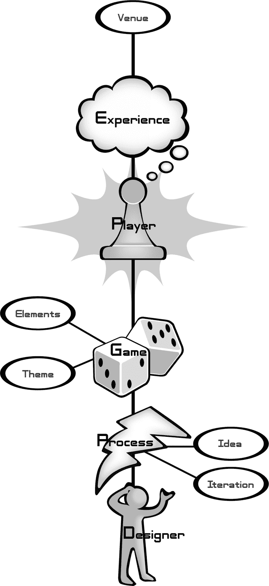
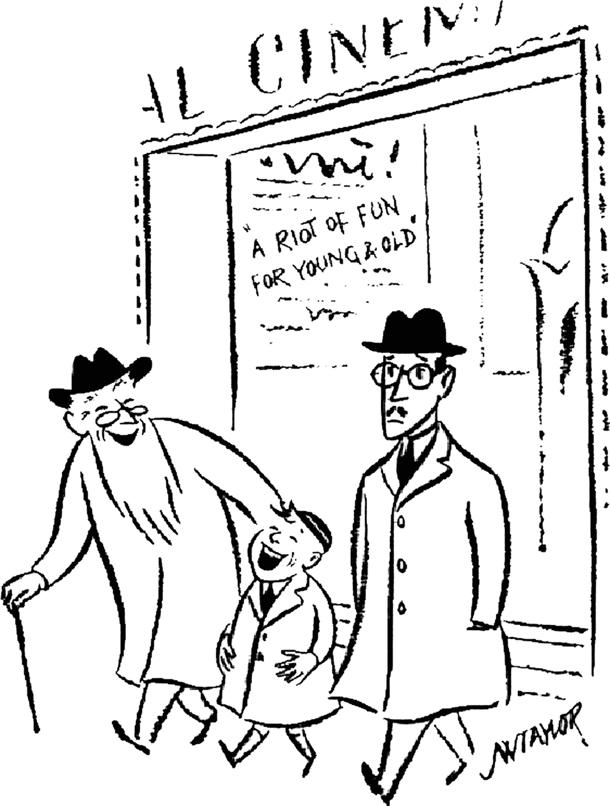
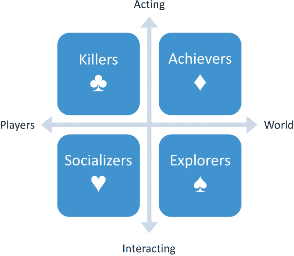

# 第九章

## 游戏是为*玩家*而造的

图 9.1

### 爱因斯坦的小提琴

在职业生涯的某个阶段，阿尔伯特·爱因斯坦受一家小型本地组织邀请，担任午宴的嘉宾并就其研究发表演讲。他欣然应允。午宴十分愉快，到了演讲时间，主持人焦急地宣布：著名科学家阿尔伯特·爱因斯坦将在此谈论他的狭义和广义相对论。爱因斯坦走上讲台，望向台下以老太太为主、多为非学术背景的听众，解释道：他当然可以谈论自己的工作，但那有点枯燥，他觉得或许听众更愿意听他拉小提琴。主持人和听众都表示赞同，觉得这是个绝妙的主意。爱因斯坦随即演奏了几首他烂熟于心的曲目，为全体听众创造了一段愉悦的体验，这段经历他们必将终身铭记。

**图 9.2**

爱因斯坦之所以能创造如此难忘的体验，是因为他了解听众。尽管他热爱思考和谈论物理学，但他清楚这并非听众真正感兴趣的内容。当然，他们邀请他谈论物理学，是因为他们认为这是获得真正渴望之物——与著名的阿尔伯特·爱因斯坦近距离接触——的最佳方式。

要创造卓越的体验，你必须像爱因斯坦那样做。你必须了解受众喜欢什么、不喜欢什么，而且要比他们自己了解得更透彻。你可能会以为弄清人们想要什么很容易，但事实并非如此，因为在许多情况下，他们自己并不真正清楚。他们自以为知道，但他们自以为想要的东西，与他们实际会享受的东西之间，往往存在巨大差距。

正如游戏设计中的其他一切一样，此处的关键在于一种倾听。你必须学会彻底、深入地倾听玩家。你必须深入了解他们的思想、情感、恐惧和欲望。其中一些秘密甚至连玩家自己都没有意识到——正如我们在第 6 章 *主题* 中讨论的，往往正是这些最为重要。

### 移情投射

那么，如何进行这种深度倾听？最好的方法之一是运用你的共情力（将在第 10 章 *玩家的心智* 中进一步讨论），将自己置于他们的位置。1954 年，迪士尼乐园建设期间，沃尔特·迪士尼会频繁在园区巡视检查进度。人们常看到他走一段路，停下来，突然蹲下身子，凝视远处的某物。然后他站起来，再走几步，又蹲下。见他反复如此，一些设计师问他在做什么——是不是腰不好？他的解释很简单：除非这样，他怎么知道迪士尼乐园在孩子们眼中是什么样子的？

回顾起来，这显而易见——不同视线高度看到的景象不同，孩子们在迪士尼乐园的视角正如成年人的视角一样重要，甚至更重要。但光有物理视角是不够的——你还必须采纳他们的心理视角，主动将自己投射到玩家的心智中。你必须主动尝试成为他们，尝试看他们所看、听他们所听、思考他们所思。人很容易陷入设计师那种高高在上的心智中，忘记投射到玩家心智中——这需要持续的关注和警惕，但只要你尝试，就能做到。

如果你为曾经属于的目标受众创作游戏（例如，一位女性为少女创作游戏），你拥有优势——你可以唤起关于当年如何思考、喜欢什么、事物给你何种感受的记忆。人们惊人地擅长遗忘年轻时事物的真实模样。作为设计师，你无法承担遗忘的代价。努力找回旧时记忆，让它们再次变得生动有力。好好保养这些旧记忆——它们是你最宝贵的工具之一。

但如果你为从未属于、或许永远不会属于的受众创作东西（例如，一位青年男性为中年女性创作游戏）呢？那时你必须采用不同的策略——你必须深入思考你认识的、属于目标人群的人，想象成为他们是什么感受。像文化人类学家一样，你应该花时间与目标受众相处，与他们交谈、观察他们、想象成为他们的感受。每个人都天生具备这种能力——但如果你加以练习，就会进步。如果你能在心智上成为任何类型的玩家，你就能极大地拓展游戏的受众，因为你的设计将能包容其他设计师忽视的人群。

### 人口统计学特征

> *正如人们所说，年龄不会让我们变得幼稚。它只是让我们发现内心真实的孩子依然在。*
>
> ——歌德

我们知道每个个体都是独一无二的，但当创作面向大量人群享用的作品时，我们必须考虑人群共同的特征。我们称这些群体为人口统计学特征，有时也称市场细分。没有“官方”划分这些群体的方式——不同职业出于不同原因采用不同划分。对游戏设计师而言，最重要的两个人口统计变量是年龄和性别。我们随年龄增长玩法会改变，且历史上男性和女性在各年龄段的玩法都有所不同。以下是游戏设计师必须考虑的几个典型年龄人口统计学特征的分析。

**图 9.3**

*   **0–3 岁，婴儿/幼儿**：这个年龄段的孩子对玩具很感兴趣，但游戏涉及的复杂性和解决问题的过程通常超出他们的能力。抽象界面（如游戏手柄）通常超出他们的理解，但直接界面（如触摸屏）却让他们着迷。

*   **4–6 岁，学龄前儿童**：这是孩子通常首次对游戏表现出兴趣的年龄。游戏非常简单，且更多是与父母一起玩，而非同龄人，因为父母知道如何灵活变通规则，让游戏保持乐趣和吸引力。

*   **7–9 岁，儿童**：七岁长期被称为“理性年龄”。这个年龄的孩子已入学，通常能阅读，能推敲事物并解决难题。自然而然，他们对玩游戏产生浓厚兴趣。这也是孩子开始自主决定喜欢或不喜欢什么玩具和游戏的年龄，不再只是接受父母为他们挑选的东西。

*   **10–13 岁，青春期前或“中间派”**：营销人员直到最近才开始将这一群体视为区别于“儿童”和“青少年”的独特群体。这个年龄的孩子正经历大脑神经的巨大增长，突然能比几年前更深入、更细致地思考问题。这个年龄有时被称为“痴迷年龄”，因为这个年龄的孩子开始对自己的兴趣变得相当狂热。尤其是男孩，这些兴趣往往是游戏。

*   **13–18 岁，青少年**：青少年的任务是开始为成年生活做准备。这个年龄，我们常见男女性趣显著分化。然而，所有青少年都对尝试新体验非常感兴趣，其中一些体验可以通过游戏实现。

### 18–24 岁，青年

这是第一个“成人”年龄分组，标志着一个重要的过渡。总体而言，成年人的游戏时间比儿童少。大多数成年人仍会继续玩游戏，但此时他们已度过青少年时期的尝试阶段，确立了自己喜欢的游戏和娱乐类型的特定品味。青年通常既有时间又有金钱，这使他们成为游戏的主要消费群体。

### 25–35 岁，二十几岁和三十几岁

在这个年龄段，时间开始变得更加宝贵。这是“家庭组建高峰期”。随着成年责任的累积，该年龄段的大多数成年人只是休闲玩家，将玩游戏作为偶尔的消遣，或与年幼的孩子一起玩游戏。另一方面，该年龄段的“硬核玩家”——即将玩游戏作为主要爱好的人——是一个重要的目标市场，因为他们购买大量游戏，且经常对喜好直言不讳，从而可能影响其社交网络的购买决策。

### 35–50 岁，三十几岁和四十几岁

有时被称为“家庭成熟期”，该年龄段的大多数成年人深陷于事业和家庭责任之中，仅属于休闲玩家。随着孩子长大，该年龄段的成年人往往是昂贵游戏购买的决策者，并在可能的情况下，寻找全家人可以一起享受的游戏机会。

### 50 岁以上，五十岁及以上

常被称为“空巢老人”，该年龄段的成年人突然拥有大量空闲时间——子女已搬出去住，他们即将面临退休。一些人回归年轻时喜欢的游戏，另一些人为求变化，转向新的游戏体验。该年龄段的成年人对具有强社交属性的游戏体验特别感兴趣，例如高尔夫、网球、桥牌和在线多人游戏。特别是在线社交游戏，在该年龄段非常成功。他们的视力和手部灵活度不如从前，因此涉及微小屏幕或复杂精细动作控制的游戏会让他们感到沮丧。

还有其他按年龄划分群体的方式，但这九个群体是游戏行业通常的做法，因为它们反映了游戏模式的变化。思考将每个群体与下一个群体分隔开的过渡性经历很有意思。大多数年轻群体由智力发展阶段分隔，而年长群体主要由家庭转型分隔。

为任何年龄段创建游戏时，有件重要的事要记住：所有游戏活动都与童年相连，因为童年围绕着游戏。因此，要为特定年龄段的人创建游戏，你必须了解他们童年时流行的游戏和主题。换种说法：要真正与某人沟通，你必须说出他们童年的语言。

### 媒介即厌女者？

> 彼得·潘：我们玩得开心，不是吗？我教你飞翔和战斗！还能有什么更多的？
>
> 温迪：还有很多更多。
>
> 彼得·潘：什么？还有什么？
>
> 温迪：我不知道。我想随着长大，会看得更清楚。

说某些类型的游戏“天生是男性的”或“天生是女性的”，这是一种过时的刻板印象，尤其是在性别的本质受到质疑的时代。没有任何关于性别的概括能适用于每一个个体。尽管如此，当我们观察大群体时，一些基于性别的游戏模式是清晰的；存在某些类型的游戏，女性参与度高于男性，反之亦然。这是一个敏感话题，因为当我们说“男性倾向于喜欢……”或“女性倾向于喜欢……”时，我们排斥了那些违背这些倾向的个体。

有些人倾向于完全回避基于性别的游戏问题，假装这些大群体模式不存在。但这样做就是否认现实，这对设计师来说是危险的，因为这些模式和倾向确实存在。玩《使命召唤》的男性多于女性，玩《糖果粉碎传奇》的女性多于男性。这是由于身为男性或女性的某种内在特质决定的？还是社会习得导致的这些差异？我们不知道。但了解和理解这些刻板印象模式对设计师很有用，因为通过理解它们，你可以包容更多玩家。

举个例子，我曾参与一款面向家庭共同游玩的射击游戏设计。游戏设计得轻松简单，所以我们自然创建了一个简单的计分系统。另一位设计师找到我，解释我们的计分系统有问题：它存在性别偏见。这对我来说似乎不可能——主题在男孩、女孩、男性和女性的焦点测试中表现都很好。但她是对的。当我们查看测试数据时，发现总体上男孩和男性的得分高于女孩和女性。回顾测试者的视频揭示了原因：男性倾向于速射法，而女性倾向于仔细瞄准的方法。

我们的解决方案？我们创建了一个稍微复杂一点的计分系统。最终得分现在呈现为两个数字：总分和命中率百分比。测试时效果很好。例如，我们的第一组测试者是一对年迈的夫妇。游戏结束时，丈夫自豪地宣布：“我得分最高！”妻子露出优越的微笑说：“没错……但我的命中率高得多。”

这就是刻板印象的讽刺之处。虽然它们可被用来让不符合常态的人感到被排斥，但若用得明智，它们可以成为包容的工具，创造支持更多样化玩家兴趣和动机的游戏模式。为此，我们不应厌恶地回避刻板印象，而应通过剖析和仔细研究它们来获益良多。概括和刻板印象从不对每个个体都成立，但为大众受众制作游戏时，它们可以成为包容的有用工具。

#### 关于男性在游戏中喜欢看到什么的五大刻板印象

> *如果你是女性却不懂男性，很可能是因为你想得太复杂了。*
>
> ——路易斯·拉米

1.  **精通**：男性喜欢精通事物。不必是重要或有用的东西——只需具有挑战性即可。女性在精通有意义目的的事物时，往往更感兴趣。

2.  **竞争**：男性喜欢与他人竞争以证明自己最强。对女性而言，输掉游戏（或导致其他玩家输掉）带来的负面感受，往往超过获胜带来的正面感受。

3.  **破坏**：男性非常喜欢破坏事物。通常，当男孩玩积木时，最让他们兴奋的部分不是搭建，而是搭好塔后将其推倒。电子游戏天然契合这种玩法，允许进行现实世界中不可能实现的大规模虚拟破坏。

4.  **空间谜题**：研究表明，男性通常比女性拥有更强的空间推理能力。因此，涉及在 3D 空间导航的谜题往往对男性极具吸引力，而有时会让女性感到沮丧。

5. **反复试错**：女性常开玩笑说男性讨厌看说明书，这多少有点道理。男性倾向于通过反复试错来学习事物。从某种意义上说，这让为他们设计界面变得更容易，因为他们有时实际上更喜欢需要通过一些实验来理解的界面，这与掌握技能的乐趣联系在一起。

## 关于女性在游戏中喜好内容的五大刻板印象

> *女性想要的是能让她们做出情感和社会发现、并能应用到自己生活中的体验。*
>
> ——海迪·丹格尔迈尔

### 1. 情感
女性喜欢探索人类情感丰富性的体验。对男性而言，情感是体验中有趣的组成部分，但很少是目的本身。一个略显粗俗但极具说明力的对比例子可以在“浪漫关系媒体”光谱的两端找到。一端是言情小说（售出的所有虚构类书籍中有三分之一是言情小说），其主要关注浪漫关系的情感层面，购买者几乎全是女性。光谱的另一端是色情制品，主要关注浪漫关系的身体层面，购买者主要是男性。吉恩·罗登贝里在创作电视剧《星际迷航》时，非常有意识地将情感剧情融入剧集的动作场面中，以增加全家一起观看的可能性。同样，《龙腾世纪：审判》拥有比普通动作 RPG 更多的女性玩家，游戏中角色间丰富的情感关系似乎与此有关。

### 2. 现实世界
女性倾向于偏好那些与现实世界有意义关联的娱乐。如果你观察小女孩和小男孩玩耍，女孩更常玩与现实世界紧密相关的游戏（玩“过家家”，假装当兽医，玩换装游戏等），而男孩更常扮演幻想角色。有史以来最畅销的女童电脑游戏之一是《芭比时装设计师》，它允许玩家为现实世界中的芭比娃娃设计、打印并缝制定制服装。将其与《芭比之长发公主》对比，后者是一款设定在奇幻世界的冒险游戏。尽管主角同样是芭比，但它缺乏现实世界的关联，因此远没有前者受欢迎。

这一趋势延续至成年——当事物以有意义的方式与现实世界相连时，女性往往会更感兴趣。有时这是通过内容实现的（例如《模拟人生》系列游戏的女性玩家多于男性，其内容模拟了普通人的日常生活），有时则是通过游戏的社交属性。女性玩家青睐在线社交游戏，似乎与好友列表作为核心游戏功能有关。与虚拟玩家玩耍“只是假装”，但与真实玩家玩耍可以建立真实的关系。

### 3. 养育
刻板印象认为，女性喜欢养育。女孩喜欢照顾娃娃、玩具宠物和比自己年幼的孩子。在竞技游戏中，女孩为了帮助较弱的玩家而放弃获胜优势的情况并不少见，部分原因在于玩家间的关系和感受比游戏本身更重要，但也部分源于养育的快乐。农场游戏和宠物游戏在女孩和女性中取得成功，很大程度上归功于其养育机制。在《图恩小镇在线》的开发过程中，战斗系统需要一个“治疗”游戏机制。我们观察到，治疗其他玩家对我们讨论过该游戏的女孩和女性极具吸引力，而我们希望这款游戏对男性和女性同样适用，因此做出了一个不同寻常的决定。在大多数角色扮演游戏中，玩家主要治疗自己，但可选择治疗他人。在《图恩小镇》中，你无法治疗自己——只能治疗他人。这提升了拥有治疗技能玩家的价值，并鼓励养育式玩法。想要专注治疗的玩家可以将其作为在《图恩小镇》中的主要活动。

### 4. 对话与文字谜题
常言道，女性在空间技能上的不足，由增强的语言技能来弥补。女性购买的书籍远多于男性，填字游戏的受众主要是女性。流行的手机游戏《Words with Friends》（单词好友）中，女性玩家占多数（截至 2013 年为 63%）。

### 5. 举例学习
正如男性倾向于避开说明书、偏好反复试错的方法一样，女性倾向于偏好举例学习。她们非常欣赏清晰的教程，能引导你循序渐进，以便当尝试任务时，玩家知道自己该做什么。

当然还有许多其他刻板印象。例如，男性以一次专注于一项任务著称，而女性能更轻松地同时处理多项并行任务，且不会遗漏任何一项。《模拟人生》和《农场小镇》等游戏需要显著的多任务处理技能，且两者的玩家大多为女性。“隐藏物体”游戏已成为深受女性欢迎的类型，这让一些人推测它激发了原始的采集行为，而有人认为这种行为在女性大脑中比男性更强烈。女性喜欢隐藏物体游戏的真实原因是否如此尚有争议，但这类游戏在该人群中的成功却是毋庸置疑的。

在思考性别刻板印象的同时仔细审视你的游戏，有时能带来迷人的发现。孩之宝《Pox》（一款无线电子掌机游戏）的设计师知道他们的游戏天生就是一种社交体验，因此推断它应该包含女孩和男孩都喜欢的功能。然而，在观察孩子们在操场上玩耍时，他们注意到一件非常有趣的事：女孩几乎从不自发地在大群体中玩游戏。表面上看这很奇怪——女孩往往比男孩更爱社交，所以你可能会预期涉及大型聚会的游戏会更吸引她们。问题似乎出在冲突解决上。通常，当一群男孩玩游戏发生争执时，游戏暂停，进行（有时激烈的）讨论，争执得到解决。有时会有一个男孩哭着回家，但尽管如此，游戏仍会继续。当一群女孩玩游戏发生争执时，情况就不同了。大多数女孩会在争执中站队，且通常无法立即解决。游戏停止，往往无法继续。女孩会在正式组织下进行团队运动，但两支非正式的竞争队伍似乎给她们的人际关系带来了过大的压力，以至于不值得为此麻烦。孩之宝的设计师意识到，虽然他们的游戏概念是社交的，但也天生具有竞争性，最终他们决定将其设计为侧重于刻板印象中的男性游戏模式。

数字技术的引入在很大程度上凸显了游戏玩法中的性别差异。过去，大多数游戏非常社交，在现实世界中进行，与真人对战。价格亲民的计算机的出现，给我们带来了一种游戏类型，它

- 移除了所有社交属性
- 移除了大部分语言和情感属性
- 在很大程度上与现实世界脱节
- 通常难以学习
- 并提供了无限虚拟破坏的可能性

基于此，早期的电脑游戏和视频游戏主要受男性受众欢迎，这并不令人惊讶。随着数字技术发展到能够支持情感丰富的角色刻画、更丰富的故事，以及在方便的时间与真实朋友一起游玩的机会，我们终于迎来了一个女性和男性玩数字游戏人数大致相等的时代。希望不久的将来，我们能看到游戏开发者社区也达到类似的平衡与代表性水平。

无论你考虑年龄、性别还是其他因素，重要的是你要设身处地为玩家着想，以便仔细考虑什么会让他们玩得最开心。这一重要视角即为透镜 #19。

在为 DisneyQuest 开发《*加勒比海盗：夺金之战*》时，我们必须考虑广泛的受众群体。许多游戏厅和互动实体娱乐中心的受众群体相对狭窄：青少年男孩。DisneyQuest 的目标是覆盖与迪士尼主题公园相同的受众群体：几乎所有人，尤其是家庭。此外，DisneyQuest 希望全家人能一起玩游戏。考虑到任何一个家庭内部技能水平和兴趣的巨大差异，这是一个不小的挑战。但通过仔细考虑每位潜在玩家的兴趣，我们找到了行之有效的方法。大致上，我们是这样细分的：

### 男孩

我们不太担心男孩会不喜欢这个游戏。这是一个令人兴奋的“冒险与战斗幻想”，玩家可以驾驶海盗船并操控强大的大炮。早期测试显示男孩们非常喜欢，且倾向于进攻性游玩——试图寻找并摧毁他们能找到的每一艘海盗船。他们也会进行一些交流，但始终高度专注于尽可能熟练地摧毁敌人这一任务。

### 女孩

我们不太确定女孩会喜欢这个游戏，因为她们并不总是对“炸飞坏蛋”有同样的热情。我们欣喜地发现女孩们似乎非常喜欢这个游戏；不过，她们的玩法不同。女孩们通常倾向于防守性游玩——她们更关心保护自己的船免受入侵者袭击，而不是追击其他船只。当我们意识到这一点后，我们确保创造入侵船只和可追击敌人的平衡，以同时支持进攻和防守玩法。女孩们似乎对收集宝藏非常兴奋，所以我们特意把宝藏显眼地堆在甲板上，并让它们在视觉上更有趣。此外，我们设计最终战斗时让飞行骷髅冲向船只并从甲板上抢走宝藏。这似乎让射击骷髅的任务对女孩们变得更重要、更有回报。女孩们似乎也比男孩更享受游戏的社交方面——她们会不断互相大声警告和建议，偶尔还会面对面“开小会”分工合作。

### 男性

我们有时开玩笑说男人只是“带着信用卡的高个男孩”。他们似乎以和男孩相同的方式喜欢这个游戏，虽然他们倾向于以稍微更内敛的方式游玩——经常仔细琢磨出最优的游玩方式。

### 女性

我们非常不确定成年女性，尤其是母亲，会从这个游戏中找到多少乐趣。母亲在主题公园的体验往往与其他家庭成员不同，因为她们的主要关注点通常不是自己玩得多开心，而是其他家人玩得多开心。在《海盗》的早期测试中，我们注意到女性，尤其是母亲，倾向于聚集在船尾，而其他家庭成员则移向船头。这通常意味着家庭成员操控大炮，而妈妈掌舵，因为舵轮在船尾。起初，这似乎是灾难的配方——妈妈可能不是自信的玩家，而驾驶不当的船有可能毁了所有人的体验。

但实际情况完全不是这样。既然妈妈希望看到大家都玩得开心，她突然就有了切身利益，想把船开得尽可能好。身处舵位（视野最好），她有机会照看每个人，把船开到有趣的地方，如果家人应接不暇就放慢速度。此外，她处于管理船员的有利位置，警告他们即将到来的危险并下达命令（“佐伊！让你弟弟也玩玩那边！”），旨在确保每个人都能玩得开心。这是让妈妈真正关心游戏结果的绝佳方式。

接受母亲比男孩、女孩或父亲更频繁地掌舵这一事实，意味着我们必须确保对于不常玩动作游戏的人来说，掌舵是直观易懂的，但为了包容这一关键受众群体，这点代价微不足道。我们经常听到孩子们下船时评论：“哇，妈妈，你玩得真棒！”

通过密切关注我们各个目标受众群体的愿望和行为，我们成功地平衡了游戏以适应所有人。起初，我们只是对让游戏吸引这四个群体可能存在的问题有一些想法——只有通过细心的原型制作和试玩，我们才开始意识到这些问题的可能解决方案。我们密切观察每个受众群体如何尝试玩我们的游戏，然后修改游戏以支持每个群体的游玩风格。

## 心理统计学

当然，年龄和性别并不是给潜在玩家分组的唯一方式。还有许多其他因素可用。人口统计学通常指外部因素（年龄、性别、收入、种族等），这些有时是给受众分组的有用方式。但归根结底，当我们按这些外部因素给人分组时，我们试图触及的是内部的东西：每个群体觉得什么令人愉悦。更直接的方法是少关注玩家外表如何，多关注他们内心如何思考。这被称为心理统计学。

某些心理统计分类与“生活方式”选择有关，例如“爱狗人士”、“棒球迷”或“硬核 FPS 玩家”。这些很容易理解，因为它们与具体活动相关。如果你正在制作一款关于狗、棒球或竞技场射击人的游戏，你自然会想密切关注这些生活方式群体各自的偏好。

但其他类型的心理统计学不那么依赖具体活动。它们更多关乎一个人最享受什么——他们在参与游戏活动，实际上是任何活动时，寻找哪种快乐。这很重要，因为归根结底，许多人类行为的动机都可以追溯到某种寻求快乐。不过这很棘手，因为世界上有许多种快乐，没有人只追求一种。但可以肯定的是，人们有各自的快乐偏好。游戏设计师 Marc LeBlanc 提出了一份包含八种快乐的清单，他认为这些是主要的“游戏快乐”。

### 勒布朗的游戏快乐分类法

1. **感官愉悦**：感官愉悦涉及运用你的感官。看到美丽的事物、听到音乐、触摸丝绸、闻到或尝到美味的食物，这些都是感官愉悦。主要是你游戏的美学将传递这些愉悦。Greg Costikyan 讲了一个关于感官愉悦的故事：

> *仅凭感觉的差异就能产生多大影响，以桌游《轴心国与同盟国》为例。我初次购买它时，是由 Nova Games 发行的，一家默默无闻的爱好游戏出版商。它有一张极其花哨的棋盘，用难看的纸板标记代表军事单位。我玩了一次，觉得挺蠢的，就把它收起来了。几年后，米尔顿·布拉德利公司买下并重新发行了它，配有一张优雅的新棋盘，以及数百个飞机、舰船、坦克和步兵形状的塑料模型——从那以后我玩了很多次。正是在棋盘上推着这些小军事模型跑来跑去的纯粹触觉乐趣，让这游戏变得好玩。*

感官愉悦往往是玩具的愉悦（参见 透镜 #17）。这种愉悦无法把烂游戏变成好游戏，但往往能把好游戏变成更好的游戏。

2.  **幻想**：这是想象世界的愉悦，也是想象自己成为并非自己的事物的愉悦。我们将在 第 19 章 和 第 20 章 进一步讨论这种愉悦。

3.  **叙事**：勒布朗所说的叙事愉悦，不一定是指讲述一个既定的、线性的故事。他指的是一系列事件的戏剧性展开，无论以何种方式发生。我们将在 第 16 章 和 第 17 章 谈论更多关于这方面的内容。

4.  **挑战**：在某种意义上，挑战可被视为游戏核心愉悦之一，因为每个游戏的核心都有一个待解决的问题。对某些玩家而言，这种愉悦已足够——但其他人需要更多。

5.  **友谊**：这里勒布朗指的是友谊、合作与社区中一切令人愉悦的事物。毫无疑问，对某些玩家而言，这是玩游戏的主要吸引力。我们将在 第 24 章 和 第 25 章 进一步讨论这一点。

6.  **发现**：发现的愉悦范围很广：任何时候你寻找并找到新事物，那就是发现。有时这是对游戏世界的探索，有时是发现秘密功能或巧妙策略。毫无疑问，发现新事物是关键的游戏愉悦。

7.  **表达**：这是表达自我和创造事物的愉悦。过去，这在游戏设计中通常被忽视。如今，游戏允许玩家设计自己的角色，构建并分享自己的关卡。通常，游戏中发生的“表达”对达成游戏目标帮助不大。为角色设计新服装在大多数游戏中无助于推进进程——但对某些玩家而言，这可能正是他们玩游戏的根本原因。

8.  **投入**：这个奇怪的术语指的是进入魔法圈的愉悦——抛开现实世界，进入一套新的、更令人愉悦的规则和意义之中。从某种意义上说，所有游戏都涉及投入的愉悦，但有些游戏世界单纯更让人愉悦、更有趣。在某些游戏中，你被迫暂时搁置怀疑——而在另一些游戏中，游戏本身似乎毫不费力地就让你搁置了怀疑，你的思维轻松地进入并停留在游戏世界中。正是这些游戏让投入真正成为一种愉悦。

审视这些不同的愉悦很有用，因为不同个体对每种愉悦的重视程度不同。游戏设计师理查德·巴尔花费多年设计 MUD 和其他在线游戏，他观察到玩家在游戏愉悦偏好方面主要分为四大类。巴尔的四种类型容易记忆，因为它们有扑克牌花色作为方便的助记符。留给读者作为练习，去理解为何每种花色被选来代表各个类别。

### 巴尔的玩家类型分类法

1.  ♦ **成就者** 想达成游戏目标。他们的主要愉悦是挑战。

2.  ♠ **探索者** 想了解游戏的广度。他们的主要愉悦是发现。

3.  ♥ **社交者** 对与他人的关系感兴趣。他们主要寻求友谊的愉悦。

4.  ♣ **杀手** 对与他人竞争并击败他人感兴趣。这一类别与勒布朗的分类法不太对应。在大部分情况下，杀手似乎享受竞争与毁灭混合的愉悦。有趣的是，巴尔将其描述为主要对“将自我强加于他人”感兴趣，并将主要对帮助他人感兴趣的人也归入此类。

巴尔还提出了一个迷人的图表（图 9.4），展示了四种类型如何完美覆盖一种空间：即成就者对作用于世界感兴趣，探索者对与世界互动感兴趣，社交者对与玩家互动感兴趣，杀手对作用于玩家感兴趣。

### 更多愉悦：更多！

试图用这种简单的分类法来描述复杂的人类欲望时，我们必须谨慎。仔细审视会发现，勒布朗和巴尔的分类法（及其他类似列表）都有漏洞，若误用会掩盖那些容易被忽略的微妙愉悦，如我们在讨论性别刻板印象时遇到的“毁灭”和“养育”。以下是还需考虑的几种愉悦：

**图 9.4**

*   **期待**：当你知道愉悦即将到来，仅仅等待它就是一种愉悦。
*   **完成**：完成某事感觉很好。许多游戏利用完成的愉悦——任何要求你“收集所有宝藏”、“消灭所有坏人”或以其他方式“通关”的游戏都在利用这种愉悦。
*   **幸灾乐祸**：通常当某不公之人突然遭到报应时，我们会感到这种愉悦。它是竞技游戏的重要一环。德语称之为 Schadenfreude（发音“shoddenfroyduh”）。
*   **送礼**：当你通过惊喜礼物让他人开心时，会有一种独特的愉悦。我们包装礼物是为了增强和加深这种惊喜。这种愉悦不仅在于对方开心，更在于你让他们开心。
*   **幽默**：两个无关的事物突然因范式转移而联合在一起。难以描述，但发生时我们都懂。怪的是，它让我们发出类似狗吠的声音。
*   **可能性**：这是拥有许多选择且知道自己可任选其一的愉悦。逛街或自助餐时常体验到这种愉悦。
*   **成就自豪**：这是一种独特的愉悦，能在成就达成很久后持续存在。意第绪语 naches（发音“nock-hess”）指的就是这种满足感，通常指为子孙感到骄傲。
*   **惊喜**：正如 透镜 #4“惊喜”所示，大脑喜欢惊喜。
*   **刺激**：过山车设计师有句谚语：“恐惧减去死亡等于乐趣。”刺激就是这种乐趣——你体验恐怖，却因安全有保障而感到安心。
*   **克服逆境的胜利**：这是你完成了明知渺茫之事的愉悦。通常伴随着个人胜利的呐喊。意大利语有个词形容这种愉悦：fiero（发音 fee-air-o）。
*   **惊奇**：一种压倒性的敬畏与惊叹感。它几乎总能引发好奇心，这也是“惊奇”得名的由来。

还有许多许多其他的愉悦。我列举这些难以简单归类的愉悦，是为了展示愉悦空间的丰富性。愉悦清单可以作为方便的经验法则，但别忘了保持开放的心态，去接纳那些可能不在你清单上的愉悦。同时要记住，愉悦非常依赖语境。在一种语境下可能非常愉悦的事（在派对上跳舞），在另一种语境下可能会让人尴尬得想找个地缝钻进去（在面试时跳舞）。愉悦这一关键视角为我们提供了`透镜 #20`。

深入了解你的玩家，比他们了解自己还要深入，这是给他们带来一款他们会喜爱的游戏的关键。在`第 10 章`中，我们将更深入地了解他们。

### 其他推荐阅读

*   **_Designing Virtual Worlds_ by Richard R. Bartle**。由一位亲身缔造历史的深度思考者撰写，是一本审视虚拟世界发展史的优秀书籍。

*   **_Pleasures of the Brain_ by Morten L. Kringelbach and Kent C. Berridge, editors**。汇集了各类心理学家和神经科学家关于愉悦机制的研究发现。如果你不习惯阅读科学论文，可能会觉得有点望而生畏，但对于坚持阅读的人来说，这是一座见解的宝库。

*   **_Understanding Kids, Play, and Interactive Design: How to Create Games Children Love_ by Mark Schlichting**。成年人很容易忘记身为孩子时的感受。马克没有忘记，他带领我们游览了童年那片奇妙的仙境。

*   **_Diversifying Barbie and Mortal Kombat: Intersectional Perspectives and Inclusive Goals in Gaming_ by Yasmin B. Kafai, Gabriela T. Richard, and Brendesha M. Tynes, editors.** 游戏领域在性别和性取向议题上取得了显著且有意义的进展，但前路漫漫。本书从多个深思熟虑的视角探讨了包容性议题。
