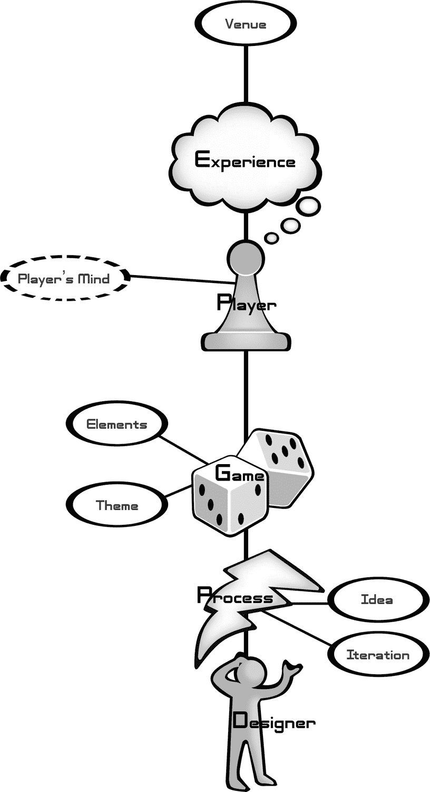
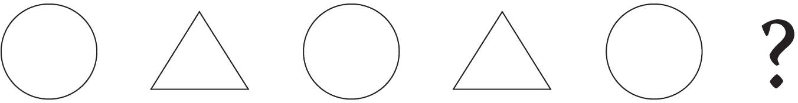
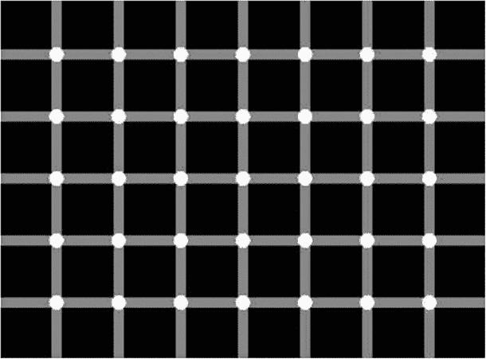
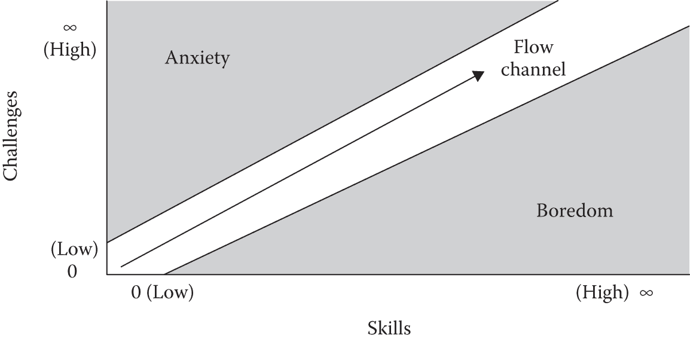
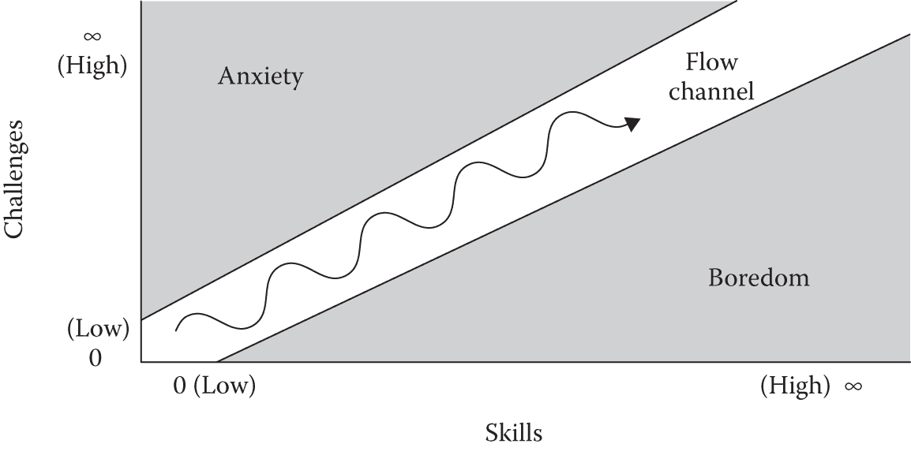

## 第十章

## 体验发生在*玩家的心中*

**图 10.1**

我们已经讨论过，归根结底，游戏设计师创造的是体验。这些体验只能发生在一个地方——人类的大脑。取悦人类大脑很难，因为它太复杂了——它是已知宇宙中最复杂的物体。

更糟糕的是，它的大部分运作机制对我们是隐藏的。

在读到这句话之前，你是否曾意识到你双脚的位置、呼吸的频率，或是你的眼睛如何在页面上移动？你甚至知道你的眼睛是如何在页面上移动的吗？它们是平滑线性地移动，还是以小跳动的方式移动？你阅读书籍这么多年，怎么可能不确定这个问题的答案？当你说话时，你真的知道在说出口之前你要说什么吗？难以置信的是，当你开车时，你不知不觉地观察道路的弯曲度，并将其转化为转动方向盘的旋转角度。是谁在做这个计算？你甚至能记得自己曾注意过道路的弯曲度吗？又是怎么一回事，就因为这句话包含“想象吃一个带酸黄瓜的汉堡”这些词，你的嘴里现在正在分泌唾液？

考虑一下这个模式：

**图 10.2**

不知为何，你知道接下来是什么。你是如何得出这个结论的？是通过演绎逻辑的过程，还是你只是“看”到了答案？如果你只是看到了，你看到了什么？是谁画出了你看到的那幅图？

还有一个例子。试着做这个实验：找个朋友，让他们做这三件事：

1.  把“boast”这个词说五遍。“Boast, boast, boast, boast, boast.”
2.  拼读单词“boast”。“B-O-A-S-T.”
3.  回答这个问题：“你往烤面包机里放什么？”

你的朋友很可能会回答“toast（烤面包片）”。通常，toast 是你从烤面包机里*取出*的东西，而不是放*进去*的东西。如果你省略前两步，大多数人会给出更正确的答案，比如“bread（面包）”。用“boast”激活大脑的神经网络，就足以让“toast”看起来比正确答案“bread”更像是一个更好的候选答案。我们通常认为回答“你往烤面包机里放什么？”这种问题是一个非常有意识的过程，但事实是，潜意识对我们几乎所有的言行都施加着巨大的控制。大多数时候，它明智而出色地完成了这项工作，我们感觉是“我们”在做——但偶尔它会犯一个令人发笑的错误，揭示出它究竟拥有多少控制权。

我们大脑中发生的大部分事情，对意识思维来说都是隐藏的。心理学家正在逐步取得进展，以理解这些潜意识过程，但总体而言，我们对它们真正如何运作仍处于黑暗之中。我们心智的运作大多超出了我们的理解，也大多超出了我们的控制。但心智是游戏体验发生的地方，所以我们必须尽力获得关于那里似乎正在发生什么的实用知识。在`第 7 章` *构思* 中，我们讨论了如何利用创造性潜意识的力量成为一名更好的设计师。现在我们必须考虑玩家心智中意识与潜意识的相互作用。关于人类心智的所有已知知识足以填满许多百科全书——我们将把对心智的考察限制在一些与游戏设计相关的关键因素上。

有四种主要的心智能力使得游戏成为可能。它们是建模、专注、想象和共情。我们将依次考察每一种，然后探究每个玩家潜意识中隐秘的优先级。

### 建模

现实世界惊人地复杂。我们的心智之所以能勉强应对，唯一的方式是简化现实，以便我们能对其有所理解。相应地，我们的心智处理的不是现实本身，而是现实的模型。我们大多没有注意到这一点——建模过程发生在我们的意识之下。意识是一种错觉，让我们以为内部体验就是现实，而实际上它们是对某种我们可能永远无法真正理解的事物的不完美模拟。这种错觉非常逼真，但有时我们会遇到内部模拟失效的地方。其中一些是视觉上的，比如这张图片：

**图 10.3**

实际上，那些点并没有随着我们的眼球移动而变色，但我们的大脑确实让它们看起来像是在变色。

有些例子稍加思考才会变得清晰，比如可见光谱。从物理学角度来看，可见光、红外线、紫外线和微波都是同一种电磁辐射，只是波长不同。我们的眼睛只能看到这平滑光谱中极小的一部分，我们称这部分为“可见光”。如果我们能看到其他种类的光将非常有用。例如，看到红外线将让我们轻松在黑暗中发现捕食者，因为所有生物都会发射红外线。不幸的是，我们眼球内部也会发射红外线，所以如果我们能看到它，很快就会被自己的光芒致盲。结果，大量有用的数据，即电磁波谱中可见光范围之外的一切，都不属于我们感知到的现实。

# 心智模型

即使是我们能看见的可见光，也被我们的眼睛和大脑以一种奇怪的方式过滤了。由于眼睛的构造，这组可见光波长看起来像是落入了截然不同的群组，我们称之为颜色。当我们看着棱镜折射出的彩虹时，可以划线将一种颜色与另一种颜色分开。然而事实上，这只是视网膜机制的产物。在现实中，颜色之间没有清晰的分界，只有波长的平滑渐变，尽管我们的眼睛告诉我们蓝色和浅蓝色比浅蓝色和绿色要相似得多。我们进化出这种眼部结构，是因为将波长这样分组是更好地理解世界的一种有用方式。“颜色”只是一种幻觉，根本不是现实的一部分，但却是一个非常有用的现实模型。

现实充满了完全不在我们日常建模范围内的层面。例如，我们的身体、家园和食物中到处都是微观的细菌和螨虫。许多是单细胞生物，但其他的，比如生活在我们睫毛、毛孔和毛囊中的*毛囊蠕形螨*，体型几乎足够大（可达 0.4 毫米），肉眼可见。这些微小生物无处不在，但通常完全不在我们的心智模型中，因为大多时候，我们不需要也不想了解它们。

## 图 10.4

*© United Features Syndicate. 经许可使用。*

要掌握我们的一些心智模型，一个好办法是寻找那些让我们感觉自然的事物，直到我们思考它们为止。看看这张查理·布朗的图片。乍一看，他似乎没什么特别——他只是个男孩。但细想之下，他看起来根本不像个真人。他的头几乎和身体一样大！他的手指只是小凸起！最令人不安的是，他是由线条构成的。环顾四周——没有任何东西是由线条构成的——一切都是由块状物构成的。他的非真实性直到我们停下来有意识地思考时才变得明显，这揭示了大脑建模事物的线索。

查理·布朗看起来像个人，尽管他不像任何我们认识的人，因为他符合我们的一些内部模型。我们接受他的大头，因为我们的大脑存储关于头部和面部的信息远多于身体其他部位，因为一个人的感受有太多信息来自面部表情。如果他长着小脑袋大脚丫，会立刻显得荒诞可笑，因为那完全不符合我们的内部模型。

那他的线条呢？大脑观察一个场景并分辨出哪些物体彼此分离，这是一个极具挑战性的问题。当它做到这一点时，在我们意识层面之下，内部视觉处理系统会在每个分离的物体周围画出线条。我们的意识从未见过这些线条，但它确实能获得一种感觉，知道场景中哪些事物是分离的物体。当我们看到一张已经用线条画好的图片时，从某种意义上说，它已经被“预消化”了，完美契合我们的内部建模机制，为它们省去了大量工作。这也是人们觉得卡通和漫画看着如此舒心的原因之一——我们的大脑理解它们需要做的工作更少。

舞台魔术师利用我们的心智模型然后打破它们，让我们惊叹不已。在我们心中，模型即现实，所以我们感觉仿佛在目睹有人做不可能的事。魔术高潮时观众发出的惊叹声，正是他们心智模型被撕碎的声音。只有凭借“这定是个把戏”的信念，我们才能推断出魔术师没有超自然力量。

我们的大脑做了大量工作，将现实的复杂性浓缩成更简单的心智模型，以便轻松存储、思考和操作。这不仅适用于视觉物体，也适用于人际关系、风险与回报评估以及决策制定。我们的大脑审视复杂局面，试图将其浓缩成一套简单的规则和关系，以便在内部进行操作。

作为游戏设计师，我们非常关注这些心智模型，因为游戏凭借其简单的规则，就像查理·布朗一样——它们是经过预消化的模型，我们可以轻松吸收和操作。这就是为什么玩游戏让人放松——它们比现实世界少费脑力，因为大量复杂性已被剥离。抽象策略游戏，如井字棋和西洋双陆棋，几乎是完全裸露的模型。其他游戏，如电脑角色扮演游戏（RPG），则给简单的模型裹上了一层甜美的美学外衣，使得消化模型的过程本身变得愉悦。这与现实世界截然不同，在现实世界里，你必须努力弄清游戏规则到底是什么，然后更努力地按规则行事，却永远不确定自己是否做对了。这也是为什么游戏有时能成为现实世界的绝佳练习——这也是西点军校仍教授国际象棋的原因——游戏让我们练习消化和实验更简单的模型，以便我们逐步过渡到像现实世界一样复杂的模型，并在准备好时能胜任应对它们。

重要的是要理解，我们经历和思考的一切都是模型——不是现实。现实超出我们的理解和领悟。我们所能理解的只是我们那点可怜的现实模型。有时这个模型会崩塌，我们必须修复它。我们体验到的现实只是幻觉，但这幻觉是我们将永远所知的唯一现实。作为设计师，如果你能理解并控制这种幻觉是如何在玩家心中形成的，你就能创造出感觉真实如现实、甚至比现实更真实的体验。

## 专注

> *时间有时像鸟一样飞逝，有时像蜗牛一样爬行；但当一个人甚至没有注意到时间是飞逝还是缓慢流淌时，他最幸福。*
>
> —伊万·屠格涅夫

大脑用来理解世界的一个关键技巧，是选择性地集中注意力的能力，忽略某些事物，将更多脑力投入到其他事物上。大脑这种能力令人震惊。一个例子是“鸡尾酒会效应”，即我们在满屋子人同时交谈时，依然能神奇地专注于单一对话的能力。尽管来自多个对话的声波同时撞击我们的耳膜，我们不知怎么就有能力“调入”一个，“调出”其他的。为了研究这一点，心理学家进行了所谓的“双耳二向性研究”。在这些实验中，受试者佩戴耳机，每只耳朵接收不同的音频内容。例如，受试者左耳可能听到有人朗读莎士比亚，右耳可能听到有人朗读一串数字。只要声音不太相似，被要求专注于其中一个声音并即时复述所听内容的受试者通常都能做到。事后，当被问及另一个声音在说什么时，受试者通常毫无头绪。他们的大脑只关注选定的信息，过滤掉了其余部分。

# 游戏设计中的心流

在任何特定时刻，我们关注什么是由我们的无意识欲望和有意识意志共同决定的。当我们创作游戏时，目标是创造一种足够有趣的体验，能尽可能长久、强烈地抓住玩家的注意力。当某事物长时间完全捕获我们的注意力和想象力时，我们会进入一种有趣的心理状态。世界的其余部分似乎消失了，我们没有任何侵入性思维。我们所想的只是正在做的事情，并完全失去了时间感。这种持续专注、愉悦和享受的状态被称为“心流”，一直是心理学家米哈里·契克森米哈赖及其他许多人广泛研究的课题。心流有时被定义为“在一种活动中拥有完全且充满活力的专注感，伴随着高度的享受和满足感”。游戏设计师深入研究心流大有裨益，因为这正是我们希望玩家在游戏中获得的感受。

## 心流的关键要素

以下是让玩家进入心流状态所必需的一些关键要素：

### 明确的目标
当目标明确时，我们能更轻松地专注于任务。当目标模糊时，我们无法“投入”任务，因为我们完全不确定当前的行动是否有用。

### 无干扰
干扰会夺走我们对任务的专注。无专注，无心流。这意味着要同时调动大脑和双手。无需思考的苦力活会让思绪游离；只是坐着思考会让双手坐立不安。这些“躁动”感都是一种干扰。

### 直接反馈
如果每次采取行动后，我们都必须等待才能知道行动造成了什么效果，我们很快就会分心，失去对任务的专注。当反馈即时时，我们就能轻松保持专注。我们将在第 15 章 *界面* 中更多地讨论反馈。

### 持续的挑战
人类热爱挑战。但必须是我们认为能够实现的挑战。如果我们开始认为无法实现，就会感到沮丧，大脑会开始寻找更有可能获得回报的活动。另一方面，如果挑战太简单，我们会感到无聊，大脑同样会开始寻找更有回报的活动。第 13 章 *平衡* 将对挑战有更多阐述。

## 心流通道

心流活动必须设法保持在无聊和挫败之间那狭窄的挑战边界内，因为这两种令人不快的极端都会导致我们的大脑将注意力转移到新的活动上。契克森米哈赖称这个边界为“心流通道”。他用一个游戏——毫不意外——来举例说明心流通道：

> 假设下图代表一项特定活动——例如网球运动。体验中理论上最重要的两个维度——挑战和技能——分别表示在图表的两个轴上。字母 A 代表正在学打网球的男孩亚历克斯。图表展示了亚历克斯在四个不同时间点的状态。当他刚开始玩时（A[1]），亚历克斯几乎没有技能，面临的唯一挑战是把球打过网。这并非难事，但亚历克斯很可能会享受其中，因为难度刚好适合他初级的技能。所以此时他很可能处于心流状态。但他无法长久停留在那里。过一会儿，如果他坚持练习，技能必然会提高，然后他会觉得光把球打过网很无聊（A[2]）。或者可能遇到一个更有经验的对手，这时他会意识到除了高高吊球之外还有难得多的挑战——那时，他会为自己的糟糕表现感到一些焦虑（A[3]）。
>
> **图 10.5**
>
> 
>
> 无聊和焦虑都不是积极体验，所以亚历克斯会被激励回到心流状态。该怎么做？再看一眼图表，我们会发现，如果他感到无聊（A[2]）并希望重回心流，亚历克斯基本上只有一个选择：增加面临的挑战。（还有一个选择是彻底放弃网球——在这种情况下 A 就会从图表中消失。）通过给自己设定一个与技能相匹配的、新的更困难目标——例如击败一个只比他强一点的对手——亚历克斯就会重回心流（A[4]）。
>
> 如果亚历克斯感到焦虑（A[3]），回归心流的方法是提高技能。理论上他也可以降低面临的挑战，从而回到起点的心流状态（即 A[1]），但在实践中，一旦意识到挑战的存在，就很难视而不见。
>
> 图表显示 A[1] 和 A[4] 都代表亚历克斯处于心流的状态。虽然两者同样令人愉快，但这两种状态截然不同，因为 A[4] 比 A[1] 更复杂。它更复杂是因为涉及更大的挑战，并要求玩家具备更高的技能。
>
> 但 A[4] 虽复杂且愉快，也不代表稳定状态。随着亚历克斯继续比赛，要么会对该水平陈旧的机会感到厌倦，要么会因相对较低的能力而感到焦虑和挫败。所以，再次享受乐趣的动力会推动他重回心流通道，但此时复杂度甚至比 A[4] 更高。
>
> 正是这种动态特性解释了为什么心流活动能带来成长和发现。一个人无法长久地在同一水平上享受做同一件事。我们会变得要么无聊要么挫败，然后再次享受乐趣的渴望会推动我们拓展技能，或发现运用技能的新机会。

## 管理心流通道

你可以看到，让某人保持在心流通道中是一种微妙的平衡，因为玩家的技能水平很少停留在原地。随着技能提高，你必须给他们提供相称的挑战。对于传统游戏，这种挑战主要来自寻找更强的对手。在电子游戏中，通常有一系列逐渐变难的关卡。这种难度递增的关卡模式具有良好的自我平衡性——技能高的玩家通常能快速通过低级关卡，直到遇到能挑战他们的关卡。技能与通关速度之间的这种联系有助于防止高手感到无聊。然而，能坚持通关、掌握所有关卡的玩家毕竟是少数。大多数玩家最终会达到某个关卡，在那里花费大量时间处于挫败区，最终放弃游戏。关于这是坏事（许多玩家感到挫败）还是好事（只有技术娴熟、坚持不懈的玩家才能到达终点，成就感才特别），众说纷纭。

许多设计师很快指出，虽然保持在心流通道中很重要，但沿着通道向上移动的方式有优劣之分。像这样直直地沿着通道向上移动……

**图 10.6**

……绝比游戏以焦虑或无聊告终要好。但考虑一下遵循类似下面这条轨迹的游戏体验：

**图 10.7**

## 流程

这对玩家来说可能会感觉有趣得多。这是一个不断重复的循环：挑战不断增加，随后是奖励，通常是获得更强的力量，这带来了一段挑战较小、相对轻松的时期。很快，挑战又会再次升级。例如，一款电子游戏可能会提供一把枪，让我射击三次就能消灭敌人。随着游戏推进，敌人变得更多，挑战随之增加。如果我迎接挑战，并消灭了足够多的敌人，我可能会获得一把新枪，只需两枪就能消灭敌人。突然游戏变简单了，这非常有成就感。但这段轻松期不会持久，因为很快会出现新敌人，即使用我的新枪，也需要三枪甚至四枪才能消灭，将挑战推向新的高度。

这种“紧张与释放，紧张与释放”的循环在设计中反复出现。这似乎是人类享受乐趣的内在机制。张力过大，我们会精疲力竭；放松过度，我们会感到厌倦。当我们在两者之间波动时，我们既能享受刺激，又能享受放松，这种振荡还同时提供了多样性的愉悦和期待的愉悦。

你可以看到“流”概念和“流通道”对于讨论和分析游戏体验有多么有用——有用到它成为了透镜 #21。

流很难测试。你在十分钟的游戏过程中看不出来。你必须观察玩家更长的时间。更棘手的是，一款游戏可能在前几次游玩时让人保持在流状态，但后来可能变得无聊或令人沮丧。

观察玩家时，流状态很容易被忽略——你必须学会识别它。它并不总是伴随着外在的情绪表达——通常表现为安静的沉浸。独自游玩单人游戏且处于流状态的玩家通常很安静，可能会自言自语。他们太专注了，以至于如果你问他们问题，他们反应可能迟钝，甚至感到恼火。多人游戏中处于流状态的玩家有时会热情地相互交流，时刻专注于游戏。一旦你注意到玩家在你的游戏中进入了流状态，你需要密切观察他们——他们不会永远停留在那里。你必须留意那个关键时刻——将他们推出流通道的事件，以便弄清楚如何确保该事件在你下一个游戏原型中不再发生。

最后一点：别忘了把“流透镜”对准你自己！你肯定会发现，作为设计师，你最高效的时刻正是处于流状态的时候——确保安排好你的设计时间，以便尽可能频繁地进入那种特殊的心境。

### 共情

作为人类，我们拥有将自己投射到他人位置的惊人能力。当我们这样做时，我们会尽最大努力思考对方的想法，感受对方的情绪。这正是我们能够相互理解的标志之一，也是游戏玩法不可或缺的一部分。

有一个有趣的戏剧练习：一群演员被分成两组。第一组中，每位演员选择一种情绪（快乐、悲伤、愤怒等），然后他们都在舞台上走动，试图通过姿态、走路方式和面部表情来投射他们选择的情绪。第二组不选择情绪。他们只是在第一组演员中随机走动，试图与他人建立眼神接触。第一次尝试时，第二组演员发现自己做了一件令人震惊的事——每当他们与正在投射情绪的人对上视线，他们就会不由自主地接纳那种情绪，并做出相应的面部表情。

这展示了我们共情能力的强大。甚至无需尝试，我们就能变成别人。当我们看到快乐的人，我们能感受到他们的喜悦，仿佛那是我们自己的；当我们看到悲伤的人，我们能感受到他们的痛苦。表演者利用我们的共情能力，让我们感觉自己是他们创造的故事世界的一部分。令人惊讶的是，我们的共情能在眨眼间从一个人转移到另一个人身上。我们甚至能对动物产生共情。

你注意到狗比其他动物拥有丰富得多的面部表情了吗？它们用眼睛和眉毛表达情绪，很像我们（**图 10.8**）。狼（狗的祖先）的面部表情范围远不如家犬丰富。狗似乎将这种能力作为生存技能进化而来。会摆出恰当表情的狗能赢得我们的共情，而我们突然感受到它们的感受，就更有可能照顾它们。

当然，大脑通过心智模型完成这一切——事实上，我们共情的不是真实的人或动物，而是我们对他们的心智模型——这意味着我们很容易被欺骗。我们会在并无情感的地方产生情感。一张照片、一幅画或一个电子游戏角色同样能轻易俘获我们的共情。摄影师懂得这一点，他们将我们的共情到处抛掷，从一个角色转移到另一个角色，从而操纵我们的感受和情绪。下次看电视时，请时刻留意你的共情流向何处，以及为何流向那里。

**图 10.8**

作为游戏设计师，我们将像小说家、平面艺术家和电影制作人那样利用共情，但我们也拥有自己的一套全新的共情互动。游戏关乎解决问题，而共情投射是一种有用的解决问题的方法。如果我能想象自己处于他人的位置，我就能更好地决定那个人能做什么来解决特定问题。此外，在游戏中，你不仅将感情投射到角色身上，还将你的整个决策能力投射到那个角色身上，并以非互动媒体无法实现的方式化身为他们。我们将在第 20 章 *角色* 中详细讨论其含义。

### 想象力

> *最美好的世界总是通过想象力进入。*
>
> —海伦·凯勒

想象力将游戏植入玩家心中，从而让玩家进入游戏。

**图 10.9**

你可能会认为，当我谈论玩家想象力的力量时，我指的是他们的创造性想象力和编造梦幻世界的能力——但我谈论的东西平凡得多。我所说的想象力是人人视为理所当然的奇迹般力量——每个人用于沟通和解决问题的日常想象力。例如，如果我告诉你一个短故事：“邮递员昨天偷了我的车”，我实际上告诉你的很少，但你脑海中已经形成了发生的画面。奇怪的是，你的画面充满了我故事中未包含的细节。看看形成的心理图像，并回答这些问题：

*   邮递员长什么样？
*   他偷车时我的车在什么样的社区？
*   车是什么颜色的？
*   他是什么时间偷的？
*   他是怎么偷的？
*   他为什么要偷？

现在，我并没有告诉你那些事情，但你惊人的想象力凭空编造了一堆细节，以便你更轻松地思考我所讲述的内容。现在，如果我突然给你更多信息，比如“那不是一辆真车，而是一辆昂贵的模型玩具车”，你会迅速重构你的想象图像以契合你所听到的内容，而你对前面问题的回答也可能随之相应改变。这种自动填补空白的能力与游戏设计息息相关，因为这意味着我们的游戏不需要提供每一个细节，玩家就能自行脑补其余部分。艺术在于知道该向玩家展示什么，以及该留给他们的想象力什么。

仔细想想，这种力量真是不可思议。我们的大脑只处理现实的简化模型这一事实，意味着我们可以毫不费力地操纵这些模型，有时甚至能将其置于现实中不可能发生的情境中。我能看到一把扶手椅，并想象如果它换个颜色或尺寸、如果它是用燕麦片做的、或者如果它能走动，会是什么样子。我们通过这种方式进行大量的问题解决。如果我让你想办法在没有梯子的情况下换灯泡，你会立刻开始想象可能的解决方案。

想象力有两个关键功能：第一是沟通（通常用于讲故事），第二是解决问题。既然游戏显著地包含这两者，游戏设计师就必须理解如何调动玩家的想象力作为讲故事的伙伴，同时也要了解想象力能解决什么问题、不能解决什么问题。

人类的心智确实是我们已知的最迷人、最惊人、最复杂的事物。我们可能永远无法揭开它所有的奥秘。我们了解得越多，就越有机会在其中创造出色的体验，因为那是我们所有游戏体验发生的场所。永远别忘了！你自己就拥有一个。你可以利用你自己的建模、专注、共情和想象力，去了解这些力量是如何在玩家心智中运作的。通过这种方式，自我倾听可以成为倾听受众的关键。在下一章，我们将进行一些自我倾听，以理解大脑为何会被激励去使用这些力量中的任何一种。

### 其他推荐阅读

*   **米哈里·契克森米哈赖** 著的 *《心流：最优体验心理学》*。由该领域最杰出的研究者撰写，以极高可读性探讨了心流的本质。
