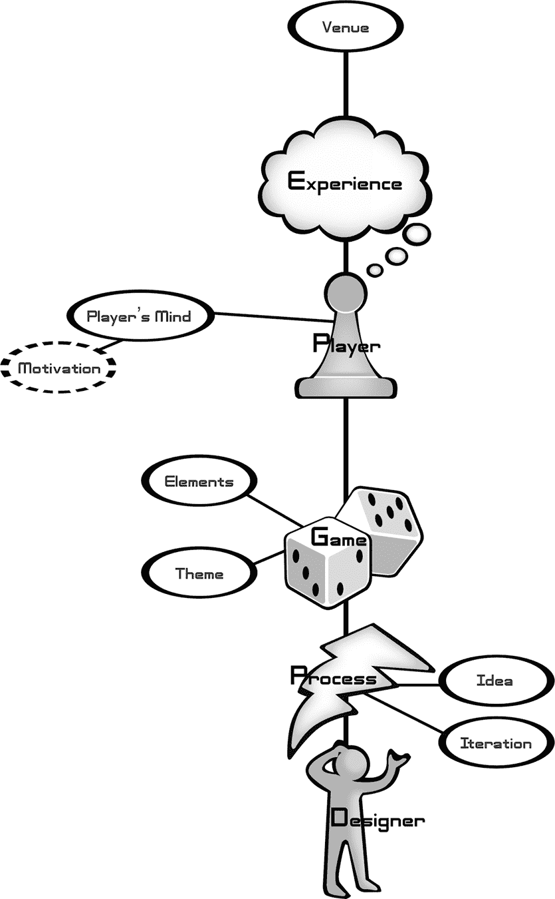
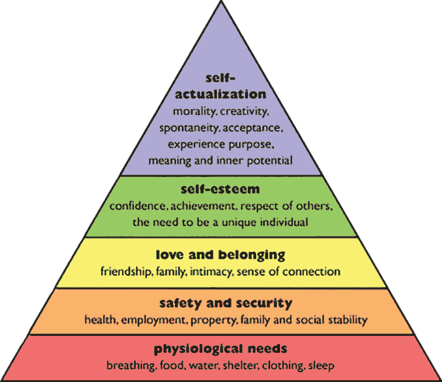
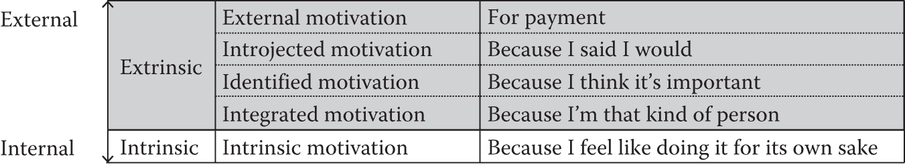
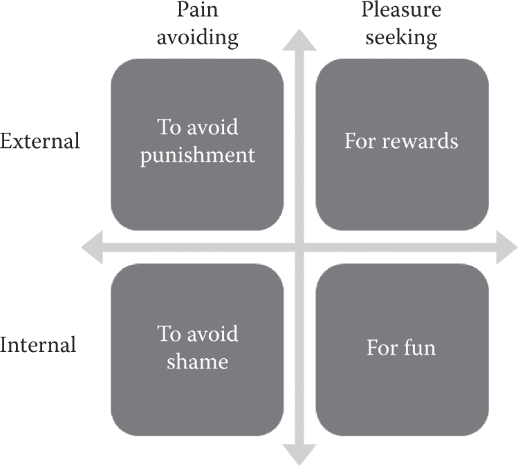

## 第十一章

### 玩家的心智由*玩家的动机*驱动

图 **11.1**

> *游戏并不重要。*

当然，我们喜欢玩游戏。我们为之兴奋，在游戏中获得美好、难忘的体验。但在我们生活的大局中，总有更重要的事可做。事实上，这对所有娱乐活动都适用。毫不夸张地说，所有娱乐体验的目标都是将一些无关紧要的事（比如球进篮筐、关于想象中动物的故事、或者这张牌是国王还是 A）变得极其重要。这是欺骗吗？不是。归根结底，我们始终清楚那“只是游戏”。但在游戏过程中，我们内心会发生一些事情，让它感觉远不止于此。某种东西驱使我们、强迫我们关心这些琐碎的体验，仿佛它们关乎生死。这就是动机的魔力。我们为何做我们所做之事，这个问题古老如哲学本身，但毫无疑问，游戏设计师似乎对人类动机有着特殊的洞见。

游戏设计师实际理解的现实情况要模糊得多，正是这种模糊性让游戏设计如此充满挑战。事实上，大多数设计师创建动机系统，与其说是通过精通心理学错综复杂的细节，不如说是凭借直觉和实验，偶尔碰巧成功。然而，任何关于动机的洞见都潜在有用，而这是心理学研究与我们的设计目标罕见地高度契合的领域之一，所以让我们从这里入手。

### 需求……

1943 年，心理学家亚伯拉罕·马斯洛发表了一篇题为《人类动机理论》的论文，提出了人类需求层次理论。这通常被呈现为一个金字塔：

图 **11.2**

这里的观点是，在较低层次的需求得到满足之前，人们不会被激励去追求列表中较高层次的需求。例如，如果有人快饿死了，这比安全感更优先。如果有人不感到安全，他们就不会认真追求人际关系。如果有人缺乏爱和社会归属感，他们就不会追求能提升自尊的事物。而如果他们没有良好的自尊，就无法发挥自己的天赋（还记得主要天赋吗？）去做他们“天生注定要做”的事。

如果你仔细思考，能找出一些该模型的潜在例外，但总体而言，它足够好用，可以作为讨论游戏中玩家动机的非常有用的工具。思考不同的游戏活动处于这个层次的哪个位置很有意思。许多游戏活动关乎成就和精通，这将它们置于第四层——自尊需求。但也有一些更低。看看这个层次，多人游戏的吸引力和持久力的原因突然变得清晰——它们满足的比单人游戏更基本的需求，所以许多玩家感到更有动力去玩它们，这不足为奇。

你能想到甚至深入到第二层或第一层的游戏活动吗？第五层的活动呢？可以认为《我的世界》的成功源于它对金字塔的完整覆盖。它通过其奇幻背景（你试图收集资源建造安全庇护所）覆盖了底部两层，并通过作为一款关于精通和创造力的多人游戏覆盖了顶部三层。

任何能让你与他人建立联系、让你获得成就感、并让你构建和创造事物以表达自我的游戏，都满足了第三、第四和第五层的需求。从这个角度来看，拥有在线社区和内容创作工具的游戏之所以流行且持久，就非常合理了。考虑不同层次如何相互影响也很有意思。但还有其他思考需求的方式。

### …以及更多需求

马斯洛的观点虽有趣，但更现代的心理学家对需求问题提出了新观点。特别是爱德华·德西和理查德·莱恩的研究与游戏息息相关，他们大力发展了所谓的自我决定理论。别让这个难听的名字吓到你。他们只是说，正如人类有生理需求，我们也有心理需求——不仅仅是愿望或欲望，而是真正的需求。当这些需求得不到满足时，我们会在心理上变得不健康。令人惊讶的是，莱恩和德西认为我们恰好有三种心理需求：

1.  **胜任感**：我需要在某方面感到擅长。
2.  **自主感**：我需要按自己的方式做事的自由。
3.  **关联感**：我需要与他人建立联系。

这些观点因其简洁性而略显惊人，但大量证据支持其有效性。而且很难不注意到游戏往往多么完美地满足了这三种需求。游戏的设计旨在让你感受到精通感。游戏给予你自由，让你以想玩的方式游玩。事实上，它们给予的自由不止于此：既然它们只是游戏，你可以随时停止游玩。当然，大多数游戏都是为多人游玩而设计的，以帮助建立社交联系和纽带。在未来的章节中，我们将遇到分别针对胜任感、自主感和关联感的透镜。但为了铭记需求的总体重要性，请采纳这个透镜。

### 内在动机与外在动机

思考动机的另一种方式是审视其来源。这对游戏设计师尤为重要，因为游戏利用各种不同类型的动机来维持玩家的兴趣。表面上听起来很简单：当我想做某事时，我们说我受内在动机驱动；但当有人付钱让我做某事时，我们说我受外在动机驱动。这听起来可能很简单，但在游戏的现实中，事情很快就会变得纠缠不清。我玩*吃豆人*是因为享受在迷宫中竞速追逐的内脏快感（内在），还是因为游戏给我分数（外在）？如果我真正被获得高分的刺激所驱动，那算什么？是内在的，外在的，还是两者皆有？假设百事公司开发了一款游戏，喝百事可乐能获得积分和奖品。这显然是一个外在动机系统。但如果这游戏变成了我和朋友间的笑谈，我们通过赢取更多分数和奖品互相较劲，从而获得了一种内在有趣的社交体验，那又如何？有人急于将外在动机妖魔化为“廉价”游戏设计，但精明的设计师知道，一种动机可以依托另一种动机生长，如藤蔓攀爬在架子上。

一些心理学家试图通过将内在和外在动机表现为一个连续体，来说明它们的复杂性：

**图 11.3**

关键在于，“内在”和“外在”并非二元对立，而是一个梯度：动机越源于“你的真实自我”，就越是内在的。作为游戏设计师，重要的是要了解游戏中不同动机究竟有多内在或多外在，因为并非所有动机都是平等的，有时它们会以意想不到的方式相互作用。在一项著名研究中，两组孩子被要求画画。第一组每画一幅画就获得报酬；第二组则没有。如果你相信“动机越多越好”的观点，你可能会预期有报酬的那组会画得更多、更好。你只对了一半——他们确实画得更多，但质量更低——画作不那么有趣、深思熟虑。但令人惊讶的是：绘画时间结束时，每组都被要求等待，而研究人员离开了房间。没拿报酬的孩子们面前有蜡笔和纸，自然继续画画。而拿报酬的孩子却没有。他们放下蜡笔，只是等待。动机似乎并非纯粹可加性的；相反，给本就具有内在激励作用的事物添加外在动机，会将其沿着连续体推向外在端，从而消耗掉内在动机！这对那些认为任何活动只需添加简单的积分、徽章和奖励就能轻松“游戏化”的人有着严重的影响。

### “想做” vs. “不得不做”

在第 4 章：*游戏*中，我们讨论了态度的转变如何将工作变成游戏，反之亦然。这毫无疑问与动机有着深刻联系。回想一下那位工厂工人的例子，他把每天打破生产记录当成游戏，这极大地提高了他的动机和投入度。那里到底发生了什么？当然，可以认为他的动机变得更内在了。他不再那么专注于工作的外在回报（拿工资），而是更专注于某种更内在的东西——打破个人记录，因为他想这么做，因此他的动机变得更属于他自己。

但这里还有别的因素在起作用。直到我读到一本神经科学书籍，指出寻求快乐和避免痛苦是大脑中两个不同的系统，我才没有完全理解这一点。它们不是从痛苦到快乐的简单连续体，而是两套不同的动机回路。然而，我们经常只是把寻求快乐和避免痛苦归为一类，称之为“动机”，便不再深究。但当我们试着将它们分开时，有趣的事情就浮现出来了。

考虑以下例子，这与游戏的关联就变得清晰了。假设我创办了一家新软件公司：大红按钮软件公司。我们的第一款产品是一种新型报税软件。我们邮寄给你一个大红按钮，你按下它，砰！你的报税瞬间完成，保证你获得法律允许的最大退税额。我猜你会同意这是一款相当惊人的软件产品，我很高兴你喜欢，因为我们准备发布第二款产品：一款名为《愤怒的小鸟》的游戏。同样，我们邮寄给你一个大红按钮，这次你按下它，砰！你瞬间获胜！

但这可不是什么惊人的软件产品，对吧？事实上，它可能是有史以来最烂的游戏。是什么让这两个应用截然不同？就只有一点：我“不得不”报税，但我“想”玩游戏。报税全是关于避免痛苦。我做报税不是因为享受，也不是因为有人付钱让我做，而是因为如果不做，我会面临巨额罚款甚至坐牢。但玩游戏全是关于寻求快乐。不玩没有惩罚——我玩只是因为我享受其中。这与活动本身无关，而与我们对待它的态度有关。我有个朋友喜欢填报税表，同样，电子游戏让他感到无聊。对他来说，报税是“想做”的活动，而电子游戏是“不得不做”的活动。

那么我们为什么关心这个？因为虽然许多游戏动机关乎寻求快乐，但并非全都是——许多以避免痛苦为中心。当你躲避敌人、“试图不死”时，你处于避免痛苦模式。当你收集金星、打出巧妙连招得分时，你处于寻求快乐模式。两者都是有效的动机类型，实际上可以结合得很好。然而，有时这种结合会失衡。“免费游戏”通常开始时完全专注于寻求快乐：丰厚奖励、意外惊喜、激动人心的动画。但随着时间的推移，它们累积起义务——在特定时间前回归否则扣分、邀请更多朋友否则错失奖品。逐渐地，这些游戏从寻求快乐的动机滑向避免痛苦的动机。它们让你持续回归，但你并不总是感觉良好。因此，正如设计师 Sheri Graner Ray 所言，“人们不只是停止玩这些游戏，他们是‘与这些游戏离婚’。”许多《魔兽世界》玩家有过类似经历。他们开始玩是因为有太多有趣的事可做，其中之一是加入公会，享受团队游戏的友谊和情谊。但有时公会领袖为追求成功，施压成员玩得比他们想玩的更多。玩家想避免来自公会的羞耻感，所以坚持上线，渐渐地，玩游戏开始让人感觉成了“不得不做”的事。

要从一个有趣的视角审视游戏中的动机，不妨将每个动机放在一个矩阵上，其中一轴是内部/外部，另一轴是“必须/想要”。这又一次说明了人类动机可以是多么丰富、复杂且有趣。

**图 11.4**

警惕那些告诉你人类动机很简单的人，因为无视其复杂性将自食恶果。运用这副透镜来帮助你记牢这一点。

## 新颖性

> *毫无疑问，这世上最受欢迎的东西就是新颖性。*
>
> —马克·吐温

无法高估新颖性作为动机在游戏设计领域的重要性。人类是天生的探索者，我们总是对新事物感兴趣。如果质量是我们的首要关注点，我们的书店里就会摆满经受过时间考验、质量有保证的经典之作。相反，经典著作却落得个躲在后面落灰的货架，而绝大多数在售书籍都是崭新的。对于游戏来说，这一点甚至更真实。关于游戏的谈论主要集中在什么是新的、接下来会有什么。对新颖性的渴望是驱动玩家购买游戏的巨大动力。今天还要花几百美元买的游戏和主机，明天可能就在 eBay 上以几分钱的价格出售。对新颖性的渴望也是让玩家持续游玩的重要原因——相信下一关会有新东西，是通关当前关卡的强大动力。

游戏中最强大的新颖性类型之一，是那种能让你用全新方式思考的新颖性。《传送门》就是个绝佳例子，其古怪的机制是向天花板、墙壁和地板发射相连的“洞”。它的广告语“现在你正用传送门思考”非常贴切，因为游戏机制让你用全新的方式思考世界。尽管还是同一个旧世界，但你有了与之互动的新方式——这大概是你从未想到过的，因为它看似不可能。但突然间，这不仅变得可能，而且变得迫在眉睫。新颖的思维方式以一种让人感觉无比有回报的方式拓展了我们的大脑。

但请记住，过犹不及，新颖性过强也是存在的。每款成功的游戏都是新颖与熟悉的混合体。许多迷人的游戏因超前于时代而失败。更大的危险在于，你的游戏可能有新颖性，却缺乏其他赋予其生命力的品质。切勿自欺欺人地认为新颖性就足够了。新颖性会传播口碑、推动早期销量，但如果底下没有扎实的游戏支撑，你的玩家会像突然到来一样突然消失。

对于一个追求新颖胜过质量的社会的悲惨现状，人们很容易摇头叹息，但寻求并抓住新颖性是人类探索可能性、永远追寻更美好世界的方式。所以，不要对人类对新颖性无法满足的渴望感到绝望——相反，要拥抱它，给人们他们想要的东西：他们从未体验过的东西。只要确定当新颖感褪去后，还留有值得关心的东西。运用这副透镜，确保你记牢这一点。

## 评判

马斯洛需求层次理论的第四层——自尊需求，是与游戏联系最紧密的一层。但为什么？每个人共有的一个深层需求是被评判的需求。这听起来可能不对——人们难道不讨厌被评判吗？他们不讨厌——他们只讨厌被不公正地评判。我们有深层的内在需求去了解自己的水平如何。当我们对评判结果不满意时，就会努力直到获得正面评价。游戏是优秀的客观评判系统，这是其最吸引人的特质之一。

本章只是蜻蜓点水地涉及了游戏相关的人类动机本质。但别担心——这不是个我们可以抛弃的话题。创造优秀游戏的方方面面最终都回归到人类动机。把这当作起点，一个基础，你将在其上构建越来越深入的理解，明白我们为什么做我们所做的事。让我们通过研究让游戏运转的机制，迈出下一步。

## 其他推荐阅读

*   ***Glued to Games* by Scott Rigby and Richard M. Ryan**。一本深入浅出的指南，讲解自我决定理论与游戏运作机制之间的关系。
*   ***Punished by Rewards* by Alfie Kohn**。本书对关于外在奖励弊端的大量研究进行了极好的综述。
*   ***Understanding Motivation and Emotion* by Johnmarshall Reeve**。如果你准备超越对动机和情绪运作方式的原始认知，这本大学教材级的著作是该领域心理学研究的可靠入门读物。
