# 第十二章：有些元素是游戏机制

**图 12.1**

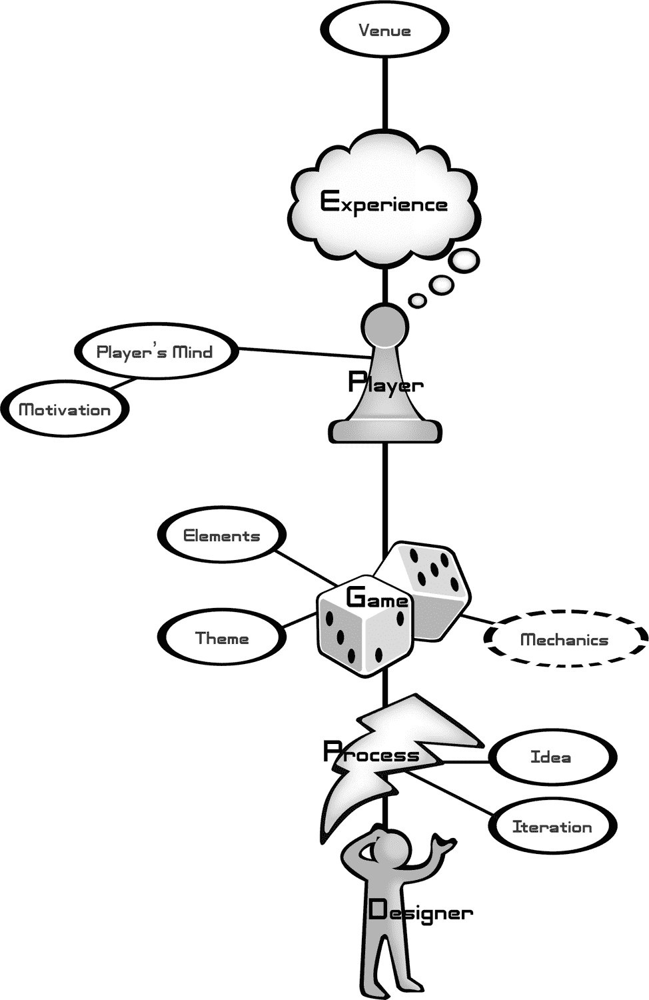

我们已经谈了很多关于设计师、玩家和游戏体验的话。是时候深入探讨游戏真正由什么构成了。游戏设计师必须学会使用他们的“X 射线视力”，透过游戏的表象，迅速洞察由游戏机制定义的骨架。

但这些神秘的机制到底是什么？

游戏机制是游戏的核心本质。它们是剥离所有美术、技术和故事后，剩下的互动与关系。

正如游戏设计中的许多事物一样，我们没有一套公认的游戏机制分类法。原因之一在于，即使是简单游戏的玩法机制，也往往相当复杂，极难理清。试图将这些复杂的机制简化到能完美用数学理解的地步，会导致描述系统显而易见地不完整。经济学的“博弈论”就是个例子。你可能会想，有着“博弈论”这名字，它对游戏设计师应该大有裨益，但事实上，它只能处理非常简单的系统，很少能用于设计真实的游戏。

但游戏机制分类法不完整还有另一个原因。从一层面看，游戏机制是非常客观、清晰陈述的规则集。但从另一层面看，它们涉及更神秘的东西。前面我们讨论过，大脑如何将所有游戏分解为易于操作的心智模型。游戏机制必然涉及描述这些心智模型的结构。由于这些模型主要存在于潜意识的黑暗中，我们很难提出一套定义良好的分析性分类法来解释它们如何运作。

但这不意味着我们不该尝试。一些作者从极其学术的角度切入，更关心分析在哲学上是否严密无懈，而非对设计师是否有用。我们担不起这种迂腐。为知识而知识固然好，但我们的兴趣在于为伟大游戏而知识，即使这意味着分类法会有灰色地带。话虽如此，我提出我用来分类游戏机制的分类法。这些机制主要归为七大类，每一类都能为你的游戏设计提供有用的洞见。

### 机制 1：空间

每个游戏都发生在某种**空间**中。这个空间是游戏的“魔法圈”。它定义了游戏中可能存在的各种场所，以及这些场所之间的关系。作为一种游戏机制，空间是一种数学构造。我们需要剥离所有视觉效果、所有美术表现，仅审视游戏空间的抽象构造。

描述这些抽象的、简化后的游戏空间没有铁律。但一般来说，游戏空间：

1.  要么是离散的，要么是连续的
2.  具有若干维度

## 3. 拥有可能连通也可能不连通的有界区域

例如，井字棋游戏的棋盘就是离散且二维的。什么是“离散”？虽然我们通常这样画井字棋棋盘：

**图 12.2**

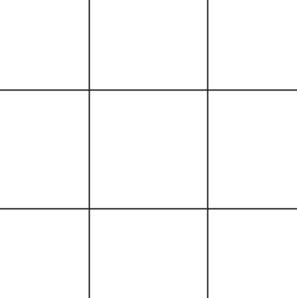

但它其实并不是一个连续空间，因为我们只关心边界，而不关心每个格子内部的空间。无论你把 X 放在……

**图 12.3**

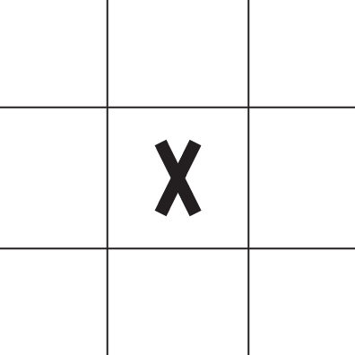

**图 12.4**

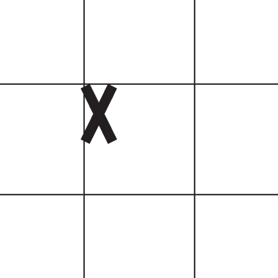

**图 12.5**

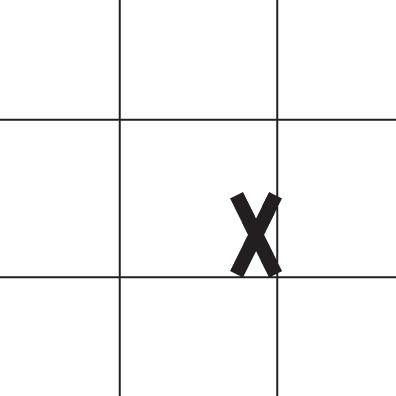

……这些在游戏层面上都是等价的。但如果你把 X 放在这里：

**图 12.6**

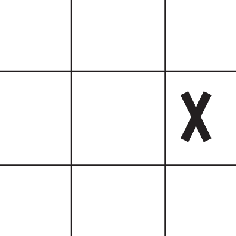

那完全是另一回事了。因此，尽管玩家可以在连续的二维空间中无限多个位置落子，但真正在游戏中有实际意义的离散位置只有九个。从某种意义上说，我们实际上拥有九个零维单元，它们在二维网格中相互连接，如下所示：

**图 12.7**

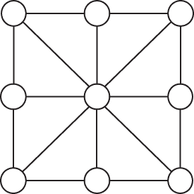

每个圆圈代表一个零维位置，每条线显示哪些位置相互连接。在井字棋中，没有从一个位置移动到另一个位置的动作，但邻接性非常重要。没有邻接性，那只是九个孤立的点。有了邻接性，它就变成了一个离散的二维空间，拥有清晰的边界——空间宽三格、高三格。棋盘的空间与此类似，只是它是 8 × 8 的空间。

一个画面华丽的游戏可能会欺骗你，让你以为它的功能空间比实际更复杂。考虑一下大富翁棋盘。

乍一看，你可能会说它是一个离散的二维空间，像棋盘一样，只是中间大部分格子缺失了。但它可以更简单地表示为一个一维空间——一条由四十个离散点组成的线，首尾相连形成一个环。当然，在游戏棋盘上，角落的格子看起来很特别，因为它们更大，但从功能上讲这无关紧要，因为每个游戏格子都是零维空间。多个棋子可以在同一个游戏格子里，但它们在该格子内的相对位置毫无意义。

但并非所有游戏空间都是离散的。台球桌就是一个连续二维空间的例子。它有固定的长和宽，球可以在桌面上自由移动，撞击库边反弹或落入固定位置的袋口。大家都会同意这是一个连续空间，但它是二维的吗？既然高手有时能让球离开桌面跳过其他球，你完全可以争辩说这其实是一个三维游戏空间，而且对于某些目的来说，这样思考很有用。对于这些抽象功能空间，没有铁律可循。在设计新游戏时，有时将空间视为二维对你有用，有时视为三维更有用。离散与连续也是如此。将游戏剥离为功能空间的目的，是为了让你能更容易地思考它，而不受美学或现实世界的干扰。如果你正考虑修改足球比赛，在一个有新边界的场地上进行，你可能会用二维连续空间来思考。

**图 12.8**

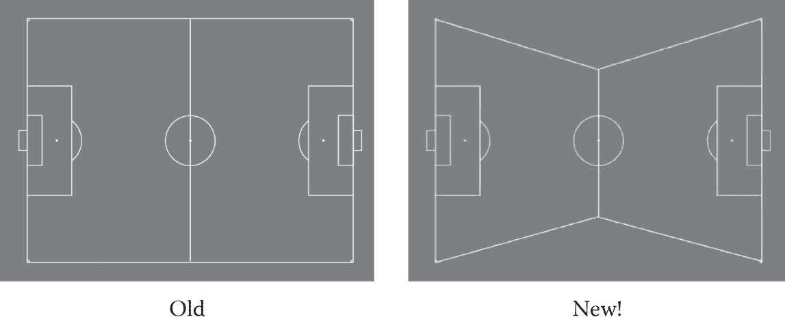

但如果你在考虑修改球门的高度，或改变球员踢球高度的规则，或在场地上增设山丘和山谷，那么将其视为连续三维空间会更有用。

**图 12.9**

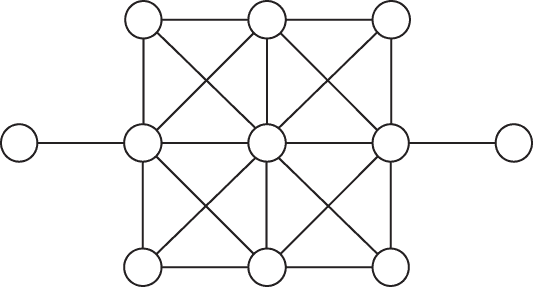

甚至有时你会把足球场视为离散空间——将其分割为，比如说，九个主要比赛区域，左侧和右侧各加一个代表球门的额外区域。如果你在分析场地不同部位发生的不同比赛类型，这种思维模式可能会很有用。重要的是，你能建立游戏空间的抽象模型，帮助你更好地理解游戏内部的相互关系。

### 嵌套空间

**图 12.10**

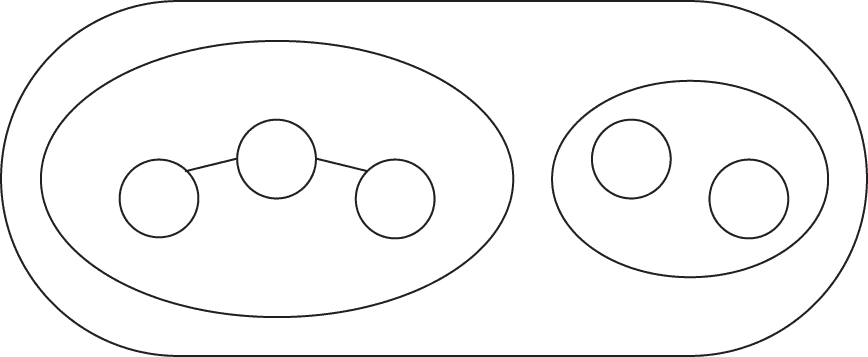

许多游戏空间比我们在这里看到的例子更复杂。它们通常包含“空间中的空间”。电脑奇幻角色扮演游戏就是个好例子。大多数此类游戏都有一个连续的二维“室外空间”。玩家穿越这个空间时，有时会遇到代表城镇、洞穴或城堡的小图标。玩家可以进入这些作为完全独立空间的区域，它们与“室外空间”没有任何实质连接，仅通过入口图标相连。当然，这在地理上是不真实的——但它符合我们对空间的心智模型：当我们在室内时，我们考虑的是所在建筑物内部的空间，很少去想它究竟如何与室外空间关联。因此，这些“空间中的空间”通常是表现复杂世界的一种极佳简化方式。

### 零维度

每个游戏都发生在一个空间中吗？考虑一下“二十个问题”游戏，一方想一个物体，另一方通过问“是或否”的问题来猜测。没有游戏板，没有任何东西移动——游戏只是两个人在交谈。你可能会争辩说这个游戏没有空间。另一方面，你可能会发现将游戏视为发生在如图 12.11 所示的空间中很有用。

**图 12.11**

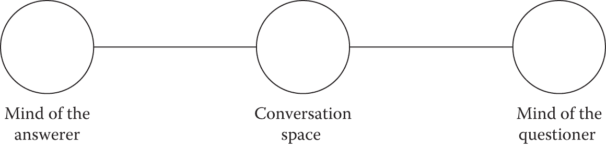

答题者的脑海中藏着秘密物体。提问者的脑海中正在权衡之前的答案，他们之间的对话空间是交换信息的方式。每个游戏都包含某种信息或“状态”（正如我们稍后在机制二中将看到的），而这些必须存在于某处。因此，即使游戏发生在一个零维的单点中，将其视为一个空间也可能很有用。你可能会发现，为一个空间看似微不足道的游戏建立抽象模型，可能会带来令你惊讶的洞见。

能够从功能性抽象术语思考游戏空间，是设计师的一个基本视角，这就是透镜 #26。

在思考游戏空间时，很容易受美学影响。表现游戏空间的方式有很多，只要适合你，它们都是好的。当你能用这些纯粹的抽象术语思考空间时，它能帮你摆脱对现实世界的假设，让你专注于你希望看到的游戏玩法交互。当然，一旦你操纵抽象空间使其布局令你满意，你就会想为它应用美学。功能空间透镜与透镜 #10：**全息设计**配合得很好。如果你能同时看到抽象功能空间、玩家将体验到的美学空间，以及它们如何相互关联，你就能对游戏世界的形态做出自信的决策。

## 机制二：时间

在现实世界中，**时间**是最神秘的维度。违背我们的意愿，我们在其中单向前行，无法停下、掉头、减速或加速。在游戏世界中，我们常试图通过创造玩具世界来弥补这种缺乏控制的缺憾，让我们能像神一样玩弄时间。

### 离散时间与连续时间

正如游戏中的空间可以是离散的或连续的，时间也是如此。我们有一个词来表示游戏中离散时间单位：“回合”。通常在回合制游戏中，时间并不重要。每个回合算作一个离散的时间单位，至于回合之间的间隔，就游戏而言，根本不存在。例如，拼字游戏通常记录为一系列移动，而不记录每次移动所花费的时间，因为现实时钟时间与游戏机制无关。

当然，也有许多游戏不是回合制的，而是在连续时间中运行。大多数动作类电子游戏属于此类，大多数体育运动也是如此。还有一些游戏混合使用时间系统。锦标赛国际象棋是回合制的，但有一个连续计时钟来限制每位玩家的用时。

### 时钟与竞速

各种类型的时钟被用于许多游戏中，以对各种事物设定绝对时间限制。Boggle 游戏中使用的“沙漏计时器”、美式橄榄球中的比赛计时钟，甚至《大金刚》中马里奥跳跃的持续时间，都是不同种类的“时钟”机制，旨在通过时间的绝对度量来限制游戏过程。正如可以有嵌套空间一样，时间有时也是嵌套的。例如，篮球比赛通常有一个比赛计时钟来限制总比赛时长，但也有一个短得多的“进攻计时器”（24 秒违例计时器），以帮助确保球员承担更多风险，保持游戏的趣味性。

其他时间度量则更具相对性——我们通常称之为“竞速”。在竞速的情况下，没有固定的时间限制，而是要比另一个玩家更快的压力。有时这非常明显，比如赛车比赛，但其他竞速则更微妙，例如我在《太空侵略者》中必须在入侵的外星人触地前将其全部消灭的竞速。

当然，也有许多游戏中时间不是限制因素，但它仍然是一个有意义的因素。例如在棒球比赛中，局数不计时，但如果比赛拖得太久，会耗尽投手的体力，使时间成为游戏的重要组成部分。在第 13 章：*平衡*中，我们将讨论不同的游戏因素如何控制游戏的时长。

### 控制时间

游戏给了我们一个在现实世界中永远无法做到的机会：控制时间。这以许多迷人的方式发生。有时我们完全停止时间，比如在体育比赛中叫“暂停”，或在电子游戏中按下“暂停”键。偶尔我们会加速时间，如在《文明》等游戏中，这样我们只需几秒钟就能看到数年的流逝。但最常见的是，我们倒转时间，这正是你在电子游戏中每次死亡并返回上一个检查点时发生的事情。有些游戏，如《时空幻境》，甚至将游戏时间的操控作为核心机制。

既然时间是不可见且不可阻挡的，它很容易被遗忘。请使用这枚透镜来帮助你记住。

## 机制 3：物体

没有任何东西的空间，嘛，只是空间而已。你的游戏空间肯定会有**物体**。角色、道具、棋子、记分牌，或任何可以在你的游戏中被看到或操纵的东西都属于这一类。物体是游戏机制中的“名词”。从技术上讲，有时你可能会把空间本身视为一个物体，但通常你游戏的空间与其他物体有足够的区别，能够独立存在。物体通常具有一个或多个**属性**，其中之一通常是物体在游戏空间中的当前位置。

属性是关于物体的信息类别。例如，在赛车游戏中，一辆车可能拥有最高速度和当前速度作为属性。每个属性都有一个当前**状态**。“最高速度”属性的状态可能是 150 英里/小时，而如果车正以该速度行驶，“当前速度”属性的状态可能是 75 英里/小时。最高速度不是一个会经常改变的状态，除非你升级了赛车引擎。另一方面，当前速度会随着游戏过程不断变化。

如果物体是游戏机制的名词，那么属性及其状态就是形容词。

属性可以是静态的（如棋子的颜色），在整个游戏过程中永不改变；也可以是动态的（棋子有一个“移动模式”属性，有三种可能的状态：“普通”、“升级为王”和“被吃掉”）。我们主要关注动态属性。

这里还有两个例子：

1. 在国际象棋中，国王有一个“移动模式”属性，有三个重要状态（“可自由移动”、“被将军”和“被将死”）。

2. 在大富翁游戏中，棋盘上的每块地产都可视为一个物体，具有动态的“房屋数量”属性，有六种状态（0、1、2、3、4、旅馆），以及一个“抵押”属性，有两种状态（是、否）。

是否有必要将每个状态变化都传达给玩家？未必。有些状态变化最好隐藏起来。但对于其他状态，确保将其传达给玩家至关重要。一个好的经验法则是：如果两个物体的行为方式相同，它们看起来应该相同。如果它们的行为不同，它们看起来应该不同。

电子游戏物体，尤其是那些模拟智能角色的物体，拥有如此多的属性和状态，以至于设计师很容易感到困惑。为每个属性构建一个状态图通常很有用，以确保你理解哪些状态相互连接以及什么触发状态变化。在游戏编程方面，将属性的状态实现为“状态机”是一种保持所有复杂性整洁且易于调试的非常有用的方法。图 12.12 是《吃豆人》中幽灵“移动”属性的一个示例状态图。

**图 12.12**

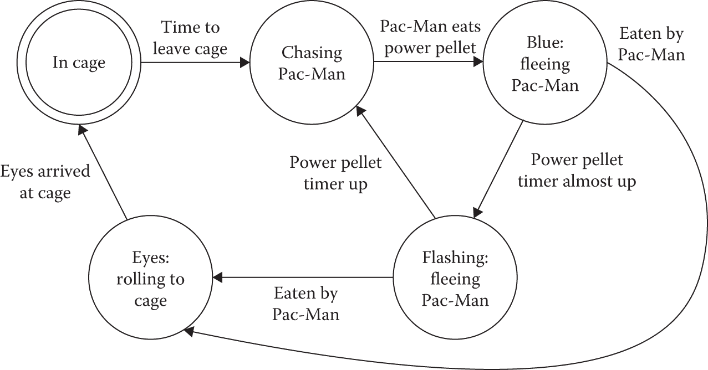

标有“在笼中”的圆圈是幽灵的初始状态（双圆圈常用于表示起始状态）。每个箭头表示一个可能的状态转换，以及触发该转换的事件。在尝试设计游戏中的复杂行为时，此类图表非常有用。它们迫使你真正思考物体可能发生的一切以及导致这些事件的原因。通过在计算机代码中实现这些状态转换，你自动禁止了非法转换（如“在笼中” → “变蓝”），这有助于减少令人费解的错误。这些图表可能变得相当复杂，有时也是嵌套的。例如，真实的吃豆人算法很可能在“追逐吃豆人”状态中实际上有几个子状态，如“扫描吃豆人”、“紧跟吃豆人”和“穿过隧道”。

决定哪些物体拥有什么属性和状态取决于你。通常有多种方式来表示同一事物。例如，在扑克游戏中，你可以将玩家的手牌定义为游戏空间中包含五张牌物体的一个区域，或者你可以决定不想把牌视为物体，而只称玩家的手牌为一个拥有五个不同牌属性的物体。与游戏设计中的所有事物一样，“正确”的思考方式是当时最有用的方式。

强迫玩家为了玩游戏而必须注意太多状态（太多游戏棋子、每个角色太多统计数据）的游戏会让玩家感到困惑和不知所措。在第 13 章：*平衡*中，我们将讨论优化玩家必须处理的状态数量的技巧。严格地将你的游戏视为一组具有变化状态的物体和属性，可以提供一个非常有用的视角，这也是透镜 #28 的作用。

### 秘密

# 游戏属性与状态：公开与私有

关于游戏属性及其状态的一个非常重要的决定是：谁知道哪些属性。在许多桌面游戏中，所有信息都是公开的；也就是说，每个人都知道。在国际象棋游戏中，双方玩家都能看到棋盘上的每一个棋子和每一个被吃掉的棋子——没有秘密，除了对方在想什么。在纸牌游戏中，隐藏或私有状态是游戏的重要组成部分。你知道自己手里有什么牌，但对手手里有什么牌对你来说是个谜，需要你去推断。例如，扑克游戏很大程度上在于试图猜测对手有什么牌，同时试图隐瞒自己可能有什么牌的信息。当你改变什么信息是公开的、什么是私有的时，游戏会变得截然不同。在标准的“抽牌扑克”中，所有状态都是私有的——玩家只能根据你下注的多少来猜测你的手牌。在“梭哈扑克”中，你的某些牌是私有的，某些是公开的。这给了对手更多关于彼此情况的信息，游戏的感觉也截然不同。像`Battleship`（海战棋）和`Stratego`（陆战棋）这样的桌面游戏，全都是关于猜测对手私有属性的状态。

在电子游戏中，我们面临一种新情况：一种只有游戏本身知道的状态。这引发了一个问题：从游戏机制的角度来看，虚拟对手应该被视为玩家，还是仅仅是游戏的一部分？一个故事很好地说明了这一点：1980 年，我的祖父买了一台 Intellivision 游戏机，附带一盒“拉斯维加斯扑克和二十一点”游戏卡带。他玩得很开心，但祖母拒绝玩。“它作弊，”她坚持道。我告诉她这很傻——它只是台电脑——怎么可能作弊？她解释了她的理由：“它知道我所有的牌，还知道牌堆里所有的牌！它怎么能不作弊？”我不得不承认，我解释说电脑在做游戏决策时“不看那些牌”，听起来有点站不住脚。但这揭示了一个观点：在那个游戏中，实际上有三个实体知道不同属性的状态：我的祖父，他知道自己手牌的状态；虚拟对手算法，它“知道”自己手牌的状态；最后是游戏的主算法，它知道双方玩家的手牌、牌堆里的每一张牌，以及游戏的其他一切。

因此，从公开/私有属性的角度来看，将虚拟对手视为与玩家同等地位的独立实体是合理的。不过，游戏本身是另一个实体，具有特殊地位，因为它并不是真正在玩游戏，尽管它可能会做出让游戏得以进行的决策。Celia Pearce 指出了另一种信息，这种信息对我们迄今提到的所有实体都是私有的：随机生成的信息，例如掷骰子的结果。取决于你对宿命论的看法，你可能会争辩说，这种信息在生成并揭示之前根本不存在，所以称其为私有有点愚蠢。但它确实很适合一个我称之为“知晓者层级”的维恩图，这有助于直观展示公开状态和私有状态之间的关系：

## 图 12.13

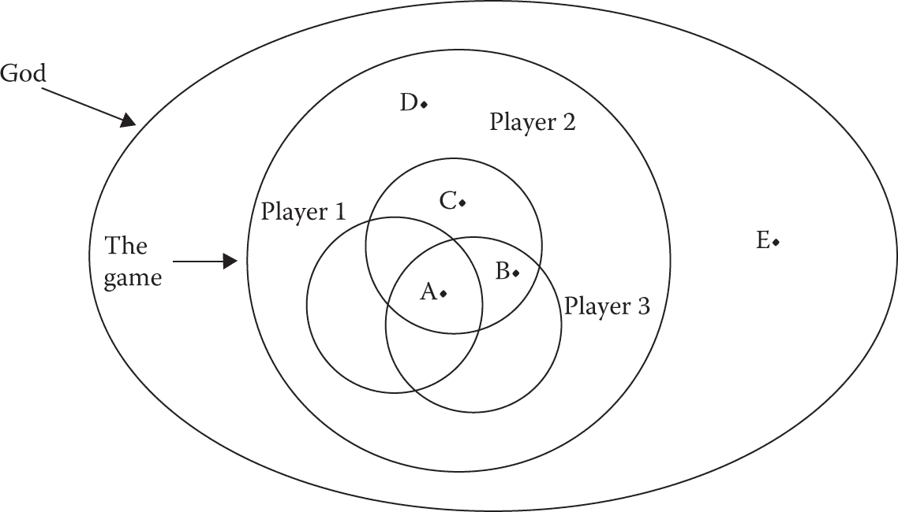

在图 12.13 中，每个圆圈代表一个“知晓者”。“知晓者”包括神、游戏、玩家 1、玩家 2 和玩家 3。每个点代表游戏中的某些信息——一个属性的状态：

*   **A** 是完全公开的信息，例如游戏棋盘上棋子的位置，或一张明牌。所有玩家都知道。
*   **B** 是玩家 2 和玩家 3 共享但对玩家 1 保密的状态。也许玩家 2 和玩家 3 各自有机会看一张暗牌，但玩家 1 没有。又或者玩家 2 和玩家 3 是玩家 1 的虚拟对手，它们的算法让它们共享信息，以便联手对付玩家 1。
*   **C** 是单个玩家私有的信息，此处指玩家 2。例如，可能是发给他的牌。
*   **D** 是游戏知道但玩家自己不知道的信息。有些机械桌面游戏中存在这种状态，存在于桌面游戏的物理结构中，但玩家不知情。`Stay Alive`（生存游戏）是个经典例子，移动塑料滑块会露出棋盘上的洞。`Touché` 是另一个有趣的例子，未知极性的磁铁被放在棋盘每个格子下面。这些状态为游戏所“知”，但玩家不知。另一个例子是桌面角色扮演游戏，其中有“地下城主”或“游戏主持人”，他不是玩家之一，但私下知道大量游戏状态，因为从某种意义上说，他是游戏的运作机制。大多数电脑游戏都有大量玩家不知道的内部状态。
*   **E** 是随机生成的信息，仅为命运、神等所知。

秘密即力量。透镜 #29 将帮助你引导这种力量，让你的游戏尽可能有趣。拿去用吧，但别告诉别人。

## 机制 4：行动

下一个重要的游戏机制是`action`（行动）。行动是游戏机制的“动词”。对行动有两种视角，换句话说，回答“玩家能做什么？”这个问题有两种方式。

第一种行动是`basic action`（基本行动）。这些只是玩家可以采取的基础行动。例如，在跳棋中，玩家只能执行三种基本操作：

*   向前移动一个棋子。
*   跳过对手的一个棋子。
*   向后移动一个棋子（仅限王）。

第二种行动是`strategic action`（策略行动）。这些行动只有在游戏的大局中才有意义——它们关乎玩家如何利用基本行动来达成目标。策略行动的清单通常比基本行动的清单长。考虑跳棋中可能的一些策略行动：

*   通过在另一个棋子后面移动棋子，保护其不被吃掉。
*   迫使对手进行一次不想要的跳跃。
*   牺牲一个棋子来欺骗对手。
*   建立一座“桥”来保护你的底行。
*   将一个棋子移入“王行”使其成为王。

### 涌现式游戏玩法

策略行动通常涉及游戏中微妙的相互作用，往往是非常有策略性的举动。这些行动大多并非规则本身的一部分，而是随着游戏进行自然涌现的行动和策略。大多数游戏设计师都认为，有趣的涌现行动是好游戏的标志。因此，有意义的策略行动与基本行动的比率，是衡量你的游戏包含多少涌现行为的良好指标。一个优雅的游戏确实允许玩家拥有少量的基本行动，但大量的策略行动。值得注意的是，这在一定程度上是主观的衡量标准，因为“有意义”的策略行动数量因人而异。

试图创造`emergent gameplay`（涌现式游戏玩法），即有趣的策略行动，被比作打理花园，因为涌现出的东西有其自身的生命，但同时也脆弱且易于毁灭。当你注意到游戏中出现了一些有趣的策略行动时，你必须能够识别它们，然后尽你所能培育它们，给它们繁荣的机会。但这些东西最初为什么会冒出来呢？这不仅仅是运气——你可以做一些事情来增加有趣策略行动出现的几率。这里有五个建议，帮你准备游戏的土壤，播下涌现的种子。

### 1. 增加更多动词

也就是说，增加更多基础动作。当基础动作彼此交互、与物体交互以及与游戏空间交互时，策略性动作就会涌现。当你增加更多基础动作时，交互的机会就会增多，从而产生更多涌现。一个让你能跑、跳、射击、买、卖、驾驶和建造的游戏，其涌现潜力要比仅能让你跑和跳的游戏大得多。不过要小心——增加过多的基础动作，尤其是那些彼此交互不佳的动作，会导致游戏变得臃肿、混乱且不优雅。请记住，策略性动作与基础动作的比率比基础动作的绝对数量更重要。通常增加一个好的基础动作，胜过增加一大堆平庸的动作。

### 2. 可作用于多种物体的动词

这或许是让游戏变得优雅且有趣的**最有力**的单一手段。如果你给玩家一把只能射击坏人的枪，那游戏就非常简单。但如果同一把枪还能用来射开门上的锁、打破窗户、猎取食物、击爆汽车轮胎、或在墙上写字，你就进入了一个充满无限可能的世界。你仍然只有一个基础动作：“射击”，但通过增加可被有效射击的事物数量，有意义的策略性动作数量也随之增加。

### 3. 可通过多种方式达成的目标

让玩家在游戏中做各种不同的事，给他们大量动词，以及作用对象丰富的动词，这很棒。但如果目标只能通过一种方式达成，玩家就没有理由去寻找不寻常的交互和有趣的策略。继续以“射击”为例，如果你让玩家射击各种东西，但游戏目标只是“射击 Boss 怪物”，玩家只会做那件事。反之，如果你可以射击怪物，或射断支撑链条让吊灯砸向它，甚至完全不射击，而是通过非暴力手段阻止它，你就会拥有丰富、动态的游戏玩法，各种可能性应有尽有。这种方法的挑战在于游戏难以平衡，因为如果某个选项始终比其他选项容易得多（占优策略），玩家总会追求该选项。我们将在 第 13 章 *平衡* 中进一步讨论这一点。

### 4. 多主体

如果跳棋只涉及一红一黑两枚棋子但规则相同，游戏将毫无趣味。正是因为玩家拥有许多不同的可移动棋子，这些棋子能相互交互、配合与牺牲，游戏才变得有趣。这种方法显然不适用于所有游戏，但它能在一些令人惊讶的地方发挥作用。策略性动作的数量似乎大致等于主体数量乘以动词数量乘以物体数量的量级，因此增加更多主体极有可能增加策略性动作的数量。

### 5. 改变约束的副作用

如果每次采取行动都会产生改变你或对手约束条件的副作用，极有可能产生非常有趣的游戏玩法。让我们再看看跳棋。每次你移动一枚棋子，不仅改变了你威胁吃子的格子，同时也改变了对手（和你）可移动进入的格子。从某种意义上说，每一步棋都在改变游戏空间的本质，无论你是否有意。想想如果多枚棋子能和平共处于同一格子，跳棋会有多么不同。通过强制游戏的多个方面随每个基础动作而改变，你极有可能让有趣的策略性动作突然涌现。

在将游戏与书籍和电影比较时，最显著的差异之一是动词的数量。游戏通常将玩家限制在极窄的潜在动作范围内，而在故事中，角色可从事的潜在动作数量似乎近乎无限。这是一个自然的副作用：在游戏中，动作及其所有效果必须即时模拟，而在故事中，一切都提前安排好。在 第 18 章 *间接控制* 中，我们将讨论如何在玩家心中弥合这种“动作鸿沟”，让你在保持基础动作数量在可控范围内的同时，给予玩家无限可能的感觉。

之所以许多游戏看起来相似，是因为它们使用同一组动作。看看那些被认为“缺乏创新”的游戏，你会发现它们拥有与老游戏相同的动作集。看看被称为“创新”的游戏，你会发现它们给玩家提供了新型动作，无论是基础还是策略性的。刚推出 *Donkey Kong*（大金刚）时，它看起来截然不同，因为它关乎奔跑和跳跃，这在当时是新颖的。*Harvest Moon*（牧场物语）是一款关于耕作的游戏。*Katamari Damacy*（滚动的天空/捡滚球）关乎滚动一个粘性球。玩家可执行的动作对定义游戏机制至关重要，改变单个动作就能让你得到一个完全不同的游戏。

一些设计师梦想制作这样的游戏：玩家能想到的任何动词都是可能的动作，这是一个美好的梦想。一些大型多人游戏开始朝这个方向发展，为战斗、制作和社交互动提供广泛的动词。从某种意义上说，这是一种回归——在 20 世纪 70 年代和 80 年代，文字冒险游戏非常流行，通常包含数十或数百个可能的动词。只有随着视觉类游戏的兴起，动词数量才骤减，因为在视觉类游戏中支持所有那些动作是不可行的。文字冒险游戏类型的消亡（或冬眠？）通常归因于公众对华丽视觉效果的渴望——但或许，从动作的角度来看，还有另一种解释。现代 3D 电子游戏给你非常有限的基础动作范围。玩家通常知道自己能尝试的每一个动作。在文字冒险游戏中，基础动作的完整集合是不清晰的，发现它们是游戏的一部分。解决棘手谜题的方法往往是想到输入一个不寻常的动词，比如“旋转鱼”或“挠猴子”。虽然这非常有创意，但也常令人沮丧——游戏支持的每一个动词背后，都有成千上万个不支持的动词。结果，玩家并没有真正拥有文字冒险界面假装给予的“完全自由”。这种挫败感或许比其他任何原因都更导致了文字冒险游戏的衰落。

你对动作的选择极大地定义了你的游戏结构，所以让我们应用 透镜 #31。

## 机制 5：规则

**规则** 真正是最基础的机制。它们定义空间、时机、物体、动作、动作后果、动作约束和目标。换句话说，它们使我们迄今为止见到的所有机制成为可能，并增添了使游戏成为游戏的关键要素——目标。

### Parlett 的规则分析

游戏史学家 David Parlett 出色地分析了游戏玩法涉及的不同种类规则，如下图所示。

**图 12.14**

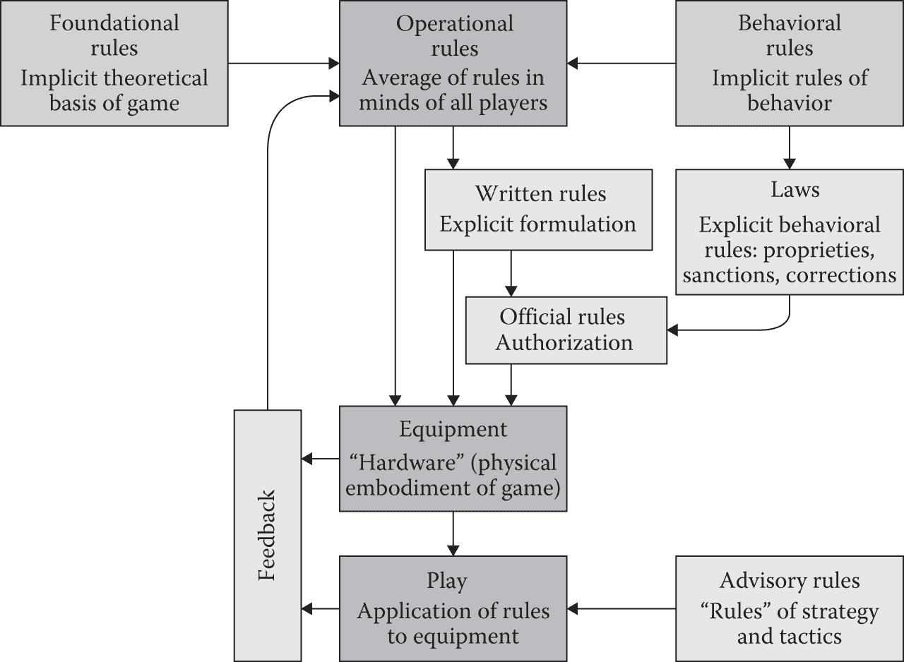

这展示了我们可能遇到的所有规则种类之间的关系，所以让我们逐一考察。

#### 1. 运作规则

这些最容易理解。这些基本上是“玩家为玩游戏所做的事”。当玩家理解运作规则时，他们就能玩游戏。

# 规则分类

## 2. 基础规则
基础规则是游戏底层的形式化结构。运作规则可能会说：“玩家应掷一个六面骰，并收集相应数量的能量筹码。”基础规则则更为抽象：“玩家的能量值增加一个 1 到 6 之间的随机数。”基础规则是对游戏状态及其变化方式和时机的数学表达。棋盘、骰子、筹码、生命值条等，都只是追踪基础游戏状态的运作方式而已。正如帕莱特的图表所示，基础规则指导运作规则。目前尚无表示这些规则的标准符号系统，甚至有人质疑完整的符号系统是否可能存在。在实际工作中，游戏设计师会按需学会洞察基础规则，但极少需要以完全抽象的方式正式记录整套基础规则。

## 3. 行为规则
这些是隐含于游戏过程中的规则，大多数人自然将其视为“体育精神”的一部分。例如，在下棋时，不应在对方思考时挠痒痒，也不应花五个小时才走一步。这些规则很少明文规定——大多时候，大家心知肚明。它们的存在凸显了这样一个观点：游戏是玩家之间的一种社会契约。这些规则同样指导运作规则。史蒂文·斯尼德曼写过一篇关于行为规则的优秀文章，名为《不成文规则》。

## 4. 成文规则
这些是“随游戏附带的规则”，即玩家必须阅读以了解运作规则的文档。当然，现实中只有少数人会读这份文档——大多数人是通过让别人讲解来学会游戏的。为什么？因为将游戏玩法的非线性复杂性编码进文档非常困难，解码这类文档同样困难。现代电子游戏逐渐摒弃了成文规则，转而让游戏本身通过互动教程教会玩家如何游玩。这种亲身体验的方法有效得多，尽管设计和实现起来颇具挑战且耗时，因为它涉及许多迭代，直到游戏达到最终状态才能完成。每位游戏设计师都必须准备好答案来回答：“玩家将如何学会玩我的游戏？”因为如果有人搞不懂你的游戏，他们就不会玩了。

## 5. 赛规
这些规则仅在游戏处于严肃、竞技的场合、赌注足够高以至于需要明文记录体育精神规则，或需要澄清、修改官方成文规则时才会形成。这些常被称为“比赛规则”，因为在正式比赛中最需要这种官方澄清。请看 2005 年 Penny Arcade Expo 上《铁拳 5》（一款格斗游戏）的比赛规则：

1. 单败淘汰制。
2. 可自带手柄。
3. 标准对战模式。
4. 100% 生命值。
5. 随机选关。
6. 60 秒计时。
7. 每局 5 回合 3 胜。
8. 每场 3 局 2 胜。
9. 禁用木人。

其中大多数只是明确比赛将使用哪些游戏设置。“可自带手柄”是关于何为“公平竞争”的正式决定。此处最有趣的规则是“禁用木人”。木人是《铁拳 5》中可供选择的角色之一。玩家普遍认为木人的“眩晕”招式过于强大，任何选择木人的玩家都极可能获胜，导致比赛失去意义。因此这条“赛规”旨在改进游戏，确保比赛平衡、公平且有趣。

## 6. 官方规则
当游戏进行得足够严肃，以至于一群玩家感到有必要将成文规则与赛规合并时，官方规则便诞生了。随时间推移，这些官方规则后来会成为成文规则。在国际象棋中，当一名玩家走出一步让对方国王面临被将死的危险时，该玩家有义务说“将军”来警告对手。曾经这是一条“赛规”，而非成文规则，但现在它已成为“官方规则”的一部分。

## 7. 建议规则
常被称为“策略准则”，这些只是帮你玩得更好的提示，从游戏机制角度来看，它们根本不是“规则”。

## 8. 家规
帕莱特并未明确描述这些规则，但他指出，随着玩家游玩，他们可能会想调整运作规则以让游戏更有趣。这是他图表中的“反馈”，因为家规通常是玩家在几局游戏后察觉到不足而制定的。

### 模式
许多游戏在不同阶段有截然不同的规则。规则在模式间往往完全改变，几乎像是完全不同的游戏。一个令人难忘的例子是赛车游戏《进站维修》。大多数时候它是个典型的赛车游戏，但有个反转——如果你不定期进站换胎，轮胎就会爆胎。一旦你进站，游戏完全变了——你不再是在赛车，而是在比拼换胎速度，拥有完全不同的游戏界面。当你的游戏像这样剧烈切换模式时，让玩家知道当前处于哪种模式非常重要。模式过多会让玩家困惑。通常有一个主模式和几个子模式，这是组织不同模式的良好层级方式。游戏设计师西德·梅尔提出了一个绝佳的经验法则：玩家不应在子游戏上花费过多时间，以免忘记主游戏中的目标。我们将在第 15 章：*界面*中详细讨论模式。

### 执行者
电子游戏与传统游戏最显著的区别之一在于谁来执行规则。在传统游戏中，规则主要由玩家自己执行，或在高风险游戏（如体育赛事）中由公正的裁判执行。在电脑游戏中，由电脑执行规则成为可能（有时甚至必要）。这不仅是方便——它允许创建比传统可能复杂得多的游戏，因为现在玩家无需记住所有关于什么可能、什么不可能的规则——他们只需在游戏中尝试，看看什么行得通、什么行不通——无需全记在脑子里，也无需查阅。在某种意义上，过去的“规则”现在变成了游戏世界的物理约束。如果棋子不允许以某种方式移动，它就是无法那样移动。许多游戏规则由空间、物体和动作的设计来强制执行。《魔兽争霸》这样的游戏理论上可以做成桌游，但规则太多、状态太繁杂，很快就会变成枯燥的体验。将枯燥的规则执行工作卸载给电脑，游戏能达到其他方式无法企及的复杂性、微妙性和丰富性深度。但须谨慎行事——如果你的电子游戏规则复杂到玩家甚至无法形成关于游戏如何运作的粗浅概念，他们就会不知所措、感到困惑。你必须让复杂电子游戏的规则成为玩家能自然发现和理解的东西——而不是必须死记硬背的东西。

### 可作弊性

游戏需要执行者的原因是为了防止作弊。违反规则当然是不道德的游戏行为，但正如我们在历史上所见，一些玩家为了被视为赢家不择手段。显然，当你玩游戏时，你希望确保其他人不作弊。但作弊的影响比这更隐蔽——如果玩家开始相信你的游戏可作弊，即使实际上不能，你辛苦建立的所有珍贵内生价值也会随之流失。玩家想象自己努力争取胜利，却想象另一个玩家在作弊，这会让他们觉得自己像个傻瓜。这就是可作弊性的危险——如果玩家觉得你的游戏可以作弊，一些人会尝试作弊，但大多数人只会不再想玩。

## 最重要的规则

游戏有很多规则——如何移动，能做什么不能做什么——但有一条规则是所有其他规则的基础：游戏目标。游戏关乎达成目标——你必须能够清晰地陈述游戏的目标。通常，游戏中不只有一个目标，而是一系列目标——你需要陈述每一个目标，以及它们如何相互关联。笨拙的目标陈述会从一开始就让玩家望而却步——如果他们不完全理解自己行动的目的，就无法确定地继续下去。国际象棋新手常会被难住，当有人笨拙地试图解释游戏目标时：“你的目标是将死对方的王……意思是你移动棋子让他无法移动而不被将军……呃，意思是你的某个棋子可能吃掉它，除了，嗯，规则禁止吃王。”小时候，我常纳闬为什么一个被认为如此优雅的游戏会有如此不优雅的目标。我玩了多年才意识到国际象棋的目标其实非常简单：“吃掉对手的王。”关于将军和将死的所有繁文缛节，只是为了礼貌地警告对手他们处于岌岌可危的境地。当你告诉潜在玩家这个简单的四词目标时，他们变得更有兴趣，这令人惊讶。对于你创作的任何游戏也是如此——玩家越容易理解目标，就越容易想象达成它，也就越有可能想玩你的游戏。

当目标植入玩家脑海时，会给他们巨大的动力去坚持到底。拥有一组清晰、构建良好的目标或任务，对于保持玩家的投入和动力至关重要。好的游戏目标具备以下特质：

1.  **具体**：玩家理解并能清晰陈述他们应该达成什么。
2.  **可达成**：玩家需要认为自己有机会达成目标。如果对他们来说似乎不可能，他们会迅速放弃。
3.  **有回报**：让达成的目标具有回报性涉及很多因素。如果目标具有恰当的挑战程度，仅仅达成它本身就是一种回报。但为什么不更进一步？你可以在玩家达成目标时给予他们有价值的东西，让目标更有回报——使用透镜 #20：*愉悦*，寻找不同的方式奖励玩家，真正让他们为成就感到自豪。虽然奖励达成目标的玩家很重要，但同样重要（甚至更重要）的是玩家在达成目标*之前*就意识到目标是有回报的，从而激励他们尝试去达成。不过不要过度夸大他们的期望，因为如果他们对达成目标的奖励感到失望，就不会再玩了！我们将在下一章详细讨论奖励。

虽然游戏中的每个目标都具备这些特质很重要，但拥有良好的目标平衡也很重要，既有短期目标，也有长远得多的目标。这种目标平衡会让玩家感到他们知道立即该做什么，并最终会达成一些重要而宏伟的事情。

很容易过分关注游戏的动作而忘记目标。为了帮助我们记住目标的重要性，让我们把这个透镜加入工具箱。

同时拿起玩具透镜、好奇心透镜和目标透镜，观察这些游戏方面如何相互影响，这会很迷人。

## 规则总结

规则是所有游戏机制中最基础的。游戏不仅由规则定义；游戏*就是*它的规则。从规则视角审视你的游戏很重要，这就是透镜 #33。

## 机制 6：技能

> *In virtute sunt multi ascensus.*
>
> *(卓越有许多层阶。)*
>
> —西塞罗

**技能**机制将焦点从游戏转移到玩家身上。每个游戏都要求玩家运用特定技能。如果玩家的技能水平与游戏难度相匹配，玩家会感到有挑战并保持在心流通道中（如第 10 章：*玩家的心智* 所述）。

大多数游戏不只要求玩家具备一项技能——它们需要多种技能的组合。设计游戏时，列出游戏要求玩家具备的技能是一项有价值的练习。尽管有数千种可能的技能可融入游戏，但技能通常可分为三大类：

1.  **身体技能**：包括涉及力量、灵活性、协调性和身体耐力的技能。身体技能是大多数体育运动的重要组成部分。熟练操作游戏手柄是一种身体技能，但许多电子游戏（如基于摄像头的舞蹈游戏）要求玩家具备更广泛的身体技能。
2.  **心智技能**：包括记忆、观察和解谜技能。虽然有些人避开需要太多心智技能的游戏，但很少有游戏不涉及任何心智技能，因为有趣的决策让游戏变得有趣，而决策制定是一种心智技能。
3.  **社交技能**：包括读懂对手（猜测他们的想法）、欺骗对手、与队友配合等。通常我们从交友和影响他人的角度思考社交技能，但游戏中的社交和沟通技能范围要广得多。扑克很大程度上是社交游戏，因为很大程度上取决于隐藏自己的想法和猜测他人的想法。体育运动也非常社交，专注于团队合作和“在心理上击垮”对手。

### 真实技能与虚拟技能

## 技能：真实与虚拟

在这里做出区分很重要：当我们把技能作为一种游戏机制来谈论时，我们指的是玩家必须拥有的**真实技能**。在电子游戏中，谈论角色的技能等级是很常见的。你可能会听到玩家宣称：“我的战士剑术技能刚增加了两点！”但“剑术”并非玩家所需的真实技能——玩家实际上只是在正确的时间按下手柄上正确的按钮。在这种情况下，剑术是一种**虚拟技能**——一种玩家假装拥有的技能。虚拟技能有趣的地方在于，即使玩家的实际技能没有提高，虚拟技能也能提升。玩家猛按手柄按钮的手法可能依然笨拙，但只要按得次数够多，他们可能会获得更高等级的虚拟技能作为奖励，从而让他们的角色成为更快、更强大的剑客。许多“免费游戏”都有基于购买虚拟技能的完整变现策略。

虚拟技能是给玩家一种强大感的绝佳方式。如果过犹不及，会让人感到空洞——一些大型多人游戏的批评者抱怨说，过分强调虚拟技能，而对真实技能重视不够。通常，有趣游戏的关键在于找到真实技能与虚拟技能的恰当组合。许多新手设计师会混淆这两者——你在脑海中对它们做出清晰的区分非常重要。

### 列举技能

列出游戏所需的所有技能清单是一个非常有用的练习。你可以列一个大致的清单：“我的游戏需要记忆、解决问题和模式匹配技能。”也可以列得非常具体：“我的游戏要求玩家在脑海中快速识别并旋转特定的二维形状，同时解决基于网格的装箱问题。”列举技能可能非常棘手——一个有趣的例子来自游戏*RC Pro Am*，这是一款任天堂娱乐系统（NES）上的赛车游戏。在游戏中，玩家用方向键（左拇指）控制转向，用 A 键（右拇指）加速，用 B 键（也是右拇指）向对手发射武器。要精通这款游戏，需要两项令人惊讶的技能——第一是解决问题。通常在 NES 游戏中，你一次只按一个按钮——当你想按 B 键时，会把拇指从 A 键上拿开。但在*RC Pro Am*中，这会导致灾难——这意味着如果你想发射火箭（B 键），就必须松开汽车的加速器（A 键），对手就会迅速甩开你！如何解决这个问题？有些玩家尝试用拇指按一个键，用手指按另一个键，但这很别扭，让游戏变得太难玩了。最好的解决方案似乎是采用一种新的握持手柄方式：你将拇指侧放在 A 键上，这样当你想偶尔按下 B 键时，可以顺利地将拇指滚动到 B 键上，而不必松开加速器。一旦玩家解决了这个问题，他们就需要练习这项非常具体的物理技能。当然，游戏中还涉及许多其他技能——资源管理（导弹和地雷，以免用完）、记忆赛道、应对急转弯和意外路面危险，等等。重点是，即使是一款看似简单的游戏，也可能要求玩家具备许多不同的技能。作为设计师，你需要知道这些是什么。

很容易让自己误以为游戏主要考验某项技能，而实际上其他技能更重要。许多动作类电子游戏表面上看似主要考验快速反应对手，但实际上需要大量解谜来找出正确的应对方式，还需要大量记忆以避免下次游玩同一关卡时再次被惊吓。设计师往往会失望地发现，他们原以为考验快速决策和临场应变的游戏，实际上却是关于记忆敌人在何时跳出来——这给玩家带来了截然不同（且枯燥得多）的体验。玩家锻炼的技能在很大程度上决定了其体验的性质，所以你必须知道这些是什么。从这个角度审视你的游戏就是透镜 #34。

## 机制 7：机会

我们的第七个也是最后一个游戏机制是**机会**。我们将它放在最后讨论，因为它关乎其他六大机制（空间、时间、物体、行动、规则和技能）之间的相互作用。

机会是趣味游戏的重要组成部分，因为机会意味着不确定性，而不确定性意味着惊喜。正如我们之前讨论的（透镜 #4），惊喜是人类愉悦的重要来源，也是趣味的秘诀。

我们现在必须谨慎行事。你永远不能掉以轻心，因为它非常棘手——数学计算可能很难，而且我们对它的直觉往往是错的。但优秀的游戏设计师必须成为机会与概率的主宰，随心所驭地塑造它们，创造出始终充满挑战性决策和有趣惊喜的体验。理解机会的挑战可以用一个关于概率数学发明的故事来说明——毫不奇怪，它是专门为游戏设计而发明的。

### 概率的发明

> *Il est tres bon ésprit, mais quel dommage, il n'est pas geometre.*
>
> *(他是个好人，但遗憾的是，不是数学家。)*
>
> —帕斯卡致费马，关于梅雷骑士

那是 1654 年，法国贵族安托万·贡博，梅雷骑士（发音为“Shevulyay duh Mayray”），遇到了一个问题。他是个狂热的赌徒，一直在玩一个游戏：他赌如果掷一个骰子四次，至少有一次会出现 6 点。他从这个游戏中赚了一些钱，但他的朋友们厌倦了输钱，拒绝再和他玩这个游戏。为了找到新的方式坑朋友，他发明了一个新游戏，他认为这个游戏的赔率和上一个一样。在新游戏中，他赌如果掷一对骰子二十四次，至少会出现一次 12 点（双 6）。朋友们起初很警惕，但很快就喜欢上了这个新游戏，因为梅雷骑士开始迅速输钱！他很困惑，因为按他的计算，两个游戏的赔率是一样的。梅雷的推理如下：

第一个游戏：掷一个骰子四次，如果至少出现一次 6 点，梅雷就赢。

梅雷推理单个骰子出现 6 点的概率是 1/6，因此掷四次骰子意味着获胜概率应为 4 × (1/6) = 4/6 = 66%，这解释了他为什么倾向于赢。

第二个游戏：掷一对骰子二十四次，如果至少出现一次 12 点，梅雷就赢。

梅雷确定一对骰子出现 12 点（双 6）的概率是 1/36。他推理，那么掷二十四次骰子意味着赔率应为 24 × (1/36) = 24/36 = 2/3 = 66%。和上一个游戏一样的赔率！

他在困惑和输钱中，给数学家布莱兹·帕斯卡写信求助。帕斯卡发现这个问题很有趣——当时没有成熟的数学理论来回答这些问题。帕斯卡又写信给他父亲的朋友皮埃尔·德·费马求助。帕斯卡和费马就此问题及类似问题进行了漫长的通信，并在发现解决方法的过程中，确立了概率论作为数学的一个新分支。

# 夏瓦利耶游戏的真实胜率是多少？

要理解这一点，我们得涉及一些数学——别担心，这是任何人都能看懂的简单数学。完全涵盖概率数学对于游戏设计并非必要（也超出了本书范围），但了解一些基础知识会非常有用。如果你是数学天才，可以跳过这一节，或者至少带着优越感读完它。对于我们其他人，我提供以下内容：

## 每个游戏设计师都应知晓的概率十大法则 [`#C02a_toc.xhtml#rsec12_7_2`]

### 法则 #1：分数即小数即百分比 [`#C02a_toc.xhtml#rsec12_7_2_1`]

如果你是那种一直觉得分数和百分比很头疼的人，是时候正视并搞定它们了，因为它们是概率的语言。别紧张——你随时可以用计算器——没人盯着你看。你必须弄明白的一件事是：分数、小数和百分比本质上是同一回事，可以互换使用。换句话说，½ = 0.5 = 50%。这不是三个不同的数字；它们只是同一个数字的三种写法。

从分数转换为小数很简单。想知道 33/50 的小数等价形式？在计算器里输入 33 ÷ 50，你会得到 0.66。百分比呢？也很简单。如果你在字典里查 "percent"，会发现它的真意是 "per 100"（每一百）。所以，66% 实际上意味着 66 per 100，即 66/100，也就是 0.66。如果你看一下夏瓦利耶之前的数学推导，就会明白为什么我们需要频繁在不同形式间转换——作为人类，我们习惯用百分比交流，但也喜欢说 "six 分之一的机会"（one chance in six）——所以我们需要一种方法在这些形式间转换。如果你是那种有数学焦虑的人，放松点，在计算器上练习几个——你很快就会掌握窍门。

### 法则 #2：零到一——仅此而已！ [`#C02a_toc.xhtml#rsec12_7_2_2`]

这条很简单。概率只能在 0% 到 100% 之间，即 0 到 1 之间（见法则 #1），不能更低也不能更高。虽然你可以说某事发生有 10% 的机会，但不存在 −10% 的机会，更不存在 110% 的机会。0% 的机会意味着它不会发生，100% 的机会意味着它肯定会发生。这听起来可能显而易见，但它指出了夏瓦利耶数学中的一个重大问题。考虑他的第一个游戏，掷四个骰子。他以为用四个骰子，他有 4 × (1/6)，即 4/6，即 0.66，即 66% 的机会掷出 6 点。但如果他有七个骰子呢？那他将有 7 × (1/6) 即 7/6 即 1.17 即 117% 的获胜机会！这肯定是错的——如果你掷骰子七次，六点可能很大概率会出现一次，但这并不保证（实际上约为 72% 的机会）。任何时候你计算出的概率大于 100%（或小于 0%），你就确定哪里算错了。

### 法则 #3："目标结果" 除以 "可能结果" 等于概率 [`#C02a_toc.xhtml#rsec12_7_2_3`]

前两条法则奠定了基础，现在我们要谈谈概率到底是什么——它非常简单。你只需取 "目标结果" 出现的次数，除以可能结果的总数（假设结果出现的可能性均等），就得到了概率。掷骰子出现 6 点的机会是多少？共有六种可能结果，只有一种是我们要找的，所以出现 6 点的机会是 1 ÷ 6，即 1/6，约 17%。掷骰子出现偶数的机会是多少？有 3 个偶数，所以答案是 3/6，即 50%。从一副牌中抽到人头牌（J、Q、K）的机会是多少？一副牌有 12 张人头牌，共 52 张牌，所以抽到人头牌的机会是 12/52，约 23%。如果你理解了这一点，你就掌握了概率的基本概念。

### 法则 #4：列举！ [`#C02a_toc.xhtml#rsec12_7_2_4`]

如果法则 #3 听起来像它本身那么简单（确实如此），你可能会想为什么概率会这么棘手。原因在于我们需要的那两个数字（"目标结果" 的数量和 "可能结果" 的数量）并不总是显而易见的。例如，如果我问你掷三次硬币至少出现两次 "正面" 的几率，"目标结果" 的数量是多少？如果你不写下来能回答出来，我会很惊讶。找出答案的简单方法是列举所有可能的结果：

1. HHH（正正正）
2. HHT（正正反）
3. HTH（正反正）
4. HTT（正反反）
5. THH（反正正）
6. THT（反正反）
7. TTH（反反正）
8. TTT（反反反）

共有八种可能结果。哪些至少有两次正面？#1、#2、#3 和 #5。即 8 种可能中有 4 种目标结果，所以答案是 4/8，即 50% 的机会。那么，夏瓦利耶为什么不用这招解决他的游戏呢？他的第一个游戏有四次骰子投掷，意味着 6 × 6 × 6 × 6，即 1296 种可能性。这会是枯燥的工作，但他花一两个小时就能列举所有可能性（列表如 1111, 1112, 1113, 1114, 1115, 1116, 1121, 1122, 1123 等），然后数出包含 6 点的组合数量（671 种），再除以 1296 得到答案。如果你有时间，列举法能解决几乎任何概率问题。但考虑夏瓦利耶的第二个游戏：24 次掷两个骰子！两个骰子有 36 种可能结果，列举所有 24 次投掷意味着要写下 36²⁴（一个 37 位数）种组合。即使他能每秒写下一种组合，所需时间也会超过宇宙年龄。列举法很方便，但当耗时太长时，你需要走捷径——这正是其他法则的用途。

### 法则 #5：在特定情况下，"或" 意味着加 [`#C02a_toc.xhtml#rsec12_7_2_5`]

我们经常想确定 "这个或那个" 发生的几率，例如从一副牌中抽到人头牌**或** A 的几率是多少？当我们讨论的两件事是**互斥**的，即它们不可能同时发生，你可以将它们各自的概率相加得到总体概率。例如，抽到人头牌的几率是 12/52，抽到 A 的几率是 4/52。因为这是互斥事件（不可能同时发生），我们可以相加：12/52 + 4/52 = 16/52，约 31% 的机会。

但如果我们问另一个问题：抽到 A**或** 方块的几率是多少？如果我们相加这些概率，得到 4/52 + 13/52（一副牌有 13 张方块）= 17/52。但如果我们列举，会发现这是错的——正确答案是 16/52。为什么？因为这两种情况**不**互斥——我可能抽到方块 A！既然不是互斥，"或" 就不意味着加。

看看夏瓦利耶的第一个游戏。他似乎试图用这条法则计算骰子投掷——加上四个概率：1/6 + 1/6 + 1/6 + 1/6。但他得错了，因为这四个事件**不**互斥。加法法则很方便，但你必须确定你要相加的事件彼此互斥。

### 法则 #6：在特定情况下，"且" 意味着乘 [`#C02a_toc.xhtml#rsec12_7_2_6`]

## 规则 #6：非互斥事件的乘法规则

这条规则几乎与前一条相反！如果我们想求两件事同时发生的概率，可以将它们的概率相乘得到答案——但**仅当**这两个事件**不是**互斥时才适用！考虑掷两次骰子。如果我们想求两次都掷出 6 的概率，可以将这两个事件的概率相乘：一次掷出 6 的机会是 `1/6`，第二次掷出 6 的机会也是 `1/6`。所以掷出两个 6 的机会是 `1/6 × 1/6 = 1/36`。当然你也可以通过枚举法得出该结果，但这要快得多。

在规则 #5 中，我们询问从一副牌中抽到 A **或** 方块的概率——该规则失效了，因为这两个事件不是互斥的。那么如果我们询问抽到 A **且** 是方块的概率呢？换句话说，抽到方块 A 的概率是多少？答案很直观地是 `1/52`，但我们可以用规则 #6 来验证，因为我们知道这两个事件不是互斥的。抽到 A 的机会是 `4/52`，抽到方块的机会是 `13/52`。将它们相乘，`4/52 × 13/52 = 52/2704 = 1/52`。所以，该规则有效，且符合我们的直觉。

我们现在掌握的规则足以解决谢瓦利耶的问题了吗？让我们来看看他的第一个游戏：

**第一个游戏：** 掷一枚骰子四次，如果至少出现一次 6，谢瓦利耶获胜。

我们已经确定可以通过枚举得到答案 `671/1296`，但那需要一个小时。有没有更快的方法，利用我们现有的规则？

（我先警告你——这有点棘手。如果你不太在意，省省脑子，直接跳到规则 #7。如果你在意，那就继续读下去——你会发现值得。）

如果问题是掷骰子四次连续出现四个 6 的几率，那将是一个针对四个非互斥事件的“与”问题，我们可以直接用规则 #6：`1/6 × 1/6 × 1/6 × 1/6 = 1/1296`。但这不是问题所在。这是一个针对四个非互斥事件的“或”问题（谢瓦利耶在四次掷骰中可能出现多个 6）。那我们能怎么办？嗯，一种方法是将其分解为互斥事件，然后将它们相加。另一种表述这个游戏的方式是：

掷四个骰子，得到以下情况的几率是多少：

1. 四个 6，或
2. 三个 6 和一个非 6，或
3. 两个 6 和两个非 6，或
4. 一个 6 和三个非 6

这听起来可能有点复杂，但这是四个不同的互斥事件，如果我们能算出每个的概率，就可以直接把它们加起来得到答案。我们已经用规则 #6 算出了 (a) 的概率：`1/1296`。那么 (b) 呢？实际上，(b) 是四种不同的互斥可能性：

1. 6, 6, 6, 非 6
2. 6, 6, 非 6, 6
3. 6, 非 6, 6, 6
4. 非 6, 6, 6, 6

掷出 6 的概率是 `1/6`，掷出非 6 的概率是 `5/6`。所以上述每一种情况的概率是 `1/6 × 1/6 × 1/6 × 5/6 = 5/1296`。现在，把这四个加起来，得到 `20/1296`。所以 (b) 的概率是 `20/1296`。

(c) 呢？这和上一个类似，但组合更多。要算出恰好出现两个 6 和两个非 6 有多少种方式有点棘手，但共有六种方式：

1. 6, 6, 非 6, 非 6
2. 6, 非 6, 6, 非 6
3. 6, 非 6, 非 6, 6
4. 非 6, 6, 6, 非 6
5. 非 6, 6, 非 6, 6
6. 非 6, 非 6, 6, 6

这些每一种的概率是 `1/6 × 1/6 × 5/6 × 5/6 = 25/1296`。把这六个加起来得到 `150/1296`。

剩下的只有 (d)，它是 (b) 的逆情况：

1. 非 6, 非 6, 非 6, 6
2. 非 6, 非 6, 6, 非 6
3. 非 6, 6, 非 6, 非 6
4. 6, 非 6, 非 6, 非 6

每一种的概率是 `5/6 × 5/6 × 5/6 × 1/6 = 125/1296`。把这四个加起来得到 `500/1296`。

所以，我们现在已经算出了四个互斥事件的概率：

1. 四个 6——（`1/1296`）
2. 三个 6 和一个非 6——（`20/1296`）
3. 两个 6 和两个非 6——（`150/1296`）
4. 一个 6 和三个非 6——（`500/1296`）

将这四个概率相加（规则 #5 允许）得到总计 `671/1296`，约 `51.77%`。所以，我们可以看出这对谢瓦利耶来说是个好游戏——因为获胜率超过 50%，他最终很可能获利，但游戏又足够接近均势，让他的朋友们相信他们有机会——至少有一阵子。这当然与谢瓦利耶自以为拥有的 `66%` 获胜几率截然不同！

这是我们本可以通过枚举得到的相同答案，但快得多。实际上，我们确实做了一种枚举——只是加法和乘法规则让我们能快得多地数清所有情况。我们能用同样的方法得到谢瓦利耶第二个游戏的答案吗？我们可以，但用两个骰子掷 24 次，大概也要花一个小时或更久！这比枚举快，但我们可以通过耍个小聪明做得更好——这就是规则 #7 的用武之地。

## 规则 #7：1 减去“发生” = “不发生”

这是一条更直观的规则。如果某事发生的几率是 `10%`，它不发生的几率就是 `90%`。为什么这有用？因为通常很难算出某事发生的几率，但很容易算出它**不**发生的几率。

考虑谢瓦利耶的第二个游戏。要算出 24 次掷骰中至少出现一次双 6 的几率简直是噩梦，因为你有太多不同的可能事件要加在一起（1 次双 6，23 次非双 6；2 次双 6，22 次非双 6；等等）。另一方面，如果我们换个问法：掷两个骰子 24 次，**不**出现双 6 的几率是多少？这现在变成了一个针对非互斥事件的“与”问题，所以我们可以用规则 #6 来求答案！但首先我们要用两次规则 #7——看着。

单次掷两个骰子出现双 6 的几率是 `1/36`。所以，根据规则 #7，**不**出现双 6 的几率是 `1 − 1/36`，即 `35/36`。

那么，使用规则 #6（乘法），连续 24 次都不出现双 6 的几率是 `35/36 × 35/36` 乘 24 次，即我们说的 `(35/36)²⁴`。你肯定不想手算这个，但用计算器算，答案约为 `0.5086`，或 `50.86%`。但这是谢瓦利耶**输**的几率。要算他**赢**的几率，我们再用一次规则 #7：`1 − 0.5086 = 0.4914`，约 `49.14%`。现在清楚他为什么输了吧！他的获胜几率足够接近均势，以至于他很难判断这是赢面还是输面，但玩多次后，他极有可能会输。

尽管所有概率问题都可以通过枚举解决，但规则 #7 可以是一个非常方便的捷径。事实上，我们本可以用同样的规则解决谢瓦利耶的第一个游戏！

## 规则 #8：多次线性随机选择的和**不是**线性随机选择！

别慌。这听起来难，其实很简单。“线性随机选择”就是所有结果发生几率相等的随机事件。掷骰子就是线性随机选择的绝佳例子。但如果你把多次掷骰子的结果加起来，可能的结果**不**再具有相等的发生几率。例如掷两个骰子，得到 7 的几率很大，而得到 12 的几率很小。枚举所有可能性就能明白为什么：

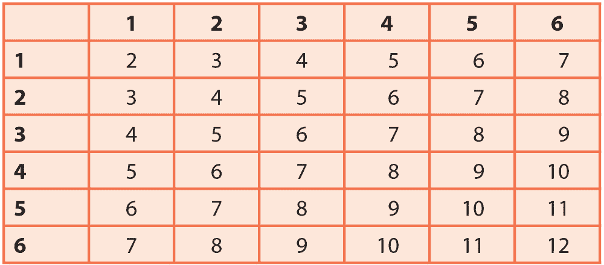

看看有多少个 7，而 12 只有一个！我们可以用图表（见图 12.15）来展示这一点，这被称为概率分布曲线，可以直观地看到每个总和出现的几率。

规则 #8 看起来可能是一条非常显而易见的规则，但我经常发现新手游戏设计师会犯将两个随机选择的数字相加却未意识到其影响的错误。有时，这正是你想要的效果——在《龙与地下城》游戏中，玩家通过掷三个六面骰子来生成数值在 3 到 18 之间的（虚拟）技能属性。结果，你会看到大量属性值集中在 10 或 11 左右，而 3 或 18 非常少见，这正是设计师想要的。如果玩家只是掷一个二十面骰子来获得属性，游戏会有什么不同？

想要将随机机制作为游戏工具的设计师，必须知道他们想要什么样的概率分布曲线，以及如何获得它。通过练习，概率分布曲线将成为你工具箱中非常宝贵的工具。

### 图 12.15

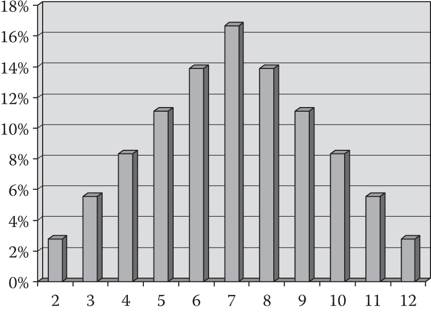

## 规则 #9：掷骰子

我们迄今为止讨论的所有概率都是**理论概率**，即从数学上讲，应该发生什么。还有**实践概率**，它衡量的是实际发生了什么。例如，我掷一个骰子得到 6 的理论概率是完美的 1/6，约 16.67%。我可以通过掷一百次六面骰子并记录出现 6 的次数来求得实践概率。我可能会记录到 100 次中有 20 次是 6。在这种情况下，我的实践概率是 20%，这离理论概率不算太远。当然，我进行的试验次数越多，实践概率就越接近理论概率。这有时被称为“蒙特卡洛”方法，以著名的赌场命名。

蒙特卡洛方法确定概率的伟大之处在于它不涉及任何复杂的数学——你只需反复重复测试并记录结果。有时它甚至能比理论概率给出更有用的结果，因为它衡量的是真实情况。如果你的数学遗漏了某些因素（例如，你的骰子可能略微偏向 6），或者数学太复杂以至于你无法为你的情况建立理论模型，蒙特卡洛方法就是解决之道。骑士本可以通过反复掷骰子、统计胜利次数并除以试验次数，轻松找到他问题的良好答案。

而在计算机时代，如果你懂一点编程（或者认识懂的人——见规则 #10），你可以轻松在几分钟内模拟数百万次试验。编写游戏模拟程序并获得一些非常有用的概率答案并不难。例如，在《大富翁》中，哪些格子被踩到的频率最高？从理论上推断这几乎是不可能的——但一个简单的蒙特卡洛模拟允许你利用电脑掷骰子、移动棋子绕棋盘跑几百万圈，从而快速回答这个问题。或者，你可以利用 Joris Dormans 创建的 Machinations 系统，它专门用于建模游戏系统并通过重复模拟展示结果模式。

## 规则 #10：极客爱显摆（贡博定律）

这是所有概率规则中最重要的一条。如果你忘了其他所有规则但记住了这一条，你也能过得很好。还有许多更困难的概率方面我们不会深入探讨——当你遇到它们时，最简单的办法是找一个自认为是“数学天才”的人。通常，这些人会非常高兴有人真正需要他们的专业知识，他们会竭尽全力帮助你。我一次又一次地利用规则 #10 解决了棘手的游戏设计概率问题。如果你身边没有专家，就在论坛或邮件列表上发帖提问。如果你真的想要快速回复，可以在开头加上“这个问题可能太难了，没人能解决，但我还是想问问”，因为有许多数学专家喜欢解决别人认为不可能的问题所带来的成就感。从某种意义上说，你的难题对他们来说就是一个游戏——为什么不利用游戏设计技巧让它尽可能有吸引力呢？

你甚至可能是在帮你的极客一个忙！我喜称规则 #10 为“贡博定律”，以纪念安托万·贡博，即梅雷骑士，他正是凭借对这一原则的认识，不仅解决了他的赌博问题（至少是数学上的那个），还无意中开创了整个概率论。

你可能害怕行使规则 #10，因为你怕问愚蠢的问题。如果你有这种感觉，别忘了帕斯卡和费马都欠骑士一个人情——如果没有他的愚蠢问题，他们永远不会做出一些最伟大的发现。你的愚蠢问题可能会通向一个属于它自己的伟大真理——但如果你不问，永远不会知道。

## 期望值

你将在设计中以多种方式使用概率，但最有用的之一是计算**期望值**。通常，当你在游戏中采取一个行动时，该行动会有一个值，无论是正面还是负面。这可能是获得或失去的分数、代币或金钱。游戏中一笔交易的期望值是所有可能结果值的平均值。

例如，棋盘游戏中可能有一条规则：当玩家落在绿色格子上时，他可以掷一个六面骰子并获得相应数量的能量点。该事件的期望值是所有可能结果的平均值。在这种情况下，由于所有概率相等，我们可以将所有可能的骰子点数相加，1 + 2 + 3 + 4 + 5 + 6 = 21，然后除以 6，得到 3.5。作为游戏设计师，知道每次有人落在绿色格子上，平均会获得 3.5 个能量点，这非常有用。

但并非所有例子都这么简单——有些涉及负面结果，以及权重不均的结果。考虑一个玩家掷两个骰子的游戏。如果掷出 7 或 11，赢 5 美元；如果掷出其他点数，输 1 美元。我们如何计算这个游戏的期望值？

掷出 7 的概率是 6/36。

掷出 11 的概率是 2/36。

根据规则 #8，掷出其他点数的概率是 1 − 8/36，即 28/36。

因此，要计算期望值，我们将每种结果的概率乘以其值并全部相加，如下所示：

| 结果 | 概率 × 结果 | 数值 |
| --- | --- | --- |
| 7 | 6/36 × $5 | $0.83 |
| 11 | 2/36 × $5 | $0.28 |
| 其他所有 | 28/36 × −$1 | −$0.78 |
| **期望值** | | **$0.33** |

所以，我们发现这是一个值得玩的游戏，因为从长远来看，你每玩一次平均能赢三十三美分。但是，如果我们改变游戏规则，只有 7 是赢的数字，而 11 像其他数字一样让你输 1 美元呢？这会改变期望值，如下所示：

| 结果 | 概率 × 结果 | 数值 |
| --- | --- | --- |
| 7 | 6/36 × $5 | $0.83 |
| 其他所有 | 30/36 × −$1 | −$0.83 |
| **期望值** | | **$0.00** |

期望值为零意味着，从长远来看，这个游戏就跟抛硬币一样好。输赢完全平衡。如果我们再改一次，这次只有 11 能赢呢？

| 结果 | 概率 × 结果 | 数值 |
| --- | --- | --- |
| 11 | 2/36 × $5 | $0.28 |

| 其他一切 || 34/36 × −$1 || −$0.94 |
| 期望值 ||   || −$0.86 |

哎！正如你所料，这是一个必输的游戏。平均而言，你每玩一次会损失约八十六美分。当然，你可以通过增加掷出十一点的奖金，把它变成一个公平游戏，甚至是一个必胜游戏。

## 仔细考量数值

期望值是游戏平衡的绝佳工具，我们将在下一章更深入地讨论它——但如果你不小心搞错结果的真实价值，它就会非常具有误导性。

考虑一下可能出现在奇幻角色扮演游戏中的这三种攻击：

| **攻击名称** | **命中率 (%)** | **伤害** |
| --- | --- | --- |
| 风刃 | 100 | 4 |
| 火球术 | 80 | 5 |
| 闪电束 | 20 | 40 |

这些攻击的期望值各是多少？风刃很简单——它总是恰好造成 4 点伤害，所以该攻击的期望值是 4。火球术有 80% 的命中率和 20% 的未命中率，所以其期望值是 ` (5 × 0.8) + (0 × 0.2) = 4 ` 点，与风刃攻击相同。闪电束攻击不太容易命中，但一旦命中，威力巨大。其期望值是 ` (40 × 0.2) + (0 × 0.8) = 8 ` 点。

现在，基于这些数值，人们可能会得出结论：玩家总会使用闪电束攻击，因为平均而言它造成的伤害是其他两种攻击的两倍。如果你面对的敌人有 500 点生命值，这可能是正确的。但面对只有 15 点生命值的敌人呢？大多数玩家在这种情况下不会使用闪电束——他们会选择较弱但更稳妥的攻击。为什么？因为尽管闪电束能造成 40 点伤害，但在这种情境下只有 15 点是有用的——闪电束对付 15 HP 敌人的真实期望值是 ` (0.2 × 15) + (0.8 × 0) = 3 ` 点，这比风刃和火球术都低。

你必须时刻注意衡量游戏中行动的真实价值。如果某事物提供的益处玩家无法利用，或包含隐性惩罚，你必须在计算中体现这一点。

## 人为因素

你还必须记住，期望值计算无法完美预测人类行为。你会期望玩家总是选择期望值最高的选项，但情况并非总是如此。有时这是由于无知——因为玩家没有意识到实际的期望值。例如，如果你没有告诉玩家风刃、火球术和闪电束各自的命中几率，而是让他们通过反复试错来发现，你可能会发现：尝试闪电束几次从未命中的玩家会得出“闪电束从不命中”的结论，因此认为其期望值为零。玩家对事件发生频率的估计往往是不准确的。你必须意识到玩家心中的“感知概率”，因为这将决定他们的游戏方式。

但有时，即使拥有完美信息，玩家仍不会选择期望值最高的选项。两位心理学家卡尼曼和特沃斯基做过一个有趣的实验，他们询问许多受试者更想玩以下两个游戏中的哪一个：

**游戏 A：**
- 66% 的几率赢得 $2400
- 33% 的几率赢得 $2500
- 1% 的几率赢得 $0

**游戏 B：**
- 100% 的几率赢得 $2400

这两个游戏都很棒！但有没有哪个更好？如果你进行期望值计算：

游戏 A 的期望值：` 0.66 × $2400 + 0.33 × $2500 + 0.01 × $0 = $2409 `
游戏 B 的期望值：` 1.00 × 2400 = $2400 `

你可以看到游戏 A 的期望值更高。但他们调查的受试者中，只有 18% 选择了 A，而 82% 更倾向于玩游戏 B。

为什么？原因在于期望值计算没有捕捉到一个重要的人为因素：**懊悔**。人们不仅寻求能带来最大快乐的选项，也避免能造成最大痛苦的选项。如果你玩游戏 A（假设你只能玩一次），却倒霉地抽中了那 1% 而得到 $0，感觉会很糟糕。人们往往愿意付出代价来消除潜在的懊悔——“买个安心”，正如保险推销员所说。他们不仅愿意付费避免懊悔，还愿意冒险。这就是为什么输了点钱的赌徒往往愿意冒更大的风险试图赢回本金。特沃斯基是这样表述的：“在为获利而冒险时，人们是保守的。他们会选择确定的收益，而非不确定的收益。但我们也发现，当人们面临‘小额确定损失’与‘大额概率性损失’的选择时，他们会选择赌博。”这似乎是“免费游戏”《Puzzle & Dragons》（智龙迷城）成功的很大一部分原因。玩家通过一系列解谜积累宝藏，穿越地下城。但有时他们会在城中丧命，游戏实际上会说：“哦，太糟糕了，你要死了。看看你将失去所有宝藏。你确定不想花一点真钱，来争取保住你赚来的东西吗？”许多人为了避免那笔小额的确定损失，选择了付费。

在某些情况下，人类大脑会将某些风险完全夸大。在一项研究中，特沃斯基请人们估算各种死因的可能性，得出了以下结果：

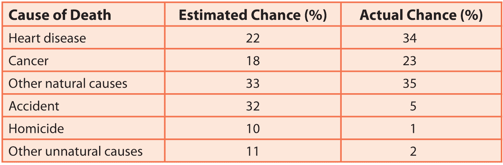

特别有趣的是，受试者低估了前三类（自然死因），却显著高估了后三类（非自然死因）。这种现实扭曲似乎反映了受试者的恐惧。这对游戏设计有什么启示？作为设计师，你不仅要掌握游戏中事件的实际概率，还要掌握感知概率，两者可能因多种原因而截然不同。

在计算期望值时，你需要同时考虑实际概率和感知概率，它们提供的信息极其有用，足以构成 **透镜 #35**。

## 技巧与运气交织在一起

概率以及实际价值与感知价值的差异固然棘手，但运气这一游戏机制还有更多花招。尽管我们倾向于认为运气和技巧是完全分离的机制，但它们之间存在重要的相互作用，我们无法忽视。以下是游戏设计师必须考虑的五个最重要的技巧/运气互动。

1. **估算几率是一种技巧**：在许多游戏中，熟练玩家与新手的区别在于他们预测下一步会发生什么的能力，这通常通过计算概率来实现。例如，二十一点游戏几乎完全关乎对赔率的了解。一些玩家甚至练习“计牌”，即记录已经打出的牌，因为每打出一张牌都会改变后续牌出现的几率。你游戏中的感知概率在擅长估算的玩家和不擅长的玩家之间可能差异巨大。

### 技能具有成功概率

人们可能天真地认为，完全基于技能的游戏（如国际象棋或棒球）不包含任何随机性或风险因素。但从玩家的角度来看，这根本不是事实。每个行动都存在一定风险，玩家时刻都在做期望值决策，决定何时稳扎稳打，何时孤注一掷。这些风险很难量化（我成功盗垒的几率有多大？我能在对手毫无察觉的情况下困住其皇后的几率有多大？），但它们依然是风险。在设计游戏时，你需要确保这些风险经过平衡，就像你平衡“纯运气”游戏元素（如抽牌或掷骰子）一样。

### 估算对手技能是一项技能

玩家判断特定行动成功几率的能力，很大程度上取决于他们估算对手技能的能力。许多游戏中一个迷人的部分在于，试图欺骗对手，让他们误以为你的技能高于实际水平，从而阻止他们尝试过于大胆的行动，并让他们对自己产生怀疑。同样，有时情况恰恰相反——在某些游戏中，让对手误以为你的技能低于实际水平是一种好策略，这样对手就不会注意到你的微妙策略，甚至可能尝试一些在高手面前极具风险的行动。

### 预测纯运气是一种想象出的技能

人类会有意识或无意识地寻找模式，以帮助预测接下来会发生什么。我们对模式的狂热常使我们在本不存在模式的地方寻找并“发现”模式。两种最常见的虚假模式是“幸运连赢谬误”（我已经连赢几局了，所以再赢一局的可能性很大）及其对立面“赌徒谬误”（我已经连输几局了，所以我该赢了）。嘲笑这些为无知很容易，但在玩家至关重要的心智中，识别这些虚假模式感觉就像是在运用真实的技能，作为设计师，你应该想办法利用这一点为己所用。

### 控制纯运气是一种想象出的技能

我们的大脑不仅主动寻找模式，还主动且绝望地寻找因果关系。对于纯运气事件，无法控制结果——但这无法阻止人们以特定方式掷骰子、携带幸运物或进行其他迷信仪式。这种感觉——仿佛有可能控制命运——正是赌博游戏如此刺激的部分原因。理智上我们知道这是不可能的，但当你站在那里掷骰子，嘴里念叨着“来啊，来啊……”，这确实让人感觉仿佛有可能，尤其是当你真的走运时！如果你尝试玩纯运气游戏，但完全摒弃“你的任何思想或行为都能影响结果”这一念头，大部分乐趣会瞬间消失。我们试图控制命运的自然倾向，能让运气游戏感觉像技能游戏。

运气是棘手的东西，因为它交织着硬核数学、人类心理学和所有基础游戏机制。但正是这种棘手赋予了游戏丰富性、复杂性和深度。我们的七大基础游戏机制中的最后一个带给我们了透镜 #36。

终于，我们已经涵盖了所有七大基础游戏机制。很快，我们将转向由这些机制构建的更高级机制，如谜题和互动故事结构。但首先，我们需要探索将这些基础元素带入平衡的方法。

### 延伸阅读推荐

*   **《游戏机制：高级游戏设计》** 作者：Ernest Adams 和 Joris Dormans。本书深入探讨了各种游戏机制交互的大量精彩细节，并介绍了用于模拟游戏设计的迷人 Machinations 系统。
*   **《牛津棋类游戏书》** 作者：David Parlett。包含更多关于 Parlett 规则分析的细节，以及一些前几个世纪惊人但鲜为人知的棋盘游戏描述。
*   **《游戏中的不确定性》** 作者：Greg Costikyan。一本关于游戏中运气与不确定性本质的极具洞察力的书。每次阅读我都能有新收获。
*   **《未完成的游戏：帕斯卡、费马和改变世界的未完成信件》** 作者：Keith Devlin。如果你想了解更多概率论诞生的故事细节，这是权威著作。
