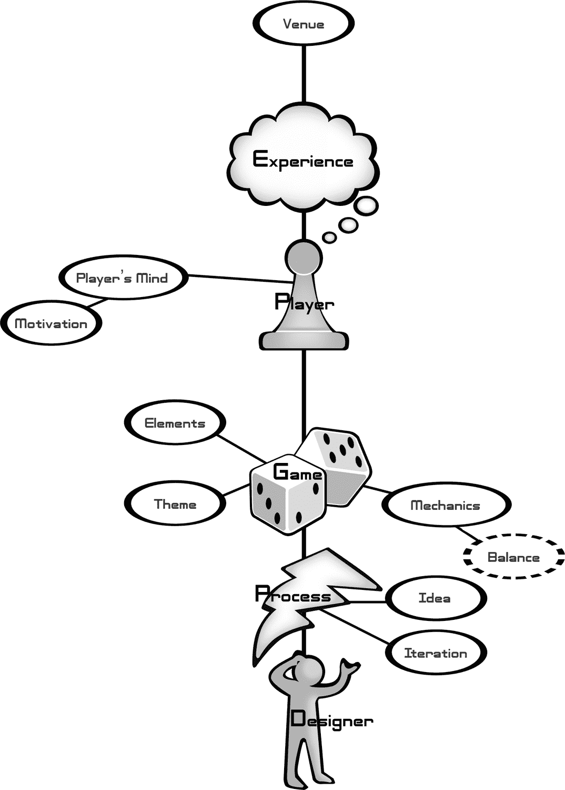
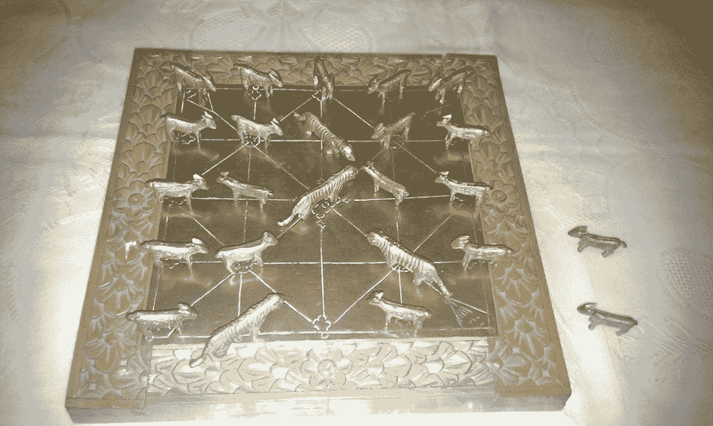
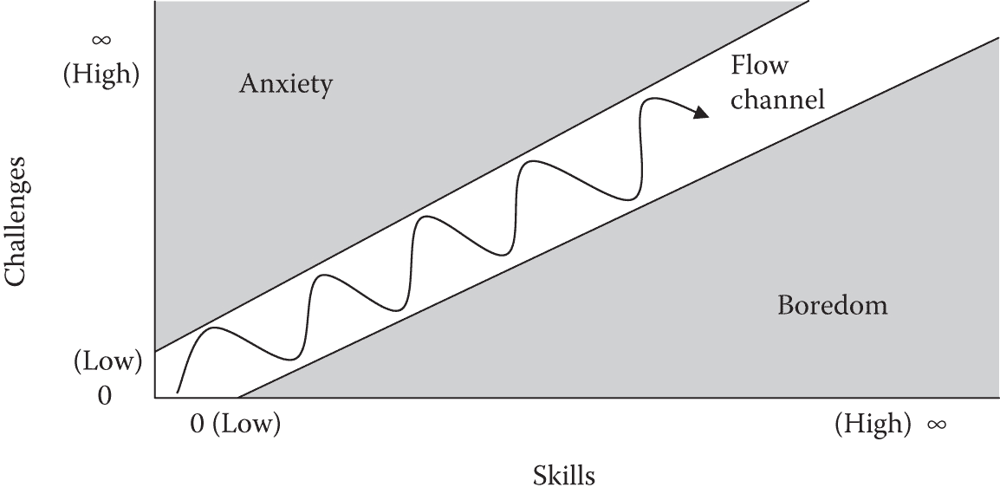
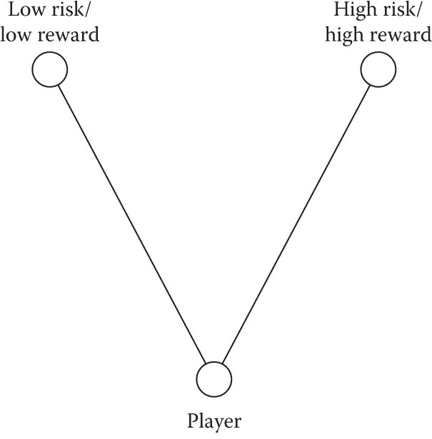

# 第 13 章：游戏机制必须保持平衡

> *不公平的天平为耶和华所憎恶。*
>
> ——《箴言》11:1

你是否曾满怀期待地玩一款你确信会非常好玩的游戏，结果却大失所望？这款游戏拥有听起来有趣的故事、你最喜欢的游戏玩法类型、尖端技术和精美美术——但不知为何，游戏过程却单调、困惑且令人沮丧。这就是一款失去平衡的游戏。

对新手设计师来说，游戏平衡的工作似乎相当神秘——但实际上，平衡游戏无非是调整游戏元素，直到它们带来你想要的体验。平衡游戏远非科学；事实上，尽管通常涉及简单的数学，它普遍被认为是游戏设计中最具艺术性的部分，因为它关乎理解游戏元素间微妙关系的细微差别，知道该修改哪些元素、修改多少、以及哪些元素该保持不变。

游戏平衡之所以困难，部分原因在于没有两款游戏是相同的，每款游戏都有许多不同的因素需要平衡。作为设计师，你必须洞察你的游戏中哪些元素需要平衡，然后尝试修改它们，直到它们产生你希望玩家获得的精确体验。

把它想象成创建新食谱——确定需要哪些食材是一回事，但决定每种用多少量以及如何搭配是另一回事。一些决策基于硬性数学（1.5 茶匙泡打粉可使 1 杯面粉膨胀），但另一些，比如用多少糖，往往取决于个人口味。技艺高超的厨师能让最简单的食谱也美味可口，原因与技艺高超的游戏设计师能让最简单的游戏也耐玩是一样的——他们都知道如何平衡配料。

游戏平衡可以有多种形式，因为每款不同的游戏都有不同的东西需要平衡。尽管如此，仍有一些平衡模式反复出现。平衡游戏的关键在于仔细审视它，因此本章将包含大量透镜。

## 十二种最常见的游戏平衡类型

### 平衡类型 #1：公平性

> *力悬殊的战斗没有乐趣。*
>
> ——卡武尔夫人

#### 对称游戏

## 对称游戏

玩家在游戏中普遍追求的一个特质是公平。玩家希望感受到与其对抗的力量没有会让他们无法战胜的优势。确保这一点最简单的方法之一就是让你的游戏**对称**，即给予所有玩家平等的资源和能力。大多数传统棋盘游戏（如跳棋、国际象棋和大富翁）以及几乎所有体育运动都采用这种方法，以确保没有玩家比其他玩家拥有不公平的优势。如果你想让玩家直接相互竞争，并且预期他们的技能水平大致相当，那么对称游戏是一个绝佳的选择。它们是判断哪些玩家最强的特别好的系统，因为游戏中的一切条件都相同，唯一的区别在于个别玩家带入游戏的技能和策略。在这些游戏中，完美的对称并不总是可能的，因为通常存在一些小问题，例如“谁先走？”或“谁先发球？”，这会给一方带来微小的优势。通常，随机选择（如抛硬币或掷骰子）是解决办法。虽然这给了某位玩家微小的优势，但在多局游戏中，优势会均匀分布。在某些情况下，消除这种不对称的方法是将优势给予技能最低的玩家——例如“年龄最小的玩家先走”。这是一种利用游戏天然的不平衡来帮助平衡玩家技能水平的优雅方式。

## 非对称游戏

给予对手不同的资源和能力也是可能的，而且通常是可取的。如果你这样做，请注意你面临着一项重要的平衡任务！以下是你可能创建非对称游戏的一些原因：

1.  **模拟真实世界情境**：如果你的游戏目的是模拟二战期间轴心国和同盟国之间的战斗，对称游戏讲不通，因为现实世界的冲突并非对称的。

2.  **给玩家探索游戏空间的另一种方式**：探索是游戏体验的巨大乐趣之一。玩家通常喜欢探索用不同的力量和资源玩同一个游戏的可能性。例如在格斗游戏中，如果两个玩家有十个不同的斗士可供选择，每个斗士拥有不同的能力，那么就会有一百种不同的组合，每种组合都需要不同的策略，实际上你将一个游戏变成了一百个游戏。

3.  **个性化**：不同的玩家给游戏带来不同的技能——如果你给玩家选择最适合自己技能的力量和资源，会让他们感到强大——他们能够塑造游戏，以强调他们喜欢的玩法。

4.  **拉平竞技场**：有时，你的对手技能水平截然不同。如果你有电脑控制的对手，这尤其明显。以*吃豆人*游戏为例。如果只有一个幽灵追逐*吃豆人*，游戏会更对称。但如果是这样，玩家会轻松获胜，因为人类在穿越迷宫方面很容易就能智取电脑。但要同时智取四个电脑控制的对手，则使游戏达到平衡，给电脑击败玩家的公平机会。有些游戏在这方面是可定制的——例如高尔夫差点制，就让不同水平的玩家都能在各自享受的挑战难度下竞技。是否引入这种平衡，取决于你的游戏是旨在成为衡量玩家技能的标准尺度，还是旨在为所有玩家提供挑战。

5.  **创造有趣的情境**：在所有可创造的游戏的无限空间中，非对称游戏比对称游戏多得多。让非对称的力量相互对抗，往往能给玩家带来有趣且发人深省的体验，因为获胜的正确策略并不总是显而易见的。玩家会自然地好奇某一方是否具有优势，并经常花费大量时间和思考来判断游戏是否真正公平。*Bhag-Chal*（尼泊尔的官方棋盘游戏）就是一个绝佳的例子。在这个游戏中，玩家不仅力量不对等，目标也不同！一方控制五只老虎，另一方控制二十只山羊。老虎玩家通过吃掉五只山羊获胜，山羊玩家通过摆放山羊使所有老虎无法移动来获胜。虽然资深玩家普遍认为游戏是平衡的，但新手会花费大量时间讨论哪一方有特定优势，并反复游玩以尝试确定最佳策略和反制策略。

## 双翼机大战

想象一款双翼机空战游戏。每位玩家可以选择以下飞机之一：

| **飞机** | **速度** | **机动性** | **火力** |
| --- | --- | --- | --- |
| 食人鱼 | 中 | 中 | 中 |
| 复仇者 | 高 | 高 | 低 |
| 骆驼式 | 低 | 低 | 中 |

这些飞机平衡吗？很难说。但乍一看，我们可能会将这三个类别评估为低 = 1，中 = 2，高 = 3。这给我们带来了新信息：

| **飞机** | **速度** | **机动性** | **火力** | **总计** |
| --- | --- | --- | --- | --- |
| 食人鱼 | 中 (2) | 中 (2) | 中 (2) | 6 |
| 复仇者 | 高 (3) | 高 (3) | 低 (1) | 7 |
| 骆驼式 | 低 (1) | 低 (1) | 中 (2) | 4 |

从这个角度来看，驾驶复仇者的玩家似乎比其他玩家拥有不公平的优势。情况可能确实如此。但玩了一会儿后，也许我们会注意到食人鱼和复仇者看起来势均力敌，但驾驶骆驼式的玩家通常会输。这可能会让我们推测火力比其他类别更有价值——也许价值是两倍。换句话说，对于火力这一栏，低 = 2，中 = 4，高 = 6。这给我们一张新表：

| **飞机** | **速度** | **机动性** | **火力** | **总计** |
| --- | --- | --- | --- | --- |
| 食人鱼 | 中 (2) | 中 (2) | 中 (4) | 8 |
| 复仇者 | 高 (3) | 高 (3) | 低 (2) | 8 |
| 骆驼式 | 低 (1) | 低 (1) | 中 (4) | 6 |

这给出的总计与我们在实际游戏中的观察相符。我们现在可能有了一个模型，展示如何平衡游戏使其公平。为了验证我们的理论，我们可以将骆驼式的火力改为高 (6)，得到一张新表：

| **飞机** | **速度** | **机动性** | **火力** | **总计** |
| --- | --- | --- | --- | --- |
| 食人鱼 | 中 (2) | 中 (2) | 中 (4) | 8 |
| 复仇者 | 高 (3) | 高 (3) | 低 (2) | 8 |
| 骆驼式 | 低 (1) | 低 (1) | 高 (6) | 8 |

如果我們的模型是正確的，這三架飛機似乎達到了完美的平衡。但這只是理論。我們通過遊戲測試來驗證。如果測試中發現，無論使用哪架飛機，遊戲體驗都大致公平，那麼我們的模型就是正確的。但如果測試發現「索普威思·駱駝」戰機依然屢戰屢敗，我們就必須提出新假設、修改模型、重新平衡，並再次測試。

值得注意的是，平衡遊戲與建立平衡模型這兩個過程是相輔相成的。在平衡過程中，你會更深入地了解遊戲內部的各種關係，從而建立更好的數學模型來表達這些關係；而模型的修正又會指導你找到更正確的平衡方法。模型指導平衡，平衡完善模型。

另外請注意，遊戲平衡工作只有在遊戲可玩後才能真正開始。許多遊戲在市場上表現不佳，就是因為開發進度被「讓遊戲跑起來」耗盡，留給平衡的時間不足，就不得不推向市場。有一條經驗法則：遊戲完全可玩後，平衡需要六個月，但這因遊戲類型和規模而異。我個人遵循的規則是：一半的開發時間應用於平衡。毫無疑問，新玩法元素越多，妥善平衡所需的時間就越長。

### 石頭、剪刀、布

確保公平平衡遊戲元素的一種簡單方法是：每當遊戲中的某樣東西相對於另一樣擁有優勢時，總有第三樣東西對它擁有優勢！這通常被稱為「循環平衡」，其經典例子就是「石頭、剪刀、布」遊戲：

*   石頭砸碎剪刀
*   剪刀剪斷布
*   布包住石頭

沒有任何元素能稱霸，因為總有另一個元素能擊敗它。這是確保每個遊戲元素都有優勢和劣勢的簡單方法。格鬥遊戲特別喜歡使用這種技術，以確保玩家可選的角色沒有無敵的。

讓遊戲感覺公平是遊戲平衡最基礎的類型之一。你在創作的任何遊戲中肯定都會用到「公平性透鏡」。

## 平衡類型 #2：挑戰與成功

讓我們回顧一下第 10 章中的這張圖：*玩家的心智*。

**圖 13.2**

我們知道讓玩家保持在「心流通道」中是理想的。如果遊戲太難，玩家會沮喪；如果太簡單，玩家會厭倦。讓玩家走在中間的道路上，意味著要將挑戰體驗和成功體驗保持在適當的平衡。這很難做到，因為玩家技能水平參差不齊。一人覺得無聊，另一人可能覺得有挑戰，第三人卻可能覺得沮喪。一些實現適當平衡的常用技巧包括：

*   **隨成功提高難度**：這是電子遊戲中非常常見的模式——每一關都比上一關難。玩家磨練技能通過一關，緊接著面臨新的挑戰。當然，別忘了使用前面提到的「張弛有度」模式。

*   **讓玩家快速通過簡單部分**：假設你的遊戲有逐漸增加難度的機制，允許高手玩家在輕鬆掌握的關卡中快速通關，這對你有利。這樣，高手能迅速通過簡單關卡，到達更有意思的挑戰；而新手則在前期關卡獲得挑戰。這能讓每位玩家快速到達適合自己的挑戰部分。如果安排得不當，比如無論技能如何每關都要玩一小時，高手會因缺乏挑戰而迅速厭倦。

*   **創建「挑戰層級」**：遊戲中常見的模式是每關或每次任務結束時給出等級或星數。獲得「D」或「F」需重玩，獲得「C」或以上可繼續。這創造了極大的遊玩靈活性。新手玩家獲得「C」解鎖下一關會很興奮。隨著經驗積累解鎖所有關卡，他們可能會給自己設定新挑戰——在早期關卡爭取「A」（甚至「A+」！）。

*   **讓玩家選擇難度等級**：一種行之有效的方法是讓玩家選擇「簡單、普通、困難」模式。有些遊戲（如許多 Atari 2600 遊戲）甚至允許中途改變難度。優點是玩家能快速找到適合自己技能的挑戰。缺點是你必須創建並平衡多個版本的遊戲。此外，這可能削弱遊戲的「真實感」——玩家會爭論哪個版本是「真正的」版本，或不確定是否有任何一個是「真正的」。

*   **用多種玩家進行測試**：許多設計師陷入只與長期接觸遊戲的人測試的陷阱，導致遊戲對新手太難。另一些人則陷入相反的陷阱，只與從未玩過的人測試，導致老手很快感到無聊。明智的設計師會混合高手和新手進行測試，確保遊戲初期、中期、後期都好玩。

*   **給落後者機會**：《瑪利歐賽車》以其獨特的道具分配系統聞名。領先的玩家獲得微薄道具，而落後的玩家獲得強力道具，從而反超。這對該遊戲很有效，因為它讓人感覺更公平，讓所有人都投入其中：落後者需時刻留意，因為逆轉道具隨時可能出現；領先者不敢掉以輕心，因為「藍色貝殼」隨時可能擊中他們。這個巧妙的系統能很好地將所有玩家推向心流通道的中心。

遊戲平衡中最棘手的挑戰之一是決定遊戲難度隨時間如何上升。許多設計師害怕玩家太容易通關，於是讓後期關卡難度極高，導致 90% 的玩家最終因沮喪而放棄。這些設計師希望高難度能延長遊戲時間——這有一定道理——如果你花了 40 小時通過第 9 關，你很可能願意為通過第 10 關付出巨大努力。但事實上，競品遊戲太多，許多玩家直接因挫敗感而棄坑。另一方面，對於免費遊戲，這種後期挫敗感可能正是你想要的，以刺激玩家付費推進進度。作為設計師，問自己「我想讓多少比例的玩家能通關？」並為此設計，是合理的。

别忘了：仅仅学会如何玩游戏本身就是一种挑战！因此，游戏的前一两关通常极其简单——玩家光是努力理解“控制与目标”就已经感到非常有挑战性了，任何额外的挑战都可能让他们直接陷入挫败感中。更别提早期的几次成功能极大地建立玩家的信心——自信的玩家不太会轻易放弃游戏。

挑战是游戏玩法的核心元素，且难以平衡，值得用一个独立的透镜来审视。

## 平衡类型 #3：有意义的选择

在游戏中给玩家提供选择的方式有很多种。对玩家而言，有意义的选择会引导他们自问一些问题，例如：

*   我该去哪里？
*   我该如何花费我的资源？
*   我该练习并精通什么？
*   我该如何打扮我的角色？
*   我该速通还是谨慎推进？
*   我该专注进攻还是防守？
*   在这种局势下我该用什么策略？
*   我该选哪个能力？
*   我该稳扎稳打还是孤注一掷？

好的游戏给玩家提供有意义的选择。不是随随便便的选择，而是会对接下来发生的事和游戏结局产生真实影响的选择。许多设计师陷入了提供无意义选择的陷阱；例如，在赛车游戏中，你可能有 50 辆车可选，但如果它们开起来手感都一样，那就等于完全没有选择。另一些设计师则陷入了另一个陷阱——提供没人想要的选择。你可能给士兵十把各不相同的枪，但如果其中一把明显优于其他所有枪，那又等于完全没有选择。

当向玩家提供选择，但其中有一个明显优于其他所有选择时，这被称为**占优策略**。一旦发现占优策略，游戏就不再好玩了，因为游戏的谜题已被解开——不再有选择可做。当你发现你正在开发的游戏存在占优策略时，你必须修改规则（调整平衡），使该策略不再占优，从而将有意义的选择还原给游戏。前面的“双翼机大战”例子就是这种情况——设计师试图平衡游戏以移除占优策略，并将有意义的选择还原给玩家。被玩家发现的隐藏占优策略常被称为“漏洞利用”，因为玩家可利用它们走捷径取得设计师未预料的成功。

在游戏早期开发阶段，占优策略比比皆是。随着开发推进，这些策略开始得到妥善平衡。矛盾的是，这往往让新手设计师陷入恐慌：“昨天我还懂这游戏该怎么玩——但有了这些新改动，我不确定正确的玩法是什么了！”他们感觉失去了对自己游戏的掌控。但现实是，游戏刚刚向前迈了一大步！它不再有占优策略，现在有了有意义的选择。与其恐惧这一刻，不如珍惜它，并借机看看能否理解当前的规则与数值配置为何能让游戏达到平衡。

但这引出另一个问题：我们该给玩家多少有意义的选择？Michael Mateas 指出，玩家寻求的选择数量取决于他们欲望的数量：

*   如果选择 > 欲望，玩家会不知所措。
*   如果选择 < 欲望，玩家会感到沮丧。
*   如果选择 = 欲望，玩家会感到自由和充实。

因此，要妥善确定选择数量，你需要弄清玩家想做的事情的类型和数量。在某些情况下，玩家只想要少量的有意义选择（选走左岔路还是右岔路很有趣——选走三十条岔路中的一条则让人不知所措）。其他时候，则需要大量选择（例如《模拟人生》中的服装购买界面）。

有意义的选择是交互性的核心，拥有一个审视它们的透镜非常有用。

### 三角性

对玩家而言，最激动人心、最有趣的选择之一，是选择稳妥行事换取小奖励，还是冒大险博取大奖励。如果游戏平衡得当，这是个很难做的决定。我发现约有八成找我求助、说游戏原型“就是不好玩”的人，他们的游戏缺少这种有意义的选择。你可以称之为“平衡的非对称风险”，因为你在平衡低风险低回报与高风险高回报，但这有点绕口。这种关系频繁出现且至关重要，所以我喜欢给它一个更短的名字：**三角性**。玩家是三角形的一点，低风险选择是第二点，高风险选择是第三点。

《太空入侵者》就是个具有良好三角性的游戏。游戏大部分时间你都在射击靠近飞船的低分外星人，分值 10、20、30 分。它们移动缓慢、易于射击，射击它们能让你更安全，因为能阻止它们向你投弹。但偶尔，一个小红飞碟会飞过屏幕顶端。它不构成威胁，但很难且危险射击。难在它移动且距离远，险在要瞄准它，你必须把视线从飞船上移开看它，冒着被炸弹击中的风险。然而，它值 100 到 300 分！没有飞碟，《太空入侵者》会变得很乏味，因为你的选择很少——只是不停地射、射、射。有了飞碟，你偶尔会面临一个非常困难、有意义的选择——是稳妥行事，还是冒险博取高分？三角性非常重要，值得拥有自己的透镜。

**图 13.3**

Steven Levy 所著《黑客》一书中出现了一个经典的三角性例子。一位 MIT 工程师黑进了一台自动售货机，给每位用户一个选择：像往常一样按原价买零食，或碰碰运气。抛一枚数字硬币，结果要么零食双倍价格，要么完全免费。

确保三角性平衡的好方法是使用透镜 #35：**期望值**。街机游戏 *Qix* 提供了一个用期望值平衡的有趣例子。在游戏中，你试图在空白游戏板上绘制矩形包围领地。同时，一团称为 Qix 的线条在板上随机漂浮。如果 Qix 在你画完矩形前触碰到你的矩形，你就死掉。但如果你画完了矩形，就占有那块区域。当你覆盖了 75% 的板面，你就赢下该关卡。

游戏设计师给玩家一个非常明确的选择——每次画矩形，你可以选择快速移动（画蓝色矩形）或半速移动（画橙色矩形）。因为半速移动危险程度加倍，半速画出的矩形得分翻倍。这之所以行得通，是因为如果我们假设成功画出快速蓝色矩形的几率是 20%，值 100 分，那么尝试画一个的期望值就是 100 分 × 20% = 20 分。我们也知道半速画矩形成功几率减半，于是得到如下表格：

| 速度 | 成功几率 (%) | 分数 | 期望值 |
| --- | --- | --- | --- |
| 快速 (蓝色) | 20 | 100 | 20 |
| 慢速 (橙色) | 10 | ? | 20 |

我们希望游戏保持平衡，因此我们维持期望值不变。很容易看出，如果我们想让游戏保持平衡，同尺寸慢速矩形的分数值应为 200 分。这类问题的难点在于确定成功几率——我们通常不得不估算——但这又是一个模型指导原型、测试原型反哺模型的案例，从而形成一个良性循环，最终模型正确且游戏平衡。

*马里奥赛车* 是三角性的交响曲。它一次又一次地向你呈现高风险/低风险的选择，并给予相应的回报。示例包括以下内容：

*   **手动还是自动？** 手动操作需要更多技巧，但如果用得好，能给你更多加速。
*   **赛车还是摩托车？** 赛车拥有更快的基础速度——但如果你在摩托车上翘头（这有风险，因为翘头时无法转向），你的速度会比赛车更快。
*   **拾取道具？** （冒着撞车的风险）还是无视它们？
*   **使用道具？** （冒着分心的风险）还是无视它们？
*   **保留手中的道具？** 还是丢弃它以换取新道具？
*   **使用加速垫？** 它们能加速，但往往位于危险地带。
*   **提前踩油门？** 如果你在起跑线提前踩油门，时机把握得当能获得加速，时机不对则会遭遇令人沮丧的延迟。
*   **左还是右？** 许多赛道包含分叉路径，有低风险和高风险之分——当然，高风险路径拥有更多加速道具。

#### 平衡类型 #4：技巧 vs. 运气

在 第 12 章 中，我们详细讨论了技巧与运气的机制。从真实意义上讲，这是任何游戏设计中两股对立的力量。过多的运气会抵消玩家技巧的作用，反之亦然。这没有简单的答案——有些玩家偏好运气成分尽可能少的游戏，而另一些玩家则偏好相反的情况。技巧型游戏往往更像体育竞技——判断哪位玩家最强的评判体系。运气型游戏通常更具轻松、休闲的性质——毕竟，结果很大程度上取决于命运。要达到平衡，你必须使用 透镜 #19：***玩家***，以了解多少技巧和多少运气适合你的游戏受众。偏好差异有时由年龄或性别决定，有时甚至由文化决定；例如，德国桌游玩家似乎比美国玩家更偏好尽量减少运气影响的游戏。

平衡二者的一种非常常见的方法是在游戏中交替使用运气和技巧。例如，发牌是纯运气——但选择如何出牌是纯技巧。掷骰子决定移动步数是纯运气——决定棋子移动到哪里是纯技巧。这能创造出一种张弛交替的模式，让玩家感到非常愉悦。

设计师大卫·佩里建议，让游戏具有成瘾性的关键在于设计游戏，使玩家始终在做三件事：锻炼技巧、承担风险、制定策略。确实，每当玩家承担风险时，他们就在以某种方式对抗运气。

如何平衡技巧与运气将决定你游戏的性格。请透过这枚透镜仔细审视它。

#### 平衡类型 #5：脑力 vs. 手力

这种平衡类型非常直观：游戏中有多少比例应涉及具有挑战性的身体活动（无论是转向、投掷，还是熟练地按按钮），又有多少比例应涉及思考？这两者并不像表面看起来那样截然不同——许多游戏在同时完成速度与敏捷壮举的过程中，涉及持续的策略制定和解谜。其他游戏则为了多样性而交替这两种玩法。考虑“动作平台”游戏类型——你操控角色通过关卡，熟练地引导角色跳过障碍，或许还要射击敌人，偶尔停下来解开阻碍通关的小谜题。通常，关卡末尾会通过“Boss 怪物”来提高强度，击败它需要解谜（“噢！我得跳到它尾巴上，这样它就会放下盾牌一秒钟！”）和敏捷操作（“我只有一秒钟时间把箭射进那个窄缝里！”）相结合。

不过，了解目标市场在游戏中偏好什么很重要——更多思考还是更多敏捷操作？同样重要的是，你的游戏要清楚地传达你选择了何种平衡。请看世嘉 Mega Drive（Genesis）上那款非常不寻常的游戏《吃豆人 2：新冒险》。其名称暗示这将是一款动作加少许策略的游戏，像最初的《吃豆人》一样。但瞥一眼包装盒却讲述了另一个故事——这看起来像是一款 2D 平台游戏，像《超级马里奥兄弟》或《索尼克》，意味着动作加少许解谜。但实际游玩后却发现完全不同！虽然视觉上看像动作平台游戏，它其实是一款古怪的心理解谜游戏，你微妙地引导吃豆人进入不同情绪状态，以让他通过各种障碍。期待以动作为主、少思考的玩家感到失望——寻找解谜游戏的玩家通常根本不玩这款游戏，因为其“动作游戏”的外观而拒绝了它。

当《Games Magazine》评测电子游戏时，他们会在一个滑动刻度上给出排名，一端是“手指”，另一端是“大脑”。很容易忘记，一款需要大量按键操作的游戏仍然可能包含大量思考和策略。使用 透镜 #34：***技巧***，以了解游戏中的不同技巧，然后用这枚透镜来平衡这些技巧。

#### 平衡类型 #6：竞争 vs. 合作

竞争与合作是基本的动物本能。所有高等动物都受驱使去与他人竞争，部分是为了生存，部分是为了在群体中确立地位。与此相反，也存在与他人合作的基本本能，因为团队拥有更多的眼睛和手以及多样化的能力，永远比个体更强大。竞争与合作对我们的生存如此重要，以至于我们需要尝试它们——部分是为了更擅长它们，部分是为了了解朋友和家人——从而更好地了解谁擅长什么以及我们如何协作。游戏提供了一种在社交上非常安全的方式，来探索周围人在压力情境下的行为——这是我们喜欢一起玩游戏的一个隐秘原因。

说到游戏，竞争性游戏比合作性游戏更常见，尽管也创作了一些非常有趣的合作游戏。《煮糊了》需要玩家合作烹饪菜肴以拯救世界。而桌游《瘟疫危机》是一个迷人的例子，玩家之间完全不竞争，而是协调努力，试图作为一个团队赢得游戏。

有些游戏会寻找有趣的方式来融合竞争与合作。街机游戏*Joust*可以单人游玩，此时玩家与众多电脑控制的敌人竞争；也可以双人模式游玩，两名玩家在同一竞技场中共同对抗敌人。*Joust*中竞争与合作之间的张力非常有趣：在竞争方面，玩家根据击败的敌人数量获得分数，如果他们愿意，还可以互相厮杀。但在合作方面，如果玩家协调进攻并互相掩护，总分会更高。是试图击败对手（获得更高的相对分数），还是试图通关游戏（试图获得最高的绝对分数），全凭玩家决定。游戏充分利用了这种张力：有些关卡被指定为“团队波次”——如果两名玩家都能存活下来，每人可获得 3000 分奖励。其他关卡被指定为“角斗士波次”——率先击败对手的玩家获得 3000 分奖励。这种在合作与竞争之间有趣的交替，赋予了游戏丰富的变化，让玩家得以探索其搭档更倾向于合作还是竞争。

虽然竞争与合作是截然对立的两极，但它们可以非常方便地结合在一起，形成一种两全其美的局面。怎么做？通过团队竞争！这在体育运动中很常见，网络游戏的兴起让团队竞争在电子游戏世界中得以成长和繁荣。

竞争与合作至关重要，因此我们需要三个透镜来妥善审视它们。

随着越来越多的游戏上线，不同类型的竞争与合作机会变得触手可及，从两人之间的休闲多人国际象棋游戏，到大型多人在线角色扮演游戏（MMORPG）中数千名玩家组成的公会对抗。但驱动我们享受竞争与合作的心理力量并未改变——你越能理解并平衡这些力量，你的游戏就会变得越强。

## 平衡类型 #7：短流程 vs. 长流程

每个游戏中一项重要的平衡任务是游戏时长。如果游戏太短，玩家可能没有机会制定并执行有意义的策略。但如果游戏拖得太长，玩家可能会感到厌倦，或者因为游戏需要投入太多时间而避而远之。

决定游戏时长的因素往往很微妙。例如，按官方规则玩*大富翁* 时，通常在 90 分钟左右结束。但许多玩家觉得这些规则太严苛，会修改规则发放现金大奖、放宽购买地产的时机限制，这作为副作用导致游戏时间大幅延长，通常长达三小时，甚至更久。

决定游戏何时结束的主要因素是胜负条件。通过改变这些条件，可以极大地改变游戏时长。街机游戏*间谍猎手* 的设计师想出了一个非常有趣的系统来平衡游戏时长。在*间谍猎手* 中，你驾驶一辆在高速公路上向敌人发射机枪的汽车。在早期原型中，汽车被摧毁三次游戏就结束。游戏极具挑战性，尤其是对新手，设计师发现这些玩家的游戏时间非常短并感到沮丧——于是他们引入了一条新规则：游戏前 90 秒内，玩家拥有无限数量的汽车——在此期间他们不会失败。时间一到，只剩下几辆汽车，用完即游戏结束。

*牛头怪* 的设计师（他们后来制作了*光环*）有另一种有趣的方法来平衡游戏时长。*牛头怪* 是一款网络游戏，最多四名玩家在迷宫中奔跑，收集武器和法术，试图消灭迷宫中的其他玩家。当只剩一名玩家存活时游戏结束。设计师发现了一个问题：如果玩家不互相对抗，可能会陷入僵局，游戏有变得无聊的风险。解决方法之一是设定时间限制并根据积分制宣布获胜者，但他们采用了更优雅的做法。他们制定了一条新规则：20 分钟后，钟声响起，“末日审判”开始；所有存活玩家突然被传送到一个充满怪物和其他危险的小房间，在那里没人能存活太久。这样，游戏保证在 25 分钟内以一种相当戏剧化的方式结束，仍可决出一名获胜者。现代“大逃杀”游戏遵循了这一模式，在固定时间内逐渐缩小区域，最终迫使所有存活玩家相遇。

## 平衡类型 #8：奖励

> *君主应当快于赏赐，缓于惩罚。*
>
> —奥维德

为什么人们愿意花费大量时间玩电子游戏，只为获得一个好分数？我们之前讨论过游戏如何成为判断的结构，以及人们渴望被判断。但人们不想要任何判断——他们渴望获得**正面**的判断。奖励是游戏告诉玩家“你做得很好”的方式。

游戏倾向于给予几种常见类型的奖励。每种都不同，但它们有一个共同点——满足玩家的欲望。

*   **表扬**：最简单的奖励，游戏通过明确的陈述、特殊的音效，甚至游戏内角色对你说话，告诉你干得好。归根结底都是一回事：游戏评判了你，并且表示认可。任天堂游戏因通过音效和动画，为玩家获得的每项奖励提供大量的次要表扬而闻名。
*   **分数**：在许多游戏中，分数仅作为衡量玩家成功（无论是技巧还是运气）的指标。有时分数是通往另一种奖励的门户，但通常，这种对你成功的衡量就足够了——特别是如果其他人能在高分榜上看到它。
*   **延长游戏时间**：在许多游戏中（例如弹珠台），游戏目标是冒险消耗资源（弹珠台中是你的球），在不失去冒险资源（球掉入出球口）的情况下尽可能获得高分。采用这种“生命”结构的游戏中，玩家能获得的最有价值的奖励是额外生命。有时间限制的游戏通过增加游戏时间来奖励玩家，这本质上是一回事。延长游戏时间令人向往，因为它允许获得更高分数和成功衡量，但也触动了我们人类与生俱来的生存驱动力。现代免费游戏在“体力”模式上对此略有变体。体力耗尽，游戏暂停，直到你付费购买或等待若干小时。
*   **通道**：虽然我们渴望获得正面评价，但我们也渴望探索。奖励成功并将你带入游戏新区域的游戏结构满足了这一基本冲动。每当你获得进入新关卡的权限或赢得一把打开锁着的门的钥匙，你就获得了一个通道奖励。
*   **奇观**：我们喜欢欣赏美丽有趣的事物。游戏常播放音乐或播放动画作为简单奖励。*吃豆人* 第 2 关结束时的“间歇动画”可能是电子游戏中此类奖励的首个例子。这种奖励单独使用很少能让玩家满意，因此往往与其他类型的奖励搭配使用。

### 表达

许多玩家喜欢在游戏中通过特殊的服装或装饰来表达自我。尽管这些往往与游戏目标无关，但它们能给玩家带来极大的乐趣，并满足在世界上留下印记的基本冲动。

### 能力

变得更强大是现实生活中每个人的渴望，而在游戏中，变得更强大很可能会提高游戏对玩家成功的判定。这些能力可以有多种形式：在跳棋中“升王”，在《超级马里奥世界》中变高，在《索尼克》中加速，以及在《使命召唤》中获得特殊武器。所有能力的共同点在于，它们都能让你比以前更快地达到目标。

### 资源

赌场游戏和彩票用真钱奖励玩家，而电子游戏更常用只能在游戏中使用的资源来奖励玩家（例如食物、能量、弹药、生命值）。有些游戏不直接给予资源，而是给予虚拟货币，让玩家自行决定如何花费。通常用这笔钱能买到的东西是资源、能力、延长游戏时间或表达道具。免费游戏当然模糊了这一界限，允许你花真钱买虚拟货币（但几乎从不允许反向操作）。

### 地位

排行榜高分、特殊成就，或任何能让玩家在玩家社区中获得更高地位的事物，都可以成为极具吸引力的奖励，尤其是对竞争型玩家而言。

### 完成

完成游戏中的所有目标会给玩家一种特殊的圆满感，这是他们在现实生活中解决问题时很少能体会到的。在许多游戏中，这是终极奖励——一旦达到这一点，继续玩下去往往就失去了意义。

你在游戏中遇到的大多数奖励都属于上述一类或多类，尽管这些类别经常以有趣的方式组合在一起。许多游戏用分数奖励玩家，但当分数达到特定分值时，玩家会获得额外生命这一额外奖励（资源、延长游戏时间）。通常，玩家会获得特殊物品（资源），让他们能做新事情（能力）。其他游戏允许玩家在获得高分（分数）时录入名字或画图（表达）。如果玩家解锁了游戏中的每个区域（通道），有些游戏会在最后（完成）播放特殊动画（奇观）。

但该如何平衡这些奖励？也就是说，该给多少，给哪些？这是个难题，几乎每款游戏的答案都不同。一般来说，你能融入游戏的奖励类型越多，效果越好。心理学界还有两条关于奖励的经验法则：

*   **适应**：人们倾向于对获得的奖励产生适应，奖励越多，适应越快，一小时前还让人兴奋的奖励现在可能毫无感觉。许多游戏克服此问题的一个简单方法是，随着玩家在游戏中推进，逐渐增加奖励的价值。在某种程度上，这是个廉价把戏，但它有效——即使你知道设计师在这样做以及为什么这么做，当你进入游戏新阶段时突然获得更大奖励，依然会让人感到非常有回报。
*   **可变奖励**：可变奖励比固定奖励更强大，这已被成千上万的心理学实验证明。例如，如果你打败的每个怪物都给你 10 分，这很快就会变得可预测且乏味——但如果每个被打败的怪物有 2/3 的概率给 0 分，1/3 的概率给 30 分，这种奖励能保持吸引力更长的时间，尽管你平均获得的分数相同。这就像给同事带甜甜圈——如果你每周五都带，大家会习以为常，视作理所当然。但如果你在随机的日子偶尔带一次，每次都是令人愉悦的惊喜。三角性之所以对玩家如此有趣，部分原因在于它与可变奖励的联系。

## 平衡类型 #9：惩罚 (`#C02a_toc.xhtml#rsec13_1_9`)

惩罚玩家的游戏这一想法听起来可能有点奇怪——游戏不应该是好玩的吗？但悖论的是，适当使用惩罚反而能增加玩家从游戏中获得的乐趣。以下是游戏可能惩罚玩家的一些原因：

*   **惩罚创造内生价值**：我们讨论过在游戏中创造价值的重要性（透镜 #7：*内生价值* `#C07_chapter4.xhtml#box7`）。如果游戏资源有被夺走的可能，它们就更有价值。
*   **冒险令人兴奋**：尤其是当潜在奖励与风险平衡时！但只有存在负面后果或惩罚时，你才能冒险。给玩家承担可怕后果的机会，会让成功甜蜜得多。
*   **可能的惩罚增加挑战**：我们讨论过挑战玩家的重要性——当失败意味着游戏中的惩罚性挫折时，游戏的挑战性就会增加。增加失败带来的惩罚可以是增加挑战的一种方式。

以下是游戏中常用的一些惩罚类型。其中许多只是奖励的反面。

### 羞辱

这是表扬的反面，简单来说就是游戏告诉你你表现得很烂。这可以通过明确的信息（如“未命中”或“失败！”）或令人沮丧的动画、音效和音乐来实现。

### 扣分

玩家觉得这种惩罚非常痛苦，因此它在电子游戏甚至传统游戏和体育运动中都相对罕见。也许问题不在于它有多痛苦，而在于当玩家可能失去分数时，会降低已获分数的价值。无法被扣除的分数非常有价值——下一步失误就可能被扣除的分数，其内生价值较低。

### 缩短游戏时间

游戏中的“失去一条命”就是这种惩罚的例子。一些基于计时器的游戏会通过扣除时间来缩短游戏时间。

### 终止游戏

游戏结束，老兄。

### 挫折

当玩家死亡后，游戏将你送回关卡起点或上一个检查点，这就是挫折惩罚。在以通关为核心的游戏中，挫折是一种非常合乎逻辑的惩罚。平衡的挑战在于准确确定检查点的位置，使惩罚显得有意义，但又不至于不合理。

### 移除能力

设计师在此必须小心行事——玩家珍视辛苦获得的能力，被剥夺时会感到不公。在《网络创世纪》中，战斗中被杀的玩家会变成幽灵。要复活，他们必须找到神殿。如果花费时间过长，他们会失去花费数周才赚到的宝贵技能点。许多玩家觉得这惩罚太严厉。公平移除能力的一种方式是暂时剥夺。一些游乐园设有碰碰车战车，相互发射网球。战车四周有靶子，如果对手用网球击中你的靶子，你的战车会失控旋转五秒，且在此期间火炮无法操作。

### 资源耗尽

金钱、物品、弹药、护盾或生命值的损失属于此类。这是最常见的游戏惩罚类型之一。

## 平衡类型 #9：奖励与惩罚

心理学研究表明，奖励永远比惩罚是更好的强化工具。只要有可能，如果你需要鼓励玩家做某事，最好使用奖励而不是惩罚。

暴雪的游戏《暗黑破坏神》中有一个绝佳的例子，那就是游戏中的收集食物机制。许多游戏设计师曾一度想制作一个具有“写实”食物收集系统的游戏。也就是说，如果你不收集食物，你的角色就会因饥饿而遭受能力削弱。暴雪实现了这一机制，却发现玩家认为这很烦人——他们必须执行一项相当无聊的活动，否则就会受到惩罚。于是，暴雪反其道而行之，实现了一套玩家永远不会饿，但如果进食，就能获得暂时能力提升的系统。玩家对此好评如潮。通过将惩罚变为奖励，他们成功地将同一活动从负面体验转变为正面体验。

然而，当惩罚必要时，用多少惩罚是个微妙的问题。在开发《图恩小镇在线》时，我们必须面对一个问题：在一款轻松愉快、面向儿童的 MMORPG 中，最严厉的惩罚应该是什么。我们最终决定对“死亡”采用一组轻度惩罚的组合，在《图恩小镇》中这被称为“变悲伤”，因为游戏氛围太轻松了，玩家没有生命值，而是有一个“乐趣值”，敌人的目标不是直接杀死玩家，只是让他们悲伤到无法继续表现得像个卡通角色。当你在《图恩小镇》中的乐趣值降为零时，会发生以下情况：

*   你会从战斗区域被传送回游乐场区域（挫折）。这种挫折非常小——距离通常只需步行一分钟。
*   你携带的所有物品消失（资源耗尽）。这也很轻微——物品便宜，大约十分钟游戏时间就能再赚回来。
*   你的角色垂头丧气（羞耻）。
*   大约三十秒内，你的角色以痛苦的缓慢速度行走，无法离开游乐场区域或进行任何有意义的游戏玩法（暂时移除能力）。
*   你的乐趣值（生命值）归零（资源耗尽），玩家可能想等它恢复（在游乐场区域会随时间恢复）后再去探险。

这种轻度惩罚的组合刚好足以让玩家在战斗中保持谨慎。我们尝试过更轻的版本，结果战斗变得无聊——毫无风险。我们也尝试过更重的版本，结果玩家在战斗中变得过于谨慎。最终我们确定了一个组合，在鼓励玩家谨慎与冒险之间取得了适当的平衡。

至关重要的是，游戏中的所有惩罚必须针对玩家能够理解和预防的事情。当惩罚让人感觉随机且无法阻挡时，会让玩家感到完全失控，这是一种非常糟糕的感觉，玩家会迅速给游戏贴上“不公平”的标签。一旦发生这种情况，玩家很少愿意为这款游戏投入更多精力。

玩家当然不喜欢惩罚，你必须深思熟虑玩家是否有狡猾的方法来规避你的惩罚。理查德·加里奥特的游戏《创世纪 III》虽然深受喜爱，却包含非常严厉的惩罚。这是一款通关需要接近一百小时的游戏，如果你的四个角色在游戏中全灭，你的游戏存档会被完全清除，你必须从头开始！玩家普遍觉得这不公平，因此，如果角色濒临死亡，在游戏有机会清除存档前关掉电脑，从而有效规避惩罚，成了一种常见做法。

值得一提的是，存在一类特定的玩家，他们热衷于极具挑战性的游戏，喜欢有严厉惩罚的游戏（咳咳，《黑暗之魂》，咳咳），因为他们能为战胜如此困难的游戏而感到无比自豪。不过这些玩家属于边缘群体，即使是他们也有底线。如果他们看不出如何预防惩罚，会迅速称游戏为“不公平”。

## 平衡类型 #10：自由与受控体验

游戏是互动的，互动的意义在于给予玩家对体验的控制权，即自由。但该给多少控制权？让玩家控制一切不仅增加了游戏开发者的工作量；对玩家来说也可能很无聊！毕竟，游戏不是为了模拟现实生活，而是要比现实生活更有趣——这有时意味着剔除枯燥、复杂或不必要的决策和行动。每个设计师都必须考虑的一个简单的游戏平衡问题是：在哪里给予玩家自由，以及给予多少自由。

在《阿拉丁魔毯 VR 冒险》中，我们在“奇迹洞穴”的最终场景面临一个非常棘手的问题。为了让与反派贾法尔的冲突尽可能激动人心，我们需要控制摄像机。但我们不想损害玩家在场景中感受到的自由。不过，观察测试玩家时发现，他们都想做同一件事——飞到贾法尔站立的山顶。经过几次实验，我们做出了一个大胆的决定——我们在这个场景中剥夺玩家的自由，以便他们能完美地飞上山顶与贾法尔对峙。这与体验的其余部分形成鲜明对比，在其余部分玩家可以随心所欲地飞往任何地方，没有任何限制。在测试中，没有一位测试玩家察觉到我们剥夺了他们的自由，因为游戏已经训练他们可以去任何想去的地方，而这个场景恰好安排得让所有观看者都想要同一件东西。我们决定，这是一个天平应向受控体验倾斜而非自由的案例，因为这能给玩家带来更好的体验。

## 平衡类型 #11：简单与复杂

> *完美的境界，不是无可增加，而是无可删减。*
>
> ——安托万·德·圣埃克苏佩里

游戏机制的简单性与复杂性看似充满悖论。称游戏“简单”可能是批评，如“简单得无聊”；也可能是赞美，如“简单而优雅！”复杂性也是一把双刃剑。游戏被批评为“过于复杂且令人困惑”，或被赞美为“内容丰富且错综复杂”。为了确保你的游戏拥有“良性的简单性”和“良性的复杂性”，而非恶性的，我们需要审视游戏中简单性与复杂性的本质，以及如何在两者之间取得恰当的平衡。

经典游戏因其巧妙的简单性而备受赞誉，这可能让你认为制作复杂游戏是件坏事。让我们看看游戏中出现的不同种类的复杂性：

*   **内在复杂性**：当游戏规则本身变得非常复杂时，我称之为内在复杂性。这是通常名声不好的复杂性。它通常源于设计师试图模拟复杂的现实情况，或者为了平衡游戏而需要增加额外规则。当你看到一个包含大量“例外情况”的规则集时，这通常就是一个内在复杂的规则集。这类游戏难以学习，但有些人真的乐于掌握复杂的规则集。

# 涌现复杂性

**涌现复杂性**：这是大家都赞不绝口的复杂性。正如 H₂O 的简单结构能衍生出无数复杂的雪花一样，围棋等游戏拥有非常简单的规则，却能衍生出数十亿种错综复杂的局面。我们称之为涌现复杂性：当游戏因“简单而复杂”受到赞誉时，受赞誉的正是涌现复杂性。

涌现复杂性难以实现，但值得付出努力。理想情况下，可以创建一个简单的规则集，从中涌现出每个游戏设计师都追求的东西：平衡的惊喜。如果你能设计出一个简单的游戏，使其成为源源不断产生平衡惊喜的工厂，人们将会玩上几个世纪。要弄清是否达成此目标，唯一的办法就是反复游玩和修改你的游戏，直到惊喜开始涌现。当然，使用透镜 #30：*涌现*，也会有帮助。

所以，既然涌现复杂性这么好，为什么有人要制作天生复杂的游戏呢？有时，你需要天生复杂性来模拟现实世界的情境，比如重现一场历史战役。有时，你增加天生复杂性是为了让游戏平衡得更好一些。国际象棋中兵的移动规则天生复杂：移动时，它们只能向前走一格，进入无子的空格，除非是首次移动，此时可走一格或两格。例外情况是吃子时；此时它们只能斜向前移动一格，即使是首次移动也只能走一格。

这条规则包含一些天生复杂性（天生复杂性的关键词：“除非”、“除了”、“例外”、“但是”、“即使”），但它是逐渐演变而来的，旨在确保兵拥有平衡且有趣的行为。事实上，这非常值得，因为这少量的天生复杂性绽放出大量的涌现复杂性——尤其是因为兵只能直走斜吃——从而形成棋盘上迷人复杂的兵型结构，这是更简单的规则集永远无法实现的。

## 自然平衡与人为平衡

然而，设计师在通过增加天生复杂性来平衡游戏时必须小心。增加过多规则以获得想要的行为，有时被称为“人为平衡”，相对的是“自然平衡”，后者是指期望的效果从游戏中的互动中自然产生。以《太空入侵者》为例：它拥有非常自然形成的、极佳的难度递增平衡。入侵者遵循一条非常简单的规则——剩余数量越少，移动速度越快。由此涌现出一些非常理想的特性：

1. 游戏开始缓慢，随着玩家成功越多，速度越快。
2. 开始容易击中目标，但玩家成功越多，击中目标越难。
3. 这两个特性并非天生规则的结果，而是从单一简单规则中涌现出的良好平衡特性。

## 优雅

我们称那些在复杂情境中表现稳健的简单系统为优雅。优雅是任何游戏最理想的品质之一，因为它意味着游戏易学易懂，却充满有趣的涌现复杂性。虽然优雅似乎有些难以言喻、难以捉摸，但你可以通过计算某个游戏元素服务于多少目的，来轻松评估其优雅程度。例如，《吃豆人》中的豆子服务于以下目的：

1. 给玩家短期目标：“吃掉我附近的豆子。”
2. 给玩家长期目标：“清除棋盘上所有的豆子。”
3. 吃豆子时会让玩家略微减速，创造良好的三角性（走无豆走廊更安全，走有豆走廊风险更大）。
4. 给玩家分数，作为成功的衡量标准。
5. 给玩家分数，可获得额外生命。

仅仅是那些简单的豆子，就有五种不同的目的！这使它们非常优雅。你可以想象一个版本的《吃豆人》，豆子不具备那些所有功能；例如，如果豆子不减速、不给分、不给命，它们的目的就少了，也就不那么优雅了。好莱坞有句老话：如果剧本里的一句台词不服务于至少两个目的，就应该删掉。许多设计师发现游戏手感不对时，第一反应是：“嗯……我需要加什么？”通常，更好的问题是：“我需要删掉什么？”我喜欢做的一件事是找出游戏中只服务于单一目的的所有东西，并思考哪些可以合并。

在开发《加勒比海盗：争夺海盗金》时，我们原本计划设置两个主要角色：游戏开始时的友好向导，唯一工作是解释玩法；游戏结束时的反派，唯一目的是进行一场戏剧性的最终决战。这是一个为迪士尼世界制作的短（五分钟）游戏，花时间介绍这两个角色感觉很奇怪，让两个角色都做得好看也给预算带来压力。我们开始讨论砍掉开头的教程或结尾的决战，但二者对完整体验都很重要。后来我们想到一个主意：如果开头的向导同时也是结尾的反派呢？这不仅节省了开发时间，也节省了游戏时间，因为我们只需介绍一个角色。此外，这让角色显得更有趣、更像个可信的海盗（因为他欺骗玩家），还制造了一个惊人的剧情反转！赋予这一个角色多重目的，造就了一个我们认为非常优雅的游戏结构。

## 个性

尽管优雅很重要，但也存在“过度打磨”的情况。看看比萨斜塔。它显著的倾斜毫无用处——这是一个意外的缺陷。优雅透镜会让我们去掉它的倾斜，把它变成完美笔直的比萨塔。但谁想去参观那个？它可能优雅，但会很无聊——它没有个性。想想《大富翁》里的棋子：帽子、鞋子、狗、雕像和战舰。它们与房地产游戏毫无关系。可以说，它们应该设计成小房东的样子。但没人这么做，因为那会剥夺《大富翁》的个性。为什么马里奥是水管工？这跟他的行为或所处世界几乎没关系。但这种奇怪的不一致赋予了他个性。

# 平衡类型 #12：细节与想象力

正如我们在第 10 章讨论的，游戏不是体验——游戏只是在玩家脑海中生成心智模型的结构。在此过程中，游戏提供一定程度的细节，其余留给玩家自行脑补。决定到底提供哪些细节、留哪些给玩家想象，是另一种不同但重要的平衡。以下是一些做好这件事的技巧。

## 想象力之透镜

### 只细化你能做好的部分

玩家拥有丰富、细腻的想象力。如果你需要呈现的内容质量低于玩家脑补的效果，那就别做了——让想象力来承担繁重的工作！假设你想为整个游戏播放录制好的对白，但预算不足以请优秀的配音演员，或者存储空间不足以容纳所有对白。工程师可能会建议尝试语音合成，即让电脑为角色发声。毕竟，这很便宜，不占存储空间，而且稍微调整就能听起来像不同角色，对吧？这确实没错——但也会让所有人听起来都像机器人，除非你在做一款关于机器人的游戏，否则玩家无法对此产生代入感。一个更省钱的替代方案是使用字幕。有人可能会说这意味着完全没有声音！但这不对。玩家的想象力会填补声音——一个远比你合成出来更好的声音。这一想法几乎适用于游戏中的所有事物：场景、音效、角色、动画和特效。如果你做不好某样东西，试着找办法留给玩家的想象力。

### 给予想象力可利用的细节

玩家初入新游戏时有大量东西要学——任何能让游戏更易理解的清晰细节都将受到欢迎。以国际象棋为例。它主要是一款略显抽象的游戏，但填入了一些有趣的细节。游戏背景设定在中世纪，棋子本可以用数字标记或仅做成抽象形状，却被赋予了中世纪宫廷中人物的角色。这并非大量细节——例如，国王没有名字，我们对他们的王国或政策一无所知——但这些都不重要。事实上，如果这真的是两个王国军队的真实模拟，移动和捕获规则根本讲不通！国际象棋中“国王”重要的是：最高的棋子，其移动方式略微唤起真实国王的感觉。他至关重要，必须缓慢移动，必须受到严密保护。其他任何细节都可留给玩家的想象力，任其按意愿填补。同样，将“骑士”想象成马，有助于我们记住它们能以其他棋子无法做到的方式在棋盘上“跳跃”。通过提供有助于想象力更好地掌握功能性的细节，游戏变得更易上手。

### 熟悉的世界不需要太多细节

如果你要模拟玩家非常熟悉的事物，例如城市街道或房屋内部，你几乎不需要模拟每一个小细节——因为玩家早已知道这些地方长什么样，只要你给出几个相关细节，他们就会迅速用想象力将其填满。不过，如果你游戏的目的是教育玩家了解一个他们从未去过的地方，想象力帮不上忙，你会发现有必要填入大量细节。

### 运用“双筒望远镜效应”

当观众带着双筒望远镜去看歌剧或体育比赛时，他们多半只在开场时使用，以近距离观看不同的演员或表演者。一旦这个近距离视角被存入记忆，望远镜就可以搁置一旁，因为现在想象力开始发挥作用，为遥远渺小的身影填补特写镜头。电子游戏时常复制这种效应，通常在游戏开始时展示一个角色的特写，而该角色在剩余体验中可能只是一个一英寸高的精灵图。这是用少量细节激发大量想象力的简便方法。

### 给予能激发想象力的细节

再次以国际象棋为例。能够指挥皇家军队的所有成员，是一个大脑迅速会沉浸其中的幻想——当然，这只是幻想——它只需用一根细线系在现实上即可。给玩家提供他们容易产生幻想的情境，能让他们的想象力展翅高飞，各种想象中的细节将迅速围绕设计师提供的一个小细节凝结成形。

我们将在第 20 章 《角色》 中更多地讨论细节与想象力之间的平衡，因为决定留给想象力什么，是游戏角色设计中的关键问题。既然游戏体验发生在玩家的想象力中，想象力之透镜便是一个重要工具。

## 游戏平衡方法论

我们已经讨论了大量游戏中可被平衡的要素。现在让我们把注意力转向可广泛应用于多种平衡类型的通用平衡方法。你可能会发现其中一些可以结合使用，但另一些则相互矛盾——这是因为不同设计师偏好不同方法。你必须通过实验，找到适合你的方法。

### 运用问题陈述之透镜

前面我们讨论了在跳向解决方案前，清晰陈述设计问题的重要性。失衡的游戏是一个问题，将极大受益于清晰的问题陈述。许多设计师在未清晰思考问题真相之前，就急于引入平衡解决方案，结果弄得一团糟。

### 加倍与减半

> *除非你知道什么是“过犹不及”，否则你永远不知道什么是“恰到好处”。*
>
> ——威廉·布莱克，《地狱箴言》

加倍与减半法则建议：在通过修改数值来平衡游戏时，微调数值会浪费时间。相反，应朝着所需方向，从将数值加倍或减半开始。例如，如果一枚火箭造成 100 点伤害，你觉得这可能太高了，不要只减少 10 或 20，而是将伤害值设为 50 看看效果。如果那太低了，再尝试 50 和 100 之间的中间值。通过将数值推向比直觉建议更远的地方，良好平衡的界限会更快变得清晰。

这条法则常被归功于设计师布莱恩·雷诺兹。我联系过他询问此事，他如此说道：

> *这确实是我经常使用（并推崇）的一个原则，但最初的功劳要归于大名鼎鼎的西德·梅尔。我常讲这样一个故事：90 年代初我们在开发《殖民》时，他把我这个年轻设计师叫到一边（肯定是抓到我反复把某个数值改 10% 了），这大概就是这条法则后来与我联系在一起的原因。这条法则的要点在于：修改数值要让你立刻感受到差异。这能让你更清楚地了解你正在修改的变量的运作机制，避免你陷入细枝末节，疑惑自己是否真的产生了效果（更糟的是，由于一连串异常的随机数，误以为产生了变化，而实际上并未发生真正的变化）。*

# 游戏平衡原则

*   **通过精准猜测来训练直觉**：你做的游戏设计越多，直觉就会变得越敏锐。你可以通过练习精准猜测来训练直觉，从而更好地进行游戏平衡。例如，如果你游戏中的投射物以每秒 10 英尺的速度移动，而你觉得这太慢了，那就专注于思考确切的数值应该是多少。也许你的直觉告诉你 13 太低，但 14 又稍微有点高。“13.7？不对……也许是 13.8。对——13.8 就是感觉对劲。”一旦你得出了这个直觉猜测，把它填进去试试看。你可能会发现它太低了、太高了，甚至可能刚好完美。无论如何，你刚刚就为下一次猜测给直觉提供了一些极佳的数据。你在微波炉上也能体验到同样的事情。很难确切知道热剩菜该设定多长时间。如果你只是粗略猜测，精确到三十秒，你永远不会在猜测上变得更厉害。但如果你每次把食物放进微波炉都精准猜测（1 分 40 秒？太烫了……1 分 20 秒？太凉了……1 分 30 秒？嗯……不对，1 分 32 秒似乎是对的），几个月后，你就能做出惊人地精准的猜测，因为你已经训练了你的直觉。有些人认为，人体能以惊人的精准度在特定时间醒来，这与潜意识执行秘密算术的能力有关。

*   **记录你的模型**：你应该写下你认为你要平衡的事物之间存在什么关系。这将有助于理清你的思路，并给你一个框架来记录游戏平衡实验的结果。

*   **在调整游戏的同时调整你的模型**：正如本章开头“非对称游戏”部分提到的，当你尝试平衡游戏时，你会建立一个更好的模型，了解游戏内事物是如何关联的。每次你尝试平衡实验时，不仅要记录它是否改善了游戏，还要记录该实验是否符合你关于游戏机制如何关联的模型。然后，如果模型与预期不符，你应该修改模型。记录下你的观察和模型有很大帮助！

*   **计划好去平衡**：你知道你将不得不平衡你的游戏。在设计过程中，你可能已经对需要平衡的方面有了相当不错的想法。利用这一点，建立一些系统，让你预期需要平衡的数值易于修改。如果你能在游戏运行时修改这些数值，那就更好了。更棒的是拥有一个内容管理系统，让你甚至在游戏发布后仍能继续平衡。循环法则在游戏平衡过程中全面生效，在现代在线游戏分发的世界里，你可以（而且必须！）在游戏发布后继续不断循环迭代。

*   **让玩家来做**：偶尔你会遇到这样一位设计师，他有个“绝妙主意”：“让玩家来平衡游戏吧！这样他们就能挑选适合自己的数值了！”理论上听起来不错（谁不想要一款为个性化挑战度量身定制的游戏？），但在实践中往往会失败，因为玩家存在利益冲突。是的，他们希望游戏给他们挑战，但同时，他们也希望能尽可能轻松地赢得游戏！当所有数值都被那样设定时（看我！我有一百万条命！），这会带来一阵快感，但很快就会变得无聊，因为不再有挑战。最糟糕的是，从一个数值膨胀的游戏回归到合理的游戏平衡，有点像试图戒海洛因——缺乏力量会让普通游戏感到受限和乏味。*大富翁* 的例子再次很好地说明了这一点：玩家自定义规则在免费停车处获得奖金的人抱怨游戏时间太长，但如果你劝他们按官方规则玩（没有这种奖金），他们往往会抱怨似乎不如以前刺激。有时让玩家平衡游戏是个好主意（通常通过难度等级），但大多数情况下，平衡游戏最好还是留给设计师。

## 平衡游戏经济系统

在任何游戏中，更具挑战性的结构之一是“游戏经济系统”。游戏经济系统的定义很简单。我们之前讨论过如何平衡有意义的决策，而这正是任何经济系统的定义所在——两个有意义的决策，即：

*   我将如何赚钱？
*   我将如何花掉我赚来的钱？

这里的“钱”可以是任何可用于交换其他事物的东西。如果你的游戏让玩家赚取技能点并将其花费在不同技能上，那些技能点就是钱。重要的是玩家拥有前面描述的那两个选择——这才构成了经济系统。而有意义的经济系统源于这两个选择的深度和意义。这两个选择通常形成一个循环，因为玩家通常花钱的方式能帮他们赚更多钱，这会给他们更多花钱的机会，以此类推。这种赚取和花费交替的模式对玩家极具吸引力，并以多种形式出现，就像双腿行走一样，是一种交替的棘轮机制，推动玩家不断前进。

平衡经济系统，尤其是在大型在线多人游戏中，玩家可以互相买卖物品，这可能非常困难，因为你实际上是在同时平衡我们已经讨论过的许多要素：

*   **公平性**：某些玩家是否通过购买特定物品或以特定方式赚钱获得了不公平优势？
*   **挑战性**：玩家能否买到让游戏变得太简单的东西？赚钱买想要的东西是否太难？
*   **选择性**：玩家是否有足够多的赚钱方式？花钱方式？
*   **随机性**：赚钱更多基于技巧还是运气？
*   **合作性**：玩家能否以有趣的方式集资？他们能否串通利用经济系统中的“漏洞”？
*   **时间**：赚钱是否耗时太久，还是太快？
*   **奖励**：赚钱有成就感吗？花钱有成就感吗？
*   **惩罚**：惩罚如何影响玩家赚钱和花钱的能力？
*   **自由度**：玩家能否买他们想买的、按他们想要的方式赚钱？

平衡游戏经济系统有许多不同的方法，从控制游戏创造多少钱，到控制不同的赚钱和花钱方式。但平衡游戏经济系统的目标与平衡任何其他游戏机制是一样的——确保玩家能享受有趣、有挑战性的游戏。

## 动态游戏平衡

意气风发的年轻游戏设计师经常谈论他们想要创建一个能“实时适应玩家技能水平”的系统。也就是说，如果游戏对玩家来说太简单或太困难，游戏会检测到这一点并改变难度，直到达到适合玩家的挑战水平。这是一个美好的梦想。但这是一个充满惊人问题的梦想。

*   **它破坏了世界的真实感**：玩家在某种程度上希望相信他们身处的游戏世界是真实的。但如果他们知道所有对手的能力不是绝对的，而是相对于玩家技能水平的，这就会破坏“对手是待遇服并掌握的固定挑战”这一幻觉。

*   **它可被利用**：如果玩家知道游戏会在他们表现差时变简单，他们可能会故意表现差，只为让即将到来的游戏部分变得容易通过，从而完全击败了自我平衡系统的初衷。

*   **玩家通过练习会进步**：PlayStation 2 平台上的《无敌浩克》引发了一些争议，因为如果你被敌人击败超过一定次数，敌人会变得更容易对付。许多玩家感到受到了侮辱，另一些则感到失望——他们想继续练习直到掌握挑战，但游戏剥夺了这种乐趣。

这并不是说动态游戏平衡是一条死路。我只是想指出，实现这样的系统并不那么简单。我怀疑该领域的进步将涉及一些非常聪明、反直觉的想法。

## 全貌

游戏平衡无论在广度还是深度上都是一个大话题。我已尝试涵盖尽可能多的主要观点，但每个游戏都有独特的需要平衡的内容，所以不可能面面俱到。使用“平衡透镜”来寻找其他透镜可能遗漏的任何平衡问题。

## 其他值得阅读的资料

*   《游戏机制：高级游戏设计》（Ernest Adams 和 Joris Dormans 著）。我在上一章提到过这本书，但这里再提一次，因为书中大量内容讲的都是游戏平衡的实用技巧。
*   《设计细节：将《光环 3》狙击枪射击间隔从 0.5 秒改为 0.7 秒》（Jaime Griesemer 著）。这是 Jaime 在 GDC 2010 上的演讲，直接探讨了平衡微小数值如何对游戏玩法产生巨大影响。
