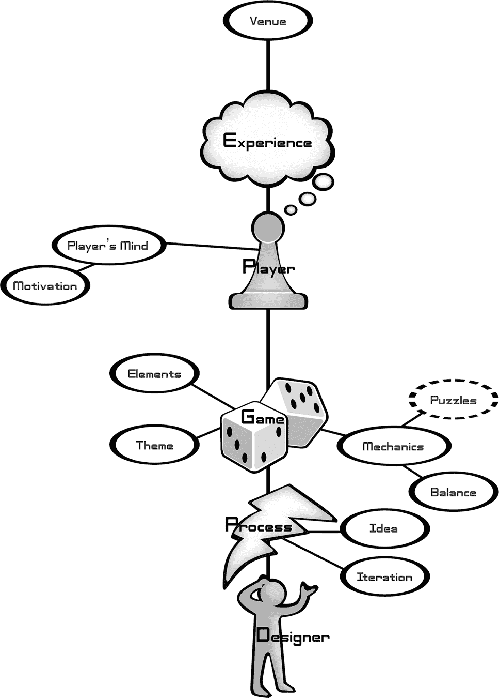
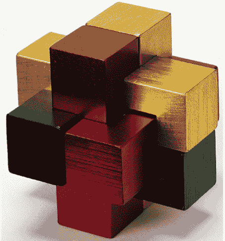
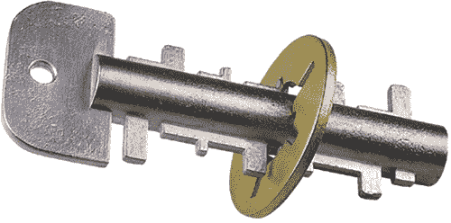
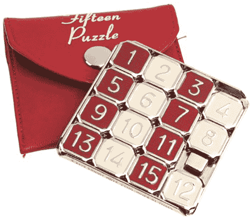
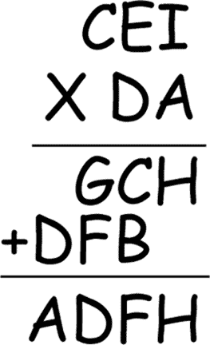
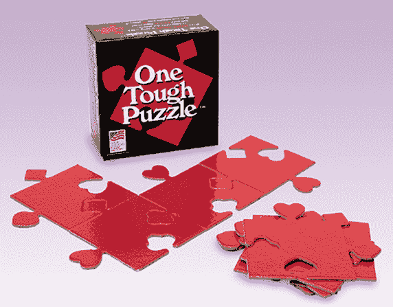
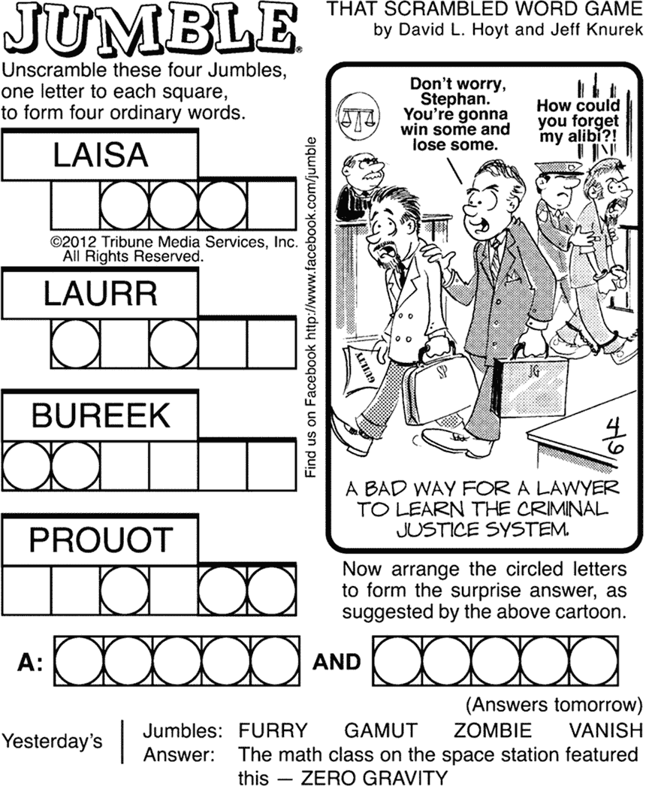

# 第 14 章：游戏机制支撑谜题

**图 14.1**

谜题是极好的机制，构成了许多游戏的关键部分。有时它们非常显眼，有时又深深融入游戏玩法中而变得隐形，但所有谜题的共同点是：它们让玩家停下来思考。通过透镜 #42“头脑与双手”来审视，谜题稳居“头脑”一方。可以说，玩家在游戏过程中任何停下来思考的时刻，都在解谜。谜题与游戏的关系很微妙。在第 4 章“游戏”中，我们讨论过每个游戏都是“一种以玩乐态度对待的问题解决活动”。谜题也是问题解决活动——这是否意味着它们就是游戏？在本章中，我们将探讨如何设计好的谜题，以及将谜题融入游戏的最佳方式是什么。但首先，我们也应该停下来思考，以更好地理解谜题与游戏的关系。

## 谜题之谜

关于谜题是否属于“真正的游戏”，存在许多争论。当然，谜题通常是游戏的一部分，但这意味它们就是游戏吗？在某种意义上，谜题只是“有趣的问题”。如果你回顾第 4 章，会惊讶地发现，“有趣的问题”符合我们列出的游戏定义的许多资格条件。那么，也许每个谜题真的是一种游戏？

把谜题称为游戏总让人觉得哪里不对劲。拼图游戏不像游戏，填字游戏也不像。你会叫魔方“游戏”吗？大概不会。那么谜题缺少了什么，让我们倾向于将其排除在游戏定义之外？首先，大多数谜题只是单人游戏，但这很难成为反对理由——许多我们立刻归类为游戏的东西，从纸牌接龙到《最终幻想》，都是单人游戏。它们仍然有冲突；只是冲突发生在玩家与系统之间，而非玩家与玩家之间。

年轻时的 Chris Crawford 曾大胆断言谜题甚至不算真正的互动，因为它们不会主动响应玩家。这说法值得商榷，部分原因是有些谜题确实会响应玩家，尤其是电子游戏中的谜题。有人提出，任何既有结局、又能保证对始终给出相同输入的玩家给出相同输出的游戏，其实是谜题，而非游戏。这将意味着许多故事驱动的冒险游戏，如《佐尔》、《塞尔达》或《神秘海域》，可能根本不算游戏，而只是谜题。但这听起来不太对劲。

也许谜题有点像企鹅。最早见到企鹅的探险家肯定很惊讶，可能也不知如何分类，心想：“它们看起来有点像鸟，但不能是鸟，因为鸟会飞。它们准是别的什么东西。”但进一步研究得出结论：企鹅确实是鸟——只是不会飞的鸟。那么，谜题“做不到”什么呢？

谜题大师 Scott Kim 曾说：“谜题是有趣的，且有正确答案。”讽刺的是，一旦你找到正确答案，谜题就不再有趣了。正如 Emily Dickinson 曾写道：

> *我们能猜出的谜语*
>
> *我们会迅速鄙视——*
>
> *没有什么陈旧得如此之久*
>
> *如同昨日的惊喜。*

让人们介意把谜题称为游戏的真正原因似乎是：它们不可重玩。一旦你找出最佳策略，就能每次都解开谜题，也不再好玩了。游戏通常不是这样。大多数游戏有足够的动态元素，让你每次游玩都面临一组新的待解决问题。有时是因为你有聪明的真人对手（跳棋、国际象棋、西洋双陆棋等），有时是因为游戏能为你生成许多不同的挑战，要么通过不断进阶的目标（创造新的最高分记录），要么通过某种丰富的挑战生成机制（纸牌接龙、魔方、《俄罗斯方块》等）。

在第 12 章“平衡”中，我们给单一策略能每次都战胜游戏的情况起了个名字：“优势策略”。当游戏存在优势策略时，它不至于不再是游戏；只是不再是个好游戏。孩子们喜欢井字棋，直到他们发现优势策略。此时，井字棋的谜题已被破解，游戏也就不再有趣。通常我们说有优势策略的游戏很烂，除非游戏的全部意义就是寻找那个优势策略。这引出了一个有趣的谜题定义：

> *谜题是一个拥有优势策略的游戏。*

从这个角度看，谜题只是不好重玩的游戏，正如企鹅是不会飞的鸟。这就是为什么谜题和游戏都以解决问题为核心——谜题只是目标在于寻找优势策略的微型游戏。

## 谜题过时了吗？

当我和学生讨论谜题的重要性时，总有人会问：“谜题不是过时了吗？我是说，当然它们是二十年前冒险游戏的一部分，但现代电子游戏是基于动作的，不是谜题，对吧？此外，网上有那么多攻略，大家都能轻松得到谜题答案——那还有什么意义？”

这是一个可以理解的观点。在 20 世纪 80 年代甚至 90 年代初，冒险游戏（《Zork》、《Myst》、《猴岛小英雄》、《国王任务》等）非常流行，这些游戏通常包含非常明确的谜题。随着主机游戏的兴起，更偏向光谱“手部”（动作/操作）一侧、而远离“头部”（思考/策略）一侧的游戏变得更受欢迎。但谜题消失了吗？没有。请记住——谜题是任何让你停下来思考的事物，而智力挑战能为动作类游戏增加显著的多样性。随着游戏设计师变得更有经验，游戏开发出更流畅、连贯的控制方案，谜题变得不那么显性，更多地融入了游戏玩法的肌理之中。现代游戏不再完全暂停游戏进程，强迫玩家在继续之前拼凑谜题碎片，而是将谜题融入其环境中。

例如，《第七位客人》（*The 7th Guest*）是一款于 1992 年发行的热门游戏，其谜题虽有趣，却往往完全不合时宜。当你在房子里行走时，你会发现架子上有罐头，你需要重新排列它们，使罐头上的字母组成一个句子。接着你会突然发现一个巨大的棋盘，被告知要想继续游戏，必须找到一种方法交换所有黑白棋子的位置。然后你会透过望远镜，做一个用线条连接行星的谜题。

将其与《塞尔达传说：风之杖》（*The Legend of Zelda: The Wind Waker*）对比，后者有许多谜题，但将它们平滑地融入了游戏环境中。当面对一条岩浆河时，你必须想出如何按正确模式投掷水罐以便过河。当你身处一个由复杂开关系列控制门的开关的地牢时，你必须想出如何利用地牢中找到的物品（雕像等）来翻转开关，以便成功通过所有门。其中一些相当复杂；例如，地牢中的某些敌人在光线照射下会麻痹。为了打开门，你必须引诱敌人踩到正确的开关上，然后在附近射出燃烧箭使其麻痹以保持门开启，好让你冲出去。但在所有情况下，谜题元素都是环境的自然组成部分，解谜的目标直接就是玩家角色的目标。

这种从显性、不协调的谜题逐渐转变为隐性、融合良好的谜题，与其说是因为游戏受众口味的改变，不如说是因为游戏设计师的技艺成熟了。透过透镜 #49：**优雅**来审视《第七位客人》和《塞尔达传说》的谜题，注意隐性谜题比显性谜题服务于多得多的目的。

我们的两个例子都是冒险游戏。其他类型能包含谜题吗？绝对可以。当你玩格斗游戏，不得不停下来思考哪种策略最适合对付特定对手时，你在解谜。当你玩赛车游戏，试图弄清在赛道何处使用氮气加速才能在一分钟内冲过终点时，你在解谜。当你玩第一人称射击游戏，思考该按什么顺序射击敌人以承受最少伤害时，你在解谜。

但网上的通关攻略呢？它们难道不永远毁了电子游戏谜题吗？并没有。我们将在下一节看到原因。

### 好的谜题

好的——谜题无处不在。我们真正关心的是如何创造能改善游戏的好谜题。这里有十条谜题设计原则，适用于任何游戏类型。

#### 谜题原则 #1：让目标易于理解

要让人们对你的谜题感兴趣，他们必须知道应该做什么。考虑这个谜题：

**图 14.2**

仅从外观看，目标是什么一点也不明显。是颜色匹配？目标是拆开它？还是把它拼回去？很难确定。与此形成对比的是这个谜题：

**图 14.3**

几乎任何人都能一眼看出目标是将圆盘从轴上取下，即使他们以前从未见过这个谜题。目标很明确。

电子游戏中的谜题同理。如果玩家不确定该做什么，他们会迅速失去兴趣，除非弄清该做什么本身很有趣。确实有很多谜题将“弄清该做什么”作为谜题的一部分。但你必须谨慎使用这类谜题——通常只有铁杆谜题爱好者才喜欢那种挑战。看看孩之宝（Hasbro）的《Nemesis Factor》的命运吧。这款巧妙的谜题因富有创意、有趣且具挑战性而备受谜题狂热者推崇——它用一百个难度逐渐递增的谜题挑战玩家。其设计令人难以置信，孩之宝肯定希望能复制魔方的成功。但遗憾的是，它销量不佳。为什么？它违反了我们的第一条谜题原则——目标不明确。它好奇的阶梯状设计让人光看外观就难以猜测目标，甚至难以猜测如何与之互动。即使购买后，游戏仍很少告诉你该做什么。玩家必须先弄清每个谜题的目标，再尝试解决，而且这一百个谜题每个目标都不同。这是硬核谜题狂热者喜欢的东西，但普通受众会觉得沮丧，因为这是一种非常开放式的问题，很少给予你是否走在正确轨道上的反馈。

设计谜题时，请务必透过透镜 #32：**目标**来审视它们，并确保你已清楚地让玩家知晓你希望他们了解的谜题目标。

#### 谜题原则 #2：让它易于上手

一旦玩家理解了你谜题的目标，他们就需要开始解决它。有些谜题很清楚该如何开始。考虑山姆·洛伊德（Sam Loyd）著名的“15 谜题”（"15 Puzzle"），其目标是滑动方块将其按 1 到 15 的数字顺序排列。

**图 14.4**

虽然解谜的移动步骤并不明显，但大多数玩家很清楚如何开始操作它。与此形成对比的是这个谜题，目标是推断每个字母代表哪个数字：

**图 14.5**

像 15 谜题一样，目标非常明确。然而，大多数玩家完全不知道如何开始解决这类谜题。硬核解谜者可能会开始漫长的试错过程来寻找切入点，但大多数玩家会直接放弃，认为“太难了”。

Scott Kim 的另一句箴言是：“要设计一个好谜题，先造一个好玩具。” 在设计谜题时引用透镜 #17：**玩具**是有道理的，因为好的玩具让如何操作它们显而易见。不仅如此，玩家还会被吸引去操作它们。这是魔方如此成功的原因之一：即使是无意解谜的人，也想摸摸它、拿在手里、拧一拧，感受一下手感。

#### 谜题原则 #3：给予进步感

# 谜题、难题与进步感

## 谜题与难题的区别

谜题和难题有什么区别？在大多数情况下，最大的区别在于**进步感**。谜题只是一个需要答案的问题。难题也需要答案，但通常涉及操作某些东西，以便你能看得见或感觉到自己正在一步步接近解决方案。玩家喜欢这种进步感——它给了他们希望，让他们相信自己真的可能找到答案。谜题不是这样的——你只能不断思考，思考，也许开始猜测，猜测的结果非对即错。在早期的电脑冒险游戏中，谜题经常出现，因为它们很容易植入游戏中——但它们给玩家带来的那堵“石墙”令人沮丧不已，以至于它们在现代冒险游戏中几乎绝迹。

## 将谜题转化为难题：二十个问题

但有一种方法可以将谜题变成难题——这就是我们称之为“二十个问题”的游戏。在这个游戏中，一名玩家心中想好一个事物或一个人，另一名玩家可以提出二十个是/否问题，试图弄清第一名玩家在想什么。

“二十个问题”游戏的妙处在于玩家获得的进步感。通过利用问题逐步缩小可能答案的范围，他们能越来越接近解决方案——毕竟，`2²⁰`超过一百万，这意味着二十个精心设计的是/否问题能从一百万种可能性中锁定一个答案。当玩家在玩“二十个问题”时感到沮丧，是因为他们觉得自己没有离答案更近一步。

## 魔方中的可见进步

让玩家坚持不懈地尝试解开魔方的原因之一，是它提供的进步感。逐渐地，新手玩家能让一个面恢复越来越多的颜色，直到——哇！整个面完成了！这是一个清晰的进步信号，让玩家感到非常自豪！现在他们只需要再完成五个面，对吧？

## 超越难题的可见进步

当然，可见进步不仅在难题中重要。它在游戏玩法的各个方面都很重要，甚至在生活中也是如此。研究表明，可见进步（或缺乏进步）是职场情绪的主要驱动因素。再考虑通货膨胀：为什么物价和工资往往会随时间上涨？这不是经济原则，而是心理原则：人们想要每年的加薪，因为那感觉像是进步。这笔钱必须有来源，所以最终物价会上涨。

可见进步对难题和游戏设计如此重要，以至于它成为了我们的下一个透镜。

## 难题原则

### 难题原则 #4：给予可解性感

与进步感相关的是**可解性感**。如果玩家开始怀疑你的难题无解，他们会担心自己在无望地浪费时间，并厌烦地放弃。你需要让他们相信它是有解的。可见进步是一个好方法，但明确声明你的难题有答案也行。回到魔方，它有一个非常优雅的方法，让玩家清楚地知道这是一个可解的难题——购买时，它已经处于还原状态——玩家然后将其打乱，通常通过扭转十几下。此时，它显然是可解的——用打乱它所用的步数，反向操作即可！但当然，大多数玩家发现解开它需要比那多得多的扭转次数。但无论他们多么沮丧，他们从不怀疑它是可以被解开的。

### 难题原则 #5：逐步增加难度

我们已经讨论过游戏难度应逐步增加（参见 透镜 #38：挑战），成功的难题也遵循这一准则。但难题如何增加难度？它不是要么解开要么没解开吗？大多数难题是通过采取一系列行动来解开的，这些行动通常是通向解开难题的目标链条中的小步骤。这些行动应该逐步增加难度。经典的拼图提供了一个自然平衡的此类步骤序列。试图解开拼图的玩家不会只是开始拼凑碎片直到解开；相反，他们通常遵循以下步骤序列：

1.  将所有碎片翻面，使图案面朝上（毫不费力，简单）。
2.  找出角块（非常简单）。
3.  找出边块（简单）。
4.  将边块连成框架（略有挑战，完成时有成就感）。
5.  按颜色分类剩余碎片（简单）。
6.  开始拼装明显相邻的区域（中等挑战）。
7.  拼装可能放在任何位置的碎片（巨大挑战）。

这种难度的逐步增加是拼图经久不衰的吸引力所在。偶尔会有人发布一款比普通拼图更难的拼图，他们通常通过改变拼图的属性来实现，使得上述步骤 1 到 6 中的某些（或全部）被省略。

下图所示的“One Tough Puzzle”就是这样做的。虽然它作为一种新颖事物很有趣，但它唯一有趣的地方在于它**立刻**就很难。那种让拼图成为长青最爱的、令人愉悦的难度逐步增加的特性不复存在。

**图 14.6**

确保难度逐步增加的一个简单方法是让玩家控制难题步骤的顺序。考虑填字游戏——玩家有几十个问题要回答，每回答一个都会给未回答的问题提供提示。玩家自然会倾向于先回答对他们最简单的问题，然后慢慢过渡到更难的问题。给予玩家这种选择称为**并行性**，它还有另一个优秀的特性。

### 难题原则 #6：并行性让玩家休息

难题迫使玩家停下来思考。一个真正的危险是玩家无法思考通过你的难题，因无法取得进展而完全放弃游戏。防范此风险的好方法是一次给他们几个不同但相关的难题。这样，如果他们厌倦了在一个难题上钻牛角尖，可以暂时去尝试另一个。在此过程中，他们从第一个难题中得到了休息，并可能以休息带来的新精力再次尝试。俗语“换个活儿也能歇歇”在此完美适用。填字游戏和数独天然具备这种机制。但电子游戏也能做到。很少有 RPG 一次只给玩家一个难题或挑战——更常见的是一次给予两个或更多并行挑战，因为这样玩家不太容易感到沮丧。

### 难题原则 #7：金字塔结构延长兴趣

并行性还适合**金字塔难题结构**。这意味着一系列小难题，每个都提供某种线索指向一个更大的难题。经典例子是报纸上常见的 Jumble 单词拼字游戏。

**图 14.7**

这个难题可以简化为只让你拼出那四个单词。但通过让每个拼出的单词为一个更难的打乱短语提供几个更多字母，游戏结合了短期和长期目标。它逐步增加难度，最重要的是，金字塔有顶点：这个游戏有一个单一、清晰且有意义的目标——弄清漫画呈现的笑话的包袱。

### 难题原则 #8：提示延长兴趣

“提示？！如果要给提示，那设计谜题还有什么意义？”我听到你在抱怨。不过，有时当玩家因沮丧和厌烦而准备放弃你的谜题时，一个适时的提示能重燃他们的希望和好奇心。虽然这在一定程度上“降低了”解谜的体验，但有提示地解开谜题总比完全解不开要好得多。孩之宝（Hasbro）的《Nemesis Factor》有一个做得非常出色的地方，就是包含了一个提示系统。它设有一个“提示”按钮，玩家按下后会听到一个关于当前谜题的简短一两个词的提示，比如“楼梯”或“音乐”。再按一次会给出另一个不那么隐晦的提示。为了平衡这个提示系统，请求提示会有轻微的扣分惩罚，但通常玩家宁愿接受扣分获取提示，也不愿完全放弃谜题。一些手机“密室逃脱”谜题游戏更进一步应用了这一逻辑——游戏免费游玩，但提示要花钱。

如今，互联网上几乎有所有游戏的通关攻略，你可以争辩说提示对于困难的电子游戏谜题已不再必要。但你或许仍该考虑加入提示，因为根据提示解开谜题，比单纯从别人那里抄答案要愉快得多。

#### 谜题原则 #9：给出答案！

不，认真听我说。问问你自己：解谜题到底哪里让人感到愉悦？大多数人会回答，是当你想出答案时那种“顿悟！”的体验。但有趣的是，这种体验并非由解谜过程本身触发，而是由**看到答案**触发的。当然，如果你自己解出来会稍微甜美一些，但如果你已认真思考过一个问题，你的解题大脑已做好准备，仅仅看到或听到答案就会获得一阵愉悦。想想推理小说——它们就是书本形式的大谜题。有时读者会提前猜到结局，但更多时候，他们会感到惊讶（哦！是管家干的！我现在懂了！），这带来的愉悦感不亚于自己推理出来，甚至可以说奇怪地更令人愉悦。

那么，如何将其付诸实践？在互联网时代，你或许不必操心——只要你的游戏稍微有点知名度，谜题答案很快就会被发到网上。但为什么不考虑省去玩家的麻烦，在游戏内就给他们一个查找谜题答案的途径，以防他们真的卡关了呢？

#### 谜题原则 #10：知觉转换是把双刃剑

考虑这个谜题：

你能排列六根火柴棍，使它们形成四个等边三角形吗？

不，认真考虑一下。我的意思是，试着解一下。别急，我在这儿等你回来。

如果你试过了，我猜发生了三种情况之一。要么（A）你以前见过这个谜题，解它不涉及任何愉悦的“顿悟”，虽然可能有一点得意的沾沾自喜；要么（B）你经历了一次“知觉转换”，即假设上的巨大飞跃，从而得出了正确答案，这非常令人兴奋；要么（C）有人告诉你答案，你体验到了一点点“顿悟！”夹杂着一点点因自己没想出来而产生的羞愧；要么（D）你在沮丧中放弃了，感到有点羞愧。

我想说明的是，这类涉及知觉转换、“要么你懂要么你不懂”的谜题，是一把有问题的双刃剑。当玩家能够完成知觉转换时，他们会获得极大的愉悦并解开谜题。但如果他们无法完成转换，他们一无所获。这类谜题几乎不存在进步的可能性或难度的逐步递增——只是大量的盯着看和苦思冥想等待灵感降临。在这方面它们几乎像谜语，一般来说，你会发现它们在电子游戏或任何玩家期望能持续取得进展的媒介中，都应谨慎使用。

### 最后一块拼图

这总结了谜题设计的十大原则。当然还有其他的原则，但如果你在设计中运用这十条，它们能让你走得很远。谜题能为任何游戏增添有意义的思维维度。在我们转向新话题之前，我留给你一个最后的透镜，用来审视你的游戏是否拥有足够多、合适类型的谜题。

### 延伸阅读推荐

- **《什么是谜题？》 作者：Scott Kim**。谜题设计师 Scott Kim 的一篇深思熟虑的文章。[`http://www.scottkim.com/thinkinggames/whatisapuzzle/`](http://www.scottkim.com/thinkinggames/whatisapuzzle/)

- **《在动作冒险游戏中设计与整合谜题》 作者：Pascal Luban**。一份实用技巧的优秀合集。[`http://www.gamasutra.com/view/feature/2917/designing_and_integrating_puzzles_.php`](http://www.gamasutra.com/view/feature/2917/designing_and_integrating_puzzles_.php)
