## 第十五章

## 玩家通过 `界面` 玩游戏

图 15.1

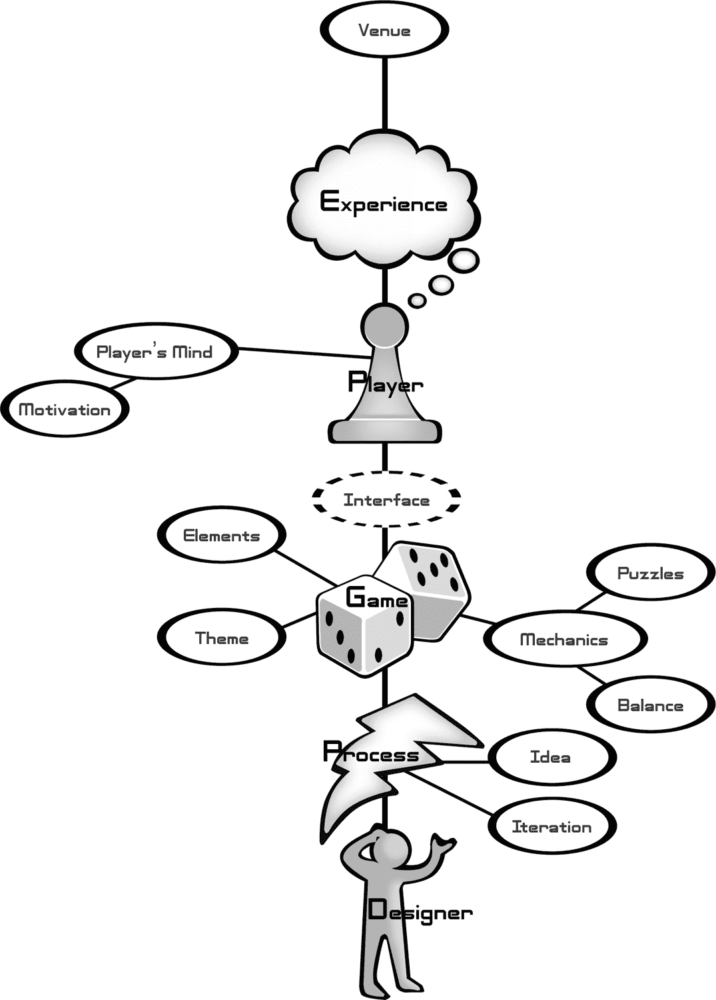

### 阴阳之间

图 15.2

还记得第 10 章我们讨论玩家与游戏之间那奇特的关系吗？具体来说，玩家将他们的思维置入游戏世界，但那个游戏世界实际上只存在于玩家的脑海中？这种神奇的处境，是我们所关注一切的核心，它之所以成为可能，全靠游戏界面——那是玩家与游戏相遇的地方。界面是那层无限薄的膜，分隔了白/阳/玩家与黑/阴/游戏。当界面失效时，从玩家/游戏互动中升起的体验之微弱火焰会瞬间熄灭。因此，我们理解游戏界面如何运作，并使其尽可能健壮、强大且隐形，至关重要。

但在继续之前，我们应该考虑良好界面的目标。它不是“外观好看”或“操作流畅”，虽然那些是很好的特质。界面的目标是**让玩家感觉他们掌控着自己的体验**。这个想法重要到我们应随时准备一个透镜，频繁审视玩家是否感到掌控。

### 拆解分析

像我们在游戏设计中遇到的许多事物一样，界面并不简单，也不易描述。“界面”可以指很多东西——游戏手柄、显示设备、操控虚拟角色的系统、游戏向玩家传递信息的方式，以及其他许多事物。为避免混淆并正确理解它，我们需要将其拆解为组成部分。

让我们从外向内梳理。最初，我们知道有一个玩家和一个游戏世界。

图 15.3

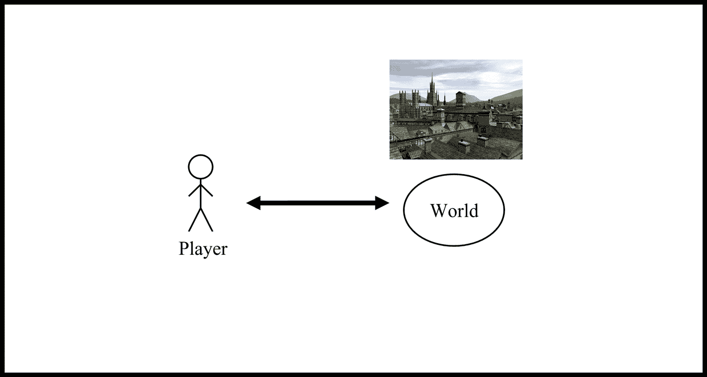

在最简单的层面上，界面就是它们之间的一切。那么，中间有什么？有一种方式让玩家触碰某物以改变世界。这可以通过操控棋盘上的棋子，或使用游戏手柄、键盘鼠标来实现。我们称之为 `physical input`（物理输入）。同样，也有一种方式让玩家看到游戏世界中发生的事。可以是看棋盘，也可以是某种带有音频或其他感官输出的显示屏。我们称之为 `physical output`（物理输出）。所以我们有以下结构：

图 15.4

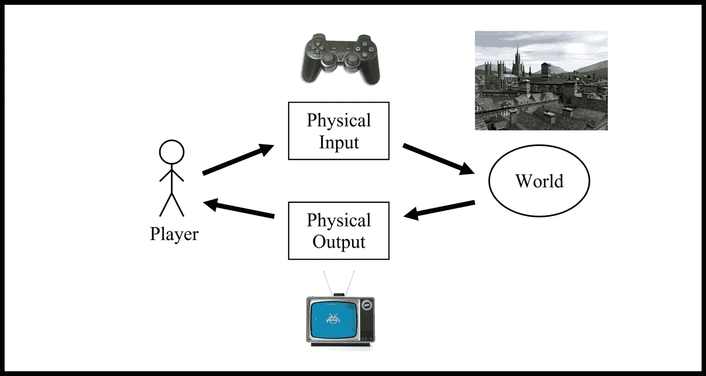

这看起来很简单，也是大多数人对游戏界面的直观认知。但这幅图景中缺少了一些重要的东西。虽然有时物理输入和输出直接连接到游戏世界中的元素，但其他时候则存在一定量的中间界面。当你玩*吃豆人*时，屏幕顶部的分数显示并不真正是游戏世界的一部分——它实际上是界面的一部分。基于鼠标的界面上的菜单和按钮也是如此，或者当你击中敌人造成 10 点伤害，一个风格化的“10”从敌人身上飘出时也是如此。当你玩大多数 3D 游戏时，你看不到整个世界，而是通过一个位于游戏世界虚拟空间中的虚拟摄像机来观察世界。所有这些东西都属于一个存在于物理输入/输出和游戏世界之间的概念层。这一层通常被称为**虚拟界面**，它既包含输入元素（例如玩家进行选择的虚拟菜单），也包含输出元素（例如分数显示）（参见图 15.5）。

有时，虚拟层非常薄，几乎不存在；但其他时候，它却非常密集，充满了虚拟按钮、滑块、显示器和菜单，它们帮助玩家玩游戏，但并不属于游戏世界。必须谨慎处理这个虚拟层，因为正如设计师丹尼尔·伯文所指出的，界面中的抽象越少，我们与内容的情感联系就越强。

这构成了游戏中涉及的主要界面元素的一个相当完整的图景。但我们遗漏了任何游戏界面设计中至关重要的东西：**映射**。在图右侧的每一个箭头上，都在发生一些特殊的事情——数据并非只是简单地传递通过——而是根据软件的设计，这些数据经历了一种特殊的转换。游戏一侧的每一个箭头都代表一段独立的计算机代码。所有这些如何协同工作，共同定义了你游戏的界面。

**图 15.5**

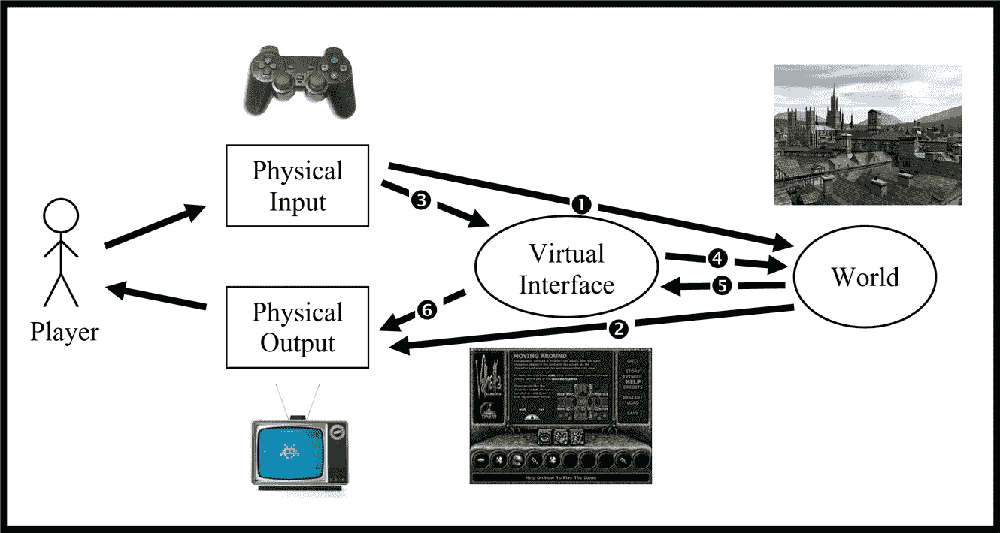

以下是这六个箭头中每一个可能包含的逻辑类型的一些快速示例：

1.  **物理输入 → 世界**：如果推动拇指摇杆会让我的化身奔跑，映射会决定它跑多快，以及松开后减速多快。如果我用力推摇杆，角色会跑得更快吗？角色会随时间加速吗？“双击”摇杆会让角色冲刺吗？
2.  **世界 → 物理输出**：如果你无法一次看到整个世界，能看到哪些部分？将如何显示？
3.  **物理输入 → 虚拟界面**：在基于鼠标的菜单界面中，点击有什么作用？双击有什么作用？我可以拖动界面的各个部分吗？
4.  **虚拟界面 → 世界**：当玩家操作虚拟界面时，会对世界产生什么影响？如果他们选择世界中的一个物品并使用弹出菜单对其执行操作，该操作是立即生效还是延迟生效？
5.  **世界 → 虚拟界面**：世界中的变化如何体现在虚拟界面中？分数和能量条何时变化？世界中的事件是否会导致界面中出现特殊的弹出窗口、菜单或模式切换？当玩家进入战斗时，特殊的战斗菜单会出现吗？
6.  **虚拟界面 → 物理输出**：向玩家显示什么数据，数据在屏幕的什么位置？是什么颜色？什么字体？当生命值非常低时，会脉动或发出声音吗？

为了深入剖析这六种连接类型，我们引入两个新的透镜。

当然，这六种映射不能独立设计——它们必须协同工作，才能创造出优秀的界面。但在继续之前，我们必须考虑另外两种重要的映射，它们由来自玩家（更具体地说，来自玩家想象力）的箭头表示。这就是当玩家沉浸在游戏中时，他或她不再是按按钮和看电视屏幕，而是在奔跑、跳跃和挥剑。你可以从玩家的语言中听到这一点。玩家通常不会说：“我控制我的化身，让她跑向城堡，然后我按下红色按钮让她抛出抓钩，接着我开始连点蓝色按钮让化身攀爬。”不，玩家会这样描述游戏过程：“我跑上山丘，抛出抓钩，开始攀爬城堡墙壁。”玩家将自己投射到游戏中，在一定程度上无视界面的存在，除非界面突然变得令人困惑。一个人将意识投射到其所控制事物的能力几乎令人震惊。但这只有在界面对玩家而言成为第二天性时才可能发生，这引出了我们的下一个透镜。

这个界面是网络漫画《Penny Arcade》的一个恶搞，它大概率不是透明的。

**图 15.6**

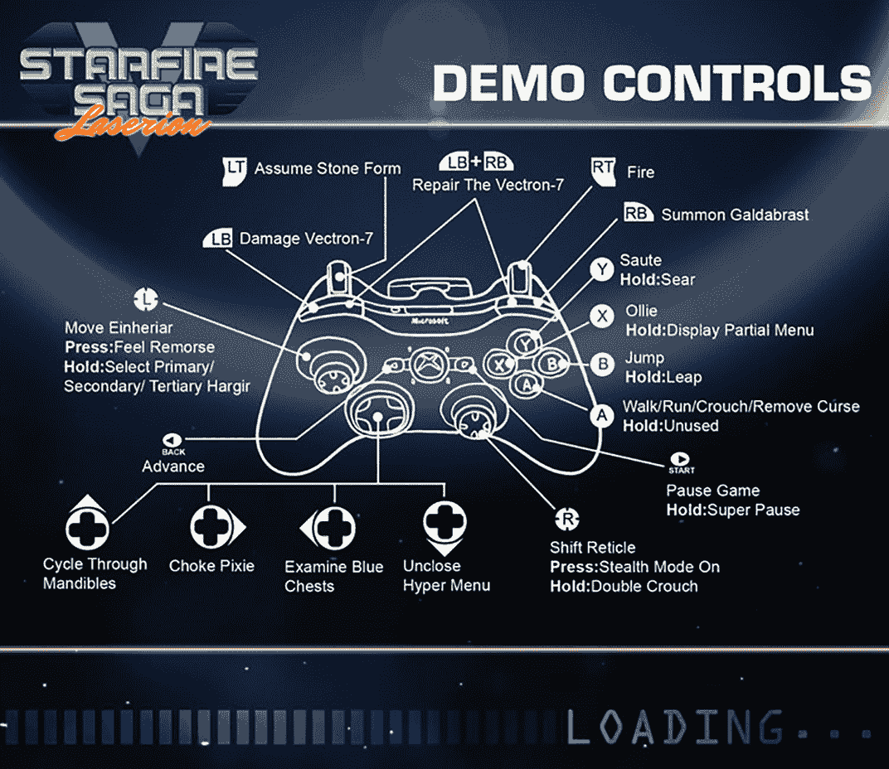

（来源：[www.penny-arcade.com](http://www.penny-arcade.com)。经许可使用。）

## 交互循环

信息在玩家和游戏之间循环流动，从玩家到游戏，再从游戏到玩家，周而复始。这几乎就像这种流动推动着一个水车，当它旋转时产生体验。但流经这个循环的不能只是任何信息。游戏返回给玩家的信息极大地影响玩家接下来会做什么。这种信息通常被称为**反馈**，反馈的质量能对玩家对游戏中发生的事情的理解和享受程度产生强大影响。

**图 15.7**

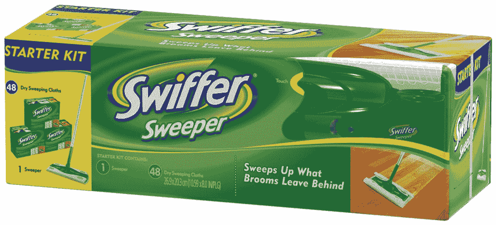

良好反馈的重要性很容易被忽视。一个例子是篮筐上的网。网根本不影响游戏玩法——但它减缓了球从篮筐落下的速度，以便所有玩家都能清楚地看到，甚至听到，球进了。

一个不那么明显的例子是 Swiffer 扫地拖（图 15.7），这是一种简单的装置，旨在成为比传统扫帚/簸箕组合更好的清洁地板解决方案。一些试图重新设计扫帚和簸箕的人只是修改了现有的解决方案，比如制作一个夹在扫帚柄上的簸箕、制作更结实的扫帚毛、给簸箕加个盖子等。看来 Swiffer 的设计师使用了透镜 #14：**问题陈述**，发明了一个全新的解决方案。如果我们看看扫帚/簸箕解决方案的一些问题，

*   **问题 #1**：无法将所有灰尘扫进簸箕。
*   **问题 #2**：站着时簸箕难用，蹲着时扫帚难用。
*   **问题 #3**：扫帚并不能真正扫净所有灰尘。
*   **问题 #4**：试图将灰尘扫进簸箕时，手会弄脏。
*   **问题 #5**：将污垢从簸箕倒进垃圾桶很危险——经常洒出来或被吹得到处都是。

我们看到 Swiffer 凭借其一次性布料相当好地解决了这些问题：

*   **解决方案 #1**：不需要簸箕。
*   **解决方案 #2**：使用 Swiffer 时无需蹲下。
*   **解决方案 #3**：Swiffer 布料捕获的灰尘远比扫帚多。
*   **解决方案 #4**：双手保持干净。
*   **解决方案 #5**：布料易于丢弃。

因此，Swiffer 解决了许多问题，这使其极具吸引力。但它的吸引力不仅限于这些实用层面。它还具有强烈的心理吸引力——坦白说，它很好玩。为什么？因为其设计解决了大多数人甚至不会将其视为问题的问题。这里有个例子：

* **问题 #6**：用户很难获得关于自己清洁地板效果如何的反馈。

除非地板非常脏，否则仅凭肉眼观察地板，很难看出扫地是否起作用。你可能会说：“谁在乎啊？只要打扫得干净不就行了？”但这种缺乏反馈的情况会让整个任务显得有些徒劳，导致用户享受度降低，打扫地板的频率也会减少。换句话说，反馈越少＝地板越脏。但 Swiffer 完美解决了这个问题：

* **解决方案 #6**：清洁完成时，你从地板上清除的污垢清晰地显示在清洁布上。

这种反馈非常清楚地向用户表明，他们的所作所为确实改变了地板的洁净程度。这会触发各种愉悦感——完成有用之事的满足感、净化的快感，甚至拥有他人无法看到的“秘密知识”的快感。虽然这种反馈要等到任务结束时才出现，但用户会逐渐期待它，并期盼看到这项工作出色完成的确凿证据。

运用这个透镜需要一些努力，因为游戏中的反馈是持续的，但需要根据不同情况有所区别。在游戏的每一刻都使用这个透镜需要大量的脑力劳动，但这物超所值，因为它有助于保证游戏清晰、有挑战性且富有回报。

**图 15.8**

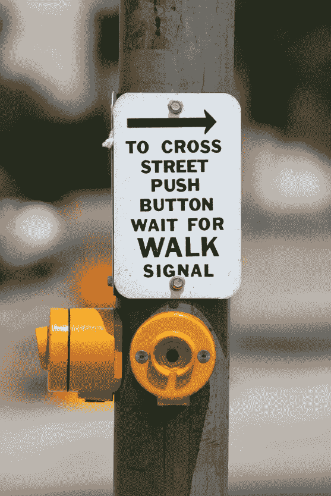

没有反馈的体验会让人感到沮丧和困惑。在美国的许多十字路口，行人可以按下一个按钮，让“禁止通行”标志变为“准许通行”标志，以便安全过街。但它不能立即变化，因为那会导致交通事故。因此，可怜的行人往往不得不等待长达一分钟，才能看到按按钮是否有效。结果，你会看到各种奇怪的按按钮行为：有人按住按钮几秒钟不放；有人为了保险连续按好几次。整个过程伴随着一种不确定感——常能看到行人焦虑地盯着红绿灯和“禁止通行”标志，看它是否会变化，因为他们可能没按对按钮。

去英国访问时，发现某些地区的过街按钮能提供即时反馈，按下按钮后“等待”标志亮起，通行期结束时熄灭（**图 15.9**），这简直是一种享受！增加简单的反馈，就将一种让行人感到沮丧的体验，变成了让他们感到自信和掌控的体验。

一般来说，一个好的经验法则是：如果你的界面在十分之一秒内没有对玩家输入做出响应，玩家就会觉得界面出问题了。一个典型的问题例子常出现在制作带有“跳跃”按钮的游戏时。如果负责跳跃动画的动画师是游戏新手，他们很可能会在跳跃动画中加入“蓄力”或“预备动作”，即角色蹲下准备跳跃，大概持续四分之一到二分之一秒。这符合动画惯例，但因为这打破了“十分之一秒法则”（我按下跳跃按钮，但角色要过半秒才真正腾空），会让玩家因挫败感而抓狂。

**图 15.9**

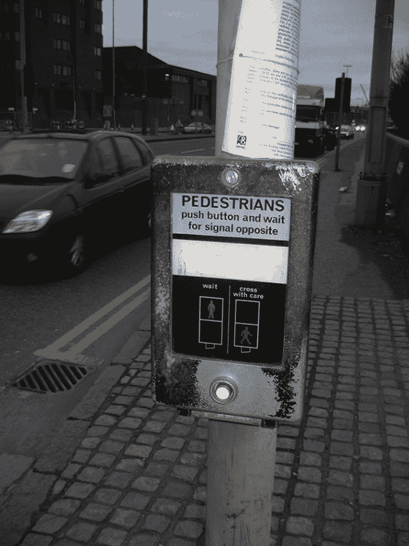

*有用的反馈。*

## 多汁性

但让我们回到扫地的例子：脏布并不是 Swiffer 给用户的唯一反馈。让我们考虑一下扫帚和簸箕的另一个问题，这也是大多数人不太可能说出来的。

* **问题 #7**：扫地很无聊。

好吧，当然了！这是扫地啊！但“无聊”是什么意思？我们需要进一步拆解。具体来说：

* 扫地是重复性的（一遍遍做同一个动作）。
* 它要求你将注意力集中在一个毫无惊喜的事物上（如果你不盯着那小堆灰尘，它会飞得到处都是）。

Swiffer 如何应对这一挑战？

* **解决方案 #7**：使用 Swiffer 很有趣！

这很可能是 Swiffer 最大的单一卖点。在 Swiffer 的电视广告中，他们展示人们在屋里快乐地跳舞清洁地板，有些广告甚至展示人们出于纯粹的好奇拿起 Swiffer，然后像孩子玩玩具一样玩着 Swiffer 顺便把地板擦了。Swiffer 在**透镜 #17** 玩具下表现优异——它很好玩……但为什么？它不就是根棍子配块布吗？从某种意义上说是的，但 Swiffer 的底座（布安装的地方）通过一种特殊的铰链与杆连接，所以当你转动手腕，哪怕只是轻微转动，夹布的底座也会大幅度旋转。我手腕的微小动作，让清洁机构能轻松、流畅、有力地移动——只需极小的力气就能精准到达你想要的位置。使用它的感觉，有点像在自家地板上驾驶一辆魔法赛车。清洁底座展现的运动是**二阶运动**，即源自玩家动作的衍生运动。当一个系统展现出大量玩家易于控制、且能赋予玩家强大力量和丰厚回报的二阶运动时，我们称之为**多汁**系统——像熟透的水蜜桃，只要稍微互动一下，就能源源不断地获得美味的回报。多汁性常被忽视为游戏的重要品质。为避免忽视它，请使用这个透镜。

我们在**第 4 章**讨论过，工作与游戏的区别在于态度。我选择这个非游戏的 Swiffer 例子作为说明，是因为它提供的反馈如此强大，以至于将工作变成了游戏。如果可能，你的界面最好也好玩——因为你的游戏旨在好玩，如果你把一个枯燥、痛苦的界面作为玩家通往所谓有趣体验的入口，就有制造内在矛盾和自我挫败体验的风险。记住，乐趣是带有惊喜的愉悦，所以如果你的界面要好玩，它就应该两者兼备。

## 原生性

一种倾向于与多汁乐趣联系在一起的界面，是手机和平板电脑上的触摸界面。触摸界面在极短时间内极大地改变了游戏世界。尤其是年幼的孩子，似乎能以惊人的轻松驾驭触摸界面。但为什么？显而易见的答案是“因为它们直观”。但这其实是个相当模糊的答案，因为“直观”的定义就是“易于理解”。所以问题变成了：“为什么触摸界面如此易于理解？”答案是：它们是原生的。

在触控计算出现之前，每个计算机界面都采用工具使用的形式。我会与某个物理对象（键盘、鼠标、按钮面板、穿孔卡等）进行交互，然后某个远程（不在我的手指附近）响应就会发生。渐渐地，就像使用所有工具一样，我们学会了它们如何工作并习惯了它们。但工具使用并非原始的，我的意思是，它是前人类时代的。人类大约在三百万年前开始使用工具，这已经是一段相当长的历史了。但动物通过触摸事物、凭直觉行事的时间要长得多：可能有三亿到四亿年之久。当然，我们的大脑是从那些大脑进化而来的。当你思考人脑的三层结构时，事情就变得更清晰了——大脑最底层的“爬行动物”部分能够处理触觉，但工具使用可能需要大脑最高层——新皮层的协助。

当你这样思考时，就显而易见为什么触控比使用鼠标或游戏手柄更直观。但这当然会引出一个更广泛的问题——我的游戏哪些部分是原始的，哪些部分需要高级大脑功能？似乎可以肯定的是，你越能调动和涉及大脑的原始部分，你的游戏体验就会感觉越直观、越强大，这有助于解释为什么如此多的游戏包含以下元素：

*   采集类水果的物品。
*   与威胁性敌人战斗。
*   在陌生环境中寻找出路。
*   克服障碍到达配偶身边（科学家所谓的“营救公主”）。

要真正了解大脑的哪些部分参与了特定活动，你需要是一名进行核磁共振（MRI）研究的脑科学家。但要对你的界面和游戏活动是否具有低级原始性做出合理的推测，只需考虑一下这是否是动物能做的事。如果它们能做，那么你很有可能正在利用原始性的力量。

### 信息通道

任何界面的一个重要目标都是传达信息。确定游戏以最佳方式向玩家传达必要信息需要深思熟虑的设计，因为游戏通常包含大量信息，且往往需要同时呈现其中的大部分。要找出在游戏中呈现信息的最佳方式，请尝试遵循以下步骤。回顾本章开头的界面数据流图，我们主要讨论的是箭头 5（世界 → 虚拟界面）和箭头 6（虚拟界面 → 物理输出）。

#### 步骤 1：列出并确定信息优先级

游戏必须呈现大量信息，但它们并非同等重要。假设我们正在为一款类似于经典 NES 游戏《塞尔达传说》的游戏设计界面。我们可以从列出玩家需要看到的所有信息开始。一个简单的未排序列表可能如下所示：

1.  红宝石数量
2.  钥匙数量
3.  生命值
4.  眼前环境
5.  远处环境
6.  其他物品
7.  当前武器
8.  当前宝物
9.  炸弹数量

现在，我们可以按重要性对这些进行排序：

**时刻都需要知道**：

*   4. 眼前环境

**游戏过程中需要不时瞥一眼**：

1.  1. 红宝石数量
2.  2. 钥匙数量
3.  3. 生命值
4.  5. 远处环境
5.  7. 当前武器
6.  8. 当前宝物
7.  9. 炸弹数量

**仅偶尔需要知道**：

*   6. 其他物品

#### 步骤 2：列出通道

信息通道只是传达数据流的一种方式。通道具体是什么因游戏而异——你在选择它们时有很大的灵活性。一些可能的信息通道包括：

*   屏幕顶部中央
*   屏幕右下角
*   我的化身
*   游戏音效
*   游戏音乐
*   游戏屏幕边框
*   逼近敌人的胸口
*   角色头顶的对话框

列出你认为可能会用到的通道是个好主意。在《塞尔达传说》中，设计师确定的主要信息通道有：

*   主显示区域
*   屏幕顶部的信息仪表盘

此外，他们决定玩家可以通过按下 `select` 键激活“模式切换”（我们将在本章后面讨论模式切换），该模式有不同的信息通道：

*   辅助显示区域
*   屏幕底部的信息仪表盘

#### 步骤 3：将信息映射到通道

现在，面临的艰巨任务是将信息类型映射到不同的通道。这通常部分靠直觉，部分靠经验，但主要靠反复试错——画很多小草图，思考它们，然后重绘，直到你认为有值得尝试的方案。在《塞尔达传说》中，映射如下：

**主显示区域**：

*   4. 眼前环境

**屏幕顶部的信息仪表盘**：

1.  1. 红宝石数量
2.  2. 钥匙数量
3.  3. 生命值
4.  5. 远处环境
5.  7. 当前武器
6.  8. 当前宝物
7.  9. 炸弹数量

**辅助显示区域**：

*   6. 其他物品

看看主屏幕（图 15.11）和子屏幕（图 15.10），你可以看到其他有趣的选择：

请注意，仪表盘信息对游戏玩法至关重要，因此需要在主屏幕和子屏幕上始终显示。而该仪表盘的内容实际上涉及七个不同的信息通道。注意它们是如何划分的——“生命”被认为如此重要，以至于获得了近三分之一的界面空间。红宝石、钥匙和炸弹虽然功能不同，但都需要传达两位数，因此被归为一组。你持有的武器和宝物非常重要，所以它们周围有小框框。`A` 和 `B` 提醒玩家按哪个键来使用这些物品。

**图 15.10**

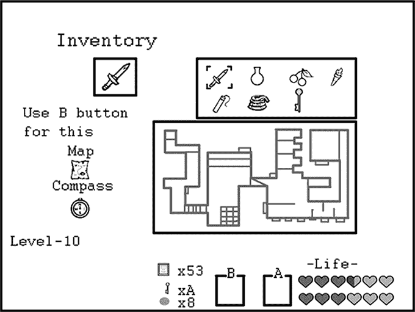

*NES 版《塞尔达传说》子屏幕。*

**图 15.11**

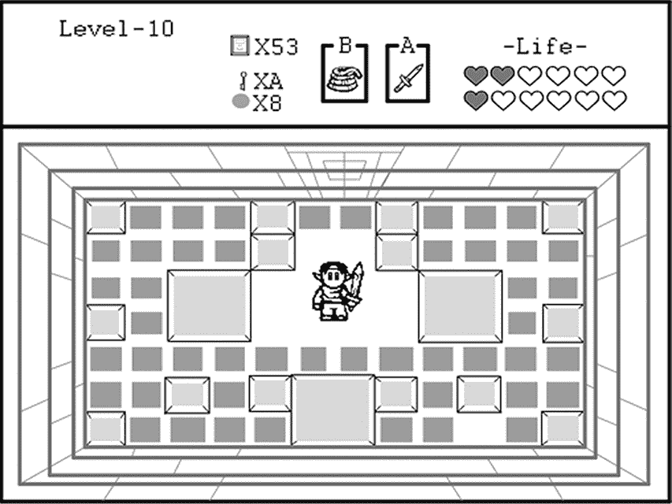

*NES 版《塞尔达传说》主屏幕。*

还请注意物品栏屏幕上如何利用额外空间给玩家一些关于如何使用它的指导。

你可以看到，即使与现代游戏相比这是一个相对简单的界面，设计师在如何布局方面仍做出了许多决定，这些决定对游戏体验产生了重大影响。

#### 步骤 4：审查维度的使用

游戏中的信息通道可以有多个维度。例如，如果你决定将“敌人受到的伤害”映射到“从敌人身上飞出的数字”，你就有几个维度可以在该通道上利用。其中一些可能是：

*   显示的数字
*   数字的颜色
*   数字的大小
*   数字的字体

现在你必须决定要使用这些维度中的哪些（如果有的话）。你肯定会使用第一个，即数字。但颜色有含义吗？也许你会将其他维度作为信息的**增强手段**——50 以下的数字为白色且字号小，50 到 99 的数字为黄色且字号中等，但 100 及以上的数字为红色、字号很大并采用特殊字体，以强调伤害量。

虽然在一个通道上使用多个维度来强化一条信息是让信息变得非常清晰（而且有点“丰富多彩”）的方法，但你也可以采取另一种方法，决定将不同的信息放在不同的维度上。例如，你可能决定给数字上色以表示友军（白色）或敌军（红色）。然后你可能让数字的大小表示角色距离失败有多近——小数字可能意味着角色还剩很多生命值，而大数字可能意味着他们快要死了。这种技术可以非常高效且优雅。通过使用单个数字，你传达了三条不同的信息。风险在于你必须教育玩家了解一个信息通道上的这些不同维度代表什么，这对某些玩家来说可能难以理解或记忆。对通道和维度的良好运用造就了优雅、布局合理的界面，所以我们会保留一个专门的透镜来进行这类检查。

## 模式

什么是界面模式？简单来说，它是我们界面图中六个映射箭头（1–6）之一发生的变化。例如，如果按下 B 键改变了游戏手柄的功能，使其不再让你的化身四处奔跑，而是让化身瞄准水管，这就是一种模式切换，此时箭头 #1（物理界面 → 世界）上的映射就发生了变化。模式切换可能是六个箭头中任意一个上的映射变化导致的。

模式是增加游戏多样性的好方法，但你必须非常小心，因为如果玩家没有意识到发生了模式切换，他们就会感到困惑。以下是一些避免界面模式麻烦的小贴士。

### 模式贴士 #1：尽可能少用模式

模式越少，玩家感到困惑的机会就越小。拥有多个界面模式并不是坏事，但你应该谨慎添加模式，因为每一个模式都是新玩家将不得不学习和理解的东西。

### 模式贴士 #2：避免重叠模式

正如我们有从游戏到玩家的信息通道一样，也有从玩家到游戏的类似信息通道。每个按钮或摇杆都是一个信息通道；例如，假设你有一个游戏，允许你在行走模式（摇杆导航）和投掷模式（摇杆瞄准）之间切换。后来，你决定也加入驾驶模式（摇杆控制汽车转向）。如果玩家在驾驶时切换到投掷模式，会发生什么？你可以尝试允许这样做，这可能会让你同时处于两种模式中（驾驶和投掷）。虽然这可能行得通，但如果摇杆同时控制汽车转向和瞄准界面，那可能就是一场灾难。如果你的物理界面有第二个摇杆，在所有情况下将瞄准功能移到第二个摇杆上可能更明智。通过使你的模式截然不同且不重叠，你可以让自己避免麻烦。如果你发现需要重叠模式，请确保它们使用界面上不同的信息通道。例如，摇杆可以有两种导航模式（飞行或行走），而按钮有两种射击模式（发射火球或闪电）。这些模式位于完全不同的维度上，因此它们可以安全地重叠——无论我是在行走还是飞行，都可以在发射火球和发射闪电之间切换，而不会产生任何混淆效果。

### 模式贴士 #3：让不同的模式看起来尽可能不同

换句话说，请通过 透镜 #63：***反馈***，和 透镜 #62：***透明度*** 来审视你的模式。如果玩家不知道自己处于什么模式，他们就会感到困惑和沮丧。旧的 Unix 文本编辑系统 `vi`（读作“V. I.”）就是一首令人困惑的模式交响曲。大多数人会期望文本编辑器启动时处于允许输入文本的模式。但 `vi` 不是这样。它实际上处于一种模式下，在这种模式下，键盘上的每个字母要么发出命令（如“删除行”），要么让编辑器进入一种新模式。但按下这些键不会给出任何关于你处于什么模式的反馈。如果你真想输入文本，必须输入字母“i”，然后你会进入文本插入模式，它看起来跟命令输入模式一模一样。靠自己根本搞不清楚，甚至资深 `vi` 用户偶尔也会搞不清自己处于什么模式。

以下是一些让模式截然不同的好方法：

*   **改变屏幕上某个巨大且显眼的东西**：在《光环》和大多数第一人称射击游戏中，当你换武器时，变化非常明显。顺便说一句，剩余弹药量是通过一个有趣的通道给出的——它就在这把枪的背面。
*   **改变你的化身正在执行的动作**：在经典街机游戏《丛林王》中，你会从荡藤蔓模式切换到游泳模式。因为你的化身在做截然不同的事情，所以模式切换显而易见（而且他的发色也会变——这可能有点过头了）。
*   **改变屏幕上的数据**：在《最终幻想》系列和大多数 RPG 游戏中，当你进入战斗模式时，许多战斗统计数据和菜单会突然弹出，显然发生了模式切换。
*   **改变摄像机视角**：这常被忽视作为模式切换的指示器，但它可以非常有效。

## 其他界面贴士

好的——我们已经涵盖了界面数据流、反馈、通道、维度和模式。这是个好开端。但关于界面设计的主题已经写出了整整几本书，而我们还有许多其他有趣的事情要讨论；我们必须继续前进！但在此之前，这里有一些制作优秀游戏界面的通用贴士。

### 界面贴士 #1：借鉴

更客气的说法，我们称之为界面设计的“自顶向下方法”。如果你正在为一个已知的游戏类型设计界面，比如动作/平台游戏，你可以从该领域一个已知成功作品的界面入手，然后对其进行修改，以适应你游戏中独特的地方。这可以节省你大量的设计时间，并且有一个好处，就是对你的用户来说这是一个熟悉的界面。当然，如果你的游戏没有任何新东西可提供，这会让它感觉像个克隆品——但往往令人惊讶的是，一个小小的改变会引出另一个，再引出另一个，等你反应过来时，你的克隆界面已经蜕变成完全不同的东西了。

### 界面贴士 #2：定制

也称为自底向上方法，它是借鉴的对立面。采用这种方法，你可以从头设计界面，通过列出信息、通道和维度，就像我们之前解释的那样。这是获得一个外观独特且专门为你的特定游戏定制的界面的好方法。如果你的玩法是新颖的，你可能会发现这是你唯一可走的路。但即使你的玩法没有新意，当你尝试从底层构建时，你可能会感到惊讶——你可能会发现自己发明了一种全新的玩法，因为其他人只是在复制成功的做法，而你花时间真正研究问题并试图做得更好。

### 界面贴士 #3：围绕你的物理界面进行设计

视频游戏开发的世界包含界面截然不同的平台：触控界面、体感界面、鼠标键盘、游戏手柄，甚至混合现实头显。让游戏能在所有这些平台上同样良好地运行、从而卖给尽可能多的人，这种诱惑很大。但事实是，试图设计一个独立于任何特定界面的游戏，通常会导致游戏变得乏味。想想《愤怒的小鸟》——它的巨大成功部分归功于它对触控界面的出色运用。还记得“玩具之透镜”吗？如果你游戏的核心交互是一种独特的玩法，利用了该物理界面独有的特性，它就能获得足够的关注，让放弃那些其他平台变得非常值得。

### 界面贴士 #4：为你的界面设定主题

通常设计界面美术的艺术家和设计游戏世界的不是同一个人。在第 6 章（参见 `#C09_chapter6.xhtml#chapter6`）：`Theme` 中，我们讨论了为万物设定主题的重要性，界面也不例外。用第 11 号透镜（参见 `#C09_chapter6.xhtml#box11`）：`Unification` 审视你界面的每一寸，看看能否找到一种方法将其与体验的其余部分融为一体。

### 界面贴士 #5：声音映射触觉

通常，当我们考虑在游戏中使用声音时，会想到创建声音景观以营造场所感（草地上鸟儿的鸣叫），或让动作显得更真实（看到玻璃破碎时听到破碎声），或给玩家关于游戏进度的反馈（拾起宝物时的音乐滑奏）。但声音有一个常被忽视的方面，它与界面直接相关：人类大脑很容易将声音映射为触觉。这很重要，因为当我们在现实世界中操控事物时，触觉是我们获得操控反馈的核心组成部分。在虚拟界面中，我们通过触觉获得的信息极少，甚至没有。但你可以通过播放合适的声音来模拟触觉，就像打字时会发出咔哒声的触屏键盘那样。首先，你得思考如果界面是真实的，你希望它摸起来是什么感觉，然后决定用什么声音能最好地创造出那种感觉。如果你成功做到了这一点，人们会惊叹于你的界面使用起来多么愉悦，但他们很难准确说出原因。我非常期待未来的界面能找到更成功地引入触觉反馈的方法，但在此之前，声音是你的最佳选择。

### 界面贴士 #6：用层级平衡选项与简洁性

设计界面时，你将面临两种相冲突的欲望：尽可能给玩家更多选项的欲望，和尽可能让界面简洁的欲望。就像游戏设计中的许多事情一样，成功的关键在于取得平衡。实现这种平衡的一个好方法是通过模式和子模式创建界面层级。如果你已经很好地对界面进行了优先级排序，你就已经领先一步，知道该如何做了。一个典型的视频游戏例子是将库存和配置菜单隐藏在一个不常用的按钮下，例如“开始”键。

图 15.12

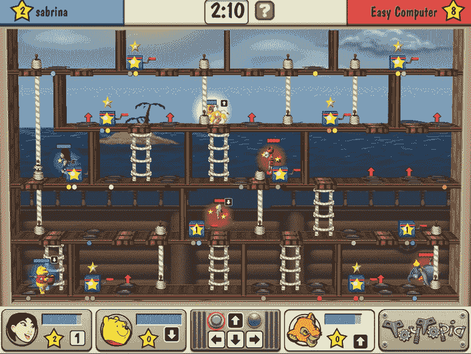

*ToyTopia* 控制面板。一条“向下”消息刚刚发送给了小熊维尼。（由 Disney Enterprises, Inc. 提供。经许可使用。）

### 界面贴士 #7：使用隐喻

让玩家理解界面如何运作的一个绝佳捷径，是让它看起来像玩家以前见过的东西。例如，在设计游戏 ToyTopia 时，我的团队面临一个非常不寻常的限制。在这个游戏中，玩家向一小队发条玩具发出键盘指令（向上、向右等）。因为是同步多人游戏，计划是在玩家发出指令和玩具接收指令之间引入延迟，以保持同步。这样，我们就能让不同玩家机器上的游戏保持同步，因为本地人为延迟的长度会与信号从一台计算机传到另一台计算机不可避免的网络延迟长度相同。不幸的是（也不出所料），玩家觉得这很困惑——他们习惯按下按钮立即生效，而不是半秒后才发生什么事。团队沮丧到了考虑放弃整个方案的地步，但后来有人想到，如果我们显示一个可见的无线电信号从虚拟按钮传向玩具，并配上“无线电传输”音效，可能会帮助玩家更好地理解机制。奏效了！有了新系统，无线电传输隐喻清楚地解释了动作延迟，还给玩家提供了关于正在发生什么的即时反馈。而在第 11 号透镜（参见 `#C09_chapter6.xhtml#box11`）：`Unification` 下，这一变化有助于强化主题，该主题是关于遥控玩具的。

### 界面贴士 #8：如果看起来不同，表现也应不同

游戏开发者经常为了视觉多样性而陷入违背这条贴士的陷阱。例如，他们可能在做一个对战飞碟的游戏。为了增加视觉花样，有人想让飞碟颜色不同：有的红，有的紫，有的绿。看到这些的玩家肯定会认为它们功能不同——也许速度不同，或分值不同。如果它们并无区别只是喷漆不同，玩家肯定会失望和困惑。同样，设计师也常犯相反的错误，创造出外观相同但行为不同的两样东西。例如，你可能创建一个“X”按钮，按下时关闭部分界面。后来，需要一个让玩家删除游戏物品的按钮，“X”似乎是代表删除的合乎逻辑的选择。但如果同一个“X”有时意味着“删除”，有时意味着“关闭窗口”，它很有可能让玩家困惑和沮丧。

### 界面贴士 #9：测试，测试，再测试！

没有人能一次就把界面做对。新游戏需要新界面，除非你让人试玩，否则不能想当然地认为你的新界面会清晰、赋予权力且有趣。尽早、尽可能频繁地测试它。在拥有完整可玩游戏之前很久，就构建界面原型。用纸和纸板制作你拥有的任何按钮或菜单系统的原型，让人们演绎玩游戏和使用界面，以便你看到他们在哪里遇到麻烦。最重要的是，通过像人类学家那样与玩家合作，你将开始更好地了解他们瞬息万变的意图，这将指导你所有的界面决策。

### 界面贴士 #10：打破规则以助玩家

## 其他推荐阅读

*   **《The Design of Everyday Things》** 作者：Don Norman。这本通俗易懂、深入浅出的书籍充满了关于现实世界物品与系统优秀与糟糕设计的深刻案例。其智慧惊人地适用于游戏设计领域。

*   **《Game Feel》** 作者：Steve Swink。这本独特的书籍聚焦于毫秒级的游戏界面设计，细致剖析了是什么让游戏手感出色。必读书目。

*   **《The Visual Display of Quantitative Information》** 作者：Edward Tufte。被公认为图形界面设计的“圣经”（或至少是“旧约”），这本书及 Tufte 的其他三本著作即使只是浏览也能提供深刻见解。
