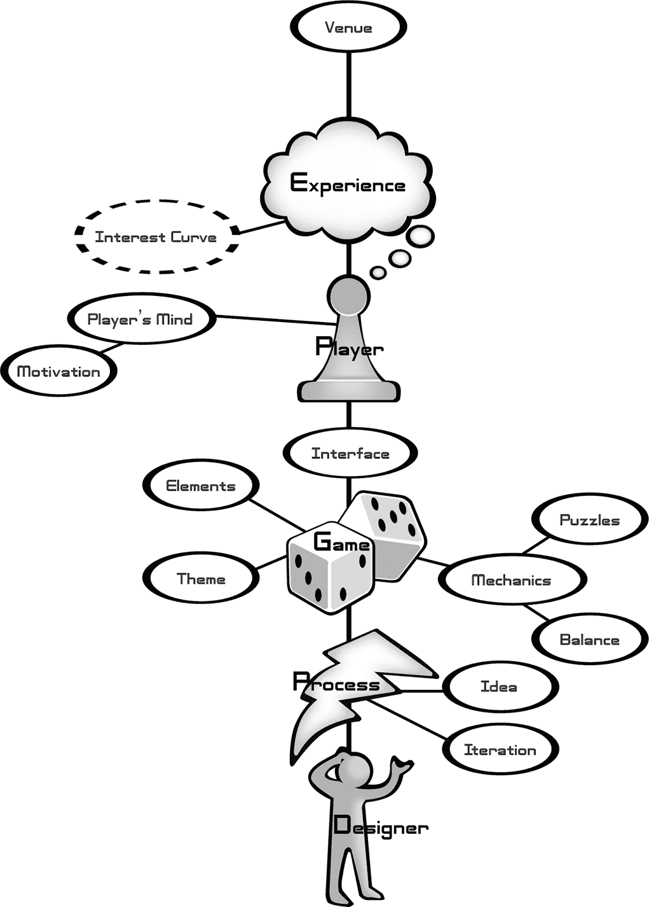
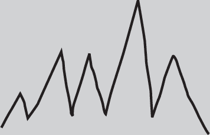
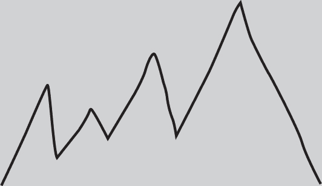
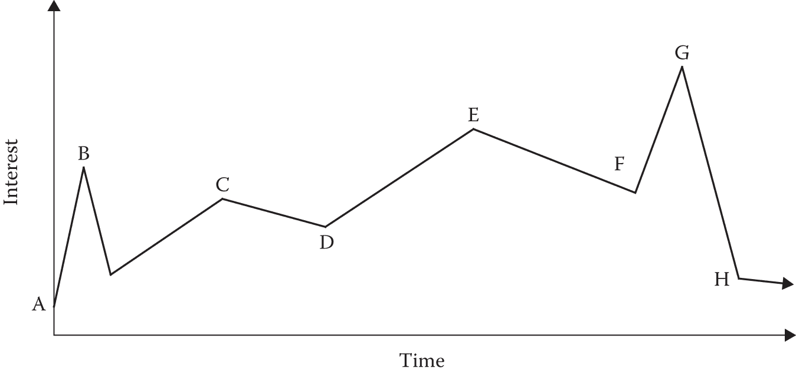
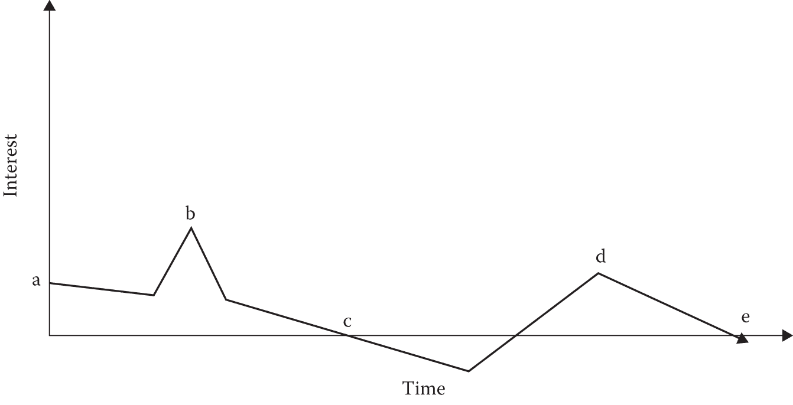
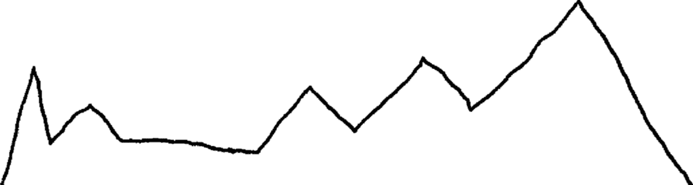
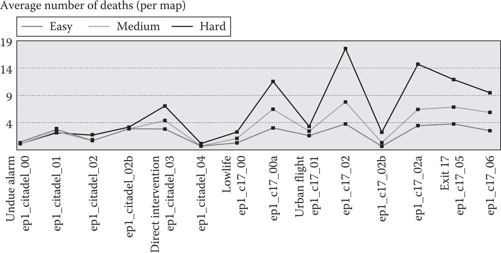
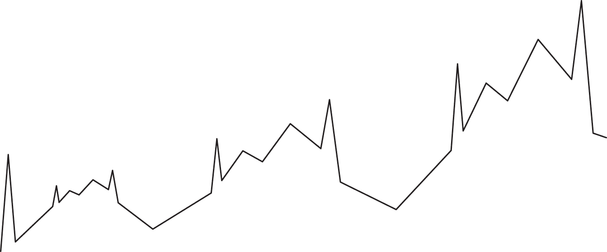
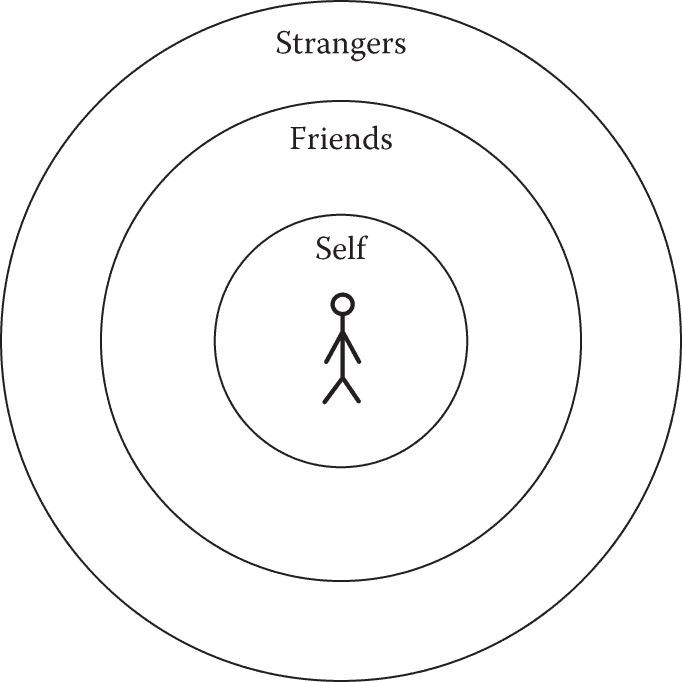

# 第十六章：体验可通过“兴趣曲线”来评判

### 透镜一：兴趣曲线透镜

十六岁时，我获得了第一份职业表演者的工作。那是在当地游乐园的一个表演团。我原本希望能参加那些能让我充分展示苦练杂耍技巧的节目，但我的工作最终变成了“杂耍”：操纵木偶、穿浣熊服装、在后台操作调音台、主持观众参与的喜剧表演。但有一天，团长、魔术师 Mark Tripp 找到我，说道：“听着——公园东侧的新舞台快建好了。我们要把音乐综艺秀搬过去，我要在那里表演魔术。在我休息的日子里，需要安排其他节目填补空档。你觉得你和 Tom 能不能凑个杂耍表演出来？”

自然，我兴奋不已——Tom 和我抓住一切机会一起练习，盼望着能有机会表演自己的节目。我们商量后拟定了一个粗略剧本，简述了各种杂技、串场的台词和笑话。我们排练到自觉准备好试演。几天后，大日子来临，我们在观众面前试演。开场是平衡杂技，接着是圈圈杂技、棍棒杂技、传接棍棒，最后是五球杂技——我们自认为最难的绝技。首次演自己的节目令人振奋。谢幕后，我们意气风发地返回后台。

Mark 在后台等我们。“觉得怎么样？”我们自豪地问。

“不错，”他说，“但可以好得多。”

“更好？”我惊讶道，“但我们没掉过任何东西！”

“确实，”他回答，“但你们有听观众的反应吗？”

我回想了一下。“嗯，他们有点慢热，但非常喜欢传接棍棒那段！”

“是的，但五球杂技——你们的压轴戏——效果如何？”

我们不得不承认，效果不如预期那么轰动。

“把剧本给我看看，”他说。他仔细阅读，时而点头，时而眯眼审视。沉吟片刻后说道：“节目里有不少好素材，但节奏安排不太对劲。”Tom 和我对视一眼。

“节奏？”我问。

“是啊，”他回答，拿起一支铅笔，“你们现在的节目大概是这个形状，”他在剧本背面画了这个形状：

他继续说：“观众通常更喜欢这种形状的节目。”

“懂了吗？”

我没懂。但我隐约觉得自己正在窥视某种极其重要的东西。

“很简单。开场要更有冲击力——抓住注意力。然后稍微收敛一点，做个小一点的环节，让观众有喘息和认识你们的机会。接着逐步递进，环节越来越大，最后给他们一个超出预期的大团圆结局。如果把圈圈杂技放开场，传接棍棒放压轴，我觉得节目会好得多。”

第二天，我们再次试演，几乎只调整了环节顺序——Mark 完全说中了。观众从一开始就被点燃，兴趣和兴奋度在节目过程中稳步攀升，在传接棍棒的高潮达到顶峰。即使第二场我们掉了几次东西，观众反应也比第一场热烈两倍，高潮时甚至有人站起来欢呼。

Mark 在后台笑着等我们。“今天效果好多了吧，”他说。Tom 回答：“按你的建议调整后，一切显而易见。真奇怪我们自己竟看不出来。”

“一点也不奇怪，”Mark 说。“筹备节目时，你们关注所有细节和环节衔接。要跳出节目，从观众视角审视整体，需要真正的视角转换。但效果截然不同，对吧？”

“确实！”我说，“我想我们有很多要思考的。”

“别想了——五分钟后你们得演木偶戏。”

### 兴趣曲线

自游乐园那段经历后，我在设计游戏时反复使用这项技巧，屡试不爽。但这些图表究竟是什么？让我们详细剖析一下。

首先要认识到，任何娱乐体验都是一系列时刻的串联。有些时刻更具冲击力，绘制这些图表时，我们通常描绘的是最具冲击力的时刻。回到我做 Imagineering（幻想工程）的日子，当我们向迪士尼 CEO 汇报主题公园新游乐设施创意时，总能预料到一个问题：“你们体验里最精彩的十个时刻是什么？”这个问题需要大量思考和准备才能妥善回答，如果我们答不上来，汇报会就结束了。绘制兴趣曲线时，你在思考如何最佳安排体验中的最佳时刻，如果你不知道它们是什么，就无法完成。这就是“时刻透镜”如此重要的原因。

# 娱乐体验中的兴趣曲线

## 兴趣曲线

一旦你明确了那些时刻，该如何将它们规划出来？娱乐体验的质量，取决于其展开的事件序列在多大程度上能抓住客人的兴趣。我使用“客人”而非“玩家”一词，因为它既适用于游戏，也适用于更广泛的体验。体验过程中兴趣程度的变化可以绘制成一条兴趣曲线。图 16.3 展示了一个成功娱乐体验的兴趣曲线示例。

### 图 16.3：成功娱乐体验的兴趣曲线

**图 16.3**

在点 (A) 处，客人带着一定程度的兴趣进入体验；否则，他们大概不会来到这里。这种最初的兴趣源于对体验趣味性的预先期待。视体验类型而定，这些期待会受到包装、广告、朋友推荐等因素的影响。虽然我们希望最初的兴趣越高越好，以吸引客人进门，但过度夸大反而会让整体体验变得没那么有趣。

随后体验开始。很快我们到达点 (B)，有时称为“钩子”。这是真正抓住你、让你对体验感到兴奋的东西。在音乐剧中，它是开场曲。在披头士的歌曲 *Revolution* 中，它是那尖啸的吉他 riff。在 *Hamlet* 中，它是鬼魂的出现。在电子游戏中，它通常表现为游戏开始前的一段小电影。拥有一个好的钩子非常重要。它给客人一个关于即将发生之事的暗示，并提供一个漂亮的兴趣峰值，这有助于在体验开始展开但尚未发生太多事情的不那么有趣的阶段维持注意力。

钩子过后，我们进入正题。如果体验设计精良，客人的兴趣将持续上升，在 (C) 和 (E) 等点暂时达到高峰，并偶尔略微下降到 (D) 和 (F) 等点，只是为了再次上升。

最后，在点 (G) 处出现某种高潮，到点 (H) 时，故事得到解决，客人感到满意，体验结束。希望客人离开时还留有余兴，或许甚至比来时更浓。当演艺界老手说“留给他们更多期待”时，指的就是这一点。

当然，并非每个优秀的娱乐体验都遵循这条确切的曲线。但大多数成功的娱乐体验都会包含我们这幅优秀兴趣曲线图所展示的一些要素。

## 不良兴趣曲线

另一方面，这张图展示了一个不太成功的娱乐体验的兴趣曲线。不良兴趣曲线有很多种可能，但这一种特别糟糕，虽然不像人们希望的那样罕见。

### 图 16.4：不太成功的娱乐体验兴趣曲线

**图 16.4**

同优秀曲线一样，客人在点 (a) 处带着一些兴趣进来，但立刻感到失望，由于缺乏像样的钩子，客人的兴趣开始衰退。

最终，发生了一些稍微有趣的事，这是好事，但持续不长，在点 (b) 达到顶峰，客人的兴趣继续下滑，直到在点 (c) 跌破兴趣阈值。这是客人对体验变得极度不感兴趣从而换台、离场、合书或关游戏的时刻。

这种惨淡的乏味不会永远持续下去，稍后在点 (d) 确实发生了一些有趣的事，但它持续不长，体验并未走向高潮，而是在点 (e) 处草草收尾——这已无关紧要，因为客人很可能早就放弃了。

## 将兴趣曲线作为设计工具

在创作娱乐体验时，兴趣曲线可以成为一个非常有用的工具。通过绘制体验过程中预期兴趣水平的变化，问题区域往往会变得清晰并可被修正。此外，在观察客人体验时，将他们观察到的兴趣水平与你作为娱乐设计者预期的兴趣水平进行比较，也是很有用的。通常，为不同人群绘制不同的曲线是一个有益的练习。视你的体验而定，它可能适合某些群体但让另一些群体感到无聊（例如“爷们片”对比“娘们片”），也可能是一款“大家都有份”的体验，意味着为几个不同的人群群体提供了结构良好的曲线。

## 模式中的模式

一旦你开始用兴趣曲线的视角思考游戏和娱乐体验，你就会到处看到优秀兴趣曲线的模式。你可以在好莱坞电影的三幕结构中看到它。你可以在流行歌曲的结构中看到它（前奏、主歌、副歌、主歌、副歌、桥段、大结局）。当亚里士多德说每部悲剧都有复杂性和结局时，你能在那里看到它。当喜剧演员谈论“三次法则”时，你能看到兴趣曲线。每当有人讲一个有趣、引人入胜或好笑的故事时，这种结构就存在，就像这个“高台跳水惊魂”故事，是一个女孩投稿给一本少女杂志的“尴尬时刻”栏目的：

> *我当时在一个室内游泳池，朋友们怂恿我从最高的跳台跳下去。我非常恐高，但还是爬到了顶上。我往下看，试图说服自己跳下去，突然胃里一阵翻腾，我吐了——正吐进池子里！更糟的是，吐在一群帅哥身上！我尽快爬下来躲进厕所，但大家都知道我干了什么！*
>
> **高台跳水惊魂，选自《Discovery Girls Magazine》**

你甚至能在过山车轨道的布局中非常具体地看到这种模式。自然，这种模式也出现在游戏中。我第一次发现自己在使用它，是在为迪士尼乐园制作 *Aladdin's Magic Carpet* 虚拟现实体验的 Mark 2 版本时。团队中一些人一直在讨论，虽然体验很有趣，但在某个环节似乎有点拖沓，我们在讨论如何改进。我突然想到，为游戏绘制一条兴趣曲线可能是个好主意。它的形状大致如下：

### 图 16.5：阿拉丁的魔毯兴趣曲线

**图 16.5**

突然，我非常清楚地意识到，那段平坦部分是个真问题。如何修复并不明显。仅仅在其中加入更多有趣的时刻可能还不够——因为如果兴趣水平太高，会削弱后续内容的吸引力。我最终意识到，完全从游戏中剪掉那段平坦部分可能最合理。跟总导演商量时，他反对剪掉——他觉得我们投入了太多心血，现在剪掉不划算，这可以理解，因为当时我们已处于开发后期。相反，他建议在平坦部分的开头设置一条捷径，以便想绕过该区域的玩家可以走捷径。我们加入了捷径（一个可以飞进去、能神奇地传送你到城市中心的商人帐篷），显然，知道捷径的玩家更倾向于走捷径。安装后观察游戏运行时，常见游戏操作员盯着显示器上的玩家进度，突然凑到玩家耳边低语“进那个帐篷！”我第一次见到这幕时，问操作员为什么这么告诉他们，她回答：“呃，我也不知道……反正他们走那边好像玩得更开心。”

## 兴趣曲线与分形模式

但“魔毯”体验很短暂——只有大约五分钟长。值得探讨的是，这种模式对较长的体验是否依然有意义。适用于五分钟体验的方法，对持续数小时的体验是否依然有效？作为其有效的佐证，请看游戏《半衰期 2》，这是有史以来最受好评的游戏之一。请看这张图表，它显示了在《半衰期 2：第一章》游戏过程中玩家死亡的次数，该游戏的平均通关时间为五小时三十九分钟。

**图 16.6**

*(图片由 Valve 公司提供，2008 年。经许可使用。)*

这三条线代表游戏的三个难度设置。这些形状看起来熟悉吗？完全可以认为，玩家死亡的次数是挑战程度的一个良好指标，而挑战程度与体验的趣味性息息相关。

但对于更长的体验，比如多人游戏，玩家可能玩上几百个小时，又该如何？同样的模式如何在五百小时的体验中站得住脚？答案有点令人惊讶：兴趣曲线模式可以是分形的。

换句话说，每一个长峰，仔细观察时，都可能拥有类似于整体模式的内部结构，类似于：

**图 16.7**

*一条分形兴趣曲线。*

当然，这种结构可以按你的意愿延伸任意层数。典型的电子游戏大致有三个层面的这种模式：

1.  **整体游戏**：开场动画，随后是一系列趣味递增的关卡，最终以玩家击败游戏的重大高潮结束。
2.  **每个关卡**：新的美学或挑战在开始时吸引玩家，随后玩家面对一系列挑战（战斗、谜题等），这些挑战提供不断上升的趣味，直到关卡结束，通常以某种“Boss 战”收尾。
3.  **每个挑战**：玩家遇到的每个挑战最好本身就有一条良好的兴趣曲线，有一个有趣的开头，以及随着你逐步深入而阶梯式上升的挑战。

多人游戏必须给玩家提供一个更大的结构，我们将在第 25 章 *社区* 中进一步讨论。

兴趣曲线将证明是你作为游戏设计师可以使用的最有用、最通用的工具之一，所以让我们把它们加入我们的工具箱。

## 什么构成了兴趣？

此时，你可能会发现你善于分析的左脑在大声抗议：“我喜欢这些图表，但我如何能客观地评估某事物对另一个人有多有趣？这全看起来很靠感觉啊！”确实全靠感觉。许多人会问“兴趣的单位”是什么。对此没有好的答案——我们还没有一个“趣味计”能以“毫趣”为单位给出读数。但这没关系，因为我们只关心兴趣的相对变化——绝对兴趣没那么重要。

要确定兴趣水平，你必须用你的整体自我去体验它，运用你的同理心和想象力，同时运用右脑和左脑的技能。不过，你的左脑可能会很高兴地知道，整体兴趣可以进一步分解为其他因素。分解的方法有很多，但我倾向于使用这三个：

### 因素 1：内在兴趣

有些事件天生就比其他事件更有趣。一般来说，风险比安全更有趣，花哨比朴素更有趣，不寻常比平常更有趣。戏剧性的变化和戏剧性变化的潜在可能总是有趣的。因此，一个男人与鳄鱼搏斗的故事，很可能比一个男人吃奶酪三明治的故事更有趣。我们只是拥有内在驱动力，促使我们对某些事物比其他事物更感兴趣。透镜 #6：***好奇心***，在评估内在兴趣时很有用，但这是一个足够有用的概念，以至于它拥有自己的透镜。

然而，事件并非孤立存在。它们相互构建，形成通常所说的故事弧。事件的内在兴趣部分取决于它们之间的关联方式。例如，在《金发姑娘和三只熊》的故事中，大多数情节并不有趣：金发姑娘吃粥、坐椅子、打盹。但这些无聊的事件铺垫了故事中更有趣的部分——三只熊发现家里被闯入了。

### 因素 2：呈现的诗意

这指的是娱乐体验的美学。呈现体验所用的艺术手法越美妙，无论是写作、音乐、舞蹈、表演、喜剧、摄影、平面设计还是其他，客人就会觉得它越有趣、越有吸引力。当然，如果你能为本身就内在有趣的事物提供美妙的呈现，那就更好了。我们将在第 23 章：***美学*** 中进一步讨论这一点，但现在就让我们把这个有用的想法加入工具箱。

### 因素 3：投射

这是指你迫使客人运用他们的同理心和想象力，将自己代入体验的程度。这个因素对于理解故事与游戏玩法的共性至关重要，需要一些解释。

考虑中彩票这个例子（一个内在有趣的事件）。如果一个陌生人中了彩票，你可能会略感兴趣地听听。如果你的朋友中了彩票，那就有趣一些了。如果你自己中了彩票，你肯定会足够感兴趣，从而将注意力集中在这件事上。发生在我们身上的事件，总比发生在别人身上的事件更有趣。

你会认为这让讲故事的人处于劣势，因为他们讲的故事通常关乎别人，往往是你从未听说过的人，甚至是根本不存在的人。然而，讲故事的人知道客人拥有同理心，有能力将自己置于他人的位置。讲故事艺术的一个重要部分，是创造让客人容易产生共鸣的角色，因为客人越能与角色共情，发生在这些角色身上的事件就越有趣。当你开始几乎任何娱乐体验时，其中的角色都是陌生人。随着你了解他们，他们变得像朋友一样，你开始关心他们的遭遇，你对涉及他们的事件的兴趣也随之增长。在某个时刻，你甚至可能在精神上将自己置于他们的位置，达到投射的最高点。

**图 16.8**

在构建投射方面，想象力与同理心同等重要。人类存在于两个世界：面向外部的感知世界和面向内部的想象世界。每一种娱乐体验都在想象中创造了自己的小世界。这个世界不必真实（尽管它可能是真实的），但它必须内部自洽。当这个世界自洽且引人入胜时，它会填满客人的想象力，在精神上，客人进入了这个世界。我们常说客人“沉浸”在这个世界里。这种沉浸感增强了投射，显著提升了客人的整体兴趣。维持客人沉浸在故事世界中的“自愿暂时搁置怀疑”确实很脆弱。只需一个小小的矛盾，就能把客人拉回现实，让他们“脱离”体验。

# 连续性娱乐与投射

连续性形式的娱乐，如肥皂剧、情景喜剧和连载小说，利用投射的力量，创造出能从一个娱乐体验延续到下一个体验的角色和世界。回头客已经熟悉这些持久的角色和场景，每当他们体验一集，他们的投射就会加深，幻想世界也变得“更真实”。然而，如果创作者未能仔细维护角色和世界的完整性，这种连续性策略很快就会适得其反。如果世界的新设定与先前确立的设定相矛盾，或者固定角色开始做或说一些“违背人设”的事来服务于某一新剧集的剧情，那么不仅这一集会受损，跨越所有剧集（过去、现在和未来）的整个幻想世界的完整性也会受损。从观众的角度来看，一集烂剧就能毁掉整个系列，因为从矛盾点开始，受损的角色和场景会显得虚假，观众将难以维持投射。

构建玩家对你所创造世界投射的另一种方法，是提供多种进入该世界的途径。许多人认为基于热门电影或电视节目的玩具和游戏，只不过是搭成功娱乐体验的顺风车、多赚几美元的噱头。但这些玩具和游戏为孩子们提供了进入既定幻想世界的新途径。玩具让他们能在该世界停留更长时间，他们在幻想世界中想象的时间越长，对该世界及其中角色的投射就越强。我们将在 `第 19 章`：`*世界*` 中进一步探讨这一想法。

就投射而言，互动娱乐拥有更显著的优势。观众可以成为主角。事件真实地发生在观众身上，正因如此才更有趣。此外，与故事世界仅存在于观众想象中的故事型娱乐不同，互动娱乐在感知与想象之间创造了显著的重叠，允许观众直接操纵和改变故事世界。这就是为什么电子游戏呈现的事件可能缺乏内在趣味或诗意，却依然能吸引观众。它们在内在趣味和呈现诗意方面的欠缺，往往能通过投射来弥补。

我们将在 `第 20 章`：`*角色*` 讨论化身时进一步探讨投射，但现在让我们引入一个透镜来审视它。

## 趣味因素示例

为了确保趣味因素间的关系清晰明了，让我们对比几种不同的娱乐体验。

一些勇敢的街头表演者通过抛接运转中的电锯来吸引注意。这是一个内在趣味极强的事件。当它在你周围发生时，你很难不抬头看一眼。然而，其呈现的诗意通常有限。还是有一定投射的，因为很容易想象接住电锯错的一端会是什么后果。当你亲眼目睹这一行为时，投射感甚至更强（见 `图 16.9`）。

**图 16.9**

小提琴协奏曲如何？事件（两根棍子摩擦）内在趣味不大，投射通常也不显著。在这种情况下，诗意必须撑起整个体验。如果演奏不优美，表演就不会太有趣（见 `图 16.10`）。当然也有例外。当音乐结构优秀或晚会节目编排得当时，内在趣味可以积累起来。如果音乐让你感觉身处异地，或让你对音乐家产生特定的共情，可能会有显著的投射。但这些是例外。在大多数情况下，单凭诗意就足以维持对优美音乐的兴趣。

**图 16.10**

考虑一下流行电子游戏《俄罗斯方块》。游戏主要由无尽的下落方块组成。这给内在趣味或呈现诗意留下的空间很小；然而，投射可以非常强烈。观众做出所有决定，成败完全取决于观众的表现。这是传统讲故事无法走的捷径。就有趣的娱乐体验而言，大量的投射弥补了诗意或内在趣味的不足（见 `图 16.11`）。

**图 16.11**

## 综合运用

有人发现，给体验中不同节点发生的趣味类型定性很有用，这样你可以看到在不同阶段是什么类型的趣味在抓住观众的兴趣，从而绘制出类似这样的图表：

**图 16.12**

无论你如何操作，审视玩家对游戏的兴趣，都是衡量你所创造体验质量的最佳方式。对于什么形状最适合兴趣曲线，意见有时会有分歧，但如果你不退后一步，为你的体验绘制一条兴趣曲线，你就有“只见树木，不见森林”的风险。不过，如果你养成了绘制兴趣曲线的习惯，你就会获得他人容易错过的设计洞察。

但我们面前出现了一个问题。游戏并不总是遵循相同的体验模式。它们不是线性的。如果这是真的，兴趣曲线对我们还有用吗？要妥善解决这个问题，我们必须先花些时间讨论最传统的线性娱乐体验类型。

## 延伸阅读推荐

*   ***《魔术与表演艺术》 作者：Henning Nelms**。还记得本章开头提到的抛接表演兴趣曲线故事吗？第二天，Mark Tripp 送了我一本这本书，它介绍了兴趣曲线的主题。凡是曾经不得不站在舞台上的人都应该读这本书。
