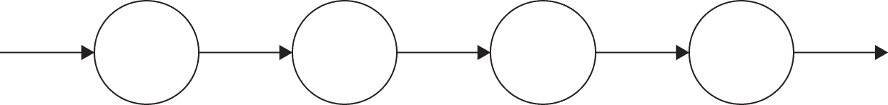
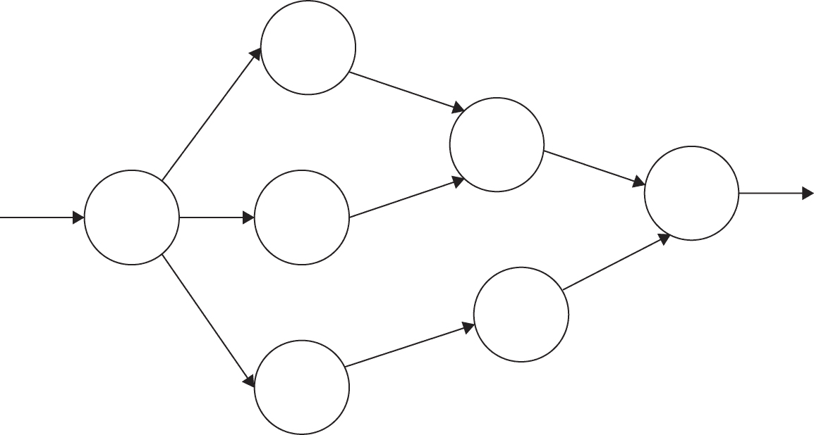
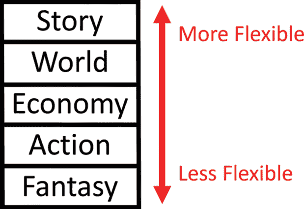

# 第十七章：一种体验是*故事*

**图 17.1**

> *上帝一生从未写过一个好剧本。*
>
> ——库尔特·冯内古特

## 故事/游戏二元性

二十世纪初，物理学家开始注意到一些非常奇怪的现象。他们注意到电磁波和亚原子粒子——长期以来被认为是相当容易理解的现象——以意想不到的方式相互作用。多年的理论推演、实验和再理论化，导出了一个怪异的结论：波和粒子是同一回事，都是单一现象的两种表现形式。这种“波粒二象性”动摇了人们对物质和能量所有已知认知的基础，并清楚地表明，我们对宇宙的理解远不如我们自以为的那样透彻。

如今我们已深入下一个世纪，讲故事的人面临着类似的困境。随着电脑游戏的出现，故事和游戏玩法——两个拥有截然不同规则体系的古老事业——展现出了类似的二元性。讲故事的人现在面临着一种媒介，他们无法确定故事将走向何方，就像物理学家发现他们无法确定电子将走向何方一样。现在这两个群体都只能用概率来表述。

# 故事与玩法

历史上，故事一直是单线程的体验，可由个人独自享受；而游戏则是拥有多种可能结局的体验，供群体共同娱乐。单人电脑游戏的出现挑战了这些范式。早期的电脑游戏只是传统游戏，例如井字棋或国际象棋，只不过由电脑充当对手。20 世纪 70 年代中期，带有故事情节的冒险游戏开始出现，让玩家成为故事中的主角。数千种结合故事与玩法的实验开始涌现。有些利用计算机和电子设备，另一些则使用纸笔。有些取得了辉煌的成功；另一些则惨遭失败。这些实验证明了一件事：可以创造出同时包含故事与玩法元素的体验。这一事实严重动摇了“故事和游戏遵循不同规则集”的假设。

关于故事与玩法之间的关系，至今仍有许多争论。有些人过于偏向故事，认为加入玩法注定会毁掉一个好故事。另一些人则持相反观点——认为拥有强故事元素的游戏在某种程度上被廉价化了。还有一些人倾向于折中方案。正如游戏设计师鲍勃·贝茨曾对我说的：“故事和玩法就像油和醋。理论上它们不相溶，但如果你把它们放进瓶子里用力摇晃，拌在沙拉上就很美味。”

抛开理论不谈，仔细看看玩家真正喜爱的游戏作品，毫无疑问，故事定有其增强玩法的作用，因为大多数游戏都有某种强故事元素，完全没有故事元素的游戏极为罕见。有些故事内容厚重，史诗感十足，如《最终幻想》系列精心制作的数小时叙事。另一些则极其微妙。以国际象棋为例。它本可以是一个完全抽象的游戏，但它不是——它有一层薄如蝉翼的故事外衣，讲述两个交战的中世纪王国。甚至连完全没有内置故事的游戏，也往往会激发玩家编造故事，赋予游戏语境意义。我最近和几个学龄儿童玩“骗子骰子”，这是一个完全抽象的骰子游戏。他们喜欢这个游戏，但玩了几轮后，其中一个说：“咱们假装是海盗——赌上我们的灵魂玩吧！”桌子四周顿时响起一片欢呼声。

归根结底，我们不在乎是创造故事还是游戏——我们在乎的是创造体验。故事和游戏都可以被视为帮助创造体验的机器。在本章中，我们将讨论故事与游戏如何结合，以及哪些技术最适合创造那些纯无游戏的故事或纯无故事的游戏无法单独创造的体验。

## 被动娱乐的迷思

在深入探讨之前，我想先处理一个顽固的迷思：互动叙事与传统叙事截然不同。本以为到了今天，随着故事驱动类游戏每年赚取数十亿美元，这种陈旧的误解早该过时并被遗忘了。遗憾的是，它似乎像杂草一样，在每一代初级游戏设计师的脑海中冒出来。论点通常如下：

> *互动故事从根本上不同于非互动故事，因为在非互动故事中，你完全是被动的，只是坐在那里，故事自顾自地拖沓推进，不管你在不在。*

说到这里，演讲者通常会翻白眼、吐舌头、流口水，以强调这一点。

> *而在互动故事中，你则是主动且投入的，持续做出决策。你在做事，而不仅仅是被动观察。真正来说，互动叙事是一种根本性的新艺术形式，因此，互动设计师几乎无需向传统讲故事者学习。*

认为植根于人类沟通能力的传统叙事机制，会因互动性而被某种方式抵消，这想法荒谬至极。如果一个讲述得不好的故事，无法迫使听众在聆听过程中思考并做决定。当一个人投入到任何类型的故事线中，无论是否互动，都在持续做决定：“接下来会发生什么？”“主角该怎么办？”“那兔子去哪了？”“别开那扇门！”区别仅在于参与者采取行动的能力。行动的渴望以及随之而来的所有思想和情感，两者皆有。高明的讲故事者懂得如何在听众心中激发这种渴望，并精准知道如何、何时（以及何时不）去满足它。这项技能能很好地迁移到互动媒体中，尽管难度增加了，因为讲故事者必须预测、考量、回应参与者的行动，并将其平滑融入体验之中。

换句话说，虽然互动叙事比传统叙事更具挑战性，但绝非根本不同。既然故事是如此多游戏设计的重要组成部分，游戏设计师最好尽可能多地学习传统叙事技巧。

## 梦想

“且慢！”我听到你呐喊。“我有一个美好的互动叙事梦想——一个超越单纯玩法的梦想，一个讲述精妙的故事完全互动，让参与者感觉身处有史以来最伟大的电影之中，同时仍拥有完全的行动、思想和表达自由！如果我们继续模仿过去的故事和玩法形式，这梦想肯定无法实现。”

我承认这是个美好的梦想——它推动了许多迷人的互动叙事实验的诞生。但迄今为止，没有人离实现这个梦想有多近。但这并未阻止人们创造出真正美妙、愉快且难忘的互动叙事体验，尽管它们在结构和给予参与者的自由度上有些受限。稍后，我们将讨论这个梦想为何未成现实，且可能永远不会成真。但首先，让我们谈谈什么真正有效。

## 现实

### 实战方法一：串珠法

尽管对互动叙事有着宏大的梦想，但有两种方法主导了游戏设计界。第一种也是电子游戏中最主流的，通常被称为“串珠法”，有时也叫“江河湖泊法”。之所以这么叫，是因为它可以用视觉方式呈现如下：

**图 17.2**

其思路是：先呈现一段完全非互动的故事（串），形式可以是文本、幻灯片或动画序列；然后给玩家一段自由移动和控制的时期（珠），并设定一个固定目标。当目标达成，玩家通过另一段非互动序列沿着串前进到下一颗珠子，换句话说，就是过场动画、游戏关卡、过场动画、游戏关卡。

许多人批评这种方法“并非真正具有互动性”，但玩家确实很享受。事实上，这毫不奇怪。串珠法让玩家体验到一个精心打磨的故事，并穿插着互动与挑战的阶段。成功完成挑战的奖励是什么？更多的故事和新的挑战。虽然有些挑剔者会嗤之以鼻，但这是一个运作良好的巧妙小系统，它在游戏性与叙事之间取得了很好的平衡。早期的游戏有时处理得笨拙生硬，但一些较新的游戏，如 *Ico*、*The Walking Dead* 和 *The Last of Us* 已展示了如何将串与珠巧妙地结合在一起。

## 真实世界方法 2：故事机器 [`#C02a_toc.xhtml#rsec17_4_2`]

要理解这种方法，我们必须仔细审视什么是故事。它无非是某人向另一个人讲述的一系列事件。“我没口香糖了，所以我去了药店”就是一个故事，只是不太有趣而已。然而，一个好的游戏往往会生成一系列有趣的事件，甚至有趣到让人想告诉别人发生了什么。从这个角度来看，一个好的游戏就像一台故事机器——生成确实非常有趣的事件序列。想想棒球或高尔夫这项运动创造了成千上万个故事。这些游戏的设计者在设计时从未想过这些故事，但游戏依然产生了它们。有趣的是，设计师在游戏中放入的预设脚本越多（就像串珠法那样），游戏产生的故事就越少。一些电子游戏，如 *The Sims*（模拟人生）或 *Minecraft*（我的世界），专门设计为故事生成器，在这方面非常有效。一些批评家说这些游戏不算真正的“互动故事”，因为这些故事没有作者。但我们不在乎这一点，因为我们只关心创造很棒的体验——如果有人体验到了他们认为很棒的故事，且没有作者，这会减弱体验的冲击力吗？绝对不会。事实上，这是一个值得考虑的有趣问题：创造一个精彩的故事更有挑战性，还是创造一个系统，让人们在与之互动时能生成精彩的故事更有挑战性？无论哪种方式，这都是一种强大的互动叙事方法，不应被忽视或视为理所当然。YouTube 和 Twitch 上大量的“实况解说”视频证明了人们喜欢分享这些故事。使用这透镜来判断如何让你的游戏成为一个更好的故事生成器。

就互动叙事方法而言，这两种方法肯定涵盖了有史以来 99% 以上的所有游戏。有趣的是，它们彼此截然相反。串珠法要求预先创建一个线性故事，而故事机器则在尽可能少的故事被预先创建时蓬勃发展。“但肯定有中间地带！”我听到梦想家在呐喊。“这两种方法都不是真正的、真实的互动叙事梦想！第一种方法基本上是一条线性路径，第二种根本不是讲故事——它只是游戏设计！我设想的那棵精妙的分支故事树、满屏的 AI 角色、数十个令人满意的结局，让参与者想反复体验，那又怎样？”

这是个好问题。为什么这个愿景无法实现？为什么它不是互动叙事的主流形式？通常的嫌疑对象（保守的发行商、意志薄弱的大众受众、懒惰的设计师）不必负责。这个愿景无法实现的原因是因为它充满了许多棘手的问题，这些问题迄今尚未成功解决——或许永远无法解决。这些问题真实、严重，值得仔细考量。

## 问题 [`#C02a_toc.xhtml#rsec17_5`]

### 问题 #1：好故事具有统一性 [`#C02a_toc.xhtml#rsec17_5_1`]

实际上，制作一个互动故事树很简单。只需不断创造通向更多选择的选择，再通向更多选择。这样做你会得到各种各样的故事。但其中有多少会是令人愉快的？它们会有什么样的兴趣曲线？我们知道关于好故事的一件事是它们具有高度的统一性——故事前五分钟呈现的问题，是一股贯穿始终、直到结尾都具有意义的驱动力。想象一个互动版的《灰姑娘》故事。“你是灰姑娘。你的继母让你清理壁炉。你是 (1) 去做，还是 (2) 收拾行李离开？”如果灰姑娘离开了，比如说，找了一份行政助理的工作，那这就不再是《灰姑娘》的故事了。灰姑娘悲惨处境的存在，是为了让她能戏剧性地、突然地、意想不到地摆脱它。你为《灰姑娘》故事写的任何结局，都无法与它原有的结局相提并论，因为整个故事是作为一个整体精心打磨的——开头和结局是浑然一体的。要创作一个拥有二十个结局和一个开头、且这个开头完美适配这二十个结局的故事，至少是极具挑战性的。结果，大多数拥有许多分支路径的互动故事最终都感觉有点稀释、无力且支离破碎。

### 问题 #2：组合爆炸 [`#C02a_toc.xhtml#rsec17_5_2`]

> *我恐惧现实太多。*
>
> —约翰·斯坦贝克，《与查利旅行记》

提议起来似乎很简单：我在这场景给玩家三个选择，下一场景三个，以此类推。但假设你的故事有十层选择深度——如果每个选择都导向一个独特的事件和三个新选择，你将需要为玩家做出的选择编写 88,573 种不同的结果。如果十层选择听起来有点短，你想从头到尾有二十次三选一的机会，那意味着你需要编写 5,230,176,601 种结果。这些巨大的数字使得任何有意义的分支叙事在我们短暂的一生中都变得不可能。可悲的是，大多数互动讲故事者应对这令人困惑的海量剧情线的主要方法，是开始融合结果——类似于（图 17.3）：

这确实让叙事更易于管理，但看看刚刚发生了什么。尽管玩家有那么多选择（实际上这里并不多），它们最终都汇聚到同一个地方。如果所有选择都导向同一个结论，这些选择能有多大意义？组合爆炸令人沮丧，因为它导致妥协之上贴创可贴，创可贴之上再妥协，最终导致故事薄弱。而且你仍然不得不编写大量玩家永远不会看到的场景。

图 **17.3**

### 问题 #3：多重结局令人失望

互动讲故事者喜欢幻想的一件事是：故事拥有多重结局是多么美妙。毕竟，这意味着玩家能反复游玩，每次都有不同的体验！但像许多幻想一样，现实往往令人失望。许多游戏都尝试过在其游戏故事中设置多重结局。几乎普遍地，当玩家在这类游戏中遇到第一个结局时，脑子里会冒出两个念头：

### “这是真正的结局吗？”

换句话说，就是最圆满的结局，或者是与故事开头最统一的结局。我们都喜欢幻想能找到一种方法写出同样合理的结局，但因为好故事具有统一性，这通常不会发生。当玩家开始怀疑自己可能走错了路时，他们就不再体验故事，而是开始思考自己本该怎么做，这破坏了任何讲故事的尝试。“串珠”结构在这里拥有巨大优势——玩家始终在正确的故事路径上，而且他们知道这一点——任何解谜行动必定通向一个令人满意的结局。

### “我必须把整个游戏再玩一遍才能看到另一个结局吗？”

换句话说，多重结局违背了统一性的理念，尽管我们希望幻想如果玩家做出不同选择，游戏过程会有显著不同，但几乎从未如此，因此玩家现在不得不踏上一段漫长重复的跋涉来探索故事树，这很可能不值得付出如此努力和忍受如此枯燥，因为二周目很可能包含大量重复内容（试图应对组合爆炸），这在透镜 #4 **惊喜**下看起来会很糟糕。有些游戏尝试过新颖的方法来解决这个问题。臭名昭著的游戏*通灵侦探*（曾在一篇评论中被总结为“有史以来最烂的游戏之一。同时也是杰作”）是一个持续 30 分钟的动态体验，总是以与反派的最终通灵对决告终，你的能力取决于你在游戏中走过的路径。结果，为了精通游戏，你不得不反复通关。由于游戏大部分由视频片段组成，且游戏树有一些你每次都必须经历的关键瓶颈节点，设计师们为这些瓶颈区域拍摄了多个版本，每个版本台词不同但包含相同信息。尽管设计师们为解决重复内容问题（以及许多其他问题）付出了巨大努力，玩家普遍仍觉得重玩互动故事的过程有些乏味。

当然，也有例外。*星球大战：旧共和国武士*提供了一种新颖的玩家选择——他们想走原力的“光明面”还是“黑暗面”，即追求善或恶的目标？取决于你选择哪条路径，你会经历不同的冒险、不同的任务，最终迎来不同的结局。可以说这并非同一个故事的两个不同结局，而是两个完全不同的故事——不同到它们各自都同样合理。试图走中间路线（呃，原力的“米色面”？）的玩家通常会觉得体验不尽如人意。

### 问题 #4：动词不够用

电子游戏角色花费时间做的事情，与电影和书籍中的角色花费时间做的事情截然不同：

*   **电子游戏动词**：跑、射、跳、攀爬、投掷、施法、拳击、飞行
*   **电影动词**：交谈、询问、谈判、说服、争辩、喊叫、恳求、抱怨

电子游戏角色在做任何需要“动脑子”的事情时都受到严重限制。故事中发生的大多是交流，而目前电子游戏根本无法支持这一点。游戏设计师 Chris Swain 曾建议，当技术进步到玩家能与电脑控制的游戏角色进行智能语音对话时，其效果将类似于有声电影的出现。突然之间，一种主要被视为有趣新奇事物的媒介将迅速成为文化叙事的主导形式。然而在此之前，电子游戏中可用动词的匮乏严重阻碍了我们将游戏作为叙事媒介的能力。

### 问题 #5：时间旅行让悲剧过时了

在互动叙事面临的所有问题中，这个最后的问题极有可能是最被忽视、最致命、也最无解的。人们常问：“为什么电子游戏不能让我们哭？”这很可能就是答案。悲剧故事常被认为是最严肃、最重要、最动人的故事类型。遗憾的是，它们通常是互动讲故事者的禁区。

自由和控制是任何互动故事最令人兴奋的部分之一，但它们要付出可怕的代价：讲故事者必须放弃必然性。在一个强有力的悲剧故事中，有一个时刻你能预见即将发生的可怕事情，你感到自己在许愿、乞求、希望它别发生——但你无力阻止这通向必然命运的道路。这种被裹挟着走向必然毁灭的冲击感，是电子游戏故事根本无法支撑的，因为仿佛每个主角都拥有时间机器，任何发生的严重坏事都可以撤销。例如，你如何能把《罗密欧与朱丽叶》做成游戏，让莎士比亚的结局（剧透警告：两人自杀）成为游戏的“真正”结局？

当然，并非所有好故事都是悲剧。但任何符合互动小说梦想资格的体验，至少应该具备悲剧的潜力。相反，我们得到的是《波斯王子：时之沙》旁白在你角色死亡时念的台词：“等等——那不是真正发生的事……”自由与命运是截然对立的。因此，这个问题的任何解决方案都必须极其巧妙。

## 梦想重生

互动叙事之梦的问题并非微不足道。也许有一天，逼真到无法与人类区分的人工人格将深度参与我们的故事和游戏体验，但即使那样也无法解决此处提出的所有问题——就像一场运作良好的*龙与地下城*游戏，其中每个游戏角色背后都有人类智慧，也无法解决所有这些问题一样。没有魔法解决方案能一次性解决这五个问题。这不是绝望的理由；梦想失败的原因是因为它有缺陷。它有缺陷，因为它痴迷于故事，而非体验，而体验才是我们关心的一切。以牺牲体验为代价专注于故事结构，与过分专注于技术、美学或游戏玩法结构而牺牲体验是同一种罪过。这是否意味着我们需要抛弃梦想？不——我们只需要改进它们。当你将梦想转变为创造创新的、有意义的、拓展思维的体验，并牢记这些可能需要以非传统的方式混合融合传统的故事和游戏结构时，梦想就能每天为你成真。我们生活在故事的海洋中，但大多数初涉叙事的人会发现它比预期更难。以下技巧和第 18 章 **间接控制** 介绍了一些有趣的方法，让你游戏中的故事元素尽可能有趣且引人入胜。

## 给游戏设计师的十个故事技巧

### 故事技巧 #1：尊重故事栈

# 故事栈

当开发一款你希望拥有引人入胜故事的游戏时，很容易产生诱惑，不是从设计游戏开始，而是从写故事开始。勾勒故事大纲，包含引人入胜的角色和激动人心的事件，这种具体化的做法极具吸引力，它吸引着新手游戏设计师，因为他们觉得勾勒故事构思比应对游戏机制和心理学的复杂性要容易得多。但这条道路充满了可怕的危险。据我所知，它毁掉的游戏比任何其他错误都多。我是从设计师 Jason Vandenberghe 那里了解到故事栈的，他不得不向我解释这个概念，因为我掉进了它的可怕陷阱，浪费了时间、资源，并差点毁了一个我非常在乎的游戏。正是因为这种巨大的危险，我将其列为故事贴士 #1。

## 图 17.4

图 17.4 展示了故事栈的全貌。这不是一个复杂的概念，只是一个由五个重要元素组成的列表，这些元素构成了故事游戏。但这些元素以一种重要的方式排序：从最不灵活（底部的幻想）到最灵活（顶部的故事）。让我们按顺序考虑这些元素中的每一个，以及它们如何相互关联，从最明智的起点开始。

## 幻想

说这五个元素中幻想是最不灵活的，听起来很疯狂。毕竟，幻想不比任何东西都灵活吗？我可以幻想任何我想幻想的东西！虽然这是真的，但幻想有一种可怕的不灵活性。要么幻想吸引玩家，要么不吸引。没有中间地带。关于飞行超级英雄的故事游戏讲得通……许多人都有这种幻想。但是，关于当专业洗碗工的故事游戏？你会难得多地保持人们的兴趣，因为那根本不是大多数人的幻想。以强有力的幻想开始你的设计很重要——毕竟，人们玩游戏的主要原因之一就是幻想实现。如果你的幻想无法引起玩家的共鸣，你所做的其他一切都将是一场艰难的战斗。清晰阐述游戏的核心幻想，是你构建强大体验的基石。

## 行动

一旦你清晰地阐述了幻想，接下来你要考虑什么玩家行动最适合实现该幻想。在 *Pixie Hollow Online* 的开发中，该游戏部分基于迪士尼电影 *Tinkerbell*，我们最初的设计让玩家参与电影中的许多动作。他们可以帮助动物，从大自然中采集物品，为其他仙女制作礼物，帮助著名仙女解决人际问题，以及许多其他事情。我们自豪地将这个设计带给一群小女孩焦点小组以测试他们的兴趣。令我们尴尬的是，她们说“这些事情看起来很有趣……但我真正想做的是飞行！”我们忽略了飞行作为一个重要动作，因为在电影剧本中它微不足道。它只是从一个活动过渡到另一个活动的方式。因此，在我们的设计中，飞行只发生在过场动画中。但当我们退后一步审视时，显而易见，要实现成为像丁克贝尔那样的仙女的幻想，主要游戏动作应该是飞行。幸运的是，女孩们在我们仍有时间修改时纠正了我们。在游戏的最终版本中，玩家会在所有活动中持续飞行，我们特别关注飞行的手感，以便以一种令人愉悦的方式实现幻想。

## 经济系统

现在你拥有一套能扎实实现吸引人幻想的行动，你需要一个进度系统来奖励这些行动，尤其是那些最能实现幻想的行动。正如我们在 第 13 章 *平衡* 中讨论的，游戏经济系统由赚取和消费定义。最简单的游戏经济系统实际上只关乎赚取——赚取分数、赚取下一关的入场资格、赚取胜利。在游戏中奖励错误的东西很容易。例如，也许你创建了一个以成为忍者为核心幻想的游戏。你选择了投掷手里剑、潜行接近敌人、用忍者刀攻击敌人等动作，这些有助于实现该幻想。然而，如果你不小心设计了关卡，要求玩家为了获胜必须枯燥地记忆隐藏陷阱的位置，你就是在奖励那些违背忍者幻想的行动。在 *Pixie Hollow Online* 的例子中，我们希望玩家从许多不同的任务中获得进度，并能用收益获得新服装给仙女换装。但是……仙女应该有钱吗？“仙女币”感觉直接违背了成为仙女的幻想。像易货系统这样的东西感觉更适合仙女幻想……我们确实实现了这一点：一个多货币系统。某个仙女商店可能用五根松针换一双拖鞋，用两颗蓝莓换一个发带，用六片百合花瓣换一条裙子。这创造了一个符合仙女幻想的经济系统，并鼓励了我们想要的行动：渴望这些物品的玩家会飞去进行寻宝猎捕，找出在 Pixie Hollow 哪里能赚到他们需要的东西。

## 世界

一旦你确立了幻想、行动和经济系统，现在你需要一个让它们讲得通的世界。我们将在 第 19 章 *世界* 中详细讨论这一点，简而言之，你需要创建一个有规则的地方，让你创建的经济系统在那里讲得通。如果你做了一个全关于奔跑、跳跃和收集星星、玩家用星星兑换魔法物品的游戏，你应该对这些星星从哪来、为什么魔法物品的卖家想要这些星星有所解释。还有……魔法物品到底从哪来的？这套关于你的世界如何运作的规则还不是故事……故事是一系列事件。世界是一个按特定规则运作的地方。如果你的世界规则与经济系统规则不匹配，你游戏的一切都会感觉空洞和虚假。

## 故事

最后，我们来到了栈顶。现在我们有了扎实的幻想、实现它的行动、奖励这些行动的经济系统、以及为该经济系统提供理由的世界，我们终于准备好开发故事了。它应该是一个让我们创造的世界讲得通的故事，也是一个玩家行动和进度至关重要的故事。正如我们在下一个贴士中将看到的，故事拥有近乎无限的灵活性，能让即使最奇怪的情况也显得合情合理、理所当然。尽管有这种灵活性，故事*依然*想要接管故事栈。一旦故事得逞，它将奴役整个游戏设计过程。故事不应是游戏的主宰，而应是一个甘愿的仆人，利用其灵活性创造最伟大的游戏体验。如果你发现自己或团队中有人说“我们不能那样做……那违背了故事”，这是一个明确的信号：故事欺骗了你，困住了你，并接管了你的游戏。

这就是为什么尊重故事栈如此重要的原因。无论你从哪里开始设计，你都在立下桩基。立下故事桩基是愚蠢的——因为现在，不知怎么地，你将不得不把不灵活的幻想拖到桩基所在的位置。另一方面，如果你找到了一个强大但不灵活的幻想，并在那里立下桩基，那么当你建立起其他元素时，你可以轻松地编织一个故事，解释为什么你的桩基恰好在那里。这引出了故事贴士 #2。

### 故事贴士 #2：让你的故事发挥作用！

正如我们在第 5 章 *要素* 中所讨论的，设计可以从四元组的任何一个角落切入——故事、玩法、技术或美学。而且许多设计都是从故事开始的。过于盲目地遵循那个故事，以牺牲其他要素为代价，是一个常见的错误——而且是一个特别愚蠢的错误，因为从某种程度上说，故事是所有要素中最灵活的！故事要素通常只需改动几个字就能修改，而修改玩法要素可能需要数周的平衡调整，修改技术要素可能需要数月的重新编程。

我曾听一款 3DO 游戏的开发者谈论他们遇到的开发难题。他们的游戏涉及驾驶飞船飞越一颗星球并击落敌机。游戏是 3D 的，为了维持性能，他们无法绘制远处的地形。为了防止地形突然弹出时显得突兀，他们原本计划使用制造迷雾这一老套路。但由于 3D 硬件的某个怪癖，他们能制造的唯一迷雾是一种怪异的绿色，看起来完全不真实。起初，团队以为不得不放弃这个方案，突然，故事来拯救了局面！有人灵机一动：也许占领该星球的邪恶外星人，是通过用有毒气体笼罩星球来实现的。故事的这一微小改动，瞬间让支持理想玩法机制的技术方案变得完全可行。作为副作用，这可以说还改善了故事，让外星人入侵显得更加戏剧化。

开发我的桌游 *莫达克的复仇* 时，我有过类似的经历。我最初的玩法设计要求玩家在地图上移动，收集五把钥匙。集齐五把后，他们必须前往邪恶巫师莫达克的要塞，解锁要塞并与他战斗。测试中很快发现，如果莫达克能主动找上收集齐钥匙的玩家，游戏机制会更好，因为这更直接，也意味着与莫达克的战斗可以在各种地形中进行。但这让我很苦恼，因为那样故事就讲不通了。于是，故事再次来拯救局面！要是莫达克有一个无人能寻觅的秘密要塞呢？玩家不再收集钥匙，而是收集五块召唤石？集齐五块后，莫达克就会立刻从要塞被召唤出来，被迫在玩家当前所在的地形与玩家战斗。故事的这一简单改动，让理想的玩法成为可能。而且比我那略显老套的“城堡里的反派”故事更有新意。

请始终牢记故事可以多么灵活、多变且强大——不要害怕塑造你的故事，以支撑你认为最好的玩法。

### 故事贴士 #3：目标、障碍与冲突

好莱坞编剧界有一句老话：故事的主要成分是 (1) 一个有目标的角色，以及 (2) 阻碍他/她达成目标的障碍。

当角色试图克服障碍时，有趣的冲突往往会产生，尤其是当另一个角色有着相冲突的目标时。这种简单的模式能产生非常有趣的故事，因为这意味着角色必须从事解决问题（我们对此很感兴趣）；因为冲突导致不可预测的结果，换句话说就是惊喜（我们对此很感兴趣）；而且障碍越大，戏剧性变化的潜力就越大（我们对此很感兴趣）。

这些成分在创作电子游戏故事时同样有用吗？绝对有用——甚至可能更有用。我们已经讨论过 透镜#32：***目标***——主角的目标将成为玩家的目标，并将成为推动玩家沿着“珠串”前进的驱动力（如果你选择创建珠串结构的话）。而该角色遇到的障碍将成为玩家面临的挑战。如果你想让游戏拥有扎实融合的故事，这些东西必须对齐——如果你给玩家一个与主角面临的障碍毫无关系的挑战，你就大大削弱了体验。但如果你能找到一种方法，让游戏的挑战既有意义，又是主角的戏剧性障碍，你的故事与游戏结构就会融为一体，这在很大程度上能让玩家感觉自己是故事的一部分。我们已经有了目标透镜——这里是它的姊妹透镜。

### 故事贴士 #4：使其真实

> *像上帝了解这个世界一样了解你的世界。*
>
> —罗伯特·麦基

构思出一个情节大纲、一份角色名单和一套奇幻世界规则是一回事；在脑海中将其视作真实存在的地方又是另一回事。要做到这一点，你必须时刻思考它，想象你是生活在该世界中的角色之一。迪士尼游乐设施设计的秘诀之一是，每个体验（如 *鬼屋* 或 *飞跃山*）都有一个不为公众所知的详尽背景故事，但所有设计师都知道它，并用它来保持世界的坚实感。托尔金并非某天坐下来就写出了 *指环王*；相反，他在故事真正成形前，花了数年时间构想和记录中土世界的历史、民族和语言。这种详细规划的程度很少是必要的，但如果你无法回答关于你世界历史和角色动机的基本问题，这会在你的作品中表现出来，人们会一眼看穿：缺乏想象力。永远记住：如果对你来说它不真实，对他们来说它也不真实。

### 故事贴士 #5：提供简单性与超越性

游戏世界和奇幻世界的共同点之一，是它们为玩家提供了 **简单性**（游戏世界比现实世界简单）和 **超越性**（玩家在游戏世界中比在现实世界中更强大）的组合。这种强效组合解释了为什么许多类型的故事世界会在游戏中反复出现，例如以下几种：

*   **中世纪**：剑与魔法的世界源源不绝。这些世界比我们所处的世界更简单，因为技术原始。但它们很少是中世纪的准确模拟——几乎总是加入了某种魔法，这提供了超越性。这一流派持续成功，必然源于它以一种原始的方式结合了简单与超越。

*   **未来**：许多游戏和科幻故事设定在未来。但这些世界极少是对我们可能见到的未来的任何现实诠释——那种未来有持续蔓延的郊区、更安全的汽车、更长的工时和日益复杂的手机套餐。不——这些世界中呈现的未来通常是后启示录式的未来；换句话说，炸弹爆炸了，或者我们身处某个陌生的边疆星球，世界变得简单得多。当然，我们可以接触到足够先进的技术——正如阿瑟·克拉克所言，它们与魔法无异——至少在超越性方面是这样。

*   **战争**：在战争中，事情更简单，因为所有常规规则和法律都被搁置。超越性来自强大的武器，让参与者化身为神，决定生死。这是现实中的恐怖，但在幻想中，它给玩家带来强烈的简单性和超越性感受。

*   **现代**：现代背景在游戏故事中并不常见，除非玩家突然拥有了令人惊讶的、超越常人的力量。这可以通过多种方式实现。《侠盗猎车手》系列利用犯罪生活赋予玩家简单性（不守法让生活变得更简单）和超越性（不守法让你变得更强大）。《模拟人生》创造了一个人类生活的简化版“玩具屋”，并赋予玩家超越常人的神一般的力量来控制游戏中的角色。

*   **抽象**：抽象世界，如《我的世界》，不仅比现实世界简单；它们甚至比普通电子游戏还要简单！正如诺奇所发现的，将这种简单性与创造和毁灭的神一般力量相结合，能创造出一款相当成功的游戏。

简单性和超越性构成了一个强大的组合，但极易搞砸。使用这枚透镜，确保你将它们完美结合。

## 故事贴士 #6：考虑英雄之旅

1949 年，神话学家约瑟夫·坎贝尔出版了他的第一本书 *The Hero with a Thousand Faces*（中文译名常为《千面英雄》）。在书中，他描述了大多数神话故事似乎共享的一种潜在结构，他称之为“单一神话”，或“英雄之旅”。他详细阐述了这种结构如何构成摩西、佛陀、基督、奥德修斯、普罗米修斯、奥西里斯等众多人物故事的基础。许多作家和艺术家从坎贝尔的著作中获得了极大的灵感。最著名的是，乔治·卢卡斯以坎贝尔描述的结构为基础构建了《星球大战》的架构，并取得了巨大成功。

1992 年，好莱坞编剧兼制片人克里斯托弗·沃格勒出版了一本名为 *The Writer's Journey*（中文译名常为《作家之旅》）的书，这是一本利用坎贝尔描述的原型来写作故事的实用指南。沃格勒的书不如坎贝尔的著作学术，但对于希望将英雄之旅作为框架的作家来说，它是一本更易懂、更实用的指南。据称，编写《黑客帝国》（其相当清晰地遵循了英雄之旅模型）的沃卓斯基姐妹曾以沃格勒的书为指南。尽管这本书通俗易懂，但它常因过于公式化、强行将太多故事套入单一公式而受到批评。尽管如此，许多人发现它能为英雄故事的结构提供有用的见解。

由于许多电子游戏都围绕英雄主义主题展开，因此英雄之旅作为强大电子游戏故事的相关结构是合乎逻辑的。既然已有多本书籍和大量网站描述如何围绕英雄之旅构建故事，我在此仅做概述。

### 沃格勒版英雄之旅梗概

1.  **平凡世界**——确立场景，展示我们的英雄是一个过着平凡生活的普通人。

2.  **冒险的召唤**——英雄面临一个打破其平凡生活的挑战。

3.  **拒绝召唤**——英雄找借口说明为何无法踏上冒险。

4.  **遇见导师**——某位智者给予建议、训练或援助。

5.  **跨越门槛**——英雄离开平凡世界（往往是在压力下）并进入冒险世界。

6.  **考验、盟友、敌人**——英雄面临小挑战、结识盟友、对抗敌人，并了解冒险世界的运作规则。

7.  **接近幽暗洞穴**——英雄遭遇挫折，需要尝试新方法。

8.  **至暗时刻**——英雄面临生死攸关的巅峰危机。

9.  **获得奖赏**——英雄幸存下来，克服恐惧，并获得奖赏。

10. **归途**——英雄返回平凡世界，但问题尚未完全解决。

11. **复活**——英雄面临更大的危机，必须运用所学的一切。

12. **带着灵药返回**——旅程彻底结束，英雄的成功改善了平凡世界中每一个人的生活。

你的英雄故事绝不需要包含所有这十二个步骤——你可以用更少或更多的步骤，或以不同的顺序讲述一个好的英雄故事。

作为旁注，透过 透镜 #69 **兴趣曲线** 来审视英雄之旅是一个有趣的练习——你会看到一种熟悉的形式浮现出来。

一些讲故事的人极其反感“好故事可以通过公式创作”这一观点。但英雄之旅不那么像一个能保证创作出有趣故事的公式；而更像是许多有趣故事倾向于采取的一种形式。把它想象成骨架。正如人类尽管都拥有相同的 208 块骨头却有着巨大的差异，英雄故事尽管拥有某些共同的内部结构，也能呈现出数百万种形式。

大多数讲故事的人似乎都同意，将英雄之旅作为写作的起点不是个好主意。正如鲍勃·贝茨所言：

> *英雄之旅不是一箱能修复所有故事问题的工具。但它有点像电路测试仪。你可以夹住故事中有问题的地方，检查是否有足够的“神话电流”流过。如果“电量”不足，它能帮你指出问题的根源。*

最好先写你的故事，如果你注意到它可能与单一神话的某些元素有共同之处，再花些时间考虑：你的故事是否能通过更紧密地遵循原型结构和元素而得到改进。换句话说，将英雄之旅作为一枚透镜来使用。

## 故事贴士 #7：保持故事世界的一致性

有一句古老的法国谚语：

> *如果你往一桶污水里倒一勺美酒，*
> *你得到的是一桶污水。*
> *如果你往一桶美酒里倒一勺污水，*
> *你得到的依然是一桶污水。*

在某些方面，故事世界如同那桶美酒般脆弱。世界逻辑中一个微小的不一致，就会永远打破世界的真实感。在好莱坞，“跳鲨” 一词用来形容一部电视剧已烂到再也无法被严肃对待的地步。该词源自 1970 年代热门剧集《快乐时光》。作为一季的结局，编剧让剧中最受欢迎的角色冯兹骑摩托车跳过一排校车。该集大肆宣传，收视率极高。下一季，为重现成功并蹭电影《大白鲨》的热度，他们让滑水的冯兹跳过一条鲨鱼。这太荒谬了，且严重偏离了冯兹的角色设定，以至于剧迷感到厌恶。问题不在于某一集有荒谬的前提，而在于角色及其世界永远被玷污，再也无法被严肃对待。这是另一个例子：《质量效应 3》发布后不久，许多玩家对三部曲的结局表达了失望。创作者回应称将发布补丁修改结局。这引发了巨大骚动，证明了故事的质量不如“真实感”的幻觉重要。一丁点儿一致性错误，就能让整个世界崩塌，毁掉它的过去、现在和未来。

如果你有一套定义世界运作方式的规则，请坚持它们，并严肃对待。例如，如果在你的世界里，你可以拿起微波炉塞进口袋，这可能有点奇怪，但在你的世界里，口袋可能是魔法的，能装下各种东西。然而，如果稍后玩家试图把熨衣板塞进口袋，却被告知“那太大了，你拿不动”，玩家会感到沮丧，不再严肃对待你的故事世界，也不再将想象力投射其中。在不知不觉中，眨眼间，你的世界将从一个真实、鲜活的地方变成一个悲伤、破碎的玩具。

## 故事贴士

### 故事贴士 #8：让你的故事世界易于理解

在儒勒·凡尔纳的经典故事《*从地球到月球*》（1865）中，他讲述了三名男子乘坐由巨型大炮发射的飞船前往月球的故事。尽管书中详细描述了大炮的科学原理，但这一设定在现代人眼中似乎荒谬可笑，因为任何足以将飞船发射入太空的大炮爆炸肯定会杀死船内所有人。经验告诉我们，火箭是将人送上月球更安全、更现实的方法。人们可能会认为凡尔纳在故事中没用火箭是因为那时火箭还没发明——但事实并非如此。当时火箭常被用作武器——例如《*星条旗*》（1814）中提到的“火箭的红光”。

所以，凡尔纳肯定知道火箭，他似乎也有足够的科学头脑意识到火箭比大炮更适合将飞行器送入太空。那他为什么要这样写故事？答案似乎是：这对他的受众来说更易于理解。

请看十九世纪军事技术的发展进程。首先看火箭：

*   1812 年：威廉·康格里夫的火箭：直径 6.5 英寸，重 42 磅，射程两英里
*   1840 年：威廉·黑尔的火箭：与康格里夫的相同，但精度略高

在近三十年里，火箭没有增长，只有微小的改进。

但现在看大炮：

*   1855 年：达尔格伦火炮：100 磅炮弹，射程三英里
*   1860 年：罗德曼大炮：1000 磅炮弹，射程六英里

仅仅五年，炮弹尺寸就增加了十倍！考虑到美国内战在 1865 年占据国际头条，人们只需稍微发挥想象力，就能预见未来几年会出现更大、更强大的大炮——可能大到能把炮弹直接打到月球上。

凡尔纳肯定明白火箭是人类登月最可能的方式——但他是讲故事的人，不是科学家，他有足够的常识知道：讲故事时，事实并不总是你的朋友。玩家会相信并享受什么，比物理上什么准确更重要。

当我参与《*加勒比海盗：争夺海盗金币*》开发时，出现了几个这种原则的例子。一个是船速——起初，我们费尽心思确保海盗船以真实速度航行。但我们很快发现这速度太慢了（或者从我们离水面的高度看起来很慢），玩家很快就厌倦了。所以，我们抛弃了现实，让船以一种感觉真实且刺激的速度行驶，尽管它完全不真实。另一个例子可以在游戏的这个截图中清楚地看到：

**图 17.5**

（由迪士尼企业公司提供。经许可使用。）

看那些船，想想风从哪边吹。奇怪的是，风似乎在所有船的后面。确实如此。在动作游戏中要求玩家理解如何顺风驾驶帆船实在是要求太高了——没有任何玩家问过我们这个；他们只是假设船像汽车或摩托艇一样开，因为那是他们熟悉的。作为一个小细节，看看船桅杆顶端的旗帜——它们飘动的方向与帆相反！建模师最初让旗帜朝向正确，但这对我们的测试玩家来说看起来很奇怪，因为他们更习惯看到汽车天线上飘扬的旗帜，而不是船桅杆上的。玩家经常问为什么旗帜指向错了，我们会解释：“不，看，风是从船后面吹来的……”他们会说“哦……嗯……我想那是对的。”但过了一阵子，我们厌倦了解释，就让旗帜指向另一边，人们就不再问了，因为现在看起来“正常”了。

不过，有时你的故事需要一些玩家从未见过的奇怪事物，这些事物无法轻易变得易于理解。在这种情况下，特别引起玩家对该事物的注意，让他们明白它是什么、如何运作，这一点非常重要。我曾带过一个学生团队，他们做了一个关于宠物店里两只相爱的仓鼠的小游戏，但因为关在不同笼子里而无法相见。游戏让玩家用一门小仓鼠大炮试图将公仓鼠发射到母仓鼠的笼子里。有人指出根本没有仓鼠大炮这东西，结果故事显得有点奇怪、难以置信。一种解决方案是把大炮换成别的能发射公仓鼠的东西，比如仓鼠轮，但团队想保留大炮，所以采取了另一种方法。在宠物店的建立镜头中，他们显眼地放置了写着“特价！仓鼠大炮出售！”的招牌。这不仅作为一个引人入胜的钩子，制造了对仓鼠大炮长什么样的期待，还向玩家介绍了这个非常奇怪的物品，以便当它出现时，不再显得那么奇怪——只是一个不同寻常世界中自然的一部分。超现实元素在游戏中并不罕见，重要的是你要理解如何平滑地整合它们。一个方便的方法是使用这个透镜。

### 故事贴士 #9：审慎使用陈词滥调

电子游戏故事似乎无法逃避的一个批评是过度使用陈词滥调或套路。毕竟，你只能拯救世界免受邪恶外星人侵害、用巫术对抗恶龙、或用霰弹枪对抗地牢里满屋的僵尸有限几次，之后就会变得乏味。这驱使一些设计师避免任何以前用过的故事背景或主题——有时把故事和背景推向如此离经叛道的地步，以至于玩家完全无法理解那是什么，也无法产生共鸣。

尽管陈词滥调有被滥用的可能，但它们拥有巨大的优势：对玩家来说很熟悉，而熟悉的东西是可理解、易懂的。有人说，每款成功的电子游戏都能找到一种方法，将熟悉的东西与新颖的东西结合起来。有些设计师永远不会做忍者游戏，因为忍者题材烂大街了。但如果你讲一个孤独的忍者、无能的忍者、忍者狗、机器人忍者，或一个过着忍者秘密生活的三年级女孩的故事呢？所有这些剧情都有潜力成为新颖独特的东西，同时拥有一个钩子，连接到玩家已理解的世界。

过度使用陈词滥调当然是错误，但将它们从工具箱中流放同样是错误。

### 故事贴士 #10：有时地图能让故事栩栩如生

# 讲故事

当我们想到写故事时，通常会想到文字、人物和情节。但故事可能来自意想不到的地方。罗伯特·路易斯·史蒂文森原本无意创作公认的他最伟大的作品：《*金银岛*》。受托在一个雨天特别多的假期里取悦一个小学生，他和男孩轮流画画。一时兴起，史蒂文森画了一张虚构岛屿的地图，这张地图突然有了自己的生命：

> ……当我停在我的“金银岛”地图前时，书中未来的人物开始清晰地出现在想象的树林中；他们棕色的脸庞和明亮的武器从意想不到的角落窥视着我，他们来回穿梭，战斗并寻宝，就在这平面投影的几平方英寸上。我一转眼发现面前已有一些纸张，正在写章节列表。

大多数电子游戏不是发生在文字的世界里，而是发生在一个物理场所中。通过绘制这个场所的草图和图画，故事往往会自然成形，因为你被迫思考谁住在那里，他们做什么，以及为什么。

## 故事技巧 #11：惊喜与情感

写故事很难。让故事从游戏中涌现出来更难。但通常情况下，故事枯燥是因为缺乏惊喜或情感（或者，天哪，两者都缺！）。如果你发现你的游戏故事枯燥，拿出你的老朋友——透镜 #1：*情感* 和透镜 #4：*惊喜*，对准你的故事。你自己可能会惊讶和感动于它们能提供多大帮助。

关于故事还有更多可说的，我们不可能在这里全部涵盖。但无论你创作什么，无论是只有最薄的主题和背景外壳的抽象游戏，还是拥有数百个详细人物的庞大史诗冒险，你明智地让游戏的故事元素尽可能有意义且强大。因此，我们以一个通用透镜结束本章，它可以作为研究元素四面体中这一非常重要的象限的工具，使任何游戏受益。

## 建议阅读

*   ***《游戏角色开发与叙事》作者：李·谢尔登***. 李为数十款游戏和同样数量的电视节目撰写过剧本。他将一生的讲故事经验浓缩进了这本非常实用的书中。
*   ***《电子游戏互动叙事》作者：乔赛亚·利博维茨和克里斯·克鲁格***. 两位经验丰富的专业人士提供了更多关于互动叙事的绝佳建议。
*   ***《故事》作者：罗伯特·麦基***. 被许多人视为好莱坞编剧的圣经，这本书清晰、易懂，充满了绝佳的建议。
*   ***《作家之旅：作家的神话结构》作者：克里斯托弗·沃格勒***. 这本书因过于公式化而名声在外，但它让许多强大的思想变得易于理解，并给许多伟大的编剧提供了强有力的洞见。
*   ***《数字叙事：创作者的互动娱乐指南》***. 这本书塞满了案例和技巧，更别提对来自全行业互动讲故事者的深度访谈了。
*   ***《小说写作：叙事技巧指南》作者：珍妮特·伯罗威***. 现已出到第十版，这本书适合任何认志成为伟大讲故事者和作家的人。从第一页就赢得了我的心：*第一章：不管什么有用就行*。
