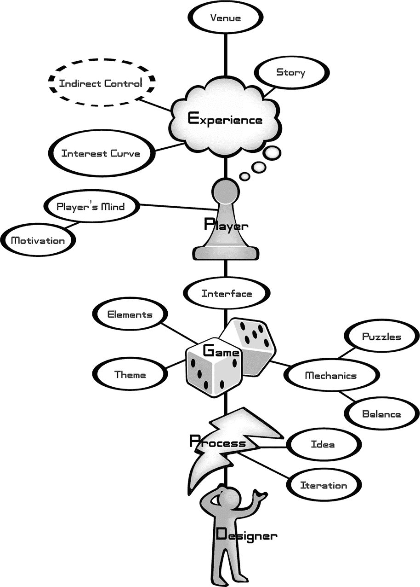
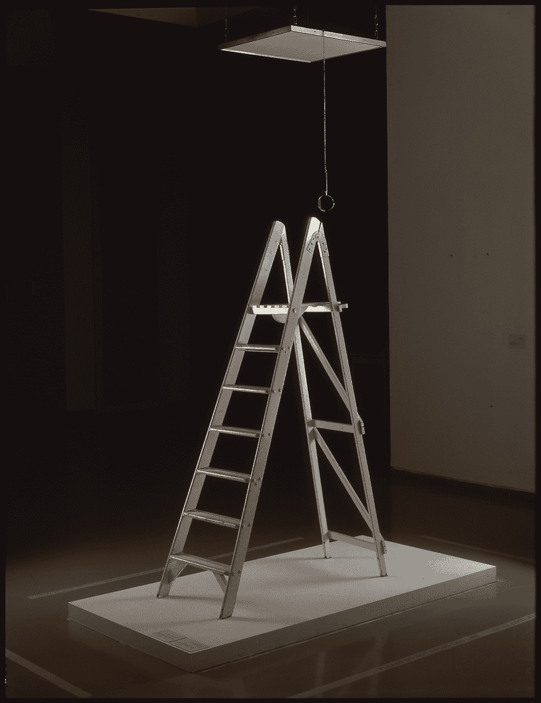
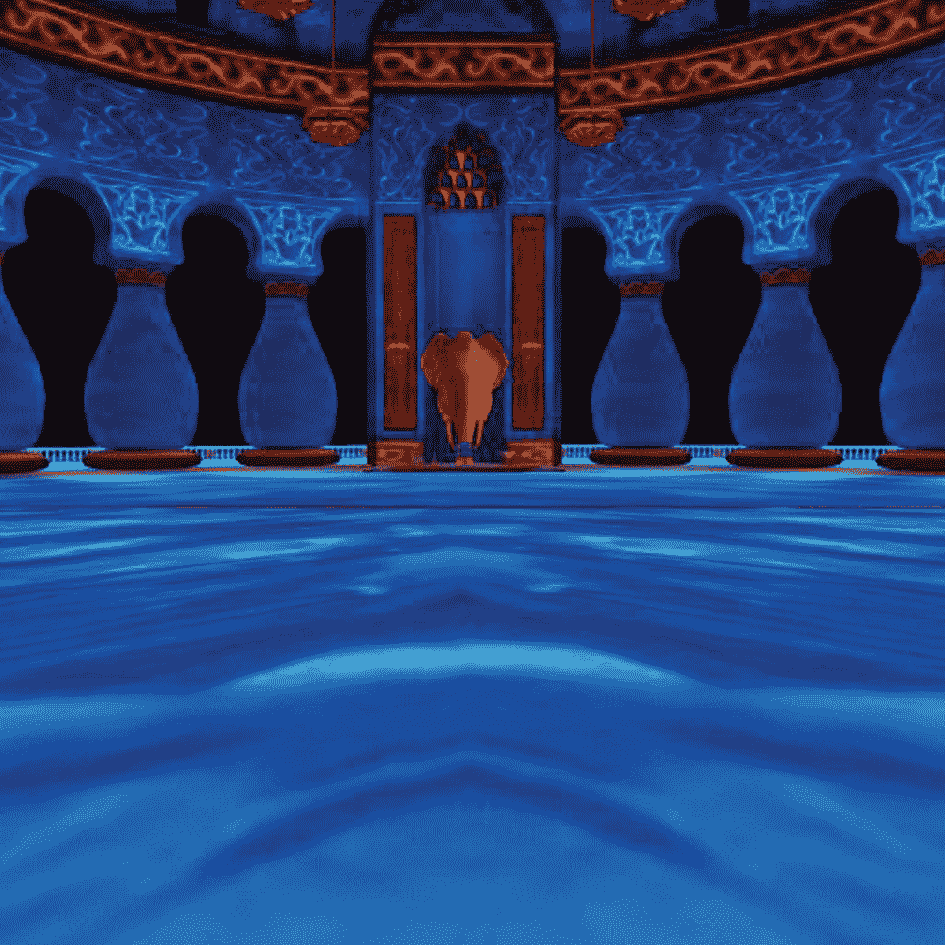
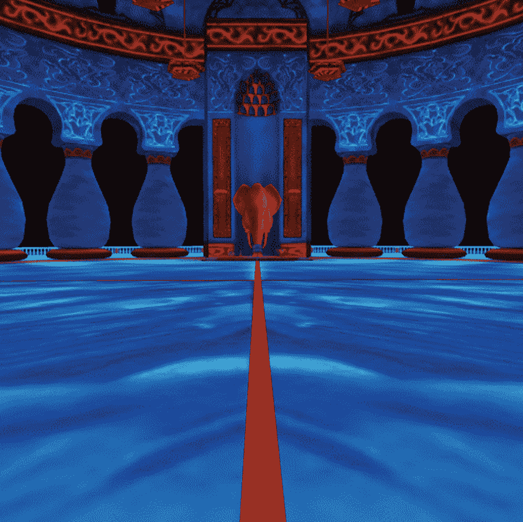
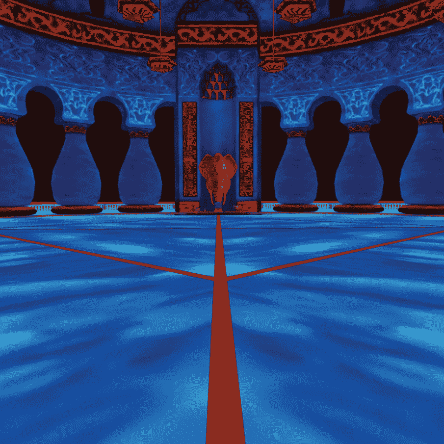
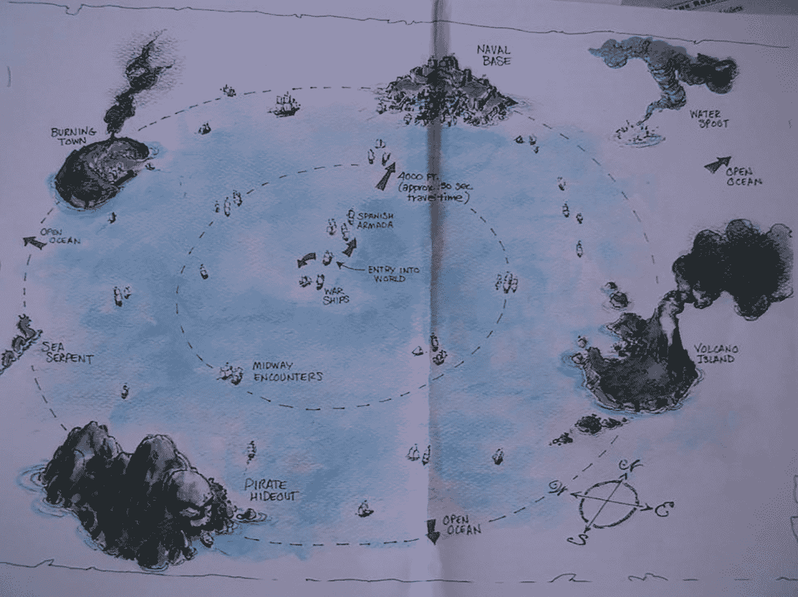
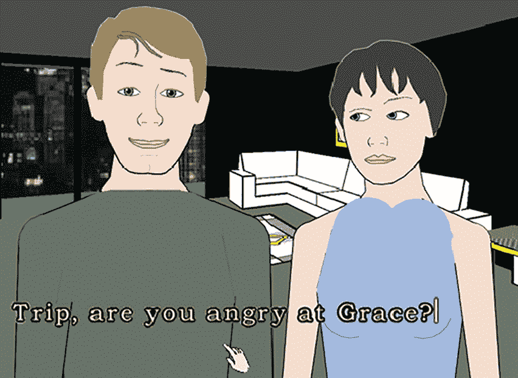
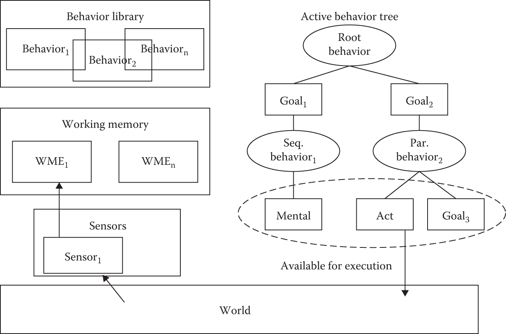
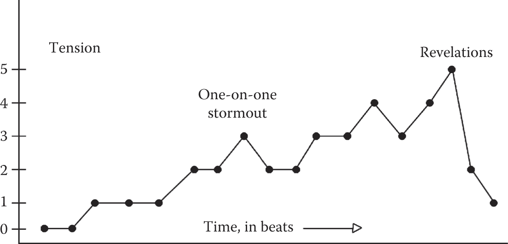

# 第十八章：故事与游戏结构可巧妙地通过间接控制融合

图  

**18.1**

图  

**18.2**

1966 年底，音乐家约翰·列侬受邀前往伦敦印第卡画廊参加一个名为“未完成的绘画与物品”的艺术展览。他对先锋艺术没有特别兴趣，也从未听说过这位艺术家——一位名叫小野洋子的女性，但当他到达时，有一件特定的作品吸引了他的注意：房间中央放着一架高高的梯子。梯子上方，天花板上挂着一块看似空白的白色画布。梯子上方，紧挨着天花板上的画布，挂着一条链子拴着的放大镜。约翰不确定地审视着这个奇怪的组合——他只是应该抬头看吗？画看起来是空白的——但如果是空白的，为什么要放个放大镜？他鼓起勇气，爬上摇晃的梯子，危险地站在最顶端，拿起放大镜，伸长脖子朝上看那块白色画布。起初，他认为那是空白的，某种关于虚无的艺术宣言。但随后他看到了：一个微小的单词，没有放大镜根本无法阅读，这个词将永远改变他的生活。

那个词是“yes。”

## 自由的感觉

在前几章中，我们触及了故事与玩法之间的冲突。其核心是一场关于自由的冲突。游戏和互动体验最美妙的地方在于玩家感受到的自由——这种自由给玩家带来了美妙的控制感，并让他们轻松地将想象力投射到你创造的世界中。自由的感觉在游戏中如此重要，以至于它值得一个新的透镜。

即使这让我们很难控制玩家的兴趣曲线，当我们给予他们那些美妙的互动感和控制感时，我们必须给他们自由，对吧？

错。

我们不必总是给玩家真正的自由——我们只需给玩家*自由的感觉*。因为，正如我们所讨论的，真实的只有你感受到的——如果一个聪明的设计师能让玩家感到自由，而实际上玩家几乎没有选择，甚至完全没有选择，那么我们突然就拥有了两全其美的局面：玩家拥有了美妙的自由感，而设计师却经济高效地创造了一个拥有理想兴趣曲线和理想事件集的体验。

但这怎么可能？当不存在自由或仅存在极其有限的自由时，如何创造自由的感觉？毕竟，设计师无法控制玩家进入游戏后会做什么，对吧？

不，不对。确实，设计师无法直接控制玩家做什么，但通过各种微妙的手段，他们可以对玩家的行为施加间接控制。而这种间接控制可能是我们将遇到的所有技术中最微妙、最精致、最巧妙、最重要的一种。

为了理解我的意思，让我们看看一些间接控制的方法。方法有很多，多种多样且微妙，但通常这六种方法承担了大部分工作。

## 间接控制方法 #1：约束

考虑这两个请求的区别：

*   请求 1：选一种颜色：\_\_\_\_\_\_\_\_\_\_\_
*   请求 2：选一种颜色：a. 红色 b. 蓝色 c. 绿色

两者都给回答者选择的自由，且询问的内容大致相同。但区别巨大，因为对于请求 1，回答者可能会从数百万个不同的答案中选择——“消防车红”、“菜花蓝”、“淡紫灰褐”、“天空蓝粉”、“不，你选个颜色”，或者实际上任何东西。

# 间接控制方法 #2：目标

对于请求 2，回答者只有三个选择。他们依然拥有自由，依然可以选择，但我们成功将选择数量从数百万减少到了三个！而且那些本来就会选红色、蓝色或绿色的回答者甚至不会察觉差别。还有人会更喜欢请求 2，因为过多的自由反而令人畏惧——它迫使你的想象力超负荷运转。在游乐园工作时，我曾在糖果店负责一大排六十种老式棒棒糖。每天上百次，顾客会进来问：“后面有什么口味？”起初我想耍聪明，把六十种口味全背给他们听——随着我念叨，顾客的眼睛因恐惧而瞪大，念到第三十二种时，他们就会说：“停！停！够了！”他们完全被这么多选择压垮了。后来我换了个策略。当他们询问口味时，我会说：“我们有你能想象到的每一种口味。尽管说出你想要的口味——我肯定有。”

起初，他们会对这种强大的自由印象深刻。但随后他们会皱起眉头，苦思冥想，说：“呃……樱桃味？不对，等等……我不要那个……嗯……薄荷味？也不对……哦，算了，”然后沮丧地走开。最后我摸索出一种能卖出大量棒棒糖的策略。当有人问起口味，我会说：“我们几乎有你能想象到的所有口味，但最受欢迎的是樱桃、蓝莓、柠檬、根啤、冬青和甘草。”他们既享受自由的感觉，又庆幸有少量诱人的选择；事实上，大多数顾客会从“热门六选一”中挑选，这是我编的清单，我会经常更换以确保其他口味不至于在货架上放太久。这就是间接控制的实例——通过限制选择，我让他们更有可能做出选择。而且不是随便什么选择——是我引导他们做出的选择。尽管我用狡猾的手段限制了他们的选择，他们依然保留了自由感，甚至可能感到自由感增强了，因为他们的选择比我不引导时更清晰。

这种通过约束实现间接控制的方法在游戏中随处可见。如果游戏把玩家放在一个有两扇门的空房间里，玩家几乎肯定会穿过其中一扇。穿哪扇我们不一定知道，但他们肯定会穿过一扇，因为门传递着“打开我”的信息，而玩家天生好奇。毕竟别无去处。如果你问玩家有没有选择，他们会说有，因为即使只有两个选项也是一种选择。对比一下把玩家放在空旷的田野、城市街道或购物中心。在这些情况下，他们去哪、做什么就更加开放且难以预测——除非你使用其他间接控制方法。

## 间接控制方法 #2：目标

间接控制在游戏设计中最常见、最直接的应用就是通过目标。如果玩家面前有两扇门，我无法确定他们会进哪扇。但如果我给他们一个目标“去找到所有香蕉”，而其中一扇门后面明显有香蕉，我就能很好地预测他们会往哪走。

前面我们讨论过建立良好目标的重要性，以给玩家关心游戏的理由。一旦建立了清晰可达成的目标，你就可以利用这一点，围绕目标塑造世界，因为玩家只会去他们认为有助于达成目标的地方、做他们认为有助于达成目标的事。如果你的赛车游戏是关于在城市中飞驰冲向终点线，你不必构建完整的街道地图，因为如果你清晰地标出最快路线，人们大多会沿着那条路走。你可以加少量支线街道（尤其是捷径！）来给予自由感，但你设定的目标会间接控制玩家避免探索每一条小巷。创造玩家永远看不到的内容并不会给他们更多自由——只是浪费本可用于改进玩家实际会看到的地方的开发资源。

值得注意的是玩家自信与目标之间的重要互动。如果玩家对目标及其追求目标的能力非常自信，间接控制的强大效果会被放大，因为玩家会自信地遵循自己的直觉。然而，如果玩家对目标感到困惑，或怀疑自己能否在世界中正常互动，间接控制的效果会大打折扣，因为玩家会对自己的直觉产生怀疑——不知道该做什么、怎么做。

间接控制在现实中一个迷人的例子可见于阿姆斯特丹史基浦机场的男厕小便池。使用者会很快注意到小便池里有一只苍蝇。这不是真苍蝇，而是瓷面上蚀刻的图案。为什么？设计师想解决“瞄准不准”导致清洁工作量增加的问题。蚀刻的苍蝇创造了一个隐性目标——击中苍蝇。将苍蝇放在小便池中心（并稍微偏向一侧以缓冲入射角），厕所就能保持整洁。“玩家”的自由丝毫未减，却被间接引导向设计师认为最优的行为。

## 间接控制方法 #3：界面

我们已讨论过反馈、透明度、多汁性及良好界面的重要方面。但关于界面还有一点要考虑：间接控制。因为玩家希望界面透明，他们尽量不去思考界面。换句话说，他们基于界面建立对游戏中能做什么、不能做什么的预期。如果你的“摇滚巨星”游戏用塑料吉他作为物理界面，玩家大概率会预期弹吉他，大概率不会想到还能做别的。如果你给他们手柄，他们可能会想能不能弹别的乐器、能不能跳台，或做摇滚巨星能做的其他各种事。但那把塑料吉他暗中剥夺了那些选项——无声地将玩家限制在单一活动中。当我们用木制船舵和三十磅重的铝制大炮构建虚拟《加勒比海盗》项目时，从未有客人问能不能在游戏中剑斗——那个选项从未进入他们脑海。

这种力量不仅存在于物理界面，虚拟界面也有。你操控的化身作为虚拟界面的一部分，也对玩家施加间接控制。如果玩家操控人类冒险者，他们会尝试做某些事。如果操控蜻蜓、大象或谢尔曼坦克，他们会尝试完全不同的事。化身的选择部分关乎玩家会与谁产生共鸣，但也关乎隐性地限制玩家的选项。

## 间接控制方法 #4：视觉设计

> *我们被引导相信谎言*
>
> *当我们用眼睛看，而非透过眼睛看时。*
>
> —威廉·布莱克

任何从事视觉艺术领域工作的人都知道，布局会影响观众的视线落点。这在互动体验中变得非常重要，因为观众倾向于前往吸引他们注意力的地方。因此，如果你能控制某人看向哪里，你就能控制他们去向哪里。图 18.3 展示了一个简单的例子。

看着这张图片，你的目光很难不被引向页面中心。在互动体验中观看此场景的观众，很可能会先察看中央的三角形，然后才会考虑画面边缘可能有什么。这与图 18.4 形成了鲜明对比。

在这里，观众的目光被迫探索画面边缘及更远处。如果此场景是互动体验的一部分，可以肯定观众会试图了解更多关于边缘物体的信息，而不是场景中央的圆圈。他们极有可能会尝试冲出屏幕边界，如果能做到的话。

这些例子是抽象的，但有大量现实世界的例子说明了同样的道理。例如，被子设计师会花费大量心思思考如何吸引视线。人们常说，好的被子设计能让视线在被子上持续游移，从不让它停留在单一图像上。

**图 18.3**  

**图 18.4**  

布景设计师、插画师、建筑师和摄影师利用这些原则引导观众的视线，间接控制他们的注意力焦点。一个绝佳的例子是迪士尼乐园中心的城堡。沃尔特·迪士尼知道，游客入园后在入口处徘徊、不知所措是存在风险的。城堡的位置安排得恰到好处，使得游客一进园目光就被它吸引（类似于图 18.3），脚步也随即跟上。很快游客就到达了迪士尼乐园的枢纽广场，那里有几个视觉地标向不同方向招唤着他们（类似于图 18.4）。间接地，沃尔特让游客做到了他希望他们做的事：快速移动到迪士尼乐园中心，然后随机分散到公园的其他部分。当然，游客很少意识到这种操控。毕竟，没人告诉他们去哪里。游客只知道，在不怎么动脑筋、完全自由的情况下，他们来到了某个有趣的地方，获得了一次愉快的娱乐体验。

沃尔特甚至给这种操控起了个名字。他称之为视觉“诱饵”，这是指在片场控制狗的方式：训练师把热狗或一块肉举在空中，晃来晃去以控制狗看向哪里，因为没有什么比食物更能吸引狗的注意力了。

优秀关卡设计的关键之一在于，玩家的视线能毫不费力地将他们拉过关卡。这让玩家感到掌控感强，沉浸于世界中。理解什么能吸引玩家的视线，能让你对玩家想要做出的选择拥有巨大的影响力。当迪士尼 VR 工作室制作《阿拉丁魔毯之旅：VR 冒险》Mark 2 版本时，我们面临一个棘手的难题。一个非常重要的场景是宫殿宝座厅，如下所示：

**图 18.5**  

*（迪士尼企业公司提供，经许可使用。）*

动画总监希望玩家飞入这个房间，然后飞到大象雕像底部的那个小宝座前，坐一会儿听苏丹的留言，然后继续游戏。我们原本指望那个穿白衣服、在宝座上上下跳动的小苏丹足以吸引玩家过去听他说话——但事与愿违。这些玩家骑着飞毯！他们想到处飞，飞到天花板，绕着柱子，只要能飞的地方都想去。他们的隐性目标是飞行和寻找乐趣——拜访苏丹不在他们的计划之内。眼看别无选择，我们准备实施一个系统，夺走玩家的控制权，把他们拖过房间到苏丹面前，在他们听他说话时把他们钉在原地。没人喜欢这个主意，因为我们都知道这意味着剥夺玩家宝贵的自由感。

但后来美术总监想出了一个主意。

他在地板上画了一条红线，如下所示：

**图 18.6**  

*（迪士尼企业公司提供，经许可使用。）*

他的想法是也许游客会跟着红线走。我们都有点怀疑，但这对我们来说很容易制作原型验证。结果令我们惊愕不已，游客真的照做了！进入房间后，他们不像以前那样四处乱飞，而是像被拖拉光束吸引一样跟着红线，一直飞到苏丹的宝座前。当苏丹开始说话时（那时游客已经离他很近了），他们等着听他说什么！虽然不是每次都奏效，但有 90% 以上的成功率，对于这种体验来说完全足够了。最令人震惊的是事后的访谈——当问玩家为什么在宝座厅跟着红线走时，他们会说“什么红线？”这根本没有进入他们的意识记忆。

**图 18.7**  

*（迪士尼企业公司提供，经许可使用。）*

效果极佳。在大多数情况下，两名玩家会拜访宝座，一名玩家沿着红线向左分支去左边的门，另一名玩家沿着红线向右分支去右边的门。

### 间接控制方法 #5：角色

间接控制玩家的一个非常直接的方法是通过游戏中的电脑控制角色。如果你能利用讲故事的能力让玩家真正关心这些角色——也就是说，自愿想要服从他们、保护他们、帮助他们或消灭他们——你突然就拥有了一个绝佳的工具，来控制玩家会尝试做什么和不尝试做什么。

这种方法在一部早期的互动电影中发挥了巨大作用：威廉·卡斯尔执导的 1961 年电影《萨多尼库斯先生》采用了一个不同寻常的噱头。旁白解释说电影结局由观众决定——反派该受惩罚，还是被原谅？每位观众都获得一张“竖大拇指/竖小拇指”卡举起，以便放映员放入相应的胶卷。卡斯尔非常自信观众会选择“惩罚”版胶卷。事实上他自信到甚至没拍“原谅”版胶卷，而从未有观众察觉。

在游戏《集合啦！动物森友会》中，一个名为快乐房间学院（HRA）的神秘委员会会定期评估你装饰房屋内部的效果，并根据表现给予积分。玩家非常努力地争取这些分数——部分原因是这是游戏目标之一，但我认为也部分是因为想到有人正盯着你的房子内部摇头嫌弃，会让人感到尴尬，即使他们只是虚构的存在。

在游戏《Ico》中，你的目标是保护一位与你同行的公主。设计师在游戏中设置了一个非常巧妙的计时机制——如果你停留太久，邪恶的灵魂就会出现，抓住公主，试图将她拖入地面的洞中。尽管除非它们成功把公主带走，否则无法伤害她，且将她拉入洞中需要一些时间，但我发现自己一看到它们出现就立刻采取行动，因为它们碰到公主这一念头就让我觉得辜负了她。

角色可以成为操控玩家选择或其对选择感受的绝佳方式。但首先，你必须让玩家在乎这些虚构角色的感受；一旦做到这一点，就很容易激发玩家的行动，因为人性中一个美妙的方面就是渴望帮助我们共情的对象。这一视角极其有用，我们应将其加入工具箱。

### 间接控制方法 #6：音乐

大多数设计师考虑给游戏添加音乐时，通常想的是想要营造的氛围和游戏的基调。但音乐也能显著影响玩家的行为。

餐厅经常使用这种方法。快节奏音乐让人吃得更快，所以午餐高峰期时，许多餐厅播放高能量的舞曲，因为吃得快意味着利润更高。当然，在下午三点等淡季时段，它们会做相反的事。空荡荡的餐厅往往意味着生意不好，为了让食客多待一会儿，它们播放慢节奏音乐，这会减慢进食速度，让顾客考虑再点一杯咖啡或一份甜点。当然，顾客没意识到这正在发生——他们以为自己完全自由地掌控着行为。

如果对餐厅经理有效，对你也有效。思考该播放什么音乐，让玩家：

*   四处寻找隐藏物品。
*   在不减速的情况下摧毁一切。
*   意识到自己走错方向。
*   缓慢而小心地移动。
*   担心误伤无辜旁观者。
*   不回头地尽可能走得更远、更快。

音乐是灵魂的语言，因此它能在深层次上与玩家对话——深到能改变他们的情绪、欲望和行动——而他们甚至没意识到这正在发生。

这六种间接控制方法能成为平衡自由度与优秀叙事的有力手段。不过需谨记：你的设计可能以从未预料的方式对玩家施加控制。上世纪 90 年代，我带朋友去华特迪士尼世界体验惊悚的《Alien Encounter》（后来改得不那么吓人、更适合家庭）。它由一个圆形室内圆形剧场和奇怪的椅子组成，能营造出凶猛的外星怪物在黑暗剧院游荡、擦过你、在你脖子上喘气的错觉。这太独特刺激了，我确信朋友会喜欢，但结束后他似乎不以为然。我问他怎么看，他说：“还行。但看到圆形布局和椅子绑带，我以为剧院会旋转。结果我们就坐在那里。我是说，还行，只是不如预期。”

为确保体验拥有正确的间接控制类型，请使用此透镜。

### 共谋

设计《加勒比海盗：掠夺海盗金》时，我们面临重大挑战。必须创造一个仅持续五分钟却极具冲击力的互动体验。兴趣曲线必须完美，因为一家四口可能花费高达 20 美元只为玩一次。同时，这不能只是线性体验，因为做海盗的本质包含巨大的自由感。基于过往经验，我们知道这是间接控制的绝佳机会。

早期原型揭示一点：若只是让玩家在海上与敌人战斗，他们会玩得很开心约两分二十秒。随后热情消退，有时会问：“所以……就这？”显然这是不可接受的兴趣曲线。玩家想要更多铺垫。我们认为通过更有趣的场景可实现这一点。我们觉得将这些场景放在玩家可接近的岛屿附近，能很好地引导他们前往有趣事件发生地——有点像迪士尼乐园的城堡引导游客。于是绘制了初始地图：

FIGURE  

**18.8**

(Courtesy of Disney Enterprises, Inc. Used with permission.)

玩家从中心开始，我们预期他们会在那里与一些敌人战斗，然后希望他们驶向某个岛屿，每个岛屿设计得有趣且远距离可见。去哪个岛由他们决定——他们有选择自由，因为每个岛有不同类型的遭遇。其中一个岛，邪恶海盗围攻燃烧的城镇。另一个岛，火山侧面进行惊人的采矿作业。第三个岛，皇家海军运送大量黄金，并用发射火球的投石机守卫堡垒。我们确信这些大岛会吸引大量玩家兴趣。

结果我们大错特错。看 Figure 18.9 就能看到问题。

玩家被告知目标是击沉海盗船。这里他们被巨大、威胁性、帆亮白的海盗船包围。看看远处那可怜的火山。它几乎不显眼，且与玩家目标无关！

我们立刻意识到这行不通。开始考虑让海盗船走固定路径引导玩家去岛屿。但随后有个有趣想法：如果敌方海盗船不按自身最佳利益行动呢？直到那时，我们花大量时间编写花哨算法让敌船用有趣、智能的策略攻击。新想法是抛弃那些，改变船只逻辑。新系统下，游戏开始时玩家在公海遇到船只，船只会攻击玩家，随后开始逃跑。玩家专注于摧毁敌船的目标，会追击它们。我们尝试把控时机，使玩家击沉敌船时，船刚好到达某个岛屿（随机选择）。船沉后，玩家抬头发现自己身处有趣的岛屿场景。他们在那里战斗，随后被新船只攻击，新船又逃跑——去哪？去玩家尚未访问的岛屿。

FIGURE  

**18.9**

(Courtesy of Disney Enterprises, Inc. Used with permission.)

这一策略效果极佳。玩家在完全自由的感觉中，实际上会经历一个结构严谨的体验：他们从一场激动人心的战斗开始，接着是一个迷你场景，然后是一场新的海战，随后又是另一个新的迷你场景。我们知道必须有一个盛大的结局，但无法确定玩家会身处何地。所以在第四分钟过后不久，盛大的结局主动找上了他们，形式是突如其来的大雾和幽灵海盗的袭击，将玩家卷入一场史诗般的最终决战。

之所以能实现这一切，是因为我们做了一件非常不寻常的事——我们让游戏中的角色拥有两个同时进行的目标。一方面，他们的目标是让玩家参与一场有挑战性的战斗。另一方面，他们的目标是引导玩家去往有趣的地方，以保持体验流程的最优状态。我称这一原则为**串通（collusion）**，因为游戏角色正在与设计师串通一气，为玩家创造最优体验。这是一种有趣的间接控制形式，它将利用目标、角色和视觉设计的方法结合起来，达到统一的效果。

有证据表明，这种通过串通实现的间接控制可能是互动叙事未来的核心。由安德鲁·斯特恩和迈克尔·马特亚斯创作的迷人*Façade*体验，将这一想法推向了新高度。在*Façade*中，你扮演一位晚宴客人，主人是一对已婚夫妇格蕾丝和特里普。你的界面主要通过输入文本进行对话，这提供了巨大的自由度和灵活性。随着游戏进行，你很快会注意到你是派对上唯一的客人，奇怪的是，这天是他们的周年纪念日。由于他们不断争吵，各自试图拉拢你站队，局面非常尴尬。这是一种非常不寻常的游戏体验，其目标更像小说或电视剧，而非电子游戏。

**图 18.10**

还有另一点也很不寻常。游戏在不同局数中似乎玩法截然不同——每次游玩，你或许只能听到 10% 已录制的对话。这不是串珠结构，甚至不是分支结构。这是一个模拟，格蕾丝和特里普是拥有目标并试图达成目标的智能角色。这是通过相当标准的 AI 目标模型实现的，这些目标与由传感器触发的行为相关（图 18.11）。

然而，就像我们那些狡猾的海盗船一样，格蕾丝和特里普不仅仅是在试图满足自己的目标。他们也非常清楚自己是故事的一部分，因此应该努力让故事变得有趣。当他们决定说什么、做什么时，部分决策取决于他们所说的话是否符合故事这一部分应有的张力，设计师编码了一条时间线，标明他们认为体验随时间变化的适当张力（图 18.12）。

这张图看起来熟悉吗？让格蕾丝和特里普做出遵循这张张力图的决策，同时努力实现他们作为故事角色的目标，他们的行为因此变得合情合理，同时保持玩家对事件序列的兴趣。

**图 18.11**

**图 18.12**

看来我们只是触及了通过巧妙运用串通可能实现的体验类型的皮毛。如果你想考虑如何在自己的游戏中使用它，请使用这透镜。

中国哲学家老子写道：

> *当最优秀的领导者完成使命时，人们会说“这是我们自己做到的！”*

希望当你试图引导玩家进入引人入胜的体验，让他们感受到掌控感、精通感和成功感时，能发现这些间接控制的微妙技巧很有用。

但这些引人入胜的体验将发生在何处？

### 其他推荐阅读

- *《图画的力量》* by Molly Bang。这本简单的指南，由著名儿童书籍插画家撰写，是我找到的关于视觉间接控制的最佳指南。
