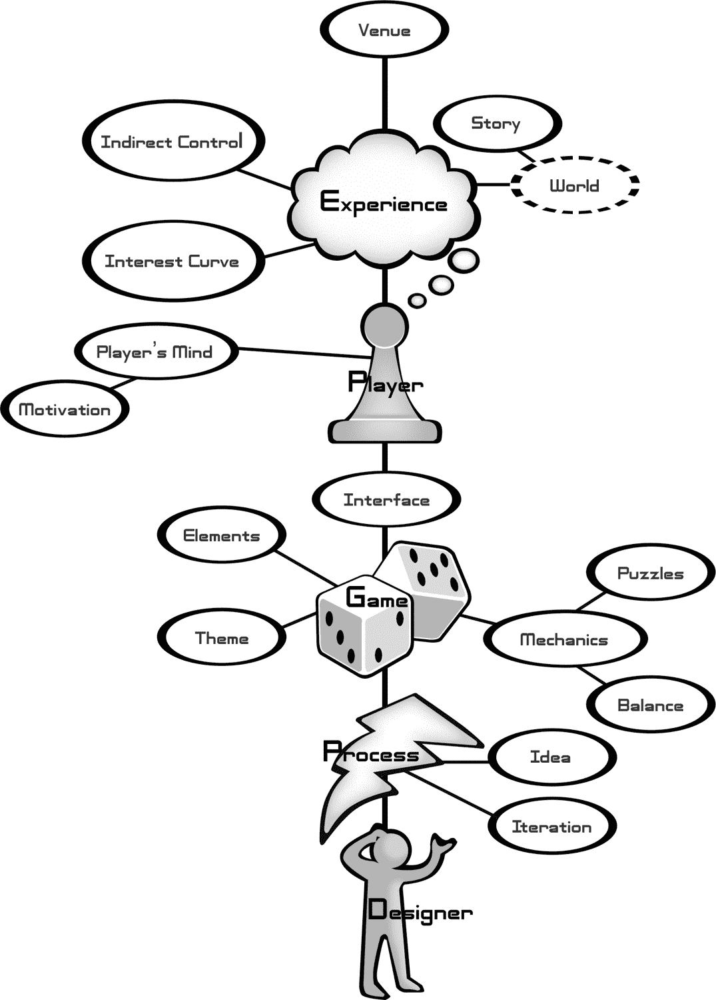
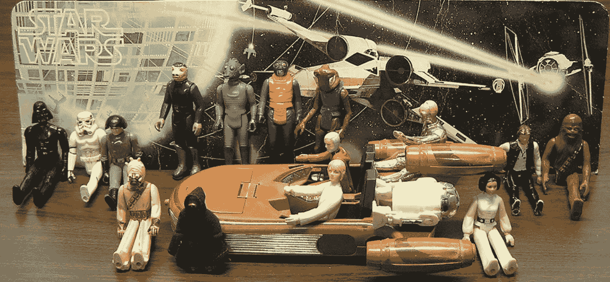

## 第十九章

## 故事与游戏发生在*世界*中

**图 19.1**

### 跨媒体世界

1977 年 5 月，电影*《星球大战》*上映。它意外地大受欢迎，老少皆宜，尤其是年轻人。孩子们反复去看。肯纳玩具公司花了近一年时间才推出基于电影角色的动作人偶系列，但即使在电影上映一年后，这些玩具依然大获成功，产多快卖多快，并持续畅销多年。其他《星球大战》周边产品也相继推出——海报、拼图、睡袋、纸盘，几乎你能想象到的所有东西——但没有任何东西能像动作人偶那样受欢迎。

**图 19.2**

有些人认为销售这类周边只是蹭热度赚快钱，最终会降低电影的格调。我是说，这些玩具跟电影里看到的相比，看起来有点廉价。

那么，为什么动作人偶卖得这么好？对一些人来说，它们只是很酷的装饰——可以看看、回忆电影。但对大多数孩子来说，它们完全是另一回事——它们是通往*《星球大战》*宇宙的大门。

因为如果你观察孩子们玩这些玩具，会发现一件非常奇怪的事。他们很少像成年人预期那样演绎电影场景。相反，他们会编造各种故事，让这些角色登场，故事与电影情节仅有松散联系，而电影情节相当复杂，孩子难以完全理解。这可能让你得出结论：受欢迎的是角色，而非《星球大战》的故事。但你常会看到孩子给这些角色起完全不同的名字，赋予完全不同于电影的关系，在世界各地的卧室和后院上演由这群角色主演的戏剧和喜剧。

那么，如果孩子们兴奋的不是情节也不是角色，那还剩什么？答案是：*《星球大战》*的世界极具吸引力——而玩具提供了另一扇通往那个世界的大门——在某些方面甚至比电影更好，因为它具有互动性、参与性、灵活性、便携性和社交性。奇怪的是，这些玩具让《星球大战》世界对孩子们更有意义，而非更少，因为玩具赋予了他们造访、塑造、改变这个世界、并将其变为己有的能力。当《星球大战》续集开始出现时，人们充满期待，但这期待中有多少是渴望听到新故事，又有多少是重返那个世界的激动？

亨利·詹金斯创造了“跨媒体世界”这一术语，用来指代那些可以通过许多不同媒介——印刷品、视频、动画、玩具、游戏以及其他更多形式——进入的幻想世界。这是一个非常有用的概念，因为这仿佛世界独立于支撑它的媒介而存在。许多人觉得这是一个怪诞的概念——他们把书籍、电影、游戏和玩具看作是各自独立的事物。但越来越多的情况下，真正被创造出来的产品不是一个故事、一个玩具或一个游戏，而是一个世界。但你无法出售一个世界，因此这些各种产品被作为通往这个世界的**入口**出售，每一个通向其中不同的部分。如果这个世界构建得当，你访问的入口越多，这个世界在你想象中就会变得越真实、越坚实。但如果这些入口相互矛盾或提供不一致的信息，世界就会迅速崩塌成尘埃和灰烬，突然间这些产品变得一钱不值。

为什么会这样？为什么世界对我们来说变得如此真实，甚至比定义它们的媒介更真实？这是因为我们希望它们是真实的。我们内心深处希望相信，这些世界不仅仅是书中的故事、规则的集合或屏幕上的演员，而是这些世界实际上存在，并且也许、以某种方式、在某一天，我们能找到通往它们的路。

这就是为什么人们随手扔掉杂志，却在扔掉漫画书前犹豫不决——毕竟，那里面有一个世界。

### 宝可梦的力量

宝可梦可以说是有史以来最成功的跨媒体世界之一。自推出以来，所有宝可梦产品的总销售额超过 900 亿美元，使其成为有史以来第二赚钱的电子游戏系列，仅次于马里奥。尽管许多人曾试图将其视为短暂的时尚而予以否定，但十五年多过去了，新的宝可梦游戏依然持续畅销。了解宝可梦的历史有助于更好地理解其跨媒体世界的力量。

宝可梦最初是任天堂 Game Boy 系统上的一个游戏。其设计师田尻智小时候喜欢收集昆虫，1991 年看到允许两台 Game Boy 之间传递信息的“游戏链接”功能时，他构想出了昆虫沿着连接线爬行的景象。他向任天堂提出了这个想法，随后他和团队花了五年时间开发和打磨这款游戏。1996 年，《口袋妖怪》（日文标题的直译）作为一对游戏（红版和绿版）发布。它本质上是一款传统的 RPG（不亚于《创世纪》或《最终幻想》），不同之处在于你可以捕捉战斗中的怪物，让它们成为你队伍的一员。

画面和游戏动作并不华丽或先进——但互动丰富有趣，因为团队花了五年时间来妥善平衡游戏。重要的是要意识到画面实际上有多原始。原版 Game Boy 画面只允许使用四种橄榄绿色调，两只对战的宝可梦基本上只是并排站着扭动，而玩家从简单的菜单中选择攻击。

游戏大获成功——以至于很快就计划推出漫画书和动画系列。与许多仅与其改编的电子游戏松散关联的电视节目不同（例如那部可怕的汉纳-巴伯拉《吃豆人》卡通），宝可梦动画非常紧密地反映了游戏玩法的复杂规则，主角的冒险直接基于 Game Boy 游戏中的任务路径。结果是这部动画如此镜像游戏机制，以至于玩家看完后能更好地理解在游戏中该用什么策略。

但最重要的是，电视节目给了玩家一个进入宝可梦宇宙的新入口——一个以全彩色、戏剧性的动画和声音展示宝可梦的入口。当观众回到 Game Boy 时，这些生动的形象保留在他们的想象中，使得 Game Boy 粗糙的画面和声音完全变得无关紧要。正如第 13 章中所述：*平衡*，这有时被称为“双筒望远镜效应”，得名于这就像人们带双筒望远镜去看体育比赛或带剧场望远镜去看戏剧一样。没有人会全程通过望远镜观看。相反，望远镜在早期被用来近距离观看远处的人物。一旦某人近距离看清了他们，就能在视觉想象中将那幅图像映射到舞台上看到的微小身影上。

这两个入口产生了巨大的协同效应——想在游戏中获胜给了观看电视节目的理由，而观看电视节目让玩游戏变得更生动、更刺激。

如果这还不够，1999 年，任天堂与《万智牌》集换式卡牌游戏的开创性制作公司威世智合作，基于宝可梦世界创造了一款新的集换式卡牌游戏。这款游戏像电视节目一样，尽可能紧贴 Game Boy 游戏的核心机制。这给了玩家进入这个世界的第三种方式——一种既便携又非常社交的方式。虽然 Game Boy 游戏有用于交换宝可梦的游戏链接线，但事实是玩家只是偶尔使用——大多数时候，它是作为单人冒险游戏进行的。卡牌游戏则不同——其低廉的价格和易得性使其在儿童中（尤其是男孩）非常流行，迎合了他们与同龄人竞争的兴趣，并与宝可梦“要把它们全部抓到手！”的口号自然契合。

这三个通往单一坚实世界的互补入口使该 IP 成为一股近乎不可阻挡的力量。不理解宝可梦宇宙的人完全感到困惑：这东西到底是游戏，还是电视节目，还是别的什么？故事线到底有什么了不起，让孩子们想花这么多钱在上面？我有幸在 1999 年参加了一场圆桌讨论，与会者包括一家大型娱乐公司的负责人。有人问他怎么看“这股宝可梦热潮”，他回答说：“电影几个月后上映，那就结束了。”他当然错了，因为他从根本上不理解跨媒体世界的概念。他完全陷入了好莱坞旧有的故事世界思维模式——一部大制作好莱坞电影定义世界，然后出玩具、游戏和电视节目来模仿它。一个基于掌机游戏规则集的世界、或者一个随着你增加的每一种新媒介而变得更强大的世界，这种想法对他来说完全陌生（他现在已不再负责那家公司）。

宝可梦的力量不仅在于游戏概念，更在于将多种媒体作为通往单一、定义明确世界的入口，并经过精心且一致地使用。

### 跨媒体世界的特性

跨媒体世界有几个特性使其引人入胜。

#### 跨媒体世界具有强大的力量

成功的跨媒体世界对粉丝产生强大的影响力。这比粉丝单纯喜爱一个有趣的故事要强烈得多。仿佛世界变成了一种他们幻想造访的个人乌托邦。有时这些幻想是短期的，但对许多人来说，它们是长期的，贯穿他们的一生。对一些人来说，这些长期的幻想是他们不时寻求的一种精神慰藉。一个把变形金刚玩具当装饰摆放的成年人可能就是个很好的例子。这个玩具给了他们一个方便的精神入口，通往变形金刚的世界，他们可以偶尔造访。

但对于其他人来说，对这种个人乌托邦的热情会变成他们每天都在积极投入的事情。斯科特·爱德华·纳尔无疑就是这种情况，他在 30 岁生日那天依法将名字改为擎天柱，即《变形金刚》宇宙中的主角机器人之一。事实上，如果你观察任何类型虚构作品的“铁杆粉丝”，你会发现几乎在所有情况下，拥有最忠实粉丝的作品都是那些拥有最强跨媒体世界的作品。《星际迷航》、《星球大战》、《变形金刚》、《指环王》、漫威漫画、《哈利·波特》以及许多其他流行作品的核心都有一个世界。比起对精彩故事情节的享受，或对有趣角色的欣赏，进入奇幻世界的渴望似乎才是驱使这些粉丝走向极致的原因。正如我们在第 17 章：*故事*中讨论的那样，奇幻是游戏中一个非常重要的概念，往往构成了你世界的锚点。为了确保你记得捕捉奇幻的史诗力量，请运用这透镜。

### 跨媒体世界长青

稳固的跨媒体世界能持续令人惊讶的长时间。超人出现已超过七十五年。詹姆斯·邦德已存在六十年。《星际迷航》和《神秘博士》在五十年后依然蓬勃发展。沃尔特·迪士尼意识到了跨媒体的力量，他开始开发漫画书以帮助保持其动画作品世界的活力，并为此创建了迪士尼乐园。他投资这一非同寻常事业的最有力论据之一是，这将通过给公众提供另一个进入电影世界的入口，帮助维持公众对迪士尼电影的兴趣。1998 年的《版权期限延长法案》将企业版权期限从 75 年延长至 95 年。这在很大程度上是因为一些仍具盈利能力的作品（如早期的米老鼠动画）面临落入公共领域的危险。无论对错，有人认为该法案通过的原因之一似乎是：让一个精心管理、深受喜爱的世界落入错误之手，感觉就是不对。

培育强大跨媒体世界的一个充分理由是，如果做得好，它可以长期盈利。这对于吸引儿童的世界似乎尤为真实——当孩子长大成人后，他们往往想与自己的孩子分享这些世界，从而创造一个可以持续很长时间的循环。

### 跨媒体世界随时间演变

但这些世界不会随时间保持静止——它们会演变。考虑一个拥有百年历史（且依然流行！）的跨媒体世界：福尔摩斯的世界。当我们今天想到福尔摩斯时，通常会想到他标志性的猎鹿帽和超大烟斗。但如果你阅读福尔摩斯故事的原文，文中并未提及这些物品。猎鹿帽首次出现在西德尼·佩吉特的插画中，因为他自己就喜欢戴猎鹿帽。后来，演员威廉·吉莱特在一系列基于故事的戏剧中饰演福尔摩斯，他戴上了这顶不寻常的帽子，并加上了超大烟斗，因为这样即使在剧院最后一排也能清晰辨认。这些戏剧大获成功，以至于后来为福尔摩斯故事绘制插画的画家都用吉莱特的照片作为模特。奇怪的是，烟斗和帽子成了福尔摩斯的标志——这些标志是他的创作者阿瑟·柯南·道尔爵士从未设想过的。但这就是跨媒体世界的方式——随着新媒体为世界提供新的入口，世界本身（或人们对它的认知，对于虚构世界而言这等同于同一回事）会发生变化以适应新的入口。

另一个绝佳例子来自一个更古老、更受喜爱的跨媒体世界——圣诞老人的世界。如果曾有一个人们真心希望成真的幻想乌托邦，那便是圣诞老人的世界——一个每年一度、仁慈的形象会仔细考量你内心愿望，并在你配得上时将其赠予你的世界。设想一下进入这个世界的诸多途径：不仅有故事、诗歌、歌曲和电影，你还可以给他写信，甚至亲自拜访圣诞老人！想想看——一个虚构角色来到你家，吃掉你的饼干，然后留下一大堆礼物！我们太渴望这个世界存在了，以至于数百万人不惜重金、精心欺骗，只为让孩子们坚信这是不容置疑的现实。

但这个世界的作者是谁？像所有长青的跨媒体世界一样，这是一项伟大的协作成果。讲故事的人和艺术家不断尝试丰富圣诞老人的世界。有些成功了，如克莱门特·摩尔于 1823 年引入的圣诞驯鹿，或罗伯特·L·梅于 1939 年引入的鲁道夫。更多则失败了。不亚于《绿野仙踪》作者 L·弗兰克·鲍姆这样的讲故事大师，其 1902 年的作品《圣诞老人的生平与冒险》惨遭失败，该书试图确立圣诞老人的起源是一个被仙女、地精和恶魔组成的委员会选中赋予不朽的凡人。

谁决定哪些新特性进入跨媒体世界，哪些被摒弃？这不知不觉就成为了我们集体意识的一部分。通过某种无声的民主过程，大家就是决定某个特性看起来合适还是不合适，虚构世界便随之略微改变以适应。没有正式的决定——它就这样发生了。如果一个故事特性受欢迎，它就会扎根。如果不受欢迎，它就会消失。从长远来看，世界由造访它的人统治。

### 成功的跨媒体世界的共同点

成功的跨媒体世界强大且有价值——那么它们有什么共同点呢？

*   **它们往往植根于单一媒介**：尽管拥有众多入口，但最成功的跨媒体世界最初都是在单一媒介中掀起巨大波澜。福尔摩斯是连载小说。超人是漫画书。《星球大战》是电影。《星际迷航》是电视剧。宝可梦是掌机游戏。变形金刚是玩具。这些后来都出现在许多其他形式中，但每个在其原始媒介中时最为强大。

*   **它们直观易懂**：在为《图恩小镇在线》做研究时，我试图尽可能多地了解图恩小镇这个虚构世界。当我研究电影《谁陷害了兔子罗杰》时，我意识到电影中几乎没有真正描述图恩小镇。电影不需要详细描述图恩小镇，因为大家都知道它存在。无需任何人明确说明，所有卡通角色共同生活在一个与我们世界截然不同的卡通宇宙中，这不知不觉成了常识。超人和蝙蝠侠的创作者肯定从未打算让他们的角色与其他超级英雄共享世界，但漫画读者直觉上认为这些角色生活在同一个世界——于是现在它们确实如此。

*   **它们核心有一位创意个体**：绝大多数成功的跨媒体世界植根于单个个体的想象力和美学风格。沃尔特·迪士尼、宫本茂、L·弗兰克·鲍姆、田尻智、吉姆·亨森、J·K·罗琳和乔治·卢卡斯都是例子。偶尔，小而精干的团队能创造出成功的跨媒体世界，但大团队创造成功世界的情况极其罕见。单个个体所拥有的世界整体愿景，赋予了它力量、坚实性、完整性和美感，这是生存于众多入口压力下所必需的。

*   **它们促进多故事讲述**：成功的跨媒体世界绝非建立在单一情节之上。它们拥有远超于此的坚实度和相互关联性。它们为未来的故事留出空间，也让客人能够想象他们自己的故事。

*   **它们通过任何入口都讲得通**：对几乎任何电影而言，“看过原著你就懂了”这句话都是致命一击。你永远不知道客人会先通过哪个入口进入，因此你必须让所有入口同样具有吸引力和欢迎度。《宝可梦》在这方面无疑取得了成功——其电视节目、漫画、视频和卡牌游戏各自都独立地易懂且有趣。这些中的任何一个都可能成为接触宝可梦世界的第一次邂逅，进而引导客人随后进入其他入口。

    反面例子可以是《黑客帝国》世界中尝试的一些做法。《进入黑客帝国》是一款基于第二部电影《黑客帝国 2：重装上阵》的电子游戏，备受评论界抨击。它采取了一种新颖的方法：不讲述电影的故事，而是讲述一个与电影交汇的平行故事。这是一个有趣的想法，但如果你没看过电影，就会感到困惑。同样，《动画版黑客帝国》是一系列发生在《黑客帝国》宇宙中的动画短片，只有当观众已经深谙《黑客帝国》宇宙时才能看懂。这种“只有通过所有入口才能看懂”的做法对少数人有吸引力，但对大多数人来说是疏远的。

*   **它们往往关乎探索**：这讲得通，因为一个关乎探索的世界会鼓励客人从多个入口造访。

*   **它们关乎愿望实现**：想象一个幻想世界需要大量工作。除非这是一个玩家真正渴望造访的世界——一个能满足某种深层重要愿望的世界——否则玩家不会付出这个劲。

跨媒体世界是娱乐的未来。仅仅专注于在单一媒介中创造绝佳体验已不再足够。越来越多地，设计师被要求为现有世界创造新的入口——这并非易事。但那些能创造出入口、通过创造性地给予玩家新视角和对已知世界的新享受来激发玩家兴奋感的设计师，备受追捧。而更受追捧的是那些能凭借对受众秘密愿望的理解，从零开始发明一个成功的跨媒体世界的人。如果你想创造或改进跨媒体世界，请使用这枚透镜。

强大的跨媒体世界不仅仅是空旷的场所。它们之所以有趣，很大程度上取决于谁住在那里。现在我们将注意力转向这一点。
