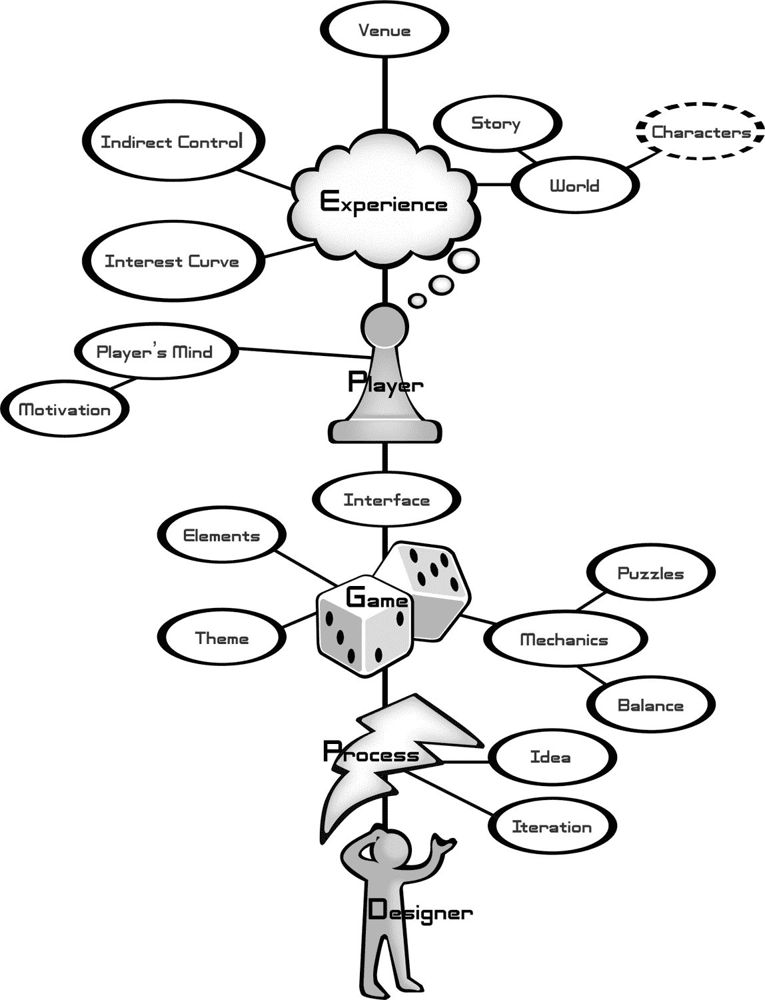
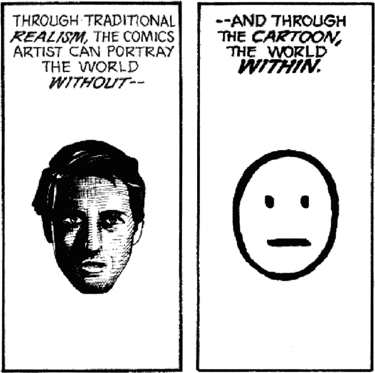
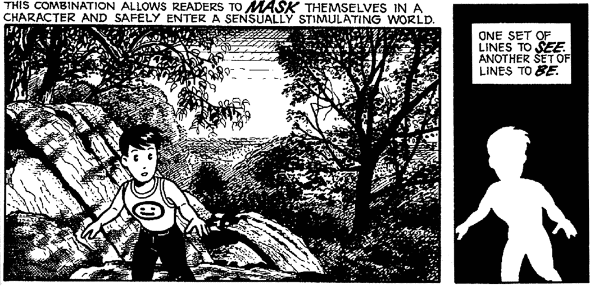
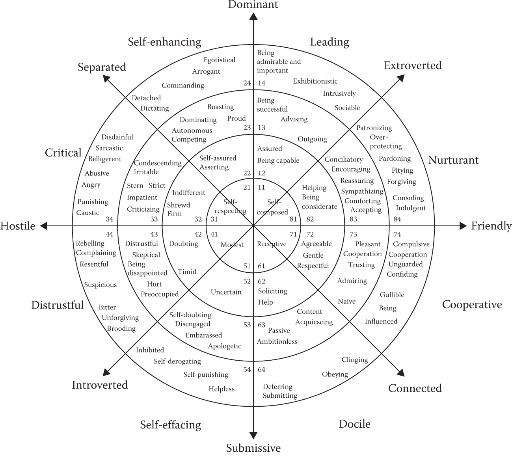
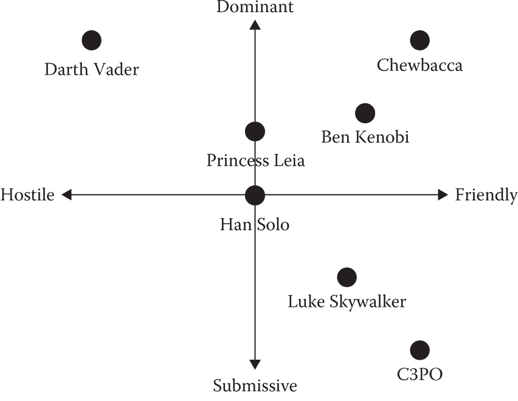
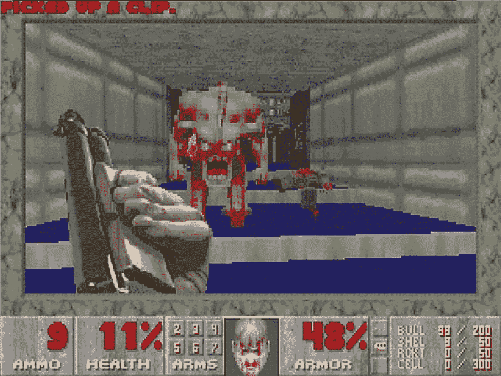
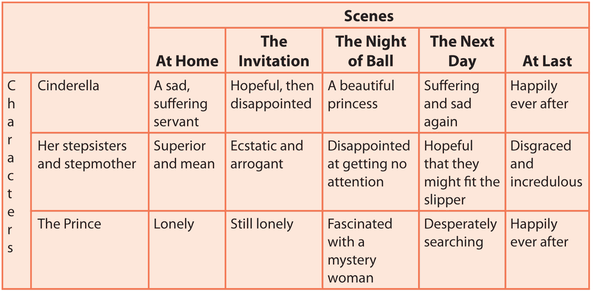
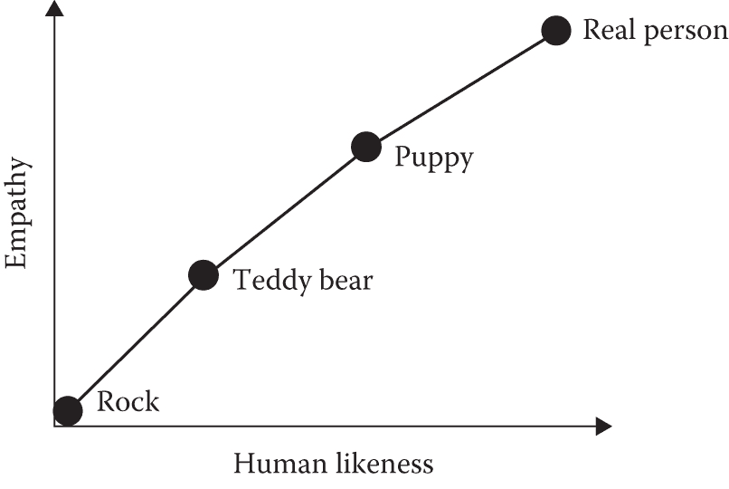
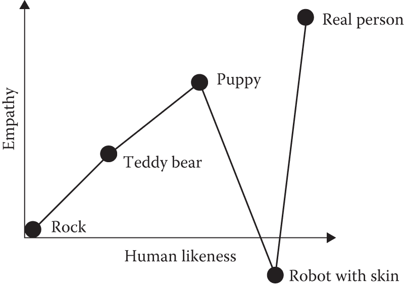

## 第二十章

## 世界包含*角色*

**图 20.1**

### 游戏角色的本质

如果我们要创作包含精彩故事的游戏，这些故事必须包含令人难忘的角色。这是一个重要的问题：游戏中的角色与其他媒介中的角色有何不同？如果我们将各种媒介中的虚构角色并排审视，一些差异就会显现出来。以下是我从二十世纪最佳小说、电影和电子游戏榜单中挑选的一些样本。

#### 小说角色

*   **霍尔顿·考尔菲德**：《麦田里的守望者》。霍尔顿是一名青少年，他与成人世界的虚伪和丑陋进行抗争。
*   **亨伯特·亨伯特**：《洛丽塔》。亨伯特是一个被对青春期少女的色欲吞噬的成年男人。
*   **汤姆·乔德**：《愤怒的葡萄》。汤姆是一名前囚犯，在家庭失去农场后试图帮助家人。
*   **拉尔夫**：《蝇王》。拉尔夫和许多其他孩子被困在一座岛上，试图在岛上生存下来，也试图在彼此间生存下来。
*   **塞西**：《宠儿》。塞西是一名女性，在她和女儿逃离奴役后试图重建生活。

#### 电影角色

*   **里克·布莱恩**：《卡萨布兰卡》。里克必须在挚爱和拯救其丈夫的生命之间做出选择。
*   **印第安纳·琼斯**：《夺宝奇兵》。一位冒险家考古学家必须将约柜从纳粹手中解救出来。
*   **露丝·德维特·布凯特**：《泰坦尼克号》。一位年轻女子在注定沉没的泰坦尼克号上坠入爱河。
*   **诺曼·贝茨**：《惊魂记》。一名患有罕见精神分裂症的男子实施谋杀并试图掩盖真相。
*   **唐·洛克伍德**：《雨中曲》。一位无声电影演员努力完成向有声电影的过渡。

#### 游戏角色

*   **马里奥**：《超级马里奥兄弟》。一位卡通水管工与敌人战斗，从邪恶国王手中营救公主。
*   **索利德·斯内克**：《合金装备》。一名退役士兵潜入核武器处理设施，化解恐怖威胁。
*   **克劳德·斯特莱夫**：《最终幻想 VII》。一群反抗者试图击败由一个邪恶巫师经营的邪恶大公司。
*   **林克**：《塞尔达传说》。一名青年必须找回一件魔法神器，从反派手中营救公主。
*   **戈登·弗里曼**：《半衰期 2》。一名物理学家在一次实验可怕地失败后必须与外星生物战斗。

那么，审视这些列表，我们看到了什么模式？

*   **心理** → **物理**。小说中的角色卷入深层的心理挣扎。这讲得通，因为在小说中我们花费大量时间聆听角色内心最深处的思想。电影中的角色卷入情感和物理的双重挣扎，这些挣扎通过沟通和行动的结合得以解决。同样，考虑到媒介特性，这讲得通：我们听不到电影角色的思想，但能看见他们所说所做。最后，游戏角色卷入的冲突几乎完全是物理层面的。既然这些角色大多没有思想（玩家替他们思考）且仅偶尔能说话，这同样完全讲得通。在所有三种情况下，角色都由其媒介定义。

*   **现实** → **幻想**。小说倾向于高度基于现实；电影倾向于植根于现实，但常推向幻想；而游戏世界几乎完全是幻想情境。角色反映了这一点——他们是环境的产物。

*   **复杂** → **简单**。由于多种原因，情节的复杂度和角色的深度随着我们从小说移向游戏而逐渐减弱。

由此，人们可能会得出结论：游戏注定只能拥有主要从事物理动作的简单幻想角色。这当然是捷径。毕竟，在游戏中你可以靠单纯的动作过关，而在电影或小说中通常不行。但这并不意味着无法在游戏中增加更多深度、更多心理冲突和更有趣的角色关系——只是意味着这很有挑战性。这份名单上的某些游戏，例如《最终幻想 VII》，就拥有非常复杂的角色关系网，构建在简单的游戏玩法结构之上——尽管已经很复杂，玩家仍在呼吁更多——他们希望游戏拥有更丰富、更有意义的角色和剧情。在本章的大部分内容中，我们将探讨其他媒介的讲故事者用来定义角色的方法，并思考如何将这些方法改编用于创造强有力的游戏角色。

让我们从一个非常特殊的角色开始：化身。

### 化身

玩家在游戏中控制的角色有种神奇之处，神奇到我们给这个角色一个特殊的名字：化身。该词源自一个梵文单词，指神神奇地以肉身形式降临人间。这个名词用于游戏角色再合适不过，因为当玩家使用化身进入游戏世界时，会发生类似的神奇转变。

# 玩家与化身的关系

玩家与化身之间的关系很微妙。有时玩家与化身截然分开，但有时玩家的心理状态会完全投射到化身上，以至于化身受伤或受到威胁时，玩家会倒吸一口冷气。这并不完全令人惊讶——毕竟，我们有能力将自己投射到几乎任何我们能控制的事物中。例如，当我们开车时，会将自我认同投射到汽车上，仿佛它是我们自身的延伸。在审视车位时，我们常会说“我觉得我停不进去。”如果另一辆车撞上了我们的车，我们不会说“它撞了我的车！”，而会说“它撞我了！”所以，我们能将自己投射到直接控制的电子游戏角色中，这不足为奇。

设计师们经常争论第一人称视角还是第三人称视角更具沉浸感。一种观点认为，通过提供无可见化身的第一人称视角场景，可以实现更强的投射感。然而，共情的力量很强，当控制一个可见的化身时，客人看到化身受到打击时往往会因想象中的疼痛而畏缩，看到化身逃脱身体伤害时会松一口气。这就仿佛化身是客人的一种动觉伏都娃娃。保龄球手也是这一现象的例证，他们试图在保龄球滚向瓶子的过程中对球施加“身体英语”（即通过身体动作试图影响球的轨迹）。这些动作主要是潜意识的，是保龄球手将自己投射到球上的结果。从这个意义上说，保龄球就是保龄球手的化身。

将自己投射到化身中，仿佛化身是一种工具，这是一回事；但如果我们能以某种方式真正与角色产生共鸣，投射体验会强大得多。那么，什么样的角色最适合让玩家投射自我呢？

## 理想形态

适合作为化身的第一类角色是玩家一直渴望成为的那种。这类角色——如强大的战士、威力无边的巫师、迷人的公主、超级帅气的特工——会对心理产生吸引力，因为我们内心推动我们成为最好的自己的力量，会觉得将自己投射到理想化形态中极具吸引力。虽然这些角色与我们的真实自我截然不同，但它们是我们有时梦想成为的人。

## 白板形象

适合作为化身的第二类角色是斯科特·麦克劳德所说的“标志性”角色。在他的佳作《理解漫画》中，麦克劳德提出了一个有趣的观点：角色细节越少，读者将自己投射到该角色中的机会就越多。

**图 20.2**

（由 Harper Collins 提供。经许可使用。）

麦克劳德进一步指出，在漫画中，旨在显得陌生、外来或可怕的角色或环境往往被赋予大量细节，因为更多细节会让它们更“异化”。当你将标志性角色与细节丰富的世界结合时，会得到一种强大的组合，正如麦克劳德在下图所示：

**图 20.3**

（由 Harper Collins 提供。经许可使用。）

这一观点的适用范围远超漫画领域。在电子游戏中，我们也看到了同样的现象。一些最受欢迎、最引人入胜的化身都是高度标志性的。以 `Mario` 为例：他算不上理想化形态，但形象简单、极少说话、完全没有威胁性，因此很容易将自己投射到他身上。

理想化形态和白板形象经常混合使用。以 `Spider-Man` 为例。他是理想形态：强大勇敢的超级英雄，但覆盖面部的面具使他几乎完全标志化——一个几乎可以是任何人的白板形象。

偶尔会出现一些噱头系统，让你拍下自己的照片贴在化身上。我听过推销这些系统的人称之为“任何玩家的终极梦想”。但这些系统虽然作为新奇事物很有趣，却从未长久流行，因为人们玩游戏不是为了做自己——他们玩游戏是为了成为他们希望能成为的人。

在 `第 16 章`：`兴趣曲线` 中，我们介绍了 `透镜 #72`：`投射` 作为一种工具，用来审视玩家将自己投射到游戏虚构世界的程度。我们还应该增加一个更具体的透镜，来审视他们将自己投射到化身中的程度。

## 创造引人入胜的游戏角色

化身在游戏中很重要，正如主角在传统故事中很重要一样。但我们不能忘记其他角色。有几十本关于剧本创作和讲故事的书可以给你关于如何创造强大、引人入胜角色的好建议。在这里，我将总结一些我发现对开发游戏角色最有用的方法。

### 角色技巧 #1：列出角色功能

在创作故事的过程中，人们经常根据剧情需要发明角色。但游戏需要角色时该怎么办？在构思游戏角色阵容时，一个非常有用的技巧是列出这些角色需要履行的所有功能。然后列出你原本打算放入游戏的角色，看看它们如何对应。例如，如果你正在制作一个动作平台游戏，你的列表可能如下所示：

**角色功能**：

1.  **英雄**：玩游戏的角色
2.  **导师**：提供建议和有用物品
3.  **助手**：偶尔提供提示
4.  **教官**：解释如何玩游戏
5.  **最终 Boss**：最后决战的对手
6.  **小兵**：坏人
7.  **三个 Boss**：需要战斗的强敌
8.  **人质**：需要营救的人

窥探一下你的想象力，你可能看到了这些角色：

1.  **`Princess Mouse`**：美丽，但强硬且不废话
2.  **`Wise Old Owl`**：满腹智慧，但健忘
3.  **`Silver Hawk`**：愤怒且复仇心切
4.  **`Sammy Snake`**：无道德且充满讽刺幽默
5.  **`Rat Army`**：成百上千只红眼恶鼠

现在，你必须将角色与功能匹配。这是一个大发创意的机会。传统做法是让 `Princess Mouse` 成为人质。但为什么不搞点不一样的？让她成为导师？或者英雄？甚至最终 Boss！`Rat Army` 看起来天生就是小兵——但谁知道呢？也许它们之所以有邪恶的红眼睛，是因为被邪恶的 `Princess Mouse` 捕获并催眠了，实际上它们才是人质！嗯……似乎我们也没有足够的角色来填满所有八个角色——我们可以编造更多角色，或者让一些角色身兼数职。如果你的导师 `Wise Old Owl` 结果是最终 Boss 呢？那将是一个讽刺的反转，还能节省开发新角色的成本。也许助手和教官都是 `Sammy Snake`——又或者 `Silver Hawk` 是人质，通过从被囚禁处发送心灵感应信息来指导你。

通过将角色功能与你对角色的设想分离开来，你可以清晰地思考如何确保游戏拥有承担所有必要工作的角色，有时还能通过合并角色提高效率。这种方法可以作为一个方便的透镜。

### 角色技巧 #2：定义并使用角色特质

假设你的女主角 `Sabu` 和她的搭档 `Lester` 之间有一段对话——简单的说明性内容，帮助铺垫下一关。类似这样：

> **莱斯特**：萨布！

# 角色设计：特质、人际关系与角色网

> **SABU**：怎么了？
>
> **LESTER**：有人偷走了国王的王冠！
>
> **SABU**：你意识到这意味着什么吗？
>
> **LESTER**：不知道。
>
> **SABU**：这意味着黑箭回来了。我们必须阻止他！

这段对话相当平淡。虽然它告诉了我们情境（王冠失窃）和反派（黑箭），但完全没有展现 Sabu 或 Lester 的个性。你的角色需要说一些话、做一些事，让他们显得像真实的人。为此，你必须了解他们的特质。

定义角色特质的方法有很多。有人建议创建“角色设定集”，列出你能想到的定义角色的一切——他们的爱恨、穿衣风格、饮食习惯、成长背景等。这是个有用的练习。但最终，你大概率想把这些浓缩成一个更简单的核心：一个小而精炼的特质列表，概括角色的本质。你要选择那些能贯穿角色经历的各种情境、真正定义他们为何其人的特质。有时这些特质可以稍微矛盾，但真人也有矛盾特质，角色为什么不能？假设我们给 Sabu 和 Lester 赋予如下特质：

> * **Sabu**：守信、暴躁、英勇、炽热的爱人
> * **Lester**：傲慢、讽刺、精神性、冲动

现在，让我们重写对话，试图注入这些特质——最好一次体现不止一个（还记得 透镜 #49：**优雅** 吗？）。

> **LESTER**（冲进房间）：诸神在上！Sabu，我有消息！（冲动且精神性）
>
> **SABU**（遮住自己）：你竟敢闯入我的隐私！（暴躁）
>
> **LESTER**：随便。也许你不在乎国王的王冠被偷了？（傲慢且讽刺）
>
> **SABU**（眼神飘远）：这意味着我必须兑现承诺……（守信且英勇）
>
> **LESTER**：我向毗湿奴祈祷，别又是个旧情人重逢的故事……（Lester：精神性且讽刺；Sabu：炽热的爱人）
>
> **SABU**：闭嘴！黑箭伤透了我的心，也伤透了我妹妹的心——我发誓如果他卷土重来，我会不惜性命消灭他。备战车！（暴躁、炽热的爱人、守信、英勇）

不仅对话受益于此。你为角色选择的行动，以及行动的执行方式，也应展现特质。如果角色狡猾，跳跃动画里能体现吗？如果角色抑郁，奔跑时能看出来吗？也许抑郁的角色不该跑，只能走。拥有特质列表并加以运用没有什么魔法——只是意味着你真正了解你的角色。

## 角色贴士 #3：使用人际周向模型

你的角色当然不会孤立存在——他们会相互交互。Katherine Isbister 从社会心理学引入游戏设计的一个工具是**人际周向模型**。这是一个用于可视化角色间关系的图表。它有两个轴：友善度和支配性。这个复杂的图表展示了许多特质在图上的位置：

这看起来有点吓人，但可以作为一个简单的工具使用。假设我们想展示其他《星球大战》角色与汉·索罗的关系。既然友善度和支配性是相对特征，我们总需要相对于某个特定角色来衡量。所以 图 20.5 展示了相对于汉·索罗的角色分布。

将角色这样布局在图上，提供了一种可视化角色关系的好方法。注意达斯·维达、丘巴卡和 C-3PO 在图上的极端位置——这些极端正是让他们有趣的部分。还要注意，他交流最多的人离他在图上最近。左下象限没有角色这一事实告诉了我们关于汉的什么？考虑一下卢克或达斯·维达的图会有多么不同。

**图 20.4**

周向模型不是终极工具，但它能引发问题，有助于思考角色关系，所以把它放进工具箱吧。

**图 20.5**

## 角色贴士 #4：制作角色网

周向模型是查看部分角色关系的好视觉方式。但角色间关系可能涉及许多其他因素。角色网是探索角色如何看待彼此及原因的好方法。思路很简单：分析一个角色时，写下该角色对所有其他角色的看法。这是一个《阿奇漫画》世界的例子：

### Archie

*   **Veronica**：Archie 被她的优雅和美貌吸引。虽然她富有，Archie 不太在乎钱。
*   **Betty**：Archie 的真爱，但她的不安全感不断发出混合信号，所以他不像可能的那样强烈追求她。
*   **Reggie**：Archie 不该信任 Reggie，但他经常信任，因为 Archie 总想做个好人，而且 Archie 有点轻信。
*   **Jughead**：Archie 的挚友。他们的共同点是都是弱势群体。

### Veronica

*   **Archie**：Veronica 觉得 Archie 有吸引力，但有时她约会他只是为了气 Betty，而且她总能在他面前感到优越。
*   **Betty**：Veronica 信任 Betty 作为朋友，因为她们小时候是朋友。Veronica 喜欢在财富和阶级上总能感到优越于 Betty，但 Betty 是个更好的人这点真让 Veronica 沮丧。
*   **Reggie**：Reggie 是个欣赏财富的帅气笨蛋，但 Veronica 沮丧于 Reggie 并不真正尊重或爱她。
*   **Jughead**：一个令人作呕的怪胎——Veronica 无法理解 Archie 为什么和他做朋友。Veronica 经常用食物贿赂他以达到目的。

### Betty

*   **Archie**：她的真爱。她害羞，不敢表达真实感受，因为 Betty 自尊心低。
*   **Veronica**：Betty 的闺蜜。她有时刻薄，太迷钱，但朋友永远是朋友，所以 Betty 留在 Veronica 身边。
*   **Reggie**：Betty 被他的财富和炫耀阶级的尝试吓倒。她觉得应该喜欢他，但内心深处排斥他。
*   **Jughead**：Betty 觉得他可爱又好笑，很高兴他是她真爱的好朋友。

### Reggie

*   **Archie**：Reggie 的死对头。Reggie 想象不出谁会看上这么个迂腐的好人。偶尔 Reggie 嫉妒 Archie 的人气，但他总觉得能找到诡计超越 Archie。
*   **Veronica**：Reggie 觉得她有吸引力且富有——他喜欢她财富的权力。
*   **Betty**：Reggie 觉得她有吸引力，虽然她的低自尊让他扫兴，但赢得她就能显示他优于 Archie。
*   **Jughead**：Reggie 视他为彻底的失败者，理应被霸凌，尤其是因为他是 Archie 的朋友。

### Jughead

*   **Archie**：Jughead 的挚友，唯一理解并欣赏 Jughead 对食物热爱的人。
*   **Veronica**：Archie 喜欢的那个坏女孩。
*   **Betty**：Archie 喜欢的那个好女孩。
*   **Reggie**：一个霸凌者。

你可以看到这需要一点时间，但非常值得，因为它引发了关于你可能未曾想过的角色互动的问题。这是一个赋予角色更多深度的非常实用的透镜。

像《迷失》和《生活大爆炸》这样的电视剧之所以成功，源于对人物关系网的深度挖掘。在游戏中很少见到这种做得好的探索，这使其成为一个值得追求的机会。

## 人物技巧 #5：运用地位

我们迄今为止看到的大多数人物技巧都来自作家。但还有另一个职业，对创造引人入胜的人物了解得同样多，甚至更多——演员。许多人都将互动叙事的不可预测性与即兴戏剧的不可预测性进行了类比；确实，即兴演员的技巧对游戏设计师大有裨益。这些技巧有很多，在几本书中都有很好的描述，但对我来说，有一个技巧超越了其他所有技巧。它其实不那么算是一种技巧，而是一种视角，由基思·约翰斯通在其经典著作《即兴表演》中无可挑剔地描述得淋漓尽致——这就是地位之镜。

每当人们相遇或互动时，都会不断进行一场隐秘的谈判。我们大多没有意识到这一点，因为它早于我们的语言能力。这是我们对地位的谈判；即，谁掌控着当前的互动？地位不关乎你是谁；地位是你做的事。约翰斯通用这段对话很好地说明了这一点：

> 流浪汉：“喂！你要去哪儿？”
>
> 公爵夫人：抱歉，我没听清……
>
> 流浪汉：你除了瞎还是聋啊？

这个本应地位很低的流浪汉，表现出了极高的地位态度。任何时候，无论在什么场合，无论两人或多人是朋友还是敌人、合作者还是竞争对手、主人还是仆人，地位谈判都在发生。我们几乎完全是下意识地通过姿态、语气、眼神接触以及数十种其他细微行为来进行这种谈判。令人惊讶的是，这些行为在所有文化中竟然如此一致。

*   **典型的低地位行为包括** 坐立不安、回避眼神接触、触摸自己的脸，以及普遍表现出的紧张。
*   **典型的高地位行为包括** 放松且掌控局面、进行强有力的眼神接触，以及怪异地说话时不移动头部。

一个典型的即兴练习是将演员分成两组，然后让他们混在一起——第一组（低地位）的人进行短暂的眼神接触，然后移开视线，而第二组（高地位）的人与他人建立并保持眼神接触。大多数尝试这个练习的演员很快就会意识到，这不仅仅是假装——低地位组的演员很快发现他们感到自卑，并开始无意识地表现出其他低地位特征。高地位组的演员开始感到优越，并表现出高地位特征。即使你独自一人，试着说话时完全不动头，感受一下那种感觉——或者试试相反的做法——说话时频繁转动头部，你很快就会领会其中的奥妙。

地位是相对的，而非个人的绝对属性。达斯·维达在对待莱娅公主时表现出高地位行为，但在面对皇帝时却表现出低地位。

地位可以用令人惊讶的方式传达——例如，慢动作就赋予高地位，正如我们在《六百万美元的人》、《黑客帝国》和无数洗发水广告中所见。人物占据空间的方式也极能说明地位。低地位人物去那些不太可能遇到他人或被注意到的地方。高地位人物则占据房间里最重要的位置。

地位就像一种我们都非常熟悉以至于不知道自己在说它的秘密语言。它过于潜意识的问题在于，当我们创造人造人物时，我们不会想到给他们这些行为，因为通常我们没有意识到自己在做这些事。但如果你确实给你的人物这些行为，你会很快发现，他们似乎以一种大多数电子游戏人物不具备的方式感知彼此的存在。

游戏《奥德赛：姆奇的冒险》有很棒的人物地位互动范例。在游戏中，你控制两个不同的角色，一个是奴隶，另一个被困在轮椅上（低地位）。贯穿游戏始终，你面对傲慢的（高地位）敌人，并得到奴性的（低地位）追随者的帮助。所有这些互动都非常有趣，看点颇多，大量的喜剧效果来自于意想不到的地位逆转，比如追随者对姆奇或敌人顶嘴。这款游戏中的人物展现出了对彼此存在的感知，虽然粗糙，但已超越了许多其他游戏。

地位在互动娱乐领域仍是一片 largely unexplored（未被充分探索）的领域。布伦达·哈格是第一个向我介绍地位概念的人，她是一位优秀的即兴演员，也是卡内基梅隆大学娱乐技术中心的研究员。她和她的学生们在创造能感知自己地位和他人地位、并自动采取适当姿态、动作和个人空间的人工智能人物方面，做了一些迷人的工作。目前，大多数电子游戏人物无论身边是谁都表现得一样。下一代互动游戏人物似乎会因为感知地位而显得更有生命力。

在第 16 章：*兴趣曲线*中，我们讨论了剧烈变化的事物天生就有趣。地位就是那些重要事物之一。在争吵中，人们争夺最高地位（要么提升自己的地位，要么降低对手的地位），这种地位的跷跷板效应正是争吵有趣的原因。

地位不仅关乎对话——它还关乎移动、眼神接触、领地以及人物的所作所为。它是一种审视世界的方式，所以让我们把它放进工具箱里。

当然，理解地位不仅能让你深入了解如何创造逼真的人物——它还能帮助你理解和控制现实生活中的情况，比如设计会议和客户谈判，但我们将在后面的章节讨论那些。

## 人物技巧 #6：运用声音的力量

人声是一件不可思议的强大事物，能在深层潜意识层面影响我们。这就是为什么有声电影将电影从一种新奇事物提升为二十世纪的主导艺术形式。直到最近几年，技术才允许电子游戏认真地利用配音。即使现在，游戏中的配音与电影中强大的表演相比，似乎仍显原始。

部分原因是游戏开发者在与配音演员合作时往往缺乏经验。指导配音演员是一门微妙的艺术，需要一定的窍门和多年的练习才能做好。但游戏配音薄弱还有另一个原因——我们把流程搞反了。在动画电影中，先写剧本，然后请配音演员来录制。在此过程中，台词会被修改，即兴发挥会被加入，好的会被纳入剧本。一旦录音到位，人物就会被设计（通常融入演员的面部特征），然后开始动画制作。在电子游戏中，我们反其道而行之——人物通常先被设计和建模；然后写剧本，往往还会创建基础动画；最后才加入配音。这削弱了配音演员的力量，他们现在只是试图模仿所见，而不是正当地表达他们真正感觉到的人物会如何行动和表现。配音演员成了创作过程的边缘人物，而非核心，声音的力量被削弱了。

我们为什么要倒着做？因为游戏开发过程极其动荡，围绕配音来创建角色成本太高，因为剧本在整个过程中持续变化。希望随着时间的推移，我们能开发出技术，让配音演员成为游戏角色设计的核心，并夺回声音的力量。顽皮狗（Naughty Dog）是一家认真对待这一理念的公司——《神秘海域》（*Uncharted*）系列和《最后生还者》（*The Last of Us*）都涉及贯穿整个项目周期的数十次录音会议，与配音演员的迭代合作似乎真正增强了这些游戏的情感张力。

### 角色技巧 #7：善用面部的力量

我们大脑的很大一部分被用于处理面部表情的专用“硬件”所占据。我们拥有整个动物界中最复杂、最富有表现力的面部。注意看，例如，我们的眼白——其他动物没有可见的眼白。看来我们进化出它们是作为一种沟通方式。我们也是唯一会脸红的动物，也是唯一会流泪的动物。

尽管有这些优势，鲜有电子游戏给予面部动画应有的重视。游戏设计师过于关注角色的动作，而很少考虑他们的情感。当游戏确实有有意义的面部动画时（如《塞尔达传说：风之杖》），往往会获得极大的关注。《OnLive Traveler》（一个早期的 3D 聊天室）的设计师对角色有着非常严格的多边形预算。在构建和测试原型时，他们每次都会问用户：“角色需要更多细节吗？”每次回答都是：“要——在脸上。”经过五六轮这样的迭代，身体逐渐消失殆尽，只剩下诡异的漂浮头颅——但这正是用户所偏好的，因为这是一项关于自我表达的活动，而面部是现存最具表现力的工具。

面部动画不一定要昂贵——简单的动画眉毛或眼型就能发挥巨大作用。但你确实需要一个玩家可见的角色面部。化身（Avatar）的面部通常对玩家不可见。《毁灭战士》（*Doom*）的设计师找到了改变这一点的方法，他们在屏幕底部放置了一个化身面部的小图像。因为我们在余光中察觉面部表情比辨认数字更容易，他们明智地让面部表情对应生命值，这样玩家无需将视线从敌人身上移开，就能感知自己受伤的程度。

最重要的是，你应该关注角色的眼睛。俗话说眼睛是心灵的窗户，但电子游戏角色往往拥有呆滞、死气沉沉的眼睛。如果你能让角色的眼睛“活”起来，整个角色就会活过来。想让反派显得邪恶？关注眼睛。想让僵尸显得恐怖？给它恐怖的眼睛。想让企鹅显得可爱？关注可爱的眼睛。关于眼睛还有个有趣的事实——我们用它们来判断谁有血缘关系。看看《辛普森一家》（*The Simpsons*）里的卡通眼睛，每个家族都有一套专属的眼睛。眼睛藏着许多秘密。给予它们应有的关注，你的角色会以“活”过来来感谢你。

**图 20.6**

### 角色技巧 #8：强有力的故事能重塑角色

> *人不会改变，只是被揭示真实面目罢了。*
>
> —安·恩赖特

伟大故事的一个显著特征是角色如何改变。游戏设计师很少考虑这一点，这损害了他们的作品。人们倾向于将游戏角色视为固定类型——反派永远是反派，英雄天生就是英雄。这会导致非常乏味的叙事。少数游戏，如《寓言》（*Fable*）和《星球大战：旧共和国武士》（*Star Wars: Knights of the Old Republic*），之所以成名，正是因为它们做到了几乎所有成功的电影或书籍都会做的事——让事件随着时间的推移改变主角。

当然，并非每款游戏的主角都能实现有意义的角色改变。但或许可以让游戏中的其他角色发生改变，比如伙伴或反派。一个直观展示游戏中角色改变潜力的好方法是制作角色转变图表，左侧列出角色，顶部列出故事的不同阶段。然后，标记角色发生某种改变的节点。例如，看看灰姑娘故事中的变化：

通过纵向观察每个角色而非仅关注故事主线，我们获得了一个独特的视角，有助于更好地理解角色。有些转变是暂时且微小的，有些则伟大且永久。通过思考角色应如何改变并充分利用这一点，你的游戏将讲述一个比角色置身事外强得多的故事。这种角色转变的视角是我们最后一个角色透镜。

### 角色技巧 #9：让你的角色给我们惊喜

在 F·斯科特·菲茨杰拉德的小说《夜色温柔》（*Tender is the Night*）中，有一段罗丝玛丽和迪克的对话，对我们讲故事的人至关重要。它始于女演员罗丝玛丽的一个简单问题：

> *“我想问问你对我的最新照片怎么看——如果你看过的话。”*
>
> *“得花几分钟跟你解释，”迪克说。“假设妮可告诉你拉尼尔病了。在生活中你会怎么做？任何人会怎么做？他们会‘表演’——脸上露出悲伤，声音表现出震惊，话语表达同情。”*
>
> *“是的——我懂了。”*
>
> *“但在剧场里，不。在剧场里，所有最优秀的女喜剧演员都是通过滑稽模仿‘正确的情感反应’——恐惧、爱和同情——来建立名声的。”*
>
> *“我明白了。”可她并不太懂。*
>
> *“演员的危险在于‘回应’。再假设有人告诉你，‘你的爱人死了。’在生活中你大概会崩溃。但在舞台上你是要娱乐观众——观众可以自己去‘回应’。首先演员要念台词，然后她必须把观众的注意力从那个被谋杀的中国人或别的什么事上拉回到自己身上。所以她必须做些意想不到的事。如果观众觉得角色刚硬，她就对他们温柔——如果觉得柔弱，她就变得强硬。你要彻底‘跳出角色’——懂吗？”*
>
> *“我不太懂，”罗丝玛丽承认道。“什么叫跳出角色？”*
>
> *“你做意想不到的事，直到你把观众从客观事实那里引回到你自己身上。然后你再‘滑回’角色里。”*

这个建议似乎完全违背了我们对讲故事和表演的一切认知。我们期望角色表现得真实可信。但在这里，菲茨杰拉德告诉我们，在一个好故事里，角色会做出观众意料之外的事。这完全是真的。一旦你知道要寻找它，你会发现它无处不在。喜剧、戏剧、经典名著，到处都是。热门电视剧《绝命毒师》（*Breaking Bad*）几乎就是建立在这个原则上的。这又是“惊喜透镜”的一种用法。当角色表现出我们意料之外的情感反应时，我们会关注。当然，乐趣就是带有惊喜的愉悦，对吧？如果你想让玩家享受与角色互动的过程，就像设计玩具一样设计每一个角色。寻找让角色给玩家惊喜的方法，玩家就会对角色的一言一行全神贯注。

### 角色技巧 #10：避开恐怖谷

日本机器人专家森政弘发现了人类对机器人和其他人造角色反应的一个有趣现象。如果你思考人们如何产生共情，你可能会注意到：某事物看起来越像人，人们就越能对其产生共情。你甚至可以把它画在一张图上：

**图 20.7**

这完全讲得通。某事物越像人，我们给予的共情就越多。但森政弘发现了一个有趣的例外，当他致力于模仿人类的机器人研究时——一旦它们开始变得太像人，也许是从金属面孔（想想 C-3PO）变成了带有人造皮肤的面孔，人们突然会感到厌恶。这让图表看起来像图 20.8。

森政弘将曲线中这个令人惊讶的下降称为“恐怖谷”。这种不安感的成因可能是：当我们看到几乎像人的事物时，大脑会将它们识别为“患病的人”，他们在身边可能很危险。僵尸就是恐怖谷底部那些令人毛骨悚然事物的典型例子。

**图 20.8**

恐怖谷在电子游戏和动画中随处可见。像《最终幻想》和《极地特快》这样的电影，每一帧看起来都华丽自然——当你只看单帧时。但当电影动起来时，计算机生成的人类有一种让许多人感到毛骨悚然的特质——不知怎么，它们的动作不太对劲——它们离山谷太近，掉了进去。将这些角色与皮克斯电影中那些卡通角色（鱼、玩具、汽车、机器人）形成对比，后者完全没有产生共情的问题，因为它们停留在山谷左侧，那里有一只小狗。

电子游戏角色很容易有同样的问题——尤其是在试图模仿现实的游戏中。也许有一天，电子游戏角色会变得如此逼真，以至于它们可以安全地存在于山谷的右侧，但在那之前，请谨慎行事——那是一条漫长的下坡路。

角色绝对能让世界变得更有趣，但要让它成为一个世界，还需要别的东西——一个存在的空间。

### 其他推荐阅读

*   *设计更好的电子游戏角色* by 凯瑟琳·伊斯比斯特。这本书巧妙地连接了社会心理学世界和电子游戏世界，提供了许多实用工具和技巧，让你的角色栩栩如生。
*   *即兴表演* by 基思·约翰斯通。如果你认为即兴表演全是滑稽笑话，这本书会纠正你的观念。它真正讲的是如何实时创造有趣的情境，换句话说，就是游戏设计。
*   *理解漫画* by 斯科特·麦克劳德。这本书是无与伦比的杰作。如果你没读过，立刻去读。
