## 第二十一章

## 世界包含空间

**图 21.1**

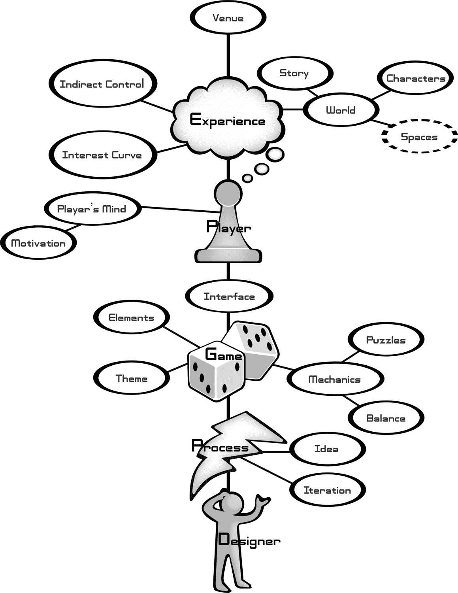

等一下——我们不是在第 12 章：*机制*中讨论过空间的概念吗？是的，也不是。我们讨论了功能空间的概念——但功能空间只是游戏空间的骨架。在本章中，我们将探讨玩家实际体验的、充实的空间。

### 建筑的目的

> *是的，如果你不介意下雨时在前院露营，就建一座弗兰克·劳埃德·赖特的房子吧。*
>
> —阿琳·巴恩斯多尔

当你听到“建筑”这个词时，你会想到什么？大多数人会想到宏伟的建筑，特别是形状奇特的现代建筑。人们有时似乎认为建筑师的主要工作是雕塑建筑的外部形状，欣赏好建筑意味着像在博物馆欣赏雕塑一样欣赏这些建筑形状。

虽然结构的外部形状是建筑的一个方面，但它与建筑的主要目的关系不大。

建筑的主要目的是控制一个人的体验。

如果我们想要的所有体验都能在自然界中轻松找到，建筑就没有存在的意义。但那些体验并不总是存在，所以建筑师设计事物来帮助我们获得渴望的体验。我们想体验阴凉和干燥，所以搭建庇护所。我们想体验安全和安保，所以建造围墙。我们建造房屋、学校、商场、教堂、办公室、保龄球馆、酒店和博物馆，不是因为我们想看这些建筑，而是因为我们想要一些体验，这些建筑使这些体验成为可能。当我们说这些建筑之一“设计良好”时，我们说的不是它外观看起来怎么样。我们说的是它在多大程度上创造了我们在里面时想要的那种体验。

因此，建筑师和游戏设计师是近亲。两者都创造人们必须进入才能使用的结构。建筑师和游戏设计师都无法直接创造体验——相反，两者都必须依靠间接控制来引导人们获得正确的体验。最重要的是，两者创造的结构除了孕育让人快乐的体验外，别无他用。

### 组织你的游戏空间

游戏设计师和建筑师还有更明显的联系——两者都必须创造空间。虽然游戏设计师可以从建筑师那里学到很多关于创造有意义和强大空间的知识，但游戏设计师绝不必遵循建筑学的每一条规则，因为他们创造的空间不是由砖瓦构成的，而是完全虚拟的结构。虽然这听起来像是一种美妙的自由（确实如此），但它也可能是一种负担。缺乏物理约束意味着几乎一切皆有可能——如果一切皆有可能，你从何处开始？

开始的一种方法是决定你游戏空间的组织原则。如果你已经对游戏如何玩有一个相当好的想法，这应该很容易。通过透镜 #26：*功能空间*（来自第 12 章：*机制*）来审视你的游戏，并将其作为你将要构建的空间的骨架。

但也许你还在摸索你的功能空间——也许你的游戏设计还处于非常早期，你希望通过创建地图来更好地了解你的游戏如何运作。在这种情况下，这里有设计师组织游戏空间的五种常见方式。

1.  **线性**：令人惊讶的是，大量游戏都安排在线性游戏空间中，玩家只能沿着一条线向前（也许也能向后）移动。有时线有两端；有时，它会回环到自身。一些著名的线性游戏空间如下：

    1.  *糖果乐园*
    2.  *大富翁*
    3.  *超级马里奥兄弟*
    4.  *喷气背包冲刺*
    5.  *吉他英雄*

    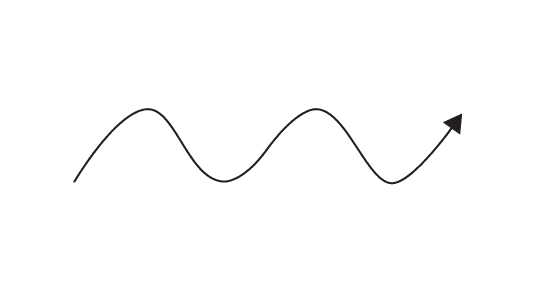

2.  **网格**：在网格上安排你的游戏空间有很多优势。它便于玩家理解，使对齐更容易，保持事物比例适当，当然，网格也非常容易被计算机理解。你的网格不必是方格网格——也可以是矩形、六边形（战争游戏中流行），甚至三角形。一些著名的基于网格的游戏如下：

    1.  *国际象棋*
    2.  *战争前线*
    3.  *卡坦岛的开拓者们*
    4.  *塞尔达传说（NES 版）*
    5.  *我的世界*

    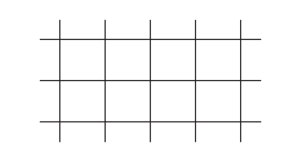

## 3. 网状结构

网状空间布局通过在地图上标记若干点并用路径连接它们来实现。当你希望玩家访问多个地点，但想给他们提供多种不同的到达方式时，这种布局很有用。有时路径上有意义的旅行过程，但其他时候旅行是瞬间完成的。基于网状空间组织的游戏示例包括：

1. *狐狸与鹅*
2. *琐事追踪*
3. *Zork*
4. *企鹅俱乐部*
5. *Puzzle Quest*

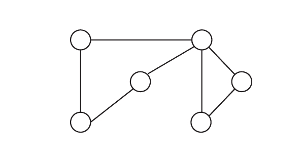

## 4. 空间中的点

空间中的点是一种相对少见的游戏空间类型，通常用于想要唤起类似“在沙漠中漫游并偶尔返回绿洲”体验的游戏，如 RPG 中的情况。这也常见于玩家可以自行定义游戏空间的游戏中。此类空间组织的示例包括：

1. *滚球*
2. *薄冰*（一种涉及湿弹珠和餐巾的桌游）
3. *极性*（磁力桌游）
4. *动物森友会*
5. *最终幻想*

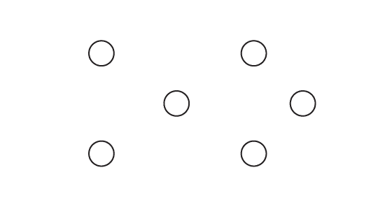

## 5. 分割空间

分割空间最像真实地图，常见于试图复制真实地图的游戏中。它通过以不规则方式将空间雕刻成多个区域来实现。拥有分割空间的游戏示例包括：

1. *风险*
2. *轴心国与同盟国*
3. *黑暗塔*
4. *塞尔达传说：时之笛*
5. *文明*

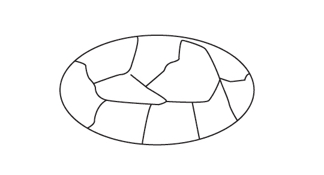

这些不同的组织原则经常被结合使用，以创造有趣的新型游戏空间。例如，《线索》结合了网格和分割空间模式；棒球结合了线性结构和空间中的点。

### 略谈地标

组织空间时，一个非常重要的考虑因素是：地标是什么？第一款文字冒险游戏 *Colossal Cave* 有两个不同的迷宫。在一个迷宫中，每个区域都被描述为“You are in a maze of twisty passages, all alike.” 另一个迷宫同样令人困惑，每个区域被描述为“You are in a maze of twisty passages, all different.” 因为过多的混乱和过多的秩序一样单调。*Colossal Cave* 的玩家学会了在迷宫中丢弃物品，形成地标以帮助他们找到路。任何优秀的游戏空间都有内置地标，它们帮助玩家找到去向，也让空间看起来更有趣。地标是玩家记住和谈论的东西，因为它们让空间变得令人难忘。

## Christopher Alexander 是一位天才

Christopher Alexander 是一位建筑师，毕生致力于研究场所如何让我们产生感受。他的第一本书 *The Timeless Way of Building*（1979）试图描述真正设计优良的空间和物品所共有的独特品质。正如他所说：

> *想象一下，在一个冬日的午后，你有一壶茶、一盏阅读灯，还有两三个巨大的枕头靠在身后。现在让自己舒服下来。不是那种你可以拿给别人看、说有多喜欢的方式。我是说让你真正为自己感到舒服、喜欢的方式。*
>
> *你把茶放在伸手可及的地方：但要放在绝对碰不倒的地方。你拉低灯光，照在书上，但不要太亮，也不要让裸露的灯泡刺眼。你把垫子放在身后，一个个仔细地摆好，正好放在你想要的位置，支撑你的背、颈、手臂：这样你就能舒舒服服地支撑着，正好像你想要的那样啜饮美茶、阅读、遐想。*
>
> *当你费心做完这一切，并小心翼翼、全神贯注地去做时，它可能开始拥有那种无名的品质。*

很难准确指出这种品质是什么，但大多数人体验时就能知道。Alexander 指出，拥有这种无名品质的事物通常具有以下特征：

*   它们感觉 **充满生命力**（充满生机），仿佛蕴含能量。
*   它们感觉 **完整**（完整），仿佛没有任何缺失。
*   它们感觉 **舒适**；身处其中令人愉悦。
*   它们感觉 **自由**，不受不自然的约束。
*   它们感觉 **精确**，仿佛正是它们应有的样子。
*   它们感觉 **无我**，与宇宙相连。
*   它们感觉 **永恒**，仿佛亘古长存。
*   它们 **没有内在矛盾**（无内在矛盾）。

最后一点“没有内在矛盾”对任何设计师都极其重要，因为内在矛盾是糟糕设计的核心。如果一个设备本应让我的生活更轻松，却很难使用，那就是矛盾。如果某物本应好玩，却令人厌烦或沮丧，那就是矛盾。优秀的设计师必须小心移除内在矛盾，不能习惯它们，也不能为它们找借口——所以让我们在工具箱里加入一个移除它们的工具。

Alexander 还解释说，只有通过迭代和对事物使用方式的观察，才能达到真正卓越的设计。换句话说，Loop 规则在建筑学中同样适用，正如在游戏设计中一样。一个具体例子是他描述的在建筑群之间铺设小径的系统：“完全不铺路。只种草。一年后回来，看看人们在草地上踩出了哪些路，然后再开始铺设。”

Alexander 的下一本书 *A Pattern Language* 是他最著名、影响力最大的作品。书中描述了 253 种似乎拥有无名品质的建筑模式。它们从大尺度模式如“城镇分布”和“农业山谷”，到小尺度模式如“帆布屋顶”和“可大开的窗户”。《A Pattern Language》的广度和惊人细节改变了读者对日常世界互动方式的看法。许多游戏设计师都有关于这本书如何启发他们的故事。就我个人而言，在阅读这本书之前，我对如何构建 *Toontown Online* 的世界感到困惑，读完后突然许多事情变得显而易见。据说 Will Wright 基于想尝试书中列出的模式而设计了 *模拟城市*。计算机科学中整个“设计模式”运动也源于这本书的力量。读完它你会创造出什么？

Alexander 不愿让这种无名品质保持无名。在后来的书中，他深入研究了究竟是什么赋予事物那种特殊感觉。他通过编录数千个拥有或不拥有那种感觉的事物，然后寻找它们之间的相似性。通过这个过程，他逐渐提炼出这些事物共有的十五种基本品质，详见 *The Phenomenon of Life*。书名源于他对无名品质的一个洞察：某些事物之所以让我们觉得特别，是因为它们拥有生物共有的某些品质。作为生物，我们会对拥有生命特有品质的事物和场所产生共鸣。

深入探讨这些属性超出了本书范围，但反思你的游戏是否包含它们会很迷人且有用。仅仅思考这些主要关于空间和纹理品质的模式如何应用于游戏，就是极好的思维练习。

### Alexander 的生命结构十五大属性

# 亚历山大的十五个完整性属性在游戏设计中的应用

## 1. 尺度层级
我们在“套娃式目标”中看到了尺度层级，玩家必须达成短期目标才能达到中期目标，最终达成长期目标。我们在分形兴趣曲线中看到了它。我们也在嵌套的游戏世界结构中看到了它。《孢子》是尺度层级的交响乐。

## 2. 强中心
我们当然在视觉布局中看到了这一点，但在故事结构中也看到了。化身是我们游戏宇宙的中心——我们通常更喜欢强化身而非弱化身。此外，就游戏中的目的——我们的目标而言，我们也偏好强中心。

## 3. 边界
许多游戏主要就是关于边界的！任何关于领土的游戏本质上都是对边界的探索。但规则是另一种边界，没有规则的游戏根本就不是游戏。

## 4. 交替重复
我们在棋盘令人愉悦的形状中看到了这一点，也在许多游戏中出现的关卡/首领/关卡/首领的循环中看到了它。甚至紧张/释放/紧张/释放也是令人愉悦的交替重复的例子，如图 10.7 所示。

## 5. 正空间
亚历山大在这里的意思是前景和背景元素都拥有美丽、互补的形状，如阴阳。从某种意义上说，一个平衡良好的游戏具有这种品质——允许多种备选策略拥有相互咬合的美感。

## 6. 良好形状
这正如其名——一种令人愉悦的形状。我们当然在游戏的视觉元素中寻找这一点。但我们在关卡设计中也能看到并感受到它。一个好的关卡感觉“扎实”，并有一条“良好的曲线”。

## 7. 局部对称
这不同于整体对称（如镜像）；它指的是设计中多个微小的内部对称。《塞尔达传说：风之杖》的建筑中充满了这种感觉——当你身处一个房间或区域时，它似乎具有对称性，但它以一种有机的方式与其他地方相连。规则系统和游戏平衡也可以拥有这一属性。

## 8. 深度咬合与模糊性
这是指两事物紧密交织以至于相互定义——若拿走其中一个，另一个也就不再是它自己了。我们在许多棋盘游戏中看到了这一点，如《围棋》。棋子在棋盘上的位置仅相对于对手的棋子才有意义。

## 9. 对比
在游戏中，我们有多种对比。对手之间的对比，可控与不可控之间的对比，奖励与惩罚之间的对比。当游戏中的对立面被强烈对比时，游戏感觉更有意义、更有力量。

## 10. 渐变
这指逐渐变化的品质。逐渐上升的挑战曲线是一个例子，适当设计的概率曲线也是。

## 11. 粗糙感
当游戏过于完美时，它就没有个性。自制“家规”那种手工感往往让游戏显得更有生命力。

## 12. 回响
回响是一种令人愉悦、统一的重复。当首领怪物与其爪牙有共同之处时，我们就体验到了回响。良好的兴趣曲线具有这一属性，尤其是分形兴趣曲线。

## 13. 虚无
正如亚历山大所说：“在拥有完美完整性的最深刻中心处，有一个如水般的虚无，深度无限，被周围杂乱的事物与结构包围并形成对比。”想想教堂，或人心。当首领怪物往往位于巨大、中空的空间中时，我们就在体验虚无。

## 14. 简洁与内心平静
设计师没完没了地谈论游戏简洁的重要性——通常指少量规则产生涌现属性。当然，这些规则必须平衡良好，这赋予了它们亚历山大所描述的内心平静。

## 15. 不分离
这指某事物与其周围环境连接良好——仿佛它就是环境的一部分。我们游戏的每一条规则都应有此属性，但游戏的每个元素也应如此。如果游戏中的一切都具有这种品质，就会产生一种完整性，让游戏感觉非常鲜活。透镜 #11：**统一** 可以作为不分离的良好指南。

亚历山大的建筑方法在设计游戏空间时非常有用。但正如你所见，他描述的优质空间特质也适用于游戏设计的许多其他方面。我在这里只能浅尝辄止地介绍亚历山大的设计方法。阅读他那些令人愉悦的著作肯定会给你带来关于游戏设计的新见解。作为对他深思熟虑视角的提醒，请使用这枚透镜。

# 真实建筑与虚拟建筑

亚历山大的建筑“深层基础”视角很有用，但详细研究虚拟建筑特有的怪癖也很有用。当我们研究为流行电子游戏制作的一些空间时，它们往往非常奇怪。它们拥有大量浪费的空间、古怪危险的建筑特征、与外部环境没有真实关系，有时区域甚至以物理上不可能的方式自我重叠。

这些怪异的建筑结构在现实世界建筑师眼中会被视为疯狂。看那些怪异的中空空间和所有那些水。那么为什么当我们玩电子游戏时，不会注意到建筑布局有多奇怪呢？

因为人类大脑在将 3D 空间转化为 2D 地图时非常薄弱。如果你不信，想想一个熟悉的地方，比如你常去的家、学校或工作场所，试着画张地图。大多数人觉得这很难——这根本不是我们在脑海中存储空间的方式——我们相对地思考空间，而非绝对地。我们知道哪扇门通向哪个房间，但对于没有门的墙后是什么，我们并不总是确定。因此，3D 空间拥有逼真的 2D 蓝图并不重要。唯一重要的是玩家身处其中时空间的感觉。

**图 21.2**

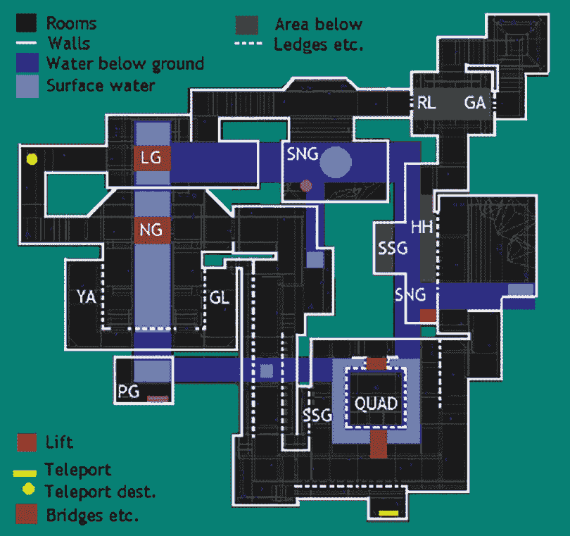

没人会在现实世界建造这个。

## 了解尺寸大小

当我们身处真实空间时，尺度感来得很自然，因为我们有许多线索——光照、阴影、纹理、立体视觉，最重要的是我们自己身体的存在。但在虚拟空间中，尺度并不总是清晰的。由于缺失了许多现实世界的线索，很容易创建一个看起来比实际大得多或小得多的虚拟空间。这会让玩家非常困惑和迷失方向。我经常与学生和其他新手世界构建者进行如下对话：

> **虚拟建筑师**：我的世界看起来怪怪的……但我不知道为什么……
>
> **我**：嗯，东西似乎比例失调——那辆车对街道来说太大了，那些窗户对那栋楼来说太小了。那辆车到底有多大？
>
> **虚拟建筑师**：不知道……也许五个单位？
>
> **我**：那么一个单位有多大？
>
> **虚拟建筑师**：不知道。全是虚拟的……这有关系吗？

从某种意义上说，他是对的——只要你世界里的一切比例协调，你的虚拟单位可以是英尺、米、肘尺或蓝精灵帽子，都无所谓。但一旦有东西比例失调，或者你怀疑可能失调，这就会变成一个非常重要的问题，因为那时你必须将事物关联回现实世界。因此，明智的做法是让你的游戏单位成为你在现实世界中非常熟悉的东西——对大多数人来说是英尺或米。这将节省大量时间和困惑，因为如果你的单位是英尺，而你的车长三十个单位，你会立刻知道问题出在哪里。

# 第三人称视角失真

但有时，你世界中的元素比例协调得当，但在玩家眼中，事物看起来却不合比例。此情况下的典型罪魁祸首包括以下几点：

* **视线高度**：如果你的第一人称游戏将虚拟摄像机放置得很高（离地面七英尺以上）或很低（离地面五英尺以下），都会扭曲世界的视野，因为人们倾向于假设视线高度与自身相似。

* **人物与门道**：比例感最强的两个线索是人物和门道（门道当然是为适应人而设计的）。如果你的世界是巨人或小人的世界，会让玩家对比例感到困惑；同样，如果你决定游戏中的门道非常大或非常小，也会造成类似的困惑。如果没有人物、门道或其他常见尺寸的人造物体，玩家往往会对比例感到有点困惑。

* **纹理缩放**：设计世界时容易犯的一个错误是纹理比例不当，例如墙上的砖块纹理太大，或地板砖纹理太小。请确保你使用的纹理与现实世界中的纹理比例相匹配。

虚拟空间设计还有另一个特殊的怪癖。我们每个人都天然地形成了一种感觉，知道自己的身体如何融入所见的世界。当我们玩第三人称视频游戏（能看到自己的身体）时，大脑会做一件神奇的事；它以某种方式让我们同时身处两地——既在角色的身体里，又漂浮在身体后方八英尺处——同时让这种奇怪的视角感觉非常自然。虽然我们在游戏中能看到虚拟身体获益良多，但我们的比例感却发生了非常奇特的变化。在宽阔的室外场景中，我们大多察觉不到这一点。但当我们试图控制一个处于正常大小室内空间的角色时，空间会让人感到沮丧的拥挤，就像我们在房子里开车乱转。

**图 21.3**

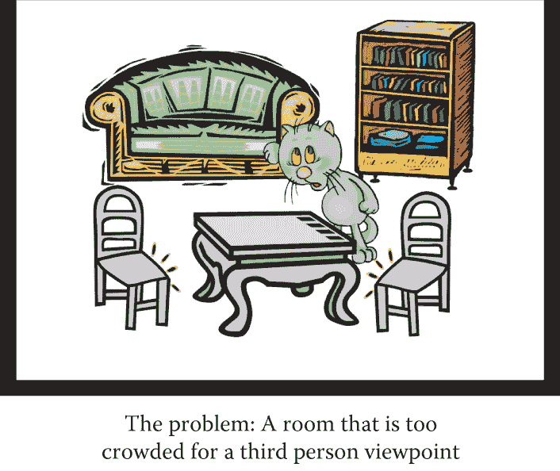

奇怪的是，大多数玩家并不认为这是第三人称化身系统的问题，而是觉得房间太小。有没有办法扭曲房间，使其在这种奇特的视角下看起来正常？

**图 21.4**

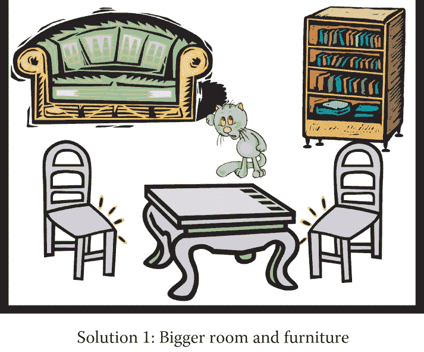

**方案 1：放大房间和家具**。如果你放大所有墙壁和家具，确实能腾出更多活动空间，但会让人产生一种化身变得像小孩一样渺小的怪异感觉，因为椅子、沙发等正常大小的物体变得太大，无法坐上去。

**图 21.5**

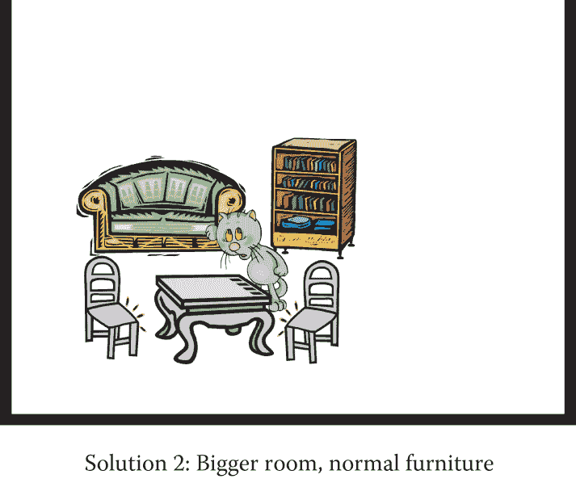

**方案 2：放大房间，但保持家具正常大小**。现在你得到了一个巨大的房间，家具挤在一起，形成孤零零的簇群。

**图 21.6**

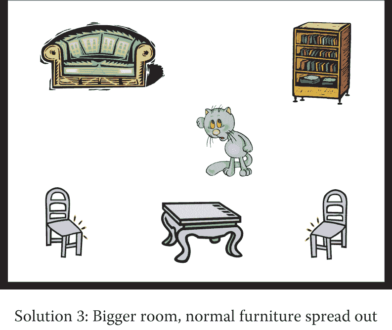

**方案 3：放大房间，保持家具正常大小，但分散摆放家具**。这稍微好一些——房间不再显得像个山洞，但房间看起来奇怪地稀疏，物体之间有着不自然的巨大间隙。

**图 21.7**

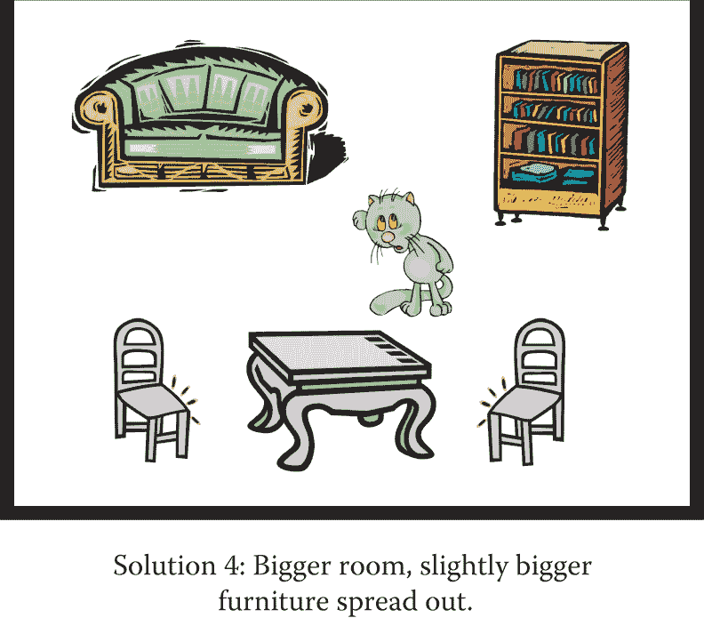

**方案 4：放大房间，稍微放大家具，并分散摆放家具**。这个方案由《马克思·佩恩》的设计师首创，效果非常好。在第一人称视角下，这看起来有点奇怪，但在第三人称视角下，它能非常好地抵消因视点远离身体而造成的失真。

## 关卡设计

我们快要到本章末尾了，还没谈到关卡设计。还是说我们已经谈了？事实上，我们一直在讲！不仅是这一章，而是贯穿全书。关卡设计师所做的一切，就是以有趣且引人入胜的方式安排游戏中的建筑、道具和挑战——即确保有适当的挑战度、适当的奖励、适当的有意义的选择，以及所有让游戏变得优秀的其他要素。关卡设计就是详细层面上的游戏设计——而且这并不容易，因为魔鬼藏在细节里。每个游戏的关卡设计都不同，因为每个游戏都不同。但如果你在设计关卡时运用所有游戏设计知识，透过多种透镜仔细审视，最佳的关卡设计选择就会开始变得清晰。

## 延伸阅读建议

* *《建筑的永恒之道》*，克里斯托弗·亚历山大著。给任何设计师的天才建议。你应该读的第一本亚历山大的书。

* *《模式语言》*，克里斯托弗·亚历山大等著。读完这本书，你将永远以不同的眼光看世界。接着读这本。

* *《秩序的本质》*，第 1-4 卷。后人将惊叹于我们在亚历山大在世时未能领会这些书的价值。最后读这些。

* *《游戏关卡设计：创造引人入胜的游戏体验》*，菲尔·科著。一本扎实的书，充满了关于游戏详细设计与文档记录的实用建议。
