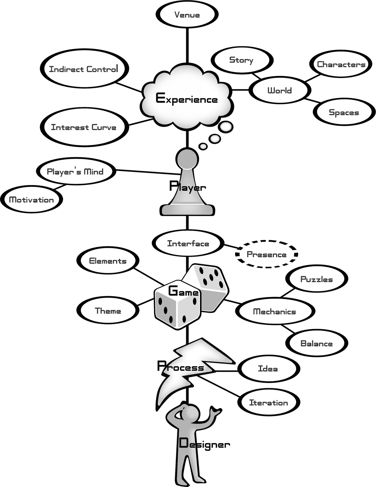
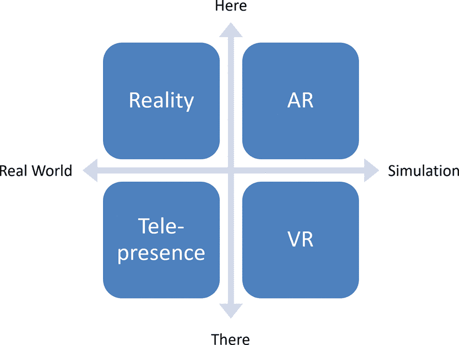

# 第二十二章：某些界面能创造临场感

**图 22.1**

你怎么知道周围环境是真实的，而不是幻觉？我们整天都在面对幻觉……照片、视频，甚至 3D 电影。视频和电影尤其具有吸引我们意识、完全调动我们思维的力量。但无论它们多么引人入胜、看起来多么逼真，我们永远不会被骗以为它们是真实的、与我们身处同一真实地点，因为我们能看清并感觉到我们的身体并不在我们所注视的图像所在的地方。我们或许会将思维投射进这些体验，但从未投射身体。但在夜晚，我们入睡做梦。在梦中，我们面对另一组幻觉。尽管逻辑上有许多漏洞，我们当下却将其接受为真实，真实到有时我们醒来时嘴角挂着欣喜的微笑，或喉咙里发出惊愕的呼喊。梦境的幻觉不同于大多数清醒时的幻觉。在梦中，我们不仅体验丰富的视觉和听觉（全凭非眼睛和耳朵），还体验嗅觉、味觉、触觉，以及某种更多的东西。在梦中，甚至我们的身体似乎也存在于大脑创造的幻觉中，因此，我们相信梦见的地点和事件是真实的。

人们往往认为虚拟现实（VR）和增强现实（AR）是设计来欺骗眼睛的技术。但更准确的说法可能是，这些是设计来欺骗身体的技术。准确说，不是欺骗身体本身，而是欺骗大脑对身体的感知。这个感知的专业术语是“本体感觉”，源自拉丁语，由 1906 年创造，意为“自我感知”，这是一种非常强大的感知。我们的身体与世界的关系定义了我们身份的很大一部分，也决定了什么是真实、什么不是真实。“掐我一下，我准是在做梦”这句话表达的观点是：我的眼睛和大脑可能被幻觉欺骗，但发生在我身体上的事是真实的。

# VR 与 AR 的真正魔力：身体在场感

VR 和 AR 的真正魔力不仅仅在于 3D 图像。自 1838 年立体镜发明以来，3D 图像就已存在。不，VR 和 AR 的魔力在于它们让我们能将身体带入模拟的世界。这一点很重要，因为令人惊讶的是，我们的思考不仅依靠大脑，还依靠身体。传统游戏（儿童游戏、竞技游戏、聚会游戏）经常涉及身体，但大多数数字游戏试图尽可能少地涉及身体。大多数视频游戏只承认你手指尖的抽动。但身体在场感是真实存在的。VR 开发者最能在玩家在其世界中的无意识行为中看到这一点。一个试图解谜、不得不停下来思考的 VR 玩家，往往会随意地倚靠在虚拟桌子或柜台上，随后突然意识到那不是真的，自己有跌倒的危险。当然，他们在理智上从未相信虚拟桌子是真实的，但其心智的某个潜意识部分发现沉浸式 3D 世界的呈现足够真实，以至于准备将虚拟物体视为真实物体。这种不为心理学所深刻理解的在场感，正是 VR 的核心魔力。

## AR 呢？

关于哪种技术将对游戏世界产生最大影响——VR 还是 AR——存在大量争论。虽然在撰写本文时，VR 因其将你传送到幻想世界的能力而显示出最大的游戏潜力，但人们常说：“我对 VR 不感兴趣——我真正想要的是 AR。”他们真正想表达的是：将身体送入虚拟世界的想法对他们没有吸引力；他们想要的是模拟物体和实体来到他们身边，在现实世界中与他们共存。这是可以理解的——将身体送往另一个地方的想法对某些人令人兴奋，但会让另一些人感到不适和脆弱。幻想之地可能怪异或可怕，而且当大脑专注于虚拟世界时，失去对现实世界中身体的感知，是一个令人不安的概念。可以说，AR 体验是将模拟带到“我身体所在的这里”，而 VR 体验是将我的身体送到“模拟所在的那里”。将真实/模拟和这里/那里置于不同轴线上，你会得到一个展示四种与现实交互方式的图表：

**图 22.2**

当然，不同的游戏体验适合不同的象限。迄今为止，“远程在场”象限中的游戏非常少，但谁知道呢？也许远程在场机器人普及的日子即将到来，从而开辟全新的游戏类别。

作为游戏设计师，我们一直在创造新现实。每个模拟都是一种新现实。值得思考我们可以创造的多种现实类型：

*   **逻辑现实** 定义因果规则。
*   **空间现实** 定义我如何在空间中移动。
*   **本体感知现实** 定义身体感觉所在的位置。
*   **社会现实** 定义我如何与他人互动。

前几章详细讨论了创造引人入胜的逻辑现实和空间现实，后续章节将讨论社会现实。但由在场感力量创造的本体感知现实，是非常特别的，也值得我们考量。在场感可能比看起来更重要。毕竟，有人说幸福的秘诀是“活在当下”，一些冥想者声称通过“日常保持在场”，生命的意义已在他们面前展开。

## 在场感的力量

当新媒介出现时，人们会从旧媒介复制东西。电影发明时，人们拍摄舞台剧，未意识到剪辑和编辑将成为新媒介的核心。互联网视频发明时，人们为其制作昂贵的 30 分钟和 60 分钟节目，未意识到人们真正想要的是短小的业余视频。同样，现在 VR 和 AR 出现了，许多人试图复制主机、PC 和移动游戏世界中行之有效的东西，未意识到 VR 和 AR 的核心是全新的东西。VR 和 AR 的核心是**在场感**。

## 六大在场感破坏因素

不幸的是，在场感并非随这些技术免费附赠。在场感是一个脆弱的幻觉，是魔术师的把戏，一次尴尬的互动就能破坏整个效果。如果你要设计一个以在场感为中心的体验，必须考虑一个令人不安的概念：在场感可能比游戏性更重要。还记得“玩具之透镜”吗？玩家乐于摆弄他们感到在场的世界中的元素，即使没有游戏性。但如果在场感被打破或中断，玩家会非常清楚地意识到自己戴着头显，甚至可能对整个体验感到恼火，无论实际游戏性有多好。这对许多游戏开发者来说是不可想象的，他们全心全意地相信游戏性永远是第一位的。但请考虑：如果你的 VR 或 AR 体验的核心在于玩家感觉身临虚拟世界，而这种在场感的幻觉被打破了，你提供的是什么体验？那些花时间在这些新媒介中工作的人，会意识到在场感的幻觉是多么脆弱，以及维护它需要付出多少努力。为此，以下是对在场感感觉构成最大威胁的六大因素。

### 在场感破坏因素 #1：晕动症

仔细想想，晕动症现象非常奇怪。一个人面对异常运动（如船、车、过山车），或运动的假象（如 IMAX 电影、VR 赛车），身体会逐渐变得恶心，最终可能呕吐。为什么是呕吐？为什么不是打喷嚏、发冷、刺痛，或其他任何生理反应？为什么会有任何反应？答案被称为“毒理学假说”。某些毒素（如某些蘑菇中的毒素）会破坏大脑神经系统，导致内耳细毛（检测加速度和旋转）的输入与视觉系统的输入不一致。这些毒素在我们的进化史上一定曾是重大问题，因为睿智的大自然已将我们的大脑编程为：当这种情况发生时呕吐，以挽救生命。问题在于毒素不是导致这种脱节的唯一方式——车上看书、乘坐旋转飞椅、进行某些 VR 体验也能产生相同效果。目前 AR 体验不太可能导致晕动症，因为它们不太可能向视野外缘提供错误信息，而大脑利用视野外缘来感知运动。但随着 AR 技术通过更宽视野推进，它也将能触发这种神经毒素控制机制。

我们能以某种方式破坏这种机制吗？某些药物（如 Dramamine）确实如此，但正如 Spalding Gray 曾指出的，关于用药物禁用特定大脑活动，“不存在精准轰炸这回事”，这些药物往往让玩家感到昏昏欲睡和脱离感。总有一天（据我猜测约 2060 年），我们可能会拥有某种纳米技术，能在无副作用的情况下安全平息晕动症回路，但在那之前，我们必须与之共存。触发晕动症的具体因因人而异，但通过遵循以下提示，可以创造无“运动不适”的优秀体验。

### 1. 保持高帧率

请将每秒 60 帧 (fps) 视为你新的绝对可接受底线。90 fps 或更高应当是你的目标。是的，我知道这很难。是的，我知道硬件平台参差不齐。我才不在乎。你的头和眼睛转动得非常快，当帧率远低于这些高数值时，你的大脑就会开始察觉到不对劲。有人持不同意见，坚称大脑甚至无法分辨如此高帧率之间的差异——电影早已确立 24 fps 绰绰有余。如果你也是这么想的，不妨做个实验。找个晚上到荧光路灯下，把球抛向空中。路灯每秒闪烁 50–60 次。如果你只盯着灯看，它似乎是持续亮着的。但如果你盯着球看，就能清晰地看到一个个独立的光脉冲。你甚至不用出门。拿起电脑鼠标前后晃动，观察光标。你的屏幕很可能以 60 fps 刷新——而你能清晰地看到光标一个个离散的位置。大脑感知运动的方式并不简单直观。在 VR 的新世界里，低于 60 fps 的帧率已不再可行。

### 2. 避免虚拟相机移动

我知道。你想做第一人称射击游戏，想做赛车游戏，想在太空来场空战。所有这些都需要虚拟相机四处疾驰，而真实相机（玩家的眼睛）却保持静止。猜会怎样？每当你在眼睛和内耳那些细小毛发之间制造脱节，玩家就会感到恶心。所以，是的，这意味着许多类型的玩法都被排除在外了。但请记住，VR 在拿走一些东西的同时，也给予了以前无法实现的新体验。哪怕只是短距离，能在环境中移动头部和身体，本身就是一种不可思议的体验，用真实的双手操控虚拟物品亦是如此。这需要发挥创意，在 VR 的限制框架内进行设计，但如果你愿意这么做，就能创造出几乎零晕动症的强烈体验。这并不是说带有空间移动的 VR 体验完全被排除——只是意味着你在创作它们时要冒险，且必须格外努力地为玩家提供舒适的体验。

### 3. 如果必须移动相机，请勿加速

你耳朵里那些细小毛发有个有趣的特性——它们只能检测加速度，无法检测速度。它们分辨不出以每小时 80 英里在高速公路上疾驰，与完美静止坐着有什么区别。它们感知的是加速和减速。上世纪九十年代，我在 DisneyQuest 为《阿拉丁的魔毯 VR 冒险》编写移动系统时，利用这一特性，将魔毯的运动编程得尽可能线性。不过仍需一定量的加速，因此一定程度的晕动症在所难免。但程度很轻，因为体验限时五分钟，大多数人能忍受五分钟轻微的虚拟运动而不感到太大不适。然而对于家庭游玩，五分钟通常不是可接受的时长。家庭玩家一次想玩 VR 超过一小时的情况并不少见，而晕动症会产生累积效应。

### 4. 隐藏边缘

你有没有坐在公交车或火车上，突然感到一阵运动感，抬头一看才发现自己的车辆根本没动，而是旁边的车在动？产生这种运动感的原因是，我们的大脑利用视野边缘来判断我们如何移动。聪明的 VR 开发者意识到，如果用通常所谓的“暗角”隐藏视野边缘，就能显著减轻运动不适感。首个商业化使用此技术的游戏是《鹰之飞翔》。这并非万能药，因为有时它会分散玩家注意力，从而破坏临场感。但在合适的时机使用——比如玩家全神贯注地朝特定地点移动时——玩家甚至不会察觉它的存在。

### 5. 少用传送

既然虚拟运动会导致晕动症，传送似乎是显而易见的移动选择——它能快速到达，且不引起晕动症——完美，对吧？遗憾的是并非如此。令人惊讶的是，传送可能成为严重的临场感破坏者。似乎你的大脑构建临场感幻觉的方式，是建立周围空间的心理 3D 模型。但这只有在你观察过那个空间时才能实现。这是个微妙的过程，但每次你按下传送按钮，都会把自己带到一个没有临场感的地方，直到你花时间观察周围环境，临场感才会恢复。因此，虽然传送能防止晕动症，但从体验上讲，它消耗的正是我们最需要保留的临场感。借用《神秘博士》的一句话，这是一种廉价且恶劣的空间旅行方式。

### 6. 无论做什么，保持地平线水平

某些运动，无论虚拟还是真实，都是触发你晕动症警报电路的捷径。以“桶滚”方式翻滚相机，让地平线在玩家眼前筋斗云般翻滚，是通往呕吐之城的最快捷径。所以——别这么做。你内耳中控制这一切的半规管是环形的，且擅长检测旋转，因此总体上应避免任何形式的虚拟旋转（相机独立于玩家头部旋转）。VR 的独特之处之一在于它允许玩家**真正地**转身——是真的！利用真实旋转让玩家环顾环境，尽可能避免虚拟旋转。

非常重视晕动症问题至关重要。它不仅会破坏你精心打造的体验，还可能产生更深远的影响。大多数人都有过因某些食物恶心的创伤经历，结果多年甚至几十年后，看到或想到那种食物仍会身体不适。大脑对毒素控制极其重视，如果玩家的潜意识认定你的游戏有“毒性”，他们余生都会避而远之，因为光是想到就会胃部不适。

#### 临场感破坏者 #2：反直觉的交互

当然，在我们创作的任何游戏中，我们都希望交互清晰直观，但在 VR 中，风险要高得多。令人困惑或违背直觉的物理交互会瞬间打破临场感。而在 VR 中，玩家交互与现实相符的重要性，远高于屏幕游戏。例如，在传统冒险游戏中，物品往往是“单任务”的：螺丝刀只能拧螺丝，别无他用。小刀只能切东西，别无他用。这是一种“钥匙与锁”的思维模式。但当临场感现象接管一切，你的身体认为虚拟世界是真实时，人们会期待丰富得多的交互深度。在 Schell Games，我们开发了一款谍战主题的 VR 游戏《我希望你去死》（*I Expect You To Die*），其中包含一个谜题，玩家需要从汽车中控台上拧下一块面板。我们在显眼处放置了螺丝刀，完全预期玩家会用它来完成此事。然而，我们发现许多玩家试图用在手套箱里找到的折叠刀来拧下面板。这让我们很惊讶，因为我们思考问题的方式太像传统的、无临场感的冒险游戏了。而我们的玩家正体验着临场感，他们觉得既然在现实世界里可能用小刀当螺丝刀，在游戏里这么做似乎完全自然。起初，这只是静默失败，但它是一个真正的沉浸破坏者。允许玩家用小刀拧螺丝将要求我们彻底改变谜题结构，所以最终我们添加了一句旁白台词：“我看过你用小刀干许多有创意的事，但我不觉得拧螺丝会在其中。”这有点像敷衍了事，仍是一个轻微的临场感破坏者，但至少它承认了玩家的尝试，并引导他们转向其他事物。其他交互我们处理得更好：用枪射击香槟瓶会将其打碎，碎玻璃可用来切东西。用打火机点燃钞票会让它燃烧。玩家喜欢将物品用于其他物品上——如果你能真实地处理这些交互，就会让他们感到愉悦。如果不能，你会提醒他们“这只是个游戏”，从而打破他们的临场感。发现这些深度交互的唯一途径是反复试玩。与其做一个交互薄弱、会破坏临场感的大游戏，不如做一个交互丰富自然的小游戏，这要明智得多。

#### 临场感破坏者 #3：强度过载

许多玩家渴望刺激和激烈的动作——这些是游戏中的重要乐趣。VR 是传递这些体验的有力方式。但一些设计师未能意识到 VR 的强度要高得多。我们大脑中有一个特殊的核团，负责关注靠近身体的物体。让某人把手放在你脸旁（用自己的手不行），你就能感觉到那个核团被激活了。传统电子游戏无法激活该核团，但 VR 和 AR 可以。我们许多最大的恐惧都涉及身体遭遇不测，VR 可用于让玩家感觉这些事真正正在发生！VR 能让你感觉身体从高处坠落，感觉溺水，感觉蜂群围绕，感觉怪物触碰你。这些体验可能令人兴奋激动，但也可能过于强烈，以至于人们想扯下头显、停止体验。一旦有人想“这太过分了——我要停下来”，你就已经失去他们了，因为他们的内心声音正像父母对孩子那样安静地重复：“这只是假的……这只是假的……”这意味着玩家的大脑正在主动对抗你如此精心试图创造的临场感。

#### 临场感破坏者 #4：不真实的音频

如果我捡起一枚虚拟硬币握在手中，翻转它查看正反面，如果它看起来很真实，我可能会真正沉浸其中。但如果我随后把它扔下，它却没有声音，我会被提醒世界是假的，我的临场感随之被摧毁。如果相反，它在鹅卵石街道上弹跳时发出逼真的“叮”和“铛”声，我的临场感就会得以维持。声音与触觉紧密相关，因此你的大脑利用听觉来判断身体的位置。换种说法，听觉即信仰。

#### 临场感破坏者 #5：本体感知脱节

本体感知不仅是你对身体位置的感觉，也是你对身体姿态的感觉；例如，你意识到自己在坐着或站着，或者一只脚交叉在另一只脚上。在屏幕游戏中，我们的本体感知无关紧要。在 VR 中，让真实身体与虚拟身体匹配是维持临场感的关键。如果你坐着玩一个涉及角色在房间内走动的 VR 游戏，你的身体会将其视为假的，临场感随之打破。仅规模差异就足以让身体困惑：如果你的物理身体是坐着的，但虚拟头部却在六英尺高处，你的身心会感知到要么你在漂浮，要么世界非常小，因为尽管你与高大的成年人平视，你的身体知道如果你站起来，你将相当于八英尺高！你的大脑知道这不可能，所以会产生周围一切都很小的奇怪感觉。

另一种本体感知脱节涉及物体穿透玩家身体——例如穿过一张虚拟桌子。玩家不喜欢虚拟物体穿透自己的身体。起初这会让人不安，因为你的身心在潜意识恐惧中挣扎，但很快它就会直接打破临场感。导致本体感知脱节最快的方式是给玩家一个他们能看见的、笨拙的虚拟身体。如果你对身体的视觉感觉与本体感觉不同（那些假手或假脚不在你真实手脚的位置），你的大脑会迅速拒绝这个现实，判定其为假。显示没有身体（不知为何，大脑不太介意这个）总比显示一个稍微错位的身体要好得多。把这看作是 VR 化身的“恐怖谷”效应。

#### 临场感破坏者 #6：缺乏身份认同

临场感是身处某地的普遍感觉。但要身处某地，你必须是某*人*。临场感与身份认同紧密交织。VR 电影制作者往往未能理解这一点。如果有人拍摄一部两人在桌旁交谈的屏幕电影，我们看起来会觉得很正常。我们习惯了屏幕媒体是一种隐形飞掠演员周围的“浮动之眼”。但如果同一部电影用 VR 拍摄，突然你的身体就“在场”了，你会开始纳闷：“为什么这两个人无视我？难道他们看不见我就在这儿吗？”当然，你在世界中的临场感会立即让你质疑自己在世界中的身份。未能解决玩家身份的问题，会不断提醒玩家他们并不真正“在那里”。

### 六大临场感构建者

虽然从体验中移除所有能找到的临场感破坏者非常重要，但这还不够。临场感不会自动发生。就像仅用燧石和火绒生火一样，临场感必须被耐心地培育和鼓励。这六种技术会有所帮助。

#### 临场感构建者 #1：手部临场感

因为 VR 和 AR 是**身体**的技术，而不仅仅是眼睛的技术，我们在这些体验中如何使用身体非常重要。而人类与世界互动的主要方式是通过双手。还记得我们对“游戏”的定义吗？“满足好奇心的*操控*。”单词“manipulate”（操控）源自拉丁语“manus”，意为“手”。看到自己的双手有一种特别的意义。“清醒梦”是指意识到自己在做梦，却能继续体验梦境的罕见经历。这对我们大多数人来说很难，因为当我们意识到在做梦时，梦境往往会迅速消失。当资深清醒梦者意识到在做梦时，他们常用的一个稳定梦境状态的技巧是盯着自己的梦境之手。看到自己的手似乎能说服大脑世界是坚实真实的。同样，仅仅观察世界的 VR 和 AR 体验，与那些你可以伸手触摸世界的体验之间，有着**天壤之别**。这种效果非常强烈，以至于 VR 开发者常提到“**手部在场感**”的力量。某种形式的手部追踪是实现手部在场感的必要条件，但还不够。最强、最好的手部在场感发生在玩家能有意义且自然地操控周围环境时。这需要大量深思熟虑的设计，以及对心智与双手关系的深刻理解。例如，当使用工具时，大脑不再思考双手——大脑会延伸到双手所持工具的尖端。精明的 VR 设计师意识到这意味着：当工具在使用时，让双手隐形是可以接受的。你能说出哪些 VR 体验使用了这个技巧，哪些没有吗？大多数玩家记不住，因为他们根本没注意到自己的手变隐形了。

## 在场感构建器

### 在场感构建器 #2：社交在场感

人类是社会性生物，我们大脑的很大一部分专门用于处理人类面部和手势。VR 和 AR 拥有创造一种特殊远程通信的力量，这种通信比基于屏幕的视频通话感觉更自然，因为它提供了他人在场的感觉。能够在 VR 和 AR 中与他人自然地说话和交流手势，是一种非常特别的体验，当连接头显的数量超过一千万时，这种体验将变得非常普遍。即使是简单的语音电话也能创造一种在场感，因为你感觉自己与那个远程的人处于一种社交空间中。通过眼神接触、看到与我处于同一空间的另一个人的手势和动作所创造的在场感，在很大程度上让那个空间和那个人显得真实……如果我们还能互相传递物体，效果会更好。

### 在场感构建器 #3：熟悉感

还记得我们说过，为了感受在场感，你必须环顾环境，以便大脑建立其内部 3D 模型吗？那只在陌生场所时成立。如果呈现给你的是一个熟悉的地点，比如汽车内饰、快餐柜台或篮球场，如果这些类型的地方对你已经很熟悉，你的大脑会在你甚至不需要环顾的情况下自动填补细节，从而快速建立在场感。正如我们讨论的，游戏中的新颖性非常重要——但在你的周围环境中给予适当的熟悉感，能带来令人惊讶的强烈在场感。

### 在场感构建器 #4：真实音频

无论你在普通游戏中通常做多少声音设计和集成，为 VR 体验做好准备要**加倍**，因为要让与物体的交互显得真实，需要多得多的声音设计工作。部分原因是空间化声音（声音来自特定位置的错觉）在 VR 中强大且重要，但也因为真实的声音非常依赖语境。声音在小房间和大房间里的回声不同。碰撞声音尤其依赖语境。硬币掉在木桌上的声音与掉在玻璃桌上的声音截然不同。在基于屏幕的视频游戏中，这种差别可能被忽略——但在 VR 中，把这些细节做对能极大地构建在场感。

### 在场感构建器 #5：本体感觉对齐

本体感觉脱节会削弱在场感，但本体感觉对齐——即你的真实身体与虚拟身体强烈对齐——能极大地构建在场感。在《I Expect You To Die》中，我们为坐姿玩家设计了游戏，因此开发了坐姿场景（坐在办公桌前、坐在车里），这极大地增强了在场感。许多游戏一直在尝试新颖的方法来提供强烈的本体感觉对齐，例如射箭游戏，你的箭存放在背部的箭袋里。为了拿新箭，你必须伸手越过肩膀去抓——这是一个非常自然且本体感觉对齐的动作。随着技术改进，足部和全身追踪成为常态，本体感觉对齐将变得更加重要，并带来更强的在场感。

### 在场感构建器 #6：喜剧

听起来很奇怪，但在喜剧世界中构建在场感比在严肃世界中容易得多。《Job Simulator》这款早期 VR 佳作的成功说明了这一点，它的内容是在各种职场环境中做滑稽任务。在卡通式的喜剧世界里，你不指望一切都正常运作。事实上，发现这个世界疯狂的规则本身就是乐趣的一部分！在《Job Simulator》早期版本中，厨房场景给玩家提供了一把刀和一些蔬菜。很自然地，玩家想切蔬菜。这在技术上是个极具挑战性的场景，因为每次切割都要创建任意大小的几何体。开发者通过允许奇怪的事情发生来避免这个问题：如果玩家试图切蔬菜，刀会意外粉碎成碎片，提供一个怪诞的喜剧时刻，从而规避了问题。在严肃世界里，这会破坏在场感，因为它太明显地不像真实世界。但在喜剧世界里，这种怪异事件只会强化这个奇怪世界的规则，从而强化玩家的在场感。

## 鼓励环顾四周

早在 1996 年，Randy Pausch 对《Disney's Aladdin Magic Carpet VR Adventure》的研究就指出，VR 新手玩家不愿转动头部环顾四周。这似乎是因为我们大多数人一生都接受过训练：基于屏幕的媒体最好坐着不动、面朝前享受。此外，创作要求玩家环顾环境的媒体是一种微妙的艺术形式，许多 VR 设计师做不对。而且，许多早期帧率低（<60 fps）的 VR 体验训练玩家保持头部静止以避免晕动症。

# VR/AR 设计与存在感

给玩家观察四周的理由至关重要，因为这有助于建立存在感——大脑会构建空间的 3D 模型。新玩家起初不会倾向于这样做。但渐渐地，你可以引导他们。《I Expect You To Die》通过将玩家置于一个他们不期望自由移动的场所来实现这一点。如果玩家能向前导航，他们就会想看向前方。如果你让他们原地不动，他们最终会开始环顾四周。《I Expect You To Die》的一个关卡发生在一辆停着的车里。玩家坐在驾驶座上。起初，他们检查面前的东西——方向盘、油门和刹车踏板。当这些不起作用时，玩家逐渐开始探索车内：换挡杆、手套箱、副驾驶座，最终他们会想知道后座有什么。大多数玩家一旦开始探索车内，都会被世界的真实感震惊。这似乎是熟悉感与环顾四周共同作用建立了存在感。如果这是一款关于开车的游戏，我怀疑存在感不会来得这么快（尽管晕动症很可能会）。

不仅要给玩家观察四周的理由（以及有趣的观察和交互对象），还应明智地给玩家深入观察事物的机会。设计师出于乐于助人，倾向于让所有东西从玩家的起始点就清晰可见。但请记住位置追踪的力量。在我们的游戏中，我们给了玩家很多理由不仅转头，还要移动头部。多个手套箱、后座上的物品、细小文字、允许物体掉落到车地板上的物理效果，甚至一个要求你前倾的视网膜扫描系统（如果你不把头移开，它会尝试用激光杀死你），这些都是我们鼓励玩家在环境中移动头部的不同方式。

## 考虑纸箱原型

大多数开发者明白，当你承担一个充满未知的游戏项目时，必须在日程中预留大量时间来应对发现和问题。VR 和 AR 项目有很多未知数，必然需要实验和适应的时间。但有趣的是：既然你在尝试模拟现实，实际上可以通过在现实中构建体验来学到很多！Shawn Patton 开创了“brownboxing”技术，即用一堆旧纸箱在现实世界中模拟 VR 场景，然后像任何纸面测试一样进行测试，让某人担任游戏主持人，告诉你当你触摸、拿起或操作不同物体时会发生什么。你不能那样测试所有东西，但你可以快速了解很多关于玩家如何想用手与场景交互、以及他们能触及什么。一旦你的 brownbox 迭代完成，测量它，交给建模师，你就会有一个优秀的第一个“whiteboxed”数字原型基础。

**FIGURE 22.3**

Shawn Patton 和 Matt Mahon 测试《I Expect You To Die》的潜艇关卡。

## 不同硬件支持不同体验

你使用的 VR 和 AR 输入设备在很大程度上定义了你创造的体验。仅使用游戏手柄的系统与使用运动追踪手部控制器的系统截然不同，后者又与追踪空手的系统截然不同。要求玩家静止站立的系统与给予玩家自由走动的系统创造的体验也大相径庭。此外，处理能力、音频传递方式等许多其他因素也存在根本差异。

极少有 VR 体验能轻松移植到各种不同的 VR 输入系统上。因此，如果你想创造一个伟大的 VR 体验，应该首先选择计划使用的输入系统，并围绕它设计游戏。是的，这意味着你的游戏可能难以移植到其他平台，但它将在你选择的平台上变得*卓越*。

还记得透明度之镜吗？这里有一个很好的搭档。

在撰写本章时（2019 年），VR 和 AR 系统才刚开始被视为严肃的游戏平台。写这一章我冒着风险，几年内这里说的一切可能都会显得愚蠢。然而，我决定分享这些想法，因为虽然 VR 和 AR 系统不太可能成为主导的视频游戏硬件形式，但它们提供的强大存在感体验让我确信，它们将在游戏设计世界中拥有永久且重要的地位。尽管它们的形式和技术将快速演变和改变，但我有信心这些平台上存在感的重要性将保持不变。

鉴于存在感深受体验的外观和感觉影响，这可能是谈论美学的好时机。
