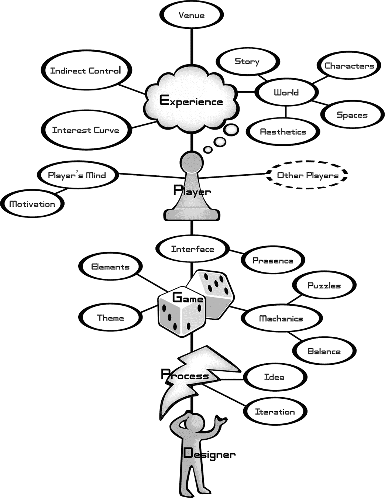

## CHAPTER TWENTY-FOUR

## Some Games Are Played with *Other Players*

**FIGURE 24.1**

### We Are Not Alone

> *值得铭记的是，整个宇宙，除了一点微不足道的例外，都是由他人构成的。*
>
> —约翰·安德鲁·霍姆斯
>
> *临终之际，从未有人感叹道：“哎呀，我真希望我能花更多时间独自与电脑为伴。”*
>
> —丹尼·伯顿·贝里

人是社会性动物。人类总是尽可能避免独处。在大多数情况下，我们不喜欢独自进食、独自睡眠、独自工作或独自玩耍。表现不佳的囚犯会被关入单独监禁室，因为虽然与危险罪犯关在同一个笼子里很糟糕，但独自一人更糟。

如果你回顾几个世纪的历史，游戏设计史也反映了这一点。绝大多数被创造出来的游戏，都是设计给玩家相互配合或相互对抗的。在计算机出现之前，单人游戏（如纸牌接龙）非常罕见。

那么电子游戏是怎么搞的？其中绝大多数都是单人体验。但为什么？是技术中有什么东西让我们想要放弃与生俱来的社交倾向吗？当然不是。事实上，趋势显而易见——每年都有更多电子游戏包含某种多人或社区成分。Facebook 游戏和异步社交手游的爆发，是人性的大规模绽放。单人游戏现象似乎只是一种暂时的异常，部分源于单人交互世界的新奇感，部分源于游戏软硬件的技术局限。如今，随着越来越多游戏平台联网并实现互联，不具备多人游戏成分的游戏再次变得罕见。技术越进步，技术新奇感越消退，电子游戏就越开始契合人类拥有了数千年的古老社交模式。

这是否意味着终将到来一个没有单人游戏的日子？绝对不会。人类有很多时候确实想独处一段时间——读书、锻炼、冥想、做填字游戏都是美妙的独处乐趣，电子游戏与这些都有共同之处。但人类倾向于花更多时间社交而非独处，从长远来看，游戏也将如此。

## 我们为何与他人同玩

> *每个人都是一扇半掩的门，通向一个属于所有人的房间。*
>
> —托马斯特兰斯特罗默

显然，与他人一起玩游戏是天性使然，事实上也是我们玩游戏的首选方式。但为什么？迄今为止在本书中，我们讨论了人们玩游戏的数十种理由：为了快乐、为了挑战、为了评判、为了奖励、为了心流、为了超越，等等。虽然其中一些因其他玩家的在场而得到增强，但没有哪一个绝对需要他人的在场。当我们与他人一起玩游戏时，我们具体在寻求什么？似乎有五个主要原因：

1.  **竞争**：提到多人游戏，竞争通常是首先浮现在脑海中的概念——且理由充分。它同时满足了我们多种需求和欲望。它一下子就能：
    *   让游戏在公平的竞技场上达到平衡（透镜 #37：*公平性* [`#C16_chapter13.xhtml#box37`]）
    *   为我们提供势均力敌的对手（透镜 #38：*挑战* [`#C16_chapter13.xhtml#box38`] 和透镜 #43：*竞争* [`#C16_chapter13.xhtml#box43`]）
    *   给我们提供有趣的问题去解决（透镜 #8：*解决问题* [`#C07_chapter4.xhtml#box8`]）
    *   满足我们内心深处的需求，即确定我们在社交圈中相对于他人的技能水平（透镜 #25：*评判* [`#C14_chapter11.xhtml#box25`] 和透镜 #90：*地位* [`#C23_chapter20.xhtml#box90`]）
    *   让包含复杂策略、选择和心理博弈的游戏成为可能，这全赖于人类对手的智慧和技巧（透镜 #39：*有意义的选择* [`#C16_chapter13.xhtml#box39`]，透镜 #34：*技巧* [`#C15_chapter12.xhtml#box34`]，和透镜 #79：*自由* [`#C21_chapter18.xhtml#box79`]）

2.  **合作**：这是竞争的对立面，是我们喜欢共同游戏的“另一种方式”。合作类游戏之所以让我们乐在其中，是因为它们
    *   让我们能参与那些单人无法完成的游戏动作并采用单人无法施展的游戏策略（例如，一对一棒球几乎毫无意义）
    *   让我们享受（推测是进化而来的）源自团队解决问题和身处成功团队中的深层愉悦
    虽然有人认为合作类游戏具有实验性质，但那仅限于玩家联手对抗自动化对手的情况。大多数合作类游戏遵循团队运动的模式，让合作的乐趣与竞争的快感同时存在。

3.  **聚会**：我们喜欢与朋友相聚，但光顾着露面并被迫定期寻找话题聊天，有时会让人社交尴尬。游戏就像美食一样，给了我们一个在一起的便利理由，给了我们共同分享的东西，给了我们一个焦点，让屋子里没人感到不自在。游戏是孩子和父母共度时光的绝佳方式，无数友谊靠着每周一局的国际象棋、高尔夫、网球、桥牌、宾果、篮球，或是最近的 *英雄联盟*、*使命召唤* 或 *Words with Friends* 得以维系。

4.  **探索朋友**：虽然有借口与朋友聚会很棒，但游戏还能让我们做另一件光靠聊天不易做到的事——探索朋友的心灵深处。交谈中，我们听到朋友对喜恶的看法，听到他们讲述自己和他人的行为。但这些都经过了朋友“他们认为我们想听什么”的过滤。而当我们与他们玩游戏时，却能窥见更接近未经修饰的真相。我们能看到他们解决问题。我们能看到他们在压力下做艰难抉择。我们能看到他们决定何时网开一面、何时落井下石。我们了解谁值得信任、谁不值得。正如柏拉图所谓：
    > “一小时的游戏，胜过一年的交谈，能让你更了解一个人。”

5.  **探索自我**：独处时，游戏让我们测试能力极限，发现我们喜欢什么、想改进什么。但当我们与他人在一起时，我们能探索自己在复杂社交情境和压力下会如何表现。朋友心情不好时，我们倾向于让着他们赢，还是无条件碾压他们？我们更倾向于与谁组队，为什么？当众失败时我们何种感受、如何应对？我们的策略为何与他人不同？我们选择模仿谁，或发现自己不自觉模仿了谁？这些问题及其他许多问题，都在我们与他人玩游戏时得到探索。这些并非琐事——它们至关重要，直抵我们自我认知和人际关系的核心。

值得注意的是，对于其中某些情况，甚至并不需要每个人都参与游戏。仅仅是观看别人玩游戏，也能建立良好的社交连接。因此，考虑如何为观众设计变得非常重要。在壁炉旁（客厅）这样的场所，这一点尤为关键，因为身边很可能有其他人，他们宁愿看电视。如果你能让你的游戏成为一场引人入胜的表演，让他们宁愿观看它——欢笑、旁观指点、帮助玩家解决难题——那你就做成了一件非常有价值的事。此外，越来越多的人通过流媒体视频远程观看游戏过程。观视角是一个容易被忽视的视角，所以我们一定要把它加入我们的视角收藏中。

多人游戏带来了一种单人游戏时不那么重要的新风险：作弊。独自作弊的玩家只是在欺骗自己。但在其他玩家之间或对抗其他玩家时作弊，则是对社交契约的实质性违背。如果作弊者被抓住，其他人会羞辱他们。这会以两种不同的方式损害你的游戏。首先，如果你的游戏存在漏洞并鼓励玩家作弊，会给玩家带来压力，迫使他们时刻警惕作弊行为。但可被作弊的游戏还面临一个严重得多的问题：如果玩家意识到作弊是可能的，却无法判断其他玩家是否在作弊，不作弊的玩家就会想退出游戏，因为他们担心不作弊就赢不了，谁愿意输给作弊者呢？这是所有类型多人和社交游戏中一个重要的视角。运用这个视角来帮助你让游戏免于作弊。

虽然多人游戏很重要，但你必须谨慎而明智地使用它，因为它可能意味着大量工作且难以控制。通常可以假设，与类似的单人游戏相比，开发一款多人在线游戏需要四倍的精力和成本。这是因为多人游戏调试和平衡难度大得多。不过，回报可能值得——前提是拥有多人游戏的理由清晰且确定。如果加入它的理由只是“因为多人游戏很酷”，你最好再仔细斟酌一下。

我们喜欢与他人一起玩游戏，有许多不同且强大的理由。还有一个比此处列出的理由更强大的原因，将是我们下一章的主题。

### 其他推荐阅读

*   **《睾酮与竞技玩法》 作者：Dan Cook**。Dan 富有深度的 Lost Garden 博客文章是见解的宝库，这篇对于开发涉及竞技玩法游戏的人尤为重要。 <http://www.lostgarden.com/2009/11/testosterone-and-competitive-play.html>
*   **《听……》 作者：Ogden Nash**。这首诗概括了多人游戏设计的真正目标。 <http://www.poemhunter.com/poem/listen/>
