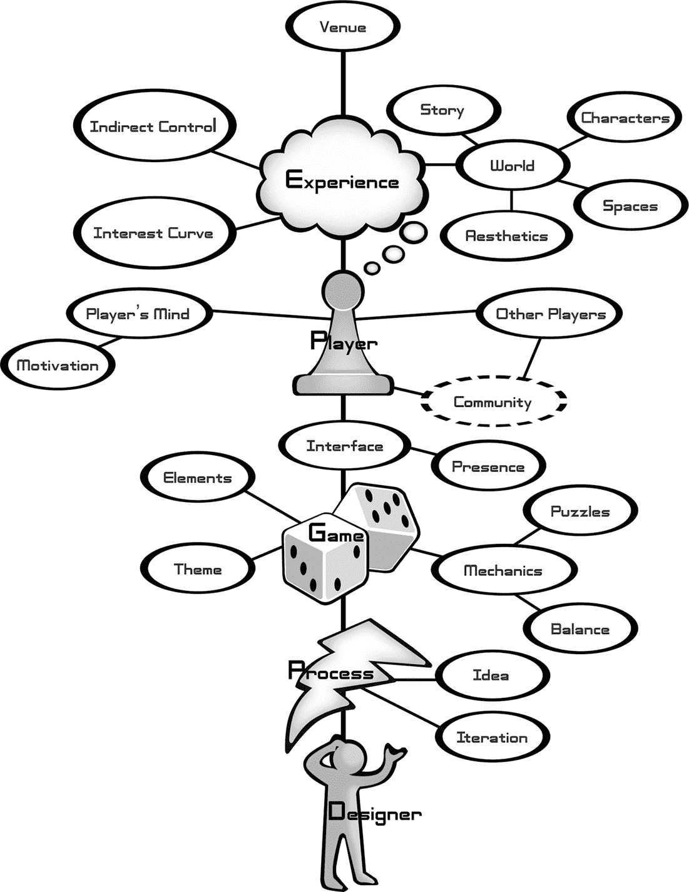

# 第二十五章

## 其他玩家有时会形成*社区*

**图 25.1**

### 不仅仅是其他玩家

游戏能激发玩家真正的热情，因此游戏周围经常会形成社区，这并不奇怪。这些社区可以是**粉丝**社区，如职业体育；也可以是**玩家**社区，如《魔兽世界》和《堡垒之夜》；还可以是**设计师**社区，如《我的世界》和《小小大星球》。这些社区可以成为非常强大的力量，通过不断吸引新玩家，将游戏的寿命延长数年。

但究竟什么是社区？答案并不简单。它不仅仅是一群互相认识或做同一件事的人。你可能每天和同一群人坐火车，但从未因此产生社区感。但你可能会与完全陌生的人产生社区感，仅仅因为你们都是同一部晦涩电视剧的粉丝。成为社区一员有一种特殊的感觉。这很难描述，但我们一旦感受到就知道了。两位旨在更好理解这种社区感的心理学家发现，它包含四个主要要素：

1.  **成员资格**：某些独特的东西能明确表明你是这个群体的一员。
2.  **影响力**：成为这个群体的一员赋予了你对某事物的权力。
3.  **需求的融合与满足**：成为这个群体的一员能为你做些什么。
4.  **共同的情感连接**：你有某种保证，能与群体中的其他人分享对特定事件的情感。

虽然这四点无疑是社区的重要方面，但我有时更倾向于设计师 Amy Jo Kim 对社区简洁的定义：一群拥有共同兴趣、目的或目标，并随着时间的推移相互了解得更深的人。

但是，作为游戏设计师，为什么你希望社区围绕你的游戏形成？主要有三个原因：

1.  **成为社区一员能满足社交需求**：人们需要感觉自己是某个群体的一部分，正如**视角 #22**：*[需求]* 所示，社交需求非常强大。
2.  **更长的“传染期”**：朋友的个人推荐是购买游戏时最具影响力的因素。游戏设计师 Will Wright 曾指出，如果我们真信游戏的兴趣像病毒一样传播，研究流行病学就很有意义。从流行病学我们知道，当传染期翻倍时，感染人数可能增加十倍。在我们的例子中，“感染疾病”意味着购买游戏。但游戏的“传染期”意味着什么？它是指玩家对游戏如此兴奋，以至于不断向认识的每个人谈论它的那段时间。成为游戏社区一员的玩家可能会“保持传染性”很长时间，因为游戏会成为他们生活中更深层的一部分，给他们提供大量谈资。Will 一如既往地走在时代前沿，病毒式传播现在被视为社交和手机游戏成功的关键组成部分。
3.  **更多游戏时长**：通常玩家因游戏的乐趣开始玩，但长期坚持下来却是为了社区的乐趣。我曾和一位朋友及其大家庭一起去山里度假，路上他跟我讲他们家族喜欢玩的一种纸牌游戏。晚饭后，全家聚在一张大桌子旁玩牌，我非常渴望了解这款陌生游戏到底有什么吸引他们的地方。他们解释了规则，简单得令人难以置信——基本上就是往右传牌，直到所有牌按顺序排好。几乎不需要做决定，也不需要任何技巧。有时甚至很难说谁赢了。我非常失望，但环顾全桌，只有我一人如此。其他人一边玩一边谈笑风生——我突然意识到，游戏是否完美并不重要——重要的是它让他们留在桌旁，享受彼此的陪伴，让他们的手忙碌但思想自由。一款能孕育社区的游戏会被玩很久，无论其其他品质多么欠缺。如果你的游戏经济成功依赖于订阅续费、销售续作或微交易，社区让人们想玩得更久这一事实就变得非常重要。

### 打造强大社区的十个技巧

社区是复杂的，涉及许多相互关联的心理现象，但你可以做一些基本的事情来帮助在你的游戏周围培育一个社区。

## 社区贴士 #1：培育友谊

在线友谊的概念看似简单。就像现实中的友谊，只不过是在线上，对吧？但我们真正理解友谊的本质吗？我们该如何将其转化为游戏环境？要与另一个人建立有意义的在线关系，需要三个条件：

1.  **交谈的能力**：这听起来显而易见。但令人惊讶的是，大量在线游戏被创造出来时，却不提供玩家互相交谈的能力——设计师希望某种非语言交流能通过游戏过程发生，并认为这就足够了。这是不够的。为了形成社区，玩家必须能够自由地彼此交谈。

2.  **值得交谈的对象**：你不能假设所有玩家都想互相交谈，就像你不能假设公交车上的陌生人会混在一起一样。社交媒体的爆发向我们表明，大多数人主要对与以下对象建立联系感兴趣：(1) 他们的朋友和 (2) 名人。你必须清楚地了解你的玩家想和谁交谈，以及原因。这在很大程度上取决于你的受众群体。成年人通常想和能理解他们问题的人交谈。青少年通常寻找异性成员或比他们现实朋友更有趣的人。而儿童通常对陌生人没什么兴趣——他们更愿意与现实生活中的朋友社交。但理解这些基于年龄的概括是不够的——你必须了解你的游戏特有的社交类型。你的玩家寻求的是竞争对手？合作者？助手？简短的聊天还是长期的关系？如果玩家找不到他们感兴趣的交谈对象，他们会迅速流失。

3.  **值得交谈的话题**：前两点可以通过一个好的聊天室来满足。能培育社区的游戏会给玩家提供源源不断的话题。这可以来自游戏玩法本身（像《Words with Friends》（词语拼拼）和《Draw Something》（你画我猜）这样的游戏，每次玩都有不同的内容），游戏固有的策略深度（例如，策略讨论是国际象棋社区的主要话题），或者来自随时间引入的事件或规则变更（大型多人在线游戏 [MMOs] 和集换式卡牌游戏 [CCGs] 中典型的谈资）。人们常说“好的在线游戏更像是社区而非游戏”，但这并不完全正确。好的在线游戏必须在社区和游戏之间保持可靠的平衡。如果游戏不够有趣，社区就没有话题可聊。另一方面，如果你游戏的社区支持不够好，玩家会享受游戏，但最终会离去。

很多游戏设计初衷就是和朋友一起玩。但在你的游戏里结交新朋友呢？友谊有三个不同的阶段，如果你希望友谊萌芽并存续，你的游戏必须为每个阶段提供良好的支持：

*   **友谊阶段 1：破冰**。在两个人成为朋友之前，他们首先必须相遇。第一次见面总是尴尬的。理想情况下，你的游戏应提供一种方式，让人们能轻松找到他们可能喜欢的那类朋友，并提供某种方式与他们互动，这种方式社交压力低，但允许他们稍微表达一下自己，以便他人了解他们是怎样的人。

*   **友谊阶段 2：成为朋友**。两人“成为朋友”的那一刻是神秘而微妙的——但几乎总是涉及双方都关心的话题的交谈。而在游戏中，这种交谈通常关乎两个朋友刚刚共同经历的游戏体验。在激烈的游戏体验后给玩家提供互相聊天的机会，是鼓励友谊形成的最佳方式之一。在游戏中创建一个交友仪式是个好主意，比如邀请另一位玩家加入你的“好友列表”。

*   **友谊阶段 3：保持友谊**。认识人并成为朋友是一回事——保持友谊是另一回事。要与某人保持朋友关系，你必须能再次找到他们以延续友谊。在现实世界中，这主要取决于朋友双方，但在在线游戏中，你需要给人们提供某种方式让他们能再次找到彼此。这可能通过好友列表、公会，甚至令人难忘的昵称。无论什么有效就行！但你必须做点什么，否则你的游戏就会错失友谊的力量，而这是维系社区的粘合剂。

请记住，不同的人对不同类型的友谊感兴趣。成年人通常最有兴趣结交志同道合的朋友，而孩子们更有兴趣和现实生活中的朋友一起玩游戏。友谊对社区至关重要，对游戏本身也是如此，它值得拥有自己的透镜。

## 社区贴士 #2：将冲突置于核心

在线游戏先驱 Jonathan Baron 指出，冲突是所有社区的核心。运动队之所以成为强有力的社区，是因为他们与其他队伍存在冲突。家长教师协会之所以成为社区，是因为他们为争取更好的学校而斗争。一群古董车狂热者在对抗熵增的共同斗争中成为了社区。幸运的是，冲突是游戏的天然组成部分。但并非所有游戏冲突都能产生社区。例如，纸牌接龙中的冲突对创建社区帮助不大。你游戏中的冲突必须要么激励玩家证明他们比其他所有人都强（对抗其他玩家的冲突），要么是那种人们合作时更有可能解决的冲突（对抗游戏本身的冲突）。许多游戏在这两种冲突上都建立了社区：例如，集换式卡牌游戏的核心是成为你社区中最强的玩家，但它们的策略如此复杂，以至于玩家花费大量时间分享和讨论策略。同样，《我的世界》既关于合作建造，也关于成为社区中最强的玩家。

## 社区贴士 #3：利用架构塑造你的社区

在一些社区里，人们并不真正认识邻居。在另一些社区里，人人相识，整个社区都有归属感。这是因为人不同吗？不。这通常是社区设计方式的副作用。设计为可步行（且有值得去的有意义目的地）的社区，给了邻居交流的机会。而有很多死胡同的社区往往没有太多过境交通，所以当你看到有人路过，很有可能你认识他们。换句话说，就有频繁的机会反复见到并交谈与同一群人。在线世界可以支持这些相同的设计特性，部分通过好友列表和公会，但也部分通过创建人们可能反复相遇且仍有时间交谈的地方。许多 MMOs 都有玩家倾向于随意聚集和聊天的区域——这些区域通常位于许多玩家去处理重要游戏事务的必经之路上。

## 社区贴士 #4：创建社区财产

当你能在游戏中创造出不只是由单个玩家拥有，而是由多个玩家共同拥有的事物时，这能真正鼓励玩家结成团体。例如，也许在你的游戏中，没有任何单个玩家买得起一艘飞船，但一个团队可以联合起来共同拥有它。这个团队实际上瞬间就变成了一个社区，因为他们必须频繁沟通并彼此友善。《Eve Online》（EVE Online）的巨大成功很大程度上建立在社区财产之上。你创造的财产不必如此有形——例如，公会的地位就是一种社区财产。

## 社区贴士 #5：让玩家表达自我

自我表达在任何多人游戏中都至关重要。虽然玩家确实可以通过游戏策略和游玩风格来表达自我，但为什么要止步于此呢？毕竟，你正在创造一个幻想世界，玩家可以在其中成为他们想成为的任何人：为什么不让他们表达出来呢？丰富、富有表现力的角色创建系统深受在线游戏玩家的喜爱。允许玩家传达情绪、选择文字颜色和样式进行显示的聊天系统也是如此。在从《英雄联盟》到《Color Switch》等游戏中，购买“虚荣物品”是变现的关键部分。

玩家表达不限于在线游戏——请考虑一下“猜词游戏”或《绘画猜词》中的表达力。游戏设计师 Shawn Patton 曾创作过一款桌面游戏，主题是关于一个孩子试图在不弄脏自己的情况下玩得开心。每当你弄脏了，就必须把泥土涂在你的角色卡上。玩家们非常享受编造弄脏的故事，并给角色涂色以配合故事。即使是《大富翁》也允许玩家表达自我——虽然它只有 2–8 名玩家，但游戏提供了 12 种不同的棋子，因为这是确保玩家有机会表达自我的简便方法。

自我表达极其重要，却容易被忽视。请保留这枚透镜，以便你记得让玩家表达自我。

## 社区贴士 #6：支持三个层级

重要的是要意识到，在设计游戏社区时，你实际上是在为不同经验水平的玩家设计三款独立的游戏。有人可能会争辩说层级更多，但至少有这三个：

### 第 1 层级：新手

初次接触游戏社区的玩家往往会感到不知所措。他们还没有被游戏本身挑战——他们只是在努力学习如何玩游戏。从某种意义上说，学习玩游戏对他们来说就是游戏本身——因此你有义务设计这个学习过程，使其尽可能富有回报。如果你不这样做，新手会在真正入门前就放弃游戏，这将显著限制你的受众。让新手感到有回报并与游戏产生联系的最佳方法之一，是创造让他们能与经验丰富的玩家进行有意义互动的情境。一些资深玩家出于自身乐趣喜欢欢迎和教导新手，但如果你的玩家中倾向于这样做的不够多，那么为什么不给予游戏内奖励来鼓励帮助新手呢？《Battletech》的一个在线版本曾以一种有趣的间接方式做到这一点——资深玩家扮演将军角色，必须招募自己的军队。新手受宠若惊地被邀请，并进一步荣幸地被安排在行动最激烈的地方——前线，那是资深玩家学会避开的地方。即使新手通常会被屠杀，但从某种意义上说这是双赢——将军们得到了大量的“炮灰”，而新玩家则立刻尝到了行动的滋味。

### 第 2 层级：玩家

玩家已度过新手阶段。他们完全理解游戏，并沉浸在游戏活动和探索如何精通游戏中。投入游戏的大多数设计都针对这一群体。

### 第 3 层级：元老

对于许多游戏，特别是涉及某种“升级”系统的在线游戏，总会达到一个游戏本身不再有趣的地步。大多数秘密已被发现，许多游戏乐趣已被榨干。当玩家达到这种状态时，他们倾向于离开，寻找有新秘密的新游戏。然而，一些游戏设法通过给这些元老玩家一款完全不同的游戏来留住他们——一款适合他们的技能水平、专业知识和对游戏奉献程度的游戏。留住元老有巨大的好处，因为他们通常是你游戏最积极的宣传者，而且他们是关于你游戏的专家，往往能教你如何改进它。一些典型的“元老游戏”包括以下内容：

#### 更高难度的游戏

通常，特别是在 MMO（大型多人在线游戏）中，中后期游戏是关于朝着目标逐步、清晰地进步：目标达成后，然后呢？有时会向高等级玩家呈现一种不同类型的游戏，难度大得多——事实上难到没有人能持续稳定地精通它。在《Toontown Online》中，具有新的平台式玩法和新战斗系统的“Cog Headquarters”区域服务于此目的。一些游戏让你从士兵晋升为将军。其他游戏则从让你对抗电脑变为让你对抗其他玩家。增加更高难度游戏的方法有很多——但你始终面临一个问题：当元老厌倦了它该怎么办？

#### 治理特权

一些游戏给予元老玩家特殊的责任层级，例如决定游戏规则。许多 MUD（多用户地牢）给予元老玩家此类权力。这是让元老保持参与感并感到特别的好方法，尽管如果你给他们太多控制权，也会有一定风险。集换式卡牌社区通常有正式系统，经验丰富的玩家可以通过考试成为游戏比赛的官方裁判。

#### 创作的乐趣

真正热爱一款游戏的玩家往往幻想以新方式扩展它，特别是当他们对它感到厌倦时。那么，为什么不让他们这么做呢？《模拟人生》和《上古卷轴 5：天际》等游戏通过让玩家创作和分享自己的内容，建立了强大的社区。许多元老达到这样一个地步：他们只是偶尔玩玩游戏，但花费大部分时间创作新内容。对他们来说，新游戏变成了一场地位竞赛：他们能否成为最受欢迎、最受尊敬的设计师？

#### 公会管理

当玩家组建团体时，这些团体通常受益于有组织者。元老通常会自发做这件事，但如果你给他们一套强大的工具来帮助管理公会，这项活动对他们会更有吸引力。

#### 教学的机会

正如现实世界中许多专家享受教学机会一样，游戏专家也是如此。如果你能给他们许可和鼓励，其中一些人会乐于担任新手的大使和普通玩家的向导。一些在线游戏，如《Entropia Universe》，给予愿意教学的元老特殊身份，标注他们为专家和教师，这通常是他们非常引以为豪的。

这三个层级听起来可能工作量很大，但实际上往往可以相当简单地实现。例如，每年复活节，我的社区都会为所有住在那里的孩子举办寻蛋活动。很自然地，他们发现分三个层级进行游戏效果最好：

### 第 1 级——2-5 岁（新手）

这些孩子在与大孩子分开的区域寻找彩蛋，因此无需担心要与他们竞争。所有彩蛋都放在显眼处——根本谈不上隐藏。不过，对这些学龄前儿童来说，仅是穿梭空间、发现彩蛋并捡起它们，就已是不小的挑战。彩蛋数量充足，也没有霸道的大孩子来破坏乐趣。

### 第 2 级——6-9 岁（玩家）

这些孩子在广阔区域内享受标准的寻蛋活动，彩蛋藏在有时颇具技巧性的地方。彩蛋数量足够每个人分配，但孩子们仍需动作迅速、仔细寻找。

### 第 3 级——10-13 岁（长者）

这些大孩子被赋予藏彩蛋的任务。他们为这份工作感到非常自豪——他们觉得既有挑战又有趣，因承担责任而感到荣幸，并享受相较于小孩子所拥有的地位。他们也常乐于给遇到困难的孩子提供提示。

### 社区建议 #7：强迫玩家相互依赖

仅靠冲突无法创建社区。冲突情境必须是那种通过获得其他玩家的帮助来化解冲突的情境。大多数视频游戏设计师都习惯于创建单人独自即可游玩的游戏，即使是在多人游戏中也是如此。其逻辑大概是：“我们不想排斥那些更喜欢独自游玩的玩家。”这是一个合理的顾虑。但当你创建一款单人独自就能精通的游戏时，你就降低了社区的价值。反之，如果你创造出玩家必须沟通互动才能成功的情境，你就赋予了社区真正的价值。这通常涉及一个违反直觉的步骤：从玩家那里拿走某些东西。手机游戏 *Spaceteam* 就是典型例子——每个玩家都拥有任务所需的关键信息，但只有其他人能根据这些信息采取行动——这保证了持续的沟通。在 *Toontown Online* 中，我们团队决定了一条不同寻常的规则：玩家在战斗中无法自我治疗——只能治疗其他玩家。大家非常担心有些玩家会觉得这条规则令人沮丧，但实施后，似乎并非如此。相反，它很好地达成了目标。它强迫人们沟通（“我需要‘小飞侠加油’！”）并鼓励他们互相帮助。还记得 透镜 #80：**帮助** 吗？人们渴望帮助他人——帮助另一个人是一种深层的满足感，即使只是帮他们赢一场视频游戏。但我们往往因害怕提供帮助会冒犯对方而不敢伸出援手。但如果你能创造玩家需要彼此帮助且能轻松请求帮助的情境，其他人就会迅速伸出援手，你的社区也会因此变得更强大。

### 社区建议 #8：管理你的社区

如果你认为社区对游戏体验很重要，你需要做的不仅仅是交叉手指祈祷它会自行形成。既然游戏现在可以根据玩家反馈持续更新，玩家也期待这一点。你需要创建合适的工具和系统，让玩家能够沟通和组织，你可能还需要专业的社区管理者，在设计师和玩家之间建立并维护强有力的反馈循环。把这些管理者想象成园丁。他们不直接创建社区，但他们播下种子，通过观察和满足社区的特定需求来鼓励其成长。这是一个培育、倾听和鼓励的角色。Amy Jo Kim 之前提到的著作《网络社区建设》对此有极好的建议，讲述了如何通过在“亲力亲为”和“放手不管”之间找到恰当的平衡，来谨慎地管理在线社区。

### 社区建议 #9：对他人的义务感力量强大

在澳大利亚部分原住民地区，意外送礼被视为无礼，因为这会造成回礼的负担。这或许是文化上的极端例子，但对他人的义务感在所有文化中都根深蒂固。如果你能创造让玩家互相许下承诺（“周三晚上 10 点见面打巨魔”）或彼此欠下人情（“那个治疗术救了我一命！我欠你一个人情！”）的情境，玩家会对此非常重视。许多 *World of Warcraft*（魔兽世界）玩家表示，对公会的义务感是促使他们定期游戏的最强大动力之一。这部分是因为他们想在公会中享有高地位，但往往还有另一个原因——避免低地位。赠礼机制是 Facebook 游戏大规模病毒式传播的主要推手。正如我们在 透镜 #25：**判断** 中所见，没有人想被其他玩家负面评价，而无法兑现承诺是让人对你另眼相看的最快方式之一。精心设计的玩家间承诺系统，是让玩家定期游玩并帮助建立强大社区的绝佳途径。

### 社区建议 #10：创建社区活动

几乎所有成功的社区都以定期活动为锚点。在现实世界中，这些可以是会议、派对、比赛、练习或颁奖典礼。在虚拟世界中，情况大致相同。活动对社区有多重作用：

*   它们给玩家带来期待。
*   它们创造共同体验，让玩家感觉与社区联系更紧密。
*   它们标记时间节点，给玩家留下回忆。
*   它们保证了与他人建立联系的机会。
*   知道活动频繁举办，会让玩家想不断回来查看即将到来的活动。

玩家通常会自发创建活动，但为什么不自己创建一些呢？对于在线游戏，这可以像为玩家设定一个简单目标并发送群发邮件一样简单。

## 破坏者的挑战

破坏行为是任何基于社区的游戏，尤其是在线游戏，最终都必须面对的一个问题。对某些玩家来说，戏弄、欺骗和折磨其他玩家比游戏本身更有趣。如果你还记得 Bartle 的四种玩家类型分别对应红桃、黑桃、方块和梅花（第 9 章：**玩家**），那么破坏者就是大王（Joker）。

回顾 透镜 #90：**地位**，破坏者认为自己的地位高于其他玩家，因为他能通过破坏一场他们在乎但他不在乎的游戏，从而对他们施加权力。

游戏设计师能对破坏行为做些什么？一些游戏制定了“反破坏政策”，将破坏者封禁——这是处理问题的一种方式，但会造成不得不监管破坏行为，然后还要维护一个“法庭”来判断哪些是故意滥用、哪些只是“闹着玩”的丑陋局面。更好的想法是避免那些让破坏行为变得容易的游戏系统。这些是破坏者最容易利用的系统：

*   **玩家对战（PvP）**：某些游戏（如第一人称射击游戏）将玩家对战（PvP）作为游戏的核心。但如果你制作的游戏并不以 PvP 为核心玩法，你应当仔细思考为何要支持它。虽然它能带来刺激感，但也会让玩家时刻感到受到威胁、缺乏安全感。在没有 PvP 限制的游戏中，典型的捣蛋鬼伎俩是先与玩家交朋友，花足够的时间建立信任，然后突然杀死玩家并窃取其物品栏。你或许会辩解说这是“游戏的一部分”，但通常捣蛋鬼这么做并非为了在游戏中获取优势——他们只是为了享受折磨他人的乐趣。归根结底，这会造出一个玩家不敢与陌生人交谈的环境——这能留下什么样的社区？如果你真的认为 PvP 是游戏的重要组成部分，你应该考虑将其限制在特定区域或特定情境中，从而使其难以被用作捣蛋的机会。

*   **偷窃**：在许多游戏中，物品赋予玩家巨大的力量。任何夺走他人这种力量的机会对捣蛋鬼都极具吸引力。这可能通过扒窃，或是在战斗后“拾取”玩家遗物来实现。被偷窃会让玩家感到受到侵犯，因此捣蛋鬼热衷于此。除非你打算制作一款让捣蛋鬼快乐、让其他人沮丧的游戏，否则你大概率不想支持玩家互相偷窃的功能。当然，偷窃不仅仅指偷物品。一些游戏存在“抢杀”问题。例如，《无尽的任务》（*EverQuest*）初版中，只有对敌人造成最后一击的玩家才能获得经验值。捣蛋鬼会养成站在战斗旁边的习惯，等待强力怪物濒死时偷偷补上最后一击，“窃取”所有经验。同样，极少数玩家将此作为有效策略，但许多人纯粹是为了捣蛋的快感。建立让玩家难以夺取不属于自己的东西的系统，是增加捣蛋难度的一种方法。

*   **交易**：如果你给玩家交易物品的机会，就为不公平交易埋下了伏笔。如果玩家对将获得的物品拥有完全的信息，就很难利用该系统进行捣蛋。但如果存在任何歪曲交易物品的方式，捣蛋鬼就会扑上来，将其作为进行不公平交易的机会。

*   **猥亵言语**：捣蛋鬼乐此不疲的一件事就是在其他玩家面前使用令人震惊、不安的语言。如果你为此设置过滤器，这对捣蛋鬼来说就会变成一个“寻找绕过过滤系统方法”的游戏，而且如果你使用“黑名单”（禁止特定词汇）、“白名单”（仅允许特定词汇）或任何其他自动聊天过滤器，他们几乎总能找到办法，因为人类大脑在模式识别方面远胜于任何机器。阻止此类捣蛋行为最成功的系统，是将自动过滤器与玩家举报恶劣行为的系统相结合。语音聊天让这个问题变得更难，但随着语音识别技术的兴起，情况开始有所改善。有趣的是，Xbox One 上的《NBA 2K14》会在麦克风拾取到脏话时判罚“技术犯规”。另一个限制猥亵捣蛋的好技巧来自于使用 `Lens #63` (`#C18_chapter15.xhtml#box63`)：`反馈` (`#C18_chapter15.xhtml#box63`)。牢记猥亵言语对捣蛋鬼而言是一种游戏，你可以通过不给他们任何关于脏话过滤是否生效的反馈，来剥夺这种游戏的乐趣。只让发送者自己看到脏话，而将消息适当过滤后再发送给其他玩家。他们仍能找到击败该系统的方法，但这需要更多工作，也少了许多乐趣。

*   **堵路**：最简单、最恼人的捣蛋行为之一就是挡住道路，让玩家无法到达目的地。解决方案包括：确保碰撞系统允许玩家相互穿过；创建足够宽的门道，使单个玩家无法堵住；允许玩家推开其他玩家。在《图恩小镇在线》（*Toontown Online*）中，我们选择了最后一种方案。但即便如此，捣蛋鬼也利用上了！既然玩家可以互相推挤，找到一个“挂机角色”（玩家离开键盘），将其慢慢推下街道并推入战斗，就成了一个流行的恶作剧。

*   **漏洞**：捣蛋鬼最大的乐趣莫过于发现游戏系统中的漏洞，从而做一些本不该做的事。如果捣蛋鬼能在战斗中断线以剥夺其他玩家获得珍贵宝物的机会，他们就会这么做。如果他们能通过在角落跳上下跳两小时偶尔让服务器崩溃，他们就会这么做。如果他们能在公共场所摆放家具拼出猥亵词汇，他们就会这么做。如果他们找到窃取资源的方法，他们肯定会这么做。任何能让他们破坏或骚扰他人的行为，都会让他们感到强大和重要，尤其是当其他玩家不知道如何做到时。你必须时刻警惕这些漏洞，并在它们出现时小心地移除。处理此类问题正是制作在线多人游戏如此艰巨过程的原因之一。

### 游戏社区的未来

几个世纪以来，游戏社区一直是地球生活的重要组成部分，主要通过体育队伍，无论职业还是业余。随着我们步入互联网和社交媒体时代，新型游戏社区也变得愈发重要。在这个新时代，一个人的网络身份变得重要且极度私人。选择网络昵称和身份已成为儿童和青少年的重要成人礼。大多数创建这些身份的人将终身保留它们。二十年前创建昵称的大多数人至今仍在使用同一个，且无意更改。将这一点与“最具表现力的在线体验来自多人游戏世界”这一事实相结合，我们很容易想象这样一个未来：玩家在年幼时为游戏创建的化身，将随着成长成为其个人和职业生活的一部分。正如如今人们常对特定运动队保持终身忠诚，也许玩家童年加入的公会将影响其余生的个人社交网络。当玩家去世时，这些网络身份和社交网络将何去何从？也许它们会以某种形式在线陵墓中被纪念，又或许我们的化身将比我们长寿，传给子孙后代，赋予未来的后代一种与祖先奇妙连接的方式。这是一个创造在线游戏的激动人心的时代，因为我们发明的新型社区可能成为人类文化中永恒的元素，延续几个世纪。

### 延伸阅读推荐

*   《网络社区建设：成功在线社区的秘密策略》（*Community Building on the Web: Secret Strategies for Successful Online Communities*），作者 Amy Jo Kim。本书略显陈旧，但它仍是我所知道的理解在线社区本质的最佳资源。
