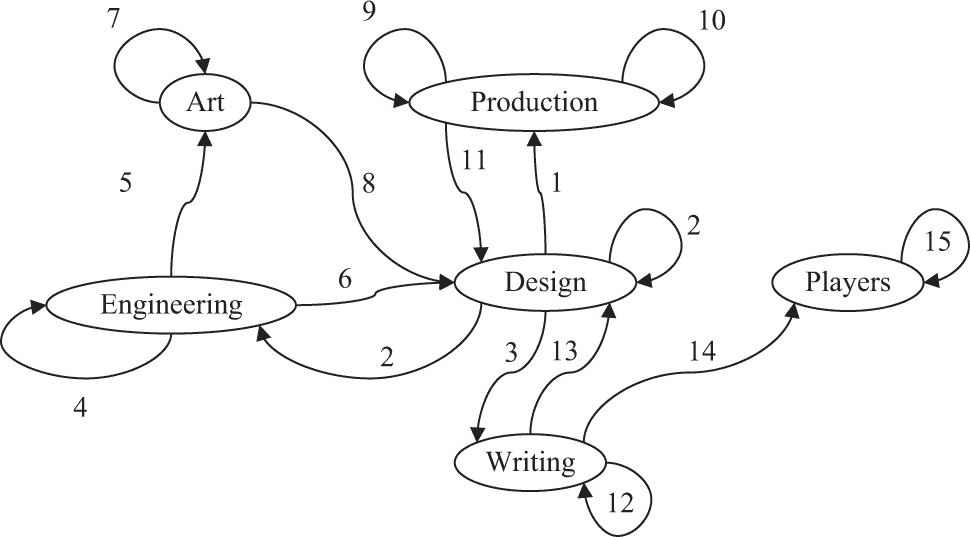

# 第二十七章

## 团队有时通过*文档*进行沟通

**图 27.1**

### 游戏设计文档的迷思

许多新手游戏设计师和其他梦想家对游戏设计过程如何运作有一个有趣的设想。由于不了解“循环法则”，他们相信游戏设计过程涉及一位天才游戏设计师独自坐在键盘前，敲出一份光荣而完美的游戏设计文档。当这份杰作完成后，只需将其交给一支称职的程序员和艺术家团队，等待他们将这个闪耀的愿景变为现实。“如果只有，”沮丧的想成为设计师的人会想，“我能找到游戏设计文档的正确格式，我就能成为专业游戏设计师了！我满脑子都是点子——但没有这个神奇的模板，我就无法设计游戏。”

我必须非常清楚地说明这一点，所以我将使用非常大的字体。请仔细听：

**神奇的模板并不存在！**

它从未存在过，将来也不会存在。任何告诉你相反的人要么是傻瓜，要么是骗子。即使这种东西确实存在，也不清楚它是否有帮助。考虑一下设计师 Jason VandenBerghe 关于游戏设计文档的看法：

> *GDD（游戏设计文档）的麻烦在于，它们在你写下的那一刻字面上就已经过时了。设计文档是你关于什么能让你的游戏变好的当前理论的表达……但在你亲眼看到这些理论在实践中运作之前，你无法知晓。不幸的是，我们天生倾向于把正式文档当作规格说明、脚本或蓝图来对待。它们不是——它们是理论。当你有一份文档，一些人认为它是计划，一些人认为它是理论，一些人认为它是蓝图时，祸患就滋生了。小团队可以通过大量的人际沟通克服这些不一致……但大团队将会困难得多。*

这是否意味着文档不是游戏设计的一部分？不——文档是游戏设计非常重要的一部分。但文档因游戏而异，因团队而异。要理解你游戏的文档的正确结构，你必须首先了解它们的目的。

### 文档的目的

游戏文档只有两个目的：**记忆** 和 **沟通**。

#### 记忆

人类的记忆力很糟糕。游戏设计将包含成千上万个重要决策，这些决策定义了游戏如何运作及其背后的原因。你很有可能无法全部记住它们。当这些绝妙的想法还清晰地留在脑海中时，你可能会觉得它们不可能被遗忘。但两周和两百个设计决策之后，甚至连最巧妙的解决方案也很容易被遗忘。如果你养成记录设计决策的习惯，就能省去重复解决同一个问题的麻烦。将设计过程从我有限的工作记忆转移到文档中，有助于我更好地思考——在纸上或屏幕上展开构思，能帮我充实创意点子。

#### 沟通

即使你拥有完美的记忆力，关于游戏设计的决策也必须传达给团队中的许多其他人。文档是实现这一目标的非常有效的方式。正如我们在第 25 章：*团队*中讨论的那样，这种沟通将是一场对话，因为一旦决策被写在纸上，总会有人发现其中的问题，或想出改进的办法。文档能让更多人的思维更快地参与到设计中，从而更快地发现并修复游戏设计中的弱点。如此多的人需要查阅和修改这些文档；不难理解为什么 Google Docs 已成为编写和更新游戏文档的标准方式。

### 游戏文档的类型

既然文档的目的是为了记忆和沟通，那么你需要的文档类型就取决于什么需要被记住、什么需要被沟通。极少有游戏只靠一份文档就能满足所有必要用途——通常创建几种不同类型的文档更合理。有六个主要群体需要记住和沟通不同的事项，每个群体都会产生自己特有的文档类型。

**图 27.2**

上图展示了游戏设计团队中一些可能的记忆与沟通路径。每一条箭头可能代表一份文档，也可能代表多份文档。让我们看看这六个群体分别是什么，以及它们可能创建哪些文档。

#### 设计

1.  **游戏设计概览**：这份高层级文档可能只有几页。它通常主要面向管理层编写，以便他们了解这款游戏是什么、面向谁，而无需深入过多细节。概览文档有助于整个团队把握游戏的宏观蓝图。设计师 Stone Librande 给出了极好的建议：每款游戏都应该能用一张海报上的图表来解释，说明整个游戏是如何组合在一起的。

2.  **详细设计文档**：这份文档详细描述了所有游戏机制和界面。它通常有两个用途：一是让设计师记住他们想出的所有细节构思；二是将这些构思传达给必须将其编码实现的工程师，以及需要让它们看起来美观的美术师。由于这份文档很少被“外人”看到，它通常是一团糟，只包含足以引发讨论并防止重要想法被遗忘的细节。它往往是最厚的文档，且很少能保持更新。项目进行到一半时，它往往会被完全抛弃——此时游戏本身已包含大部分重要细节，未包含在内的细节通常通过非正式方式交流，如电子邮件或简短的备忘录。不过，在项目开始时，找到适合你设计文档的形式很重要。在大多数情况下，拥有许多详述游戏各个子系统的小文档，比只有一份巨大的文档要好得多。设计师 Rich Marmura 说得很好：“我对 GDD（游戏设计文档）的理念是根据我合作的团队来量身定制。GDD 不仅是我整理思路的地方，也必须是团队成员获取信息和明确方向的地方。虽然 GDD 可能保留一套通用的核心结构，但其大部分结构和风格会随游戏而变化。正如没有两个完全相同的团队或游戏，也不应有两份完全相同的 GDD。”

3.  **故事概览**：许多游戏需要专业作家来创作游戏中的对话和旁白。这些作家通常是外包的，且往往远离核心团队。游戏设计师往往有必要创建一份简短文档，描述游戏中将出现的重要背景设定、角色和事件。作家们经常对此做出回应，提出有趣的新想法，从而改变整个游戏设计。

#### 工程

4.  **技术设计文档**：通常，电子游戏包含许多复杂的系统，它们与游戏机制无关，却关乎如何将事物呈现在屏幕上、如何通过网络发送数据，以及其他棘手的技术任务。通常，工程团队之外没人关心这些细节，但如果工程团队不止一个人，将这些细节记录在文档中往往是合理的，这样新成员加入时就能理解整个系统应如何运作。与详细设计文档一样，这份文档很少能在项目过半后保持更新，但编写它对于架构必要系统和启动编码工作往往至关重要。

5.  **流水线概览**：电子游戏工程中极具挑战性的工作，很大一部分来自于如何正确地将美术资源整合进游戏。美术师通常必须遵守一些特定的“该做什么和不该做什么”，以确保美术资源能在游戏中正确显示。这份简短文档通常由工程师专门为美术团队编写，越简单越好。

6.  **系统限制**：设计师和美术师往往完全不清楚他们所针对的系统能做什么、不能做什么（或者他们假装不知道）。对于某些游戏，工程师会发现创建文档以明确不应逾越的限制很有用——例如屏幕上同时出现的多边形数量、每秒发送的更新消息数量、屏幕上同时出现的爆炸数量等。通常这些信息并非那么绝对明确，但试图确立这些限制（并将其书面化）能节省大量后续时间——而且有助于促进关于创造性解决方案的讨论，以突破这些限制。

#### 美术

7.  **美术设定集**：如果多位美术师要共同为一个项目工作，以创造统一、一致的视觉风格，他们就必须有一些准则来维持这种一致性。“美术设定集”就是提供这些准则的文档。这些内容可能包括角色设定图、环境范例、色彩运用范例、界面范例，或任何定义游戏中各元素外观的其他内容。

8.  **概念美术概览**：团队中有许多人需要在游戏构建完成前，就了解游戏长什么样。这就是概念美术的任务。但单靠美术图通常讲不清故事——将其放在设计文档中往往最合理，因此美术团队常与设计团队合作，制作一组图像，展示它们在游戏设计语境下的外观和手感。这些早期图像会出现在各处——在游戏设计概览中、详细设计文档中，有时甚至在技术文档中，以展示技术力求实现的视觉效果类型。

#### 制作

### 撰写文档

9. **游戏预算**：虽然我们都希望能“一直做游戏直到完成”，但游戏行业的经济现实很少允许这样做。通常，团队需要在完全弄清要构建什么之前，就给出开发游戏的成本估算。这份成本估算通常通过一份文档（通常是电子表格）得出，文档试图列出完成游戏所需的所有工作，并附带时间估算，进而换算成金额。制作人或项目经理不可能独自凭空得出这些数字，因此他们通常会与团队的各个部门紧密合作，使估算尽可能准确。这份文档往往是最早创建的文档之一，因为它用于帮助为项目争取资金。优秀的项目经理会在整个项目过程中持续更新这份文档，以确保项目不会超出分配的预算。

10. **资产追踪器**：无论是用简单的电子表格还是更正式的系统，你都需要追踪已创建了什么以及它们处于什么状态。这适用于代码、游戏关卡、美术资源、音效与音乐以及设计文档。资产追踪的一个非常重要的方面是审批：正确的人员是否批准了每个资源？

11. **项目进度表**：在管理良好的项目中，这份文档将是更新最频繁的。我们知道游戏设计与开发的过程充满了惊喜和意外变更。尽管如此，某种形式的规划是必要的，理想情况下，规划至少能按周进行调整。一份优秀的项目进度表文档会列出所有需要完成的任务、每项任务的耗时、每项任务的截止日期以及负责人。希望这份文档能考虑到这样一个事实：单个人每周工作不应超过四十小时，以及某些任务必须等到其他任务完成后才能开始。有时这份进度表保存在电子表格中，有时则在更正式的项目管理软件中。在中型或大型游戏项目中，保持这份文档的更新很容易成为一份全职工作。

### 玩家

12. **故事设定集**：虽然人们可能会认为游戏的故事完全由项目中的编剧（如果有）决定，但通常项目中的每个人都会为故事贡献有意义的修改。引擎程序员可能会意识到某个故事元素在技术上难度太大，从而提议修改故事。美术人员可能会有一个编剧从未想象过的全新故事部分的视觉构想。游戏设计师可能会有一些游戏玩法概念的想法，需要修改故事来配合。一本规定了在这个故事世界中什么可能、什么不可能的故事设定集，能让团队中的每个人更容易贡献故事创意，最终这会造就一个更强大、与美术、技术和玩法完美融合的故事世界。

13. **剧本**：如果游戏中的 NPC 要说话，他们的对话必须有来源！这些对话通常写在剧本文档中，该文档要么独立存在，要么作为详细设计文档的附录。游戏设计师审查所有对话至关重要，因为对话内容很容易与游戏玩法规则不一致。

14. **游戏教程与手册**：电子游戏很复杂，玩家必须通过某种方式学会如何游玩。游戏内教程、网页和印刷手册是通常的方式。这些文本很重要——如果玩家无法理解你的游戏，他们怎么能享受它？你的游戏设计细节很可能会持续变更直到开发的最后一刻，因此重要的是要确保有人持续检查这些文本，以确保它们与游戏实现仍然保持一致。

15. **游戏通关攻略**：开发者不是唯一制作游戏文档的人！如果玩家喜欢一个游戏，他们会自己写文档并发布在网上。研究玩家为你的游戏所写的内容，能让你详细了解玩家喜欢和不喜欢什么，哪些部分太难，哪些太简单。当然，等到玩家攻略写出来时，往往为时已晚，无法修改你的游戏——但至少下次你会知道！

再次强调，这些文档不是魔法模板——根本不存在魔法模板！每个游戏都不同，在记忆与沟通两方面都会有不同的需求，你必须自己去发掘。

### 那么，从哪里开始呢？

你要简单开始，就像你开始设计游戏时那样。从一份文档着手，里面是你想在游戏中包含的创意的粗略要点列表。随着列表增长，你脑海中会浮现关于设计的问题——这些问题至关重要！把它们记下来，别忘了！“完善你的设计”主要意味着回答这些问题，所以你不想丢失这些问题。每当你满意地回答了一个问题，就记下这个决定以及做出该决定的理由。渐渐地，你的创意、计划、问题和答案列表会增长，并自然地归纳成几个板块。持续记下你需要记住和需要沟通的事情。在你意识到之前，你就会拥有一份设计文档——不是基于魔法模板的，而是围绕你独特游戏的独特设计有机生长出来的。

### 延伸阅读推荐

* **《游戏设计日志》** 作者：Daniel Cook。Dan 的 Lost Garden 博客中的这篇佳作，为陈旧的设计文档问题提供了一个极佳的解决方案。
* **《单页设计》** 作者：Stone Librande。Stone 在 GDC 2010 上的这个演讲一夜之间改变了游戏行业。对所有人来说，这显然是创建设计概览的最佳方法，因此它一夜之间成为了行业标准。演讲幻灯片可在此找到：[`www.stonetronix.com/gdc-2010/`](http://www.stonetronix.com/gdc-2010/)
