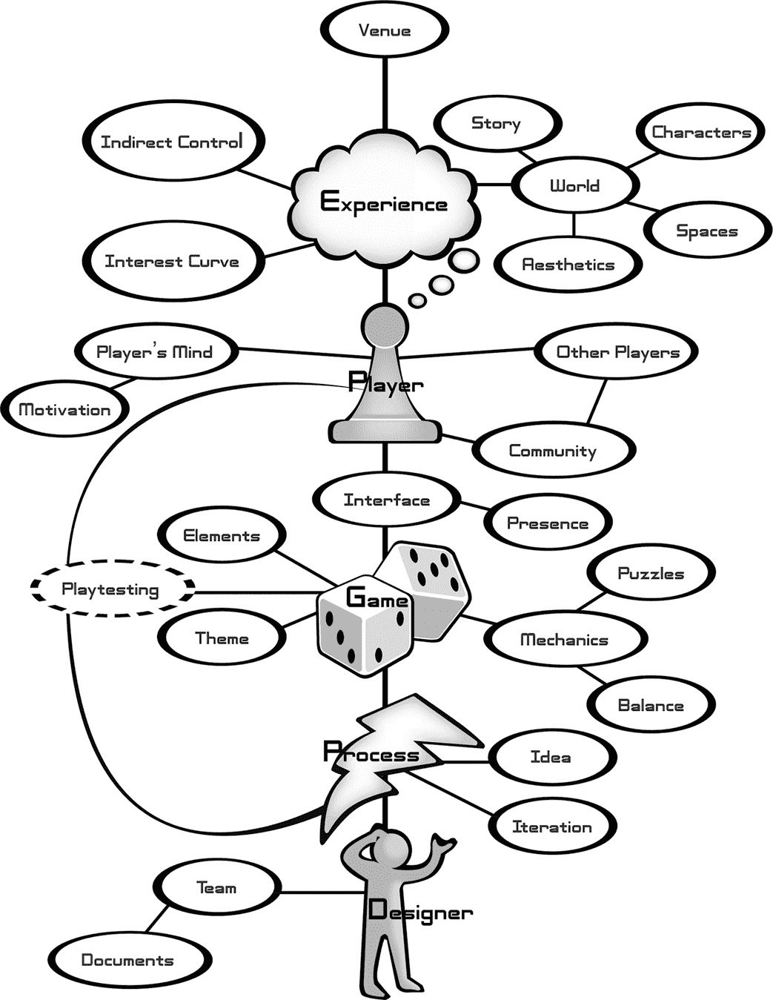

## 第二十八章：好游戏是在试玩中创造出来的

**图 28.1**

### 试玩

**图 28.2**

在开发游戏时，很容易对玩家体验产生幻想，想象它会有多棒。试玩对于敲响警钟、迫使你解决那些一直拖延的棘手问题至关重要。在深入讨论之前，我想区分四种不同类型的测试（焦点小组、QA 测试、可用性测试和试玩）：

1. **焦点小组**：这个词常让专业设计师闻之色变。它指邀请潜在玩家参与访谈，了解他们的喜好，通常是为了判断他们是否喜欢公司正在考虑的一个游戏创意。焦点小组在合适的语境下（特别是在决定定义明确的功能的相对优先级时）非常有用，但它们名声不好，因为它们经常组织得很糟糕，并被用来扼杀管理层害怕的创意。

2. **QA 测试**：QA 是“质量保证”。这种测与游戏有多好玩毫无关系，完全关乎寻找 Bug。

## 3. 可用性测试

这关乎确定你的界面和系统是否直观且易用。这两点对于一款令人愉快的游戏是必要的，但还不够。当有人建议引入可用性专家让你的游戏更好玩时，请记住这一点。

## 4. 试玩测试

区别于前三种测试，试玩测试旨在让人们来玩你的游戏，以查看它是否能产生其设计初衷的体验。虽然其他三种测试类型都有用且重要，但本章将重点关注设计师最关心的测试类型：试玩测试。

### 我可怕的秘密

我现在要承认一件令人极度尴尬的事。多年来，我一直试图假装情况并非如此，但无法回避。我不喜欢谈论这件事，因为它让我成为一个伪君子，并让我作为游戏设计师的资格受到严重质疑。

然而，我写这本书的目标是阐述游戏设计的真实面貌，而非某种理想化的梦想版本。所以，请尽量不要过于苛责我。

**我讨厌试玩测试。**

试玩测试能在还有时间修复时尽早发现问题吗？是的。试玩测试能建立团队对为正确受众制作正确游戏的信心吗？是的。试玩测试对于制作一款好游戏至关重要吗？是的。试玩测试让我充满了无法思考的强烈恐惧吗？是的，是的，是的！

这完全是一种羞辱。我知道试玩测试对我的游戏有益，不仅是有益，而且是必要的。但当真正进行试玩测试时，我会找各种借口逃避。首先，我拖延组织试玩测试。一旦组织起来，我又找借口不去现场。当我真的在现场时，我会找理由不直接观察，被附近的任何琐事分心。我清楚这些倾向，并拼命对抗，但对试玩测试的恐惧依然存在。

为什么？我怕什么？很简单。我怕人们不喜欢我的游戏。我本该超脱于此，我知道。但我做不到。当你制作游戏时，你会倾注一切：心血、灵魂、梦想、血汗与泪水。你努力制作的游戏会成为你的一小部分。让人们接触它然后拒绝它，真的很痛。别骗自己——这迟早会发生。

让人们讨厌你的作品，大概是游戏设计师最痛苦的部分之一。而试玩测试就像一张雕刻精美的请柬，上面写着：

> *诚挚邀请您*  
> *来告诉我为什么我很烂*  
> *带个朋友来——提供茶点*

试玩测试必须如此不舒服吗？是的。试玩测试的全部意义在于让你明白：一些你完全满意的决定，其实完全是错的。你需要尽快发现这些问题，趁还有时间采取行动。

也许试玩测试对你来说很自然。也许你不怕别人嘲笑你的作品。如果是这样，恭喜！你的客观视角将在试玩测试中成为巨大优势。但如果你像我一样恐惧并厌恶这些环节，只有一件事可做：克服它。人们要么喜欢你的游戏，要么不喜欢。如果喜欢，很好；如果不喜欢，也很好！你有机会问他们为什么不喜欢，从而加以修复。放下恐惧，拥抱试玩测试，因为它是让游戏变得更好的绝佳机会。

每次试玩测试由六个关键问题定义：Why、Who、When、Where、What 和 How？

### 试玩测试第一问：为什么？

还记得在 第 8 章：迭代 中我们讨论的吗？每个原型都是为回答一个问题而设计的。试玩测试是一种原型——不是游戏的原型，而是游戏体验的原型（这是我们最关心的！）。如果你组织试玩测试时没有具体目标，很可能浪费时间。你在组织试玩测试时的问题越具体，收获就越大。

你可能希望试玩测试回答数百万个问题。最明显的一个——“我的游戏好玩吗？”——是不够的。通常，你希望问题尽可能具体。例如：

- 男人和女人玩我的游戏的方式不同吗？
- 孩子比成人更喜欢我的游戏吗？
- 玩家理解如何游玩吗？
- 玩家想玩第二次吗？第三次？第二十次？为什么？
- 玩家觉得游戏公平吗？
- 玩家会感到无聊吗？
- 玩家会感到困惑吗？
- 玩家会感到沮丧吗？
- 是否存在主导策略或漏洞？
- 游戏是否有隐藏 Bug？
- 玩家自己发现了什么策略？
- 游戏哪部分最好玩？
- 游戏哪部分最不好玩？
- 应该用“A”键还是“B”键跳跃？
- 第三关太长了吗？
- 芦笋谜题太难了吗？

这些只是一些激发思考的想法。我经常发现，使用本书中的各种透镜是提出好试玩测试问题的绝佳方法。

准备一份你希望试玩测试回答的问题清单，是规划试玩测试的绝佳第一步，因为在你确定“为什么”（即“我们为什么要进行这次试玩测试？”）之前，无法回答谁、哪里、什么和怎么。

### 试玩测试第二问：谁？

一旦你知道为什么要进行试玩测试，就可以决定测试对象。选择谁完全取决于你想学到什么。最可能的是，你想选择目标受众中的人。但即使如此，也有选择。以下是一些常见类别：

1. **开发者**

   首先有机会试玩你游戏的是开发者，所以我把他们列在第一位。

   - **优点**：开发者就在那里！他们可以玩很多次、玩很久，并给出大量有意义、深思熟虑的反馈。此外，你不必担心他们签署保密协议（NDA），因为他们已经知道游戏的所有机密信息。
   - **缺点**：开发者离游戏太近了——比任何真实玩家都近——这会扭曲他们对游戏的看法。一些“设计专家”会告诉你，让参与游戏制作的人试玩是危险的，不应该这样做。这种极端立场意味着你可能会错过一些有价值的见解。最好让开发者试玩，但对他们的说法打个折扣听。

2. **朋友**

   接下来尝试游戏的通常是开发者的朋友和家人。

   - **优点**：朋友和家人很容易找到，交谈也很自在。如果他们在试玩结束后想到好主意，你大概率还能听到。
   - **缺点**：你的朋友和家人不想伤害你的感情——毕竟他们要经常和你打交道。这可能导致他们在不喜欢某事时隐瞒真相。此外，既然他们已经喜欢你，他们会倾向于喜欢这个游戏——他们会努力去喜欢，这在现实世界中不会发生。

3. **专家玩家**

   每个类型都有其“专家”——硬核玩家，他们玩过你正在制作的那类游戏的所有变体。这些人喜欢来试玩仍在开发中的游戏，因为这能提升他们的“专家”资历！

**专家玩家**

*   **优点：** 这些专家玩家玩过许多，甚至所有与你正在制作的游戏类似的游戏，他们能运用专业术语和具体例子，详细说明你的游戏与同类游戏相比如何。
*   **缺点：** 正如只有少数食客是美食家一样，只有少数玩家是“游戏发烷友”。专家玩家往往更加挑剔，要求比普通玩家更复杂、更困难的游戏玩法挑战。许多游戏因过度迎合硬核发烧友这一小众受众的精英口味而毁于一旦。`The Sims Online` 原本有望大获成功，最终却以惨败收场。原因似乎在于它过度针对最硬核的玩家进行了调整，这些玩家对创作内容的热情远高于体验内容。

**纸巾测试员**

*   **优点：** 理想的测试条件通常包括从未见过你的游戏的人。业界喜欢称他们为“鲜肉”或“纸巾测试员”（意指像面巾纸一样，只能用一次）。从未见过你游戏的人会以全新的视角审视它，并注意到你已习以为常的问题。对于旨在确定易用性问题、传达问题或“初始吸引力”问题的测试，这些测试员非常有价值。
*   **缺点：** 游戏通常会在多个阶段被反复游玩。如果你只用“纸巾测试员”测试游戏，就有制作出一款首次吸引力强但玩几遍就腻的游戏的风险。

同样，你找谁测试完全取决于你想了解什么。将测试员与你试图回答的问题相匹配，是获得有意义结果的唯一途径。几乎每款游戏在设计过程的某个阶段都会结合上述几类测试员进行测试——关键在于在正确的时间安排合适的测试员，以尽可能彻底地回答最多的问题。

## 测试问题之三：何时测试？

很容易找借口不进行测试……主要借口是“游戏还没准备好”。但你测试得越早，就越早知道你的游戏是否走在正轨上。无论游戏处于哪个阶段，你都可以进行测试：

### 创意前期
召集一组你想为其制作游戏的目标人群组成焦点小组。“你们喜欢什么类型的游戏？你们想看到什么类型的游戏？”

### 初步概念
“我们正考虑制作一款这样的游戏……你们怎么看？”

### 纸质原型
正如我们在第 8 章：**迭代**中讨论的，纸质原型制作是测试新游戏概念的一种非常高效的方式。但不要把所有纸质游戏的乐趣都留给开发者——邀请测试员来看看他们有多喜欢你这款勉强可玩的游戏。

### 白盒原型
太好了！你把游戏代码写出来了，但里面还没有任何美术资源。没关系！提前告诉玩家注意事项，然后让他们玩起来。反正人们对丑陋的游戏反馈更诚实！

### 可运行原型
太棒了！你有了一个功能性的游戏原型！尽可能晚地在流程中持续进行测试。

### 成品/已发布游戏
游戏完成了……现在测试太晚了，对吧？错！如今全是关于`Games as a Service`——玩家期望游戏发布很久后仍能获得修复和新功能。从这个意义上说，发布你的游戏就像是有史以来最大规模的测试！

希望你已经明白，你可以在开发过程的任何时候测试你的游戏。但是……实际上你应该多久进行一次测试？游戏设计师兼测试大师肖恩·帕顿对这个问题有一个简单的回答：

> `WUBALEW`

当然，`WUBALEW`代表`When Useful, But At Least Every Week`。这听起来可能很多，但养成每周测试游戏的习惯能确保你永远不会在没有获得真实反馈的情况下走得太远。保持固定的时间表会让它变成常规。一旦你坚持每周测试一段时间，你会惊讶以前没有它是怎么过来的。

## 测试问题之四：在哪里测试？

正如很大程度上取决于你游戏的场地（见第 3 章：**场地**），测试的场地也至关重要。以下是几种不同的选择：

1.  **在你的工作室**（或你制作游戏的任何场所）
    *   **优点：** 开发者都在。你在。游戏在！所以在工作室测试对你来说超级方便。此外，这给团队中的每个人一个机会，观察真实玩家玩游戏的情况。
    *   **缺点：** 你带来的测试员可能感觉不完全舒服。他们身处陌生环境，除非有私密房间，否则他们可能不敢在别人工作时尽情玩乐。如果你在工作室举办测试，应千方百计让它尽可能舒适。你最不想要的是不敢出声、不敢玩得开心、不敢说真话的测试员。让测试员带朋友来会有帮助。

2.  **在测试实验室**
    *   **优点：** 一些（实际上出奇地少）大型游戏公司设有专门的测试实验室。此外，一些第三方公司会在专为测试设计的特殊实验室里为你测试游戏。实验室是为测试而设计的！它可能拥有你梦寐以求的一切：单向镜、对准测试员的摄像头、懂得提问并做详细记录的测试专家，甚至可能还有精心挑选的合适测试员群体！
    *   **缺点：** 这类东西通常非常昂贵。但如果你负担得起，这笔投资很可能物超所值。

3.  **在某个公共场所**
    *   **优点：** 可以是购物中心、大学校园活动、像`PAX`或`Indiecade`这样的游戏展，甚至是街角的一张桌子。通常成本不高，如果你找到合适的场地，能获得许多测试员。当`Schell Games`需要测试其`Daniel Tiger’s Neighborhood`游戏时，我们与`Pittsburgh Children’s Museum`达成协议，定期直接在博物馆里测试，这提供了源源不断的 3-5 岁儿童及其父母——正是我们所需要的。
    *   **缺点：** 你可能很难找到“合适”的测试员，即你目标人群中的那些人。此外，如果场地里有其他活动，测试员可能会分心，无法全神贯注。

4.  **在测试员家中**
    *   **优点：** 人们买了你的游戏后会在家里玩——为什么不让他们现在就在那里玩？你有很好的机会在真实条件下，在游戏的自然栖息地看到它被游玩。你的测试员很可能会叫朋友来，你有机会看到通过你的游戏发生的真实社交互动。
    *   **缺点：** 你的测试可能受到限制。可能只有一两个设计师能到场观察，并且在给定的时段内你可能只能测试少数人。你可能还需要自带特殊硬件，或者至少花时间配置机器以运行你的原型软件。

5.  **在线**
    *   **优点：** 为什么要把测试局限在物理宇宙中？许多人可以在许多不同配置的机器上测试你的游戏。如果你需要回答的问题涉及游戏的压力测试或了解大规模多人游戏玩法，这可能是你的最佳选择。

*   缺点：游戏测试的数量是以质量为代价的。虽然可能有很多人在玩，但如果你不和测试者在同一个房间，就无法获得同等深度的洞察。此外，如果你试图对游戏保密，一旦提供下载，就很难做到这一点。而且，第一印象很重要，所以如果你要把未完成的版本放到网上，就需要限制玩家群体。幸运的是，一些在线平台（如 Steam）正在创建安全空间来放置游戏的测试版，以帮助控制玩家预期。

你究竟选择在哪里测试，完全取决于你的测试试图回答的问题。在考虑重要的“为什么？”问题时选择测试地点。通常，最简单的想法是最好的——请看设计师 Curt Bererton 的这个故事：

> 我们在一次内部测试（针对一款 Facebook 游戏）中做的一件事，我发现非常有效，就是在游戏下方放一个高约 2-3 行文本的文本框。文本框里只写着“告诉我们如何让我们的游戏变得更好”，每次游戏只能发送一条消息，发送后文本框就会消失。邮件会发送到一个邮件列表，团队中的任何人都可以注册查看玩家输入的内容。
>
> 这个简单的文本字段在内测和公测期间效果惊人，我们甚至在正式运营中保留了它，面向可调整的小比例玩家（以及所有付费用户），这样我们每天能收到约 30 条消息，想看的时候就看。你可能会以为会收到很多辱骂之类的内容，但几乎所有反馈质量都非常高。我们发现了大量 Bug、用户体验问题，以及单纯的好点子。每当我们推送新版本时，我们会特别仔细地查看。顺便说一句，如果你同时发送一些汇总玩家状态数据（他们在教程或游戏进度中的位置）以及平台规格（版本、内存等），除了让你时刻掌握社区脉搏外，还能帮助查找 Bug。

### 游戏测试第五问：测什么？

“测什么？”我的意思是“在游戏测试中你会寻找什么？”有两类东西需要寻找。

#### 第一类“测什么”：你知道自己在找什么

这些源自你的“为什么？”清单中的问题。希望你设计游戏测试时能寻找这些问题的答案（这正是你列出它们的原因！）。在规划测试时，确保你有办法获得清单上每个问题的某种答案。如果游戏中有部分与这些问题无关，考虑制作一个特殊版本跳过这些部分以节省时间。如果无法通过单次测试回答所有问题，考虑进行多次小型测试以覆盖你需要了解的所有内容。

#### 第二类“测什么”：你不知道自己在找什么

任何人都能找到他们知道要找的东西——但只有真正善于观察、学会深度倾听玩家的设计师，才能发现他们不知道自己在找的东西。关键在于保持警惕，留意惊喜。要在游戏测试中感到惊讶，你必须已有关于会发生什么的想法：玩家会以特定方式攻略第二关，他们会在第三关开始时感到兴奋，等等。每当发生任何非同寻常的事情，无论好坏，都要准备好立即跟进，并找到理解它的方法。女生比男生更喜欢你的游戏，而你原本预期相反？你的反派让人发笑，而你以为他会很吓人？玩家对你认为不重要的东西感兴趣？他们在争论你从未考虑过的策略？弄清楚原因！即使你不是在测试这些，也要利用这个机会了解你自以为已懂的一切的真相。从理解这些惊喜中获得的洞察，是游戏测试这棵树上结出的最甜美果实。

### 游戏测试第六问：怎么测？

所以你已经搞清了为什么要游戏测试、观察谁、在哪里举办、甚至测什么。这些都是很好的准备工作，但只有当你决定怎么去做时，理论才联系实际。

#### 你真的需要在场吗？

有一种观点认为，让游戏开发者在测试时在场是危险的。危险在于他们对游戏的情感投入会导致他们鼓励玩家忽略缺陷，并用“内部人士视角”“感染”玩家。这种危险非常真实。如果你无法在游戏测试中保持客观，并妥善约束自己的行为以便让测试者保持“纯真”，你绝对不应该在场。如果是这种情况，真遗憾，因为亲自参加游戏测试能学到的东西，远比仅看调查数据或观看录像视频多得多。所以，尽管一些设计理论家可能不同意，我的建议是找到方法抑制这些腐蚀性冲动，以便你能亲自到场。

#### 开场白该告诉他们什么？

某些测试中，你完全不告诉玩家任何事——让游戏自己说话，特别是当你想看他们能否自行摸索时。但对于大多数游戏测试，你需要告诉玩家一些事让他们开始。这样做时要极其小心——游戏开始前几句不当的话就可能毁掉整个测试。例如，如果你告诉玩家他们的目标是打败邪恶的克洛诺斯，有些玩家可能会立刻开始找他，结果错过了如果你不说他们本会发现的重要细节。因此，你应该仔细记录你在开场对测试者说的话，以防产生意外后果。提前写下来是个好主意，这样你能确保以相同方式准备所有测试者。

当然，经过几轮测试后，你可能会发现需要修改开场白以澄清某些事项。而这正是游戏测试的一个巨大附带好处。当你连续进行多场游戏测试时，你会发现自己逐渐在调整给玩家的指令，这里删个词，那里加个短语，直到得到一段非常清晰高效的开场白。把它记下来！这段开场白可以成为你游戏内教程的基础。许多游戏教程很烂——用这种方法创建的教程很可能自带卓越光环。拥有一个真正让玩家感到受欢迎和被关怀的游戏内教程，能给你的游戏留下极好的第一印象。

#### 你该看哪里？

大多数参加游戏测试的人倾向于看玩家看的地方。如果是电子游戏，这意味着看屏幕。这讲得通，因为这样你能看到玩家看到的东西。但这不是我看的地方。我游戏测试时大部分时间都在看玩家的**脸**。当然，我会瞥一眼屏幕获取背景，但主要看脸，因为我不只想看玩家在**做**什么，还想看他们在做时**感觉**如何。他们的面部表情提供了大量数据，这些数据永远不会出现在赛后访谈或调查问卷中。

我是在当街头艺人时学会这样做的。当你表演街头节目时，唯一的收入就是演出结束时传帽子收集的钱。所以，如果你想那天晚上有顿饱饭吃，确保你招来的观众保持愉悦就变得至关重要。经过练习，我很快发现我能迅速“读懂”人群的情绪，并相应地调整我的表演——拉长他们喜欢的环节，快速略过让他们感到无聊的环节。当我开始制作视频游戏时，我惊讶地发现自己正在阅读玩家游戏时的情绪，并决定游戏该如何改变以提升玩家情感体验的质量。这是我们每个人都具备的能力——只是需要练习。

当然，如果我们的眼睛能同时无处不在：盯着游戏、玩家的脸，甚至他们的手，看他们是否按预期使用控制器，那将是最好的。而有了现代视频技术，你可以全程观察！设置几台不同的摄像机，输出到一个分屏图像中，能同时记录游戏画面、面部表情和手部动作，这样你稍后就能回顾这三者是如何相互关联的。

## 游戏过程中还应收集哪些数据？

亲自观察并记录游戏过程的视频能提供大量有用信息，但你还可以收集其他信息。稍作规划，你就能找到方法在每次游戏过程中记录重要游戏事件的日志。如果你的游戏是数字化的，你可以自动记录所有这些内容；如果不是，你只需在这些重要事件发生时仔细记录笔记即当然，什么构成“重要事件”因游戏而异。以下是一些你可能想要收集的数据示例：

*   玩家在角色创建器中花了多长时间？
*   击败反派用了多少次攻击？
*   玩家的平均得分是多少？
*   哪些武器使用最多？

游戏能自动收集的数据越多，这些数据对你就越有用。在过去几年里，对于任何创建 MMO 或免费游戏的人来说，建立一套严格的分析系统并辅以内容管理系统，已成为一种必要，以便持续进行调优和测试。这种新型的“定量设计”有其危险性——它可能导致设计平庸，并让设计师不敢信任自己的直觉；但如果你能克服这一点，它就是一门微妙的艺术，能给你理解玩家行为带来新机会。

## 我会在游戏中打扰玩家吗？

这是一个微妙的问题。在游戏中打扰玩家，也许是想问问他们在做什么，这冒着干扰他们自然游戏模式的风险。另一方面，在恰当的时机提出恰当的问题，可能会给你带来原本无法获得的洞见。你或许会争辩说，最好只是记下心中的问题，等游戏结束再问玩家。但那时玩家心态已变，可能根本不记得你在说什么。这是一个艰难的取舍。大多数设计师似乎倾向于只在玩家做出设计师无法理解的真正惊人之举时才打断。

人机交互专家通常推荐“出声思维法”来了解人们与软件产品交互时的决策过程。其理念是鼓励使用者将所有内心独白表达出来，形成一种意识流式的絮叨。在游戏中，这听起来可能像：“让我想想……我好像要找香蕉，但我没看见……那根圆木后面会是什么……哇！坏人！哎哟！吃我一拳！好……嘿，那山坡上是不是有根香蕉？”等等。用在游戏上这可能很棘手。对某些人来说，说出想法会改变他们的行为方式——通常变得更加深思熟虑和小心谨慎，导致出声思维法污染了游戏模式。另一些人则因试图同时玩游戏和说话而僵住，游戏变紧张时往往彻底不说话了，这令人沮丧，因为这些紧张时刻往往是设计师最需要了解玩家情况的时候。此外，当谈话出现意外转折时（换句话说，要准备好应对惊喜！），也要留出空间记录一般性笔记。

*   **尽可能单独面谈**。在一对一的情况下，人们会比在他人（尤其是熟人）旁听时更诚实。如果测试者有其他朋友也在测试，不�等个人面谈结束后再进行小组面谈，看看当亲密朋友交谈时是否会有新信息浮现。

# 游戏测试技巧

*   **测试玩家会避免伤害你的感情**，特别是如果他们知道（或认为）你参与了游戏的制作。有时，保持客观是不够的。我有时会大张旗鼓地说：“我需要你的帮助。这款游戏有一些真正的问题，但我们不确定是什么。请务必告诉我，如果这款游戏有任何你不喜欢的地方，那将对我有很大帮助。”这给了测试者诚实表达喜好和厌恶的许可。

*   **避免记忆测试**。向玩家提问，例如“在第 3 关，当你到达黄色蝴蝶那里时，你向左飞而不是向右飞。为什么？”通常只会得到茫然的眼神。玩家忙于玩游戏；他们并不总是会对那些与游戏目标没有直接关系的事情形成记忆。如果你需要这类问题的答案，应该在游戏进行时提问。

*   **不要指望测试玩家是游戏设计师**。像“如果第三关更难，游戏会不会更好？”这样的问题可能得不到你想要的结果。一般来说，玩家总认为他们希望游戏更简单，所以他们很可能会回答“不”。大多数测试玩家不擅长思考和讨论游戏机制。问同一个问题的更好方式是“第三关有没有哪部分很无聊？”，这很可能会得到诚实的回答和你正在寻找的信息。

*   **要求提供超出你需要的信息**。与其问“你最不喜欢哪部分？”，为什么不问“你最不喜欢的三个部分是什么？”你会得到更多数据，并且这些数据会按优先级排序……玩家脑海中印象最深的东西会排在第一位。

*   **考虑设置视频小屋**。视频小屋是游戏设计师 Barbara Chamberlin 的发明，她领导着新墨西哥州立大学的学习游戏实验室。正如她所说：“视频小屋只是一个预留的空间，里面放着摄像机或 iPad，还有一块白板供我们写问题。当我们提示他们时，玩家一个个进去，读问题，然后思考和反思。准备好后，玩家打开摄像头，直接说出答案。这在对抗群体思维方面效果惊人，也帮助一些较安静的玩家表达自己的声音。当我们在焦点小组或访谈中在小屋外问过他们相关问题后，效果最好，然后他们可以进去单独提供更多深度或不同视角。这是一种获得详实、丰富反馈的绝佳方式，而且——因为全程录制——很容易与团队和客户分享！”我可以绝对证明视频小屋的威力——不知为何，人们对着摄像头会说出他们绝不会当面对你说的话。

*   **放下你的自尊**。坐在那里听别人说你的游戏有多烂，这非常难。你会极其想要插嘴为游戏辩护，告诉他们游戏本该是什么样。抵制这种冲动。在面试期间，没人在乎游戏本该是什么样。现在唯一重要的是这位测试玩家对游戏的感受，以及为什么。当你感到这种诱惑升起时，强迫自己冷静下来，问一些客观的问题，比如“你不喜欢它的什么地方？”和“你能多告诉我一些吗？”

### FFWWDD

FFWWDD 是 Shawn Patton 提供的另一个有用的首字母缩写。这是六个容易记住的问题，你可能想在玩家玩完游戏后问他们。这组六个问题是我们在 Schell Games 的标准流程，所以我想在这里分享它们。

1.  你刚才玩的过程中，最**令人沮丧**的时刻或方面是什么？
2.  你刚才玩的过程中，最**喜欢**的时刻或方面是什么？
3.  有没有什么你**想**做却做不到的事？
4.  如果你有一根魔法**魔杖**，可以改变、添加或移除体验中的任何东西，你会怎么做？
5.  你在体验中**在做**什么？
6.  你会如何向朋友和家人**描述**这款游戏？

我们按这个顺序提问是有原因的。问题一（令人沮丧）给玩家一个发泄不满的机会。问题二（最喜欢）很重要，因为它告诉你他们体验的高潮。问题三和问题四（想做和魔杖）看起来可能一样……但它们不一样。玩家倾向于在问题三中告诉你小愿望，但在问题四中真正跳出框框思考。问题五（在做什么）告诉你玩家的目标是什么，问题六（描述）给你关于他们对整体体验要点的感知的重要信息。

随着技术进步，实时分析和对微交易收入的依赖变得越来越关键，游戏测试越来越多地融入持续的游戏调整中。但别让这迷惑了你——测试就是测试。归根结底，一切都是关于收集人们喜欢什么、不喜欢什么的信息，并明智地利用这些信息为你的设计做出更好的选择。

说到技术，我们怎么能在一本电子游戏书的五百页中不谈论它？我想是时候了。

### 其他推荐阅读

*   **《万智牌的设计演变》 作者：Richard Garfield**。讲述有史以来最成功游戏之一背后的测试过程。可在 Tracy Fullerton 的《游戏设计工作坊》以及 Tekinbas 和 Zimmerman 的《游戏设计读本》中找到。

*   **《游戏可用性：提升玩家体验》 作者：Katherine Isbister 和 Noah Schaffer**。关于优秀游戏测试的详尽、实用文章集。

*   **《跨越主流之旅：给岳母的游戏》 作者：Dave Grossman**。这篇文章完美展示了优秀游戏测试的样子。 <http://www.gamasutra.com/view/feature/6100/a_journey_across_the_main_stream_.php>

*   **《努力制作不烂的游戏》 作者：Barbara Chamberlin**。这个二十分钟的视频包含大量接地气的技巧，教你如何进行优秀的游戏测试。 <http://www.youtube.com/watch?v=qx6lpeaUPSc>

*   **《Valve 的游戏测试方法：经验主义的应用》 作者：Mike Ambinder**。这场 GDC 2009 演讲展示了有史以来最持续高质量游戏工作室之一的内部情况。幻灯片可在此获取： <http://www.valvesoftware.com/publications/2009/GDC2009_ValvesApproachToPlaytesting.pdf>
