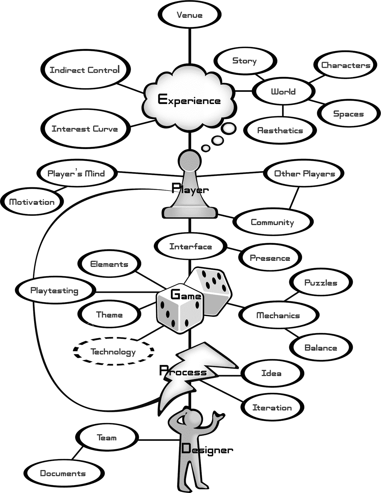
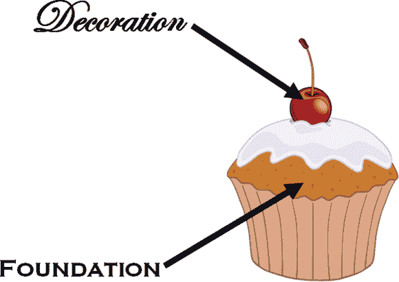
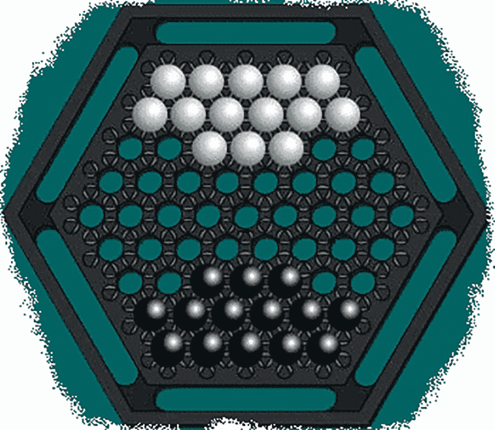
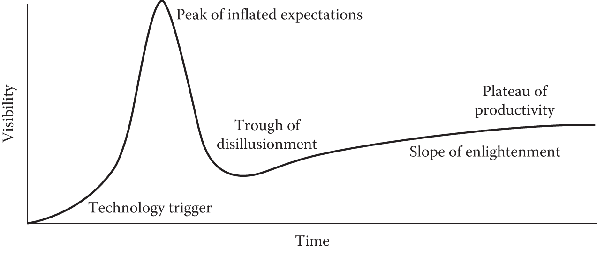
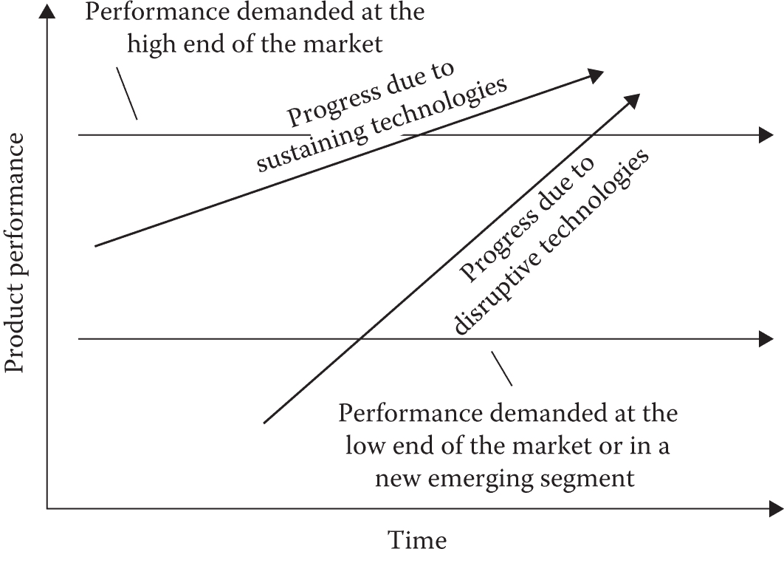

# 第二十九章

## 团队利用*技术*构建游戏

**图 29.1**

> *Tom 正在画图时 Samuel 进来了。Samuel 看着那幅图。“那是啥？”*
>
> * “我正想设计个开门器，这样人就不用下车了。这是拉杆，用来打开门闩。”*
>
> * “什么东西来打开它？”*
>
> * “我想用个强力弹簧。”*
>
> * “这根杠杆。它会滑向这个弹簧，反向提供张力。”*
>
> * “我明白了。如果门真装上了，这也许行得通。而且造这个、维护这个，花的时间顶多相当于二十年里下车开门的两倍时间。”*
>
> * Tom 抗议道：“有时候马受惊了……”*
>
> * “我知道，”他父亲说。“但主要原因是这很有趣。”*
>
> * Tom 咧嘴一笑。“抓到我了，”他说。*
>
> —John Steinbeck, *East of Eden*

### 技术，终于来了

> *机器并没有将人类与自然的重大问题隔离开来，反而让他更深地陷入其中。*
>
> —Antoine de Saint-Exupery

技术在游戏设计中的地位

在一本表面上旨在指导电子游戏设计的书中，直到接近尾声才讨论技术，这似乎有些奇怪。但这是有原因的。技术在游戏设计师的生活中占据重要地位。正如阳光出时难以观测星星，技术在场时也难以研究游戏设计。技术永远新颖、永远令人惊讶、永远带来新谜题。在四元素（技术、故事、美学、机制）中，技术是最动态、最易变、最不可预测的。这就像一个醉酒的亿万富翁闯入你的派对——所有人的目光都盯着他，因为没人知道他会做什么。好吧，终于到了我们冲向阳光、认识这位醉酒亿万富翁的时候了。

## 什么是技术？

我们是指计算机和电子设备吗？不……我们指的范围广得多。对游戏设计师而言，“技术”指的是游戏的媒介本身——使游戏成为可能的物理对象。对于《大富翁》，技术是棋盘、纸条、棋子和骰子。对于跳房子，是一粒粉笔和一条人行道。对于《俄罗斯方块》，是一台计算机、一个屏幕和一个简单的输入设备。说技术只是构成游戏的物理东西似乎显而易见，但这个想法有深远含义，因为技术以极快速度进步。想想你出生以来发明了多少物理东西。一万？十万？一百万？太多了，难以确定。但许多新发明可用于创造新型游戏。这很重要，因为游戏设计师的追求永远是对新颖性的追求。正如我们之前所说，人们购买新游戏是因为它们是新的。由于这种对新颖性的压力和新技术的诱惑，很容易沉溺于技术的可能性而忘记我们的目标是创造一款伟大的游戏。

保持清醒头脑，不与亿万富翁一起醉倒，对某些人是个挑战。工程师尤其天生热爱技术，特别容易被其诱惑。沃尔特·迪士尼对此有强烈感受，在里程碑式著作《生命的幻象》中，动画师弗兰克·托马斯和奥利·约翰逊写道：

> 由于某种原因，[沃尔特] 不信任工程师，认为他们主要为自己设计而不顾产品的预期用途，他拒绝让任何头衔为“工程师”的人进入员工队伍。

这当然是个极端立场，但它强调了在创造体验时保持对技术地位清醒头脑的重要性。

### 基础技术与装饰技术

保持对技术理智视角的最具体方法之一，是理解基础技术与装饰技术的区别。基础技术使新型体验成为可能。装饰技术只是让现有体验变得更好。这个比喻有助于阐明：

**图 29.2**

纸杯蛋糕的蛋糕部分是基础技术。没有它，就没有纸杯蛋糕。樱桃和糖霜是装饰技术。添加它们不会创造根本性的新东西；只是让旧东西好看一点。或许一些娱乐和游戏的例子能让这更清晰。

#### 米老鼠的第一部动画

常见的琐事问题常在问答节目出现：“米老鼠的第一部动画是什么？”我们大多知道答案：《威尼汽船》。但大多数人错了。《威尼汽船》早于《飞机大作战》，后者是另一部米老鼠动画，早六个月发布。《威尼汽船》有何非凡之处，以至于被普遍认为是米老鼠的首秀？技术。具体来说，《威尼汽船》是第一部采用同步声音的动画。声音不是装饰性的——整部动画围绕同步配乐设计。《威尼汽船》的剧情主要描绘米老鼠和米妮将各种农场动物当作乐器演奏。它可爱、巧妙、朗朗上口，没有同步声音就完全讲不通。该技术是动画创造体验的基础。后来《飞机大作战》添加了同步声音，但那是装饰性的：飞机引擎的咆哮声对动画的基本体验改变不大。

#### 鹦鹉螺棋

**图 29.3**

《鹦鹉螺棋》是一个低技术含量但有趣的基础技术例子，这是一款由洛朗·莱维和米歇尔·拉莱于 1987 年发明的棋盘游戏。游戏棋盘看起来像熟悉的跳棋，但有一个重要区别：孔之间的凹槽使得抓起一颗弹珠推动时，能沿着凹槽推动整排其他弹珠，使它们“咔嗒”落入下一个孔。大多数此类对抗游戏的机制基于通过落子或跳跃捕获对手棋子。莱维和拉莱意识到允许推动的棋盘能实现全新机制，于是设计了通过将棋子推出棋盘来捕获的游戏。凹槽技术不复杂，但它们为全新的游戏体验奠定了基础。

#### 索尼克

世嘉 Genesis 平台上的《索尼克》和《索尼克 2》是基础技术的有力例证。世嘉知道，Genesis 主机与竞争对手超级任天堂的关键区别之一，在于世嘉系统架构支持极快的滚动。《索尼克》游戏（特别是《索尼克 2》及其闪电般的冲刺冲锋）专门设计用于利用这一能力。玩家此前从未玩过具有如此极速移动的游戏，这正是游戏让人感到刺激和新颖的部分原因。

#### 迷雾岛

今天很难理解《迷雾岛》在市场上的成功程度。它连续五年每月都是最畅销的 PC 游戏。哇。无论如何，这种成功源于基础技术与装饰技术的结合。第一项技术是装饰性的：精美的 3D 艺术作品。当时（1993 年），计算机生成的 3D 艺术还是新鲜事物。它有一种超凡脱俗的新外观。但要在游戏中呈现这些美图，需要更基础的技术：CD-ROM 驱动器。在 CD-ROM 之前，游戏图像细节多限于像素艺术。CD-ROM 使得照片级画质的游戏成为可能。Cyan（《迷雾岛》开发商）对此非常重视。CD-ROM 驱动器刚推出时可能非常不稳定。有许多不同制造商、不同驱动程序、许多软件故障方式。Cyan 有意识地选择花费开发时间确保游戏能在每种可能的 CD-ROM/PC 组合上运行——团队中一些人宁愿把这段时间花在制作更精美的结局上。但似乎他们做对了决定——多年来，几乎每个为家庭购买 CD-ROM 驱动器的人都买了《迷雾岛》，因为他们听说它很美，而且与许多其他 CD-ROM 游戏不同，这款游戏保证能运行。

#### 旅程

不……不是那个 *Journey*。在 1980 年代初，Bally Midway 的工程师们有了一个很棒的新电子游戏技术构想：为什么不在街机上装个数码相机，这样拿高分的玩家不只能录入姓名首字母——还能摆姿势拍张照！他们造了个原型机，能给获胜者拍黑白数码照片，并在芝加哥的一家游戏厅试运行。这可能是史上首例“恶搞”事件：第二天他们去查看时震惊地发现，有几个获胜者竟然对着镜头“露底”，把高分榜变成了低分辨率的色情展览。没人想得出解决办法，所以管理层叫停了该项目的进一步开发。但团队没那么轻易放弃。他们在该技术上投入了大量心血，想看到点成果。结果诞生了《Journey: The Arcade Game》（旅程：街机游戏），一款基础平台游戏，以摇滚乐队 Journey 的成员作为化身。这些化身长相极其怪异，拥有微小的卡通身躯和巨大得离谱的头，头部是乐队成员的黑白照片。这项技术最初是基础性的，最后却变成了纯粹的装饰性技术，而且还是个相当丑陋的装饰。花哨的技术挽救不了无聊的游戏，它扑街了。

### 布娃娃物理

考虑“布娃娃物理”技术时，可以看到一个更现代的例子。布娃娃物理是一种操控实时动画角色的方法，使他们的身体能以非预设的方式真实地与游戏世界中的其他元素互动。换种说法：如果你抓起游戏角色的胳膊摇晃，它的四肢会真实地晃动，动作完全由计算机计算得出——不需要动画师。这已在无数第一人称射击游戏中作为纯粹的装饰性技术使用：非玩家角色（NPC）被手榴弹击中，身体在空中翻滚落地，利用实时物理数学计算运动。即使有时看起来不对劲（身体与某些地形交互不良），它也是个小小的新奇点，工程师们很喜欢。

将这种用法与同类算法在游戏《Ico》中的应用形成对比。《Ico》是叙事游戏的里程碑，部分原因在于主角 *Ico* 与他试图营救的公主之间互动的新颖性。游戏大部分时间，*Ico* 必须牵着公主的手带她四处走，帮她度过各种惊险困境。由于公主跟随 *Ico* 的方式，对他的每一次奔跑、攀爬、跳跃时手部的牵引都做出反应，她显得栩栩如生，这是一种完全全新且不同的体验。游戏中的大多数谜题都基于 *Ico* 必须带着公主这一事实，没有布娃娃物理算法这根本不可能实现。《Ico》背后的工程师和设计师找到了一种方法，将一项纯粹用作装饰的技术，转变为世界从未遇见过的游戏体验的基础。

正如这些例子所示，遇到新技术时，问自己“如何让这项技术成为我游戏的基础？”是个好习惯。

### 触控革命

当触控游戏首次出现在任天堂 DS 和 iPhone 等平台上时，许多玩家大声抱怨。触控屏是游戏手柄的劣质替代品——也就是说，当它试图模仿游戏手柄时。很快，出现了没有触控根本不可能实现的游戏（如 DS 上的《Cooking Mama》或 iOS 上的《Cut the Rope》），人们的感受截然不同。总是同一个故事：新技术出现，人们说它毫无用处。直到有人为它设计出应用。

### 炒作周期

抵御技术迷醉效应的另一个好方法是了解这种迷醉的模式。这最好通过 Gartner Research 创建的一个模型来描述，他们称之为炒作周期。

**图 29.4**

前面的图表表示随时间变化的可见度（谈论它的人数）。Gartner 认为每项新技术都会经历五个炒作阶段：

1.  **技术萌芽期**：这是技术首次被发现或宣布的时候。

2.  **期望膨胀期**：这是谈论该技术的人远多于实际体验过它的人的时候。换句话说，“没人知道它真像什么，但大家都说它很棒。”推出产品的公司（比如新 iPhone）试图充分利用人性的这一怪癖，让人相信新技术能实现梦想，尽管这似乎从未真正发生过。

3.  **低谷期**：当技术无法兑现围绕它的惊人炒作（比如 Segway 平衡车），人们在冷酷现实的强光下审视它时，它迅速变得过时，甚至被鄙视。

4.  **稳步爬升期**：逐渐地，人们和企业开始弄清技术真正有用且有益的领域。

5.  **生产成熟期**：此时，技术的益处被广泛理解和接受。这个高原的高度取决于技术真正有多广泛的用处。

炒作周期有趣之处在于它每次都会发生。不知为何，人们似乎永远学不乖，一遍遍重复同样的愚蠢行为：假设“新事物”将改变生活，当它没做到时就恨它，最终将其用于它擅长的事情上。作为游戏设计师，你需要了解炒作周期，主要有三大原因：

1.  **免疫力**：如果你了解炒作周期，你可以让自己对其效应免疫，避免在尚未见到实际效果的技术上押注职业生涯。

2.  **接种疫苗**：很有可能在某个时刻，你会发现自己被一些买单了某疯狂新技术炒作的人包围，他们会想让你围绕它设计游戏。如果你能让他们理解炒作周期，你或许能救你的团队免于做出危险决策。

3.  **融资**： 没有好听的说法。在某个时刻，你会有机会向一个完全处于膨胀期望迷惑中的人推介设计，他们会愿意为你的游戏买单，不是因为它的优点，而是因为他们相信自己跳上去的技术顺风车会让他们大发横财。你可以试着说服他们面对真相，但没用。诀窍是在低谷期来临前拿到钱，然后尽管技术如何，做出伟大的东西。如果你能做到，这将是一场过山车之旅，但你会把游戏做出来。

回顾不同游戏和游戏系统的发布，思考它们的炒作周期，会非常有趣。我留给读者作为练习，因为我们还有个两难困境要讨论。

### 创新者的窘境

# 创新者的窘境

另一个从事新技术工作的人需要了解的模式是创新者的窘境（见图 29.5），这一概念源自克莱顿·克里斯滕森同名著作。基本思想是：科技公司往往因为犯了一个错误——听取客户意见——而走向失败。这听起来反直觉——正如我们所讨论的，倾听玩你游戏的人的意见非常重要。但克里斯滕森谈论的是一种非常具体的情况：一种新技术出现了，它与旧技术不同，尚不足以取代旧技术。如果你问客户对这项新技术怎么看，他们会说“不够好”。结果，你可能会选择忽视这项新技术，专注于对旧技术进行渐进式改进。但那项新技术也在逐步改进。突然间，几乎一夜之间，新技术将跨越某个门槛，进入“足够好”的领域，旧技术的所有客户会突然弃船而去，转投这项更快、更好、更便宜的新“颠覆性技术”怀抱。

我们在电子游戏领域已经多次见证这一现象。零售 PC 游戏制造商多年来都不把主机游戏当回事——主机就是“不够好”。然后，突然间，它们变得“足够好”了。在不到一年的时间里，PC 游戏从主流变成了边缘。体感控制器已经存在了二十年，但一直被认为太贵或不够可靠。结果，大多数主机制造商都不把它们当回事。但随后，在一系列渐进式改进和创新之后，任天堂发布了 Wii 遥控器，凭借一个“足够好”的巧妙体感控制器，几乎接管了主机市场。而现在，语音识别、人工智能（AI）、脑波感应等技术因为不“足够好”而被忽视。如果你能设计出面向即将“突破”临界点的技术的游戏，你就能乘上一波别人未曾预见的成功浪潮——当然，前提是这些技术是基础性的！

**图 29.5**

## 分化定律

人们在试图预测技术未来时，反复出现的一个错误是：他们假设技术会融合并统一。例如，许多人预测不久的将来，你的客厅里将有一个设备，能播放所有视频、音乐和游戏。但想想你的客厅里有多少个遥控器。三四个，对吧？当然，你过去只有一个——但随着技术进步，设备数量成倍增加。为什么？因为总是如此。不同技术以不同速率发展，所以我们有不同的设备，因为如果它们都被粘合成一个大电视/电脑/音乐/视频播放器/游戏主机，每当有一项新功能出现，你就得更换整个设备。相反，技术在演化过程中不断分化，就像加拉帕戈斯群岛上的雀鸟一样。将它们作为独立设备，你可以任意搭配，随时准备迎接下一个新事物。随着我们继续开发越来越有趣的新输入和输出系统来玩游戏，这对电子游戏肯定也将继续适用。

不过，分化定律也有例外：口袋。我们装在口袋里的东西（如瑞士军刀和智能手机）往往倾向于技术融合，为了便利。口袋例外对游戏也很重要，但明智的做法是记住它只是个例外。

## 奇点

我们都注意到，技术随着每一年的流逝，越来越强势地渗透进我们的生活。毫无疑问，技术进步的步伐不仅在加快，而且在加速。随着加速，预测未来变得越来越困难。一千年前，你可以相当准确地猜测一百年后的日常生活会是什么样。现在，我们甚至难以猜测仅仅十年后的生活。一些人推测，随着技术持续加速，很快我们将无法预测一年后、一个月后，甚至未来十分钟的生活会是什么样。技术进步快到我们完全无法做出任何预测的那一刻，被称为奇点，一些人预测它将在我们有生之年到来。

这可能听起来牵强，但毫无疑问，技术变革的快速步伐对游戏设计师是个好消息，因为新技术意味着新的游戏可能性。此外，我们开发引人入胜的虚拟世界的技术，目前仅被视为一种消遣，如果创造和体验虚拟现实的技术突然飞跃，这些技术可能会绽放为人类体验本质的核心。

技术是你游戏的媒介，也是游戏设计四大基石之一。用这个实用的透镜仔细审视你的技术选择。

## 眺望你的水晶球

> *有把握地预见固然好，但不确定的预见也总比不预见要强。*
>
> ——亨利·庞加莱
>
> *对盲人来说，一切皆是突然发生的。*
>
> ——佚名

急速技术变革的一个效应是：人们陷入理解当下新技术的泥沼，以至于停止思考接下来会发生什么。对如此多的创新感到厌倦，他们放弃了尝试预测未来，认为那太难了。这对你是巨大的优势——因为如果你坐下来仔细思考，许多即将到来的事情是可以推测的。如果你能猜对，对你这位设计师来说将是多大的益处啊！你将能为别人未曾预见的趋势和发展做好准备，只因为你用逻辑和推理在它们到来之前看清了未来。当然，你不会总是猜对，但每次猜错，你都会意识到原因，这会让你下次成为更好的预言家。尝试预测未来这一行为本身，就能改变你看世界的方式。不妨用以下例子试一试：

* 四年后的客厅游戏会是什么样？它会与现在有何不同？
* 八年后呢？
* 两年后，有多少比例的游戏将通过下载获取，而不是从光盘或卡带加载？为什么？五年后呢？
* VR 会成为主导游戏平台吗？为什么会或不会？
* 在线游戏的下一个趋势是什么？为什么？
* 四年后，小型游戏工作室将在做什么？
* 四年后，大型游戏工作室将在做什么？
* 四年后，体育游戏会有什么不同？
* 四年后，第一人称射击游戏会有什么不同？
* 四年后，你选择的游戏类型会有什么不同？
* 未来四年可能会出现什么新类型？为什么？

