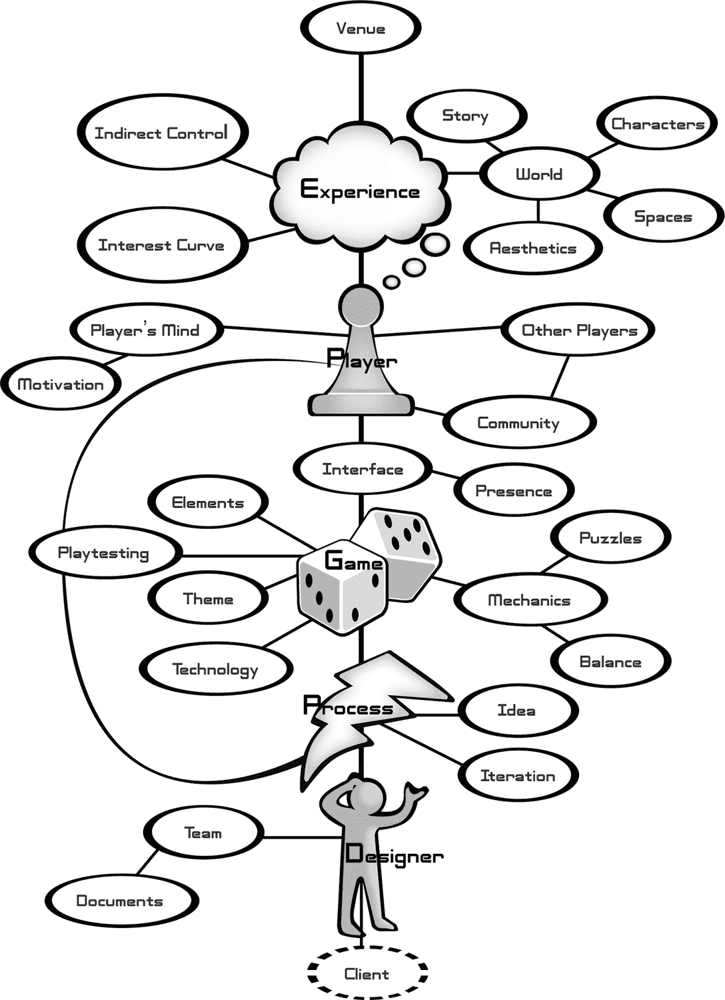

# 第三十章：你的游戏很可能会有客户

> *形式追随功能。*
>
> ——路易斯·沙利文，建筑师
>
> *形式追随乐趣。*
>
> ——苏珊娜·罗森塔尔，玩具设计师
>
> *形式追随资金。*
>
> ——布兰·费伦，现实主义者

## 延伸阅读推荐

*   克莱顿·克里斯坦森的**《创新者的窘境》**和**《创新者的解答》**。这些书是技术创新真正挑战及如何克服它们的绝佳案例研究。

## 谁在乎客户怎么想？

在一个完美的世界里，你作为一名游戏设计师，只需要操心取悦两群人：（1）你的团队和（2）你的玩家。

但这不是一个完美的世界，在大多数情况下，还有别人你得考虑：你的客户。

有时客户是游戏发行商，有时是持有热门 IP 版权的媒体公司，有时只是某个毫无娱乐经验却决定出于某些原因需要做款游戏的人。客户形形色色，五花八门。

你为什么要在乎客户怎么想？好吧，除非你是把做游戏当爱好，或者你财务自由，否则客户很可能是在付钱让你做游戏。如果他们不喜欢项目的进展，*字面意义上*就是游戏结束。

现在，你可能指望客户把你当专家——毕竟客户自己做不了游戏，这才找上你的。顺理成章地，你可能接着会假设客户尊重你关于“什么能做出最好的游戏”的意见。

有时候确实会这样。

起码我是听说过。

但大多数时候，你的客户会对游戏该怎么看、怎么动、怎么玩有非常强烈的个人见解。这也没错——毕竟是他们在掏钱。你处理这些见解的能力至关重要，原因如下。世界上有两种游戏设计师：开心的和暴躁的。开心的要么财务自由，要么擅长应对客户的强烈见解。暴躁的则不擅长应对这些强烈见解。这听起来可能像句俏皮话，但我是认真的——你搭建妥协桥梁的能力，能让你和客户双方都满意，这极有可能是你长期能否作为一名快乐的游戏设计师的*单一最大指标*。

---

回答这类问题可能很棘手。如果能和别人讨论会有帮助。当你这么做时，你会发现自己在推演可能发生的事情，并利用那些确定性作为支架，来支撑你那些没那么自信的预测。对你有价值的不是预测本身，而是你为做出预测而搭建的支架。你不仅会培养对技术的直觉，还会理解它如何契合人类心智，因为两者的知识都是预测未来所必需的，正如我常说的：技术 + 心理学 = 命运。此外，试图预测未来往往迫使你审视历史趋势，这能给你提供真正可用且往往正确的洞见。我创建了一个 YouTube 频道，网址是 <http://crystalballsociety.com>，在那里我收集我和其他人对未来做出具体预测的视频。我很乐意收录你的！通过练习，尝试预测技术的未来不会再显得那么辛苦，而会开始变成一种习惯。谁不想洞察未来呢？

在继续之前，我们应该花点时间思考一下，为什么人们会对技术如此兴奋。当然，正如我们在第 16 章：兴趣曲线中讨论的，技术提供的剧变潜力自然会让人感兴趣。但还有更深层的东西。技术提供了一样东西，那是每一个曾经活过的人类都在追寻的：乌托邦。对乌托邦的渴望是我们共同拥有的。对完美世界的梦想是如此多事物背后的驱动力：学校、教堂、政府、法律、发明、互联网初创公司、医疗计划、革命、非营利组织、书籍、艺术，以及是的，电子游戏。在某种程度上，*尤其是*电子游戏。毕竟，我们承诺的是什么？不仅仅是游戏，而是整个世界——比这个世界更刺激、更美丽、更公正的世界。从这个角度看，我们创造的事物周围存在如此盛大的“炒作周期”也就不足为奇了。玩家期望我们带领他们走向乌托邦，别无他求。当他们不再关心我们的新游戏和新系统时，正如有时会发生的那样，意味着他们对我们失去了信心——他们不再相信我们知道路在何方。

这就是为什么当你选择新技术时，选择那些最有可能通向更美好世界的技术至关重要。就目前而言，我认为以下这五类技术最有机会实现那个梦想。

### 1. 魔法般的界面

直观的界面是不够的；玩家想要的是感觉神奇的界面。iPhone 和 iPad 的成功很大程度上建立在那种神奇的感觉上。人们可以争论微软 Kinect 系统的整体价值，但没人能否认数百万玩家渴望尝试神奇新界面而购买了数百万台设备。

### 2. 公平的付费

过去十年里，电子游戏的购买模式发生了根本性变化，经历了无数实验。即便如此，玩家仍不觉得我们现有的游戏销售系统完全公平。如果你能想出一个让玩家觉得公平、同时又能维持你创作优秀游戏能力的系统，玩家和开发者都会追随你的脚步。

### 3. 少 A，多 I

即：感觉不那么“人工”的人工智能。计算机革命的一个破碎承诺是：计算机能像人类一样思考和交流。我们离那还很远——但最先到达那里的技术将是游戏，因为我们的 AI 不必完美，只需*有趣*即可。我们已做好准备，迎接一个引人入胜的游戏 AI 发展的十年，它将捕获全世界的想象力。

### 4. 家人和朋友

正如我们所说，人们通常不是为了独自一人而玩游戏。他们通常更愿意和家人朋友一起玩。虽然我们有些游戏适合某些关系，但错失的机会太多了。哪里有丈夫和妻子夜夜同玩、乐在其中的游戏？哪里有让全家踏上冒险旅程的游戏？哪里有帮助孩子与远方祖辈建立联系的游戏？《Words with Friends》（词语拼拼/找朋友）等游戏的成功开始指明方向，但机会仍然无数。

### 5. 蜕变

人们玩游戏确实是为了轻松娱乐——但如果你能做出帮助人们蜕变成他们真正想成为的人的游戏，在精神、身体和灵性上实现转化，那会怎样？这很难兑现，但对此有巨大需求，Wii Fit 和 Lumosity（乐慧）的成功便证明了这一点。如果你选择能帮助人们自我提升的技术，你无疑是在引领我们走向一个更美好的世界。

通过游戏实现乌托邦这一概念虽重要却反直觉。请像手持火把一样带着这副透镜，助你照亮前路。

多美的梦啊。不过我得把你叫醒了——客户刚进门。

但为什么呢？客户的强烈观点有什么不好？万一客户的观点很有见地呢？这种情况是会发生的——有时客户的观点非常深思熟虑且明智——那真是件好事。但也有时候，客户会提出极其愚蠢、荒谬、虚伪到令人难以置信的观点。你一生中听到的最蠢的一些话，将会从你客户嘴里说出来，而不知何故，你必须应对这一切。而这关乎重大：你与客户的关系、你作为设计师的声誉、你的快乐，以及你的游戏。

## 应对糟糕的建议

许多设计师在收到客户的糟糕建议时，会像被车灯照住的鹿一样僵住，吓得不知说什么好。有三种应对方式：

1.  迁就这个糟糕的建议，生怕得罪客户。这是对客户和你的游戏的不负责任。
2.  立刻告诉客户为什么他们的建议很烂，好让客户对你的英明印象深刻。这通常会适得其反。
3.  试图理解客户为什么要提出这个建议。

第三种反应才是正确答案。当有人提出糟糕建议时，并不代表他们笨——只是说明他们想帮忙。而且大多数时候，这些糟糕建议的出现，是为了解决一个未曾言明的问题。这正是祭出我们老朋友 **透镜 #14：** *【问题陈述】* 的绝佳时机！因为如果你能弄清客户试图用他们的建议解决什么问题，或许你能想出一个能更好地解决该问题的方案，客户会欣喜若狂。

举个例子，曾有一款赛车游戏开发到一半时，客户前来评审。把玩原型几分钟后，他看着团队说：“这些车需要更多镀铬装饰。”主美术惊恐地看向设计师——模型基本完成，且几个月前已获客户批准。主程序同样惊恐——性能优化本就棘手，增加闪亮的镀铬意味着对已超负荷运转的 CPU 造成更大消耗。

设计师本可以说“好”，也可以说“不”，但他却说了唯一明智的话：“为什么？为什么需要更多镀铬？”客户的回答令人意外：“嗯，我玩的时候感觉车速不够快。我知道改车速对你们工作量可能很大，所以我就想，要是给车加点镀铬，看起来就会快些。”这逻辑乍听挺离谱，但请放下成见，注意到客户只是想帮忙！事实上，团队也觉得车太慢，正打算提出来。他们的解决方案是让车真跑快点（简单）并降低摄像机视角以增加体感速度。他们在客户面前当场做了修改。客户见到成效大为振奋，也很高兴多了解了些赛车游戏的制作门道。

这是**问题陈述透镜**力挽狂澜的教科书级案例。人脑反应快，往往在搞清要解决什么问题前就跳到解决方案。大多数糟糕建议，只需一句魔法词就能化解：“你想解决什么问题？”

## 不是那块石头

客户让设计师抓狂的另一种完全不同的方式，是强烈观点的对立面：不知道自己想要什么。这有时被称为“不是那块石头”游戏。流程如下：

> 客户：给我拿块石头来。
>
> 设计师：好，这块怎么样？
>
> 客户：不，不是那块。
>
> 设计师：哦。那这块呢？
>
> 客户：不，那块也不是。
>
> （重复两百次。）

玩十来二十轮后，设计师常会沮丧地向任何愿意听的人吼道：“我真不敢信这客户！他们根本不知道想要什么！”这很可能是事实。但说实话，如果他们确切知道想要什么，游戏不早设计完了吗？设计师工作的很大一部分，就是帮客户弄清他们想要什么。这就像倾听受众——你必须比客户自己更了解客户。这是玩“给我拿块石头”的正确方式：

> 客户：给我拿块石头来。
>
> 设计师：要什么样的石头？
>
> 客户：不确定……我不懂石头。
>
> 设计师：那您打算拿它干什么？
>
> 客户：哦……我想放在车道边，刷个门牌号。
>
> 设计师：啊……我想我知道合适的……让我拿几块供您挑选。

当你设法帮客户弄清他们真正想要什么时，你就在参与设计过程，同时通过给予他们所需的认知，赋能于客户。玩得好，客户会觉得自己很聪明，而你将设计出完美契合其需求的游戏。

## 欲望的三个层次

要真正给客户他们想要的，你必须理解对他们什么重要——你得在乎他们在乎的，像他们那样思考。做功课了解客户，无论是个人还是职业层面，都是时间花得值。他们更在乎一夜暴富，还是慢慢建立好游戏的口碑？他们想切入新市场，还是深耕现有市场？他们觉得什么是好游戏？光跟他们聊、问想要什么，就能学到很多——但记住，人不总说真话。在琢磨客户想要什么时，要记住人人都有三层欲望：嘴上说的、脑子想的、心里想的。

例如，客户可能对你说，嘴上说：“我要你为 Rittenhouse 基金会做个游戏。游戏得教八年级学生代数。”

但脑子里可能藏着秘密：“其实我想做个太空主题教几何的游戏。我全盘规划好怎么运作了。我配合这代数事儿，只是因为 Rittenhouse 那帮人觉得重要。”

但内心深处可能想着完全不同的事：“我厌倦了当财务人员。我想让人看到我有创造力。”

现在，如果你只听她嘴上说的，项目推进时你会发现她在跟你对着干，朝着与资助方意愿相悖的方向走，整体行为相当古怪。但如果你能摸清她脑子里的想法，甚至更好，摸清她内心的渴望，你或许能融入她构想的游戏元素，或找到其他方式让她贡献创意、至少占个功劳。如果你足够聪明，大概率能同时满足三层欲望——这绝非小事，因为当你满足了某人内心深处的渴望，你可能会收获一位终身挚友。
