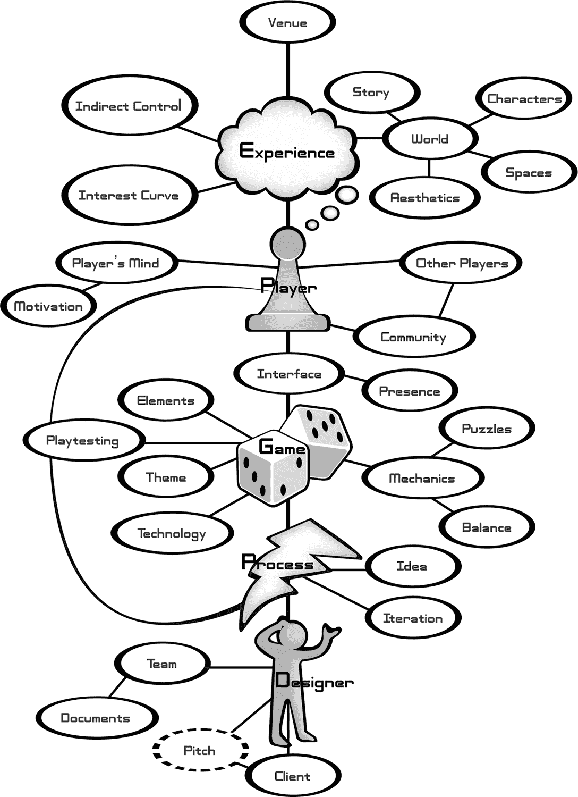
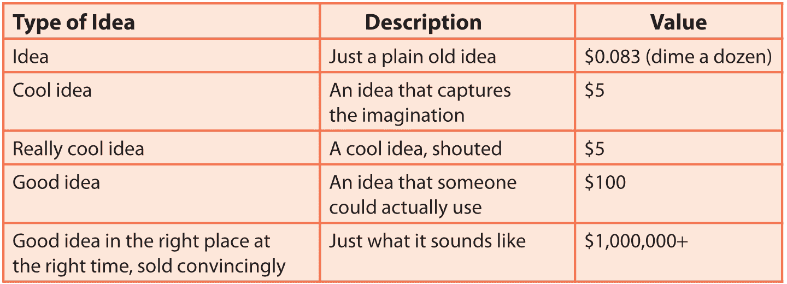

# 第 31 章：设计师向客户推介

**图 31.1**

## 凭什么是我？

如果你想让某人为你的游戏提供资金、发行或分发，你必须说服他们你的游戏值得冒险，这意味着你要推介你的游戏。你可能会想：“凭什么是我？我设计游戏还不够吗？找别人不行吗？”但说实话，谁比你更合格？美术？程序？管理层？作为游戏设计师，你比任何人都更了解游戏，也更清楚它为什么伟大。如果你连站在众人面前高歌猛夸自己游戏的信心都没有，凭什么指望别人会相信它？

那么，你要向谁推介，何时推介？这很大程度上取决于你的处境。兼职独立开发者的推介需求与大公司全职开发者不同，但两者都需要大量推介才能做成一款成功的游戏。起初，你会向团队成员和潜在合作伙伴推介粗略的想法。当团队就总体概念达成一致时，你可能会向管理层或出资方推介，以获得制作原型的批准。原型完成后，你可能会向发行商或 Kickstarter 推介游戏以获取开发资金。在开发过程中，当你意识到游戏必须在某些重要方面改变时，你会向几乎所有人推介这些变更。游戏完成后，你需要在游戏展会上向记者推介。推介可以很大：“这是我为什么需要 7500 万美元做新 3A 大作的理由。”也可以很小：“鲍勃，这是飞船边角需要更圆润的理由。”如果你要开发游戏，你将不断需要说服他人认可你的想法，并不断处于这样一个位置：你必须让各个学科、各种背景的人团结在一个想法背后。压力最大的推介是争取游戏资金的推介，因此本章将更多地关注这类推介。

## 权力的博弈

在深入探讨如何构建一个好的推介之前，我们应该花点时间弄清到底什么是推介。要理解这一点，有必要理解什么是权力。权力不一定关乎财富或控制他人，尽管它可以涉及这些。权力简单来说就是获得你想要东西的能力。如果你能得到你想要的，你就强大；如果不能，你就无力。

但请注意，我们对权力的定义有两部分：“获得的能力”和“想要的东西”。大多数人完全关注第一部分，即获得的能力。但第二部分，即你想要什么，同样重要。因为如果你不知道自己想要什么，你会发现自己不断抓取却永不满足。但如果你知道自己想要什么，你就能更有效地集中精力去争取，并在此过程中变得强大。

当你推介游戏时，你就进入了一场权力博弈，你试图获得你想要的，同时说服对方你的游戏能帮他们获得他们想要的。因此，任何成功推介的基础都是知道你想要什么、知道他们想要什么，这可能有点复杂，要记住你们各自都有三层欲望。

## 创意的层级

新手设计师常会抱怨：“我真不敢相信！我推介了这个超酷的创意，却没人感兴趣！大家怎么了？”答案是大家没问题——只是酷点子在这里展示的创意层级中价值相当低：

我知道这听起来很傻，但重点在于：当你推销一个想法时，它不会因为其整体优劣而被评判——它将根据对你推销对象**当下**有多大用处来被评判。正是这类想法促成了价值数百万的交易。当你推销一个好想法却被拒绝时，别咬牙切齿——把它带给能用上它的人，或者把它放进后口袋，以便时机成熟时随时拿出来。

### 成功推销的十二条建议

所以你已经了解了推销对象，想出了一个他们当下能用上的好主意，甚至知道你想让他们为你做什么。接下来怎么办？

#### 推销建议 #1：跨过门槛

如果你进不了门，就无法推销你的想法。有些门好进，有些难进。大型游戏发行商很难约见。他们就像学校里最漂亮的女生，而且她们知道这一点。她们经常无视邮件和信息，几乎不发通知就取消会议。她们有挑选合作开发商的特权，所以除非你能说服她们你拥有某种相当特别的东西，否则甚至很难跨过门槛，尤其是如果你走的是前门；也就是说，“喂，你好，这里是大作游戏公司吗？我有个游戏设计想推销……我该找谁谈？”

好得多的方法是走后门，如果你能做到的话；也就是说，认识内部的人为你担保。一个会无视你邮件的发行商，不会无视他们经常合作之人的邮件。我认为可以肯定地说，大多数游戏交易都是通过这种方式达成的——开发商和发行商由共同的朋友介绍认识。这就是为什么像游戏开发者大会（GDC）和当地国际游戏开发者协会（IGDA）聚会这样的行业活动如此重要——它们帮你建立联系网络，以便当你的推销准备就绪时，能顺利跨过门槛。

即使你只是在公司内部向某人推销，同样的原则也适用。拥有最大决策权决定进度和预算的人最忙。如果他们已经认识你、喜欢你、信任你，他们更有可能听取你的意见并认真对待你。

#### 推销建议 #2：展现你的诚意

当我在华特迪士尼幻想工程工作时，有一个一年举办两次的非凡活动，叫“公开论坛”。这是一个向负责迪士尼主题公园的顶尖创意大脑推销你绝妙想法的机会。整个组织的任何人都可以来，向这个决策小组进行五分钟的推销。然后他们会私下讨论五分钟，再给你五分钟反馈。如果他们喜欢这个想法，它就会进入下一层流程，甚至可能部署在公园里！我喜欢有机会推销新想法，每次都会抓住机会。通常我会准备得很充分，但有一次，我就是没时间。我没有提出一个完全充实的想法，而是想也许我可以带两个不那么成熟的想法进去。一个是肥皂泡喷泉，另一个是餐厅里的迷你营火，让客人能直接在桌边烤棉花糖。当我展示这些想法时，小组成员有很多问题。喷泉真的行得通吗？迷你营火安全吗？我有没有制作原型来回答这些问题？我不得不承认没有。一位小组成员愤愤不平：“如果你不够在乎这些想法去尝试它们，凭什么指望我们在乎？”这很丢人，但他完全正确。

当你推销游戏时，你必须展现出你对构建它的**诚意**。过去，开发商只需凭借几张草图和对游戏样子的描述就能与发行商达成交易。那种交易现在越来越少见了——如今需要一个可运行的原型。但即使有原型也不够——你需要展示你已对你的游戏、其市场及其运作方式进行了深思熟虑。这可以通过一份详细的设计文档（没人会读，但他们会掂量它的分量），或者更好的是，通过一个清晰的演示文稿，详述游戏为何会畅销。仅仅相信你的游戏可能好玩是不够的——你必须展示你已完成的工作，证明你的游戏**会**好玩且**会**盈利。

#### 推销建议 #3：条理清晰

> 条理不是负担。条理会让你自由。
>
> ——阿尔顿·布朗

很容易掉进“创意人士不讲条理”的陷阱。条理清晰只是向对方展示你诚意的另一种方式。此外，你越有条理，随手就能拿到所需材料，你就会越冷静，掌控力越强。发行商会把有条理的设计师视为“低风险”设计师，这会让他们更倾向于信任你。

所以确保你的推销计划周全。如果你带纸质讲义，确保它们易于获取且人手一份。如果你的演示涉及电脑、投影仪，或者（咽口水）网络连接，确保它们**真能工作**——带上所有正确的线缆，早点到场测试，以防万一。我曾安排过一次非常重要的推销，我们定了日期却忘了定时间！前一天我手忙脚乱地联系对方，搞清楚会议是否还在、到底几点开始！整件事压力大、尴尬且完全没必要。

#### 推销建议 #4：充满激情！！！

令我难以置信的是，我一直看到推销时演讲者似乎对自己谈论的游戏漠不关心。你想让听众对你的游戏兴奋——要做到这一点，你自己必须对你的游戏兴奋！**千万别**试图伪装——这会显得完全虚假。如果你谈论游戏时**真诚地、发自内心地**兴奋，这会通过演示传达出来，甚至可能具有感染力！激情不仅代表兴奋——它还代表不惜一切代价交付高质量游戏的动力和承诺。如果资助方要把制作你天才游戏所需的资金交托给你，他们需要看到这种承诺。

#### 推销建议 #5：设身处地

在前几章中，我们讨论过倾听受众、游戏和团队的重要性——推销只是又一个倾听的场合。我们常以为推销全靠我们自己——只要我们推得够猛，他们就会买单。但没人喜欢面对咄咄逼人的强硬推销员。我们喜欢的是有人倾听我们并试图解决我们的问题。你的推销应全围绕这一点。提前与你要推销的对象交谈。尽可能多了解他们，并确保你计划推销的游戏适合他们——如果不适合，别浪费他们的时间。

即使你对要推销的游戏倒背如流，也必须记住推销对象从未见过它，所以确保用他们容易理解的方式解释——尽可能避免行话。在不熟悉游戏创意的朋友和同事身上练习推销，看对他们是否讲得通。

还要记住，你推销的对象可能看过成百上千次推销，而且很忙。确保你不浪费任何时间，直奔主题。如果他们对你提出的某点显得厌烦，略过继续下一点。如果他们想了解某方面的更多细节，他们会提问。

## 假设客户的视角：最佳情况

还有一种假设客户视角的方法：考虑最佳情况。也就是说，他们**爱上**了你的提案。接下来会发生什么？在大多数情况下，交易还无法立即达成。你提案的对象很可能需要向其公司的同事或上级再次推销。你让他们有多轻松？以下是让你项目的“粉丝”更容易向他人推销的几个关键点：

*   **开篇即陈述平台、受众和类型**：新手设计师往往想吊人胃口，等到演示进行到一半才揭晓游戏是什么。这**永远是个糟糕的主意**。立刻告诉他们平台、受众和类型。如果不这么做，他们听不进你说的任何一句话，因为他们的大脑会痴迷于弄清楚这是哪类游戏，以便决定他们是否关心。

*   **不要以讲故事开场**：我相信你的故事很棒。但猜猜看？很多烂游戏有绝妙的故事，而很多神作的故事却很烂。与其讲努尔大陆的传奇背景故事，不如拿出透镜 #83：***幻想***，告诉他们这款游戏满足了怎样的幻想。

*   **给你的创意加上“把手”**：也就是说，提供简短的短语来概括创意：“这是一款保龄球 RPG！”“这是成年人的《宝可梦》！”“这是拥有整个动物园的《Nintendogs》！”这将帮助他们理解概念，并让他们更容易向他人解释。

*   **演示而非讲述**：有可运行版本？太棒了——演示给他们看！更好的是，展示一个突出最佳功能的视频。如果流程太早还做不到这一点，至少要制作一个幻灯片演示，展示游玩过程是怎样的。这**迄今为止是让他们理解你心中构想的最佳方式**。

*   **让*他们*推销变得容易**：你推销的对象很少能独立做出最终决定。通常最好的情况是：他们爱上了你展示的东西，现在他们必须去说服同事这是个好主意。制作能自我说明的推销材料，不需要你在房间里歌舞升平也能引人入胜。为他们提供关键图片、短视频和不言自明的要点列表，以便他们能像你一样出色地推销。

### 推销技巧 #6：设计推销过程

推销是一种体验，对吧？你为什么不像设计游戏一样至少同样用心地设计它呢！本书中的许多透镜都能帮你做到这一点。你的推销应该易于理解，有惊喜，有良好的兴趣曲线（钩子、铺垫、张弛、高潮）等。它应该有良好的美学设计，尽可能多用图像少用文字。你的推销应该优雅，重点关注你的游戏有何独特之处、为何能在竞争中胜出、以及为何适合你正在推销的这个人。只要有可能，你的推销就应该让人眼前一亮。寻找一些小方法，用精湛的表演技巧给他们留下深刻印象。细致的动画、意想不到的音效、幽默的图片、实体道具，以及你能想到的任何东西，都能帮助打造一场精彩且令人难忘的推销。甚至场地也能起作用：我曾经不得不向一位来纽约出差的发行商推销一款关于木乃伊的游戏。我安排我们在大都会艺术博物馆的埃及展厅进行推销，就在真实的木乃伊和墓穴旁边。发行商被震撼了，我们拿下了项目。如果你能让即使是简单的 PowerPoint 演示也充满表演感，这会让他们相信你在制作游戏时也会做到这一点，甚至做得更多。

你应该推敲整个推销过程中将发生的每一个时刻。会有其他团队成员在场吗？何时介绍他们？何时展示原型？如果你认为“过度规划”会破坏推销的活力，那你就错了。如果你想，你随时可以偏离计划，但有计划能让你的头脑自由专注于精彩的推销，而不必担心是否遗漏了重要事项。

### 推销技巧 #7：了如指掌

推销过程中你会遇到问题。经验丰富、忙碌的发行商不会等到最后才提问——他们会打断你精心策划的演示，询问他们认为重要的细节问题。你需要掌握尽可能多的事实。这些包括以下内容：

*   **设计细节**：你应该对你的设计了如指掌。对于你一直拖延的设计部分，你至少应该有一个猜测。你应该对诸如“游戏时长多少小时？”“完成一个关卡需要多久？”“多人游戏如何运作？”等问题给出自信的回答。

*   **进度细节**：你需要知道制作游戏需要多长时间，以及你的团队大概需要多长时间才能达到每个重要里程碑（设计文档完成、首个可玩原型、首个 Alpha 版、第二个 Alpha 版、Beta 版、发布日期、发布后更新频率）。确保这些时间切合实际，否则你的听众会迅速失去对你的信心。准备好回答：“最快能多快做完？”指望他们会拿你的答案当承诺。

*   **财务细节**：你应该知道完成游戏需要多少成本。这意味着要知道有多少人参与开发、工作多久、以及其他成本。还要预料到这个问题：“这能赚多少钱？”你最好根据同类产品的变现情况来回答。别只给一个数字——给出你认为合理的范围。**绝对要确保**你给出的最低数字仍能让游戏成为一个有利可图的项目。

*   **风险**：你会被问到项目最大的风险是什么。你需要准备好清晰简洁地说明它们，以及你针对每一个风险的管理计划，无论它们是技术、玩法、美术、市场、财务还是法律方面的。

你还需要预判向你推销的人会问什么问题。有一个关于幻想工程师乔·罗德的传说，他正在向迪士尼 CEO 迈克尔·艾斯纳做《动物王国》主题公园的最终推销。艾斯纳长期以来对这个公园是否是个好主意犹豫不决，乔得到了最后一次机会解释为什么可行。在乔详细的演示后，艾斯纳说：“抱歉……我还是看不出活体动物有什么令人兴奋的。”乔走出会议室，片刻后牵着一只孟加拉虎走了进来。“这就是，”他宣布道，“活体动物令人兴奋的原因。”主题公园获得了资金。当你能预判即将到来的问题并给出完美答案时，你就能拥有神奇的说服力。

### 推销技巧 #8：散发自信

激情固然重要，但自信同样重要，且两者截然不同。自信意味着你确信你的游戏完美契合客户，且你的团队是完美执行它的团队。这意味着面对棘手问题时不慌不乱。这意味着了如指掌。请记住，你不仅在推销创意，更在推销你自己。如果你看起来很紧张，会让人觉得你不相信自己说的话。当你展示令人印象深刻的东西时，你应该表现得若无其事，仿佛这很容易。如果你的其他团队成员在场，你们应该作为一个团队回答问题，每个人都自信地知道其他人最擅长回答哪些问题。

这里有一个神奇的词，当棘手的问题试图动摇你的信心时可以使用：“**绝对没问题**。” 对于诸如“你认为这在欧洲能卖得动吗？”“服务器能承受负载吗？”“你能做个儿童版吗？”这类问题，你可能会想回答“是”或“大概”，但我保证“**绝对没问题**”听起来会自信得多。当然，你需要用实力来支撑那个自信的回答！

再简短说说握手：如果你不确定自己是否有自信的握手，就要练习直到你有为止。握手是潜意识的秘密语言，是人们（尤其是男性）评估个性的一种系统。你的话听起来可能很自信，但如果你的握手不自信，就会让人对你说的一切产生怀疑。毕竟，如果你连握两三下手都无法与对方同步，那么剩下的工作关系又会如何发展呢？

但如果你感觉不自信怎么办？如果你在众人面前讲话时非常紧张怎么办？最好的办法是想象一次你极其自信的时刻。将自己置入那个过去的时刻，将帮助你回忆起自信的感觉，以及你可以成为一个冷静掌控重要局面的自信之人。

### 推介技巧 #9：保持灵活

在你的推介过程中，你会遇到意外情况。你推介的对象可能突然透露他们讨厌你的概念——那你还有别的吗？你可能原本计划开一小时的会，却被告知“我只有二十分钟”。你需要以冷静和自信来应对这类情况。游戏设计师理查德·加菲尔德讲了一个故事，讲他如何去找发行商推介《机器人拉力赛》，一个关于工厂里机器人的精复杂桌游。加菲尔德热爱他的游戏，向一位游戏发行商做了详细推介，对方耐心听完后说：“抱歉，我们不能用这个。太大了。我们在找小巧便携的游戏。有那种吗？”加菲尔德本可以愤然离去，但他保持客观，考虑到他的目标是让游戏发行——不一定非得是这款。他提到自己正在构思一种新型卡牌游戏的点子——能不能回来展示一下？他第二次推介的游戏最终成为了大热作《万智牌》。

### 推介技巧 #10：排练

规划推介固然好；排练推介更佳。你越习惯谈论你的游戏，推介就越自然。寻找任何机会练习——当你妈妈问：“那么，你最近在忙什么？”就给她推介一下。给同事推介，给理发师推介，甚至给你的狗推介。并非要求你背诵推介的具体措辞，而是创意链条要能像一首喜爱的歌一样自然地从你口中流淌出来。

如果你要展示演示版，也要排练。千万避免边玩边推介！那会让你听起来思维迟钝，还浪费宝贵时间。让同事玩游戏，你在旁讲解并回答问题。除非他们对此很兴奋，否则别指望高管玩你的原型。他们自取其辱或弄崩你的原型让你难堪的风险太大了。

### 推介技巧 #11：让他们产生归属感

在第 30 章：*客户*中，我们听到了米开朗基罗让客户对项目产生归属感的巧妙方法。但你不必那么狡猾。理想情况下，你希望他们离开时认为这游戏是“**他们的游戏**。”在你推介的群体中有一个内部支持者非常有帮助——一个已经对概念买单并会在其他人面前为其辩护的人。另一个增加他们产生归属感几率的方法是将客户的想法融入推介中。如果在之前的交谈中，他们说：“所以，这是个战争游戏，是吧？有直升机吗？我超爱直升机！”那你最好确保你的推介里某处有直升机。你甚至可以即时融入客户的想法，利用他们早期提问中的概念（“能有巨型老鼠吗？”）来解释推介后面的内容（“假设你遇到一个满是巨型老鼠的房间……”）。你越让他们容易想象这是他们的游戏，他们就越接近接受你的提案。

### 推介技巧 #12：跟进

推介结束后，他们会感谢你并承诺回复你。他们可能会回复——但也很可能不会。这不代表他们不喜欢你的推介。他们可能非常喜欢，只是被其他更紧急的事务缠身了。推介后几天内，你应该找个借口用邮件跟进一下（“您之前问到`texture manager`的细节，我只是想就此回复您”），以此微妙地提醒他们你还在，而且他们欠你个反馈。你没有充分理由直接催促他们给答案——如果你这么做，大概率会很快得到答案：“不用了，谢谢。”他们可能需要时间思考、内部讨论，或评估其他竞争提案。只需定期跟进，不要太频繁，直到得到答复。如果他们不回复，切勿沮丧——保持耐心和理解。也许你的创意派上用场的时机尚未到来。推介六个月后再联系发行商，对方回复“嘿，很高兴你联系我。还记得你那个推介吗？我想我们可能想跟你聊聊。下周能见面吗？”这种事并不罕见。

## 嘿，Kickstarter 怎么样？

啊，众筹。这似乎是完美的解决方案！为什么非要向某个高管推介，而不直接把游戏带给大众，甚至在制作完成前就卖给他们呢！有些设计师就这样筹到了数百万美元，为什么你不行？

Kickstarter 及其众多同类平台确实让一些游戏开发者受益匪浅，但大多数尝试众筹的游戏开发者都会失败。为什么？因为他们中许多人未能遵循上述推介技巧——所有关于直奔主题、显得井井有条、抓住想象力、演示而非讲述、让观众眼前一亮的规则，在视频推介中同样适用，正如当面推介时一样。但关于众筹，还有一些人们未曾意识到的特定事项：

*   **工作量巨大**：准备和运营众筹活动是海量工作。预计需要整整一个月设计和制作页面及视频，整整一个月运营活动，之后还要整整一个月兑现承诺（寄 T 恤、制作定制内容等）。那是你本可以用来做游戏的两三个月，最后你可能连钱都拿不到。

*   **本质是预购系统**：众筹不是投资系统，也不是慈善系统。大多数资助者是因为对获得特别的东西、比别人早获得、以优惠价格获得感到兴奋才掏钱。如果你发明了下一代游戏手柄，这很棒。但如果你打算为免费 `iOS` 游戏众筹，就要当心了。Apple（目前）没有分发早期版本的渠道，而且游戏本来就免费，凭什么有人在不知道自己是否喜欢前就给你 25 美元？众筹最适合带有实体组件的产品，或定价较高（20 美元以上）的游戏。

