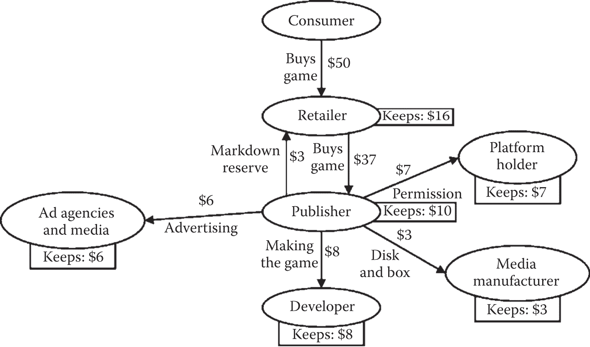
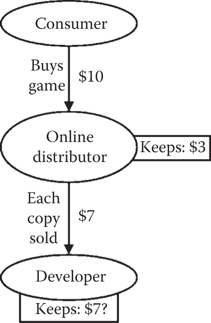
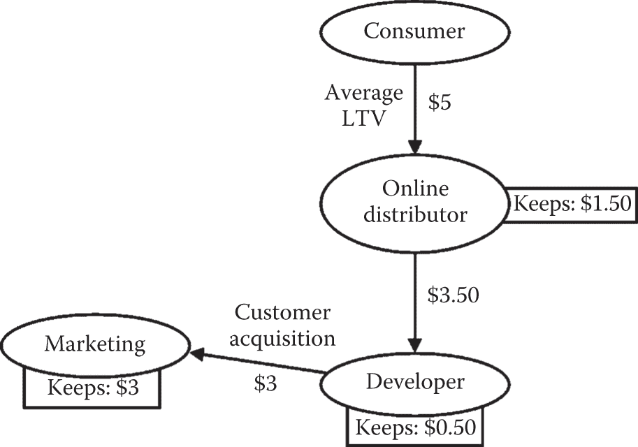

# 第三十二章：设计师与客户希望游戏能盈利

## 众筹最佳实践

- **尽可能少要钱**：你可能会觉得，要的钱越多，越能激励社区给你更多资金。事实似乎并非如此。而且在 Kickstarter 上，如果没达到目标额，你一分钱也拿不到。设定你能承受的最低筹资目标。如果你的项目大获成功，随时都能获得更多资金。

- **越短越好**：六十天的筹资期听起来比三十天多，对吧？在大多数情况下，并非如此。较短的战役似乎效果更好。大多数项目发现，资金主要集中在第一周（来自确定想资助的人）和最后一周（来自喜欢等到最后一刻才决定的人）。中间是两周还是六周似乎没太大关系，但战役时间越长，工作量越大，人们忘记它的可能性也越大。

- **保持回报简单**：记住，这是预购。大多数人只想以优惠价格提前拿到游戏。T 恤和其他小饰品主意虽好，但对筹资额影响不大，邮寄起来工作量巨大，甚至可能因选项过多而让资助者感到不知所措。

- **多展示，少讲述**：最成功的游戏众筹视频都会展示游戏实际运行的片段，仅此而已。为什么？因为众筹本质上主要是关于预购。给他们看一段酷炫的游戏实机，人们就会掏钱买单。唠叨五分钟游戏*可能*是什么样，你会难得多。

- **拼命宣传**：想尽一切办法让你的众筹项目为人所知。尽可能频繁地发推文和更新进度。设定微小目标“嘿，我们快达到 10% 了！你可能就是那个让我们破 10% 的人！”纠缠你能搭上线的任何有影响力的人帮忙传播。别以为躺平就能让项目自动成功——你必须时刻推着它走。

- **设定延伸目标**：延伸目标（我们的目标是 4 万美元，但如果达到 5 万，我们就加个蓝色激光关卡！）极大地助力了病毒式传播，因为每个资助你游戏的人现在都有理由去宣传——毕竟，如果我能让别人也出钱，我出的那份钱就能解锁更多内容，而我自己不用多花一分钱。

- **要有名气**：这点无法回避。最容易获得资助的游戏，都是那些自带粉丝群体的创作者做的。如果你不出名，你的游戏要么听起来极其不可思议，要么筹资目标极低。

简而言之，众筹对某些游戏是妙招，对另一些则不然。归根结底，它和其他推介一样，需要投入时间和精力才能出彩。每个游戏始于一个创意，但靠推介获得资金。保持这副眼镜，别忘了像设计游戏一样精心设计你的推介。

如果你是在向高管推介，他们最关心的是游戏能不能赚钱，以及能赚多少。这是下一章的主题。

## 延伸阅读推荐

- **《我讨厌你的游戏推介的 30 件事》** 作者：Brian Upton。Brian 听推介听了多年，他列出的这些雷区值得注意。<https://www.youtube.com/watch?v=4LTtr45y7P0>

- **《如何向混蛋解释你的游戏》** 作者：Tom Francis。这场简短的演讲干货满满，直击要害。<http://www.pentadact.com/2012-03-17-gdc-talk-how-to-explain-your-game-to-an-asshole/>

## 爱与金钱

是时候面对另一个残酷的真相了。

我知道，你个人从事游戏设计是出于对这一媒介的热爱。如果游戏设计无法赚钱，你肯定还会把它当爱好坚持下去。“Amateur”（业余爱好者）一词的字面含义就是“爱好者”。

但金钱是驱动游戏产业运转的燃料。

如果游戏不盈利，产业就会枯萎消亡。

在真实的游戏产业世界里，有很多人，如果他们今天得知卖开罐器比卖游戏能多赚 2% 的年利润，他们会毫不犹豫地转行卖开罐器，并为自己的选择感到无比自豪。

你或许会鄙视这些人。但你应该鄙视吗？利润对产业至关重要——谁比热爱金钱的人更适合掌管金钱？毕竟，你也不想整天为钱发愁，对吧？你有游戏要设计。为什么不让钱管钱、设计管设计，大家各得其所，皆大欢喜呢？

遗憾的是，不行。还记得“形式追随资金”吗？金主的决策（“你得用 20 万美元做这游戏，不是你要的 45 万”；“我们决定这游戏要内购，不是订阅制”；“你必须植入游戏内广告”）会对游戏设计产生巨大影响。反之亦然——游戏设计决策会对盈利能力产生巨大影响。以一种诡异的方式，设计与管理各自握着控制对方命运的绳索。因此，金主会插手告诉你怎么设计游戏，因为他们怕你不懂你的设计对盈利的影响。一旦你们产生冲突，你觉得谁会赢？记住黄金法则：谁有金子，谁定规矩。

因此，你非常有必要懂得足够多的游戏商业知识，以便能和金主进行智力层面的对话。这能让你拥有更多创作掌控权，因为如果你能用他们能听懂、信服的商业语言，解释你珍视的特性为何能赚更多钱，你就更有机会让游戏按你认为最好的方式呈现。

你可能会想：“我完全不懂商业——这些财务东西太深奥了。”但作为游戏设计师，你已经懂很多心理学了，而每一个商业决策，本质上都是对人性心理的押注。你不必精通每个财务细节——只需懂得足够多的游戏商业知识，能思考它、谈论它即可。这当然比学概率论简单，而你似乎已经掌握得不错了。我肯定你见过拿着 MBA 学位却让人惊讶地不太聪明的人。那家伙都能懂，你也行。赚钱很像玩游戏——从这个角度看，思考它其实挺有意思的。

本章不会深入细节讲游戏商业——有其他书专门讲那个。但我们会聊聊你能做些什么，让与掌握你游戏钱包的人进行有意义的对话变得更容易。

## 了解你的商业模式

> *赚钱是艺术，工作是艺术，好的商业是最好的艺术。*
>
> ——安迪·沃霍尔

### 零售

要读懂任何生意，就跟着钱走。如果你搞清钱流向哪里、为何流向那里，你就读懂了生意。例如，当消费者花 50 美元买一款零售游戏大作时，这张图展示了平均而言钱最终流向了哪里：

看到这类图表会引出如下问题：

**问：** 什么是平台持有方？

**答：** 这是制造特定主机的公司（索尼、任天堂、微软）。他们通常不靠卖主机赚钱（往往亏本，低于成本价出售！）。他们通过向发行商征收每款游戏的“税”来盈利。

**问：** 为什么零售商抽成这么多？

A: 零售商看起来不贪婪吗？但他们并不贪婪。零售业是一个低利润的行业，他们必须在各个方面精打细算才能生存。经营一家店的成本很高。

Q: 为什么发行商要拿走这么多？

A: 看看他们要做多少事！他们必须与所有这些不同的公司协调和讨价还价，一旦出什么岔子，亏钱的就是他们。如果游戏卖不出去，开发商仍然能拿到制作游戏的报酬，而零售商会强迫发行商回购滞销游戏。发行商拿走这么多钱的部分原因是因为他们必须为亏本的游戏买单。

Q: 什么是降价准备金？

A: 最终，游戏会降价，以更低的价格出售。当这种情况发生时，零售商会让发行商承担部分损失。平均而言，每单位约为 3 美元。

请记住，这些数字是平均值。实际情况要复杂得多，且因情况而异。但即便如此！看看玩家支付的 50 美元中有多少流向了与实际制作游戏毫无关系的事情！你可以明白为什么当直接向消费者销售成为可能时，开发商会如此兴奋。这肯定是双赢，对吧？消费者付得更少，开发商赚得更多！好吧，让我们来看看。

### 直接下载

**图 32.3**

这就对了，这才像样！这个简单的模式省去了发行商、零售商、平台持有者，甚至连光盘制造商也省去了。这（或多或少）就是 Steam 和苹果 App Store 使用的模式。简洁明了！消费者支付低价，比如 10 美元，开发商通常能获得其中的 70%。但是，嘿……

> Q: 那 7 美元旁边的问号是什么意思？
> 
> A: 嗯，因为这个图表假设开发商在营销和广告上花费为零。有时确实如此，但通常不是。通常需要花一些钱让人们知道这款游戏。这过去是发行商的问题，但如果你是自行发行，嗯，现在这成了你的问题。回顾一下 图 32.2，发行商平均每位客户花费 6 美元；如果你在这里这么做，你只剩下 1 美元了！试图决定花多少钱来获取客户是自行发行最具挑战性的方面之一，因为没有任何保证，而且你必须小心不要花超过游戏收入的钱。

### 免费游玩

**图 32.4**

直接下载游戏出现不久后，价格开始下降，原因我们稍后再谈。最终，价格降到了零，因为开发商意识到获得最多玩家的方法是免费赠送游戏，等玩家需要什么东西时，再向他们收费。从某种程度上说，这对玩家似乎很棒（他们可以免费试玩游戏看看喜不喜欢），但另一方面，玩家经常感觉游戏设计师在故意设计游戏情境，诱使玩家在关键时刻想要付费。玩家之所以有这种感觉，是因为这是真的！无论你爱恨与否，这就是免费游玩（F2P）的运作方式。而且它确实奏效，赚得盆满钵满（数百万美元）。所以让我们来看看这张图。

> Q: 什么是平均 LTV？
> 
> A: LTV 代表生命周期价值。即平均每位玩家在其整个游戏历程中支付的金额。对于 F2P 游戏，许多玩家支付零元。但有些玩家会支付很多。平均每位玩家的花费就是平均 LTV。不同游戏的 LTV 差异巨大，所以不要太当真这个 5 美元的数字。
> 
> Q: 什么是用户获取成本？
> 
> A: 这是我们衡量平均让某人玩你的游戏需要多少成本的方式。同样，3 美元只是个例子。对于病毒式传播的游戏，成本可能更低。对于某些游戏，成本更高。
> 
> Q: 50 美分利润？那我岂不是需要很多客户？
> 
> A: 是的……是的，你确实需要。如果你的游戏制作成本是 50 万美元（一款普通手游的典型预算），按这些成本计算，你需要一百万玩家才能收支平衡。你可以明白为什么提高 LTV 和降低用户获取成本如此重要。

我肯定你对此还有很多问题——追踪资金流向就会这样——它会引发问题——找到答案，你就能理解商业模式。当然还有其他商业模式——订阅制、桌游和卡牌游戏、广告游戏、购买玩具获得额外能力的游戏，等等。每种商业模式的特性都会施加强大的力量，帮助定义通过它们销售的游戏的本质，这就是为什么你需要了解它们。其实并不难。如果你发现自己对一种新商业模式感到困惑，你只需找个懂行的人问他们：“嘿，能不能给我看看钱都花哪儿了？”很快你就会知道该问什么问题了。

## 了解你的竞争对手

当你将游戏推向世界时，它并不会直接到达消费者手中。首先，它必须与其他几十款游戏竞争，赢得潜在玩家的芳心。如果你了解你的游戏在与什么竞争，这将大有裨益，因为这可能和游戏本身的质量一样重要。你的游戏是市面上唯一的僵尸宠物养成模拟游戏，还是有几十款类似的？与其他游戏相比，你的游戏看起来如何？你是同类中的佼佼者，还是低预算的替代品？希望你的游戏能填补你在市场上发现的空白——提供一些人们真正想要、但市面上还没有的东西。如果你能向出资方展示你已经通过研究那些与你的游戏相似但缺少你将提供的关键组件的游戏，做了一份详尽的“缺口分析”，这将极大地有利于你的立项。

## 了解你的受众

早在 第 9 章：*玩家* 中，我们讨论了了解受众的重要性，以便为他们制作一款好游戏。但你不仅需要了解受众如何玩，还要了解他们如何付费。什么价位对他们来说显得公平？他们对免费游玩有何感受？高价游戏会让他们望而却步，还是他们视其为有价值的游戏？什么功能让他们决定购买游戏？你对这些问题的回答可能比任何其他因素都更能塑造你的游戏，所以你需要可靠的答案。在这里发挥你的设计师洞察力，去看到金主们看不到的东西。有时，他们眼里只有图表和数据。如果你能洞察玩家的内心和想法，并提出一个你确信他们会觉得公平的新定价模式，你对游戏盈利能力的影响将胜过一百个金融分析师。

请思考游戏*Dungeons & Dragons Online*。设计师最初制作了一款订阅制游戏，但随着该模式开始走弱，他们决定将其转为 `F2P`。许多玩家不喜欢 `F2P` 冒险游戏——这会让人感觉像是在作弊。这就好比游戏在说：“嘿……打不过巨龙，是吧？好吧，给我 5 美元买这把魔法战斧，我打赌你就能搞定。”于是，你羞羞答答地付了钱，拿到魔法战斧，杀死了巨龙，嗯，感觉有点像个失败者。但看看 *Dungeons & Dragons Online* 的设计师是怎么做的：他们不让你为武器付费；他们让你为冒险付费。他们的游戏感觉——不一样，仿佛在说：“想进巨龙洞穴吗？那趟冒险要 5 美元。”于是，你付了费，经过无数次尝试和巨大困难，最终屠杀了巨龙。而在它的宝藏堆里，猜怎么着？有一把魔法战斧。在两款游戏中，你都花了 5 美元并最终得到了一把魔法武器，但在前者中，你感觉自己像个骗子，而在后者中，你感觉自己像个英雄。一切只因有人懂得了玩家的心理。

一个重要的考量因素是你要制作“硬核”还是“休闲”游戏。老实说，有时很难在这两类之间划清界限，因为有些人只是随性地玩 *Dark Souls*，偶尔玩上一小时，而另一些人却每周在 *Farmville* 上投入八十小时的硬核游戏时间。但我们使用这些术语时的含义，是指玩家是否自我认同为“游戏玩家”。如果是，他们通常愿意为对自己意义重大的内容支付高价。如果他们不这样自我认同，并不意味着他们从不玩游戏——他们可能每周玩几次 *Angry Birds* 或 *Subway Surfer*，但只是为了打发时间。那么，最关键的区别是什么？是他们愿付多少钱。世界上每有一个硬核玩家，大概就有一百个休闲玩家，但硬核玩家愿为他们在乎的游戏支付多得多的钱。这两个市场完全都有效，但必须采取截然不同的策略。休闲市场拥有全球数十亿人口，听起来极具吸引力，但要吸引休闲玩家的注意力却很难，除非你运气好突然变得时髦（见 *Flappy Bird*）。另一方面，硬核玩家对制作精良、深度十足的游戏反应良好。为他们制作游戏成本可能更高，但他们通常也愿意支付更多。无论你怎么决定，关键在于知道谁会在乎你的游戏、他们愿为它付什么价、以及为什么。

## 学习语言

每种商业模式都有其独特的行话，作为谈论游戏如何赚钱的简略表达。如果你想让金主认真对待你，就要学会他们的语言。如果你能像他们一样流利地讲这门语言，他们就会给你留个座位。如果你能比他们讲得更好，你会发现他们每次都会听从你的设计决策。以下是你应该了解的一些术语。

### 通用游戏商业术语

*   `SKU`：读作“skew”。代表“库存单位”。它指商店里唯一的库存项目。一款游戏可能以多个 `SKU` 形式发行，因为每个不同的主机版本都是一个 `SKU`，每个语言版本（`Halo 3 in French`）也是一个 `SKU`。发行商常以一年推出多少个 `SKU` 来衡量自身规模。

*   `COGS`：不，不是机器里的齿轮。这是销货成本。即每单位实际制作游戏的成本。

*   `Burn rate`：维持工作室运营每月要花多少钱？薪资、福利、房租等。

*   `Sold in vs. sold through`：当零售商从发行商处买入游戏时，称为“`sold in`”，即售入店内。但当顾客买走游戏时，我们称其为“`sold through`”。既然发行商必须回购零售商卖不掉的库存，`sold-in` 和 `sold-through` 的数量可能差别很大。如果一个自夸的发行商向你吹嘘某游戏卖了 150 万份，而它刚发售一周，你通常可以问一句“`sold in` 还是 `sold through`？”来戳破他的泡沫。归根结底，只有“`sold through`”才算数。

*   `Units sold`：主要对零售和直接下载游戏重要，这只是游戏被购买的次数。在推介新游戏时，大家都会试图判断它能卖多少份——通常基于类似游戏的销量表现。

*   `Breakeven`：游戏必须卖出多少份，发行商才能收回投入资金。例如，如果游戏开发和营销成本为 40 万美元，每份售价收 5 美元，`Breakeven` 点就是 8 万份。低于此数亏损——高于此数盈利。

### 免费游戏商业术语

*   `Churn`：每月流失多少比例的玩家？理想情况下这数字为零。`Churn` 越大，留存越差，大家都会问：“我们能做什么让他们继续玩？”

*   `Cost of acquisition`：平均要花多少钱，才能让某人下载并玩你的游戏？

*   `DAU`：日活跃用户。过去二十四小时有多少人玩了你的游戏？这是衡量 `F2P` 游戏最简单的指标，显然越大越好，所以 `DAU` 备受关注。

*   `MAU`：月活跃用户。过去一个月有多少玩家玩了你的游戏？等等，这不应该就是 `DAU × 30` 吗？不是。如果每天玩你游戏的是同一群人，你的 `MAU` 将等于 `DAU`。如果 `Churn` 高，`MAU` 将远大于 `DAU`。`MAU/DAU` 比率备受重视。

*   `ARPU`：每用户平均收入。通常按月计算。换言之，算出过去三十天总收入，除以 `MAU`，即得 `ARPU`。

*   `ARPPU`：每付费用户平均收入。即只看付费玩家，他们平均付多少钱？像 `ARPU` 一样，通常也按月计算。这数字会高于 `ARPU`（通常高得多）。

*   `LTV`：生命周期价值。从玩家初次尝试你的游戏，到他们彻底弃坑不玩，平均每位玩家能给你带来多少收入？这数字难算，但很重要，因为它告诉你获取新玩家最多能花多少钱。如果平均玩家 `LTV` 是 `$5`，花 `$4` 去获取一个新玩家是合理的，因为最终你能从他们身上赚回 1 美元。但如果 `LTV` 是 `$3`，花 `$4` 就是愚蠢的。

*   `K-factor`：这个词源自病毒式营销领域，而后者又源自医学领域。简单说就是：你的平均玩家能带来多少其他新玩家？如果你的游戏极具病毒性，人人都在拉朋友玩，`K-factor` 就高。高 `K-factor` 非常重要，因为强病毒性能大幅降低 `Cost of acquisition`。

*   `Whale`：这个不雅称呼指在 `F2P` 游戏中付费极多的玩家。有些人若有助于成功，会付出成百上千美元。`F2P` 设计师非常关注 `Whales`，因为他们能占游戏收入的很大比例。一项研究发现 50% 的游戏收入仅来自 0.15% 的玩家。如果 50% 收入来自 `Whales`，而你找到了让 `Whales` 付费翻倍的方法，那可是大事。

当然，这类内容还有很多，我列举这些只是为了给你提供一个样本。你会发现它们其实并不复杂。如果你能熟悉这类语言，并且足够勇敢，在听到不懂的术语时主动请求解释，金主们就会开始尊重你，因为他们会看到你关心他们认为重要的事情。而这些事情确实很重要——没有它们，游戏设计只能是爱好，而不能成为职业。

## 了解畅销榜

试试这个：针对你最关心的平台，立刻列出过去一年最赚钱的十款电子游戏。列好后，上网对比现实情况与你的列表。如果完全吻合，干得好。如果不吻合，你应该思考为什么会偏离。你是否没意识到基于电影 IP 的游戏如此受欢迎？你是否忘了 F2P（免费游玩）游戏？你是否以为《宝可梦》不会上榜？你是否假设你最喜欢的游戏就是别人最喜欢的游戏？我可以保证，你推介的任何金主都能说出前十名的游戏。为什么？因为游戏行业是一个靠大作驱动的行业。发行商靠大作赚钱，所以他们会严谨地研究大作，试图理解是什么让它们成功。

如果你想理解发行商怎么想，你需要分析大作。有一家公司，Electronic Entertainment Design and Research（[www.eedar.com](http://www.eedar.com)），正将这种分析推向新高度：他们将游戏拆解为一个个功能特性，并进行复杂的数学分析，试图弄清哪些特性对每个游戏的财务成功贡献最大。多人模式有多重要？游戏时长有多重要？这样开发商和发行商就能利用这些数据指导未来的项目。

无论用什么方法，找到一种途径熟悉你的市场和受众群体中的大作，并理解它们成功的原因。这将帮你与金主建立共同的认知基础。而且，如果你对为什么某些游戏设计能大赚特赚有独到见解，我可以保证金主们一定想听听你的看法。

## 准入门槛的重要性

> *我将带着一声叹息讲述这件事*
>
> *在遥远的岁月深处：*
>
> *林间分出两条路，而我——*
>
> *我选择了人迹更少的一条，*
>
> *这改变了我的一生。*
>
> ——罗伯特·弗罗斯特

当无需发行商即可发布的可下载游戏成为现实时，独立开发者们欢呼雀跃，视其为弱者的巨大胜利。当然，现在任何拥有绝妙点子的小开发者都能与最大的游戏发行商一较高下。这确实成真了！以 iOS 市场为例，一些游戏开发者发现他们能在 App Store 以 6.99 美元的价格出售自制游戏，从而获得非常舒适的生活。很快，全世界嗅到了淘金热的气息，游戏以成千上万计涌现。价格开始下跌：4.99 美元成了标准，接着是 3.99 美元、2.99 美元、1.99 美元，然后是 0.99 美元，最后变成了免费。具有讽刺意味的是，在一个标准价格为免费的市场里，最有机会从游戏中赚钱的反而是那些能获得数百万玩家的开发者——在拥挤的市场中，这意味着要在营销上投入巨资，于是，局势再次显著地向大型发行商倾斜。让游戏上架商店不再是挑战——现在的挑战是在成千上万的竞争者中脱颖而出。这迫使所有在这些市场创作游戏的人在营销方面必须深思熟虑（且常常大笔投入）。这种供应商过剩的市场常被称为“红海”市场，勾勒出一幅弱肉强食、血流成河的画面。如何生存？要么做最大的鱼，要么去寻找“蓝海”。

“蓝海”是竞争对手相对较少的地方。有时市场之所以是这样，是因为它们非常新。但其他时候，这些地方存在准入门槛，阻止他人进入。如果你能进入这些地方之一，对你将大有裨益。目前，iOS 市场是如此红海，以至于 App Store 中 90%的游戏亏损，只有约 10%盈利。反观老虎机行业，由于政府法规、专用硬件、专业技术和对特殊算法的依赖，它是电子游戏市场中非常难以进入的领域。在这个市场中，约 90%的游戏盈利，只有约 10%亏损。准入门槛对盈利能力有巨大影响，所以如果你能利用它们，绝对应该利用。准入门槛有多种形式——以下是几个值得考虑的类型：

*   **技术门槛**：这可以包括能带来新玩法的特殊算法，或新的观感体验，亦或是允许独特多人游戏玩法的新型服务器技术。许多游戏通过解决其他人难以轻易复制的困难技术问题而获得巨大成功。

*   **硬件门槛**：如果你创造了一种新型硬件平台，甚至受专利保护，其他人将难以迅速跟进。例如《天启者》推出时，大家都认同这是个好主意，但极少公司能推出有竞争力的产品。

*   **专业知识门槛**：也许你对幼儿社会情感学习了如指掌，并发现针对这方面的游戏有真实市场。没有你这种深度理解的人将难以竞争。

*   **销售与分发门槛**：我曾联合创办一家公司，试图向消防员销售训练游戏。我们很快意识到需要庞大的销售团队逐个辖区推销软件。其他训练公司早已建立了销售关系和销售团队——既然我们负担不起，就迅速转型做别的生意。如果你与某个市场有特殊的销售关系（或能找到有这种关系的合作伙伴），考虑如何利用它。

*   **想象力门槛**：任何人都能做《我的世界》。它不是一个很复杂的游戏。但只有一个人看到，制作这样的游戏并以简单的一次性收费出售是可行的。

*   **关系门槛**：一些游戏需要特殊合作伙伴，可能是为了电影或 IP 授权。如果授权方只与他们信任的人合作，这对你来说就是一个显著的门槛，能阻止其他人竞争。

*   **不确定性门槛**：疯狂的新平台层出不穷。有时大家兴奋不已纷纷涌入。有时开发者则更加犹豫。微软 Kinect 发布时，大多数开发者怀疑它能否成功。但少数人跨越了不确定性的门槛，押注于它，当其销量意外火爆时，他们收获了成为意外热门平台上极少数可用游戏之一的红利。

大多数人看到门槛就会避而远之。他们跟随大众更安心。但跟随大众最终意味着要与大众厮杀。许多成功的开发者发现，选择那条人迹罕至的路，确实改变了一切。

在下一章，我们将讨论比金钱重要得多的东西。

## 延伸阅读推荐

*   **《玩家之心》 by Morgan Ramsay**。游戏行业商业故事的宝库。

*   **《F2P 工具箱》 by Rob Fahey and Nicholas Lovell**。给 F2P 游戏设计师的实用建议精选集。

*《我在好莱坞拍了一百部电影却从未亏过一分钱》* 罗杰·科曼 著。科曼创造引人入胜的低成本电影的不可思议方法，对游戏设计师有着惊人的启示。
