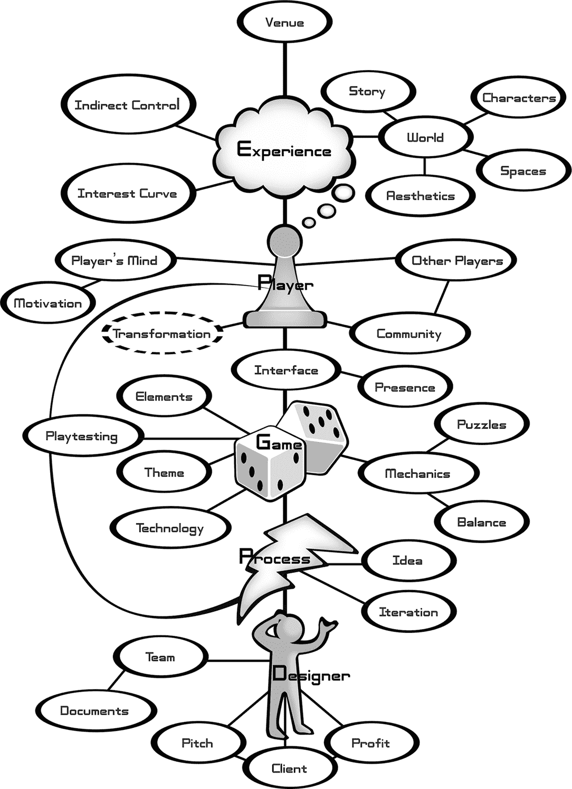
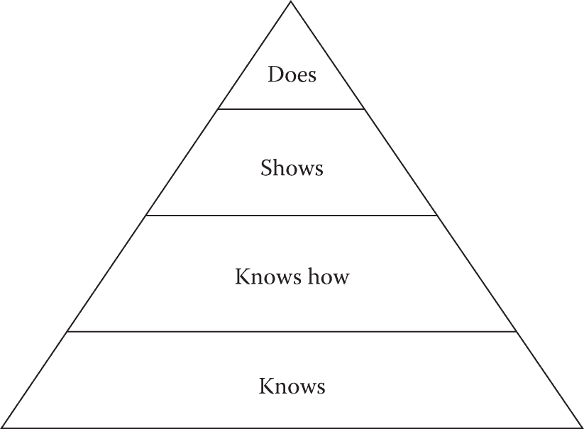

# 第三十三章：游戏改变玩家

图 **33.1**

## 游戏如何改变我们？

关于游戏对大脑的长期影响，众说纷纭。有人认为游戏没有持久影响，只是暂时的消遣；有人认为游戏玩法具有危险性，会煽动玩家暴力或通过成瘾毁掉他们的生活；还有人认为游戏对我们大有裨益，将成为二十一世纪教育的基石。

游戏如何改变我们并非小问题，因为其答案正在改变社会——无论是向好还是向坏。

## 游戏对你有益吗？

游戏对人类来说是如此自然，并带来如此多的快乐，只有极端的哲学倾向才会坚持认为所有游戏都是有害的。游戏常被归因于几种积极效果。

### 情感维护

游戏是人们为了维持和控制情绪及情感状态而从事的众多活动之一。人们玩游戏是为了：

*   **发泄愤怒与挫折**：游戏，特别是涉及大量身体活动的体育运动（足球、篮球）或涉及大量快节奏动作和战斗的电子游戏，可以在游戏的安全世界中以一种宣泄的方式“发泄情绪”。

*   **振作精神**：当一个人抑郁时，充满异想天开、有趣情境的游戏（*Cranium*、*Mario Party*）可以让人暂时忘却烦恼，记起生活依然可以快乐。

*   **获得视角**：有时烦恼压得我们喘不过气，小事仿佛世界末日。玩游戏让我们与现实问题保持距离，回归时能更清醒地看清问题本质。

*   **建立自信**：经历几次现实失败后，容易觉得自己一事无成，进而感到生活失控。在游戏中，选择和行动能带来成功结果，这种掌控感能提醒你：你能成功，你掌握命运。

*   **放松**：有时我们因烦恼太大或太多而无法放下。游戏强迫大脑专注于与烦恼无关的事物，让我们暂时逃离，获得急需的“情感休息”。

虽然为了这些原因玩游戏有时会适得其反——例如游戏被证明与现实生活一样令人沮丧——但总体而言，游戏能很好地完成上述任务，作为维护情感健康的工具。

### 社交连接

与他人建立社交联系并不总是容易的。我们各自陷入自己的问题和担忧，他人可能不理解或不在乎。游戏可以作为“社交桥梁”，给我们互动的理由，让我们看到他人对各种情境的反应，引入话题，展示共同点，创造共同回忆。这些因素的组合使游戏成为建立和维护与重要人物关系的绝佳工具。

### 锻炼

游戏，特别是体育运动，给我们理由和动力进行健康的身体锻炼。近期研究显示脑力锻炼的健康益处，尤其是对老年人。游戏的解决问题本质使其成为提供各种形式身心锻炼的灵活工具。随着数字技术变得更小、更便携，利用它增强体育锻炼的新途径将不断涌现。

### 教育

> *我一直有一种想法，那就是学习可以变成孩子们的游戏和消遣。*
>
> —约翰·洛克，1692 年

有人持观点：教育是严肃的，游戏不是；因此游戏在教育中没有地位。但审视我们的教育系统会发现，它本身就是一个游戏！学生（玩家）获得一系列作业（目标），必须在截止日期（时间限制）前提交（完成）。他们反复获得分数（分数）作为反馈，作业（挑战）越来越难，直到课程结束面临期末考试（Boss 怪），只有掌握了课程（游戏）的所有技能才能通过（击败）。表现优异的学生（玩家）会被列入荣誉榜（排行榜）。

那么，为什么教育不更像游戏？本书的透镜很清楚地说明了这一点。传统教育方法往往缺乏惊喜、投射、乐趣、社区，且兴趣曲线糟糕。马歇尔·麦克卢汉说：“认为教育和娱乐不同的人，对两者都知之甚少。”说的就是这个。不是学习不好玩，而是许多教育体验设计得很差。

那么为什么教育类电子游戏没有更多地走进课堂？似乎有几个原因：

*   **时间限制**：玩游戏耗时长且时间不固定——许多有意义的教育游戏体验太长，不适合课堂环境。

*   **节奏可变**：游戏擅长让玩家按自己的节奏进行。在学校环境中，教师通常必须让所有人按单一节奏前进。

*   **1965**：1965 年前出生的人没有在玩电子游戏中长大；因此游戏对他们不自然，显得陌生。直到最近，教育系统主要由 1965 年前出生的人掌管（高中校长平均 49 岁）。

*   **优秀的教育游戏难以制作**：创作既能传授完整、可验证、可评估的课程，又能吸引学生的游戏非常难。而一个普通学期包含两三打必须覆盖的不同课程。

尽管存在这些挑战，游戏可以成为优秀的教育工具，但它们作为工具而非完整教育系统时效果最好。明智的教育者为特定工作选择合适工具——游戏适合哪些教育工作？让我们考虑一些游戏似乎有优势的领域。

#### 给大脑它想要的

教育困难的部分原因在于它可能很枯燥。游戏天生擅长让大脑全情投入——因为它们给大脑想要的东西。例如：

*   **可见的进步**：正如 第 14 章：*谜题* 所讨论，可见的进步是巨大的人类动力源。因此，好的教育必须让学生体验可见的进步。升级和完成任务等游戏结构是让进步清晰可见的一种方式。

## 为什么游戏能教得好

### 将抽象具体化
人类的大脑难以处理抽象概念。它更擅长处理具体事物。这就是为什么优秀的教师会用具体例子来阐释抽象原则。游戏天生具有可操作性，擅长将抽象变为具体。这也是为什么兵棋推演和模拟是军事教育如此重要的一部分——脱离战场的具体现实，军事战略的抽象原则毫无意义。

### 全情投入
当大脑无事可做时，它会感到“痒”，我们会产生一种坐立难安的感觉。当大脑的某一部分投入活动（例如听讲座），而另一部分（如音乐、社交或动觉部分）却未投入时，我们也会有这种感觉。这就是为什么课堂上的学生经常发现自己在哼歌、向邻座低语或敲击手指——那些大脑区域渴望活动。游戏擅长实现全情投入，占据眼睛、耳朵、双手和大脑，通常还充满音乐和社交活动。当大脑的每个部分都处于舒适的活跃水平时，就不会有分心的躁动，教育也能更容易地发生。

### 许多小目标
大脑喜欢清晰且有趣的目标，而好的游戏是由具体的、可实现的、有奖励的目标组成的长链条。

## 大脑将学到什么？

### 事实
人们自然而然想到用电子游戏传达事实并操练这些事实，这是应用领域的首选之一。这之所以奏效，主要是因为学习事实（省会城市、乘法表、传染病名称等）枯燥且重复。将它们融入游戏系统中很容易，随着你学习那些本身不有趣的信息，游戏系统会给予辅助奖励。特别是电子游戏，可以利用视觉效果和有意义的语境，帮助玩家学习和记忆这些事实。

### 问题解决
> *组合游戏似乎是富有成效的思维的本质特征。*
>
> ——阿尔伯特·爱因斯坦

还记得我们对游戏的定义吗？一种以玩乐态度对待的问题解决活动。自然地，当涉及到练习问题解决时，游戏有机会大放异彩，特别是在学生需要展示他们能综合运用多种不同技能和技巧的情况下。因此，类游戏模拟可能开始在需要在现实环境中结合多种技术的领域担任期末考试的角色，例如警务和救援工作、地质学、建筑学和管理学。

撇开课堂作业不谈，值得注意的是，整整一代人是在玩非常复杂的电子游戏中长大的，如果玩家想要成功，这些游戏需要大量的规划、策略和耐心。有人推测，这将造就一代比以往任何一代都更擅长解决问题的人——这是否属实仍有待观察。

### 关系系统
游戏可以说最擅长教授的东西，可以用一个古老的禅宗公案来说明：

*   百丈想派一位僧人去开创一座新寺院。他告诉弟子们，谁能最恰当地回答一个问题，谁就获委任。他把一个水瓶放在地上，问道：“不得唤作水瓶，汝唤作什么？”
*   首座说：“不得唤作木屐。”
*   典座沧溟，以脚踢倒水瓶，便出去了。
*   百丈笑曰：“首座输了。”溟遂为新寺主。

首座知道语言无法道出水瓶的真实面目，所以他狡黠地试图说出它不是什么。但典座溟，其修行在于最实用的烹饪技艺，深知有些事物无法用语言理解——必须通过演示来理解。

而互动演示正是游戏和模拟擅长的领域。教育研究者经常提到米勒学习金字塔：

**图 33.2**

在该模型中，能够做某事是知识的顶峰，而基于游戏的学习几乎完全专注于“做”。

讲座、阅读和视频都有线性的弱点，而线性媒介是传达复杂关系系统的一种非常困难的方式。理解复杂关系系统的唯一方法是与之互动，并获得一切如何相互关联的整体感。

最适合通过模拟理解的关系系统包括：

*   人体循环系统
*   大城市的交通模式
*   核反应堆
*   细胞的运作
*   濒危物种的生态
*   地球大气层的加热与冷却

仅仅读过这些东西的人和玩过这些模拟的人在理解上有着巨大差异，因为玩家不仅阅读了关系系统，还亲身体验了它们。他们体验这些系统最有力的方式之一，就是测试极限，推动模拟直到其崩溃。需要多少交通量才能让通勤时间超过工作时间？反应堆损失多少水会导致熔毁？什么会不可逆转地融化极地冰盖？模拟给予玩家失败的许可，这（除了好玩之外）极具教育意义——因为学习者不仅看到了失败，还看到了失败*为什么*会发生，从而对整个系统的运作获得重要洞见。

我见过的最惊人实例之一是 Impact Games 的游戏《缔造和平》（*Peacemaker*）。《缔造和平》是一款巴以冲突模拟游戏，玩家可以选择扮演以色列总理或巴勒斯坦总统，目标是试图在两国之间实现和平。在让这些国家的本地人试玩时，他们往往怀着一种信念进入游戏：如果对方做几件简单的事，冲突就会结束。然而，当他们尝试扮演对立面时，会很快发现事情没那么简单；双方复杂的压力使得冲突很难缓和。玩家随后很快被好奇心驱使。首先，他们尝试看看什么会导致这两国全面战争；当他们发泄完这种心态后，他们尝试解决大挑战：有没有任何技巧能成功实现两国和平？

人们经常对模拟如此严肃的话题提出异议。这些模拟不太可能完美。如果有人从模拟中学到一种技巧，该技巧仅在模拟中有效，但在现实世界中却是灾难性的，怎么办？因此，模拟通常在有现场指导员的情况下效果好得多，指导员能指出差异并将其作为教学契机。不过值得注意的是，人们并不指望模拟完全准确，而且通常模拟的漏洞非常有启发性——它们让玩家思考“为什么这在现实世界中不会发生？”仅这个问题就能引发对现实世界实际运作方式的深刻洞见。换句话说，在某些情况下，有缺陷的模拟比完美的模拟更有启发性！

### 新洞见

在电影*土拨鼠之日*中，比尔·默瑞饰演一个自私、傲慢的角色，他陷入了时间循环，被迫一遍又一遍地重复同一天，直到把这一天过“正确”为止。在对那一天的无数次重演中，他尝试如何与周围的人互动，逐渐越来越了解他们。这种理解给了他洞察力，促使他改变行为，直到最后他变成了一个会主动做正确事情的人，当他终于逃离 2 月 2 日时，他已是一个改头换面的人。

模拟人际关系系统的重要部分，在于赋予参与者新的洞察——他们能以从未有过的方式看清这些系统。而创造这种视角转换以产生新洞察，正是游戏的强项，因为游戏创造了全新的现实，拥有全新的规则，在那里你不再是你自己，而是完全扮演另一个角色。这正是游戏的一项力量，才刚开始被用于改善人们的生活。人们常说，在低收入社区长大的孩子职业抱负往往较低，因为他们根本无法想象自己能在高薪职业上取得成功。如果游戏能帮助他们想象成功，并让成功看起来更触手可及，会怎样？如果游戏能帮助人们理解如何摆脱虐待关系、戒除瘾头，或仅仅是成为一名更好的志愿者，会怎样？也许我们才刚刚触及到游戏改变生活潜力的表面。

## 好奇心

> *治愈无聊的良药是好奇心。好奇心本身却无药可医。*
>
> —多萝西·帕克

好奇的学生一直比缺乏好奇心的同学更有优势，因为好奇的学生更有可能自主学习，也更有可能记住所学内容，因为他们学习是出于意愿。从某种意义上说，好奇心让你“拥有”你的学习，而你所拥有的学习，才是你保留下来的学习。但互联网接入的近期普及，将这一优势放大了千倍。现在，好奇的学生可以随心所欲地学习任何主题的知识——人类已知的每个主题的所有信息，触手可及，或很快就会触手可及。很明显，“好奇心鸿沟”即将出现，因为好奇的人会迅速成长为他们感兴趣的任何主题的专家，而缺乏好奇心的人将被远远甩在后面。在未来的几十年里，好奇的心智可能成为一个人拥有的最宝贵资产。

然而令人惊讶的是，我们对好奇心知之甚少。它是与生俱来的，还是可以被教授的？如果它可以被教授、培养或增强，那不应该成为教育的首要任务吗？现在回顾一下第 4 章: *游戏*，我们对游戏的定义：“满足好奇心的操纵行为。”难道说，将我们的教育体系转向更多基于游戏的模式，可能是让孩子们在二十一世纪茁壮成长的最佳方式吗？

## 创造可教时机

知识不能像倒咖啡倒进杯子那样，直接灌输给大脑。大脑必须被置于一种准备状态，一种特定知识突然变得有用且重要、大脑饥渴地伸出手去抓取知识、吸收它、立即使用它并为日后保存它的状态。优秀的教师专注于描绘场景和提出问题，让学生的大脑进入这种状态。游戏凭借其具体的情境和待解决的问题，可以成为帮助教师创造这些时机的绝佳工具。

## 变革型游戏

教育游戏是一种有益的游戏，但正如我们之前所见，不是唯一一种。帮助我们锻炼身体、与他人建立联系或改变习惯的游戏，也同样有意义。为了涵盖这一更广泛的议程，有人开始使用“严肃游戏”一词，以将它们与纯粹为了娱乐的游戏区分开来。我对这个词不满意，因为它不仅是对娱乐的侮辱（娱乐确实是一项严肃的事业），而且它暗示严肃是游戏的主要目标，玩家在玩游戏时不应寻求乐趣。我更喜欢“变革型游戏”这个词，因为它不仅涵盖了广泛的有益游戏，还道出了这些游戏的主要目的——改变玩家。近年来，我深入研究了变革型游戏，并致力于开发几款这样的游戏。在此过程中，我总结了一些做好它们的技巧和窍门，很高兴在此分享。

### 变革型游戏技巧 #1：定义你的变革目标

使用“变革型游戏”这一短语可能最重要的原因，是因为它能让所有人记住创建游戏的目标：改变玩家。但如果那是我们的目标，我们究竟将如何改变他们？设计师往往将目标表述为“我的游戏教数学”或“我的游戏让人们锻炼身体”。但那些只是模糊的陈述。它们没有说明玩家会发生什么样的变化，也没有说明这种变化将如何发生。试想一下，当你说“我的游戏通过向玩家介绍因式分解的概念，并通过让他们练习将合数分解为质因数，建立他们对因数的熟悉度”，或者“我的游戏通过每天给玩家设定微小、可实现的挑战，帮助他们养成每日锻炼的习惯”时，目标会清晰得多。要创造成功且有意义的变革，你必须清晰地说明你想要发生的变化，以及你的游戏将如何、为何促成这种变化的具体细节。实际上，这就是我们的老朋友，透镜 #14：*问题陈述*。当然，要创造成功的变革型游戏，你必须想出一个可靠的方案来实现这种变革，但在你清晰地说明需要发生什么变革之前，你绝不可能做到这一点。

### 变革型游戏技巧 #2：寻找优秀的学科专家

你可能会想：“我无法制作一款教消防员如何处理化学品泄漏的优秀游戏——我不懂那方面的知识！”当然不懂。当然，你可以通过读几篇文章或书籍学一点皮毛，但外面有人毕生致力于了解那类主题的每一个细节，以及如何最好地教给别人。找到这些人。他们通常非常高兴能将专业知识拓展到新维度，并渴望确保你掌握的每个细节都正确。重要的是要意识到，专家有两种——一种掌握所有事实，另一种知道教这些事实的最佳方法。如果你能与这两类专家都建立联系，并学会倾听他们关于什么重要、什么不重要的意见，你将朝着制作一款真正优秀的变革型游戏迈出巨大步伐。

### 变革型游戏技巧 #3：教师需要什么？

变革型游戏和教育游戏的设计师往往致力于创造一种体验，以取代对熟练指导者的需求。这种应用当然有时机和场合，例如指导者短缺时。但变革型游戏的现实往往是：它们被指导者用来帮助改变他人——如果是这样，为什么要试图取代他们？这样做只会冒犯指导者，说实话，你的小游戏怎么能取代指导者毕生的经验？更好的做法是想办法让你的游戏成为指导者的工具。当然，要做到这一点，你需要与指导者交谈，了解他们面临什么问题（再次强调，问题陈述！），以及你的游戏如何能提供帮助。正如我们之前讨论的，指导者往往在寻找创造“可教时机”更好的方法。与其试图取代指导者，为什么不考虑让指导者成为一种“地下城主”，掌控一个用棘手问题挑战学生的场景？这样你就能获得指导者的智慧和经验，更不用说他们的感激了，因为你创造了一个放大他们能力、帮助他们实现共同目标（让学生向好转变）的工具。我相信，变革型游戏有效性最大的变革之一，将发生在每个学生和教师都拥有标准化网络平板电脑的时候。一旦那一天到来，教师引导学生进行多人游戏模拟的体验将突然变得可行，我预计这将对教育产生显著影响。

#### 变革型贴士 #4：别贪多嚼不烂

用你了不起的全能型变革型游戏取代整个课程，这种目标很诱人。但通常这样做，你会得到一个样样稀松的产品。最好选定一个关键转变，并把它做到极致。如果有效且人人喜爱，他们会要求更多，那时你再考虑下一步该是什么。真正有效的变革型游戏（如《缔造和平》、《龙盒代数》、《僵尸除法》和《请出示证件》）大多只追求一种类型的转变，并专注于将其做到最好。

#### 变革型贴士 #5：恰当评估转变

创建变革型游戏最具挑战性的事之一，在于如何知道预期的转变是否真正发生。事实是，大多数变革型游戏具有实验性，在游戏完成前，很难知道它们是否真的在玩家身上产生了预期的改变。我发现评估通常分五个层级，按严谨程度递增排列如下：

1.  **感觉像是**：这是最低层级的评估。设计师和玩家都同意“感觉像”发生了某种转变。虽然这可以说比“感觉没用”强，但依然不算什么实质证明。

2.  **轶事证据**：这是指你有一些故事，讲述人们玩了你的游戏后，明显引发了某种有益的转变。轶事能激发灵感，在推介时听起来动听，但它们算不上有效性的有力证据。

3.  **主题专家（SME）认可**：如果你有高水平的主题专家，他们盖章认可游戏是有效的转变工具，这非常有意义。同样，这不是它真正起作用的铁证，但肯定是一个强有力的指标，表明你走在正确的轨道上。

4.  **非正式调查与评估**：游戏中或事后进行的测试，证明玩家发生了改变，这是证明游戏奏效的更好方式。

5.  **科学测试与评估**：由精通主题且懂统计的科学家组织的正式测试，对玩家进行有意义的科学分析，这当然是向自己证明游戏引发了预期转变的理想方式。

当然，有意义的科学测试耗时且昂贵。不同情况适用不同方法。在启动变革型游戏项目之初，整个团队就必要的严谨程度达成共识、对所做之事感到踏实，这至关重要。

#### 变革型贴士 #6：选择合适的场域

还记得第 3 章中的*场域*吗？光做出游戏是不够的——你必须深思玩家玩游戏时身处何地，以及这将如何影响转变。他们会在教室玩？在路上玩？在舒适的阅读角玩？在工作台前玩？他们是独自一人还是与他人同玩？时间无限还是有限？有人协助还是靠自己？游戏进行的场景语境——地点、方式、对象——将极大地影响你能否达成转变目标。

#### 变革型贴士 #7：接受市场现实

我经常遇到各种人，他们怀揣着利用游戏实现各种转变目的的美好梦想。但事实是，要找到一种方法将优秀的变革型游戏转化为可持续的商业模式，极具挑战性。一厢情愿无济于事——真正有用的是清醒地认识到人们愿为何物买单、不愿为何物买单，以及原因。如果你负担不起制作成本，也找不到途径将游戏送达需要的人手中，你那了不起的变革型游戏就改变不了任何人。因此，商业敏锐度在改变世界方面，可能与卓越的游戏设计同等重要。

### 游戏会对你有害吗？

有些人害怕任何新事物。这不无道理：许多新事物都有危险。游戏和玩法当然不是新事物；自人类诞生之初就已存在。传统游戏也有危险：运动可能导致身体受伤，赌博可能导致倾家荡产，沉迷任何消遣都可能导致生活失衡。

但这些危险并不新鲜。它们广为人知，社会也有应对办法。让人不安的，尤其是父母，是突然出现在流行文化中的新型游戏的潜在危险。当孩子沉溺于父母童年未曾接触的事物时，父母总会焦虑。作为父母，这种感觉很不舒服，因为你不知道如何妥善引导孩子，也不知道如何妥善保护他们安全。引发担忧最多的两个领域是暴力和成瘾。

#### 暴力

# 游戏暴力与成瘾担忧

## 游戏中的暴力

正如我们所讨论的，游戏和故事经常包含暴力主题，因为游戏和故事往往关乎冲突，而暴力行为是解决冲突的一种简单、戏剧化的方式。但没人太担心国际象棋、围棋或*吃豆人*中发生的抽象暴力。国际象棋似乎不会激发现实中捕捉主教和皇后的行为。担忧源于视觉上直观的暴力。我曾目睹一个焦点小组试图弄清普通妈妈在什么样的电子游戏对孩子来说“太暴力”这一问题上划清界限。“*VR 战士*没问题，”妈妈们说，“*真人快打*不行。” 区别在哪？血。困扰她们的不是游戏涉及的动作（两款游戏主要都是踢对手的脸），而是*真人快打*中完全不存在于*VR 战士*中的直观流血场面。她们似乎觉得，没有流血，那只是个游戏——只是想象。但血让游戏变得诡异地真实，而在接受采访的妈妈们眼中，一款奖励流血的游戏让人感到变态且危险。*堡垒之夜*是一个较新的例子，它充满了可怕的暴力行为，却因无血而通过了“妈妈测试”。

但也有许多没有任何可见血腥场面的游戏引发了担忧。1974 年的游戏《死亡赛车》，基于电影《2000 年死亡赛车》，是一款奖励玩家撞倒小动画行人的赛车游戏。当愤怒的家长开始抗议这款游戏出现在当地游戏厅时，发行商试图辩称那些动画行人不是人，而是“哥布林”，你本该开车撞倒它们。没人相信，因为鲁莽驾驶的危险太真实了。

当我们为 DisneyQuest 进行《加勒比海盗：争夺海盗金》的首次测试时，我们吓坏了。我们让家庭进来试玩，他们的反应将决定游戏的命运。团队里每个人都非常不安，因为科伦拜恩高中枪击案发生还不到一周，而我们却在展示一款你反复扣动大炮扳机、轰击视野内一切东西的游戏。

令我们惊讶的是，没人把两者联系起来，所有家庭都玩得很开心。没人表达任何关于游戏太暴力的担忧，尽管我们在访谈中明确询问了这一点。海盗大炮击落卡通船只与现实世界相去甚远，以至于丝毫未引起担忧。

是什么造成了这些差异和不一致？一个简单的恐惧：玩具有真实暴力内容的游戏可能会让人们对现实世界的暴力变得麻木，或者更糟，让他们觉得现实世界的暴力是有趣和愉悦的。

这种担忧有多大道理？很难确定。我们知道人有可能对血腥变得麻木：医生和护士必须如此，才能在手术中正常运作并做出理性决策。士兵和警察必须更进一步，对伤害和杀害他人变得麻木，以便在必须实施暴力行为的情况下保持清醒头脑。但这不是家长担心的那种麻木——毕竟，如果玩电子游戏能让人成为更好的医生和执法人员，就没什么好担心的了。不，对游戏暴力的担忧在于电子游戏玩家与杀人狂精神病患者之间明显的相似性——毕竟，两者都是为取乐而杀人。

但暴力游戏会带来这种精神病态的麻木，还是发生了别的事情？正如我们所讨论的，某人玩游戏玩得越多，就越能看透游戏的美学表象（因为直观暴力只是一种美学选择），并将思维置于游戏机制纯粹的问题解决世界中。即使化身正在进行屠杀狂欢，玩家通常也没有愤怒或谋杀的念头，而是完善技能、解谜和达成目标的念头。尽管数百万人玩暴力主题游戏，但很少听说有人感到冲动想在现实生活中演绎暴力游戏。似乎普通人非常擅长区分幻想世界和现实世界。除了那些已有暴力精神病倾向的人，我们大多数人似乎都能将二者分隔开：我们知道游戏只是游戏。

但大多数人的担忧不是针对成年人——而是针对仍在形成世界观的儿童和青少年。他们能安全地将暴力游戏分隔开吗？我们知道某些类型的游戏他们可以。Gerard Jones 在其著作《杀死怪物》中实际上论证了一定程度的暴力游戏不仅是自然的，而且是健康心理发展所必需的。但肯定是有限度的。有些图像和观念是孩子们还无法应对的，这就是为什么电子游戏分级系统绝对必要，以便家长能就孩子能玩什么做出知情选择。

那么，暴力电子游戏会让我们变坏吗？心理学这门科学还太不完美，无法给出确定答案，尤其是面对如此新鲜的事物。到目前为止，它们似乎没有损害我们的集体心理，但作为设计师，我们必须保持警惕。技术的新进步将继续使更极端类型的暴力游戏成为可能，也许我们会在毫无预警的情况下，发现自己跨越了某条无形的界线，进入真正让人变坏的游戏玩法。我个人认为这不太可能，但断言这不可能将是傲慢和不负责任的。

## 成瘾

人们对游戏危害的第二大恐惧是成瘾，即玩得太多以至于干扰或损害了生活中更重要的事物，如学业、工作、健康和人际关系。这不仅仅是担心玩游戏时间过长，毕竟，任何事物过量（运动、西兰花、维生素 C、氧气）都可能有害。不，这是对一种强迫行为的恐惧，即一个人明知有害后果却无法放弃。

确实，设计师持续致力于创作能抓住并吸引玩家思维的游戏——让你想一直玩下去的游戏。当某人对新游戏感到兴奋时，他们赞美它说“我爱死了！太让人上瘾了！”这并不罕见。但这么说时，他们很少指游戏正在毁掉他们的生活，而只是感觉到某种吸引力，让他们不断想回去玩。

但确实有人玩游戏玩得太多，以至于生活受损。现代大型多人在线游戏，凭借其庞大的世界、社交义务和长达数年的游戏目标，确实将某些人吸入了自我毁灭的游戏模式中。

值得指出的是，自我毁灭式的游戏行为并非新鲜事。赌博就是一种由来已久的形式，但它是个特例，因为让人上瘾的是外源性奖励而非内源性奖励。即使没有金钱奖励，人们玩游戏过度的案例也早已存在。最常见的案例是大学生。我的祖父母常谈起同学因花太多时间玩桥牌而被迫辍学。斯蒂芬·金的小说*《黑暗之心》*讲述了一个基于真实事件的故事：大学生因沉迷纸牌游戏“红心大战”而挂科退学，最终被征召入伍参加越战。20 世纪 70 年代，过度玩*《龙与地下城》*导致学业表现不佳，而今天《英雄联盟》成了许多学生无法抗拒的诱惑。

尼古拉斯·耶进行了一项深入的研究，探讨游戏“问题性使用”涉及的因素，他指出自我毁灭式游戏行为的原因因人而异，正如他所说：

> *大型多人在线角色扮演游戏（MMORPG）成瘾问题很复杂，因为不同玩家被游戏的不同方面吸引，程度各异，且可能受外部因素驱动，将游戏作为发泄出口，也可能不受其驱动。有时是游戏在拉着玩家走；有时是现实生活中的问题在推着玩家走。往往两者兼而有之。治疗 MMORPG 成瘾没有放之四海而皆准的方法，因为人们沉迷或上瘾的原因多种多样。如果你认为自己沉迷 MMORPG，且游戏习惯给现实生活带来麻烦，或者你身边有人有强迫性、不健康的游戏习惯，请考虑寻求受过成瘾问题训练的专业咨询师或治疗师的帮助。*

无可否认，对某些人来说，这确实是个真实的问题。问题是：“游戏设计师能做什么？”有人建议，如果设计师不赋予游戏如此吸引人的特质，问题就会消失。但指责设计师创作“过于吸引人”的游戏是不负责任的，这就像说暴饮暴食是不负责任的面包师坚持把蛋糕做得“太好吃”所导致的一样。游戏设计师有责任为他们创造的游戏体验负责，必须想办法让游戏结构融入平衡的生活中。我们不能忘记这一点，也不能假装这是别人的问题。这应该萦绕在我们所有人心头，就像在设计师宫本茂心中一样，他常在给孩子们签名时写上：“天气好的时候，去外面玩。”

### 体验

那么，游戏能改变人吗？我们已经详细讨论过，我们设计的不是游戏，而是体验。而体验是唯一能改变人的东西——有时以意想不到的方式。在创作*《图恩小镇在线》*时，我们设计了一个聊天系统，玩家可以从菜单中挑选短语快速交流。我们认为玩家间的礼貌互动是*《图恩小镇》*美学的重要组成部分，并有助于鼓励合作游戏，因此大多数短语都是支持和鼓励性的（“谢谢！”“干得好！”等）。这与标准 MMO 文化形成鲜明对比，后者充斥着垃圾话——尽可能粗鲁地侮辱一起玩的人。在测试期间，我们惊讶地收到一位玩家的来信，他对我们很不满。他解释说，他平时玩*《卡美洛黑暗时代》*，后来顺便玩起了*《图恩小镇》*。但渐渐地，他发现自己玩*《图恩小镇》*的时间越来越多，玩*《黑暗时代》*越来越少。他不满的原因是*《图恩小镇》*改变了他的习惯——他发现自己不再爱说垃圾话，反而倾向于感谢每一个帮助过他的人。他感到尴尬（但也勉强心存感激），一个简单的儿童游戏竟能如此轻易地操控他的思维模式。

你可能觉得改变一个人的沟通模式没什么大不了——但回到暴力问题上，请想一想暴力到底是什么。不是故事或游戏中的暴力，而是现实世界的暴力。在现实中，暴力很少是达到目的的手段；相反，它是一种沟通形式——人们在万般无奈时才诉诸的形式。它是一种绝望的表达：“我要让你知道你伤害我有多深！”

我们才刚开始理解游戏如何改变我们。我们必须深入了解其机制，因为了解越多，就越能将游戏不仅作为娱乐，更作为改善人类境况的宝贵工具。运用这透镜，帮助你铭记这一重要理念。

不过，担心你的游戏如何改变玩家，真的是你的责任吗？这是下一章的主题。

### 延伸阅读推荐

*   ***《变革框架：变革游戏开发的流程工具》* 作者：萨布丽娜·哈斯库尔·库利巴**。一本详尽且易懂的指南，介绍创作优秀高效变革游戏的最佳实践。可通过 ETC Press 免费下载。

*   ***《现实破碎：游戏如何让世界变得更美好》* 作者：简·麦戈尼格尔**。本书充满灵感，探讨游戏如何改变世界。

*   ***《电子游戏能教给我们什么：学习与识字的新视角》* 作者：詹姆斯·保罗·吉**。严肃审视电子游戏的认知力量。

*   ***《学习新传统游戏：案例集》* 作者：亚历克斯·莫斯利和妮可拉·惠顿**。汇集了教育工作者在教育情境中使用非数字游戏的精彩案例研究。

*   ***《复杂学习的十个步骤》* 作者：耶伦·J.G.·范·梅里恩博尔和保罗·A·基施纳**。系统实用地介绍如何创作高效学习材料。

*   ***《数字游戏与学习：研究与理论》* 作者：妮可拉·惠顿**。架起学习研究与变革游戏实践现实之间的优秀桥梁。
