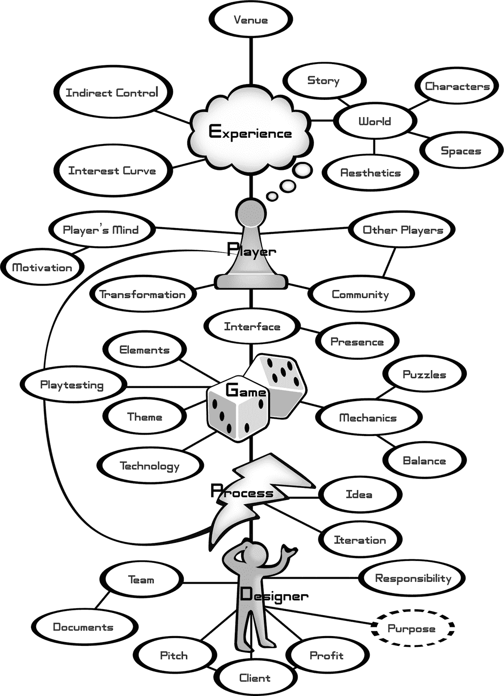

# 第 35 章：每位设计师都有其使命

1922 年，鲁德亚德·吉卜林受多伦多大学之托，创作了一项仪式，以帮助毕业工程师铭记他们造福社会的义务。在这项至今仍在举行的庄严仪式结束时，工程师会获得一枚铁戒，戴在惯用手的小指上，作为对这一义务的终身提醒。

总有一天，游戏设计师可能会创造属于他们自己的义务仪式，但你没有时间等待那一天。你的义务从今天开始——就从这一刻起。如果你真心相信游戏能帮助人们，那么，请——拿好这枚戒指。它是隐形的，就像我的一样——这样你就不会弄丢它。如果你愿意承担作为游戏设计师所附带的责任，那么你就应该戴上它。把它戴在身上作为提醒，让这些责任指引你的手。不过，在戴上戒指之前请三思，因为它一旦戴上就摘不下来了。哦——如果你仔细看，会发现它刻着这行铭文：

## 延伸阅读

*   **《杀死怪物》** 作者：杰拉德·琼斯。一本引人入胜的探索之作，论述暴力游戏为何是儿童健康成长的必需。
*   **《别教孩子杀人》** 作者：戴夫·格罗斯曼中校和格洛丽亚·德加埃塔诺。这本颇具争议但发人深省的书，对暴力媒体的负面影响持极端观点。
*   **弗雷德·罗杰斯在国会作证**。这段简短的视频清楚地展示了严肃对待自己媒介的力量。 [`www.youtube.com/watch?v=yXEuEUQIP3Q`](http://www.youtube.com/watch?v=yXEuEUQIP3Q)

**图 35.1**  

### 最深层的主题

在本书开篇，我们谈到倾听是游戏设计师最重要的技能。贯穿全书，我们探讨了倾听的各个侧面：倾听你的受众、你的游戏、你的团队和你的客户。

但现在，是时候谈谈最重要的一种倾听——倾听你自己。你可能会觉得倾听自己很容易。但我们的潜意识藏着许多秘密。我们常常做些事情，却不知所以然。比如说，为什么游戏设计对你如此重要？你知道原因吗？你可能会觉得这种自我反省的时间可以留到以后。但不行，因为生命很短暂。转眼间，你会抬头发现自己已无时间可用。因为时间会毁灭一切，夺走一切。就像坡的渡鸦，它嘲弄你，发出“永不复焉”的狂笑，滑入夜色中。你无法阻止它。你唯一的希望是趁现在还能行动时，去做你重要的工作。你必须像死神在身后追赶一样奔跑，因为死神就在你身后。快——拿好这枚透镜，以免遗忘。

但什么是那项重要的工作？你如何能知道？这就是为什么你必须学会倾听自己。你内心深处藏着某个重要的使命，你必须弄清它是什么。一定有某种理由，让你不惜一切麻烦，试图设计出伟大的游戏。也许是因为你在心灵深处看到了什么，觉得那能改变某人的一生。也许是因为你曾经历过某种美妙的事，想要与世界分享。也许是因为可怕的事情发生在你所爱的人身上，你想确保这种事永远不再发生在任何人身上。除了你没人能知晓这个使命，也没人需要知道，只有你自己。我们讨论过，如果你知道游戏的主题，游戏会强大得多；但你知道你自己的个人主题吗？你必须尽快弄清它，因为一旦知晓，你将经历一次重要的创造性转变：你的意识动机与潜意识动机将合二为一，你的工作将获得无以复加的激情、专注和强度。

为了帮你找到真正的动力，请拿好这最后一枚透镜。
