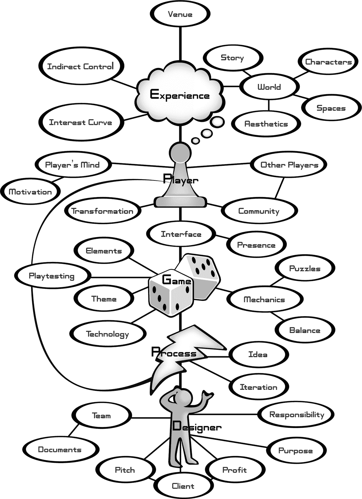

# 第 36 章：告别

**图 36.1**  

### 所有美好的事物……

> *人永远不会老到无法设定新目标或做新梦。*
>
> —C·S·刘易斯

天哪！看看时间！我说得够长了，足以填满一整本书。太感谢你光临了——我真的很享受和你这样深思熟虑、富有洞察力的人谈论这些话题。对了，你提到的那个巧妙的变位词是什么来着？如果我把“art of game design”（游戏设计的艺术）的字母打乱，会拼出“ragged……”（衣衫褴褛……）什么的？哦，是的！真聪明！我得记下来！

你有地图了吗？戒指？还有所有的透镜？好，好。不，真的，你可以留着它们——只要你答应会用它们。你可以在亚马逊上搜索“deck of lenses”（透镜牌组）找到实用的透镜卡牌，或者在安卓或 iOS 应用商店搜索相同关键词下载免费的“透镜牌组”应用。更多详情请访问 [artofgamedesign.com](http://artofgamedesign.com)。如果你想了解我的动向，可以访问 [jesseschell.com](http://jesseschell.com)。

祝你之前提到的游戏顺利——听起来真有趣！做好告诉我，什么时候能让我们试玩！

再次感谢你的光临，非常感谢你的倾听。保持联系，好吗？

毕竟，我们游戏设计师得团结在一起。

# 致谢

这是一个漫长的项目，现在出到第三版，时间跨度更长了。许多人慷慨相助，让它得以诞生；我知道我肯定会漏掉一些人。

我的挚爱奈拉和艾玛，你们一直鼓励我，包容我多年来发呆、记笔记，而那些时间本该用来割草、洗碗，或扑灭后院的火灾。

我的母亲苏珊·法林格，在我十二岁时，不知怎么就明白了《龙与地下城》非常、非常重要。

我的弟弟本，教我玩《雷霆》，这是他四岁时在梦中发明的纸牌游戏。

杰夫·麦金利，感谢他把整个冰淇淋甜筒塞进嘴里。还有包容我四十年。

里根·海勒，在无数餐厅、飞机和会议室与我共度无数小时，为卡牌上的透镜图像构思可视化创意，设计卡牌版面，并负责书中多个方面的平面设计。

金·凯泽和丹·林，不知怎么挤出时间设计了第二版封面。

Schell Games 全体员工，提供了宝贵反馈，并假装不在意我为赶书而缺席会议。特别感谢肖恩·帕顿，测试大师，极大地改进了测试章节。WUBALEW 永远。

艾玛·贝克，承担了所有灰姑娘式的琐事——排版卡牌、协调卡牌插画师、清理整理书中图片、追踪版权持有者，甚至清理壁炉里的灰烬。

第一版：Elsevier/Morgan Kaufmann 团队，慷慨允许一个两年期的项目拖了五年：蒂姆·考克斯、乔治亚·肯尼迪、贝丝·米莱特、保罗·戈特雷尔、克里斯·辛普森、劳拉·莱文和凯瑟琳·斯宾塞。

第二版：Taylor & Francis 团队，特别是里克·亚当斯和玛莎·普罗宁，让本应六个月完成的编辑工作变成了十八个月的大修。

第三版：又是 Taylor & Francis，这次还有 codeMantra 的索菲亚·布奥诺，还有里克·亚当斯再一次的极度耐心，现在还有杰西卡·维加。又一次，本应六个月，却花了我两年。还有——彩色印刷！谢谢！再也，感谢乔什·亨德里克斯设计了漂亮的新橙蓝封面。

芭芭拉·张伯林，给予情感支持，帮我更好地理解测试，并耐心忍受我们项目的延期，因为我在本书上花费太久。

# 致谢

迪士尼 VR 工作室的所有人包容了我那些年絮絮叨叨的理论废话，尤其是 Mike Goslin、Joe Shochet、Mark Mine、David Rose、Bruce Woodside、Felipe Lara、Gary Daines、Mk Haley、Daniel Aasheim 和 Jan Wallace。

Katherine Isbister 在多方面担任了我的导师，部分归功于她撰写了本系列的第一本书 *Better Game Characters by Design*（《设计更好的游戏角色》），同时也感谢她在写作过程中给予我的实际、技术和精神支持。

卡内基梅隆大学娱乐技术中心的员工、教职工和学生们慷慨地让我教授游戏设计和构建虚拟世界课程，这迫使我弄清了所有这些东西。特别感谢 Don Marinelli、Randy Pausch、Brenda Harger、Ralph Vituccio、Chris Klug、Charles Palmer、Ruth Comley、Shirley Josh Yelon、Mike Christel、Scott Stevens、John Dessler、Dave Culyba、Mk Haley、Anthony Daniels、Jessica Trybus、John Wesner、Carl Rosendahl、Ji-Young Lee、Shirley Yee 和 Drew Davidson。特别感谢 Drew Davidson 的详细笔记，以及 John Dessler，他是第一个真正欣赏这本书的人。

Randy Pausch 值得双倍的感谢，因为他的魔法透镜让他看到我能做到这一点，而当时我自己不相信我能。谢谢，Randy。

## 尾注

### 你好

第 xxxiii 页——Maxwell H. Brock：Roger Corman 经典电影 *A Bucket of Blood*（《血桶》，1959）中的一个角色。

第 xxxix 页——我们不妨省去对自然的研究，因为她太古老了。

——Henry David Thoreau，*Walden*（《瓦尔登湖》）

### 第 1 章：设计师

第 2 页——"当一件事必须尝试时，绝不能考虑可能性或不可能性。" 我从 C.S. Lewis 的 *Mere Christianity*（《纯粹基督教》）中借用了这句话。

第 2 页——"他们缺乏对嘲笑的恐惧。" 由 Cary Evans 指出。

第 3 页——"Animation 意为 '赋予生命'。" 感谢 Ben Johnson 提醒我这一点！

第 5 页——"Brian Moriarty 曾指出……" 他在 1997 年 GDC 的演讲"听！共享幻觉的潜力"中说过这句话。关于这个词源存有疑问。

第 6 页——"用宁静的心去倾听……" Herman Hesse，*Siddhartha*（《悉达多》）。1922 年。

### 第 2 章：体验

第 13 页——"心理学、人类学和设计学。" 我很惊讶地发现其他来源也强化了这三位一体。George Santayana 在 *The Sense of Beauty*（《美感》）中构建了一个类似的三位一体：心理学家、人类学家和艺术家。Marc Prensky 在 *Digital Game Based Learning*（《数字游戏学习》）中谈到了通往知识的三条路径："分析路径，哲学家在其中反思、调停并理解客体和事件；实证路径，科学家在其中操纵变量并进行控制实验以验证可靠原则；以及实用路径，实践者在其中与现实世界的挑战抗争并提出高效绩效的策略。" 分析对应人类学，实证对应心理学，实用对应设计。

第 11 页——鱼的漫画由 Reagan Heller 提供。

第 15 页——"Xenophilic"（好外物的）如果你喜欢，也可以说 "xenophilous"。

第 16 页——"例如，苏格拉底指出……" 柏拉图的 *Phaedo*（《斐多篇》）。

第 16 页——"……当我们对体验质量下结论时，可以自信地信任我们的感觉和直觉。" 这里引用 G.K. Chesterton 的话很相关："一个人只有成为天文学家才能理解天文学；只有成为昆虫学家（或者也许是昆虫）才能理解昆虫学；但仅仅作为一个人，就能理解很大一部分人类学。他本人就是他所研究的动物。因此，在人种学和民间传说的记录中到处都能看到这样一个事实：那种在天文学或植物学研究中导致成功的冷漠超然精神，在神话学或人类起源的研究中却导致灾难。为了对微生物做出公正评价，必须不再做人；但为了对人类做出公正评价，却不必不再做人。那种同样的压抑同情心、摒弃直觉或猜测的做法，能让人在处理蜘蛛胃部时异常聪明，却会让人在处理人心时异常愚蠢。"（出自 G.K. Chesterton 的《科学与野蛮人》，收录于 *Heretics*（《异端者》）。）

第 18 页——"他只是无法清晰地剖析自己的经历。" 是的，Jeff，说的就是你。

第 19 页——"战胜海森堡" Ben Johnson 建议另一种内省类别：寻找你第一次沉浸在自己游戏中的时刻。

第 19 页——"这一原则，参照海森堡不确定性原理……" 感谢 Benjamin Landorff 帮助润色措辞，使其不那么惹挑剔的物理学极客讨厌。

### 第 3 章：场地

第 26 页——感谢 Dan Burwen 启发了这一章，也感谢我的 Facebook 朋友们讨论它！

### 第 4 章：游戏

第 36 页——"我想没人会不同意这一点。" 实际上，几页后 Bernard Mergen 就会不同意。看我说的什么意思？没有共识？

第 37 页——"参与者接受了糖水喷雾……" Berns, G.S., S.M. McClure, G. Pagnoni, and P.R. Montague. "Predictability modulates human brain response to reward." *Journal of Neuroscience* April 15, 2001, 21(8), 2793–2798.

第 38 页——"这是个棘手的问题。" 不只我这么想。看看这个："……游戏的本质长期以来一直困扰着哲学家和心理学家。" Trevarthen, C. Infancy, mind in. In *The Oxford Companion to the Mind*（《牛津心智指南》）。Oxford University Press, Oxford, U.K., 2004, p. 460.

第 38 页——"游戏指那些活动……" Gilmore, J.B. Play: A special behavior. *In Child's Play*（《儿童游戏》），Herron, R.E. and B. Sutton-Smith (eds.) John Wiley & Sons, New York, 1971, p. 311.

第 38 页——"游戏是在更严格结构中的自由移动。" Salen, K. and E. Zimmerman. *Rules of Play*（《游戏规则》）。MIT Press, Cambridge, MA, 2004, p. 304.

第 39 页——"游戏是任何自发且为其自身而做的事。" Santayana, G. *The Sense of Beauty*（《美感》）。Charles Scribner's Sons, New York, 1896, p. 19.

第 39 页——"游戏，竞技游戏，有赢家或输家……" Mergen, B. *Play and Playthings*（《游戏与玩具》）。Greenwood Publishing Group, Westport, CT, 1983.

第 39 页——"在每一项必须完成的工作中……" Sherman, R.M. and Sherman, R.B. "一勺糖" 出自 *Mary Poppins*（《欢乐满人间》）。Walt Disney Pictures, 1964.

第 39 页——"他必须执行的任务……" Csikszentmihalyi, M. *Flow*（《心流》）。Harper & Row, New York, 1990, p. 39.

第 40 页——"工作与游戏……变得等同于奴役与自由。" Santayana, G. *The Sense of Beauty*（《美感》）。Dover, New York, 1955, p. 19.

第 40 页——"这是一切游戏的不变原则……" Carse, J.P. *Finite and Infinite Games*（《有限与无限的游戏》）。Ballantine Books, New York, 1986, p. 4.

第 41 页——"许多人试图定义'游戏'。" 在 *Rules of Play*（《游戏规则》）的第 7 章中，Salen 和 Zimmerman 对提出的许多定义进行了出色的分析，我在此不再赘述。不出所料，这些定义几乎没有达成共识。

## 第 4 章

第 41 页——“游戏是自愿控制系统的演练……” Avedon, E. and B. Sutton-Smith. (eds.) *The Study of Games*. John Wiley & Sons, New York, 1971, p. 405.

第 42 页——“[游戏是]一种内生意义的互动结构……” Costikyan, G. *I Have No Words, and I Must Design*. (version 2), p. 24.

第 44 页——“然而，这些分数毫无用处……” 或者，如果它们有其他用途，我永远也想不出来！

第 44 页——“游戏是一个封闭的形式系统……” Fullerton, T., C. Swain, and S. Hoffman. *Game Design Workshop*. CMP Books, San Francisco, CA, 2004, p. 37.

第 45 页——“Johan Huizinga 称之为‘魔法圈’” Johan Huizinga, *Homo Ludens*。

第 49 页——“关于游戏的全部真相……” Lehman and Witty, *Psychology of Play*, 第 1 章, 1927.

## 第 5 章：要素

第 52 页——“当她四处寻找新物体时……” 她最终还是难倒了我：“爸爸，羽毛是由什么组成的？”（答案：“角蛋白。”）

第 55 页——“……很难让人们相信这四个要素是平等的。” 我曾在一次演讲中展示过四元素框架，有个学生质问我：“我听过皮克斯动画师的演讲，他们坚持认为‘在皮克斯，故事至上，故事最重要。’ 你是说这在游戏里不成立吗？” 我回答不仅在游戏里不成立，在皮克斯也不成立。皮克斯团队选择制作《玩具总动员》是因为关于塑料玩具的故事是任何人能讲的最好的故事吗？不——他们选它是因为当时的技术无法让他们讲述关于人类的引人入胜的故事。但塑料玩具，他们能渲染。所以在那种情况下，技术是第一位的，但随后故事被用来支撑技术，就像所有伟大的事物一样，不同的要素相互支撑。

第 56 页——“……入侵军队的速度就越快。” 维基百科注：“速度的变化在一波开始时很小，但在接近尾声时却很剧烈。这一现象最初是游戏编写方式导致的无意结果——随着程序需要移动的外星人越来越少，运行速度越来越快，但开发团队发现这很受欢迎，便保留了下来。” 感谢 Ben Johnson 指出这一点！

## 第 6 章：主题

第 63 页——“迪士尼 VR 工作室” 该团队过去属于华特迪士尼幻想工程部，但后来并入了迪士尼在线工作室。

第 64 页——“Yo ho, yo ho, a pirate’s life for me.” “Yo Ho (A Pirate’s Life For Me).” X. Atencio and George Bruns, 1967.

第 66 页——“一位风趣的绅士……” 那是 Greg Wiatroski。还能是谁？

“……演职人员……” 这是迪士尼用来代替“员工”的术语。

第 68 页——“这部电影深深打动了观众……” 打动到他们贡献了 6 亿美元的票房。

第 68 页——“当 Stephen King 写他著名的小说 *Carrie* 时……” Stephen King 在他那本极好的书 *On Writing: A Memoir of the Craft*（第 195-200 页）中详细谈到了这件事。

## 第 7 章：构思

第 74 页——“……我的把戏库存仅限于两个……” 反向瀑布和“抓捕”。我是从 Carlo 的 *The Juggling Book* 里学会这两个的。

第 78 页——“……在四元素的哪些部分？” (1) 技术。“桌游”和“磁铁”已经确定。(2) 故事。(3) 美学——但要小心——这款游戏需要*感觉*像一幅超现实主义画作。它需要*看起来*像一幅吗？(4) 机制。你可能会说技术，但也许改进的办法是使用新技术。

第 81 页——“有一位缪斯女神……” King, S. *On Writing.* Scribner, New York, 2000, pp. 144–145.

第 86 页——“漫画家 Lynda Barry 坚持认为……” Lynda Barry. *What It Is*。

第 88 页——“拯救鲸鱼！收集全套！” 感谢 Randy Nelson，又名 Alyosha Karamazov，提供的这个梗。

第 90 页——“……像 Athena 一样……” 去读读神话吧！

第 92 页——“……大多数小组进行头脑风暴的方式完全错了。” 参见 Jonah Lehrer 在 *The New Yorker* 上的文章 “Groupthink: The Brainstorming Myth”，2012 年 1 月 30 日。

## 第 8 章：迭代

第 96 页——“最佳猜测，Sulu 先生。” 这是一个极客式的 *Star Trek*（星际迷航）梗。

第 101 页——“……Winston Royce，撰写论文的人……” Royce, W. Managing the development of large software systems: Concepts and techniques, Proceeding WESCON, IEEE Computer Society Press, Los Alamitos, CA, 1970.

第 102 页——“……Barry Boehm 提出了一个不同的模型……” Boehm, B. A spiral model of software development and enhancement, ACM SIGSOFT Software Engineering Notes, August 1986.

第 103 页——“……螺旋模型的许多后裔……” 其中包括 Scrum、ROPES 和喷泉模型。

第 111 页——“……你可以闪电般快速地完成一切！” 第 7 章：原型制作，在 Fullerton、Swain 和 Hoffman 合著的 *Game Design Workshop* 一书中有制作纸质原型的绝佳技巧。

第 113 页——“游戏设计师 David Jones……” 这些引语来自他在 DICE 2001 上的演讲。

第 118 页——“……从未完成——只被遗弃。” Paul Valery 这是在谈论诗歌，但对于游戏设计同样适用。

第 118 页——“……Mark Cerny……”“The Method” Cerny 是从动作平台游戏的参考点出发的。对于其他类型的游戏，你需要自己决定什么相当于“两个可发布的关卡”。 `http://www.gamasutra.com/features/slides/cerny/index.htm`。

## 第 9 章：玩家

第 123 页——“如果你正在为目标受众创建游戏……” 有些成年人很难回忆起某个年龄段的童年是什么样的。如果你问某人“八岁时你最喜欢的书是什么？”，他们往往一片空白。如果你改问“三年级时你最喜欢的书是什么？”，他们就能更容易地回忆起来。如果你也是这种情况，那就记住这个简单规则：从年龄换算年级，只需减去五。这样，当有人问“什么游戏适合 10-12 岁的孩子？”时，你就能通过思考你和你的朋友在 5、6、7 年级喜欢什么，自动调取你的记忆。

第 126 页——Peter Pan and Wendy 引语：来自 2003 年电影 *Peter Pan*。

第 128 页——“……男性通常比女性拥有更强的空间推理技能……” Hilmar Nordvik, Benjamin Amponsah. “Gender differences in spatial abilities and spatial ability among university students in an egalitarian educational system,” Sex Roles: A Journal of Research, June 1998. `http://www.findarticles.com/p/articles/mi_m2294/is_n11-12_v38/ai_21109782`。

第 128 页——Heidi Dangelmeier 引语：引用自 Beato, G. 1997. “Computer Games for Girls Is No Longer an Oxymoron.” Electrosphere, 5.04, April. `http://www.wired.com/wired/archive5.04/es_girlgames-pr.html`。

第 128 页——“售出的所有虚构类书籍中 1/3 是言情小说” `http://www.en.wikipedia.org/wiki/Romance_novel`。

### 第九章 末尾注释

第 128 页 — “…《龙腾世纪：审判》拥有比平均动作 RPG 更多的女性玩家…” <https://quanticfoundry.com/2017/01/19/female-gamers-by-genre>.

第 130 页 — “孩之宝游戏 Pox 的设计师…” Tierney, J. “Here Come the Alpha Pups.” *New York Times*, August 5, 2001.

第 133 页 — “LeBlanc 的游戏快感分类法” 该分类法由 Robin Hunicke、Marc LeBlanc 和 Robert Zubek 在“MDA: A Formal Approach to Game Design and Game Research”中提出。Greg Costikyan 在“I Have No Words and I Must Design”中对此进行了更详尽的解释。

### 第十章：玩家的心智

第 140 页 — “考虑这种模式” 摘自 Jaynes, J. *The Origin of Consciousness in the Breakdown of the Bicameral Mind*. Dover, New York, 1976, p. 40.

第 144 页 — “一种完全投入且精力充沛的专注感…” <http://en.wikipedia.org/wiki/Flow_%28psychology%29>.

第 144 页 — Ben Johnson 关于心流的注记：一些 EA 体育游戏通过让化身在“心流”状态下做出超人类的动作，来创造“虚拟心流”。

### 第十一章：动机

第 154 页 — “Abraham Maslow 写过一篇论文…” Maslow, A. A theory of human motivation. *In Psychological Review,* 50, 370–396.

第 154 页 — 关于马斯洛需求层次理论的注记：有趣的是，该层次理论甚至在游戏内部也起作用——我的首要任务是让我的角色生存，等等。

第 155 页 — “与游戏特别相关的是 Edward Deci 和 Richard Ryan 的研究…” 如果您想了解更多关于这项研究的信息，维基百科上关于自我决定理论的条目是一个很好的起点。

第 157 页 — “一些心理学家试图说明…” 我通过与 Scott Rigby 的交谈开发了这个特定的图表。

第 157 页 — “在一项著名研究中，两组孩子被要求画画。” 您可以在 Alfie Kohn 的著作《被奖励惩罚的孩子》中阅读更多相关内容。

第 158 页 — “我正在读一本关于神经科学的书…” 那是 Kringelbach 和 Berridge 合著的《大脑的愉悦》。

第 159 页 — “…试着把每一个都放在一个矩阵上…” 这个正交矩阵是我自己的想法（没人需要为此背锅），但在 Sebastien Deterding 和 Scott Rigby 的帮助下，我对其进行了完善。

第 161 页 — “每一款成功的游戏都是新颖与熟悉的混合体。” 我曾在 Bing Gordon 访问 ETC 时听他说过这句话，从此印象深刻。

### 第十二章：游戏机制

第 173 页 — “控制时间。” 如果不是得益于乐于助人的 Dan Stubbs，我不会想到这一节。

第 177 页 — “…全在于猜测对手私有属性的状态。” 想象一下，如果您不知道哪些地产上有房子和旅馆，《大富翁》会有多么不同（可能的练习）。

第 177 页 — “Celia Pearce 指出了另一种信息…” Celia, P. *The Interactive Book*. MacMillan Technical Publishing, Indianapolis, IN, 1997, p. 423.

第 183 页 — “…导致文本冒险游戏失宠。” 这个想法是 Phillip Saltzman 在为我在卡内基梅隆大学的游戏设计课写的一篇文章中建议给我的。

第 184 页 — Parlett 的规则分析：David Parlett, *Rules OK*. <http://www.davpar.com/gamestar/rulesok.html>.

第 184 页 — “基础规则”：Zimmerman 和 Salen 称之为“构成规则”（《游戏设计艺术》，第 130 页）。David Parlett 倾向于使用“基础规则”一词，我也是。 “不成文规则”：Steven Sniderman. Unwritten Rules. <http://www.gamepuzzles.com/tlog/tlog2.htm>.

第 185 页 — “考虑这些玩《铁拳 5》的比赛规则…” 这些是 2005 年 Penny Arcade Expo (PAX) 的规则。

第 186 页 — “Sid Meier 提出了一个极好的经验法则”：Sid Meier. *Three Glorious Failures*. DICE 2001 (video).

第 202 页 — “…哪些格子被踩到的频率最高？” 按顺序，被踩到频率最高的前三个格子分别是伊利诺伊大道、起点和 B&O 铁路。 Brady, M. *The Monopoly Book*. David McKay Company, New York, 1975, p. 92. 不要忘记在你的模拟中加入机会卡和社区基金卡！

第 205 页 — Tversky 的引言见于：William F. Altman. “Determining Risks with Statistics—and with Humanity.” *Baltimore Sun*, October 13, 1985, p. 50.

第 206 页 — “Tversky 让人们估计各种原因的可能性…” 摘自 Bernstein, P.L. *Against the Gods: The Remarkable Story of Risk*. John Wiley & Sons, New York, 1996, p. 279. 他引用自 Tversky 的一篇论文。

### 第十三章：平衡

第 212 页 — “不平等的战斗没有乐趣。” 正如 Nancy Brelis 的《木乃伊市场》中 Cavour 夫人所说。

第 217 页 — “《异形大战铁血战士》” 感谢 James Portnow 提供这个不同寻常的例子。

第 221 页 — “Michael Mateas 指出…” Interactive Drama, Art, and Artificial Intelligence 2002. Mateas, M. PhD thesis. Technical Report CMU-CS-02–206, School of Computer Science, Carnegie Mellon University, Pittsburgh, PA. December 2002.

第 222 页 — “三角性” 我第一次在 Chris Crawford 的著作《计算机游戏设计艺术》中看到这个词。他使用它的方式与我略有不同。

第 236 页 — “暴雪游戏《暗黑破坏神》的一个绝佳例子…” 源自 Bill Roper 在 DICE 2004 上发表的名为“Benefits of Rewarding Gamers”的演讲。

第 238 页 — “看来完美是达到…” 摘自 Antione de Saint Exupery 的《人类的大地》（又译《风沙星辰》）。

### 第十四章：谜题

第 252 页 — “年轻时的 Chris Crawford 曾做出大胆断言…” Crawford, C. *The Art of Computer Game Design*. Osborne/McGraw Hill, Berkeley, CA, 1984, p. 7.

第 253 页 — “谜题很有趣，且有正确答案。” 什么是谜题？ <http://www.scottkim.com/thinkinggames/whatisapuzzle/index.html>.

第 256 页 — “考虑 Sam Loyd 著名的 15 谜题…” 当然，Sam Loyd 实际上并没有发明这个谜题，但他成功地为自己争取了一个多世纪的发明权，正如 Jerry Slocum 和 Dic Sonneveld 所著《The 15 Puzzle》中所解释的。

第 258 页 — “研究表明可见的进度…” 参见 Teresa M. Amabile 和 Steven J. Kramer 的“The Power of Small Wins”，《哈佛商业评论》，2011 年 5 月。

### 第十五章：界面

第 270 页 — “有时，虚拟层薄到几乎不存在…” 喜欢用希腊词的人称虚拟界面为“diegetic interface”（叙事界面/内嵌界面），这是从声音设计领域借用的术语。“Diegetic”音效和音乐是观众能听到但电影角色听不到的。虚拟界面是一个很好的类比。

第 280 页 — “juicy（多汁/反馈丰富）：” 我第一次在 CMU 的实验性游戏玩法研究团队那里听到这个术语：Kyle Gabler、Kyle Gray、Matt Kucic 和 Shalin Shodhan。他们制作了许多 juicy 的游戏。

### 第十六章：兴趣曲线

## 尾注

### 第 16 章

第 298 页——“那是当地一个游乐园的表演剧团。” 事实上，那是位于马萨诸塞州阿加旺的河滨公园，现在是新英格兰六旗乐园。我的命运与那个公园紧密相连——我的祖父母在 1930 年代在那里初次相识。哦——那是一个保罗·奥斯本的表演剧团。

第 303 页——“《阿拉丁魔毯》虚拟现实体验的 Mark 2 版本。” 虽然本书付印时 Mark 3 版本仍可在奥兰多的 DisneyQuest 体验，但 Mark 2 版本已于 1997 年关闭。

第 304 页——“《半衰期 2》，有史以来媒体评价最高的游戏之一。” Metacritic 评分 96 分——相当不错了。[`www.metacritic.com`](http://www.metacritic.com)。

第 304 页——“……玩家死亡人数图表……” 来源：[`www.steampowered.com/stats/ep1/`](http://www.steampowered.com/stats/ep1/)。

### 第 17 章：故事

第 324 页——“怎么能把*罗密欧与朱丽叶*做成游戏……” 我当时正和克里斯·克劳福德讨论这个想法，他半开玩笑地提到，或许上帝让时光旅行在我们的宇宙中变得不可能，是为了确保我们的决定有意义。我至今仍常因思考此事而彻夜难眠。

第 324 页——“……确实必须足够聪明。” MMO 没有存档点——因此也没有时光旅行。最感人、最戏剧化的游戏体验很可能正因如此而来自这种媒介。

第 333 页——“正如鲍勃·贝茨所言：“ 出自*《走进森林：英雄之旅实用指南》*。

第 338 页——“……当我在*《金银岛》*地图上停顿时……” *《写作的艺术》*，罗伯特·路易斯·史蒂文森著，第 5 章。

### 第 18 章：间接控制

第 345 页——“……尽管我用尽狡猾手段限制他们的选择……” 更多信息请看希娜·艾延加的这场 TED 演讲：[`www.ted.com/talks/sheena_iyengar_choosing_what_to_choose`](https://www.ted.com)。

第 349 页——“但随后美术总监想出了一个主意。” 那是加里·戴恩斯。

第 353 页——“餐厅经常使用这种方法……” Areni, C.S., and Kim, D. “背景音乐对购物行为的影响：酒类商店中的古典音乐对比流行音乐”，《消费者研究进展》，1993，20，336–340。关于音乐对购物行为影响的更多研究。

第 354 页——“……仅玩一次这个游戏就要 20 美元。” DisneyQuest 最初采用“按项付费”模式，“一票制”模式是可选的。从长远来看，“一票制”模式胜出了。

第 355 页——“……我们绘制了一张初步地图。” 动画总监布鲁斯·伍德赛德绘制了这张地图。

第 359 页——“中国哲学家老子写道……” 出自*《道德经》*。

### 第 19 章：世界

第 363 页——“所有宝可梦产品的总销售额” [`en.wikipedia.org/wiki/List_of_highest-grossing_media_franchises`](https://en.wikipedia.org)。

### 第 20 章：角色

第 379 页——“……一个小而精炼的特质列表，概括了该角色。” 大卫·弗里曼因倡导这种方法而闻名，他称之为“角色钻石”。

第 380 页——“这个复杂的图表……” 出自凯瑟琳·伊比斯特的*《设计更好的游戏角色》*第 26 页。

第 385 页——“流浪汉：‘喂！你要去哪儿？’” *《即兴表演》*，基思·约翰斯通著，第 36 页。

第 388 页——“我们也是唯一会脸红的动物……” 或者正如马克·吐温指出的，是唯一需要脸红的动物。

第 388 页——“……唯一会哭泣的动物。” 有人说大象也会哭。大概是因为这些笑话吧。

第 391 页——*《夜色温柔》*。 我为清晰起见略微编辑了这段文字。抱歉，妮可。

### 第 21 章：空间

第 400 页——“想象一下你在一个冬日的午后……” 克里斯托弗·亚历山大。*《建筑的永恒之道》*，第 32–33 页。

第 403 页——“在最深刻的中心……” Alexander, C. *《生命的现象》*，第 222 页。

第 405 页——图 21.2 由欧内斯特·亚当斯提供。

第 408 页——“……由《马克思·佩恩》的设计师们开创……” Aki Maatta 的《马克思·佩恩的写实关卡设计》。[`www.gamasutra.com/features/20020508/maatta_01.htm`](http://www.gamasutra.com/features/20020508/maatta_01.htm)。

第 409 页——“……魔鬼藏在细节里。” 也有人是说上帝在细节里。坦白说，我开始怀疑他们是同一个人。

### 第 22 章：临场感

第 418 页——“我们的大脑中有一个特殊的核团，负责关注靠近我们身体的物体。” [`www.scientificamerican.com/article/debate-2016-what-goes-on-in-your-brain-when-people-invade-your-personal-space/`](https://www.scientificamerican.com)。

第 422 页——“……在兰迪·波许对*《迪士尼阿拉丁魔毯 VR 冒险》*的研究中……” 该研究名为“迪士尼阿拉丁：虚拟现实叙事的第一步”，Pausch 等人，1996 ACM-0-89791-746-4/96/008。

第 420 页——“……当连接的头显数量超过一千万时。” 我的观察是，当世界上有了一千万件某种东西，你的朋友大概率就有一件，从而使社交网络成为可能。我预计我们将在 2022 年或更早达到这个数字。

### 第 23 章：美学

第 434 页——“远山。” 感谢特德·埃利奥特提供这个故事。[`www.ugo.com/ugo/html/article/?id516210&sectionId588`](http://www.ugo.com)。

### 第 24 章：其他玩家

第 440 页——“一小时的游戏比一年的交谈更能让你了解一个人。” 这句名言常被归于柏拉图，并被认为出自《理想国》。但老实说，我在那里找不到这句话。

### 第 25 章：社区

第 444 页——“两位旨在更好地理解……的心理学家” McMillan D.W. and D.M. Chavis, 1986. “社区感：定义与理论”，第 16 页。

第 444 页——“艾米·乔·金对社区的简明定义……” Kim, A.J. *《网络社区建设》*，第 28 页。

第 451 页——“像*《模拟人生》*和*《上古卷轴 5：天际》*这样的游戏……” 感谢亨伯托·塞韦拉指出*《天际》*作为例子。

第 455 页——“Xbox One 上的 2K14 会判技术犯规……” 感谢马克·汤姆扎克提供的提示。

### 第 26 章：团队

第 462 页——“把它想成……一款面向目标受众的游戏。” 当然，这才是你一直以来应该有的思维方式！

第 463 页——“你可能会惊讶于自己内心开始发生的转变。” 我从 C.S. 路易斯的*《纯粹基督教》*中得到这个想法。

第 468 页——“如果你把一个好点子给一个平庸的团队……” [`news-service.stanford.edu/news/2007/february7/pixar-020707.html`](http://news-service.stanford.edu)。

### 第 27 章：文档

第 472 页——杰森·范登伯格语录：来自私人通信。

第 474 页——里奇·马穆拉语录：来自私人通信。

### 第 28 章：测试

第 487 页——库尔特·贝雷顿语录：来自私人通信。

### 第 28 章

第 491 页——“……如果你使用五点量表……” 这种量表通常被称为李克特量表，如果你想听起来很懂行的话。大多数人将其发音为“Like-urt”，但李克特博士本人发音为“Lick-urt”，所以基本上随你喜欢。也许我们应该让人们在一到五分的量表上给这两种发音打分。

第 495 页——引自芭芭拉·张伯林的演讲“竭力制作不烂的游戏”。[`https://www.youtube.com/watch?v=qx6lpeaUPSc`](https://www.youtube.com)。

### 第 29 章：技术

第 500 页——“……另一部早六个月发布的米老鼠动画片。” 什么，你不信我？[`http://en.wikipedia.org/wiki/Mickey_Mouse`](http://en.wikipedia.org)。

第 503 页——“没人知道它到底怎么样，但大家都说它很棒。” 这是 They Might Be Giants 乐队关于炒作周期的歌曲《螺旋形状》中的一句歌词，以防你想，你知道的，唱唱炒作周期。

### 第 30 章：客户

第 517 页——“佛罗伦萨，1498 年。” 我最喜欢的关于米开朗基罗的故事讲述见于罗伯特·格林和约斯特·埃尔弗斯合著的《权力的 48 条法则》。

### 第 31 章：推销

第 523 页——“$0.083” 当然就是“十几个一角钱”（货比三家/廉价货）的价格。

### 第 32 章：利润

第 537 页——“当消费者购买一款 50 美元的零售游戏大作时……” 数据来源于《游戏开发导论》（Steve Rabin 编，2005 年，Charles River Media 出版，第 862 页）中 Kathy Schoback 撰写的“游戏行业角色与经济学”。

第 543 页——“一项研究发现 50% 的游戏收入来自 0.15% 的玩家。” [`http://landingpage.swrve.com/0114-monetization-report.html`](http://landingpage.swrve.com)。

### 第 33 章：转化

第 551 页——“最近的研究表明脑力锻炼的健康益处……” 例如 [`http://www.jhsph.edu/publichealthnews/articles/2006/rebok_mentalexercise.html`](http://www.jhsph.edu)。

第 551 页——“有人持观点认为教育是严肃的……” 这些人通常会被语义安抚：虽然他们可能觉得“娱乐游戏”不可接受，但往往认为“引人入胜的模拟”是宝贵的工具——同一回事，换个名字而已。

第 552 页——“普通高中校长的平均年龄为 49 岁，数据来自 [`http://nces.ed.gov`](http://nces.ed.gov)。”

第 554 页——“百丈想派一位僧人……” 出自《无门关》，慧开（号无门）著，千玄泉、保罗·雷普斯译 \[1934\]。

第 554 页——“米勒学习金字塔……” Miller, G.E. The assessment of clinical skills/competence/performance. *Academic Medicine* 1990, S63–S67.

第 555 页——“……线性媒介是传达复杂关系系统极其困难的方式。” 写这本书就是个例子，绝非易事！

第 555 页——“Impact Games 的《制造和平》” [`http://www.peacemakergame.com`](http://www.peacemakergame.com)。

第 563 页——“有问题的使用” 比“成瘾”更技术正确的术语，后者有特定的医学定义。

第 563 页——“Nicholas Yee 进行了一项非常深入的研究……” “Ariadne—Understanding MMORPG Addiction” by Nicholas Yee, October 2002 ([`http://www.nickyee.com/hub/addiction/home.html`](http://www.nickyee.com))。

### 第 34 章：责任

第 568 页——“罗杰斯先生” 想了解更多关于这位迷人人物的信息，建议观看 2018 年的纪录片《你愿意做我的邻居吗》。

第 571 页——“1922 年，鲁德亚德·吉卜林受邀……” [`http://en.wikipedia.org/wiki/The_Ritual_of_the_Calling_of_an_Engineer`](http://en.wikipedia.org)。

## 参考文献

1.  Adams, E. and Dormans, J. *Game Mechanics: Advanced Game Design*. New Riders, Berkeley, CA, 2012.

2.  Alexander, C. *The Timeless Way of Building*. Oxford University Press, New York, 1987a.

3.  Alexander, C. *A Pattern Language*. Oxford University Press, New York, 1987b.

4.  Alexander, C. *The Nature of Order: The Phenomenon of Life*. The Center for Environmental Structure, Berkeley, CA, 2002a.

5.  Alexander, C. *The Nature of Order: The Process of Creating Life*. The Center for Environmental Structure, Berkeley, CA, 2002b.

6.  Arijon, D. *Grammar of the Film Language*. Silman-James Press, Los Angeles, CA, 1976.

7.  Aristotle. *The Poetics*. Harvard University Press, Cambridge, MA, 1999.

8.  Arnheim, R. *Art and Visual Perception*. University of California Press, Oakland, CA, 1974.

9.  Bang, M. *Picture This*. Little, Brown, and Company, New York, 1991.

10.  Barry, L. *What It Is*. Drawn and Quarterly, Montreal, 2008.

11.  Barry, L. *Picture This: The Near-sighted Monkey Book*. Drawn and Quarterly, Montreal, 2010.

12.  Bartle, R. *Designing Virtual Worlds*. New Riders, 2004.

13.  Bates, B. *Game Design*, 2nd edn. Course Technology PTR, Boston, MA, 2004.

14.  Bates, B. *Learning Theories Simplified*. SAGE Publications, London, 2016.

15.  Bernstein, P.L. *The Remarkable Story of Risk*. John Wiley & Sons, New York, 1996.

16.  Brathwaite, B. and Schreiber, I. *Challenges for Game Designers: Non-Digital Exercises for Video Game Designers*. CreateSpace Independent Publishing, 2008.

17.  Brotchie, A. *A Book of Surrealist Games*. Shambhala Redstone Editions, Boston, MA, 1995.

18.  Buxton, B. *Sketching User Experiences*. Morgan Kaufmann, Amsterdam, the Netherlands, 2007.

19.  Burak, A. and Parker, L. *Power Play: How Video Games Can Save the World*. St. Martin’s Press, New York, NY, 2017.

20.  Burroway, J. and Stuckey-French, E. *Writing Fiction: A Guide to Narrative Craft*. Pearson, New York, NY, 2007.

21.  Callois, R. *Man, Play, and Games*. University of Illinois Press, Champaign, IL, 2001.

22.  Carse, J.P. *Finite and Infinite Games*. Ballantine, New York, 1986.

23.  Chou, Y.-K. *Actionable Gamification: Beyond Points, Badges, and Leaderboards*. [`YukaiChou.com/OctalysisBook`](http://YukaiChou.com). 2015.

24.  Christensen, C. *The Innovator’s Dilemma: When New Technologies Cause Great Firms to Fail*. Harvard Business Review Press, Cambridge, MA, 1997.

25.  Christensen, C, and Raynor, M. *The Innovator’s Solution: Creating and Sustaining Successful Growth*. Harvard Business Review Press, Cambridge, MA, 2013.

26.  Co, P. *Level Design for Games: Creating Compelling Game Experiences*. New Riders, 2006.

27.  Collins, M. and Kimmel, M.M. (eds.) *Mister Rogers’ Neighborhood: Children, Television, and Fred Rogers*. University of Pittsburgh Press, Pittsburgh, PA, 1996.

28.  Corman, R. *How I Made a Hundred Movies in Hollywood and Never Lost a Dime*. Da Capo Press, New York, 1990.

29.  Costikyan, G. *Uncertainty in Games*. MIT Press, Cambridge, MA, 2013.

30.  Crawford, C. *The Art of Computer Game Design: Reflections of a Master Game Designer*. Osborne/McGraw Hill, Berkeley, CA, 1984.

31.  Crawford, C. *Balance of Power*. Microsoft Press, 1986.

32.  Cruit, R.L. and Cruit, R.L. *Survive the Coming Nuclear War: How to Do It*. Stein and Day, New York, 1984.

33.  Csikszentmihalyi, M. *Flow: The Psychology of Optimal Experience*. Harper & Row, New York, 1991.

34.  Csikszentmihalyi, M. and Csikszentmihalyi, I.S. *Optimal Experience*. Cambridge University Press, Cambridge, U.K., 1997.

35.  Culyba, S. *The Transformational Framework: A Process Tool for the Development of Transformational Games*. ETC Press, Pittsburgh, PA, 2018.

36.  Dali, S. *Fifty Secrets of Magic Craftsmanship*. Dover Publications, New York, 1992.

## 参考文献

37. 德夫林, K. *《未完成的游戏：帕斯卡、费马与改变世界的十七世纪书信》*. 基本书籍, 纽约, 2010.

38. *《发现女孩杂志》*, 2007 年 6–7 月, 第 23 页.

39. 多布林集团. 引人入胜的体验模型. 2007. 网址：[`www.doblin.com`](http://www.doblin.com).

40. 多兹沃思, C. 小. *《数字幻象》*. ACM 出版社—SIGGRAPH 系列, 纽约, 1998.

41. 爱德华兹, B. *《右脑绘画术》*. 塔彻/普特南, 纽约, 1989.

42. 埃利奥特, A., 德韦克, C., 和 耶格尔, D. *《胜任力与动机手册：理论与应用》*. 吉尔福德出版社, 纽约, 纽约州, 2017.

43. 费伊, R, 和 洛维尔, N. *《F2P 工具箱：趣味盈利游戏设计的核心技巧》*. GAMESbrief, 2014.

44. 弗拉马里翁, C. *《神秘的心灵力量》*. 斯莫尔·梅纳德公司, 波士顿, 马萨诸塞州, 1907.

45. 弗拉克斯顿, D.N. 弗拉克斯顿替代界面技术. 网址：[`www.sonic.net/~dfx/fait/`](http://www.sonic.net/~dfx/fait/).

46. 富勒顿, T. *《游戏设计工作坊》*, 第 2 版. 摩根·考夫曼, 阿姆斯特丹, 荷兰, 2008.

47. 吉, J.P. *《电子游戏能教给我们什么关于学习与素养的知识》*. 圣马丁出版社, 纽约, 2003.

48. 吉, J.P. *《为什么电子游戏对你的灵魂有益》*. 共同基地出版社, 墨尔本, 维多利亚州, 澳大利亚, 2005.

49. 吉尔摩, J. 和 派恩, B.J. *《真实性：消费者真正想要的是什么》*. 哈佛商学院出版社, 波士顿, 马萨诸塞州, 2007.

50. 格拉德威尔, M. *《引爆点：微小事物如何引发巨大变化》*. 后湾图书, 波士顿, 马萨诸塞州, 2002.

51. 格拉斯纳, A. *《互动叙事：二十一世纪虚构作品的技巧》*. AK Peters, 纳蒂克, 马萨诸塞州, 2004.

52. 戈尔德, R. *《丰富世界：创造力、创新与制造》*. MIT 出版社, 剑桥, 马萨诸塞州, 2007.

53. 格林, R. *《权力的 48 条法则》*. 企鹅出版社, 纽约, 1998.

54. 格雷戈里, R.L. (编) *《牛津心智指南》*. 牛津大学出版社, 牛津, 英国, 2004.

55. 格罗斯曼, A. (编) *《游戏开发者的复盘录》*. CMP Books, 旧金山, 加利福尼亚州, 2003.

56. 格罗斯曼, D. 和 德加埃塔诺, G. *《别教孩子杀人：反对电视、电影和电子游戏暴力的行动呼吁》*. 皇冠出版社, 纽约, 1999.

57. 哈特森, W.R. 和 沃森, P.C. *《国际象棋心理学》*. 事实档案出版社, 纽约, 1984.

58. 亨德森, M. *《星球大战：神话的魔力》*. 班塔姆图书, 纽约, 1997.

59. 希沃德, L. 和 培根, J. *《太阳马戏团：火花》*. 双日出版社, 纽约, 2006.

60. 霍华德, V. *《通往宇宙力量的神秘之路》*. 奖赏图书, 西尼亚克, 纽约州, 1967.

61. 胡伊青加, J. *《游戏的人：文化中游戏因素的研究》*. 信标出版社, 波士顿, 马萨诸塞州, 1955.

62. 休谟, D. *《人性论》*. 巴诺书店, 纽约, 纽约州, 2005, 原版 1740 年.

63. 伊斯比斯特, K. *《设计更好的游戏角色：心理学方法》*. 摩根·考夫曼, 旧金山, 加利福尼亚州, 2006.

64. 伊斯比斯特, K. 和 谢弗, N. *《游戏可用性：提升玩家体验》*. 摩根·考夫曼, 伯灵顿, 马萨诸塞州, 2008.

65. 尤帕, N. 和 博斯特, T. *《严肃游戏的故事与模拟》*. 焦点出版社, 伯灵顿, 马萨诸塞州, 2007.

66. 杰恩斯, J. *《意识的起源：两半球心智崩溃中的意识起源》*. 霍顿·米夫林, 纽约, 1976.

67. 耶尼施, J. *《电子游戏的艺术》*. 怪诞图书, 费城, 宾夕法尼亚州, 2008.

68. 约翰斯通, K. *《即兴表演：即兴与剧场》*. 劳特利奇, 纽约, 1992.

69. 琼斯, G. *《杀死怪物：为什么孩子需要幻想、超级英雄和假装暴力》*. 基本书籍, 纽约, 2002.

70. 卡法伊, Y., 理查德, G. 和 蒂恩斯, B. *《多元化的芭比与真人快打：游戏中的交叉视角与包容性设计》*. ETC 出版社, 匹兹堡, 宾夕法尼亚州, 2016.

71. 凯利, T. *《创新的艺术》*. 双日出版社, 纽约, 2001.

72. 金, A.J. *《网络社区建设》*. 桃核出版社, 伯克利, 加利福尼亚州, 2000.

73. 科恩, A. *《奖励的惩罚：金星、A 等、表扬和其他贿赂的麻烦》*. 霍顿·米夫林, 波士顿, 1999.

74. 科斯特, R. *《游戏设计的乐趣理论》*.帕拉格利夫出版社, 斯科茨代尔, 亚利桑那州, 2005.

75. 克林格尔巴赫, M. 和 贝里奇, K. *《大脑的愉悦》*. 牛津大学出版社, 牛津, 2010.

76. 莱博维茨, J. 和 克鲁格, C. *《电子游戏互动叙事：创造难忘角色与故事的以玩家为中心方法》*. 焦点出版社, 伯灵顿, 马萨诸塞州, 2011.

77. 伦西奥尼, P. *《优势：为什么组织健康在商业中胜过一切》*. 乔西-巴斯, 旧金山, 加利福尼亚州, 2012.

78. 林奇, D. *《捕捉大鱼》*. 塔彻/企鹅, 纽约, 2007.

79. 林奇, K. *《城市意象》*. MIT 出版社, 剑桥, 马萨诸塞州, 1960.

80. 马林, K.A. *《设计迪士尼主题公园：安抚的建筑学》*. 加拿大建筑中心, 蒙特利尔, 魁北克省, 加拿大, 1997.

81. 麦克劳德, S. *《理解漫画》*. 厨房水槽出版社, 1994.

82. 麦戈尼格尔, J. *《现实破碎：游戏如何让我们变得更好以及如何改变世界》*. 企鹅图书, 纽约, 2011.

83. 麦克卢汉, M. *《媒介即按摩》*. 硬连线, 纽约, 1996.

84. 麦克卢汉, M. *《理解媒介》*. MIT 出版社, 剑桥, 马萨诸塞州, 1998.

85. 梅多斯, M.S. *《停顿与效果：互动叙事的艺术》*. 新骑士出版社, 印第安纳波利斯, 印第安纳州, 2003.

86. 梅利西诺斯, C. 和 奥鲁克, P. *《电子游戏的艺术：从吃豆人到质量效应》*. 欢迎图书, 纽约, 2012.

87. 门彻, M. *《进入游戏行业！游戏产业职业指南》*. 新骑士出版社, 印第安纳波利斯, 印第安纳州, 2003.

88. 梅里恩博尔, J. 和 基施纳, P. *《通往复杂学习的十个步骤》*. 劳特利奇, 纽约, 2018.

89. 米亚尔, D.S. 文学反应中的预期与感受. *《诗学》* 1995, 23, 275–298.

90. 米查尔科, M. *《思维玩具：创造性思维技巧手册》*. 十速出版社, 伯克利, 加利福尼亚州, 2006.

91. 摩尔, S. *《我们爱哈利·波特！》*. 圣马丁格里芬, 纽约, 1999.

92. 莫斯利, A. 和 惠顿, N. *《用于学习的新传统游戏：案例集》*. 劳特利奇, 纽约, 2014.

93. 马尔登, S. 和 卡林顿, H. *《星体投射》*. 赖德公司, 伦敦, 1929.

94. 默里, J.H. *《全息甲板上的哈姆雷特》*. 自由出版社, 纽约, 1997.

95. 奈尔姆斯, H. *《魔术与表演艺术》*. 多佛出版社, 纽约, 1969.

96. 纽曼, J. 和 西蒙斯, I. *《关于电子游戏的困难问题》*. PublicBeta, 诺丁汉, 英国, 2004.

97. 诺曼, D. *《设计心理学》*. 基本书籍, 纽约, 2013.

98. 帕莱特, D. *《帕莱特桌游史》*. 牛津大学出版社, 牛津, 1999.

99. 佩尔拉, P. *《兵棋推演的艺术》*. 海军学会出版社, 安纳波利斯, 马里兰州, 1990.

100. 普罗普, V. *《民间故事的形态学》*. 德克萨斯大学出版社, 奥斯汀, 德克萨斯州, 1998.

101. 拉宾, S. *《游戏开发导论》*. 查尔斯河媒体, 波士顿, 马萨诸塞州, 2005.

102. 拉姆齐, M. *《工作中的玩家：人们玩的游戏背后的故事》*. 施普林格-费尔拉格, 纽约, 2012.

103. 里夫, J. *《理解动机与情绪》*. 怀利, 霍博肯, 新泽西州, 2018.

104. 里格比, S. 和 瑞安, R. *《粘住游戏：电子游戏如何吸引我们并让我们着迷》*. 普雷格, 圣塔芭芭拉, 加利福尼亚州, 2011.

105. 劳斯, R. III. *《游戏设计：理论与实践》*. 词件出版, 普莱诺, 德克萨斯州, 2001.

106. 萨伦, K. 和 齐默尔曼, E. *《游戏规则：游戏设计基础》*. MIT 出版社, 剑桥, 马萨诸塞州, 2003.

107. 桑塔亚那, G. *《美感：美学理论大纲》*. 多佛出版社, 纽约, 1955.

108. 施利希廷, M. *《理解孩子、游戏与交互设计：如何创造孩子喜爱的游戏》*. 让我们玩出版社, 格拉顿, 加利福尼亚州, 2016.

109. 施瓦茨, D.G. *《掷骰子：赌博史》*. 哥谭图书, 纽约, 2006.

110. 舒尔, N. *《设计成瘾：拉斯维加斯的机器赌博》*. 普林斯顿大学出版社, 普林斯顿, 新泽西州, 2012.

111. 塞林克, M. *《狗头人桌游设计指南》*. 开放设计, 柯克兰, 华盛顿州, 2011.

## 参考文献

112. Sheldon, L. *角色开发与游戏叙事*。Thomson Course Technology, Cambridge, MA, 2004。

113. Solarski, C. *绘画基础与电子游戏艺术：从经典到前沿的制胜游戏设计艺术技法*。Watson-Guptill Publications, New York, 2012。

114. Suits, B. *蚱蜢：游戏、生活与乌托邦*。Broadview Press, Peterborough, ON, 2005。

115. Sutton-Smith, B. *游戏的模糊性*。Harvard University Press, Cambridge, MA, 2001。

116. Swink, S. *游戏感知：游戏设计师的虚拟感觉指南*。Morgan Kaufmann, Burlington, MA, 2009。

117. Tekinbas, K.S. and Zimmerman, E. *游戏设计读本：游戏规则文集*。MIT Press, Cambridge, MA, 2006。

118. Tinsman, B. *游戏发明家指南*。Krause Publications, 2002。

119. Tobin, J. (编) *皮卡丘的全球冒险：宝可梦的兴衰*。Duke University Press, Durham, NC, 2004。

120. Tufte, E. *定量信息的视觉显示*。Graphics Press, Cheshire, CT, 2001。

121. Utterberg, C. *国际象棋心理学动力学*。Chess Digest, Inc., Dallas, TX, 1994。

122. Van Pelt, P. (编) *幻想工程锻炼：塑造你创造力肌肉的练习*。Disney Editions, New York, 2005。

123. Vogler, C. *作家之旅*，第 2 版。Michael Wiese Productions, Studio City, CA, 1998。

124. Vorderer, P. and Bryant, J. (编) *玩电子游戏：动机、反应与后果*。Lawrence Erlbaum Associates, Manwah, NJ, 2006。

125. Wakabayashi, H.C. (编) *毕加索：他自己的言语*。Welcome Books, New York, 2002。

## 索引

### A

- **成就者**，135

- **游戏动作**
    - 基础，179
    - 定义，179
    - 涌现式玩法，增加，180–181
    - 差距，*vs.* 书籍和电影，182
    - 策略性，179

- **游戏成瘾**，563–564

- **美学**，54, 56–57, 91
    - 艺术家参与，432–433
    - 音频，434
    - 深度观察，431–432
    - 游戏空间，171
    - 重要性，429
    - 作为兴趣衡量标准，308
    - 技术，两者间的平衡，434–435

- ***敏捷宣言***，103–105

- ***阿拉丁的魔毯 VR 冒险***，238, 303, 349–351, 416

- **亚历山大，克里斯托弗**，400–403

- **AND 函数**，197–200

- **动画**，3

- **人类学**，3, 14

- **游戏中的焦虑**，147

- **游戏架构**，3
    - 目的，396
    - 现实 *vs.* 虚拟，404–408

- **竞技场**，29

- **亚里士多德**，16

- **美术设定集**，475

- **受众**。*另见* 客户; 人口统计
    - 了解受众，对游戏设计的重要性，122–123
    - 定位，123

- **增强现实 (AR)**，412, 413, 415

- **化身**。*另见* 游戏角色
    - 图标化本质，374–376
    - 理想化，374
    - 投射，374

- **阿维登，埃利奥特**，41

- ***轴心国与同盟国***，134

### B

- **游戏平衡**
    - 人为平衡，240
    - 双翼机游戏场景，215–216, 221
    - 挑战 *vs.* 成功，217–219
    - 选择，有意义的，221–222
    - 竞争 *vs.* 合作，227–228
    - 细节 *vs.* 想象力，243–244
    - 动态平衡，249
    - 经济系统，247–248
    - 公平性，217
    - 自由 *vs.* 受控体验，238
    - 头脑 *vs.* 双手，226–227
    - 想象力，244–245
    - 游戏时长，230
    - 实现方法论，245–247
    - 自然平衡，240
    - 概述，212
    - 惩罚，234–237
    - 奖励，231–233
    - 简单 *vs.* 复杂，238–239
    - 技巧 *vs.* 运气，225, 226
    - 对称性，213

- **巴恩斯达尔，阿琳**，396

- **巴伦，乔纳森**，448

- **巴特尔，理查德**，135–138

- **贝茨，鲍勃**，316

- **鲍姆，L. 弗兰克**，368

- **行为特征**，385

- **贝里，丹尼·邦滕**，438

- **伯姆，巴里**，102–103

- **厌倦**，145, 147

- **大脑**
    - 复杂性，140–141
    - 专注力，144 (*另见* 持续专注)
    - 现实处理功能，143
    - 潜意识，141

- **头脑风暴**，3, 465
    - 唤醒潜意识，80
    - 技巧，86–92

- **布鲁克斯，弗雷德**，109

# B

## 棕盒原型
423

## 巴布西
43

## 《海盗黄金》
63–64, 131, 241

## 预算编制，游戏设计
476

## 商业模式
*另见* 客户

### 竞争
540

### 直接下载
538–539

### 免费游玩
539–540

### 行话，商业
542–543

### 零售
537–538

# C

## 坎贝尔，约瑟夫
331

## 塞尔尼，马克
118

## 挑战

### 控制
209

### 掷骰子
198–200, 201, 202, 203–204

### 估算
208

### 对游戏的重要性
193

### 增加
148

### 技能，与...的关系
209, 225, 226

## 角色，游戏
242

### 化身（*另见* 化身）

### 卡通风格
393

### 随剧情发展而变化
389–390

### 支配/顺从图表
381

### 要素
373

### 面部表情
388–389

### 功能
377–378

### 通过...间接控制玩家
351–352

### 人际周向模型
380–381

### 与真实人类的相似度
392–393

### *对比* 电影角色
372

### *对比* 小说角色
372

### 特质
372–373

### 地位
384–387

### 特征
378–379

### 声音
387–388

### 关系网
382–384

## 可作弊性
187

## 游戏中的选择
220–221, 321–322

## 克里斯滕森，克莱顿
504–505

## 西塞罗
190

## 电影摄影
3

## 叙事陈规
337–338

## 客户

### 处理棘手的建议
515–516

### 辨别他们的愿望清单/对游戏的期望
517, 526–527

## 《企鹅俱乐部》
398

## 勾结

### 角色与设计师
356–358

### 《加勒比海盗》游戏中的应用
354–356

## 《殖民地》
246

## 《巨洞冒险》
399

## 喜剧
422

## 沟通

### 渠道
286–287

### 对游戏设计的重要性
5–6

### 列举
284

### 映射
284–286

### 优先级排序
283–284

## 社区，游戏

### 冲突作为一部分
448

### 鼓励
444–445

### 创建活动
453

### 促进友谊
445–447

### 未来
457

### 内部捣乱行为（*另见* 捣乱行为）

### 公会（*另见* 公会）

### 管理
452–453

### 玩家对他人的依赖
452

### 社区资产
448–449

### 心理原因
444

### 自我表达
449

### 形成
448

## 复杂性，游戏
239. *另见* 难度，游戏

## 计算机增强虚拟环境 (CAVE)
63, 65

## 专注力
144

## 概念艺术
433

## 建立自信
1–2, 6–7

## 约束，游戏
344–345

## 科斯蒂基安，格雷格
42, 44

## 反直觉交互
417–418

## 创意写作技巧，对游戏设计师的重要性
3. *另见* 预算编制，游戏设计; 对话; 剧情

## 契克森米哈赖，米哈里
39, 145

## 好奇心
40, 556–557

# D

## 达利，萨尔瓦多
79, 84

## 丹格尔迈尔，海迪
128

## *《黑塔》，*
399

## 达斯·维达
385

## *《死亡竞赛》* 2000
561

## 人口统计学特征
97. *另见* 心理统计学特征

### 年龄相关
124–126

### 性别（*另见* 性别）

### 概览
124

## 设计师，游戏

### 问责制
569–570

*   情感/体验的分析，17–18
*   道德责任，570
*   内省作为探究路径，15–16
*   现实的类型，413
*   倾听技巧，5
*   组织技能，525

*   **设计，游戏。** *另请参阅* 工程，游戏
    *   艺术设定集，475
    *   人工制品 *与* 体验，12
    *   受众，17–18
    *   预算编制，476
    *   共谋原则，356
    *   控制 *与* 自由，玩家的感受，343
    *   详细设计文档，474
    *   文档记录，472–473
    *   取材于真实体验，21–23
    *   用于分析的过滤器，97–99
    *   概览，474
    *   哲学，16–17
    *   进度安排，476
    *   故事设定集，476–477
    *   从其他设计和艺术领域收集的工具，15
    *   未完成的绘画和物品，342

*   细节，在游戏中提供，244
*   *《暗黑破坏神》*，236
*   对话，129，378，379，477
*   难度，游戏，218，259–260。*另请参阅* 复杂性，游戏
*   DisneyQuest，63，131，416
*   迪士尼，沃尔特，368
*   *《神秘博士》*，417
*   狗，共情能力，149–150
*   *《大金刚》*，182
*   *《龙与地下城》*，201，563

## E

*   *《鹰之飞行》*，416
*   经济系统，游戏，247–248
*   爱迪生，托马斯，12
*   教育游戏，551–552，554
*   爱因斯坦，阿尔伯特，122
*   优雅，240–241，254
*   **要素四元组**
    *   美学，54，56–57，429
    *   相互关联性，55
    *   透镜，55
    *   机制，53–56
    *   概览，53
    *   基于此的风险评估，105–108
    *   故事，54，56
    *   技术，54–56
*   **情绪**
    *   游戏中的焦虑，147
    *   无聊，145，147
    *   共情，149
    *   对游戏体验的热爱，462–463
    *   操控，150
    *   游戏体验的一部分，128，550–551
    *   团队合作，由...唤起，460–461
*   内生意义，42–43
*   **工程，游戏。** *另请参阅* 设计，游戏
    *   复杂性，3–4
    *   流水线概览，475
    *   系统，对局限性的认识，475
    *   技术设计文档，475
*   核心体验透镜，22
*   锻炼，作为游戏体验的一部分，551
*   体验，分析，20
*   探索者，135

## F

*   *《外观》*，357
*   角色面部表情，388–389
*   公平性，212–217
*   幻想透镜，366
*   **反馈**，275–276，277
    *   持续，281
    *   不可用时的挫败感，279
*   费马，皮埃尔·德，194
*   *《最终幻想》*，252，289，393，399
*   *《最终幻想 VII》*，372
*   **心流状态**，144–147
    *   透镜，148
    *   识别，149
    *   测试，149
*   焦点小组，480
*   专注，持续，144–145
*   挫败感，147
*   弗勒顿，特雷西，44
*   乐趣，定义，49

## G

*   Game Boy，363–364
*   游戏行业，商业运作，3
*   **游戏。** *另请参阅* *具体游戏标题*
    *   定义，34–35，41–46
    *   要素，53–57
    *   体验，58，564–565
    *   热爱，462–463
    *   特质，45–46
    *   价值，43
*   游戏桌，30–31
*   加里奥特，理查德，237

## G

- 盖特纳研究，503
- 性别。 *另见* 人口统计学
  - 差异，129–130
  - 女性游戏偏好，128–131
  - 男性游戏偏好，127–128
  - 性化女性角色，126
- 吉尔摩尔，J. 巴纳德，38
- 目标，游戏，345–346
  - 定义，154
  - 优秀游戏玩法所需的目标特质，188
- 戈尔德，里奇，63
- 贡博，安托万，194
- 贡博定律，202–203
- *侠盗猎车手*，113，330
- *重力头*，76
- 恶意捣乱
  - 定义，454
  - 过于容易实施恶意捣乱的系统，449
- 公会，451，453
- *吉他英雄*，397

## H

- *半条命 2*，304
- 半私密/半公共场所
  - 游戏桌，30–31
  - 随处可玩游戏，31
  - 游乐场，31
- *光环*，231，289
- *光环* *3*，250，542
- 手部临场感，420
- 硬件，不同体验，424–425
- *哈利·波特*，365
- *牧场物语*，182
- 炉边游戏，27
- 海森堡原理，19
- 英雄主义，331
- 英雄之旅，331–333
- 提示，263
- 基于历史的游戏，3–4
- 霍夫曼，史蒂夫，44
- 福尔摩斯，夏洛克，366
- 全息设计，58
- 幽默，88
- 炒作周期，503–504，509

## I

- *Ico*，502
- 创意，层级结构，523
- *我希望你死*，417，421–423
- 想象力
  - 对游戏的重要性，151–152
  - 玩家的，243
- 信息流，275
  - 维度，286–287
  - 映射，284–286
- 创新，技术层面的，504–505
- 灵感，74–77
- 强度过载，418
- 兴趣曲线，299–302
  - 分形，304
  - 模式，303–305
- 兴趣，测量
  - 对比图表，311–312
  - 内在，306–307
  - 概览，306–307
  - 呈现，美感，308
  - 投射，308–310
- 交互
  - 作为控制玩家的方法，346
  - 模式，288–289
  - 物理，272
  - 创建技巧，291–294
  - 虚拟，271–272
- 人际周向图，380–381
- 直觉，训练，246

## J

- 詹金斯，亨利，363
- *喷气背包冲刺*，397
- *工作模拟器*，422
- 琼斯，杰拉德，562
- *风之旅人*，502
- *马上比武*，228
- 判断，人类对其的需求，162
- 乱序单词游戏，261
- 跳鲨，334
- *丛林王*，289

## K

- *捡球大作战*，182
- 凯利，汤姆，89
- Kickstarter，531–532
- 杀手型玩家，135
- 金，艾米·乔，444，453
- 金，斯科特，253
- *王者之剑*，254
- 吉卜林，拉迪亚德，571
- 克罗伯，阿尔弗雷德·L.，14

## L

- 游戏空间中的地标，399
- 老子，358
- 分化定律，506
- 学习
  - 好奇心作为其中一部分，556–557
  - 洞察，556
  - 金字塔模型，554–555
- 勒布朗，马克，113，135
- *塞尔达传说*，283，284，373
- *塞尔达传说：风之杖*，254，283
- 游戏时长，230
  - 延长游戏奖励，232
  - 缩短/终止游戏，235
- 透镜
  - 无障碍，257，430
  - 行动，183
  - 氛围，431
  - 化身，376，430
  - 平衡，250
  - 美感，308，429
  - 挑战，219

