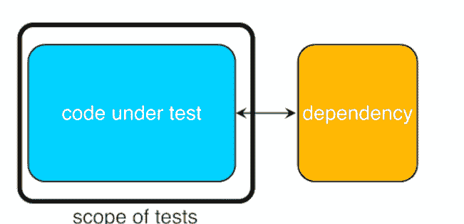
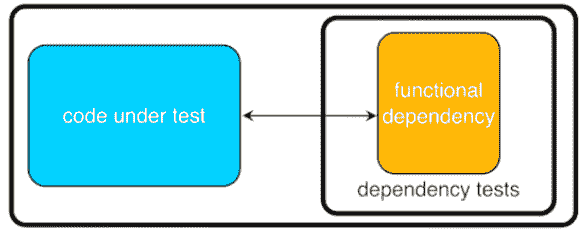
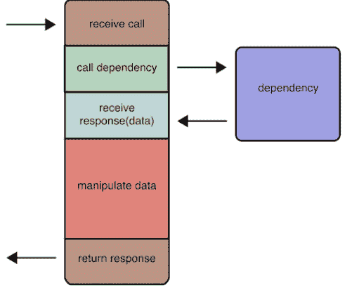
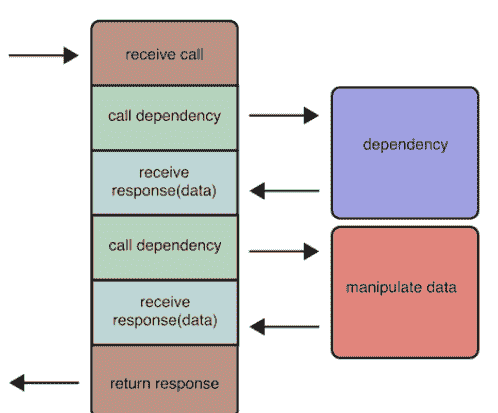

# Chapter 1

## Unit Tests

对于大多数工程师来说，测试体验始于单元测试。单元测试最容易编写，因为它们关注点有限，因此通常处理的复杂度低于涉及应用程序大块部分的测试，例如集成测试。虽然单元测试不那么复杂，但我们为其使用的测试工具和技能构成了所有测试的基础，使得单元测试成为我们探索的完美起点。

许多转向 Elixir 的工程师在其他语言的各种测试框架中拥有单元测试经验。其中大部分经验可以很好地迁移到 Elixir，但某些概念在 Elixir 中的实现会有些不同。例如，stubbing 是一种在解释型语言中常见的技术，在编译型语言 Elixir 中更为复杂。Elixir 的函数式特性使我们能够放宽“单元”定义的范围，为我们的测试设计带来新的灵活性。

我们在单元测试中使用的 ExUnit 工具是所有测试的基础。虽然集成测试可能会引入额外的工具，但我们所有的测试仍将与单元测试结构相似并使用相同的断言。在本章中，我们将学习如何定义测试的范围、为函数式代码编写测试、学习如何组织测试文件，然后探索一些隔离被测代码的方法。

到本章结束时，你将更好地了解如何在 Elixir 中编写单元测试，并理解如何组织应用程序代码和测试代码，使其更易于维护并编写有效的测试。你将更好地理解代码组织如何影响测试，并开始培养如何定义单元测试范围的感觉。这些技能将迁移到你为 Elixir 代码编写的所有测试中。

我们需要首先介绍的是单元测试的范围。自软件测试开始以来，工程师们一直在讨论如何定义这些测试的范围。

### Why We Didn’t Test-Drive in This Book

测试驱动开发，通常称为 TDD，是一种开发实践，建议你先编写测试，由于尚未实现代码而让它们失败，然后在编写代码的同时持续运行测试，直到测试通过。这是一种我们经常喜欢使用的常见技术。然而，我们不会在本書中实践 TDD。由于本书的重点是测试，我们不会过多关注应用程序代码，并且只会使用应用程序代码来为测试概念提供上下文。TDD 与此相冲突：如果我们想实践 TDD，我们就必须先编写测试，然后再编写应用程序代码以使其通过。相反，我们通常会向你展示一些我们已经编写的应用程序代码，然后你将与我们一起为该代码编写测试。

### Defining the Unit in Unit Test

单元测试是一种专注于应用程序子集的软件测试，通常会移除代码使用方式的整体上下文。常见的情况是单元测试专注于单个函数及其逻辑，可能还封装了可用的私有函数。有时将多个模块或进程的代码纳入单元测试范围会更有意义，从而扩大“单元”的范围。保持狭窄的范围有助于更快地发现错误，但学会何时扩大范围可以大大降低代码库和测试的复杂性。如果单元测试的范围，即单元本身，可以稍微扩大以包含其他模块，测试有时会变得更简单、更易于维护，同时仍提供传统狭窄范围单元测试的所有好处。

在深入探讨何时以及如何扩大单元测试范围之前，让我们先谈谈为什么要进行测试。设计测试时我们需要牢记四个目标：

- 证明你的代码按预期工作。
- 防止破坏性变更（回归）。
- 使查找代码损坏的位置变得容易。
- 编写尽可能少的测试代码。

你很可能已经认同前两个目标。然而，最后两个目标将指导你在测试范围内选择多少代码构成单元。你的测试应该在范围内的代码周围画一个黑盒，我们称之为被测代码或应用程序代码。这个黑盒定义了测试代码与应用程序代码交互的地方。在单元测试的情况下，这个黑盒通常会

将单个函数作为单元对待。保持范围狭窄的优势在于，如果被测代码存在问题，保持范围小有助于你快速确定问题所在。狭窄范围的缺点是，通常为了隔离被测代码，你需要在测试中编写更多代码，这可能会使难以跟上正在发生的事情。允许你的测试范围（黑盒）包含一个经过良好测试的功能性依赖，可以让你在利用狭窄范围的同时，避免隔离使用该依赖的代码的一些步骤。

你的测试需要以两种方式与被测代码交互。第一种更明显：你的测试会用参数调用一个函数（或发送消息）并获得返回值。第二种更复杂。你的测试可能需要拦截外部调用并返回响应，代替代依赖，如果你的代码依赖于代码库中的其他代码。我们称之为“隔离被测代码”。我们将在本章后面介绍代码隔离，但首先我们将看看在何时可以不用严格隔离。以下图表显示了围绕被测代码绘制的黑盒。



由于被测代码依赖于代码库中的其他代码，测试必须解决代码隔离问题。存在不同的代码隔离方法，但它们都伴随着成本，通常体现在时间和测试复杂性上。纯函数式代码的存在会影响需要隔离的内容。一个函数是“纯”的，如果它在每次使用相同参数调用时都返回完全相同的答案并且没有副作用。我们将在本章后面进一步展开。当你的依赖是纯函数式的并且本身经过了良好的测试时，你可以扩展黑盒以包含该依赖，如图所示。



测试范围

扩展黑盒使我们能够跳过隔离代码的额外工作，同时不放弃轻松定位损坏代码的能力。你的测试仍然紧密聚焦于被测代码，并且——由于你的代码是纯函数式的——你在其中测试代码的环境是完全受控的，防止了不一致的结果。当你能够以这种方式包含依赖项时，你的测试更容易编写、理解和维护。由于你的依赖项本身已被测试，你可以编写更少的测试代码，同时在测试失败时仍能确定代码损坏的位置。如果你的依赖项的测试没有失败，但在你引入它的测试中出现失败，你就知道你的失败是在新代码中，而不是在依赖项中。

挑战在于找到何时应在测试范围中包含纯函数式依赖项的平衡点。调整这种感觉需要一些试错和从痛点中学习。首先扩展黑盒以包含这些依赖项，然后如果发现调试代码时出现问题，就收紧范围。实践将帮助你磨练何时这是正确选择的判断力。

现在，让我们学习编写一些测试。

## 使用 ExUnit 进行测试

从一开始，Elixir 就是在核心库中将 ExUnit 测试框架作为一部分进行开发的。因此，我们在生产应用程序中使用的大多数测试工具都直接来自 Elixir 核心。这意味着，如果你拥有 Elixir 并且熟悉可用的工具，你就可以在无需引入其他库的情况下编写有效的测试。

为了学习如何使用 ExUnit，我们将从编写第一个测试开始，然后讨论一些测试理论，特别是测试阶段。我们将查看如何组织测试文件，然后探索使用常见的 Elixir 来最大化测试的有效性。最后，我们将介绍如何设计代码，使其组织良好且易于测试。

## 我们的第一个测试

让我们在我们的降雨警报应用 Soggy Waffle 中编写第一个测试。Soggy Waffle 会调用 API 并从中获取数据。然后它将数据标准化为自己的术语和数据结构，供应用程序其余部分使用。虽然本章不会重点关注对 API 的这些调用（但将在第 2 章 集成和端到端测试中介绍），响应转换是可以在隔离中测试的代码的绝佳示例。让我们看看我们将要测试的代码。

我们在本书的代码中包含了一个 Soggy Waffle 的副本。本章中我们展示的大多数应用程序文件都来自该代码。Soggy Waffle 中的示例测试文件扩展名为 .bak.exs，因此在运行测试时它们不会运行，但它们可供参考。如果你想跟随示例一起编码，你应该在提供的 Soggy Waffle 应用程序内部进行，在示例之前的指示位置添加测试文件。

从理论上讲，只要天气 API 返回时间戳和该时间戳的天气状况，Soggy Waffle 就可以与任何天气 API 配合使用。作为最佳实践，我们的应用程序将 API 响应翻译成 SoggyWaffle.Weather 结构体列表，该结构体在 lib/soggy_waffle/weather.ex 中定义，具有两个字段，一个用于时间戳 datetime，一个用于天气状况是否转化为降雨。

这意味着我们的 ResponseParser 模块将包含大量特定于我们选择的 API 的信息；在这种情况下，那就是 openweathermap.org。请注意代码中的模块属性以及关于该信息来源的注释。

```
unit_tests/soggy_waffle/lib/soggy_waffle/weather_api/response_parser.ex

defmodule SoggyWaffle.WeatherAPI.ResponseParser do
  alias SoggyWaffle.Weather

  @thunderstorm_ids [200, 201, 202, 210, 211, 212, 221, 230, 231, 232]
  @drizzle_ids [300, 301, 302, 310, 311, 312, 313, 314, 321]
  @rain_ids [500, 501, 502, 503, 504, 511, 520, 521, 522, 531]
  @all_rain_ids @thunderstorm_ids ++ @drizzle_ids ++ @rain_ids

  @spec parse_response(Weather.t()) ::
    {:ok, list(Weather.t())} | {:error, atom()}
  def parse_response(response) do
    results = response["list"]

    Enum.reduce_while(results, {:ok, []}, fn
      %{"dt" => datetime, "weather" => [%{"id" => condition_id}]},
      {:ok, weather_list} ->
        # possible weather codes: https://openweathermap.org/weather-conditions

        new_weather = %Weather{
          datetime: DateTime.from_unix!(datetime),
          rain?: condition_id in @all_rain_ids
        }

        {:cont, {:ok, [new_weather | weather_list]}}
      _anything_else, _acc ->
        {:halt, {:error, :response_format_invalid}}
    end)
  end
end
```

我们的测试需要传入一个形似 API 数据的响应，并且它期望响应数据以 SoggyWaffle.Weather 结构体列表的形式存在。

现在让我们在提供的 Soggy Waffle 代码中打开一个新的测试文件 test/soggy_waffle/weather_api/response_parser_test.exs 并开始编写第一个测试！将下面的代码复制到你的文件中。

```
unit_tests/soggy_waffle_examples/weather_api/response_parser_test.exs

1: defmodule SoggyWaffle.WeatherAPI.ResponseParserTest do
-   use ExUnit.Case
-   alias SoggyWaffle.WeatherAPI.ResponseParser
-   alias SoggyWaffle.Weather
5:
-   describe "parse_response/1" do
-   test "success: accepts a valid payload, returns a list of structs" do
-     api_response = %{
-       "list" => [
-         %{"dt" => 1_574_359_200, "weather" => [%{"id" => 600}]},
10:
-         %{"dt" => 1_574_359_900, "weather" => [%{"id" => 299}]}
-       ]
-     }
-
-     assert {:ok, parsed_response} =
15:
-         ResponseParser.parse_response(api_response)
-
-     for weather_record <- parsed_response do
-       assert match?(
-         %Weather{datetime: %DateTime{}, rain?: _rain},

```
20:
    weather_record
    )
    assert is_boolean(weather_record.rain?)
    end
25:
    end
    end
    end
```

这是一个相当基础的测试，但已经有很多事情在发生了。第 15 行调用了一个 assert 宏，并且在列表推导式（第 18 行）内部存在断言。让我们分别查看每个部分。

## 函数与宏


ExUnit 工具是宏和函数的混合体。从你的角度来看，安全地把它们都当作函数来思考，但我们在描述任何特定代码时都力求准确。有关宏的更多信息，请查看 Elixir 入门指南中关于宏的部分。[8]

第 15 行的 assert 调用之所以有效，是因为如果函数求值为 true 或某个“真值”，assert 就会通过。在我们的例子中，我们传递给它的是一个模式匹配。如果模式匹配成功，它会返回与模式匹配的数据，这就是“真值”。ExUnit 还提供了相反的操作 refute，只有当作为参数传递给它的表达式求值为 false 或 nil 时才会通过。不过要小心，因为 refute 与模式匹配的工作方式可能与你预期不同。如果模式不匹配，会引发 MatchError。我们稍后会找到处理它的方法，如果需要的话。另外，不要犯常见的错误，假设它是可枚举的。如果结果无法迭代，测试会引发 Protocol.UndefinedError，从而暴露出错误的值。我们匿名函数中的单元素模式更具体地暗示响应是一个列表。如果我们的代码返回了无法迭代的东西，测试将以 Protocol.UndefinedError 失败。

现在让我们查看代码块内部的断言。第一个是将 match?(%Weather{datetime: %DateTime{}, rain?: _rain}, weather_record) 传递给 assert。match?/2 是对模式匹配进行断言的另一种方式。如果你想使用 refute 进行模式匹配，就是这样做的。尽管 match? 不像使用 = 那样绑定值，如果你在模式中的变量前不使用 _，你仍然会收到编译警告。此断言仅关注数据的形状，而不关注提供的值。我们的解析器做了不止一件事，通常的最佳实践是将不同职责的测试拆分到多个测试中。如果你的测试出现失败，这种方法会更快地引导你找到出错的代码。

块中的第二个断言 `assert is_boolean(weather_record.rain?)` 仍然关注数据的形状而不是特定值，因为转换天气 ID 是额外的功能。单元测试通常运行速度很快，保持它们专注于代码的单一方面可以使查找错误更快、更轻松。没关系，因为我们很快会添加其他测试，这些测试将专注于响应中的特定值。

下一步是运行测试并查看会发生什么。在应用程序的根目录下，运行 `mix test` 并查看响应。如果测试写得正确，它将通过，你会看到一个漂亮的点代表通过的测试。如果测试未通过，很可能你在某处有拼写错误。生成的错误应该能引导你找到错误所在。

我们之前提到过我们会添加更多测试。但在这样做之前，让我们深入了解一下术语，以便在本书的其余部分取得成功。

## 不使用 Mix 运行测试


虽然 ExUnit 在不使用 Mix 的情况下也能工作，但你不太可能在 Mix 应用程序之外编写许多、甚至任何测试。因此，我们将专注于使用 Mix 及其包含的测试流程。

## 测试的解剖结构

当我们开始进入单元测试的领域时，让我们建立一些基本词汇和测试理论。软件测试无论多么复杂，都最多包含四个阶段。它们的名字因人而异，因此在本书中我们将使用 *setup*、*exercise*、*verify* 和 *teardown*。简单的测试可能只有其中两个阶段；复杂的测试可能有重复阶段的循环。有时顺序并不直接，但每个测试都可以分解为这四个阶段。让我们按它们“通常”发生的顺序逐一查看。

根据测试的范围，setup 可以简单到准备数据作为参数传递给被测代码，也可以意味着在某种共享状态（如数据库）中准备数据。这个阶段非常常见；但在测试纯函数式代码时，通常不需要 setup。

exercise 阶段始终存在。这是运行被测代码的调用。没有它，就无事可做。

在 verify 阶段，你的测试会对代码的行为做出断言。虽然有时与 exercise 步骤内联，但 verify 阶段始终存在于测试中。如果不验证代码以某种方式表现，那么你的测试就毫无意义了。

如果你的 setup 阶段涉及对共享状态的任何影响，你需要在 teardown 阶段将事物恢复到之前的状态。如果没有共享状态，例如数据库，则此阶段不是必需的。通常使用工具自动处理此步骤，例如 Ecto 的 sandbox，但这并不意味着此步骤不会发生。经常出现“随机”测试失败，是因为测试没有正确清理已设置的数据。

我们提到阶段的顺序不保证是 setup、exercise、verify 和 teardown。有时测试代码必须以与执行顺序不同的顺序编写。这种情况最常见的是使用测试替身（我们稍后会介绍的概念）时。如果该测试替身使用断言，定义它的代码必须在 exercise 步骤之前编写，即使实际断言要到 exercise 步骤之后才会执行。

之前我们说过，复杂的测试实际上可能会重复其中一些阶段。当你在单元测试中工作时，如果看到某个阶段的第二次（或以后）的重复，这表明你的测试可能做得太多。用户界面测试可能需要重复阶段，反映用户体验中的连续步骤。我们将在第 6 章，Testing Phoenix 中介绍这种测试。在本章以及单元测试的上下文中，你可以认为测试每个阶段只出现一次。

现在让我们看看如何构建测试，以及 ExUnit 提供了哪些工具来帮助组织测试、分组测试并使测试套件更易于维护。

## 组织测试

除了确保我们的代码正常工作外，测试套件还有一个次要目的。如果写得好，它就成为我们代码的文档来源，包含我们期望代码如何工作的文本描述以及如何使用代码的工作示例。这听起来像是一个宏伟的目标，但只要稍加组织，完全可以实现。想象一下 *future you* 回顾几个月未见的代码，试图记住它如何工作以及如何使用它。测试套件越有条理，*future you* 就越会感谢 *past you* 降低了这一挑战的复杂性。仅此一点就足以激励我们思考测试的整体设计。幸运的是，ExUnit 附带了一些有用的函数（和宏），允许我们以可读且可维护的方式组织单个文件。

随着我们构建越来越复杂的测试，你会在我们的示例中看到这些组织工具的出现。让我们先看看这些工具和代码示例，以及如何使用它们来保持测试套件更易于阅读和维护。

## 描述测试

虽然可以用扁平的组织结构拥有可读的测试文件，但 ExUnit 为我们在文件内分组测试提供了一个很好的工具 describe。该工具允许我们为分组传递描述，并且正如我们很快会发现的，可以对共享通用 setup 的测试进行分组。需要注意的是，与某些其他测试框架不同，ExUnit 的创建者决定只允许一个级别的分组，因此你不能嵌套 describe 块。虽然这乍一看可能违反直觉，但它在组织测试和避免 setup 的嵌套噩梦之间取得了健康的平衡。


作为一般指导原则，按函数对测试进行分组是一个不错的起点，如以下示例所示：

```
unit_tests/misc/describe.exs

defmodule YourApp.YourModuleTest do
  use ExUnit.Case

  describe "thing_to_do/1" do
    test "it returns :ok, calls the function if the key is correct"
    test "it does not call the function if the key is wrong"
  end
end
```

你可能已经注意到，描述中包含 /1 来表示元数（函数接受的参数数量）。这是一个风格选择。你可以根据自己认为最合乎逻辑的方式对测试进行分组。在本书后面，当我们处理集成测试时，你可能会按它们所访问的端点等进行分组。其目的是使测试更易于阅读，以便你（以及你的协作者）可以决定什么最合理。指导你的设计的一个因素是你的函数是否具有共同的设置。

## 设置块

虽然单个测试可以包含自己的设置代码，但有时你会发现自己一遍又一遍地编写相同的设置。这种情况是一个考虑使用设置块的机会。设置块中的代码将在其作用域内的每个测试之前执行。由于代码与测试设计中的阶段名称相同，我们将可执行代码称为设置块，而将测试阶段称为 setup。

设置块需要返回一个对后续内容有意义的值。如果设置是为了在其他地方设置状态，并且后续测试中没有任何值有用，则返回值可以简单为 :ok。更常见的是，设置块的返回值会传递给它前面的测试。随着 Elixir 和 ExUnit 的成熟，常见的做法是让 setup 返回一个可在后续测试中使用的值映射。在测试纯函数式代码时，这通常是你会使用设置块的唯一时间，因为没有共享状态需要设置。让我们看一个设置块的示例，其中没有状态被改变，但我们决定不想为每个测试重新定义相同的匿名函数。

unit_tests/misc/callbacks.exs

```elixir
setup do
  function_to_not_call = fn ->
    flunk("this function should not have been called")
  end

  function_to_call = fn -> send(self(), :function_called) end

  %{bad_function: function_to_not_call, good_function: function_to_call}
end
```

请记住，当你将逻辑提取到设置块中时，单个测试的可读性会稍有下降。设置中的每个值都不会在每个测试中使用，但如果你将某个值提取到设置块中，它应该在多个测试中使用。在前面的示例中，坏函数和好函数几乎不可能在同一测试中使用，因为一个用于成功情况，另一个用于失败情况，但由于每个函数都将被多个测试使用，将它们都提取到公共设置中是值得的。

在测试中接受来自 setup 的值需要对测试定义进行轻微修改：

unit_tests/misc/callbacks.exs

```elixir
test "does not call the function if the key is wrong",
  %{bad_function: bad_function} do
  assert {:error, _} =
    YourModule.thing_to_do(:bad_first_arg, bad_function)
end
```

在测试中添加一个作为第二个参数的模式允许你提取 setup 传递的任何内容。如果传递的东西太多，以至于解构映射使测试难以阅读，你始终可以使用一个变量，并在需要时从中提取所需内容。

```
unit_tests/misc/callbacks.exs

test "does not call the function if the key is wrong", context do
  assert {:error, _} =
    YourModule.thing_to_do(:bad_first_arg, context.bad_function)
end
```

## 选择要移入公共设置的内容


很容易在应该移入设置的代码上过度延伸。如果将太多内容移入公共块，单个测试的目的就难以理解。你可以通过选择描述从设置块接收内容的名称来避免这种情况。不要使用 user，你的变量可以命名为 user_with_completed_profile。有时一个长名称可以为后来者节省大量工作。

你的 setup 的作用域由测试的逻辑分组决定。如果你的 setup 在 describe 内部，它将在该 describe 内部分组的测试之前运行。如果它位于测试文件的顶部——在任何 describe 之外——它将在该文件中的所有测试之前运行。

你的设置可以层层构建。如果整个文件都有一个共同的 setup，但你也需要为 describe 块设置一个 setup，则 describe 中的 setup 可以通过向测试的参数添加模式来接受从更高层 describe 传递给它的值。

```elixir
setup context do
  additional_value = "example value"
  Map.merge(context, %{additional_value: additional_value})
end
```

添加模式可能有帮助，但要小心选择应移入更高层设置块的内容，因为你开始将理解每个测试所需的逻辑分散到文件的多个不同区域。能够在无需查看文件或代码库中不同位置的情况下阅读和理解单个测试，具有很大的价值。

稍后我们将讨论 test cases，这又是帮助减少代码重复的一种结构。它们提供了一个额外的设置层，这次是在多个测试文件之间。由于该设置是在当前测试文件之外定义的，花时间考虑如何组织测试以确保一切易于跟进绝对值得。即使没有嵌套的 describe 块，如果我们在组织测试时不考虑这种平衡，也很容易接近可读性和维护性的噩梦。

setup 的另一个功能可以帮助在减少单个测试或多个设置中的重复的同时保持测试的清晰度：setup 可以接受函数名称或函数名称列表，而不是块。这些函数应遵循一种模式，接受现有上下文（由之前的设置块或函数传递的数据）并返回更新后的上下文，以便它们可以被管道传输。如以下示例所示，with_authenticated_user/1 期望从之前的设置函数接收的数据映射，向该映射添加更多数据，然后返回该映射。

```
unit_tests/misc/setup_with_helper_functions.exs

def with_authenticated_user(context) do
  user = User.create(%{name: "Bob Robertson"})
  authenticated_user = TestHelper.authenticate(user)

  Map.put(context, :authenticated_user, authenticated_user)
end
```

如果你定义了遵循该模式的函数，你可以向 setup 传递一个要执行的函数列表：

```
unit_tests/misc/setup_with_helper_functions.exs

setup [:create_organization, :with_admin, :with_authenticated_user]
```

函数按列出的顺序执行。这允许你在不同的设置作用域中重用相同的逻辑，并使设置逻辑更接近（在文件中）其使用位置。此功能旨在消除对嵌套 describe 块的需求。随着使用的深入，你会发现它是一个相当优雅的解决方案。

虽然 setup 是大多数场景下的正确解决方案，但还有几个额外的函数可以帮助组织测试。

## setup_all

通常你需要一个设置步骤，但不需要在每个测试之前重复执行。如果你的测试在这些步骤仅对整个文件执行一次时也能正常工作，你可以使用 setup_all。除了运行频率外，setup_all 与 setup 工作方式相同，这意味着它可以用函数列表、代码块或上下文模式和代码块来使用。返回值应与你为其他设置函数设置的模式匹配。


unit_tests/misc/callbacks.exs

```elixir
setup_all do
  function_to_not_call = fn ->
    flunk("this function should not have been called")
  end

  function_to_call = fn -> send(self(), :function_called) end

  %{bad_function: function_to_not_call, good_function: function_to_call}
  end
```

我们的示例没有做任何需要在每次调用时重复的事情。我们定义的功能在不同测试之间不会改变。因此，这个块是 setup_all 的一个良好候选。setup_all 不是正确解决方案的情况包括任何基于时间的情况，其中每个测试都需要新的时间戳，或为需要共享状态然后更改该状态的测试进行的设置，这将使其在下一个测试中无法使用。虽然本章不会涵盖，但涉及数据存储的测试是后者的一个很好的例子。当同时使用两者时，setup_all 会先被调用，并且它返回的上下文会先传递给 setup，然后再传递给测试。有关顺序和测试生命周期的更多信息，请参阅附录 2，测试生命周期。

## on_exit

我们已经涵盖了测试的设置阶段以及允许我们减少设置重复的工具。但 ExUnit 也为我们提供了 on_exit 回调，让我们以类似的方式组织清理阶段。此回调可以定义在你的 setup 块内或单个测试中。

unit_tests/misc/callbacks.exs

```elixir
setup do
  file_name = "example.txt"
  :ok = File.write(file_name, "hello")

  on_exit(fn ->
    File.rm(file_name)
  end)

  %{file_name: file_name}
end
```

请注意，setup 的返回值仍然是块的最后一行。on_exit 会返回 :ok，这对于你的 setup 来说可能没有用。在此示例中，setup 返回的是文件名，使测试可以访问一个保证存在的<|message|>。像 Elixir 中所有匿名函数一样，你传递给 on_exit 的函数是一个闭包，因此你可以引用函数定义之前定义的所有变量。

on_exit 很强大，因为即使你的测试惨败，匿名函数仍会被执行。这有助于保证测试环境的<|message|>，无论单个测试的结果如何。它不常见，但 on_exit 也可在单个测试中使用。如果你想将设置保留在单个测试内，但需要保证无论测试结果如何清理都会完成，请使用 on_exit。

现在我们有了更多保持测试有组织的工具，我们可以回到编写更多利用这些组织工具的测试。

## Where Are Doctests?

Elixir 将文档作为一等公民对待，很少有其他语言这样做。编写 Elixir 代码的任何人都被鼓励为其公共函数添加文档。其功能的一部分是 doctests。虽然它们名字里有“test”，但它们实际上是一个工具，用来确保文档中的示例保持最新。我们衷心鼓励你了解更多关于 doctests 的信息，但我们觉得它们超出了本书的范围，因为 doctests 不是你测试套件的一部分，也不关注你代码的行为，而是关注文档的准确性。Elixir 的入门指南在解释 doctests 方面做得非常好，如果你想深入了解。[9]

## Creating Comprehensive Test Coverage

我们已经涵盖了测试的一些非常基础的内容，并深入探讨了一些测试理论。为了对一个文件提供可靠的覆盖率，我们需要在此基础上构建知识，通过引入 Elixir 本身的一些特性，以及 ExUnit 断言的一些可选特性。这些技能将帮助你用最少的代码编写最大化的测试覆盖率，且没有权衡。

## Using a Setup Block

让我们回到我们离开的 Soggy Waffle 测试，SoggyWaffle.WeatherAPI.ResponseParserTest。我们将在为响应解析器添加更多测试之前，对现有测试进行修改。我们在测试中使用的数是手写的。这是一个很好的开始方式，但我们不拥有数据的原始来源，即天气 API。虽然硬编码的数据很容易阅读，但它实际上是来自天气 API 的真实数据的显著精简版本。最好能使用尽可能真实的数据。为此，我们可以使用 fixture 文件。对 API 的一个简单的 curl 调用可以提供一个实际的 JSON 响应负载。我们已将其保存到应用程序中的文件 test/support/weather_api_response.json。让我们修改测试以使用该数据，而不是我们之前使用的手写值：

unit_tests/soggy_waffle_examples/test/soggy_waffle/weather_api/response_parser_test.exs

```elixir
1: describe "parse_response/1" do
- setup_all do
- response_as_string =
- File.read!("test/support/weather_api_response.json")
5:
- response_as_map = Jason.decode!(response_as_string)
- %{weather_data: response_as_map}
- end
```

```elixir
test "success: accepts a valid payload, returns a list of weather structs",

10:
  %{weather_data: weather_data} do
  assert {:ok, parsed_response} =
    ResponseParser.parse_response(weather_data)

  for weather_record <- parsed_response do

15:
  assert match?(
    %Weather{datetime: %DateTime{}, rain?: _rain},
    weather_record
  )

20:
  assert is_boolean(weather_record.rain?)
  end
  end
```

让我们更新测试以使用 setup 块（第 2 行）。在 setup 代码中，你会看到我们正在读取 JSON 文件的内容（第 3 行），然后将其解码为 Elixir map（第 6 行）。这样我们就有了数据，其解析方式与应用程序其他部分在传递给 ResponseParser.parse_response/1 之前解析数据的方式相同。我们现在有了真实数据，让我们在测试中使用它。

我们的测试已在第 11 行修改为接受测试上下文。这就是数据如何从 setup 块进入测试的方式。请注意，我们解构了 map，以便可以直接访问变量 weather_data。之后，我们需要删除旧的数据设置，并将练习调用中的参数替换为新变量（第 12 行）。运行 mix test；因为我们的测试关注的是数据的形状而不是特定值，所以它应该会通过。

以这种方式编写测试存在权衡。如前所述，我们受益于知道测试数据尽可能真实的安心感。但要实现这一点，我们牺牲了一些测试的可读性。我们传递的数据隐藏在另一个 JSON 文件中，其格式不如精简的 Elixir map 易于阅读。此外，为了使 fixture 数据可用于其他测试，我们已将其移入 setup 块。

Setup 块对于测试组织和防止测试套件中的重复非常有用，但它们会将测试的某些设置从测试中移除并移动到文件的另一部分。只要测试的逻辑扩展到测试本身之外，就更难阅读和理解。话虽如此，就像我们做的一切一样，我们需要做出选择，选择哪种方式以及哪种测试设计能在覆盖率和可读性/可维护性之间取得最佳平衡。

## Setting Module Attributes in Test Files

现在我们的第一个测试正在使用 fixture，我们将添加关注天气 API 响应中特定值的测试，这意味着我们不会使用 fixture 数据，因为我们不知道特定值。由于被测模块（SoggyWaffle.WeatherAPI.ResponseParser）专注于将外部 API 特定数据转换为内部数据，因此该模块必须具有大量特定于该 API 的知识。这体现在模块顶部所有的各种天气状况 ID 上。

我们的测试必须具有同等水平的知识，以便彻底测试代码。这意味着在测试文件中添加所有 ID 的副本。把它们放在测试和被测代码都可以访问的地方似乎是个好主意，但这是不鼓励的。对该列表的任何意外修改都可能导致我们的测试遗漏所需的情况，从而使被测代码带着 bug 进入生产环境。你应该避免在测试和被测代码之间拆分实例时使用不要重复自己（DRY）原则。[10]


在我们的例子中，我们知道多个测试很可能会使用这些 ID 列表，因此我们将它们作为模块属性添加到测试文件的顶部。

```
unit_tests/soggy_waffle_examples/test/soggy_waffle/weather_api/response_parser_test.exs

@thunderstorm_ids {
  "thunderstorm",
  [200, 201, 202, 210, 211, 212, 221, 230, 231, 232]
}
@drizzle_ids {"drizzle", [300, 301, 302, 310, 311, 312, 313, 314, 321]}
@rain_ids {"rain", [500, 501, 502, 503, 504, 511, 520, 521, 522, 531]}
```

## 利用列表推导式

准备好迎接一些疯狂的操作了吗？我们将把新的测试包装在列表推导式中。将以下代码添加到你的测试文件中，我们将逐步讲解它。保持第一个 for 与之前的测试处于相同的缩进级别。

```
unit_tests/soggy_waffle_examples/test/soggy_waffle/weather_api/response_parser_test.exs

1: for {condition, ids} <- [@thunderstorm_ids, @drizzle_ids, @rain_ids] do
  - test "success: recognizes #{condition} as a rainy condition" do
  - now_unix = DateTime.utc_now() |> DateTime.to_unix()
  -
5: for id <- unquote(ids) do
  - record = %{"dt" => now_unix, "weather" => [%{"id" => id}]}
  -
  - assert {:ok, [weather_struct]} =
  - ResponseParser.parse_response(%{"list" => [record]})

10:
  - assert weather_struct.rain? == true
  - end
  - end
  - end
```

将代码添加进去后，运行 mix test 来确保测试通过。

在谈论列表推导式之前，让我们先看看在练习步骤中我们传递给函数的那些数据。它是一个手写的 map。现在我们已经通过传递真实响应测试了代码能够处理正确形状的数据，我们就可以相信如果传入正确形状的数据，代码就会正常工作。有效载荷已经被提炼为我们代码关心的部分：一个带有 “dt” 和 “weather” 键的 map，其中 ID 嵌套在 “weather” 键下的 map 列表中。保持输入有效载荷如此之小有助于使我们的测试更容易理解。此外，由于我们是在测试文件内部定义这些值（并且在本例中是在测试内部），因此我们可以安全地对特定值进行断言，而不必担心难以维护的测试。

列表推导式实际上添加了三个新的测试，每个我们感兴趣的天气条件各一个：雷暴、毛毛雨和雨。列表推导式在你有几乎相同的测试但希望错误被分开时很有用。你会看到我们不得不使用 unquote,[11] 一个元编程宏，以便在测试内部访问信息。这可能特别令人困惑，因为它不在 quote 块内，但它有效，并且这是本书中我们将引入的唯一元编程部分。你需要有一种方法为每次迭代提供唯一的测试名称，就像我们在测试名称中使用 condition 的方式一样。如果这些测试中的任何一个失败，ExUnit 的输出会告诉你是哪一个测试，从而更容易追踪问题。

> » 1) test parse_response/1 success: recognizes drizzle as a rainy condition
> (SoggyWaffle.WeatherAPI.ResponseParserTest)
> test/soggy_waffle/weather_api/response_parser_test.exs:32

## 编写自定义测试失败消息

虽然列表推导式允许我们用更少的测试代码覆盖更多测试用例，但它们会带来混淆错误的风险。如果测试失败但你无法判断它是在对哪些值进行断言，你将花费时间调试失败。在我们刚刚编写的测试中，如果雨的值错误，我们如何知道正在测试哪个 ID？让我们更新该断言以使用自定义失败消息：

```
unit_tests/soggy_waffle_examples/test/soggy_waffle/weather_api/response_parser_test.exs

1: for {condition, ids} <- [@thunderstorm_ids, @drizzle_ids, @rain_ids] do
2:   test "success: recognizes #{condition} as a rainy condition" do
3:     # test body
4:
5:     assert weather_struct.rain? == true,
6:       "Expected weather id (#{id}) to be a rain condition"
7:   end
8: end
```

添加带有字符串插值的自定义错误消息（第 6 行）现在在测试失败时给了我们所需的一切信息。拥有这些信息非常重要，因为否则将无法看到导致测试失败的具体代码。在设计测试时，花时间确保失败消息能直接指向问题所在。它花费不了多久，你或你的团队成员以后会感谢你的。

+   1) test parse_response/1 success:
+      recognizes drizzle as a rainy condition
+      (SoggyWaffle.WeatherAPI.ResponseParserTest)
+      test/soggy_waffle/weather_api/response_parser_test.exs:32
+      » Expected weather id (300) to be a rain condition
+      code: for id <- unquote(ids) do

## 覆盖所有用例

虽然我们将在后面的章节讨论基于属性的测试，但我们通常不需要超出 ExUnit 和 Elixir 之外的东西来覆盖其余用例。我们已经添加了测试来检查返回雨为 true 的条件，但现在我们需要一个测试来确保没有其他代码会产生 true 值。将以下代码添加到你的文件中：

```
unit_tests/soggy_waffle_examples/test/soggy_waffle/weather_api/response_parser_test.exs
```

```
1: test "success: returns rain?: false for any other id codes" do
  {_, thunderstorm_ids} = @thunderstorm_ids
  {_, drizzle_ids} = @drizzle_ids
  {_, rain_ids} = @rain_ids
5:  all_rain_ids = thunderstorm_ids ++ drizzle_ids ++ rain_ids
  now_unix = DateTime.utc_now() |> DateTime.to_unix()

  for id <- 100..900, id not in all_rain_ids do
    record = %{"dt" => now_unix, "weather" => [%{"id" => id}]}

10:
    assert {:ok, [weather_struct]} =
        ResponseParser.parse_response(%{"list" => [record]})

    assert weather_struct.rain? == false,
        "Expected weather id (#{id}) to NOT be a rain condition."

15:
    end
  end
```

是时候再进行一次测试运行（mix test）来确保你的测试为绿色。定期运行测试总是一个好方法，可以避免在意识到有问题之前走得太远。

这些测试非常彻底，因为它们测试了所有可能的正值。我们能够做到这一点是因为我们有一个已知且有限的降雨天气 ID 列表。我们没有同样全面的非降雨 ID 列表。因此，查看 API 的文档，我们将可能返回的代码范围缩小到 100 到 900 之间。我们再次使用列表推导式，但这次我们使用列表推导式的过滤函数，即时构建 100 到 900 之间所有 ID 的列表 *except* 我们已知为降雨 ID 的那些（第 8 行）。即使这意味着我们测试了很多值，由于我们的代码是纯函数式的，测试仍然会相当快速地运行。我们再次为自己提供了一个自定义错误消息，以确保如果此测试失败，我们知道导致失败的 ID。

此测试本可以使用我们谈到的两种列表推导式方式之一（为每个值创建新的测试或为每个值创建新的断言），两者都有权衡。生成新的测试将消除对自定义错误消息的需求，但会增加实际运行的测试数量。当你决定列表推导式是合适的工具时，由你来决定哪种方式最适合你。

## 测试错误用例

我们编写的每个测试都专注于成功用例。我们在测试名称开头添加 “success” 和 “error” 以帮助在心理上对它们进行排序，但这是一种风格选择，是对无法在测试中嵌套 `describe` 块的回应。现在让我们看看我们的代码可能不会返回成功响应的地方，在本例中是由于输入数据错误。由于我们希望在单独的测试中测试不同的功能，让我们选择格式错误的天气数据。

我们的应用程序相当小，并不打算用于面向客户的生产环境。如果是这样，我们会有更多测试并会利用 Ecto Schema 和 Changeset 函数。我们将在第 4 章 *Testing Ecto Schemas* 中介绍示例的例子。现在，我们将添加一些基本覆盖，前提是当你完成本书后，你将拥有更好的工具来为有效载荷编写更好的验证测试。在同一个 `describe` 块内添加一个新的测试；但这次它是一个 “error” 测试：

unit_tests/soggy_waffle_examples/test/soggy_waffle/weather_api/response_parser_test.exs

```
test "error: returns error if weather data is malformed" do
  malformed_day = %{
    "dt" => 1_574_359_200,
    "weather" => [
      %{
        "wrong_key" => 1
      }
    ]
  }

  almost_correct_response = %{"list" => [malformed_day]}

  assert {:error, :response_format_invalid} =
    ResponseParser.parse_response(almost_correct_response)
end
```

再次使用 mix test 运行你的测试。

相比之下，这个测试几乎乏味。它之所以能如此简单，是因为我们已经有一个测试断言：如果将正确的数据传递给被测代码，代码就能正确解析它。因此，我们只需要关注一件事，即缺少“id”键。值得注意的是，通过将错误键命名为“wrong_key”，我们使测试具有自文档化特性。类似的小机会在你的测试中随处可见。

我们将在文件中再添加一个测试，以覆盖负载中缺少日期时间的情况。在同一个 describe 块中添加这个最后一个测试：

unit_tests/soggy_waffle_examples/test/soggy_waffle/weather_api/response_parser_test.exs

```
test "error: returns error if timestamp is missing" do
malformed_day = %{
  # wrong key
  "datetime" => 1_574_359_200,
  "weather" => [
%{
  "main" => 1
}
]
}

almost_correct_response = %{"list" => [malformed_day]}

assert {:error, :response_format_invalid} =
  ResponseParser.parse_response(almost_correct_response)
end
```

这个测试几乎与之前的测试相同；但由于它测试的是被测代码功能的不同部分，我们将保留它作为单独的测试，而不是想办法使用列表推导来让它们 DRY。如果你将测试视为文档，那么你的测试名称就是顶级参考，将不专注于同一事物的测试合并会削弱你的文档。

现在我们已经介绍了测试的结构并编写了全面的测试文件，是时候开始研究代码设计如何影响测试设计了。我们将从测试纯函数式代码开始。

## 测试纯函数

最简单的代码是纯函数。[12]如果每次使用相同的参数调用函数时，它都返回完全相同的答案并且没有副作用，则该函数为“纯”。如果依赖项可以改变结果，则该函数不是纯的。在测试纯函数时，测试可以专注于输入的数据——函数参数——以及响应。就这些。

对于纯函数，我们唯一需要的设置就是为参数准备数据。测试的执行步骤是函数调用，传递输入参数。验证阶段只是对响应的断言，仅限于响应。没有清理步骤，因为设置只是创建参数，而这些参数在测试之外没有影响。让我们看一些纯函数测试的示例。

我们迄今为止测试的唯一函数 SoggyWaffle.WeatherAPI.ResponseParser.parse_response/1 是一个纯函数。我们的测试永远不必担心副作用，并且无论运行多少次，它们始终从被测代码中获得相同的响应。

虽然测试纯函数很简单，但大多数应用程序不能完全由纯函数组成，因此我们必须考虑两种测试有状态代码的策略：将逻辑移入纯函数，或设计函数使用可用的依赖注入方法之一，以便隔离我们的代码。我们将首先探讨移动逻辑，然后开始深入研究代码隔离。

## 向纯函数重构

当你有一个很难测试的模块时，如果可行，将尽可能多的逻辑重构为纯函数是简化测试的最简单方法。我们将在第 3 章《Testing OTP》的 GenServer 部分深入探讨此示例的实例，但在继续之前，让我们确保理解基本概念。当代码具有外部依赖时，它很少直接作为该依赖值的直通。大多数情况下，它会调用依赖项，然后在返回函数调用结果之前操作响应。你的代码对该数据进行的操作越多，它就越适合将逻辑重构为纯函数。

让我们看一个函数的可视化表示，该函数既调用依赖项，又在返回响应之前操作数据。



我们图纸中标记为“manipulate data”的部分是无需外部依赖即可更改数据的代码。如果代码有显著不同的结果，则测试此函数可能会相当痛苦，这取决于依赖项返回的数据。对于逻辑可能表现的每一种可能方式，每个测试都必须使用某种机制来保证依赖项返回可预测、已知的响应。我们将在下一节讨论其中一种方法，但另一种选择是重构代码，以便将该部分逻辑（“manipulate data”）专门从函数中提取出来并放入新的纯函数中。这样它就成为我们原始函数的新依赖项，如下图所示。



这看起来似乎使事情变得更复杂，但事实并非如此。我们所做的是将该代码提取到一个可以轻松测试的地方，进行多个测试，这些测试要么有简单的设置，要么没有设置，并有执行阶段和验证阶段。当我们学习代码隔离时，你将更好地了解我们能够避免的复杂性。一旦该单独的逻辑部分经过充分测试，就可以认为将其拉入原始函数的测试黑盒是安全的。我们知道该代码有效，并且每次给定相同输入时都会一致地表现。我们不再需要弄清楚如何创建原始依赖项返回不同值的场景，并且可以减少测试原始函数所需的测试数量。

重构为纯函数适用于你想将逻辑提取到现有模块中的新函数或新模块中的新函数的情况。唯一需要记住的是，它必须是公共函数，并且需要经过充分测试。

本章前面，我们测试了 SoggyWaffle.WeatherAPI.ResponseParser。然后我们讨论了纯函数，并以 SoggyWaffle.WeatherAPI.ResponseParser.parse_response/1 作为示例。该模块仅被另一个模块 SoggyWaffle 使用。我们本可以非常轻松地将所有响应解析逻辑保留在 SoggyWaffle 内部。它看起来会像这样：

unit_tests/soggy_waffle_examples/overloaded_soggy_waffle.ex

```elixir
defmodule SoggyWaffle do
  alias SoggyWaffle.Weather

  @thunderstorm_ids [200, 201, 202, 210, 211, 212, 221, 230, 231, 232]
  @drizzle_ids [300, 301, 302, 310, 311, 312, 313, 314, 321]
  @rain_ids [500, 501, 502, 503, 504, 511, 520, 521, 522, 531]
  @all_rain_ids @thunderstorm_ids ++ @drizzle_ids ++ @rain_ids

  def rain?(city) do
    with {:ok, response} <- SoggyWaffle.WeatherAPI.get_forecast(city) do
      weather_data = parse_response(response)

      SoggyWaffle.Weather.imminent_rain?(weather_data)
    end
  end

  defp parse_response(response) do
    # parsing logic
  end
end
```

代码组织并不糟糕，模块也不算很大。这很可能可以维护，因为该应用程序预计不会增长太多。事实上，代码看起来几乎具有欺骗性的简单。它从 API 获取数据（非纯函数式），解析数据（纯函数式），然后检查是否下雨（纯函数式）。

从代码设计角度来看，此函数正在协调三种不同类型的工作。保持函数的好做法是

尽可能让协调其他函数响应的部分对内部逻辑保持轻量。除了良好的软件设计之外，测试一个协调多种逻辑的函数即使它本身的逻辑不多也是一项挑战。如果在内部逻辑之前条件会发生变化，你就必须编写测试来设置每种条件，以确保代码被测试正确覆盖。这一场景的方方面面都指向向纯函数重构，正如我们对 SoggyWaffle.WeatherAPI.ResponseParser 所做的那样。

唉，有很多时候我们无法明确划出可以提取到新函数中的边界。在这种情况下，我们仍然有另一种工具可以用来创建受控环境以运行我们的代码。我们可以为依赖项创建一个替代品，从而隔离我们的代码。接下来让我们来看一下这一点。

## 隔离代码

我们可以采用多种策略来测试代码，以消除外部变量，控制被测代码必须执行的情境，并允许我们期望特定的结果。我们将介绍最简单的方法——注入依赖项并创建基本替代品（测试替身），以便为你的测试工具箱增加另一个选项。

## 依赖注入

在利用依赖注入来隔离被测代码行为之前，让我们花点时间定义一下依赖注入。依赖项是你的代码所依赖的任何代码。依赖注入（通常缩写为 DI）是对任何允许你的代码在不硬编码依赖项名称的情况下使用依赖项的系统的花哨称呼，从而允许满足契约的任何代码单元被使用。在 Elixir 中，我们有两种常见的注入依赖项的方式：作为函数的参数以及通过应用程序环境。在测试中使用 DI 允许我们创建行为可预测的替代依赖项，从而使测试能够专注于被测代码内部的逻辑。

将依赖项作为参数传递是在单元测试中注入依赖项的更常见方式，这也是我们首先要关注的风格。在后面的章节中，我们将介绍通过应用程序环境进行依赖注入，以及 Mox，这是一个有助于创建测试替身的工具。

## 测试替身术语

## 测试替身术语


本章中，我们将把用于测试的生产代码的替代品称为“测试替身”。这涵盖了可以返回预定结果的代码，甚至可以断言它是否被调用，无论是否带特定参数。我们将在下一章深入探讨不同类型的替身。

## 将依赖项作为参数传递

将依赖项作为参数传递就像听起来一样简单，通常是最简单的解决方案。我们可以选择传递函数或模块作为参数。当你像以下代码所示注入模块时，它必须满足隐式契约。否则调用代码将引发异常。SoggyWaffle 模块已编写为允许传入天气预报函数：

```
unit_tests/soggy_waffle/lib/soggy_waffle.ex

1: defmodule SoggyWaffle do
  - alias SoggyWaffle.WeatherAPI
  - def rain?(city, datetime, weather_fn \\ &WeatherAPI.get_forecast/1) do
  -   with {:ok, response} <- weather_fn.(city) do
5:     {:ok, weather_data} =
      SoggyWaffle.WeatherAPI.ResponseParser.parse_response(response)
      SoggyWaffle.Weather.imminent_rain?(weather_data, datetime)
  -   end
  end
10:
  - end
```

这里，在第 3 行，我们将函数引用作为注入依赖项的默认参数提供。这种模式允许我们在执行期间不必传入真实依赖项，同时在测试期间允许传入替身。注入函数是在你有一个复杂的依赖项，即使在相同的测试设置中也可能返回不一致的结果时可以采用的工具。注入替身允许你消除未知因素，并为被测代码提供一致的测试环境。我们将在下一章探讨的注入整个模块，在你的代码将调用该模块的多个函数时可能很有用。

在我们的代码中，另外两个依赖项 SoggyWaffle.WeatherAPI.ResponseParser 和 SoggyWaffle.Weather 都是纯函数式的，并且各自经过了良好的测试。因此，我们可以通过不担心为这些依赖项注入替身来节省额外的工作。它们永远不会产生不同的结果。我们需要在测试场景中移除的唯一部分——这就是我们称之为代码隔离的原因——是第 4 行对天气 API 的调用。它很容易根据代码执行的时间返回不同的结果，从而阻止我们的测试期望精确的结果。

现在我们添加了注入依赖项的机制，让我们编写一个可以利用该机制创建结果始终相同的场景的测试。将以下测试文件（test/soggy_waffle_test.exs）添加到你的应用程序中。

```
unit_tests/soggy_waffle_examples/test/soggy_waffle_test.exs

1: defmodule SoggyWaffleTest do
-   use ExUnit.Case
- 
-   describe "rain?/2" do
5:   test "success: gets forecasts, returns true for imminent rain" do
-   now = DateTime.utc_now()
-   future_unix = DateTime.to_unix(now) + 1
-   expected_city = Enum.random(["Denver", "Los Angeles", "New York"])
```

```
- test_pid = self()
10:
- weather_fn_double = fn city ->
- send(test_pid, {:get_forecast_called, city})
- data = [
%{
15:
- "dt" => future_unix,
- "weather" => [%{"id" => _drizzle_id = 300}]
- }
- ]
20:
- {:ok, %{"list" => data}}
- end
- assert SoggyWaffle.rain?(expected_city, now, weather_fn_double)
25:
- assert_received {:get_forecast_called, ^expected_city},
- "get_forecast/1 was never called"
- end
- end
end
30:
```

此测试的主要特点是在第 11 行定义并使用函数式测试替身 weather_fn_double。它符合 SoggyWaffle.WeatherAPI.get_forecast/1 的契约，但与真实函数不同，它总是返回完全相同的结果。现在我们的测试可以断言特定值，帮助我们知道被测模块 SoggyWaffle 的行为是否正确。

不过请注意，测试替身不仅仅满足契约，它还有一种机制来报告函数已被调用，并将传递给它的参数发送回测试，见第 12 行。当替身被调用时，模块会向测试进程发送 {:get_forecast_called, city} 消息。

第 26 行的测试代码确保函数已被调用，同时也确保传递给它的值是正确的。我们称这种测试风格为期望。这样，如果该依赖项从未被调用，测试就会失败。这种期望在代码有预期副作用且测试关注确保其发生时最有用。坦白说我们的测试只是通过函数调用进行查询，所以在这种情况下期望并不是完全必要的，但它仍然很好地说明了如何向测试替身添加期望。

在继续之前，值得注意此测试的其他一些特点。被测代码在其业务逻辑中使用了时间比较，实际上位于一个函数式依赖项 SoggyWaffle.Weather 中。因为我们没有将 SoggyWaffle 与该依赖项隔离，关于时间比较的知识现在已渗透到测试 SoggyWaffle 所需的知识中。这与我们之前关于为测试定义单元或黑盒的讨论相关。因为 SoggyWaffle.Weather 已得到充分测试，采用这种方法几乎没有缺点，因为从长远来看它会更容易理解和维护，而这是在我们设计测试时非常重要的优先事项。

匿名函数在第 11 行的测试内部定义，而不是在同一文件中定义命名函数，因为它需要访问绑定到 future_unix 的值。此外，我们必须在函数外部定义测试的进程 ID（或 PID），因为 self() 不会在函数执行时才被求值，而是在被测代码的进程内部执行，该进程可能与我们的测试具有不同的 PID。因为匿名函数在 Elixir 中是闭包，所以 future_unix 的值在函数执行时是函数的一部分。对 self() 的调用

在匿名函数的定义处求值，其值为该测试进程的 PID。利用闭包是函数式依赖注入的优势之一。我们稍后会考察其他能提供类似能力的 DI 工具。

这个测试的一个最后、值得注意的特性（与依赖注入无关）是在第 8 行使用了随机数据。当测试数据是偶然的，即不应改变你的代码行为时，尽量避免使用硬编码值。

在对测试进行首次编写时不必担心这个问题。但在你认为该测试完成之前，我们建议你查找可以从硬编码值切换到随机数据的[content]
在匿名函数的定义处求值，其值为该测试进程的 PID。利用闭包是函数式依赖注入的优势之一。我们稍后会考察其他能提供类似能力的 DI 工具。

这个测试的一个最后、值得注意的特性（与依赖注入无关）是在第 8 行使用了随机数据。当测试数据是偶然的，即不应改变你的代码行为时，尽量避免使用硬编码值。

在对测试进行首次编写时不必担心这个问题。但在你认为该测试完成之前，我们建议你查找可以从硬编码值切换到随机数据的[content]
在匿名函数的定义处求值，其值为该测试进程的 PID。利用闭包是函数式依赖注入的优势之一。我们稍后会考察其他能提供类似能力的 DI 工具。

这个测试的一个最后、值得注意的特性（与依赖注入无关）是在第 8 行使用了随机数据。当测试数据是偶然的，即不应改变你的代码行为时，尽量避免使用硬编码值。

在对测试进行首次编写时不必担心这个问题。但在你认为该测试完成之前，我们建议你查找可以从硬编码值切换到随机数据的[content]
在匿名函数的定义处求值，其值为该测试进程的 PID。利用闭包是函数式依赖注入的优势之一。我们稍后会考察其他能提供类似能力的 DI 工具。

这个测试的一个最后、值得注意的特性（与依赖注入无关）是在第 8 行使用了随机数据。当测试数据是偶然的，即不应改变你的代码行为时，尽量避免使用硬编码值。

在对测试进行首次编写时不必担心这个问题。但在你认为该测试完成之前，我们建议你查找可以从硬编码值切换到随机数据的[content]
在匿名函数的定义处求值，其值为该测试进程的 PID。利用闭包是函数式依赖注入的优势之一。我们稍后会考察其他能提供类似能力的 DI 工具。

这个测试的一个最后、值得注意的特性（与依赖注入无关）是在第 8 行使用了随机数据。当测试数据是偶然的，即不应改变你的代码行为时，尽量避免使用硬编码值。

在对测试进行首次编写时不必担心这个问题。但在你认为该测试完成之前，我们建议你查找可以从硬编码值切换到随机数据的[content]
在匿名函数的定义处求值，其值为该测试进程的 PID。利用闭包是函数式依赖注入的优势之一。我们稍后会考察其他能提供类似能力的 DI 工具。

这个测试的一个最后、值得注意的特性（与依赖注入无关）是在第 8 行使用了随机数据。当测试数据是偶然的，即不应改变你的代码行为时，尽量避免使用硬编码值。

在对测试进行首次编写时不必担心这个问题。但在你认为该测试完成之前，我们建议你查找可以从硬编码值切换到随机数据的[content]
在匿名函数定义时求值，其值为该测试进程的 PID。利用闭包是函数式依赖注入的优势之一。我们稍后会考察其他提供类似能力的 DI 工具。

这个测试的一个最后且值得注意的特性，与依赖注入无关，是第 8 行使用了随机数据。当测试数据是偶然的，即不应改变代码行为时，尽量避免硬编码值。

首次编写测试时不必担心此问题。但在认为测试完成前，建议查找可将硬编码值改为随机数据的[content]
在匿名函数的定义处求值，其值为该测试进程的 PID。利用闭包是函数式依赖注入的优势之一。我们稍后会考察其他能提供类似能力的 DI 工具。

这个测试的一个最后、值得注意的特性（与依赖注入无关）是在第 8 行使用了随机数据。当测试数据是偶然的，即不应改变你的代码行为时，尽量避免使用硬编码值。

在对测试进行首次编写时不必担心这个问题。但在你认为该测试完成之前，我们建议你查找可以从硬编码值切换到随机数据的[content]
测试


## 收尾

在编写了第一个测试之后，我们深入探讨了如何定义单元测试的范围。随后我们探索了 ExUnit 为我们提供的组织测试的工具，并以使代码更易于测试的设计方式完善了我们的探索：重构为纯函数或利用依赖注入。我们所建立的基础——组织测试文件、理解测试的各个阶段、将列表推导式与断言结合起来，以及设计代码使其可测试——将成为本书所有额外概念的起点。

下一章中，我们将通过集成测试扩展测试黑盒的范围。你将看到大多数模式在跨应用程序大范围测试时如何被扩展。

## 脚注

- [8] https://elixir-lang.org/getting-started/meta/macros.html
- [9] https://elixir-lang.org/getting-started/mix-otp/docs-tests-and-with.html#doctests
- [10] https://en.wikipedia.org/wiki/Don%27t_repeat_yourself
- [11] https://hexdocs.pm/elixir/Kernel.SpecialForms.html#unquote/1
- [12] https://en.wikipedia.org/wiki/Pure_function
- [13] https://hex.pm/packages/faker
