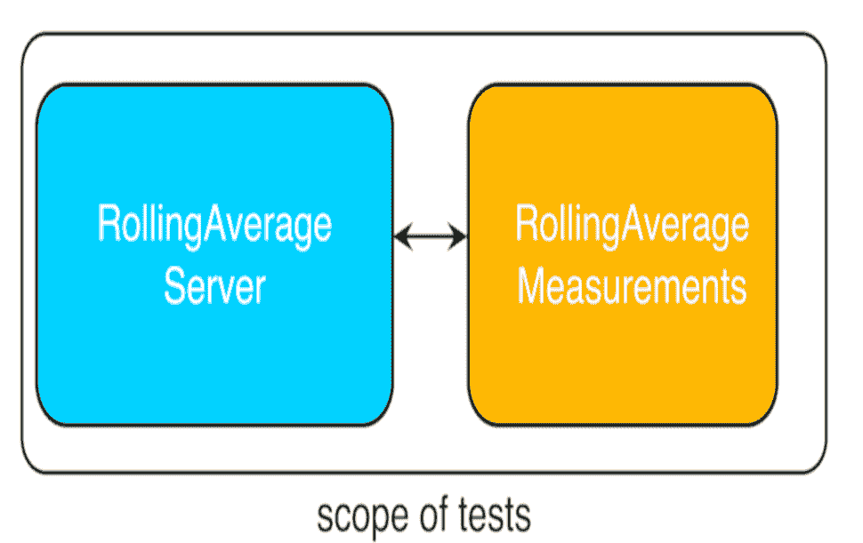

# 第 3 章

## Testing OTP
## 测试 OTP

In the previous two chapters, we established a mental framework to think and work with different levels of testing. We now have the tools to test isolated pieces of code through unit testing, test parts of the system that interact together through integration testing, and test the whole system through end-to-end testing. We covered many patterns that are specific to Elixir but also talked about testing practices in general. In this chapter, we’re going to focus on something that’s specific to Elixir: the OTP set of abstractions. We’re going to dive deeper into testing a few OTP abstractions, such as GenServers and supervisors, as well as talk about some patterns and things to pay attention to when testing asynchronous code.
在前两章中，我们建立了一个思维框架来思考和处理不同层次的测试。我们现在拥有了通过单元测试测试孤立代码片段、通过集成测试测试相互交互的系统部分、以及通过端到端测试测试整个系统的工具。我们涵盖了许多特定于 Elixir 的模式，也讨论了一般的测试实践。在本章中，我们将专注于 Elixir 特有的东西：OTP 抽象集合。我们将更深入地研究一些 OTP 抽象的测试，例如 GenServer 和 supervisor，以及讨论一些模式和在测试异步代码时需要注意的事情。

We’re going to start this chapter by discussing how to test GenServers, which are usually considered the *fundamental* abstraction in OTP.
我们将从讨论如何测试 GenServer 开始，本章通常被认为是在 OTP 中 *基本* 的抽象。

### Testing a GenServer
### 测试 GenServer

Let’s refresh our memory: a GenServer is a process that holds state and optionally provides an interface to read or update that state. OTP abstracts all of the common parts of a GenServer, like spawning the process, having a receive loop, and sending messages. What’s left to the user is to implement callbacks that implement code that’s specific to a particular GenServer.
让我们刷新记忆：GenServer 是一个保存状态并可选地提供读取或更新该状态的接口的进程。OTP 抽象了 GenServer 的所有通用部分，如生成进程、拥有接收循环和发送消息。留给用户的是实现回调来实现特定 GenServer 的代码。

We’ll see how we can make use of a GenServer in the Soggy Waffle application, but we’d like to start off with a self-contained example. It’s going to make things easier when illustrating some concepts. We’ll use a GenServer that provides a simple rolling average of the last N numeric measurements given to it. We can start with a simple implementation by looking at the public API exposed by the GenServer:
我们将看到如何在 Soggy Waffle 应用中使用 GenServer，但我们希望从一个自包含的示例开始。这将在说明一些概念时使事情更简单。我们将使用一个 GenServer，它提供最后 N 个给定数值测量的简单滚动平均值。我们可以通过查看 GenServer 暴露的公共 API 来开始一个简单的实现：

```
testing_otp/rolling_average/overloaded_genserver.ex

def start_link(max_measurements) do
  GenServer.start_link(__MODULE__, max_measurements)
end

def add_element(pid, element) do
  GenServer.cast(pid, {:add_element, element})
end

def average(pid) do
  GenServer.call(pid, :average)
end
```

We have a function to start the GenServer, a function to store a new element in the GenServer, and a function to get the average of the elements that the GenServer is storing at a given time. From the public API, we know that this is going to be a GenServer (because of the calls to GenServer functions), but we don’t know what the internal state of the
我们有一个用于启动 GenServer 的函数、一个用于在 GenServer 中存储新元素的函数，以及一个用于获取 GenServer 在给定时间存储的元素平均值的函数。从公共 API 我们知道这将是一个 GenServer（因为调用了 GenServer 函数），但我们不知道内部状态的

GenServer 或 add_element/2 和 average/1 功能的实现将如下所示。

现在让我们来检查它们。

内部状态将是一个包含两个字段的结构体：GenServer 一次存储的测量值的最大尺寸以及测量值本身。

```
testing_otp/rolling_average/overloaded_genserver.ex
defmodule RollingAverage do
  use GenServer

  defstruct [:size, :measurements]
```

接下来让我们查看 init/1、handle_call/3 和 handle_cast/2 回调的实现。

```
testing_otp/rolling_average/overloaded_genserver.ex
@impl GenServer
def init(max_measurements) do
  {:ok, %__MODULE__{size: max_measurements, measurements: []}}
end

@impl GenServer
def handle_call(:average, _from, state) do
  {:reply, Enum.sum(state.measurements) / length(state.measurements), state}
end

@impl GenServer
def handle_cast({:add_element, new_element}, state) do
  measurements =
    if length(state.measurements) < state.size do
      [new_element | state.measurements]
    else
      without_oldest = Enum.drop(state.measurements, -1)
      [new_element | without_oldest]
    end
{:noreply, %__MODULE__{state | measurements: measurements}}
end
```

很好。让我们继续测试它。

## 编写测试

我们如何测试这个 GenServer？我们提到了三种不同的选项：初始化、向队列添加一个数字以及获取当前平均值。我们将测试这三项。我们的第一个测试专注于初始化：

testing_otp/rolling_average/overloaded_genserver_test.exs

```
defmodule RollingAverageTest do
  use ExUnit.Case

  describe "start_link/1" do
    test "accepts a measurement count on start" do
      max_measurements = 3
      assert {:ok, _pid} = RollingAverage.start_link(max_measurements)
    end
  end
```

我们正在测试使用整数列表大小初始化 GenServer 不会引起问题并且返回一个 {:ok, pid} 元组。从测试的角度来看，我们还不知道大小是否实际上被 GenServer 使用（并且是否正确使用），但此测试有助于我们知道 GenServer 至少可以在不引起问题的情况下启动。

现在我们需要测试调用 add_element/2 是否会向队列添加一个元素。让我们先看看测试本身，然后再解释其工作原理。

免责声明：我们即将向您展示的测试有点糟糕。我们马上就会解释原因。

testing_otp/rolling_average/overloaded_genserver_test.exs

```
1: describe "add_element/2" do
-   test "adding an element to a full list rolls a value" do
-   max_measurements = Enum.random(3..10)
-   {:ok, pid} = RollingAverage.start_link(max_measurements)
5:
-   # "Fill" the measurements with 4s.
-   for _ <- 1..max_measurements do
-     RollingAverage.add_element(pid, 4)
-   end
10:
-   assert %{size: ^max_measurements, measurements: measurements} =
-     :sys.get_state(pid)
-   
-   expected_measurements = List.duplicate(4, max_measurements)
    assert measurements == expected_measurements
15:
-   
-   # We add an element that we know causes an "overflow".
-   RollingAverage.add_element(pid, 1)
-   
-   assert %{size: ^max_measurements, measurements: measurements} =
20:
-     :sys.get_state(pid)
-   
-   expected_measurements = [1 | List.duplicate(4, max_measurements - 1)]
-   assert measurements == expected_measurements
    end
25:
-   end
```

首先请注意，测试被设置为使用动态大小的列表。在测试中在静态值和动态值之间进行选择时，始终倾向于动态值。这种选择使得由于测试迫使代码仅适用于特定值而错过边缘情况的可能性降低。在这种情况下，我们从 4s 的列表开始，其长度与我们传递给 start_link/1 的最大测量次数相同（该数字是动态的）。然后，我们用此列表填充正在测试的 GenServer 的状态，并窥探 GenServer 的状态以断言预期状态。之后，我们向 GenServer 添加一个 5，这会导致测量值列表“溢出”，删除第一个添加的元素（一个 4）。最后，我们再次窥探 GenServer 状态并验证最旧的测量值是否确实被丢弃并且新测量值已添加到状态中。

在使用动态值时，确保它们出现在失败测试的反馈中非常重要。在这种情况下，您可以看到 max_measurements 被固定并且将成为失败反馈的一部分。这使得在调试时更容易重现相同的条件。

add_element/2 测试做了很多事情，但最大的问题是它无法在不使用系统调用窥探 GenServer 并获取其状态的情况下测试任何内容，见第 12 行。我们的测试必须知道 GenServer 将测量值存储为列表。这违反了代码周围的黑盒概念：测试代码必须知道代码的内部细节才能通过。然而，我们希望即使更改代码的内部细节但保持公共 API 不变时，我们的测试仍然能通过。如果我们例如将内部状态表示从列表更改为 Erlang 队列（参见 :queue[21]），这里就不会发生这种情况。我们警告过您测试会有一点糟糕。

我们的第三个测试稍微简单一些。结合之前的测试，我们对“滚动”行为有效有信心，所以在这里我们只关注返回平均值的 cast 回调。不过，设置 GenServer 中的状态仍然是测试的大部分内容。

```
testing_otp/rolling_average/overloaded_genserver_test.exs

describe "average/1" do
  test "it returns the average for the elements" do
    max_measurements = 2
    {:ok, pid} = RollingAverage.start_link(max_measurements)
    RollingAverage.add_element(pid, 5)
    RollingAverage.add_element(pid, 6)
    assert RollingAverage.average(pid) == 5.5

    RollingAverage.add_element(pid, 7)
    assert RollingAverage.average(pid) == 6.5
  end
end
```

拥有健壮的测试需要一点动态设置，并且如前所述，我们使用了一个通常最好避免的调用（:sys.get_state/1），以允许在不尝试解释 average/1 函数的结果的情况下测试分支行为。违反黑盒模型是一种测试坏味道，但如果没有它，我们的测试就必须很多，因为它们必须设置各种不同的状态并解释 average/1 返回的值。这种方法不仅会产生大量需要维护的测试；对于任何试图理解测试正在做什么的人来说，它也需要相当大的心理负担。

这个例子很基础，但内部逻辑越复杂，就越难理解测试。开始越来越多地深入 GenServer 获取其状态变得非常诱人。在下一节中，我们将看看如何重新思考我们的代码，使其更健壮，同时也更容易测试。

## 隔离功能核心

解决这个问题的更简单方法是将逻辑从 GenServer 的模块中移出，并放入一个新的纯功能模块中。这使您可以利用纯功能代码易于测试的优势，同时让 GenServer 测试专注于 GenServer 最擅长的事情：维护状态和提供 API。

首先，让我们看看纯功能模块的测试和代码，我们将它称为 RollingAverageMeasurements，因为它现在将处理我们的大部分代码逻辑。该模块简洁且范围明确：

```
testing_otp/rolling_average/measurements.ex

1: defmodule RollingAverageMeasurements do
  - def new(max_measurements) do
  - {[], max_measurements}
  - end
5:
  - def add_element({measurements, max_measurements}, new_element)
  - when length(measurements) < max_measurements do
  - {[new_element | measurements], max_measurements}
  - end
10:
  - def add_element({measurements, max_measurements}, new_element) do
  - without_oldest = Enum.drop(measurements, -1)
  - {[new_element | without_oldest], max_measurements}
  - end
15:
  - def average({measurements, _max_measurements}) do
  - Enum.sum(measurements) / length(measurements)
  - end
  - end
```

我们将所有纯数据结构逻辑移到了这个模块。new/1 函数（第 2 行）返回一个全新的测量值集合。在这里，我们将测量值数据结构设计为一个两元素元组，第一个元素是测量值列表，第二个元素是允许的最大测量次数。我们将这两个值都存储在数据结构中，以便数据结构包含执行 GenServer 需要执行的操作所需的所有必要信息。通过将此数据结构“隐藏”在模块内部并提供一组用于操作它的函数，我们将能够在不触及 GenServer 的情况下更改内部表示。


add_element/2（第 6 行）和 average/1（第 16 行）函数包含与 GenServer 用于处理相应 cast 和 call 基本相同的逻辑，但它们通过将我们的元组数据结构作为第一个参数接受，从而将数据结构的内部表示隐藏在 GenServer 本身之外。保持黑盒的边界完整会导致代码易于且安全地重构。

测试这种纯函数式代码比测试整个 GenServer 容易得多。我们的第一个测试关注在滚动平均数据结构有空间容纳该元素时添加一个元素。

```
testing_otp/rolling_average/measurements_test.exs

defmodule RollingAverageMeasurementsTest do
  use ExUnit.Case

  describe "add_element/2" do
    test "adds an element when there are fewer elements than the size" do
      measurements = RollingAverageMeasurements.new(_max_measurements = 3)

      measurements =
        measurements
        |> RollingAverageMeasurements.add_element(1)
        |> RollingAverageMeasurements.add_element(2)

      assert RollingAverageMeasurements.add_element(
          measurements,
          3
        ) == {[3, 2, 1], 3}
    end
  end
end
```

因为我们测试的是无状态代码，所以我们的测试只需要关注传入参数并断言返回值。不需要复杂的设置状态。从阅读这个第一个测试可以看出，我们现在能够只关注练习并验证测试阶段，表明我们已转向纯函数式代码的测试模式。你会看到这个测试检查了内部数据结构表示（元组）。这没关系，因为就这么说吧，我们在这里处于黑盒内部，而该数据结构的外部用户仍然不需要知道它是什么样子的。

在之前的测试中，验证滚动平均的“滚动”部分是否正常工作很困难，因为它隐藏在 GenServer 接口之后，需要设置状态，最终促使我们在为了保持测试数量最少而违反黑盒边界。相反，通过使所有部分明确，我们也可以对代码的滚动行为进行功能测试：

```
test "adding an element to a full list rolls a value" do
  initial_measurements =
    RollingAverageMeasurements.new(_max_measurements = 3)

  measurements =
    RollingAverageMeasurements.add_element(measurements, 1)

  measurements =
    RollingAverageMeasurements.add_element(measurements, 1)

  measurements =
    RollingAverageMeasurements.add_element(measurements, 1)

  assert RollingAverageMeasurements.add_element(measurements, 3) ==
    {_list = [3, 1, 1], _max_measurements = 3}
end
```

随着测试复杂度的降低，弄清楚如何使输入动态化几乎变得有趣。测试相当直接且易于阅读，即使列表大小是动态的。这是一个使用函数式代码进行设置的良好示例。它不会影响任何事物的状态，因此不需要清理。但我们确实需要做一些工作来为测试创建正确的参数。

我们只需要在 measurements 模块中再有一个测试：对列表求平均值。如果 Elixir（或 Erlang）自带一个平均值函数，我们可能可以跳过它，但添加一个测试和一个函数已经足够简单了：

```
describe "average/1" do
  test "it returns the average of the list" do
    max_measurements = Enum.random(1..100)
    measurements = RollingAverageMeasurements.new(max_measurements)

    input_list = Enum.take_random(1..1_000, max_measurements)

    measurements =
      Enum.reduce(input_list, measurements, fn input, acc ->
        RollingAverageMeasurements.add_element(acc, input)
      end)

    expected_average = Enum.sum(input_list) / length(input_list)

    assert RollingAverageMeasurements.average(input_list) ==
      expected_average
  end
end
```

在这种情况下，用于构建预期返回值的测试代码看起来会与我们代码本身的逻辑非常相似。这并不理想，因为代码相当基础。那么为什么还要有测试呢？这个测试将有助于防止回归。很可能被测试的代码在某个时候会被修改，而拥有这个测试将确保没有人意外破坏该功能。

我们的 GenServer 仍然需要被测试，但其目的现在已大幅减少。它只保留状态并调用 measurements 模块。这是一个我们可能希望扩展测试黑盒的示例，以包含经过良好测试的纯函数式 RollingAverageMeasurements 模块，如图所示。



由于 measurements 代码经过了充分测试并且由真正的纯函数组成，允许 GenServer 调用它几乎没有风险。（请参考第 1 章《单元测试》中关于定义单元测试范围的讨论以获取更多信息。）虽然风险很低，但回报是，我们不需要以强硬的方式修改代码或测试来确保 GenServer 调用该工具并验证它发送的数据是否符合预期。相反，我们可以编写一些轻量级测试，只确保外部行为存在，因为我们知道逻辑是单独测试的。

```
testing_otp/rolling_average/thin_genserver_test.exs

1: defmodule RollingAverageServerTest do
  use ExUnit.Case

  describe "initialization" do
5:   test "accepts a measurement count on start" do
    assert {:ok, _pid} =
```

```
-     RollingAverageServer.start_link(max_measurements: 3)
-   end
-   end

10:

-   describe "adding and averaging" do
-   test "it returns the rolling average for the elements" do
-     assert {:ok, _pid} =
-       RollingAverageServer.start_link(max_measurements: 2)

15:

-   RollingAverageServer.add_element(pid, 5)
-   RollingAverageServer.add_element(pid, 6)
-   assert RollingAverageServer.average(pid) == 5.5

20:

-   RollingAverageServer.add_element(pid, 7)
-   assert RollingAverageServer.average(pid) == 6.5
-   end
  end
25:

- end
```

我们现在只剩下两个测试：一个确保初始化正确，另一个确保基本操作按预期工作。我们的第一个测试（第 5 行）与之前相同，但它一开始就很小且易于理解。通常，我们会将两个行为的测试拆分为两个独立的测试，即添加元素和对列表求平均值。然而，正如我们之前发现的那样，以不违反黑盒的方式测试元素添加并不容易。这是可以接受的，因为我们已经通过 measurements 模块测试了相关逻辑。我们的第二个测试（第 12 行）运行 GenServer 的基本使用，只做足够多的断言来验证其是否正常工作。

GenServer 的实现代码现在也显著更容易理解了：

```
testing_otp/rolling_average/thin_genserver.ex
defmodule RollingAverageServer do
  use GenServer

  defstruct [:measurements]

  def start_link(options) do
    max_measurements = Keyword.fetch!(options, :max_measurements)
    GenServer.start_link(__MODULE__, max_measurements)
  end

  def add_element(pid, element) do
    GenServer.cast(pid, {:add_element, element})
  end

  def average(pid) do
    GenServer.call(pid, :average)
  end

  @impl true
  def init(max_measurements) do
    measurements = RollingAverageMeasurements.new(max_measurements)
    {:ok, %__MODULE__{measurements: measurements}}
  end

  @impl true
  def handle_call(:average, _from, state) do
    average = RollingAverageMeasurements.average(state.measurements)
    {:reply, average, state}
  end

  @impl true
  def handle_cast({:add_element, new_element}, state) do
    measurements =
    RollingAverageMeasurements.add_element(
      state.measurements,
      new_element
    )
  end
```

```
{:noreply, %__MODULE__{state | measurements: measurements}}
end
end
```

通过将代码设计为将逻辑提取到一个纯函数式模块中，我们把原本难以测试、难以推理的代码拆分成了两个更易于测试、更易于理解的测试文件和模块。在可能的情况下，朝着测试纯函数式代码的方向发展是一大胜利。有时并不像我们这里的示例那样简单，有时你的代码具有并非纯函数式的依赖。在这些情况下，第 2 章《集成和端到端测试》中讨论的思想就派上用场了。

现在让我们快速了解一下 ExUnit 工具箱中一个很棒的工具，它可以帮助我们在测试中启动和停止 GenServer（以及其他“OTP 进程”）。

## Controlling the Life Cycle of OTP Processes in Tests

到目前为止，当我们在测试中需要启动一个 GenServer 时，我们总是直接调用 GenServer 的 start_link/1 函数。我们甚至对其返回值进行了断言。

```
assert {:ok, pid} = RollingAverageServer.start_link(max_measurements: n)
```

这种断言可能有助于测试 start_link/1 函数是否按预期行为，但它有几个缺点。最重要的一点是，我们启动的进程与测试进程的生命周期绑定在一起，但方式并不干净。进程只是被链接起来。当测试执行结束时，测试进程会终止（平静地）；由于我们的 GenServer 进程与其链接，GenServer 也会死亡。然而，测试进程并不知道它必须等待使用 start_link/1 启动的进程正确关闭。换句话说，我们启动的 GenServer 进程在下一个测试开始时可能仍在关闭中，这可能导致一些讨厌的错误和竞态条件。

你可以想象为什么这种情况有问题：如果我们有两个测试都启动同一个进程并使用相同的名称进行注册，例如，如果第一个测试结束和下一个测试开始之间没有足够的时间，就可能发生名称冲突。让我们看一个例子，假设我们的 RollingAverage 服务器在启动时接受一个 :name 选项，该选项会为其注册一个名称：

```
testing_otp/rolling_average/server_with_name_start_link_test.exs

test "some test" do
  assert {:ok, _pid} =
    RollingAverageServer.start_link(
      name: :my_server,
      max_measurements: 3
    )
  # assertions
end

test "some other test" do
  assert {:ok, _pid} =
    RollingAverageServer.start_link(
      name: :my_server,
      max_measurements: 3
    )

  # other assertions
  end
```

在这两个测试中，服务器都使用相同的名称 :my_server 选项启动。当 ExUnit 完成运行其中一个测试并开始另一个测试时，无法保证在上一个测试中启动的、注册在 :my_server 名称下的服务器已经终止。因此，第二测试可能会失败，因为无法启动另一个已使用相同 :my_server 名称注册的服务器。

幸运的是，ExUnit 提供了一个有用的变通方法：
ExUnit.Callbacks.start_supervised/1。该函数接受一个子进程规范，在为你设置的临时监督者下启动你的进程。让我们先看看它的实际效果：

testing_otp/rolling_average/thin_genserver_test_with_start_supervised.exs

```
defmodule RollingAverageServerTest do
  use ExUnit.Case

  describe "initialization" do
    test "accepts a measurement count on start" do
      assert {:ok, _pid} =
        start_supervised(
          {RollingAverageServer, max_measurements: 3}
        )
    end
  end
end
```

start_supervised/1 如果成功仍会返回 {:ok, pid}，如果不成功则返回 {:error, reason}。在幕后，它会设置一个临时监督树，其中给定的进程作为其子进程之一。对于我们迄今为止看到的内容，它的工作方式几乎与我们手动的 start_link/1 断言完全相同。魔力发生在测试关闭时。由于 ExUnit 知道你是在其临时监督者下启动此进程的，它也知道在测试执行结束且测试进程退出时必须关闭子进程。当测试执行结束时，ExUnit 会使用适当的监督者关闭语义优雅地关闭你使用 start_supervised/1 启动的所有进程。这意味着它会在开始下一个测试之前等待进程关闭。

当你需要在许多测试中反复启动一个进程时，每次都写 assert {:ok, pid} 就没有意义了，因为你实际上并没有每次都测试进程是否正确启动。也就是说，进程应该每次都正确启动，但这不是你测试的重点。我们可以在原始的 RollingAverageServerTest 的第 14 行看到这种情况，我们断言 start_link/1 返回 {:ok, pid}，即使这不是测试的重点。在这些情况下，ExUnit 提供了另一个有用的工具，start_supervised!/1。它与 start_supervised/1 相同，但如果进程启动失败则会引发异常。我们可以在测试中使用它来确保我们启动了进程，但无需断言 {:ok, pid} 元组：

```
testing_otp/rolling_average/thin_gen_server_test_with_start_supervised.exs

describe "adding and averaging" do
  test "it returns the rolling average for the elements" do
    pid = start_supervised!({RollingAverageServer, max_measurements: 2})

    RollingAverageServer.add_element(pid, 5)
    RollingAverageServer.add_element(pid, 6)

    assert RollingAverageServer.average(pid) == 5.5

    RollingAverageServer.add_element(pid, 7)

    assert RollingAverageServer.average(pid) == 6.5
  end
end
```

虽然使用得不那么常见，但 ExUnit 还提供了一个助手，可以在测试结束前关闭使用 start_supervised/1（或 start_supervised!/1）启动的进程。该助手是 ExUnit.Callbacks.stop_supervised/1（以及对应的 stop_supervised!/1）。我们接下来要展示的测试有点牵强，也不是最有用的，但它会帮助我们展示 stop_supervised/1 的实际效果，请耐心等待。

```
testing_otp/rolling_average/thin_genserver_test_with_start_supervised.exs

describe "error cases" do
  test "asking for the average if the server has stopped crashes" do
    pid = start_supervised!({RollingAverageServer, max_measurements: 2})

    RollingAverageServer.add_element(pid, 5)
    RollingAverageServer.add_element(pid, 6)

    stop_supervised!(RollingAverageServer)

    assert {:noproc, _} = catch_exit(RollingAverageServer.average(pid))
  end
end
```

忽略对 catch_exit/1 的调用。我们在关于 catch_exit 和 catch_throw 的侧边栏中讨论了它。正如你所见，在此测试中，我们需要在测试结束前关闭 GenServer。stop_supervised!/1 来救援！stop_supervised/1 和 stop_supervised!/1 仍会优雅地关闭已启动的进程，因此我们几乎不必担心竞态条件。需要注意的一个特殊之处是，这些助手接受要关闭的进程的子进程 ID，而不是其 PID。这与 Supervisor 模块中关闭子进程的 API 一致，后者倾向于使用子进程的 ID 而不是其 PID。在我们的例子中，GenServer 使用的默认值意味着我们 GenServer 的子进程 ID 是其模块名称，TestingElixirCodeSamples.RollingAverageServer。

## catch_exit and catch_throw

在之前的测试中，我们使用了之前未使用过的宏：catch_exit/1。ExUnit 提供了两个类似的自解释宏，称为 catch_exit/1 和 catch_throw/1。它们运行你提供的表达式并断言该表达式退出或抛出某些内容。

我们在这里不会介绍这两个断言助手。主要原因是，在 Elixir 中拥有一个退出或抛出某些内容的公共接口是高度不鼓励的。我们绝对不希望你使用退出或抛出作为向你的代码用户（这可能包括你系统本身的其他部分）公开的控制流机制。抛出对于控制流很有用，尤其是在深度嵌套的循环和递归函数中，但你应该始终在不向代码用户暴露抛出项的情况下捕获。退出则不同：在进程不知道还能做什么的情况下使用可能有意义。总体而言，它们是 Erlang 的遗产。在我们上面的测试中，如果对不存在的服务器发出 GenServer.call/3，GenServer 模块会退出。如今，Elixir 开发者可能更倾向于在这种情况下使用 raise，而你可以使用 assert_raise 来测试它。好吧，就是这样。有时，我们必须处理退出和抛出。在这些情况下，catch_exit/1 和 catch_throw/1 就派上用场了。

最后一件事。你可能想知道为什么这些东西偏偏是宏。为什么它们不是接受匿名 0 元函数的函数，比如 catch_exit(fn -> ... end)？好吧，事实证明并没有真正的原因。这些是在 Elixir 团队喜欢在处处撒宏的时代添加到 ExUnit 中的。太晚了，无法更改！

在本节中，我们研究了如何测试一个具有“正常”客户端交互的 GenServer，即同步或异步请求。然而，GenServer 也可用于作为保存状态的后台进程。GenServer 的常见用途是作为根据其状态定期执行某些操作的进程。测试这些很棘手。让我们一起研究一下。


## 测试周期性操作

最后我们可以回到我们钟爱的 Soggy Waffle 应用了。我们已经了解如何测试一个本质上用于 *保存一些状态* 的 GenServer。GenServer 的另一个常见用途是在系统中拥有一个 *周期性* 执行操作的进程。例如，你可以有一个每五分钟重置一次缓存的 GenServer，或者有一个每隔几秒检查系统环境变量变化并在发生时更新系统其他部分的 GenServer。

对于 Soggy Waffle，我们需要类似刚才描述的东西。Soggy Waffle 的目的是在未来几小时内可能下雨时提醒我们。为此，应用程序需要 *周期性地* 调用天气 API，检查特定位置的预报中是否会有降雨。还记得我们在第 1 章 [单元测试](#) 和第 2 章 [集成和端到端测试](#) 中使用过的天气 API 吗？我们终于可以真正地使用它了。

周期性地调用天气 API 并在未来几小时内有降雨时发出警报是不够的，无法让它正常工作。应用程序还需要避免每次预报说两小时后会下雨时都提醒我们：如果我们每 30 分钟检查一次 API，而预报说两小时后会下雨，我们不能每隔三十分钟就提醒一次。我们已经收到太多提醒了。我们需要在某个地方存储一些数据来帮助我们避免无用的提醒。这听起来像是保持状态。

所以我们的用例很明确：执行某些周期性操作并存储一些状态。看起来解决这个问题的最佳工具正是 GenServer——真是剧情反转。

我们还有一个细节需要处理。我们希望 Soggy Waffle 通过 SMS 提醒我们。发送 SMS 时，我们只需使用 Twilio[22] 等第三方集成。Soggy Waffle 将通过 HTTP 与 Twilio 通信，而 Twilio 将处理发送 SMS 的繁琐细节。与其深入探讨与 Twilio 交互的代码会是什么样子，我们只会向你展示我们将使用的 Twilio *接口*。这个想法与第 2 章 *集成和端到端测试* 中讨论的相同：在隔离系统各部分时，我们主要关心的是这些被隔离部分所暴露的接口。内部实现是另一个关注点。这里是我们将可用的接口：

```
testing_otp/periodic_actions/twilio_interface.ex

defmodule SoggyWaffle.Twilio.Behaviour do
  @callback send_sms(phone_number :: String.t(), text :: String.t()) ::
    :ok | {:error, reason :: term()}
end

defmodule SoggyWaffle.Twilio do
  @behaviour SoggyWaffle.Twilio.Behaviour

  @impl true
  def send_sms(phone_number, text)
    when is_binary(phone_number) and is_binary(text) do
    # Make calls to the Twilio API here
  end
end
```

我们将再次使用 Mox 为此接口创建一个双件。[23] 这就是我们添加 SoggyWaffle.Twilio.Behaviour 行为的原因。我们稍后会使用这个双件来确保天气检查进程调用 Twilio 接口（也许还会检查检查器 *如何* 调用它以及 *多少次*，但我们先不要跑太快）。

```
testing_otp/periodic_actions/twilio_double.ex

Mox.defmock(SoggyWaffle.TwilioMock, for: SoggyWaffle.Twilio.Behaviour)
```

现在我们有了发送警报的计划，让我们从一个满足我们要求的简单 GenServer 开始，以便我们能够了解测试此类东西的挑战。

## 从简单开始：一个不保存状态的 GenServer

我们将编写我们能想到的最简单的 GenServer。在这个阶段，我们甚至不关心存储我们将发送的警报：我们想专注于周期性操作部分。我们想要执行的操作本身包括调用天气 API 获取天气预报，检查未来几小时内是否会下雨，并在预计下雨时通过 SMS 发送警报。我们将把我们的周期性操作 GenServer 命名为 SoggyWaffle.WeatherChecker：

```
testing_otp/periodic_actions/first_iteration_weather_checker.ex

1: defmodule SoggyWaffle.WeatherChecker do
  use GenServer

  @twilio_module Application.fetch_env!(:soggy_waffle, :twilio_module)

5:  def start_link(opts) do
    GenServer.start_link(__MODULE__, opts)
  end

  @impl GenServer

10: def init(opts) do
    interval = Keyword.fetch!(opts, :interval)

    state = %{
      city: Keyword.fetch!(opts, :city),

15:    phone_number: Keyword.fetch!(opts, :phone_number),
    }

    :timer.send_interval(interval, self(), :tick)

20:
{:ok, state}
end

@impl GenServer
def handle_info(:tick, state) do

### TODO: figure out how to actually use the weather API.
if SoggyWaffle.rain?(state.city, DateTime.utc_now()) do
@twilio_module.send_sms(state.phone_number, "It's going to rain")
end

{:noreply, state}
end
end
```

这个 GenServer 通过周期性地向自己发送一个 “tick”，即一个 Elixir 消息来工作。我们在第 19 行使用 :timer.send_interval/3 Erlang 函数，每当 interval 毫秒过去时，就向 GenServer 本身 (self()) 发送 :tick 消息。[24] 然后，我们在 handle_info/2 回调（第 25 行）中处理 :tick 消息。为了处理一次 tick，GenServer 会查询天气 API；如果天气 API 表示将要下雨，那么 GenServer 会向提供的电话号码发送一条降雨警报 SMS。

再注意一件事：第 4 行我们使用了在第 2 章，集成和端到端测试中展示过的模式，来读取调用 Twilio 接口时使用的模块。在测试中，这将允许我们用其双件 SoggyWaffle.TwilioMock 替换 SoggyWaffle.Twilio。

> :timer.send_interval/3 or Process.send_after/3?
> 对于每隔给定间隔最多执行给定次数的周期性操作，使用 :timer.send_interval/3 是不被推荐的。原因在于计时器会在相同的间隔触发，但如果你的进程执行某些操作花费异常长的时间或被其他因素阻塞，那么它可能会 “堆积” tick 消息，然后在它们之间没有足够的时间间隔的情况下执行它们。更常见的方法是使用 Process.send_after/3 一次发送一个 tick 消息。然后你可以在处理完每个 tick 消息后调用 Process.send_after/3，这样就可以确保在处理后续 tick 消息之间至少会过去给定的间隔。对于我们的示例，间隔很长，所以我们选择不使代码复杂化而使用了 :timer.send_interval/3，但我们想强调 :timer.send_interval/3 并非总是最佳选择。

我们该如何测试这个？事实证明，这并不那么简单。让我们先看看代码，然后逐步分析：

```
testing_otp/periodic_actions/first_iteration_weather_checker_test.exs
```

```
defmodule SoggyWaffle.WeatherCheckerTest do
  use ExUnit.Case, async: true

  import Mox

  setup [:set_mox_from_context, :verify_on_exit!]

  test "when the process ticks, the Twilio interface is called" do
    interval_in_ms = 5
    phone_number = "+1 111 11 1111"

    stub(SoggyWaffle.TwilioMock, :send_sms, fn to, text ->
      assert to == phone_number
      # TODO: assert on text
      :ok
    end)

    start_options = [
      interval: interval_in_ms,
      city: "Los Angeles",
      phone_number: phone_number
    ]

    start_supervised!({SoggyWaffle.WeatherChecker, start_options})

Process.sleep(interval_in_ms * 2)
  end
end
```

该测试使用较低的间隔（五毫秒）启动 SoggyWaffle.WeatherChecker GenServer，以便 GenServer “足够快” 地调用 Twilio 接口，然后检查 Twilio 接口是否被调用。正如我们在第 2 章，集成和端到端测试中学到的，我们可以使用 Mox.stub/3 来检查接口的 send_sms/2 函数是否被调用。请记住，Mox.stub/3 不能保证双件被调用；它只提供了一种在存根函数被调用时执行代码的方式。由于我们的 GenServer 在启动后会 “tick”，我们还需要确保等待第一次 tick 发生。由于我们控制着 tick 间隔，我们可以在测试中使用 Process.sleep/1 并休眠足够长的时间（比如间隔的两倍），以确信存根已被调用。

这可行，但这是一个相当糟糕的测试。依赖 Process.sleep/1 通常是一个很大的危险信号，因为当超时时间太短时会导致测试脆弱，而超时时间太长时会导致测试缓慢。相反，我们可以使用一个相当常见的 Elixir 技巧来获得正确的时机：在存根函数中，我们可以在返回 :ok 之前向测试进程发送一条消息。这样，测试进程就可以使用 assert_receive/1 来等待从存根函数发送的消息。这至少可以保证存根函数被调用（至少一次）。它并不能保证当我们收到消息时，存根函数已经返回。解决这个问题更棘手，因为我们不想破坏黑盒模型并检查 GenServer 在做什么。幸运的是，我们知道我们的 GenServer 在调用存根函数后不会做太多事情，所以我们对这种小不一致是可以接受的。这里是使用消息传递的更新后代码：

```
defmodule SoggyWaffle.WeatherCheckerTest do
  use ExUnit.Case, async: true

  # same setup as before,
```


```
test "when the process \"ticks\", the Twilio interface is called" do
  interval_in_ms = 5
  phone_number = "+1 111 11 1111"
  test_pid = self()
  ref = make_ref()

  stub(SoggyWaffle.TwilioMock, :send_sms, fn to, text ->
    assert to == phone_number
    # TODO: assert on text
    send(test_pid, {:send_sms_called, ref})
    :ok
  end)

  start_options = [
    interval: interval_in_ms,
    city: "Los Angeles",
    phone_number: phone_number
  ]

  start_supervised!({SoggyWaffle.WeatherChecker, start_options})

  assert_receive {:send_sms_called, ^ref}
  end
  end
```

包含一个引用（使用 make_ref/0 生成）作为此类消息是一种良好的实践，这样我们可以确信我们断言的消息正是我们想要断言的那条消息。原因在于引用是足够唯一的项（在实际用途中每个引用大约在调用 make_ref/0 2⁸² 次后才会再次出现）。我们想强调，上述的消息发送技术在覆盖异步代码的 Elixir 测试中相当常见。并非总有更好的替代方案，因此它是我们工具箱中值得拥有的好工具。

这个 GenServer 及其测试都有效。然而，测试存在一个问题：如果我们重构 GenServer 使其在 tick 时发送两条或更多消息，测试仍会愉快地通过。这是由于我们使用了 Mox.stub/3，它允许你尽可能多次调用 stub 函数，并且不会对调用次数进行断言。让我们在下一节尝试修复这一不足。

## 在黑盒模型与实际需求之间取得平衡

Mox 提供了我们想要的完美函数：Mox.expect/4。我们可以使用 expect/4 来确保 send_sms/2 函数恰好被调用一次。然而，由于测试对象本身的特性，我们的问题仍然存在。由于 GenServer 周期性地执行其操作，我们在测试中并不知道它会 tick 多少次。例如，如果机器特别慢，那么在单个测试过程中，GenServer 可能会 tick 几次，尤其是当我们像上一节那样使用快速间隔时。因此问题出在测试的基础之上。

事实证明，我们很难摆脱目前所处的困境。稍后我们会看到，这一情况很好地概括了一类与周期性操作相关的测试问题。在这本书中，我们始终努力严格遵循测试原则，例如将应用程序代码视为黑盒，以及避免仅为了使测试更容易而对应用程序代码进行更改。然而，我们之前已经稍微打破了规则：例如，在编译时读取 @twilio_module 属性以便在测试期间交换 Twilio 接口替身，这无疑是我们为了有利于测试而对应用程序代码所做的更改。在这种情况下，我们将采取类似但侵入性稍强的方法，对 SoggyWaffle.WeatherChecker 进行逻辑更改以使测试更容易。我们在追求干净、实用且同时有效的测试之间走钢丝。

我们面临的基本问题是，我们的 GenServer 在后台执行周期性操作，一旦启动就会一直重复，直到我们停止 GenServer 本身。那么，如果我们不周期性地执行操作，而是“按需”执行呢？我们当前的 SoggyWaffle.WeatherChecker 不支持这一点，但这是我们可以更改的。我们将在启动 GenServer 时增加对 :mode 选项的支持。此选项控制 GenServer 是否像现在这样周期性地执行 tick（:periodic 模式），还是我们手动触发每次 tick（:manual 模式）。

```
testing_otp/periodic_actions/weather_checker_with_mode.ex

defmodule SoggyWaffle.WeatherChecker do
  use GenServer

  # same module attribute and start_link/1 as before

  @impl GenServer
  def init(opts) do
    mode = Keyword.get(opts, :mode, :periodic)
    interval = Keyword.fetch!(opts, :interval)

    state = %{
      city: Keyword.fetch!(opts, :city),
      phone_number: Keyword.fetch!(opts, :phone_number),
    }

    case mode do
      :periodic ->
        :timer.send_interval(interval, self(), :tick)

      :manual ->
        :ok
    end

    {:ok, state}
  end

  @impl GenServer
  def handle_info(:tick, state) do
    # exactly the same code as before
  end
end
```

正如你所见，我们所做的更改非常小。现在，如果我们在启动 GenServer 时传递 mode: :manual，GenServer 将不会启动 ticking 循环。这意味着我们需要一种手动触发 tick 的方式。这听起来可能很糟糕，但我们认为最好的方式是向 GenServer 发送一个 :tick 消息，以精确模拟 mode: :periodic 的行为。这听起来不好，因为它通过依赖 GenServer 的内部实现细节而破坏了黑盒模型。然而，我们认为这是一种简单且实用的解决方案，能够实现测试的目的：如果我们更改内部实现，测试将会失败，这并不理想，但至少会发出信号表明有问题需要修复，而不是悄无声息地溜过去。我们本可以想出更优雅的方式来隐藏这一实现细节，例如在 GenServer 中公开一个 tick/0 函数，但我们认为将对应用程序代码的更改保持在最小范围所带来的好处大于隐藏这一细节。

现在我们的测试可以在 :manual 模式下启动 GenServer，并使用 Mox.expect/4 来断言 send_sms/2 在测试期间恰好被调用一次：

```
testing_otp/periodic_actions/weather_checker_with_mode_test.exs

defmodule SoggyWaffle.WeatherCheckerTest do
  use ExUnit.Case, async: true

  # same setup as before,

  test "when the process \"ticks\", the Twilio interface is called" do
    interval_in_ms = 5
    phone_number = "+1 111 11 1111"
    test_pid = self()
    ref = make_ref()

    start_options = [
      # The :mode option is set explicitly for testing.
      mode: :manual,
      interval: interval_in_ms,
```
```
city: "Los Angeles",
phone_number: phone_number
]

pid = start_supervised!({SoggyWaffle.WeatherChecker, start_options})

expect(SoggyWaffle.TwilioMock, :send_sms, fn to, text ->
  assert to == phone_number
  # TODO: assert on text
  send(test_pid, {:send_sms_called, ref})
  :ok
end)

send(pid, :tick)

  assert_receive {:send_sms_called, ^ref}
  end
end
```

还有一个最后的问题需要解决：如果我们想在应用程序的监督树中启动我们的 GenServer 怎么办？这种情况相当可能，但这意味着我们的测试无法依赖在测试中启动另一个 SoggyWaffle.WeatherChecker，因为应用程序级别的 GenServer 和测试级别的 GenServer 都将调用同一个测试替身，从而使我们的 Mox.expect/4 断言变得不可靠。

这个问题更具普遍性，与单例资源有关，单例资源是应用程序中作为单例并由应用程序在启动时启动的组件。这些资源往往会在测试中引发不同类型的问题，因为通常你 either 不能在测试中启动这些资源的其它实例（毕竟它们是单例），或者，如果你能在测试中启动其它实例，它们将与单例实例争夺相同的资源。让我们在下一节更深入地探讨单例资源。

## 测试单例资源

在 Elixir 和 Erlang 应用程序中拥有 *单例资源* 非常常见。单例资源在你的应用程序中以单一且唯一的单元存在。例如，具有全局注册名称的进程就是一个单例资源，因为系统中在同一时间不能存在另一个具有相同名称的进程。这个例子有点过于简化了。

更常见且更现实的例子是一个进程执行某项操作，该操作最多应由一个进程在同一时间执行——例如，需要独占访问文件系统上的文件的进程，或周期性地通过短信通知用户即将下雨的进程。你明白我们对后者的意图吗？如果我们有多个这种类型的进程，我们会遇到麻烦，因为每个进程都会尝试发送短信，导致用户被多次通知。解决方案可能是让进程之间共享已通知用户列表，例如在 ETS 表中。然而，我们只是把问题转移了：单例资源现在变成了 ETS 表。哎呀。那么，我们如何测试这些场景呢？

我们真心认为单例通常是测试中最棘手的事情之一。*编写* 单例资源通常并不具有挑战性，因为在任何给定时间你都只有一个资源实例在运行。然而，当你想要 *测试* 这些实例时，你通常希望启动单例资源的额外实例以便在隔离环境中进行测试。我们将介绍一些测试单例资源的变通方法，但不要期望得到关于干净且成熟的测试模式的强烈建议。在这种情况下，测试可能需要逐案考虑，似乎 Elixir 社区尚未找到一种被广泛接受的解决方案。


一般在测试单例资源时，我们建议你首先确定*是什么使其成为单例资源*。是注册的名称吗？是它被允许操作特定文件的唯一事物这一事实吗？也许它是与外部系统的唯一连接？让我们看看如何找出这一点以及如何进行测试。

## 使单例资源的本质可定制

在之前的章节中，当我们为 SoggyWaffle.WeatherChecker 添加 mode: :manual 选项时，我们违背了我们核心的信念，即不应仅为了使测试更容易而更改应用程序代码。好吧，我们又得打破这一信念了。测试单例资源最简单、最容易且最高效的方法之一就是使使它们成为单例资源的东西变得*可定制*。

由于我们在之前的章节中已经使用过一个单例资源（SoggyWaffle.WeatherChecker），我们将以此作为案例研究。在这种情况下，使 SoggyWaffle.WeatherChecker 成为单例资源的原因是它被允许向用户发送短信消息的唯一事物（为了避免向同一用户发送多条消息）。在代码中，我们可以将这一想法翻译为以下陈述：SoggyWaffle.WeatherChecker 是在任何给定时间被允许使用 SoggyWaffle.Twilio.send_sms/2 的唯一事物。

第 2 章《*集成和端到端测试*》的内容在这里将适用得很好。我们的天气检查器 GenServer 已经在编译时从应用程序环境中读取用于 Twilio 接口的模块。

正如我们在讨论集成测试时提到的，特别是 *Stubbing Entire Interfaces* 中，使用依赖双重的一个有用且灵活的技术是在构成测试套件的大多数测试中使用无操作假对象，但在专门测试我们感兴趣的行为的测试中使用实际的模拟。

在这种情况下，我们可以在除天气检查器 GenServer 的测试之外的所有测试中使用一个不执行任何操作的 Twilio 假对象。假对象的代码简短精炼：

```
testing_otp/periodic_actions/no_op_twilio.ex
```

```elixir
defmodule SoggyWaffle.NoOpTwilio do
  @behaviour SoggyWaffle.Twilio.Behaviour

  @impl true
  def send_sms(_phone_number, _text), do: :ok
end
```

然后，每当我们需要启动一个天气检查器进程而不让它与 Twilio 或双重对象交互时，我们可以使用 Mox.stub_with/2：

```
Mox.stub_with(SoggyWaffle.TwilioMock, SoggyWaffle.NoOpTwilio)
```

我们在应用程序的监督树中启动天气检查器时也必须使用 mode: :manual，以避免天气检查器在后台运行。

在测试我们的 GenServer 时，我们现在可以切换到 SoggyWaffle.TwilioMock 模拟，并测试天气检查器是否对 Twilio 进行了正确的调用。

## 单例问题的更脏解决方案

有时你可能会觉得自己处于一种情况，即你有一个单例资源，根本无法在测试环境中启动。让我们想一个疯狂的例子：你的应用程序需要在每小时的第37分钟强制重启整个 VM，因为这是业务需求。你可以用 cron 作业来实现这一点，但我们说的是疯狂的例子，所以假设你实现了一个 GenServer，每分钟执行一次检查，看看当前分钟是否是小时中的第37分钟。如果是第37分钟，GenServer 就会重启 VM。如何测试这样的东西？

有些人想出的解决方案是在测试环境中使用*不同的应用程序监督树*。例如，你的 Application.start/2 回调可能看起来像下面的这样：

```
testing_otp/singleton_resources/different_sup_tree_for_testing/application.ex
```

```elixir
@mix_env Mix.env()

def start(_type, _args) do
  Supervisor.start_link(children(@mix_env), strategy: :one_for_one)
end
```

如你所见，我们调用 children(@mix_env) 以根据 Mix 环境确定应用程序顶级监督器的子进程。这样，我们就可以为测试环境设置与开发和生产环境不同的子进程集。你问为什么要在编译时读取 Mix.env() 并将其存储在 @mix_env 中？好吧，因为在 Elixir 发布版的运行时，Mix 模块（以及 :mix 应用程序）不可用，[25] 所以我们希望在编译代码时读取 Mix 环境。观察得好！

现在回到我们的代码。children/1 函数可能看起来像这样：

```elixir
defp children(:test) do
  [
    MyApp.OtherChild
  ]
end

defp children(_env) do
  [
    MyApp.VMRestarter,
    MyApp.OtherChild
  ]
end
```

我们只在开发和生产环境中启动 MyApp.VMRestarter GenServer，而不在测试环境中启动。然而，如果我们在测试环境中不启动 GenServer，我们如何测试 GenServer 本身呢？好吧，在这种情况下，你不会测试。无法测试 GenServer 是我们强烈不鼓励这样做的主要原因。

根据我们的经验，没有任何情况是精心放置的依赖双重（假对象、模拟或存根）无法拯救局面的。虽然在上述情况下，你可能不得不稍微偏离正道，对“依赖双重”是什么保持灵活。例如，在这种情况下，GenServer 可能必须调用类似 Erlang 函数 :init.reboot/0 的东西来重启 VM。[26] 好吧，那么你就可以围绕此函数包装一个接口模块并为其创建依赖双重：

```
testing_otp/singleton_resources/different_sup_tree_for_testing/rebooter.ex
```

```
defmodule MyApp.RebooterBehaviour do
  @callback reboot() :: :ok
end

defmodule MyApp.Rebooter do
  @behaviour MyApp.RebooterBehaviour

  @impl true
  defdelegate reboot(), to: :init
end

Mox.defmock(RebooterFake, for: MyApp.Rebooter)
```

在这里，你将在测试中使用 RebooterFake 模块，并在开发和生产中使用 MyApp.Rebooter，就像我们在之前的章节中展示的那样。

我们理解这种做法会感觉多么“不干净”。幸运的是，在我们的职业生涯中，我们并没有遇到太多需要诉诸如此极端措施的情况。不过在那为数不多的情况下，我们发现这种方法是最不糟糕的解决方案，我们更喜欢它而不是不同的监督树解决方案。最不糟糕远非最好，但它比最糟糕要好，对吧？

真相是，代码越纠缠复杂，并且与世界的复杂部分（比如主机，或在谈论周期性操作时*时间本身*）交互越多，就越难以控制这些世界的部分并使测试保持干净。好消息是这些问题有一些变通方法。坏消息是它们并不总是整洁美观。

现在我们已经介绍了如何测试 GenServer、周期性操作和单例资源，让我们继续测试另一个不利于测试的 Elixir 和 Erlang 特性，*弹性*。

也就是说，让我们谈谈测试在进程级别出现问题时会发生什么。

## 测试弹性

让我们用一个大胆的声明开始这一节：我们不是测试进程崩溃的粉丝。我们要来点哲学。为什么进程会崩溃？大多数时候，因为*意外的错误*。在某些情况下，最好的做法可能是为我们知道可能发生的错误条件（*预期的错误*）引发异常或退出进程。然而，我们发现这往往是例外而不是规则，因为如果错误是预期的，那么你可能希望优雅地处理它（想想 TCP 连接中断或用户输入错误）。在你故意引发或退出时，测试该行为可能有意义。

不管怎样，OTP 架构最强大的特性之一是，如果进程遇到意外错误并崩溃，很可能有监督器将其重新启动。这不是我们想要测试的行为；监督器是有效的，并且几十年来一直通过自动化和实地技术进行测试。同时，我们也不真的想测试进程*可以崩溃*。但如果它们因意外错误而崩溃，如果错误本身是意外的，我们如何测试它？如果你可以测试一个意外错误，我们认为该错误按定义就不是意外的。这就是你的哲学。

所以，我们不想测试进程崩溃时是否会被重启，也不想测试进程因意外错误而崩溃。那我们测试什么呢？好吧，关于进程崩溃的一个有趣的测试点是崩溃的*后果*：换句话说，*崩溃恢复*。大多数 OTP 的设计方式是使进程崩溃时大多数事物自动清理，使用进程和端口之间的链接等。例如，如果一个 GenServer 使用 `:gen_tcp` 启动一个 TCP socket，该 socket 将与 GenServer 链接。如果 GenServer 崩溃，socket 将因现有链接而被关闭。


然而，在某些情况下，当其“父进程”死亡时，你的进程启动或打开的资源并不会自动停止或关闭。一个直接的例子可能是启动时创建并打开文件的 GenServer 进程，并在其生命周期内使用该文件转储一些内部状态。如果 GenServer 意外崩溃，你很可能希望该文件被删除并清理干净。我们认为这值得测试，因此将在本节稍后进行探讨。

至于监督树，我们认为可能值得测试的是你的监督树是否*布局正确*。不过我们要坦率地说：这很难测试，而且很混乱。我们将在本节末尾探讨一些解决方案和替代方案，但希望大家的期望值不要太高。

## 测试崩溃后的清理

如果你想在进程崩溃后执行一些清理操作，以确保崩溃不会留下任何残留，最好的选择通常是一个不同且*非常直接*的进程来监控第一个进程，其工作仅在第一个进程崩溃时执行必要的清理。让我们回到上一节末尾提到的例子：一个在生命周期内将一些 term 转储到文件中的 GenServer，以避免将此类状态保存在内存中：

```
testing_otp/cleanup_after_crashes/genserver_that_uses_file.ex

defmodule GenServerThatUsesFile do
  use GenServer

  def start_link(opts) do
    GenServer.start_link(__MODULE__, opts, name: __MODULE__)
  end

  def store(pid, term) do
    GenServer.cast(pid, {:store, term})
  end
```

```
end

@impl true
def init(opts) do
  path = Keyword.fetch!(opts, :path)

  File.touch!(path)

  pid = self()
  ref = make_ref()
  spawn_link(fn -> monitor_for_cleanup(pid, ref, path) end)

  # Wait for the cleanup process to be ready, so that if this process
  # crashes before the cleanup process is trapping exits then we don't
  # leave a zombie process.
  receive do
    {^ref, :ready} -> :ok
  end

  {:ok, path}
end

@impl true
def handle_cast({:store, term}, path) do
  new_content = "\n" <> :erlang.term_to_binary(term)
  File.write!(path, new_content, [:binary, :append])
  {:noreply, path}
end

defp monitor_for_cleanup(pid, ref, path) do
  Process.flag(:trap_exit, true)
  send(pid, {ref, :ready})

  receive do
    {:EXIT, ^pid, _reason} ->
      File.rm_rf!(path)
  end
end
end
```

这个 GenServer 没有做任何有用的事情，但你可以想象它可以拥有一个 API 来检索它添加到文件中的特定 term，例如。 为了少写代码，让我们把这个可能的 API 留在想象中。

没有可靠的方法确保如果这个 GenServer 崩溃它会清理文件。因此，我们的做法是编写一个小的“清理进程”。这个进程也可能崩溃，是的，但鉴于其代码的简单性，发生这种情况的可能性较小。我们直接从 GenServer 的 init/1 回调中生成这个进程。代码并不是最直接的，但它只是处理可能的竞态条件并确保以下几点：

- 如果由于某种意外事故清理进程死亡，则 GenServer 进程会死亡，并且
- 清理进程仅在 GenServer 进程死亡时删除文件，然后平静地终止。

现在有了这个进程，测试其崩溃后的情况很直接。我们只需杀死 GenServer 进程并确保文件不再存在：

testing_otp/cleanup_after_crashes/genserver_that_uses_file_test.exs

```
test "no file is left behind if the GenServer process crashes" do
  path =
    Path.join(
      System.tmp_dir!(),
      Integer.to_string(System.unique_integer([:positive]))
    )

  pid = start_supervised!({GenServerThatUsesFile, path: path})

  assert File.exists?(path)

  Process.exit(pid, :kill)

  wait_for_passing(2_seconds = 2000, fn ->
    refute File.exists?(path)
  end)
end
```

该测试在系统的临时目录中生成一个随机路径（使用 System.tmp_dir!/0），然后启动 GenServer 并断言文件存在，以暴力方式杀死 GenServer（使用 Process.exit/2 且 reason 为 :kill），最后断言文件不再存在。你会注意到使用了名为 wait_for_passing/2 的函数。这是我们在使用 Elixir 代码时经常写的一个小函数。其目的是避免花哨的消息传递，以便知道何时可以运行断言。

wait_for_passing/2 的工作是重复运行断言，最长持续给定时间间隔（本例中为两秒），在此期间允许断言失败。时间间隔结束后，断言会最后再运行一次，且不捕获任何异常，因此如果在给定时间间隔后断言仍然失败，则测试将失败。我们在这个测试中需要 wait_for_passing/2，因为如果我们在杀死 GenServer 后立即断言文件不存在，就会出现竞态条件，可能导致断言运行时文件尚未被删除。通过等待几秒钟并反复尝试断言，我们很可能给了清理进程足够的时间来删除文件。如果两秒后文件仍然存在，这意味着我们可能存在问题。请注意，如果我们不放心，可以将间隔提高到十秒、二十秒甚至更长时间：wait_for_passing/2 在断言通过后立即返回，因此除非断言失败（这在正常的测试运行中不太可能发生，因为我们希望修复 bug 使其再次通过），否则我们的测试仍会保持快速！

让我们看看这个小辅助函数的代码：

```
testing_otp/cleanup_after_crashes/genserver_that_uses_file_test.exs

defp wait_for_passing(timeout, fun) when timeout > 0 do
  fun.()
rescue
  _ ->
```

```
Process.sleep(100)
wait_for_passing(timeout - 100, fun)
end

defp wait_for_passing(_timeout, fun), do: fun.()
```

实现很直接，使用了递归。它会减少给定的超时时间，直到“耗尽”。在此实现中，我们硬编码了 Process.sleep(100) 和 timeout - 100，这意味着在给定间隔期间断言每 100 毫秒运行一次，但我们可以更改此值或将其作为参数传递给 wait_for_passing 函数以使其可自定义。wait_for_passing/2 并不是最高效的函数，因为它会重复运行断言，并在每次运行之间“浪费”几百毫秒，但它是一个良好且有效的工具，在现实世界中我们已在不少地方使用过它。

本节最终更多地关注要测试的代码而非测试本身，但我们认为它有助于说明测试崩溃后清理的含义。在这种情况下，测试足够小且简单。如果事情变得更复杂，你将拥有我们在前几章中学到的工具来帮助你使用依赖双和消息传递等手段设计测试。

让我们继续讨论 OTP 领域中易于测试的最后敌人：监督器。

## 测试监督树

监督器是 Erlang/Elixir 以及 OTP 抽象集合中最强的卖点之一。它们允许你以弹性方式构建应用程序内部进程的生命周期，并使隔离故障变得轻而易举。然而，监督器是我们遇到过的最难测试的东西之一。原因在于它们的主要工作是允许你的应用程序从复杂且难以在测试期间有意触发的级联故障中恢复。

想象一下拥有一个复杂且“深”的监督树（树根与叶子进程之间有多个层级）。现在想象一下，树角落里的一个子进程开始崩溃，并且仅靠自身重启无法恢复。OTP 运行得非常漂亮，并将故障传播到该子进程的父监督器，后者开始崩溃并重启其所有子进程。如果这不能解决问题，则故障会不断向上传播，直到重启足够多的应用程序部分才能修复问题（如果问题非常严重，整个应用程序可能会崩溃）。那么，你如何测试这种行为？你甚至想广泛测试它吗？

在测试期间注入一个不会被简单重启解决但也不会导致整个应用程序崩溃的故障是困难的。与此同时，我们知道监督器是有效的：也就是说，我们知道故障隔离和“冒泡”重启行为是有效的。我们之所以知道这一点，是因为监督器在此时已被数十年的实战检验过。如前所述，我们不想测试这一点，因为它属于“测试抽象”而非测试你自己的逻辑的反模式。

我们的建议？在实践中，我们倾向于不对监督树进行自动化测试。我们测试应用程序的各个组件，有时这些组件由一组进程组成，这些进程组织在主应用程序监督树的“子树”中。为了忠实于黑盒测试模型，我们经常将组件作为一个整体进行测试，无论它是否由多个存在于监督树内的进程组成。如果组件经过单元测试和集成测试，那么我们很乐意依赖 OTP 来确保监督器按正确的方式行为。

然而，我们并非完全盲目飞行。大多数时候，我们会不时花一些时间手动启动我们的应用程序并

只是做一些手动测试。我们在运行中的应用中杀死进程，并确保监督树能够隔离故障并按预期恢复事物。让我们更深入地谈谈这种方法。

## Exploratory Manual Testing

事实证明，我们发现实践中存在一种测试监督树的方法，它在提高你对应用程序韧性的信心与避免编写复杂、繁琐且脆弱的测试套件之间取得了很好的平衡。我们所说的就是探索性手动测试。我们专门使用这个术语只是为了显得高大上，因为我们真正的意思是：启动 observer，在应用程序中右键点击随机进程，无情地杀死它们，然后看看会发生什么。

听起来虽然粗糙，但这种方法相当高效且实用。我们的做法是启动应用程序并模拟其在正常条件下运行的情况。例如，如果我们正在构建一个具有 HTTP 接口的应用程序，我们可以生成持续不断的 Web 请求。然后，我们在监督树中杀死随机进程并观察会发生什么。当然，进程被杀死的预期结果取决于该进程：如果我们杀死顶级监督者，我们肯定会看到应用程序停止响应 HTTP 请求。然而，如果我们说，杀死处理单个 Web 请求的进程会怎样？我们应该看到一个请求被丢弃，但没有其他影响。这并不难观察。如果我们杀死整个数据库连接池会怎样？我们可能会开始看到一堆请求返回一些 4xx 或 5xx HTTP 状态码。在大多数情况下，你应该知道监督树的一部分崩溃时会发生什么，因为这种确切的知识本应指导监督树的形状设计。如果例如你希望数据库连接在隔离中失败，同时应用程序继续提供 HTTP 请求，那么你需要将数据库连接的监督树与 HTTP 请求处理程序的监督树隔离开来，也许让它们成为其父监督树中的兄弟节点。

让我们谈谈这种测试技术的缺点。主要问题是这种测试不是自动化的。你需要让人工手动完成所有步骤：启动应用程序，为其生成一些工作，运行 observer，杀死进程并观察行为。想必你也知道，我们非常推崇自动化测试，所以我们并不是这种方法的忠实粉丝。然而，根据我们的经验，许多应用程序的监督树相比于其他代码而言，变化相对较少。因此，这种手动测试在应用程序生命周期中可能只需要进行几次。比较运行此类手动测试所需的时间与构建故障行为自动化测试所需的时间，从实际角度来看，只运行几次手动测试可能是有意义的。

另一个我们从经验中得到的观察是，许多 Elixir 和 Erlang 应用程序具有相对“扁平”的监督树，只有少数几个子进程。探索性手动测试技术在监督树更小、更简单的情况下效果显著更好，因为毕竟一开始需要手动测试的故障情况就更少。测试扁平的监督树往往比测试嵌套的树更容易。

## Property-Based Testing for Supervision Trees

基于属性的测试是一种技术，我们将在第 7 章《基于属性的测试》中更详细地讨论。简而言之，它围绕为你的代码生成随机输入数据，并确保你的代码无论（有效）输入数据如何都能保持一组给定的属性。这听起来可能很陌生，但在该章节中你会有时间深入了解这些概念。不过，我们只是想稍微超前一点，提及 Fred Hebert 的一个名为 sups 的库。[27] 该库是实验性的，但可以与几种不同的 Erlang 基于属性的测试框架一起使用，以编程方式运行你的应用程序，在监督树中注入随机故障，并监控你定义的一些应用程序属性。

该库的 README 最好地解释了这一点：

> 在监督结构编码了程序预期故障语义的场景中，该库可用于进行故障注入和故障模拟，以查看程序中发生的故障是否确实遵循监督树所暴露的模型。

我们自己从未在实际项目中使用过这个库，因为我们从未觉得需要对监督树进行复杂的自动化测试（原因如前几节所述）。不过，我们认识 Fred 并信任他的工作，所以我们在这里引用这个库，供那些想要或需要为其监督树构建万无一失的测试套件的好奇读者参考。我们要强调该库是实验性的，自行承担风险使用。

我们认为围绕测试监督者缺乏更广泛使用或更突出的工具，这是一个好迹象，表明 Erlang 和 Elixir 社区对监督树的稳健自动化测试也不太热衷。也许有一天社区会找到一种简单有效的方法来测试监督树。但就我们所知，那一天尚未到来。

## Wrapping Up

这是一个很难写的章节。OTP 无可否认是吸引开发者使用 Erlang 和 Elixir 的最重要特性之一。然而，虽然 OTP 中的抽象通常简单有效，但在测试领域中，测试异步和“后台”代码仍然是最困难的事情之一。

与本书中的其他章节相比，本章的说教性较少，这直接源于使用 OTP 代码测试时常涉及的复杂性。我们的目标是为你提供选项和思路，以解决测试 OTP 抽象和一般异步代码时常见的难题。例如，我们看到了如何隔离 GenServer 的功能核心，这通常是简化测试的绝佳方法，但并非总是可行。我们讨论了测试异步代码、周期性操作和单例资源的技巧。我们通过讨论关于测试故障恢复、韧性和监督树的理念和思路结束了本章。我们希望你能够使用这些概念中的一些并将其应用到自己的测试套件中。

接下来我们将研究 Elixir 生态系统中应用最广泛的库和框架 Ecto 和 Phoenix 的测试。

## Footnotes

- [21] https://erlang.org/doc/man/queue.html
- [22] https://www.twilio.com
- [23] https://github.com/plataformatec/mox
- [24] http://erlang.org/doc/man/timer.html#send_interval-3
- [25] https://hexdocs.pm/mix/Mix.Tasks.Release.html
- [26] https://erlang.org/doc/man/init.html#reboot-0
- [27] https://github.com/ferd/sups
