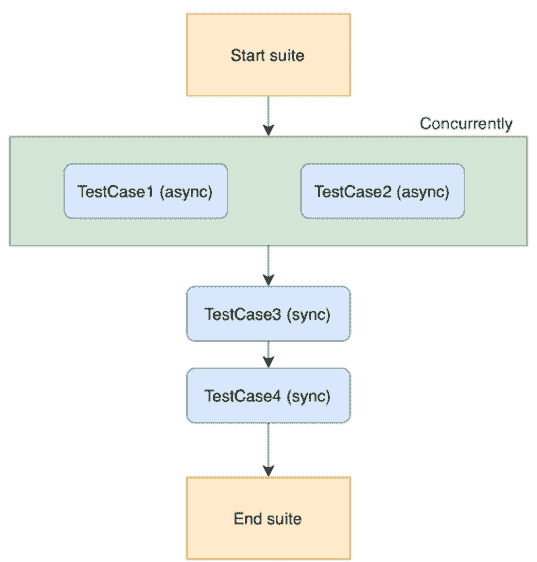
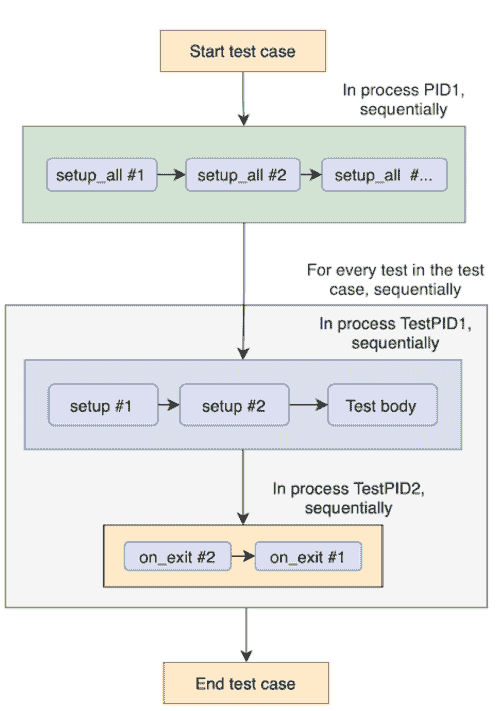

# 附录 2
## 测试生命周期

一旦你熟悉 ExUnit 作为编写 Elixir 测试的工具，你可能希望更深入地了解测试本身以及整个测试套件的确切生命周期。在本附录中，我们将探讨 ExUnit 如何执行你的测试套件，包括设置、运行测试和清理。我们还将学习测试、设置回调和清理回调如何与 *processes* 相关，即 ExUnit 测试套件的“进程架构”是什么。

这些知识不仅有助于提高你对 ExUnit 作为工具的理解。 在某些时候，你可能需要想出非常规的策略来测试特定的代码片段（出于多种可能的原因）。 在这些情况下，了解你的测试代码运行在哪个进程中、测试套件中的哪些步骤是阻塞的哪些是异步的，以及哪些测试进程相互链接非常重要。

### ExUnit 套件的生命周期

当你运行 mix test 时，Mix 本质上是在编译你的项目，从项目的 test 目录加载所有以 _test.exs 结尾的文件，然后运行 test/test_helper.exs。 Mix 负责为你启动 ExUnit 套件。 然而，其中并没有什么魔法。

Mix 执行的是对 ExUnit.start/1 的单次调用，该调用由 Mix 本身包含在所有 test/test_helper.exs 文件中，其通常看起来像下面的片段：

```
ExUnit.start()
```

ExUnit.start/1 的文档很好地总结了此函数的作用：[55]

> 启动 ExUnit 并在虚拟机终止前自动运行测试。

ExUnit.start/1 依赖于 System.at_exit/1 在关闭虚拟机之前实际运行整个测试套件。 这给了你一个机会在运行任何测试之前加载你需要的一切并编译每个测试用例模块。 当你运行 mix test 时，Mix 所做的一切就是这样。

如果你想“按需”运行测试套件，而不是在关闭 VM 之前运行，你可以使用 ExUnit.run/0。 毕竟 ExUnit.start/1 在内部也使用它。 然而，你需要在运行 ExUnit.run/0 之前以某种方式启动 :ex_unit 应用程序。 实现此目的的常见方法是使用 autorun: false 选项调用 ExUnit.start/1，这告诉 ExUnit 不要在关闭 VM 之前运行测试套件。 手动运行测试套件的可能示例如下所示：

```elixir
ExUnit.start(autorun: false)

IO.puts("About to run the test suite!")

result = ExUnit.run()

IO.puts("The test suite finished running.")
IO.puts("The result is: #{inspect(result)}")
```

要在 ExUnit 套件运行完成后运行一些代码，你可以使用自 Elixir 1.8 起可用的 ExUnit.after_suite/1 回调。 在 Elixir 1.8 之前，你会直接使用 System.at_exit/1，但 ExUnit.after_suite/1 为你提供了有关套件本身结果的有用的额外信息。 ExUnit.after_suite/1 接受一个回调函数，并在套件执行完成时运行该函数。 回调函数必须接受一个参数，一个包含表示套件中不同类别测试数量的非负整数的映射。

```elixir
%{
  excluded: 2,
  failures: 1,
  skipped: 0,
  total: 84
}
```

你可以多次调用 ExUnit.after_suite/1。 你注册的所有回调都将在测试套件结束时按与你注册的相反顺序执行。 所有回调都在调用 ExUnit.run/0 的同一进程中顺序执行。 如果你使用 ExUnit.start/1，所有回调都将在 System.at_exit/1 创建的单独进程中执行，以执行其回调。

ExUnit.after_suite/1 对于不同的事情很有用，但我们发现它对于任何类型的清理或通知最有用。 你可以使用一些物联网魔法让家里的智能灯变红
如果套件中出现任何失败。 你可以用它来删除你在测试中设置的临时目录。 你的想象力是极限。

我们查看了与整个 ExUnit 套件相关的代码和回调。 让我们继续学习如何执行 *cases*。

### 测试用例

每个名称以 Test 结尾且包含对 use ExUnit 的调用的模块都被视为测试用例。 测试用例本质上是设置回调和测试的集合。

这里最重要的是要知道，测试用例相对于其他测试用例可以并发或顺序执行。 所有在 use ExUnit 中使用 async: true 选项的测试用例都会并发执行。 然后，其余的测试用例按顺序执行（按定义顺序），默认情况下按随机顺序。



正如我们提到的，测试用例本身不包含任何逻辑。 它只是设置回调和测试的容器。 测试用例的执行如下：

- 1. 所有 `setup_all` 回调都被执行。
- 2. 所有测试都与其特定于测试的设置和清理回调一起执行。

让我们从 `setup_all` 开始。 所有 `setup_all` 回调都按在测试用例中定义的顺序执行，并且它们在 *same process* 中执行。 本质上，在运行任何测试之前，测试用例会生成一个进程，在该进程中运行所有 `setup_all` 回调，然后开始运行测试。

在 `setup_all` 回调之后，测试用例运行测试。 单个测试用例中的测试 *always run sequentially*，默认情况下按随机顺序运行（除非提供了套件种子）。 如果你好奇为什么单个测试不并行运行，原因在于性能：在大多数情况下，单个测试足够快，以至于并行执行它们并为每个测试分配自己的进程的开销大于运行测试所需的时间。

剩下的唯一需要理解的就是单个测试的生命周期。

### 执行测试

执行单个测试时，测试用例大致执行以下操作：

- 1. 按定义的顺序运行所有设置回调。
- 2. 运行测试主体。
- 3. 按注册顺序运行所有 on_exit 回调。

让我们分别查看这些步骤。

测试用例在运行测试时做的第一件事是生成一个新进程来在其中运行该测试。 所有设置回调都在该进程内顺序运行。

在设置回调执行后，测试用例在测试进程内运行测试本身的主体。

一旦测试主体退出（通过完成或通过显式退出，例如通过异常），就是运行 on_exit 回调的时候了。 为运行所有 on_exit 回调而生成了一个新进程。 所有 on_exit 回调都在该进程中执行，一个接一个（即顺序执行）。 on_exit 回调不会在测试进程中执行，因为毕竟测试进程刚刚退出，所以它不再存活。

### 一个示例和图示

在本短节中，我们将提供一个非常人为的测试用例示例，其中包含一些测试、设置回调和清理回调。 我们还将提供运行此测试用例所涉及的进程的视觉表示，以及运行测试用例的输出。 你可以通过调用 elixir test_case_example.exs 自己运行此文件并查看结果。

```
test_lifecycle/test_case_example.exs

### We use an empty list of formatters so that ExUnit doesn't
### output anything on the standard output.
ExUnit.start(autorun: false, formatters: [])

defmodule TestCaseExampleTest do
  use ExUnit.Case

  setup_all do
    IO.puts("setup_all #1 in process: #{inspect(self())}")
  end

  setup_all do
    IO.puts("setup_all callback #2 in process: #{inspect(self())}")
  end

  setup do
    IO.puts("setup callback #1 in process: #{inspect(self())}")
  end

  setup do
    IO.puts("setup callback #2 in process: #{inspect(self())}")
  end

  test "#1" do
    on_exit(fn ->
      IO.puts(
        "on_exit callback #1 (test #1) in process: #{inspect(self())}"
      )
    )
```


```
end)

on_exit(fn ->
  IO.puts(
    "on_exit callback #2 (test #1) in process: #{inspect(self())}"
  )
end)

IO.puts("test #1 in process: #{inspect(self())}")
end

test "#2" do
  IO.puts("test #2 in process: #{inspect(self())}")
end
end

result = ExUnit.run()

IO.puts("The return value of ExUnit.run/0 is:")
IO.inspect(result)
```

输出如下。

```
setup_all #1 in process: #PID<0.109.0>
setup_all callback #2 in process: #PID<0.109.0>
setup callback #1 in process: #PID<0.110.0>
setup callback #2 in process: #PID<0.110.0>
test #2 in process: #PID<0.110.0>
setup callback #1 in process: #PID<0.111.0>
setup callback #2 in process: #PID<0.111.0>
test #1 in process: #PID<0.111.0>
on_exit callback #2 (test #1) in process: #PID<0.112.0>
on_exit callback #1 (test #1) in process: #PID<0.112.0>
The return value of ExUnit.run/0 is:
%{excluded: 0, failures: 0, skipped: 0, total: 2}
```

也许下面的可视化表示也有帮助：



我们希望本附录在你处理更棘手的测试时有所帮助，或者当你只是想了解整个 ExUnit 套件的确切生命周期时有所帮助，包括测试用例以及其中的单个测试。

## Footnotes

[55] https://hexdocs.pm/ex_unit/ExUnit.html#start/1
