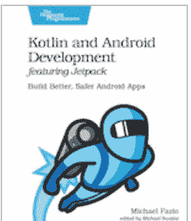
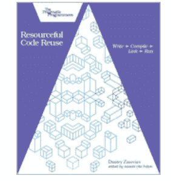

# Bibliography

[TD21] Bruce A. Tate and Sophie DeBenedetto. *Programming Phoenix LiveView*. The Pragmatic Bookshelf, Raleigh, NC, 2021.

感谢！
你喜欢这本书吗？请告诉我们。花点时间将你的反馈发送至 support@pragprog.com。告诉我们你的故事，你就有机会赢得免费电子书。请使用主题行“Book Feedback。”

准备好阅读下一本 Pragmatic Bookshelf 的好书了吗？请访问 https://pragprog.com 并使用优惠码 BUYANOTHER2021 在下一本电子书上节省 30%。

在禁止、限制或不受欢迎的地方无效。不要在水边使用电子书。如果皮疹持续存在，请咨询医生。不适用于 *The Pragmatic Programmer* 电子书，因为它比 Pragmatic Bookshelf 本身还要老。副作用可能包括知识和技能的提升、市场价值的提高以及深深的满足感。请定期增加剂量。

感谢你的持续支持，

The Pragmatic Bookshelf

## You May Be Interested In...

*选择封面获取更多信息*

### Kotlin and Android Development featuring Jetpack

开始以现代方式使用 Kotlin 和 Jetpack 的庞大工具、库和最佳实践集构建原生 Android 应用。学习如何使用 Fragments 创建高效、 resilient 的视图，并使用 ViewModels 在视图之间共享数据。使用 Room 快速持久化有价值的数据，并避免 NullPointerExceptions 和 Java 的冗长表达式，使用 Kotlin。你甚至可以用 Kotlin 协程优雅地处理异步网络服务调用。在遵循详细的逐步说明的同时构建两个功能齐全的应用，实现所有这些功能以及更多内容。

Michael Fazio

(444 页) ISBN: 9781680508154 $49.95

### Learn to Program, Third Edition

学习如何编程电脑比以往任何时候都容易。现在每个人都可以为自己学习编写程序——无需任何先前经验。Chris Pine 以彻底但轻松幽默的方式教你计算机编程的基础知识，几乎没有繁琐或麻烦。无论你对新爱好还是新职业感兴趣，本书都是你进入编程世界的门户。

Chris Pine

(230 页) ISBN: 9781680508178 $45.95

### Intuitive Python

开发者用 Python 驱动项目，因为它强调可读性、易用性以及可维护的包和工具集的访问。语言本身在每次发布时都在改进：在 Python 中编写充满可能性。但要维护成功的 Python 项目，你需要的不只是语言。你需要工具和直觉来帮助你充分利用可用的资源。用本书作为你的指南，帮助你磨练技能，塑造一个经得起时间考验的 Python 项目。

David Muller

(140 页) ISBN: 9781680508239 $26.95

### Modern CSS with Tailwind

Tailwind CSS 是一个令人兴奋的新 CSS 框架，它允许你通过组合简单的实用类来设计网站，从而创建复杂的效果。使用 Tailwind，你可以设置文本样式、在页面上移动项目、设计复杂的页面布局，并为从手机到宽屏显示器的设备调整设计。通过本书，你将学习如何利用 Tailwind 的灵活性和一致性，从排版的最小细节到网站的整体设计。

Noel Rappin

(90 页) ISBN: 9781680508185 $26.95

### Essential 555 IC

学习如何使用基于 venerable “555” 的简单但巧妙的电路创建功能小工具。这些项目将让你亲身体验在其他项目中也有帮助的有用、基础电路。这些鼓舞人心的设计甚至可能引导你开发下一个大项目。555 定时器振荡器集成电路芯片是世界上最受欢迎的芯片之一。通过巧妙的项目，你将获得永久的知识，了解如何使用 555 定时器，这将伴随你一生。

Cabe Force Satalic Atwell

(104 页) ISBN: 9781680507836 $19.95

## 巧妙的代码复用

复用编写良好、调试完善且测试充分的代码可以提高生产力、代码质量和软件可配置性，并减轻软件开发人员的压力。当你将代码组织成自包含的模块化单元时，你可以将其作为未来项目的构建块使用，并在需要时与其它程序员分享。了解七种代码复用模型的利弊，以便你能在任何开发阶段自信地复用代码。在 C 和 Python 这两种最流行的现代编程语言中创建静态和动态库。为现实世界适配你的代码：将共享函数远程部署并构建使用远程过程调用访问它们的软件。

Dmitry Zinoviev

(64页) ISBN: 9781680508208 $14.99
