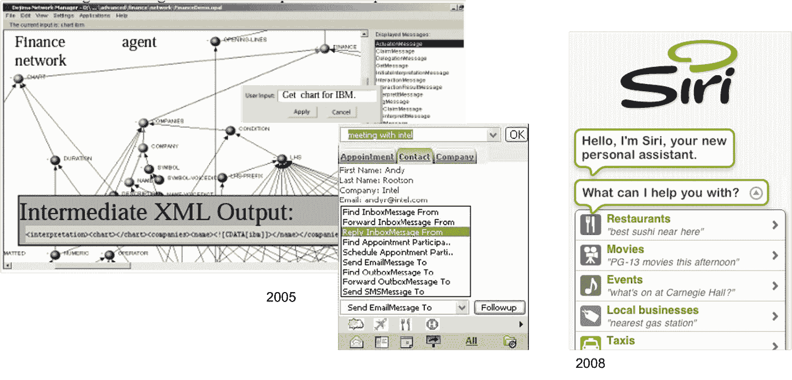
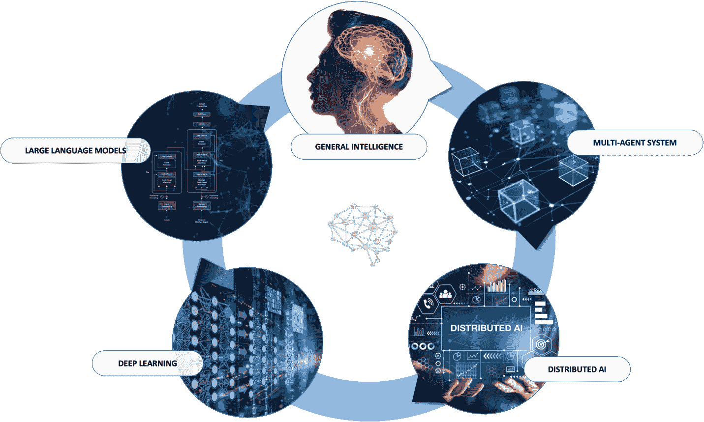
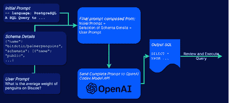
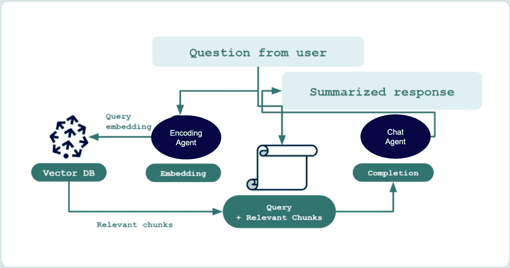
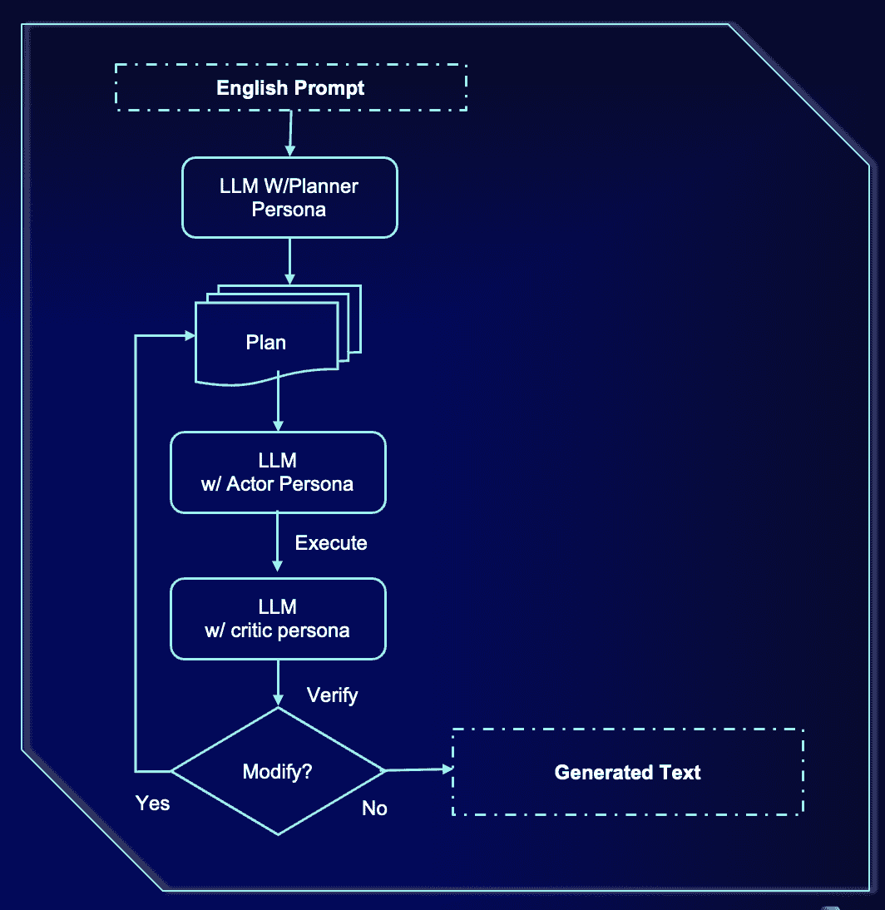
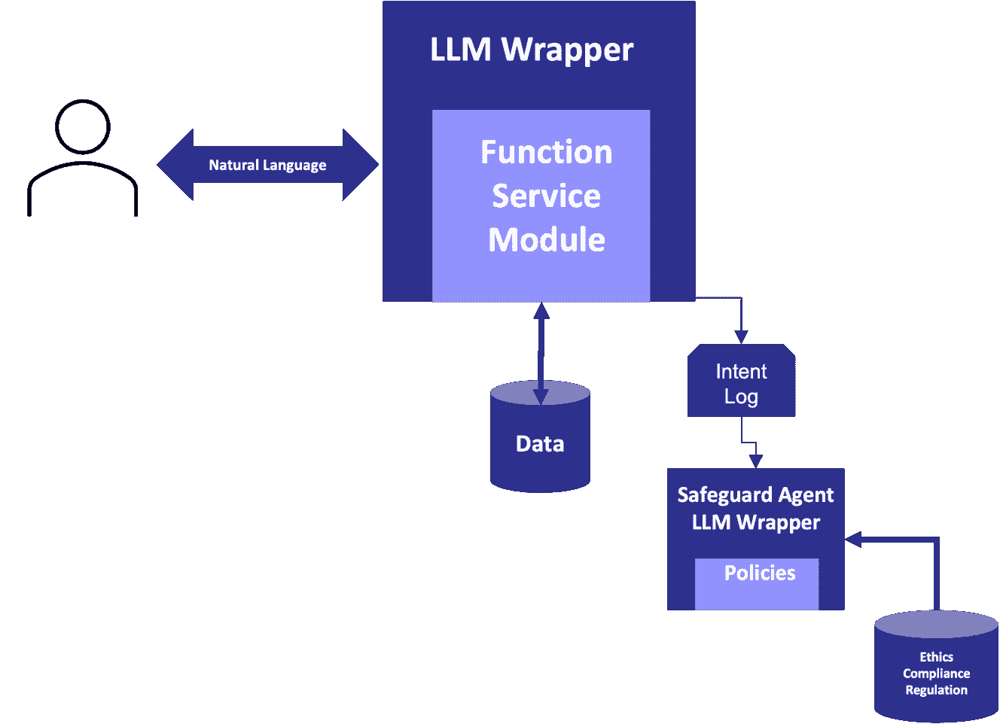
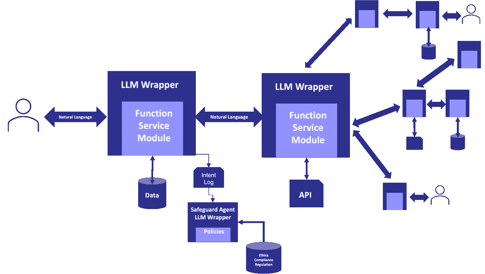
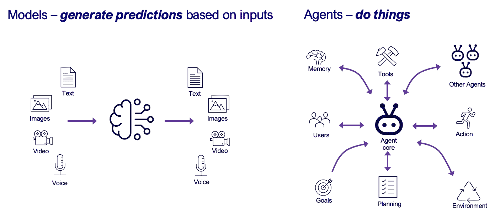
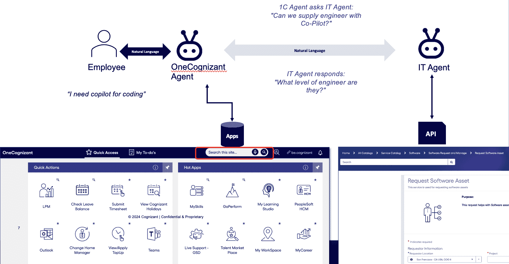
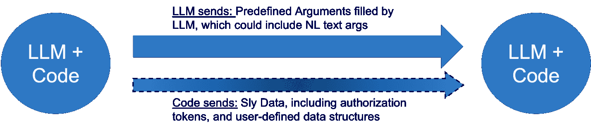

# 代理企业（致 Raymond Rhine）

PROD: Uncomment the following sentence if appropriate and add it to the above para: This book is not intended as \[legal/medical/financial; use the appropriate reference\] advice. Please consult a qualified professional if you require \[legal/medical/financial\] advice.

\[LSI\]

italicize any chapter titles that are not yet available in ER

# Introduction

Humans are Agents. When we say ‘we have agency’ we mean we are able to postulate a goal of our own making, devise an action plan, and execute to deliver on that goal. As agents we have the ability to organize and impact our world, get feedback from our actions, and modify our actions based on that feedback in order to improve.

Machine intelligence has improved such that it is taking a greater share of our decision-making, complementing and augmenting our world as AI agents.

Like AI itself, and most other modern digital technology, we owe the concept of AI Agents to Alan Turing. In his 1950 treatise on [Computing Machinery and Intelligence](https://www.edwardfrenkel.com/turing-intelligence.pdf), he described machines that perceive input and act toward goals. This definition is silent on the environment within which the agent is operating and perhaps, Turing’s idea was that the agent would be unconstrained to act in the world.

Today, the world in which an AI agent can operate has vastly expanded. Not only do we have a virtual world in the shape of the internet to complement the real world, we can also define any manner of virtual world we can imagine and engineer it into existence through programming.

So which world do AI agents operate in? Is it fair to assume that ultimately an AI agent is to be able to perceive any given environment, and act toward any given goal? Who defines the goals? Are agents autonomously to decide on which goals to pursue? While this is possible at lower levels, at some point in the hierarchy of agents there needs to be an uber-goal that directs the system and its highest order agents in how they define their goals.

Even if we borrow from nature and define the higher level goal to be survival, we, as humans, are still engineering this into the AI agents.

The same applies to inputs. Surely an AI agent cannot be perceiving the world in its entirety, and so we’d have to engineer sensors for it, designed based on what we believe to be the most important information it would need in its pursuit of its goals.

So AI Agents are an engineering concept.

Through the years, as computing, storage, and AI have progressed, this definition of an AI agent has been adopted, implemented and experimented on in a variety of ways.

In the seventies and eighties, AI scientists started off thinking we could create a single entity that would be artificially intelligent with no need for constraints. This generally capable AI agent would primarily be able to operate in the real world, perceiving any input and acting towards any given goal. This ambitious definition failed, in part due to lack of compute and labeled data resources, and in part because the AI algorithms were simply not up for the job.

In the mid-nineties, the problem of AI was simplified, by simplifying the world within which the intelligence would manifest itself. What if we build an intelligent agent, representing us, not in the complex world we live in, but in the simpler world of the internet, which back then, was mostly text and hyperlinks.

Thus, Agent-based AI took center stage. A [popular AI textbook](https://www.academia.edu/download/82860922/artificial_intelligence_modern_approach.9780131038059.25368.pdf), published in the late nineties, was called “Artificial Intelligence: A modern Approach” and the modern approach was this new constrained agent-based definition of AI.

Before long, people started wondering what would happen if your agent ran into someone else’s agent. Should they collaborate or compete? Would there be a common inter-agent language?

Multi-Agent systems became a subfield of AI, with some, including the authors, suggesting a new software paradigm called Agent-oriented Software Engineering (see Figure I-1) as a follow on to the object-oriented movement.

Fast forward to today: Generative AI has shown unexpected emergent capabilities, most important of which is the understanding of Natural Languages. LLMs are able to understand, translate, and even write code or produce images based on a natural language description. Natural Language Processing, Understanding, and translation, problems that were the first non-numerical application of computers, and considered very difficult to solve, have been effectively addressed through the use of LLMs now.

What’s more, these AI models can express intent and context in natural language. The very human ability to put concepts together in order to form new concepts, describe new contexts, or express new meaning is now available in machines, which makes them much more robust than any artificial system ever made.

语言是由人类发展出来作为结构化、高概念带宽通信的手段。没有语言，人类社会将无法运作。多年以来，随着新概念的涌现，语言变得更加丰富。现在机器“理解”人类语言，我们拥有了通用的人机通信协议——我们可以用自己的语言与它们交谈，它们也能以同样的方式回应。

有趣的是，作为大型语言模型发明的后果，我们现在也拥有了更丰富、更稳健的机器对机器通信语言的形式，即我们自己的自然语言。由于机器理解英语或德语、中文或印地语，我们可以让它们使用一种或多种语言进行通信，这具有双重好处：它在抽象和概念上非常丰富，涵盖了人类所发展出的全部本体论，而且它对我们来说也是可理解的，这在我们想要理解和追踪决策过程时非常有帮助。

因此，开箱即用，我们就拥有了代理间通信的通用协议。由于自然语言表达意图的灵活性，以及基于 LLM 的代理将此类意图映射到其工具调用方式的能力，未来的软件系统将比我们今天拥有的系统脆弱得多：负责某项功能的代理负责将意图映射到具体的 API 调用，因此更改 API 或采用具有类似能力的不同软件将不会那么麻烦。这将为组织在升级或使用第三方服务时提供更大的灵活性。

如果代理间通信和协调以保证职责封装的方式进行，那么未来的企业应用将更加稳健，能够在几乎无需重新设计现有系统的情况下，将新功能和新能力引入到已有的代理网络中。

鉴于机器学习方法，使用深度学习和 Transformer 架构，并通过语言建模进行训练，已经产生了像大型语言模型这样强大的系统，很自然地会认为我们正重回创造一个普遍智能的单一模型的轨道。换句话说，有些人认为构建越来越大的大型语言模型，并用越来越多的数据训练它们，将会产生一个在人类智能的各个方面都比人类更智能的大型语言模型。然而，似乎出于完全不同的原因，我们现在又重新考虑将基于代理的系统作为软件的下一个自然步骤（见 图 I-2）。

生成式 AI 是预训练的，因此很难使其在线上从根本上改变其世界模型。生成式 AI 通常是在公开可用数据上训练的，因此，其训练数据中不包含特定于商业问题领域的信息，例如公司可能收集和使用的专有数据，它对业务应用而言开箱即用并不通常有用。

此外，大型语言模型需要被给予系统提示才能发挥作用。系统提示是大型语言模型输入上下文的一部分，会在每次不同的输入中重复出现，以便提醒大型语言模型它是谁以及对其的期望是什么。通过系统提示，大型语言模型可以扮演不同的角色并以不同的方式运作。这意味着，为了让大型语言模型在知识工作流程中扮演特定角色，我们需要为其提供具体的指令，声明其具有特定的专业知识，并为其提供具体的职位描述和职责范围。

机器既能理解高度复杂的人类设计概念，又能执行具体指令的能力，导致了对基于代理的 AI 或代理式 AI 兴趣的重新兴起。我们能否让机器为执行复杂目标规划自己的路径，并设计指令集来实现这一目标，并且做到自主？

挑战与九十年代早期 AI 先驱者所面临的挑战完全不同：当时，由于计算资源和模型能力的缺乏，我们被迫简化问题域。现在，我们仍然简化问题域，但那是因为生成式 AI 模型过于强大和灵活，我们需要对其进行约束并将其任务限定在组织用例中的特定角色中。因此，现代基于 LLM 的代理应运而生。

## 多智能体系统

生成式 AI 的许多用途都需要将大型语言模型限制在特定角色中。例如在图 3 中，我们可以选择让大型语言模型回应查询“比斯科岛上企鹅的平均体重是多少？”。它可能已经从其通用知识中学习到答案，但如果没有，它会尝试猜测，答案可能不可靠。但有一种更可靠的替代方案：如果我们能够访问一个我们知道包含可靠数据的数据库，例如关于企鹅的数据，最好是告诉大型语言模型数据库的模式和用于查询的 SQL 类型，并让它将我们的自然语言询问翻译成对数据库的调用。

大型语言模型擅长编写代码，但它们没有实际进行调用并检索数据的能力，因此我们需要一些辅助代码来实现这一点。我们的代码会模式匹配大型语言模型的这种意图并调用数据库，检索答案，然后将其传递给大型语言模型以将其表述为自然语言响应（见 图 I-3）。

事实上，检索增强生成（RAG）是当今生成式 AI 的一个流行用例。许多公司都在寻求为其专有文档库提供类似 ChatGPT 的界面，这通过离线总结文档并将其连同大型语言模型对摘要的表示（称为嵌入）一起存储在向量数据库中来实现。嵌入是捕捉摘要含义或语义的向量。通过将它们存储在向量数据库中，我们可以计算摘要之间的数值距离，从而更容易按含义搜索，而不是对词语和句子进行严格僵化的模式匹配。该系统随后可以通过将请求映射到对向量数据库的查询来响应关于专有文档的未来自然语言问题，找到与当前查询含义最接近的摘要。

因此，你也可以在这里看到，RAG 可以被视为一个多智能体系统，其中一个智能体负责离线摘要，另一个负责回应用户的自然语言查询（见 图 I-4）。

但还可以做更多。任何需要知识工作者的工作流程都可以被视为多智能体系统。例如在 图 I-5 中，我们可以让一个规划智能体制定各种计划，例如即将到来的度假计划，一个具有 Expedia 或 Hotels.com 等互联网服务 API 知识的执行智能体可以随后调用 API 并获取实际数字，例如航空价格或酒店日期，纳入计划中。而一个批评智能体可以检查结果并判断其是否合理（例如，航班的衔接时间是否合理？）如果不合理则将其发回以便完善。

让我们对基于代理的系统做一点形式化的描述。我们所说的代理是指一个生成式 AI LLM 包裹在一个模块、函数、服务或数据库周围。这使得终端用户能够以自然语言与该功能进行交互（参见图 I-6）。它还允许我们在为用户处理每一次输入时记录代理的意图。换句话说，我们可以记录代理行为的为什么和是什么，因为代理能够理解并以自然语言描述其所执行的每一步。这也允许我们通过让另一个代理对其行为进行观察来引入对代理行为的保障，我们称之为保障代理。该代理可以被赋予我们的伦理、合规或监管准则的任务，并在系统被要求执行的操作不符合要求时进行干预。

同样，让我们现在假设，除了图 6 中的数据库之外，我们的应用程序还包括一个微服务（例如，对 CRM 后端的 API 调用），并且用户的某些查询或命令更适合通过该服务处理。我们可以选择让用户分别使用该服务的代理，或者让代理与另一个直接与用户交互的代理协作，使其无缝且更易于使用。

要实现这一点，我们可以让为用户服务的原始代理感知到包裹微服务的代理，并让它们进行通信以满足用户查询。这种通信可以用自然语言进行，这意味着它可以捕捉意图，并且对底层服务特定调用的格式和语法变化具有鲁棒性。

在你意识到之前，企业整个的软件和应用程序都可以以这种方式被代理化（参见图 I-7）。

图 I-8 将帮助我们澄清模型与代理之间的区别。模型是一个转换函数。它将数据作为输入，并产生数据作为输出。现代的 AI 代理至少包含一个能够调用某些工具的 LLM。

一个生成式 AI 模型（或 LLM）接收一些输入，并通过预测预期内容的过程产生一些输出。例如，我们给它一个编码任务，它会产生一些代码，并且根据任务的复杂程度，代码可能可以直接使用，但要运行它，你必须将其复制粘贴到编程环境中并手动点击“运行”。

相比之下，一个代理，如果配备了正确的编码工具集，就会首先让其 LLM 生成代码，然后在容器中运行它，观察结果，修改代码，从而更有机会产生有用的代码。事实上，对 LLM 在编码基准上进行测试，结果准确率低于当同一个 LLM 驱动一个编码代理并使用相同编码基准时的准确率。

多代理 AI 领域要求代理能够进行通信和协调。这可以在一个代理团队的背景下进行，这意味着协作，或者也可以在具有不同信任水平甚至对立的代理团队之间进行。

### 代理化应用与软件

为了有效，代理应该被允许相互对话。例如，想象一下你的公司内联网及其有用的搜索框，将你引导至所需的应用程序和资源。如果你是一家足够大的公司，这些由不同部门拥有的应用程序各自都有自己的搜索框。创建代理来增强搜索框是有意义的，也许可以使用像 RAG 这样的技术。没有意义的是强迫用户在内联网搜索框已根据初始查询将其识别为有用后，再次将查询重复输入到应用程序的搜索框中。相反，我们更希望顶层代理能够与代表各种应用程序的代理协调，并向你、用户呈现一个整合统一的聊天界面（参见图 I-9）。

代表组织软件或各种工作流程的多代理系统可以具有多个有趣的优势，包括提高生产力、运营弹性、提高鲁棒性，以及更快升级不同模块的能力。本书将帮助你了解这是如何实现的，并提供说明这些优势的示例。

将软件/应用程序栈迁移到基于代理的架构提供了几个明显的益处：

#### 意图日志记录

每个代理都可以在每次与各种服务进行交易或调用时记录其意图，从而增强透明度和可追溯性。这比软件日志更难实现，软件日志往往简洁而庞大，缺乏对软件行为背后各种上下文和理由的解释。

#### 鲁棒的代理间通信

由代理表示的软件和应用程序之间的通信基于意图，并且通常使用自然语言，使交互更易于理解并降低集成的复杂性。

#### 用于负责任 AI 的保障代理

能够添加保障代理来监控和检查每个代理的行为，确保遵守负责任 AI 实践和伦理标准。

#### 模块化和灵活性

基于代理的系统高度模块化，允许更轻松地更新和维护。每个代理都可以独立开发、部署和扩展，而不会影响整个系统。

#### 可升级性

由代理表示的软件和应用程序模块提供了一种更无缝、更少中断的方式来升级底层软件，因为将意图映射到实际后端调用的复杂性由 LLM 处理，这简化了并且甚至消除了 API 和软件升级中通常涉及的大量手动重新布线。

#### 互操作性

代理可以与不同的系统和服务交互，提供统一的界面并促进跨不同平台和技术的集成。

#### autonomy and Specialization

每个代理都可以专门用于特定任务，从而更高效、更优化地执行应用程序栈中的特定功能。

#### 增强的容错能力

一个代理或软件后端出现故障不一定会破坏整个系统。代理可以被设计为优雅地处理故障，从而提高整体系统可靠性。

#### 改进的数据处理

代理可以在本地处理数据，仅通信相关信息，减少数据传输成本并提高性能。不同的数据来源可以由不同的代理表示，有助于缓解数据整合或数据现代化滞后问题。

#### 更好的资源管理

代理可以根据当前系统状态和工作负载调整其操作，从而优化资源使用。

#### 可定制性和可扩展性

可以添加新代理或修改现有代理而不会造成太大干扰，从而实现持续改进和适应新需求。

#### 打破软件孤岛

各种企业软件中的冗余和重叠是用户持续的挫败来源。代理可以通过代表用户操作软件模块，并在为用户意图服务时整合和简化跨多个软件模块的响应来帮助减少或消除此类孤岛。

这些优势可以带来重大的运营效率、IT 和基础设施节省，以及对商业决策质量的可衡量提升。

然而，多代理系统的收益也伴随着对谨慎和安全设计考虑的需求。

鉴于其角色，代理在利用其工具与世界交互时被期望具有一定的自主性。在某些情况下，例如在容器中运行代码，其后果是可以控制和容纳的。在其他情况下，则需要进行审查和谨慎，以避免代理自主行为产生不良后果。

代理的“大脑”本质上是一个不透明的神经网络（即 `LLM`）这一事实使得问题更加复杂。基于 `LLM` 的代理也容易产生幻觉或对本质上模棱两可的自然语言通信产生误解，因此我们在稳健性上所获得的，可能在一致性上会失去。

有多种缓解策略可用于降低这些风险，包括为覆盖或寻求人类批准某些代理决策实施规则、评估代理行为的不确定性，以及将代理与负责监控和防止潜在危害的安全代理配对。让我们逐一介绍。

### 代理自主性和控制的规则

代理可以被封装到确定性程序中，使我们能够对代理被允许使用其 `LLM` 的非确定性推理的条件施加规则。反之亦可，即 `LLM` 推理凌驾于基于规则的行为之上，我们将决定何时切换到人类定义的基于规则的行为交由 `LLM`。

### 使用 LLM 不确定性

确定何时将决策权交给 `LLM` 的推理与基于规则的行为，甚至是呼叫人类来决定该怎么做，还有第三种选择。这需要对 `LLM` 不确定性进行估计。虽然 `LLMs` 是不透明或黑盒模型，这意味着很难确定它们为何会以某种方式表现，但存在一些技术来估计它们对其自身输出的信心程度。例如，可以大致了解 `LLM` 对于相同输入可能产生的一系列不同输出。这种范围可以帮助我们计算 `LLM` 对其可为相同输入产生的各种输出的绝对置信度值。如果我们随后在此置信度值上设置阈值，我们将拥有一种面向未来的机制，以便在 `LLM` 的置信度高于阈值时将决策权交给 `LLM`，而在 `LLM` 的置信度未达到阈值时切换到预定的基于规则的行为。

### 安全代理

可以定义一个或多个代理负责检查另一代理的拟议行为并确定该行为是否可接受。

鉴于所需的监督，我们需要一种与传统软件中我们所习惯的不同、适用于基于代理系统的测试制度。好消息是，我们已经习惯于测试此类系统，因为自工业化以来我们一直运营着由人类驱动的组织和工作流程。

生成式 AI 模型的最新进展阻止了单个代理有效地接受大量复杂指令并执行太多多样化和复杂的任务。鉴于 `LLM` 输入大小的限制（即上下文窗口限制）以及 `LLMs` 推理能力的局限性，将职责分解为多个相互连接并协调以完成工作的 AI 代理通常更有效。就像我们不会指派一名软件工程师编写一个功能齐全的 CRM 系统一样，要求 AI 代理为完整的 CRM 系统编写代码可能要求过高，但拥有代表各种职责的代理团队，例如项目管理、前端和后端工程以及 QA，共同协作，更有可能成功完成任务。

现代 AI 代理由 `LLM` 和一些代码组成。代码允许 `LLM` 使用我们分配给它的工具来实现其意图。大多数系统直接促进调用，而无需中间调用。例如，已成为定义和公开代理使用 API 的事实标准的模型上下文协议（`MCP`），允许代理在无需手动集成的情况下发现和调用 API。一些代理系统确实允许开发人员通过编写在调用工具之前运行的代码来扩展代理的代码部分（参见 Figure I-10）。

`LLM` 和代码的这种二元性是有用的，并且作为我们设计多代理系统的重要一步，这使我们能够思考代理行为的哪一部分需要由 `LLM` 处理，哪一部分需要编码。

有时，人们倾向于将 AI 代理视为我们过去对待软件模块的方式并试图控制它们并使其保持一致。这是可以理解的，但这违背了代理化的整个目的，代理化需要将部分控制权让渡给代理，并接受一定程度的不一致，以换取稳健性、效率和质量。

在处理代理时，我们应始终假设其行为具有一定自主性。代理应被允许在部分时间内自行决定使用哪些工具，按什么顺序使用以及如何使用。如果你确定你的代理不允许任何自主性，那么你应认真考虑用软件模块替换它。

需要推理、对文本或其他非结构化输入进行稳健理解，或生成此类非结构化数据作为输出的任务应委托给 `LLM`。更僵化的基于规则的行为，需要一致性，必须在代理的代码部分中实现。

换句话说，我们应将代理的职责划分为需要智能知识工作者即插即用型和需要一致应用预定义规则的部分。前者可以委托给代理的 `LLM`，后者应编程到代理的代码部分中。

帮助将这种分工应用于多代理系统的一个基本工具是 `sly_data`：一种可由代理的代码部分操作的数据结构，并通过代码在代理之间传递，因此不一定受 `LLM` 处理。

很明显，除了像 `sly_data` 这样的技术手段来编排企业中的多代理之外，还出现了对本质上定义代理之间以及它们与人类之间交互（或不交互）的某种治理的需求。在某种程度上，多代理的编排模仿了人类企业组织规则以及不同专业团队和部门如何相互交互。

# 代理用户体验

随着代理式 AI 跨越自动化中的自主性和“人在回路”控制的概念，我们在实现多代理系统在用户体验方面的变革潜力时看到了三个重要考虑：首先是处理延迟或延迟的感知，其次是交互渠道和交互选择的 multiplicity，第三是需要允许在需要时进行人工干预。

## 延迟/延迟感知

尽管多代理系统在客观性能上有所提升，但其固有的处理过程可能会造成与传统软件近乎即时反馈相比的延迟感知。战略性地减少这种感知延迟对于无摩擦的用户集成以及充分实现多代理系统的创新潜力至关重要。

## 交互渠道和选择的 multiplicity

多代理系统提供了新的和扩展的交互选择：随着多模态 `LLMs` 作为代理大脑的出现，多种交互模式成为可能。随着企业内部由多个代理负责各个领域和功能，用户可以获得与不同代理交互的多种选择。这些请求可以是请求更新和信息，也可以是影响变化的命令形式。

## 人在回路干预

负责任的多智能体系统设计也要求某些关键实现采用人在回路（human-in-the-loop）方式，或者，对于能够承受更高自主性的系统，则以人在环（human-on-the-loop）模式运行，让人类能够进行监督并在需要时介入，以及与智能体协作，在必要时将人类拉入任务。

这些方面中的每一个都需要特殊的 UX 考虑和最佳实践。最终，多智能体企业的卓越用户体验应提供简便自然的入口点和交互方式。

## 多重入口点

无论用户角色是客户还是员工，现代多智能体企业都应允许用户从各种入口点访问智能体，并尊重各种交互方式。用户应能够切换入口点并混合使用交互方式，系统应能够通过暗示和明确的线索组合来识别用户意图和上下文。

## 通道无关的交互

正如我们能够使用各种方式与同事互动一样，与多智能体企业的交互也应是通道无关的，用户应能够使用应用程序网页上的聊天机器人或搜索框、移动应用，或企业聊天应用如 Slack 和 Teams。经常，交互根本就不是基于聊天的。应用程序的上下文、数据流入和基于浏览器的交互都可能成为智能体系统的输入，触发各种行为和多智能体流程。

## 与所选智能体的直接交互

在可能的情况下，用户应被允许与其认为负责处理其请求 的智能体发起交互。例如，由 HR、财务、法务等职能的智能体组成的企业内网，不仅应能够处理发给顶层智能体的查询和命令，还应允许用户直接前往用户认为与主题最相关的智能体。如果用户知道，例如，其请求与 HR 相关，他们应被允许从 HR 智能体开始对话。

# 多智能体组织

代表组织各种工作流程的多智能体系统可以具有若干显著优势，包括提高生产力、运营韧性和改进的稳健性。对于那些迅速转向采用单一智能体解决方案的企业而言，多智能体系统可能看起来是一个不可避免且相当具有颠覆性的未来状态。

为什么要使用相互通信的多个专业智能体，而不是使用一个全能的、无所不知的单一智能体？本质上，使用多智能体相比使用单一智能体提供了诸多好处：复杂系统增量工程的灵活性、保护智能体行为的能力、智能体可靠性的提升，以及更广泛的 LLM 选择：

## 工程灵活性

从工程角度来看，封装职责并实现分布式智能体间协调机制，例如 `AAOSA` 意味着我们可以逐步构建这些智能体网络，在无需重新设计现有智能体的情况下插入新的智能体子网络。

## 保护智能体行为

保护智能体行为在将智能体与安全防护智能体配对时更为有效，而不是要求智能体去做某事，同时又要小心谨慎。

## 更好的智能体可靠性

从一致性和可靠性角度来看，该方法假设每个智能体具有更高的专业化，使智能体在行为上更可靠，且不易出现与 LLM 臆造和幻觉相关的问题。

## 更广泛的 LLM 选择

这也意味着在选择用于特定智能体的 LLM 时门槛会低一些。更大更强大的智能体成本高、速度慢，且大多托管，而能够使用更小更专业的 LLM 意味着你支付更少、获得更快的响应，并有选项托管处理更敏感数据的智能体，以及在需要时更容易微调 LLM。此外，由于 LLM 上下文有限，即使是输入上下文可达数百万 token 的更强大模型，单一智能体也可能达到局限。另一方面，如果上下文被明智使用，多智能体设置中的每个智能体都保持更专注，且不那么依赖于回忆和尊重其被要求的内容。

输出也同样如此。如果要求 LLM 生成复杂输出，它很可能无法完成你所要求的一切，而对于多智能体设置中的智能体，限制职责通常会导致输出复杂性要求降低。

然而，需要注意的是，智能体数量越大，系统越昂贵且越慢，因此需要在模块化、稳健性和一致性与成本和响应时间之间取得平衡。需要谨慎考虑智能体化的粒度，以及所使用的 LLM 类型，以及何时以及如何微调它们以使其有效。后者是一个选项，一旦初始多智能体系统投入生产或在沙箱中运行，就可以使用数据收集，并由人工审计员标记为可接受或不可接受，然后使用这些标记数据微调各种智能体背后的 LLM，以使其行为更可接受。

鉴于多智能体系统的强大能力，可以预期未来组织的架构将由互联的智能体构成；然而，在可预见的未来，除非文化和社会发生地震式转变并赋予智能体某种人格，否则人类仍将是责任的唯一承担者。这意味着多智能体应受控制并以人类作为高风险行为的最终裁决者和批准者来设计。
