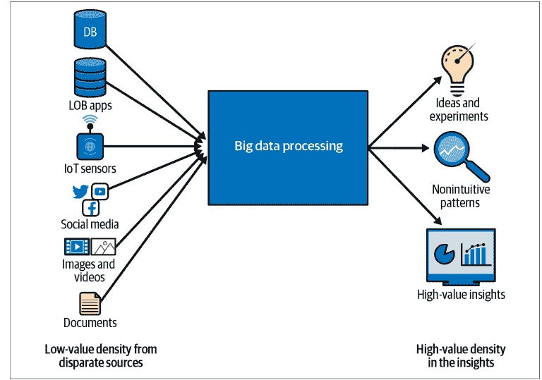
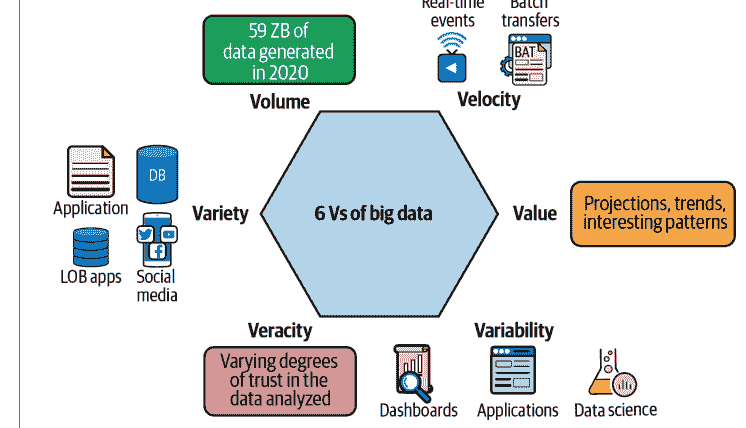
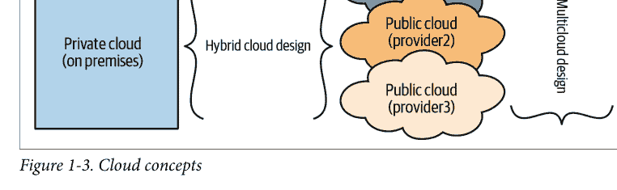
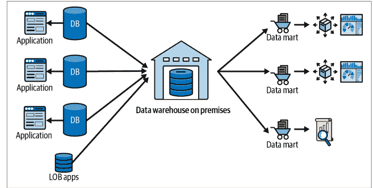
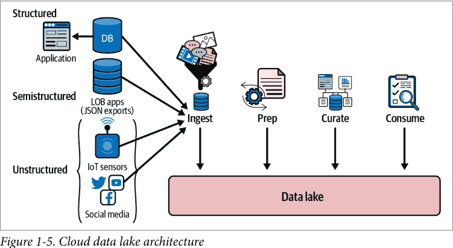

## Big Data—Beyond the Buzz

> *没有大数据，你就是盲人和聋子，而且身处高速公路中央。*
>
> —Geoffrey Moore

如果我们在玩职场宾果游戏，你很有可能通过划掉过去三个月你在组织中听到的这些术语而获胜：数字化转型、数据战略、变革性洞察、数据湖、仓库、数据科学、机器学习和智能。现在众所周知，数据是组织成功的关键要素，依赖数据和人工智能的组织明显优于竞争对手。根据 Seagate 赞助的 [IDC 研究](#)，预计到2025年，被捕获、收集或复制的数据量将增长到 *175 zettabytes (ZB)*。被捕获、收集或复制的数据被称为 *Global DataSphere*。这些数据来自三个来源类别：

- *核心*：传统或基于云的数据中心
- *边缘*：硬化基础设施，例如蜂窝塔
- *终端*：PC、平板电脑、智能手机和物联网（IoT）设备

该研究还预测，到2025年，*49% 的 Global DataSphere* 将驻留在公共云环境中。

如果你曾经想过，“为什么需要存储这些数据？它有什么用？”答案非常简单。把所有这些数据想象成散布在全球不同语言中的词语碎片，每一个都分享着一丝信息，就像拼图碎片一样。以有意义的方式将它们拼接起来，就讲述了一个故事，这个故事不仅提供信息，还可能改变企业、人们甚至世界运行的方式。大多数成功的组织已经利用数据来了解其业务的增长驱动因素和感知的客户体验，并采取正确行动；查看“漏斗”，即客户获取、采用、参与和留存，现在在很大程度上已成为为产品投资提供资金的通用语言。这类数据处理和分析被称为 *商业智能*，或 BI，被归类为“离线洞察”。本质上，数据和洞察对于展示显示增长的趋势至关重要，以便企业领导者采取行动；然而，这项工作流与用于运行业务本身的核心业务逻辑是分开的。随着数据平台的成熟，我们从所有客户那里得到的一个不可避免的信号是，他们开始要求在数据湖上运行更多场景，真正遵循“数据是新石油”这一格言。

组织利用数据来了解其业务的增长驱动因素和感知的客户体验。然后他们可以利用数据设定目标，并在客户体验、更好的支持和新功能方面推动改进。他们还可以创建更好的营销策略来发展业务，并推动效率以降低构建产品和组织的成本。星巴克，这家遍布全球的咖啡店，在尽可能多的地方使用数据来持续衡量和改进其业务。如 [这个 YouTube 视频](https://www.youtube.com/) 中所述，星巴克使用其移动应用程序的数据并将其与订购系统相关联，以更好地了解客户使用模式并发送有针对性的营销活动。它使用咖啡机上的传感器，每隔几秒钟发出健康数据，这些数据被分析以推动其预测性维护的改进。它还使用这些联网咖啡机在无需人工干预的情况下向其下载配方。

随着世界刚刚学会应对 COVID-19 大流行，组织不仅在利用数据来转型业务，还在利用数据来衡量其组织的健康状况和生产力，以帮助员工保持联系并最大限度地减少倦怠。总的来说，数据还被用于拯救世界的举措，例如 [Project Zamba](https://projectzamba.org/)，它使用人工智能进行非洲偏远丛林中的野生动物研究和保护，并利用物联网和数据科学创建循环经济以促进环境可持续性。

### What Is Big Data?

前面给出的所有示例都有一些共同点：

- 这些场景说明数据可以以多种方式探索和消费，并且当数据生成时，并没有真正明确的消费模式。这与传统的在线事务处理（OLTP）和在线分析处理（OLAP）系统不同，在这些系统中，数据是专门设计和策划的，以解决特定的业务问题。

- 数据可以有各种各样的形状和格式：它可以是物联网传感器发出的几个字节、社交媒体数据转储、业务线（LOB）系统和关系数据库的文件，有时甚至是音频和视频内容。
- 大数据处理的场景千差万别——无论是数据科学、类 SQL 查询，还是其他任何自定义处理。
- 研究表明，大数据不仅体量大，还可能以不同的速度到达：作为一个大型转储，例如从关系数据库批量摄取的数据，或是持续流式传输，如点击流或物联网数据。

这些就是大数据的一些特征。*大数据处理*是指用于存储、管理和分析数据的一套工具和技术，且不对数据的来源、格式或大小施加任何限制或假设。

大数据处理的目的是分析大量质量各异的数据并生成高价值洞察。我们之前看到的数据来源，无论是物联网传感器还是社交媒体转储，其中都包含对业务有价值的信号。例如，社交媒体信息流包含客户情绪的指标：他们是否喜欢某款产品并在上面发推，或是有问题而抱怨。这些信号隐藏在大量其他数据中，形成了较低的价值密度——你需要筛查大量数据才能得到少量信号。在某些情况下，你可能根本没有任何信号。典型的海底捞针？

此外，单独的信号可能并不能告诉你太多；然而，当你将两个弱信号结合起来时，就能得到更强的信号。例如，车辆传感器数据告诉你刹车使用频率或油门踩踏情况，交通数据给出交通模式，而汽车销售数据提供谁买了什么车的信息。虽然这些数据源各不相同，但保险公司可以关联车辆传感器数据和交通模式来构建驾驶员的安全驾驶画像，从而为安全驾驶画像的驾驶员提供更低的保险费率。

如图 1-1 所示，大数据处理系统能够关联大量价值密度各异的数据（价值密度可视为信噪比）以生成价值密度明确较高的洞察。这些洞察有能力推动产品、流程和组织文化的关键转型。

图 1-1. 大数据处理概述

大数据通常以六个 V 来表征。有趣的是——几年前，我们仅用三个 V 来表征大数据：体量、速度和多样性。我们已经又增加了三个 V：价值、真实性和可变性。这只说明在短短几年内又挖掘出了多少新的维度。好吧，谁知道呢，等到本书出版时，也许还会再增加更多 V！让我们现在来看看这些 V：

## Volume

这是大数据的“大”所在，指处理的 数据集大小。当数据库或数据仓库提到超大规模时，可能意味着数十或数百太字节（TB），在罕见情况下为拍字节（PB）。此外，你的数据集可能包含数千列，这也构成了体量的另一个维度。在大数据处理世界中，PB 级数据更常见，而更大的数据湖随着越来越多场景运行在数据湖上，很容易增长到数百 PB。需要指出的是，在大数据中，体量是一个光谱。你需要一个系统能够很好地处理 TB 级数据，并且能够随着这些 TB 累积到数百 PB 而同样良好地扩展。这使你的组织能够从小开始，随着业务以及数据资产的增长而扩展。

## Velocity

大数据生态系统中的数据具有不同的“速度”，体现在其生成速度以及移动和变化的速度。例如，考虑社交媒体趋势。虽然 TikTok 上的一个视频可能一夜爆红，但几天后就完全无关紧要，为下一个趋势腾出空间。同样地，想想医疗保健数据，如你的每日步数；虽然它在当时衡量活动时是关键信息，但几天后信号价值就降低了。在这些例子中，你有数百万，有时甚至数十亿的事件以规模生成，需要被摄取，并在近实时生成洞察，无论是实时推荐哪些话题标签正在流行，还是你距离每日目标还有多远。另一方面，你也有数据价值长期保持的场景。例如，销售预测和预算规划很大程度上依赖于过去数年的趋势，并利用过去几个月或几年的持久数据。支持这两种场景的大数据系统——既能批量摄取大量数据，也能持续流式传输数据并进行处理——让你能够在数据湖上运行各种场景，并关联来自各种来源的数据以生成以前不可能的洞察。例如，你可以基于长期模式以及来自社交媒体的快速趋势，使用同一系统预测销售。

## Variety

正如我们在第一个 V 中看到的，大数据处理系统适应一系列场景。关键在于支持多种数据。大数据处理系统能够在不对数据的大小、结构或来源施加任何限制的情况下处理数据。它们提供让你能够处理结构化数据（数据库表、LOB 系统）——具有定义明确的表格结构和强保证、半结构化数据（以灵活定义结构存在的数据，如 CSV 和 JSON）以及非结构化数据（图像、社交媒体信息流、视频、文本文件等）的能力。这让你能够从有价值的来源（想想保险或抵押贷款文件）中获取信号，而不对数据格式做任何假设。

大多数数据仓库承诺能够扩展到多个 PB 的数据并在非结构化数据上运行，并且它们在不断改进对更高体量和多样性的支持。重要的是要记住，数据仓库并非设计用于存储和处理数十或数百 PB，至少在目前如此。另一个考虑因素是成本，根据你的场景，将数据存储在数据湖中可能比存储在数据仓库中便宜得多。此外，虽然数据仓库提供对非结构化数据的支持，但其高度优化的路径是处理特定于该仓库的专有格式中的结构化数据。虽然数据湖和数据仓库之间的界限仍在模糊，但选择数据平台架构时，牢记这些原始价值非常重要。

## Veracity

真实性指的是大数据的质量和来源。大数据分析系统在不对格式或来源做任何假设的情况下接受数据，这意味着自然并非所有数据都带有高度结构化的洞察。例如，你的智能冰箱可能会发送几字节的信息指示其设备健康状态，而其中一些信息可能因实现方式而丢失或不完美。大数据处理系统需要在执行复杂操作之前纳入数据准备阶段，在此阶段数据会被检查、清洗和整理。

## Variability

无论是大小、结构、来源还是质量，可变性都是大数据系统的核心。任何大数据处理系统都需要纳入可变性，以便能够操作任何和所有类型的数据。此外，处理系统可以根据需求定义它们想要的数据结构——这被称为按需应用模式。例如，如果你有出租车数据，其中包含数百个数据点的 CSV，一个处理系统可以专注于源和目的地的对应值而忽略其余部分，另一个可以专注于司机识别和定价而忽略其余部分。这就是最大的力量：每个系统本身包含拼图的一块，而将它们全部组合起来就能揭示前所未有的洞察。我曾与一家金融服务公司合作，该公司从各个县收集住房和土地数据；他们以 Microsoft Excel 文件、CSV 转储或高度结构化的数据库备份的形式获取数据。他们处理这些数据并进行汇总，从而生成关于土地价值、房屋价值以及不同区域的购买模式的出色洞察，让他们能够适当设定抵押贷款利率。

## Value

这点在之前的论述中可能已经有所强调，但最需要强调的 V 是大数据系统中数据的价值。大数据系统的最大优点在于，其价值并非一次性。数据是基于其对不同受众具有价值这一假设而被收集和存储的。数据的价值也会随时间变化，随着趋势的改变而变得无关紧要，或显示出过去曾出现过的模式。让我们以销售数据为例。销售数据用于推动收入和税务计算，以及计算销售员工的佣金。此外，对随时间推移的销售趋势的分析可用于预测未来趋势并设定销售目标。对销售数据应用机器学习技术并将其与看似无关的数据（如社交媒体趋势或天气数据）相关联，可以预测销售的独特趋势。需要记住的一件重要事情是，数据的价值有可能随时间贬值，具体取决于你试图解决的问题。例如，包含全球天气模式的数据集在分析气候趋势随时间变化时具有很大的价值。然而，如果你试图预测雨伞销售模式，那么五年前 的天气模式就没那么相关了。

图 1-2 说明了这些大数据概念。

图 1-2. 大数据的六个 V

## Public cloud

公共云提供商包括 Microsoft Azure、Amazon Web Services (AWS) 和 Google Cloud Platform (GCP)，仅举几例。公共云提供商拥有遍布全球各地的托管着成排计算机的 数据中心，不同组织的计算资源可以利用同一套基础设施，称为多租户系统。公共云提供商提供隔离保证，以确保虽然不同组织可以使用同一基础设施，但一个组织无法访问另一个组织的资源。

## Private cloud

像 VMware 这样的提供商提供私有云，其计算资源托管在完全专用于某个组织的本地数据中心。作为类比，可以把公共云提供商想象成一个商场街区，可以在同一栋物理建筑内容纳三明治店、面包店、牙医诊所、音乐课和美发沙龙。另一方面，私有云就像一所学校建筑，整栋建筑仅供学校使用。公共云提供商也提供其服务的私有云版本。

你的组织可以使用一个以上的云提供商来满足需求，这被称为多云方法。另一方面，一些组织选择所谓的混合云，即在本地基础设施上拥有私有云并利用公共云服务，其资源根据需要在这两种环境之间移动。图 1-3 说明了这些概念。

图 1-3. 云概念

我们谈到了计算资源，但它们到底是什么？云上的计算资源属于三个不同的类别：

## Infrastructure as a service, or IaaS

对于任何产品，都需要一个最基本的底层基础设施，它由提供计算（处理）、存储（数据）和网络（连接）的资源组成。IaaS 产品是指你在公共云上创建的虚拟化计算、存储和网络资源，用于构建你自己的服务或解决方案，利用这些资源。

## Platform as a service, or PaaS

PaaS 资源本质上是提供商提供的工具，应用程序开发人员可以利用这些工具构建自己的解决方案。这些 PaaS 资源可以由公共云提供商提供，也可以由专门提供这些工具的提供商提供。一些 PaaS 资源的例子是作为服务提供的运营数据库，例如 Microsoft 的 Azure Cosmos DB、Amazon 的 Redshift、Atlas 的 MongoDB，或 Snowflake 的数据仓库，它在所有公共云上都以服务形式构建。

## Software as a service, or SaaS

SaaS 资源提供可供订阅的即用型软件服务。你可以在任何地方使用它们，无需在电脑上安装任何东西，虽然你可以使用开发人员来自定义解决方案，但也有开箱即用的功能可以立即开始使用。一些 SaaS 服务的例子是 Microsoft 365、Netflix、Salesforce 和 Adobe Creative Cloud。

作为类比，假设你想吃披萨作为晚餐。如果你利用 IaaS，你会买面粉、酵母、奶酪和蔬菜，自己做面团，加配料，然后烤披萨。你需要成为专家厨师才能做好。如果你利用 PaaS，你会买一个即烤披萨，放进烤箱烤。你不需要是专家厨师；然而，你需要知道如何操作烤箱并注意不要把披萨烤焦。如果你使用 SaaS，你会打电话给当地的披萨店，让披萨热乎乎地送到你家。你不需要任何烹饪专业知识，披萨也准备好可以吃了。

## Value Proposition of the Cloud

我从踏上云端之旅的第一步的客户和组织那里得到的第一个问题总是，为什么首先要迁移到云端。虽然投资回报可能是多倍的，但价值可以分为三个关键类别：

### Lowered TCO

TCO 指的是你维护的技术解决方案的总拥有成本，包括数据中心成本、软件成本以及需要雇佣来管理运营的人员的薪资。在几乎所有情况下，除少数例外，构建云上解决方案的 TCO 远低于在本地数据中心内部构建并部署的解决方案。这是因为你可以专注于聘请软件团队为你的业务逻辑编写代码，而云提供商会为你处理所有其他硬件和软件需求。导致成本降低的一些因素包括以下内容：

- *Cost of hardware*  
  云提供商以比你自行构建和运行自己的数据中心、维护硬件并在支持期结束时更新硬件更低的成本拥有、构建和支持硬件资源。此外，随着硬件的进步，云提供商能够比你自行构建数据中心更快地提供新硬件。

- *Cost of software*  
  除了构建和维护硬件外，IT 组织的一个关键工作是支持和部署操作系统并保持其更新。通常，这些更新涉及计划停机，这也可能对你的组织造成干扰。云提供商会在不给你的 IT 部门带来负担的情况下处理这一周期。在几乎所有情况下，这些更新都是以抽象的方式进行的，因此你不会受到任何停机的影響。

- *Pay for what you use*  
  大多数云服务采用基于订阅的计费模式，这意味着你按使用量付费。如果你有在一天中的特定时间或一周中的特定天数使用的资源，你只需为该时间付费，这比即使不使用时也一直拥有硬件要便宜得多。

- *Elastic scale*  
  你业务所需的资源本质上是高度动态的，有时你需要为计划内和计划外的使用量增加而配置资源。当你维护和运行自己的硬件时，你受限于现有硬件，这成为你业务增长所能支持的上限。云资源具有弹性扩展能力，你可以通过几次点击利用额外资源来应对高需求。

- *Ability to keep up with innovations*  
  云提供商不断创新，并根据从多个客户那里学到的经验不断向其产品中添加新服务和技术。利用最先进的服务和技术可以帮助你更快地为业务场景创新，而拥有内部开发人员可能无法在整个行业中具备必要的知识广度。

## 云数据湖架构

要了解云数据湖如何帮助组织应对日益增长的数据需求，我们首先需要了解几十年前数据处理和洞察是如何工作的。企业通常认为数据是补充需要解决的业务问题的东西。这种方法以业务问题为中心，涉及以下步骤：

1. 识别需要解决的问题。
2. 定义有助于解决问题的数据结构。
3. 收集或生成符合该结构的数据。
4. 将数据存储在 OLTP 数据库中，例如 Microsoft SQL Server。
5. 使用另一组转换（过滤、聚合等）将数据存储在 OLAP 数据库中；这里也使用 SQL 服务器。
6. 从这些 OLAP 数据库构建仪表板和查询来解决你的业务问题。

例如，当一个组织想要了解销售情况时，它会为销售人员构建一个应用程序，让他们输入潜在客户、客户和互动以及销售数据，并且该应用程序由一个或多个操作数据库支持。可能有一个数据库存储客户信息，另一个存储销售团队的员工信息，还有一个存储引用客户和员工数据库的销售信息。本地部署（称为“on prem”）有三个层，如图 1-4 所示：

- *企业数据仓库*

  这是数据存储的组件。它包含一个用于存储数据的数据库组件和一个用于描述数据库中存储数据的元数据组件。

- *数据集市*

  数据集市是企业数据仓库的一个细分，包含面向业务或主题的数据库，其中数据已准备好为应用程序服务。仓库中的数据会经过另一组转换后存储到数据集市中。

- *消费/商业智能（BI）层*

  这由 BI 分析师用来查询数据集市（或仓库）中的数据以生成洞察的各种可视化和查询工具组成。

图 1-4. 传统本地数据仓库

## 本地数据仓库解决方案的局限性

虽然这对于提供业务洞察效果很好，但该架构存在一些关键局限性：

- *高度结构化的数据*

  该架构期望数据在每一步都高度结构化。正如我们在之前的示例中所看到的，这种假设现在已不现实；数据可以来自任何来源，例如物联网传感器、社交媒体 feed 和视频/音频文件，并且可以是任何格式（JSON、CSV、PNG——用你知道的所有格式填满这个列表）。在大多数情况下，无法强制执行严格的结构。

- *数据存储孤岛*

  多个相同数据的副本存储在为特定目的专门设计的数据存储中。这是一个劣势，因为存储这些数据副本的成本很高，而且来回复制数据的过程既昂贵又容易出错，导致在数据复制过程中多个数据存储中的数据版本不一致。

- *为峰值利用率进行硬件配置*

  本地数据仓库要求组织安装和维护运行这些服务所需的硬件。当你预期需求出现突发（想想财政年度结账或假日期间预计销售增长），你需要提前为这种峰值利用率做好规划并购买硬件，即使这意味着你的部分硬件在剩余时间里会处于未充分利用状态。这会增加你的 TCO。请注意，这 specifically 是相对于本地硬件的局限性，而不是数据仓库和数据湖架构之间的差异。

## 什么是云数据湖架构？

正如我们在第 2 页“什么是大数据？”中所看到的，大数据场景远远超出了传统企业数据仓库的范围。云数据湖架构旨在解决这些确切问题，因为它们被设计为满足数据及其来源爆炸性增长的需求，而不对数据的来源、格式、大小或质量做出任何假设。与传统数据仓库采用的问题优先方法相比，云数据湖采用数据优先的方法。在云数据湖架构中，所有数据都被认为是有用的——无论是立即使用还是满足未来的需求。云数据湖架构的第一步涉及以其原始的自然状态摄取数据，对数据的来源、大小或格式没有任何限制。这些数据存储在云数据湖中，一个高度可扩展且可以存储任何类型数据的存储系统。这种原始数据具有可变的质量和价值，需要更多的转换来生成高价值的洞察。

如 图 1-5 所示，云数据湖上的处理系统在存储在数据湖中的数据上工作，并允许数据开发者按需定义模式——即在处理时描述数据。这些处理系统然后对低价值的非结构化数据进行操作，以生成通常是结构化且包含有意义洞察的高价值数据。这种高价值的结构化数据随后要么加载到企业数据仓库中供消费，要么直接从数据湖中消费。如果所有这些概念似乎非常复杂难以理解，不用担心——我们将在第 2 章和第 3 章中详细介绍这种处理。

计算资源传统上比存储更昂贵；然而，它们可以根据需求启动或停止，从而提供规模经济。

从技术上讲，在本地 Apache Hadoop 架构中也可以独立扩展计算和存储。然而，这需要仔细考虑硬件选择，这些硬件专门针对计算和存储进行优化，并且具有优化的网络连接。这正是云提供商通过其云基础设施服务所提供的。很少有组织具备这种专业知识并明确选择在本地运行其服务。

这种以成本高效的方式处理各种数据的灵活性帮助组织实现数据的价值，并将数据转化为有价值的变革性洞察。

## 定义你的云数据湖之旅

我与数百名客户讨论过他们的大数据分析场景，并帮助他们完成了云数据湖之旅的某些部分。这些客户有不同的动机和需要解决的问题：一些客户是云新手，想要迈出使用数据湖的第一步，其他人已在云上实现了支持一些基本场景的数据湖，但不确定下一步该做什么，一些是云原生客户，希望作为其应用程序架构的一部分直接从数据湖开始，还有一些已经在云上成熟地实施了数据湖，并希望利用数据的力量为其与同行和竞争对手相比提供下一级别的差异化价值。如果我必须总结我从所有这些对话中获得的经验教训，它基本上归结为两件关键的事情：

- 无论你的云成熟度水平如何，都要为公司的未来设计数据湖。
- 根据你立即需要的东西做出实施选择！

你可能会认为这听起来太明显、太笼统了。然而，在本书的其余部分，你会发现我为设计和优化云数据湖而规定的框架和指导将假设你不断对照以下两个问题进行自我检查：

1. 驱动数据湖决策的业务问题是什么？
2. 当我解决这个问题时，我还能做什么来利用数据湖来区分我的业务？

我们已经看到了解耦的计算与存储架构在独立扩展和降低成本方面的优势；然而，这要求你的云数据湖的架构和设计尊重这种解耦架构。例如，在云数据湖的实现中，计算系统通过网络系统与存储系统通信，而不是通过本地调用。如果你不对此进行优化，你的成本和性能都会受到影响。同样，一旦你完成了针对主要 BI 场景的数据湖实施，你现在可以通过启用更多场景、引入不同的数据集，或对湖中的数据进行更多的数据科学探索性分析，从而从数据湖中获得更多价值。与此同时，你需要确保数据科学探索性作业不会意外删除为你销售副总裁每天早上想要查看的仪表板提供支持的数据集。你需要确保你已实施的数据组织和安全模型能确保这种隔离和访问控制。

将这些令人惊叹的机会与你最初迁移到云的动机联系起来，即你的本地服务器已达到使用寿命，你需要制定一个计划，帮助你在满足时间线的同时为云上的成功奠定基础。你迁移到云数据湖涉及两个目标：

- 关闭你的本地系统
- 为你在云上的成功奠定基础

大多数客户最终只关注第一个目标，并在不得不重新设计其应用程序之前给自己带来巨大的技术债务。当你思考云数据湖架构时，确保你有以下目标：

- 将你的数据湖迁移到云端。
- 现代化你的数据湖以适应云架构。

这两个目标将携手帮助你确定一个能够适应你业务不断增长的规模和需求的稳健架构。

要了解如何实现这两个目标，你需要了解云架构是什么，实现的设计考虑因素是什么，以及如何优化你的数据湖以实现规模和性能。我们将在第 2–4 章中详细讨论这些问题。我们还将重点提供一个框架，帮助你考虑云数据湖之旅的各个方面。

## Summary

在本章中，我们首先讨论了数据的价值主张以及能够扭转组织的变革性洞察。我们还建立了对云计算的基本理解，以及传统数据仓库与云数据湖架构之间的差异。最后，我们研究了大数据、云和数据湖是什么。鉴于本地和云架构之间的差异，我们强调了思维转变的重要性，这种转变进而在设计云数据湖时定义了架构转变。这是我在我们深入探讨下一章中云数据湖架构及其实施考虑的细节时，恳请你做到的唯一一件事。
