## CHAPTER 2: Big Data Architectures on the Cloud

> *大数据可能意味着更多信息，但也意味着更多虚假信息。*
>
> —Nassim Taleb

正如我们在第 1 章中学到的，关于云数据湖有两个关键要点，为本章奠定了基础：

- 数据湖方法首先具备存储和处理任何类型数据而不论其来源、大小或结构的能力，从而使组织能够从许多不同的数据源中提取高价值洞察，这些数据源具有可变的价值密度，即信号与噪声比。
- 在云上构建你的数据湖涉及一种非聚合架构，其中你将 IaaS、PaaS 和 SaaS 解决方案的不同组件组合在一起。

需要记住的重要一点是，构建你的云数据湖解决方案也为你提供了许多架构选择，每种架构都有其自身的一套优势。本文对现代数据架构的各个组件提供了全面的概述。在本章中，我们将深入探讨一些更常见的架构模式，涵盖它们是什么以及了解每种架构的优势如何适用于名为 Klodars Corporation 的虚构组织。

### Why Klodars Corporation Moves to the Cloud

Klodars Corporation 是一家蓬勃发展的公司，在太平洋西北地区销售雨具和其他用品。其业务的快速增长推动其迁移到云端，原因如下：

- 运行在本地系统上的数据库已无法再扩展到业务的快速增长。
- 随着业务的增长，团队也在增长。销售和营销团队都观察到，随着同时使用系统的用户数量增加，他们的应用程序变得越来越慢，有时甚至超时。
- 市场部希望更多地参与如何最好地在社交媒体上定位其营销活动，并正在探索利用网红的想法，但不知道如何或从哪里开始。
- 销售部门无法迅速扩大与分布在三个州的客户的工作，因此在优先考虑想要首先接触的零售客户和批发分销商方面遇到困难。
- 投资者喜欢业务的增长，并询问首席执行官 Klodars Corporation 如何在冬季装备之外进行扩张。首席执行官需要弄清楚扩张战略。

来自软件开发团队的积极领导者 Alice 向 Klodars Corporation 的首席执行官和首席技术官提出建议，考虑云并看看其他企业如何利用数据湖方法来解决他们正在经历的挑战。她还收集了数据点，显示云数据湖方法可以带来的机会，包括以下内容：

- 云可以弹性地扩展到公司的不断增长的需求，并且由于按使用量付费，它无需过度配置硬件以预算高峰季节，并在其他时间让硬件闲置。
- 基于云的数据湖和数据仓库可以扩展以支持不断增长的并发用户数量。
- 云数据湖具有工具和服务来处理来自各种来源的数据，例如网站点击流、零售分析、社交媒体 feed，甚至天气，以便公司可以更好地了解其营销活动。
- Klodars Corporation 可以聘请数据分析师和数据科学家来处理市场趋势，以帮助提供有价值的信号来帮助其扩张战略。

首席执行官完全接受了这种方法，并希望尝试云数据湖解决方案。在其旅程的这一点上，Klodars Corporation 必须在开始尝试云方法的同时保持现有业务的运行。让我们看看不同的云架构如何为 Klodars 带来独特的优势，同时也有助于满足其因快速增长和扩张而产生的需求。

### Fundamentals of Cloud Data Lake Architectures

在部署云数据湖架构之前，了解有四个关键组件创建了基础并作为云数据湖架构的构建块是很重要的。这些组件是：

- 数据本身
- 数据湖存储
- 处理数据的 big data 分析引擎
- 云数据仓库

### A Word on Variety of Data

我们已经提到数据湖支持各种数据，但这种多样性实际上意味着什么？让我们以我们之前讨论的数据为例，具体来说是库存和销售数据集。从逻辑上讲，这些数据本质上是表格的，这意味着它由行和列组成，可以表示为表格。然而，实际上，这种表格数据如何表示取决于生成数据的来源。粗略地说，就大数据处理而言，数据有三个大类：

*Structured data*

这是指数据驻留在定义结构（行和列）中并遵循严格强制执行的预定义模式的一组格式。经典示例是关系数据库如 SQL 中找到的数据，其外观类似于图 2-1 所示。数据以关系数据库专用的定制二进制格式存储，并针对存储表格数据（按行和列组织的数据）进行了优化。这些格式是专有的，并为特定系统量身定制。数据的消费者，无论是用户还是应用程序，都理解这种结构和模式，并依赖它们来编写应用程序。任何不遵守规则的数据都会被丢弃且不存储在数据库中。关系数据库引擎

同时，将这些数据以优化的二进制格式存储，以便高效地存储和处理。

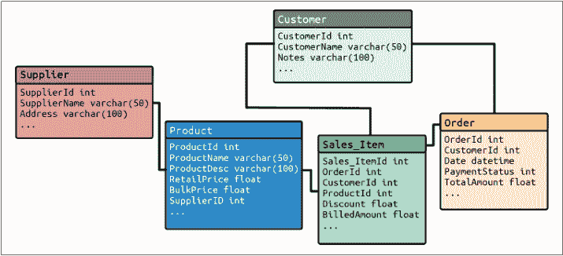

*图 2-1. 数据库中的结构化数据*

### 半结构化数据

这指的是一类存在结构的数据格式；然而，其结构定义松散，并提供了灵活性，可以根据需要自定义结构。JSON 和 XML 是半结构化数据的示例。图 2-2 展示了销售商品 ID 的两种格式的半结构化数据表示。这些半结构化数据格式的强大之处在于它们的灵活性。一旦你开始设计一个模式（schema），然后确定需要一些额外数据，你可以直接添加额外字段来存储数据，而不会破坏任何结构约束。读取数据的现有引擎将继续正常工作，新引擎也可以纳入新字段。类似地，当不同来源发送相似数据时（例如，销售点系统和网站遥测都可以发送销售信息），你可以利用灵活的模式来支持这些多来源数据。

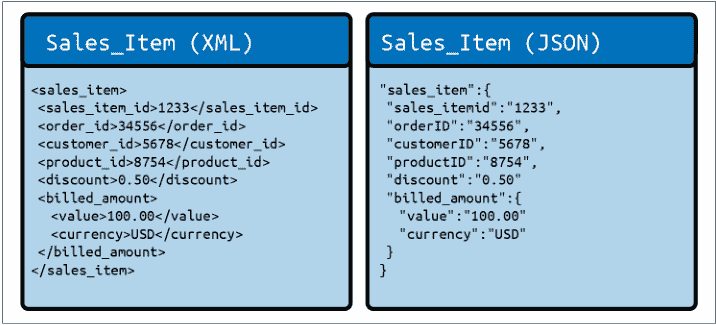

*图 2-2. 半结构化数据*

### 非结构化数据

这指的是对数据存储方式没有任何限制的格式，可以简单到像社交媒体信息流中的评论这样的自由格式笔记，也可以复杂到像 MPEG4 视频或 PDF 文档。非结构化数据可能是所有格式中最难处理的，因为它需要自定义编写的解析器来理解并从数据中提取正确的信息。同时，它也是所有格式中最容易存储在通用对象存储中的，因为它没有任何限制。例如，想想社交媒体信息流中的一张图片，卖家可以标记一件商品，一旦有人购买该商品，就添加另一个标记表示已售出。处理引擎需要处理图像以了解售出了什么商品，然后处理标签以了解价格是多少以及谁购买的。虽然这并非不可能，但要理解这些数据需要付出很多努力，而且由于依赖人工标记，质量很低。然而，这扩展了灵活性的范围，使其进入可用于促进销售的各种途径。例如，你可以编写一个引擎来处理社交媒体中的图片，以了解哪位房地产经纪人以什么价格出售了某个地区的房屋，如图 2-3 所示。

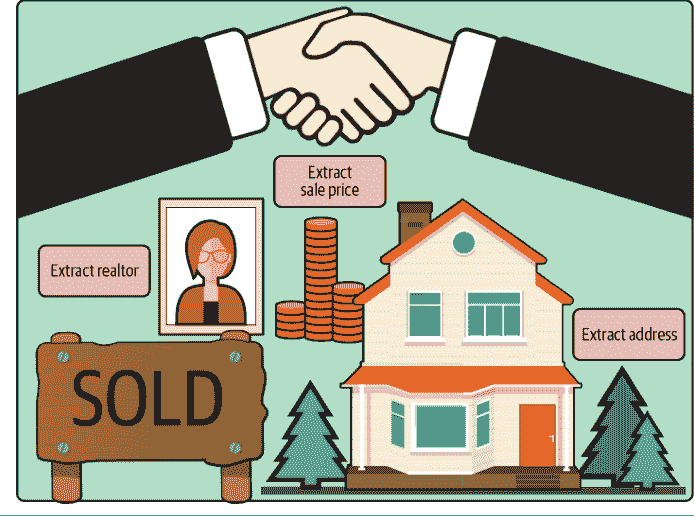

图 2-3. 非结构化数据

## 云数据湖存储

云数据湖存储的非常简单的定义是：作为一种云服务提供的存储服务，可以充当所有类型数据（结构化、非结构化和半结构化）的中央存储库，并支持大规模的数据和事务。当我说“大规模”时，请想象一个支持存储数百 PB 数据和每秒数十万笔事务的存储系统，并且随着数据和事务的持续增长，它可以保持弹性扩展。在大多数公有云产品中，数据湖存储作为 PaaS 产品提供，也称为对象存储服务。数据湖存储服务提供丰富的数据管理功能，例如分层存储（不同层级具有不同的相关成本，你可以将不常使用的数据移动到较低成本层级）、具有不同复制级别的高可用性和灾难恢复，以及允许管理员控制各种消费者访问的丰富安全模型。让我们看看一些最流行的云数据湖存储产品：

### Amazon S3（简单存储服务）

Amazon 提供的 S3 是一种大规模对象存储服务，被推荐为在 AWS 上构建数据湖架构的存储解决方案。存储在 S3 中的实体（结构化和非结构化数据集）称为对象，对象被组织在称为存储桶（bucket）的容器中。S3 还允许用户通过使用公共前缀（可以将其视为虚拟目录）对对象进行分组来组织对象。管理员可以通过在存储桶或前缀级别应用访问策略来控制对 S3 的访问。此外，数据操作员可以向对象添加标签，这些标签本质上是键值对。它们充当标签或主题标签，使你可以通过指定标签来检索对象。Amazon S3 还提供丰富的数据管理功能来管理数据成本，并提供更高的安全保证。要了解有关 S3 的更多信息，你可以访问文档页面。

### Azure 数据湖存储 (ADLS)

ADLS 是 Microsoft Azure 提供的一种存储服务，在其通用对象存储服务（Azure Blob 存储）之上提供具有分层命名空间的本地文件系统。根据 ADLS 产品网站，ADLS 是一个用于数据摄取、处理和可视化的单一存储平台，支持最常见的分析框架。你可以预配一个存储帐户，在其中对“启用分层命名空间”指定“是”，以创建 ADLS 帐户。ADLS 提供称为容器的组织单元，以及具有目录和文件的本地文件系统来组织数据。你可以访问文档页面以了解有关 ADLS 的更多信息。

### 谷歌云存储 (GCS)

GCS 由 GCP 作为对象存储服务提供，并被推荐作为数据湖存储解决方案。与 S3 类似，Google 中的数据被称为对象，并组织在存储桶中。你可以在文档页面上了解更多关于 GCS 的信息。

云数据存储服务能够从各种来源加载数据，包括本地存储解决方案，并集成与 IoT 传感器等来源连接的实时数据摄取服务。它们还与支持传统应用程序的本地系统和服务集成。此外，大量数据处理引擎可以处理存储在数据湖存储服务中的数据。这些数据处理引擎分为许多类别：

- 属于公有云产品一部分的 PaaS 解决方案（例如，AWS 的 EMR、Azure 的 HDInsight 和 Azure Synapse Analytics，以及 GCP 的 Dataproc）
- 由其他软件公司开发的 PaaS 解决方案，例如 Databricks、Dremio、Talend、Informatica 和 Cloudera
- SaaS 解决方案，例如 Microsoft Power BI、Tableau 和 Looker

你还可以预配 IaaS 解决方案（如虚拟机），并运行你自己的软件发行版（如 Apache Spark）来查询数据湖。

需要注意的一个重要点是，在数据湖架构中计算和存储是分离的，你可以对数据湖中的数据运行一个或多个处理引擎，而无需移动数据。一些流行的数据仓库包括 Amazon Redshift、Google BigQuery 和 Snowflake Data Cloud。数据仓库同时提供计算和存储，而且虽然数据仓库在某些情况下支持查询驻留在单独数据湖存储中的数据，但最常见的用例是使用最优化的路径：查询以专有数据格式驻留在数据仓库中的数据。最近，数据仓库开始支持 Apache Iceberg 等开放数据格式，这是一个非常有前景的趋势，方向上支持数据湖仓（lakehouse）架构，我们也将在本章中更详细地介绍这一点。

## 大数据分析引擎

至此，我们了解到大数据分析是对结构化、半结构化和非结构化数据的处理。现在让我们了解一下这种处理实际上是什么样的。当我们谈论数据湖上的大数据分析时，实际发生的处理很可能是这里描述的以下之一，或者是它们的衍生形式。

### MapReduce

大数据和分析处理的起源在于一种改变了我们工作方式的事物的出现：*搜索引擎*。搜索引擎主要通过从互联网上的所有来源抓取文本数据，并构建一个映射到网页的巨大关键字索引来工作。当用户搜索关键字时，搜索引擎会根据该索引对数据进行排名，并向用户提供有序的结果集。虽然搜索引擎的设计本身就值得写一本书，而且我们不会在这里详细讨论，但它们表明需要处理可以简化为可搜索索引的大量数据，从而催生了一种名为 *MapReduce* 的编程模型。

MapReduce 本质上是一种编程模型及相关实现，它接收一组键值对作为输入，并产生一组键值对作为输出。听起来很简单，不是吗？问题在于规模——对包含成百上千万条记录的数据集执行这种转换。正如 Jeffrey Dean 和 Sanjay Ghemawat 在他们的论文[“MapReduce：简化大规模集群上的数据处理”]中所描述的，MapReduce 正如其名称所示有两个阶段。在映射（map）阶段，通过一种将相似值分组在一起的逻辑，按关键字组织数据，从而产生中间的键值对。归约（reduce）阶段处理这些相似数据集，以生成过滤后的结果集，同样以键值对形式。

作为示例，我们以 Twitter 数据为例，目标是了解在大量提要中每个用户被提及多少次（图 2-4 展示了一个较小的样本）。这里有一组计算单元在工作：多个工作单元对分配给它们的数据集进行操作，以及一个主编排单元执行

工作单元之间的协调。计算单元可以是虚拟机、进程或线程，具体取决于实现方式。Twitter 的庞大数据流被分解为较小的数据流（在本例中为一个数据流），并分配给工作单元，工作单元将提及映射为计数，并生成一组输出键值对，如图 2-4 所示。然后，这些数据值被发送到另一组工作单元，执行 reduce 操作，以生成每个用户的提及计数。其主要优势在于，这种编程模型可以通过可预测的分布机制，将大型数据集有效地分布到大量工作单元上。

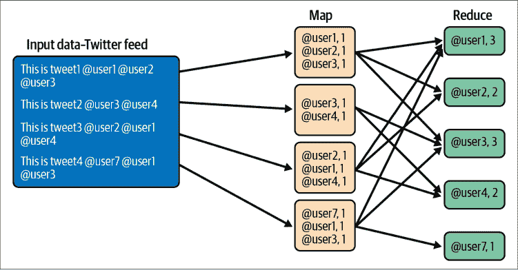

## Apache Hadoop

Apache 是一个开源组织，曾有一个名为 Apache Nutch 的开源网络搜索项目，该项目至今仍在使用。2005 年，作为 Apache Nutch 的一部分，Doug Cutting 和 Mike Cafarella 创建了 Apache Hadoop——一套用于大规模数据集分布式处理的工具、库和组件，以 MapReduce 作为其核心处理逻辑。Apache Hadoop 由四个主要组件组成：

- *Hadoop 公共模块*  
  支持其他模块的一组公共库
- *Hadoop 分布式文件系统（HDFS）*  
  面向大数据集的分布式存储系统
- *Hadoop MapReduce*  
  用于大规模处理大数据集的编程模型及实现

这一点在很大程度上也适用于 Apache Spark 等其他开源产品。

可以公平地说，Hadoop 通过提供一套全面的大数据处理工具，为数据湖架构奠定了基础，其中包括用于批处理的 MapReduce、用于实时处理的 Apache Storm，以及用于在 Hadoop 架构上查询数据的 Apache Hive。

## Apache Spark

Apache Spark 孵化于加州大学伯克利分校的 AMPLab，该实验室专注于大数据分析。Apache Spark 的目标是提供一种灵活的编程模型，这种模型既拥有 MapReduce 在分布式数据处理方面的容错性和扩展能力，又支持更广泛的应用，例如依赖数据迭代处理的机器学习和提供即时洞察的实时处理。

与 Hadoop 一样，Spark 使用底层存储层；但并没有强制要求必须是 HDFS 存储，Spark 支持云对象存储服务，甚至是本地存储。同样，Spark 使用集群管理器，并且也支持多种选项，如 YARN（源自 Hadoop）和同样孵化于加州大学伯克利分校的 Apache Mesos。近年来，随着 Kubernetes 和容器（简单定义为包含代码、应用程序运行时以及运行代码所需任何其他组件的即用型软件包）在云原生开发中日益流行，Spark on Kubernetes 也获得了广泛采用。

Spark 的关键差异化因素是其核心引擎，它建立在将数据集作为弹性分布式数据集（RDD）的基础抽象之上，无需将中间数据集存储到持久化存储，同时仍能保持容错性。这种模型极大地提升了基于 Spark 的应用性能，并为批处理、交互式查询（Spark SQL）、数据科学（MLlib）、实时处理（Spark Streaming）以及最近引入的图处理（GraphX）提供了统一的编程模型。Apache Spark 的易用性和日益增长的业界认可度，推动了大数据处理在各行各业的普及。你可以使用 Spark 的独立发行版，也可以使用公有云提供商（如 Amazon EMR、Azure Synapse Analytics 或 Google Cloud Dataproc）或软件提供商（如由 Spark 发明者创立的 Databricks 公司）提供的 Spark。

图 2-6 展示了 Spark 的各种技术组件，以及它们如何层层叠加，从而在机器学习、实时处理和批量流处理中提供一致的编程模型。

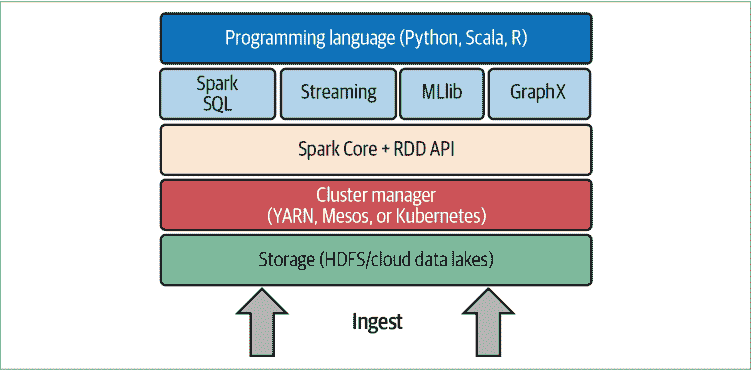

*图 2-6. Apache Spark*

## 实时流处理管道

*实时流处理*是指数据的接收、处理和消费，特别注重速度，目标是接近实时——即几乎即时获得结果。想象一下，当你旅行时，你最喜欢的餐厅点评应用向你推送实时通知，告诉你附近可以去探索的餐厅。这背后有一个实时处理管道在运作：它从你的移动设备捕获与位置相关的信号，并结合你的个人资料和其他相关数据，实时提供个性化推荐。另一个例子是，当你常用路线上出现交通拥堵时，手机上的导航应用会建议你走另一条路线。在这种情况下，实时处理管道将实时交通数据与地图相结合，为你的目的地推荐最佳路线。

实时流处理管道涉及从数据源以*极高速度*到达的数据；换句话说，数据就像雨水或瀑布一样流入系统。这些数据可能来自 GPS 等持续流式传输的数据源，也可能是物联网传感器（如家庭自动化系统或工业设备）发出的事件。这些数据通常非常小，一般只有几千字节（KB）。

实时流管道的处理部分涉及对实时流数据的处理，有时会将其与其他可能非实时的数据结合，重点是低延迟，通常为毫秒级。实时处理应用的典型场景是产生近乎实时的洞察，以便使用者快速采取行动，例如处理系统日志并在出现问题时发出实时警报的系统。

实时数据处理技术在处理以高速度和高吞吐量进入系统的数据时，需要考虑以下几个方面：

### 投递保证

实时流处理技术提供投递保证，以确定实时数据将如何处理。至少一次（at-least-once）保证确保进入的数据至少被处理一次，并且可能处理多次以应对故障。至多一次（at-most-once）保证确保进入的数据最多被处理一次，从而避免重复处理。恰好一次（exactly-once）保证可确保数据仅被处理一次，这种保证非常理想，但也很难实现。

### 容错性

实时流处理技术需要确保在集群或底层基础设施发生故障时具备韧性，并能够从上次中断的地方继续处理。

### 状态处理

实时流处理框架提供状态管理：记录已处理的消息数量，或最后处理的消息是什么。

实时流数据可以通过多种方式消费：展示趋势的可视化图表（如社交媒体热门榜单）、警报系统（如安全事件检测），甚至智能应用行为（如基于浏览模式的实时推荐）。

**图 2-7** 展示了实时流数据管道的架构。你还可以使用多种技术来构建实时数据管道。**Apache Kafka** 是一种用于接收和存储实时流数据的著名技术，具有高吞吐量和可扩展性。**Amazon Kinesis** 和 **Azure Event Hub** 是云原生 PaaS 服务，以 Apache Kafka 作为底层技术构建。**Apache Storm** 和 **Apache Flink** 是提供实时数据处理技术的热门开源技术。Apache Kafka 还提供 Kafka Streams 用于实时流处理。

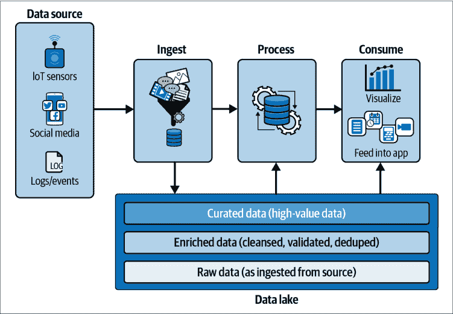

*Figure 2-7. Real-time stream processing pipelines*

## Cloud Data Warehouses

A *cloud data warehouse* is an enterprise data warehouse offered as a managed service (PaaS) on public clouds with optimized integrations for data ingestion, analytics processing, and BI analytics. *BI analytics* refers to tools that support visualization and interactive querying capabilities. Cloud data warehouse offerings are designed to elastically scale with the customer’s growing needs by abstracting the infrastructure away from the user, and they promise faster performance and lower cost of ownership than traditional on-premises data warehouses. Let’s take a look at some of the most popular cloud data warehouse offerings:

### Amazon Redshift

Amazon Redshift was the first popular cloud data warehouse offering on the public cloud. You can provision a Redshift cluster, where you can specify the number of compute nodes that you want. The cluster can support data at PB scale according to the product documentation. You can use PostgreSQL, a popular query language, to query data in your Redshift cluster. To learn more about Redshift, you can visit the [product page](#). Redshift also announced the capability to [share data across different Redshift clusters without copying data to promote sharing of data and insights](#).

### Google BigQuery

Unlike Redshift, where you provision your data warehouse as a cluster, Google BigQuery is a completely serverless, highly scalable data warehouse solution that abstracts the details of cluster management completely away from the customer. In addition, BigQuery has features like **BigQuery Omni** that allow you to use the BigQuery compute service across other clouds, such as AWS and Azure. To learn more about BigQuery, visit the [product page](product page).

### Azure Synapse Analytics

Azure Synapse Analytics is offered as a unified analytics platform on Microsoft Azure. Similar to Redshift, you can provision a data warehouse cluster and specify the number of nodes you want for your scenarios. You can also provision a Spark cluster for analytics scenarios in the same experience. In addition, you can run serverless queries in SQL or Spark. With serverless queries, you can simply submit a job without provisioning a cluster, similar to BigQuery. Azure Synapse Analytics also offers integrations in the same experience with other Azure services, such as Azure Machine Learning, Azure Cognitive Services, and Power BI. To learn more about Azure Synapse Analytics, visit the [product page](product page).

### Snowflake Data Cloud

Snowflake data warehouse is a managed data warehouse solution that is available on all public clouds—AWS, Azure, and GCP. Designed as a truly scalable solution, Snowflake is offered as a single service, while the implementation runs on a disaggregated compute and storage architecture, making it highly scalable in the compute or storage dimension without compounding the cost. This disaggregation also lets you spin up different virtual warehouses that can access the same data, providing isolation between your different query scenarios. Snowflake also offers data sharing at a table and object level to other Snowflake accounts. To read more about Snowflake, visit the [product page](product page).

In this section, I presented a high-level overview of the concepts of the four components of a cloud data lake architecture: the data, the data lake storage, the compute engines, and the cloud data warehouse. I also provided an overview of the commonly used services and technologies, along with links for you to explore deeper. In the next section, I will go over cloud data lake architectures that represent different ways in which these building blocks can be assembled in a solution. As we are reading this book, rapid innovations are being made in both the data lake and the data warehouse offerings, blurring the boundaries between them. We will address this further in the data lakehouse architecture pattern.

Data in the cloud data lake architecture can serve many purposes. However, there are two major scenarios that are common consumption patterns in an organization:

### *Business intelligence*

Data is used by BI analysts to create dashboards or work on interactive queries to answer key business problems that are well defined and work on highly structured data.

### *Data science and machine learning*

Data is used by data scientists and machine learning engineers to do exploratory analysis and experimental work to answer complex problems that don’t have a defined ruleset and require multiple iterations to get better. The data involved here assumes no structure.

## Modern Data Warehouse Architecture

In a modern data warehouse architecture, both the data lake and the data warehouse peacefully coexist, each serving a distinct purpose. The data lake serves as low-cost storage for a large amount of data and supports exploratory scenarios such as data science and machine learning. The data warehouse stores high-value data and powers dashboards used by the business. It is also used by BI users to query the highly structured data to gain insights about the business.

### Reference Architecture

Data is first ingested into a data lake from various sources: on-premises databases, social media feeds, and so on. This data is then transformed using big data analytics frameworks like Hadoop and Spark, where multiple datasets can be aggregated and filtered to generate high-value structured data. This data is then loaded into a cloud data warehouse to power dashboards, including interactive dashboards for BI analysts using their very familiar tool of choice—SQL. In addition, the data lake empowers a whole new set of scenarios that involve exploratory analysis by data scientists as well as machine learning models that can be fed back into their applications. A simplified representation of the modern data warehouse architecture is shown in Figure 2-8.

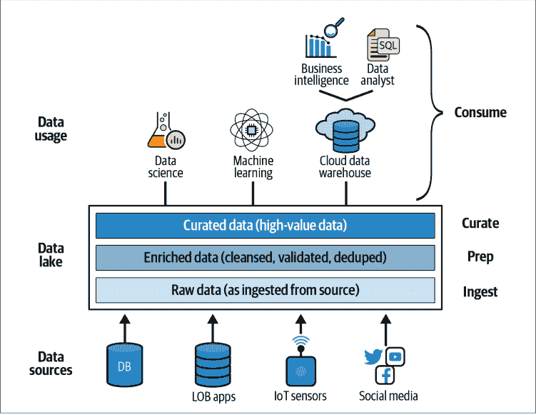

Some questions you would naturally ask here are: why not use a cloud data warehouse directly? Why is a data lake necessary in between? If I only have structured data, do I even need a data lake? If I may say so myself, these are great questions. There are a few reasons why you would need a data lake in this architecture:

- Data lakes cost a lot less than a data warehouse and can act as your long-term repository of data. Remember that data lakes are typically used to store large volumes of data (think tens or hundreds of PBs), so the difference in cost is material.
- Data lakes support a variety of modern tools and frameworks around data science and machine learning that you can use to enable completely new scenarios.
- Data lakes let you future-proof your design to scale to your growing needs. As an example, you might use your initial data lake architecture to load data from your on-premises systems on a nightly basis and publish reports or dashboards for your BI users. This same architecture is extensible to support real-time data ingestion without having to rearchitect your solution.
- Data of all forms and structures is largely becoming relevant to organizations. Even if you are focused on structured data today, as you saw in the previous example, you may find value in all kinds of data, such as weather, social media feeds, and the like.

In case you didn’t observe this already, there is a difference in usage patterns that you need to remember: when you load data into a data warehouse, you use an *extract, transform, and load (ETL) pattern*, where you extract data from the source and transform the data to the format respected by the data warehouse before loading it into the data warehouse. In a data lake, you follow an *extract, load, and transform (ELT) pattern*, where you extract data from the source, load into the data lake as is, and then do your transformations.

### Sample Use Case for a Modern Data Warehouse Architecture

Let’s revisit our model company, Klodars Corporation. It will leverage the modern data warehouse architecture and start loading data from its operational databases into the data lake. Instead of continuing to store its backups on its on-premises systems, it can now create daily backups and store up to one year’s worth of backups (or more if it wants to) in its data lake. Klodars can do this while the operational databases on its servers continue to serve their existing applications, thereby ensuring the continuity of the company’s operations. In addition, Klodars will plan to load data from social media feeds that relate to rain gear and winter gear to analyze patterns. This architecture will also enable the company to load other data, such as its clickstream, into the data lake storage in real time using real-time ingestion techniques like Apache Kafka.

With the dataset up and ready to go, the data engineering team will use tools like Apache Spark to process the structured data from its database dumps and from the website clickstream to generate high-value data that shows the shopping and sales trends over time. The team will also process the social media feeds and extract data that pertains to rain gear and winter gear as well as any associated purchases that the same feeds indicate. This architecture will enable the data engineering team to generate high-value data on a scheduled basis (e.g., daily) on sales trends, inventory and supply, website-browsing trends, and social media trends around rain and winter gear. This data will then be loaded into the data warehouse and refreshed on a periodic basis (e.g., daily).

The data stored in the data warehouse is very high-value structured data. The business analysts will use this high-value data to build dashboards that show the sales trends quarter over quarter or month over month, so the sales teams can understand the trend of their sales and set projections for the upcoming time period. The business analysts can also slice and dice the data by factors like region, salespeople coverage, partners, and other attributes, so the leadership team can understand the growth drivers and make data-informed decisions about the company’s expansion

strategy. 市场团队通过在数据仓库上运行交互式查询来消费社交媒体和网站浏览趋势，以了解下一步需要开发的定向营销活动。团队还可以通过将营销活动与销售结果相关联来了解其营销活动的影响。

影响并不止于此。Klodars 现在已组建了一个数据科学团队，该团队可以在现有数据集（如销售、社交媒体趋势和网站浏览趋势）之上进行构建，以发现有趣的相关性和影响者效应，这些效应无法通过手动分析直接处理。团队还可以将额外的数据集带入数据湖，例如天气数据、滑雪等冬季活动数据，以便为领导团队挖掘有趣的见解。这些数据可以反馈给数据工程团队，加载到仓库中，供领导、市场和销售团队使用。

图 2-9 提供了 Klodars Corporation 现代数据仓库架构的表示。

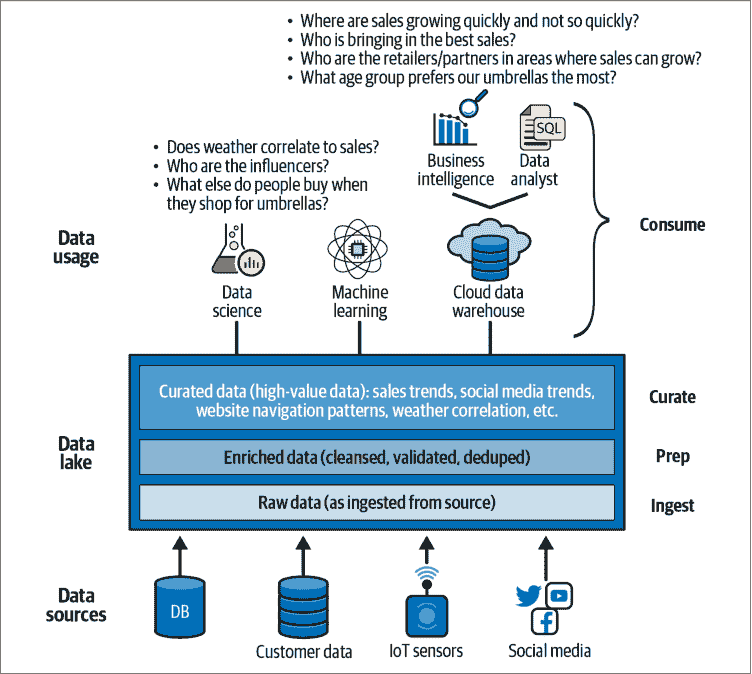

*Figure 2-9. How Klodars Corporation leverages the modern data warehouse architecture*

在依赖现代数据仓库架构的数据湖策略下，Klodars Corporation 能够通过数据驱动的重点领域优先级排序来满足不断增长的客户需求。其现代数据仓库策略使公司能够在保持现有业务运行的同时进行创新。将现有应用程序分阶段迁移到现代化云架构，为团队提供了审慎设计和实施此次过渡的时间。

## Benefits and Challenges of Modern Data Warehouse Architecture

现代数据仓库的一个重要好处是帮助业务分析师利用熟悉的 BI 工具集（基于 SQL）进行消费，同时实现数据科学和机器学习等更现代的场景，这些场景在数据仓库的本地部署实现中原本是不可能的。这主要通过数据湖实现，数据湖作为无孤岛的数据存储，支持使用云原生服务进行高级数据科学和机器学习场景，同时保留熟悉的数据仓库，例如为 BI 用户提供基于 SQL 的接口。此外，数据管理员可以使用数据仓库熟悉的访问控制方法，将数据访问隔离给 BI 团队的数据仓库。本地运行的应用程序也可以随着时间的推移移植到云端，以完全消除维护两套基础设施的需求。此外，企业可以通过将运营数据备份到数据湖更长时间来整体降低成本。

这种方法也存在一些挑战。数据工程师和管理员仍需要维护两套基础设施：数据湖和数据仓库。将各种类型的数据存储在数据湖中的灵活性也带来了挑战。管理数据湖中的数据并保证数据质量是数据工程师和数据管理员现在必须解决的巨大挑战——这些是他们以前没有遇到的问题。如果数据未得到妥善管理，数据湖还存在演变成数据沼泽的风险，像大海捞针一样隐藏洞察。如果 BI 用户或业务决策者需要新数据集，他们必须依赖数据工程师处理这些数据并将其加载到仓库中，从而引入关键路径。此外，如果数据科学家希望将仓库中一个有趣的数据切片用于探索性分析，他们需要将其重新加载到数据湖中，采用不同的数据格式以及不同的数据存储，从而增加了共享的复杂性。

## Data Lakehouse Architecture

数据湖仓（Data lakehouse）一词由 Databricks 推广，可能是行业中最大的流行语之一。根据 451 Research 研究分析师 Malav Parekh 的一篇博文，Amazon 在发布 **Redshift Spectrum** 时首次使用了“lake house”一词，其中“lake”和“house”之间有空格。该术语在 2020 年 1 月获得行业关注，当时 **Databricks blog post** 将数据湖仓称为 *new, open architecture*，它结合了数据湖和数据仓库的最佳元素。

我清楚地记得 2020 年 **Data and AI Summit** 的主题演讲，Ali Ghodsi 在其中宣布数据湖仓是一个新范式，并介绍了 Delta Lake。关于 Delta Lake 的会议有很多，参会者排队进入会议室的队伍蜿蜒穿过会议大厅。数据湖仓架构日益增长的流行度和生态系统支持了这一新范式的说法。

数据湖仓架构可以简单地解释为一个单一平台，结合了两种功能：

- 用于分析处理、数据科学和机器学习场景的数据湖
- 用于 SQL 交互式查询和 BI 场景的数据仓库

换句话说，它指的是在数据湖上运行 SQL 和 BI 场景的能力。这是一个非常有吸引力的提议，原因有三：

- 数据湖比数据仓库便宜得多，使湖仓更具成本效益。
- 将数据从数据湖移动到数据仓库不需要数据移动或数据复制。
- 数据集可以在数据科学家和 BI 团队之间自由共享，消除了二元化的体验和平台。

## Reference Architecture for the Data Lakehouse

**Figure 2-10** 中提供了数据湖仓架构的简化表示。请注意，您现在在单一平台上运行 *all scenarios*——BI 以及数据科学——并且您不再拥有云数据仓库。

好吧，如果我们已经有在数据湖上运行 BI 场景的选项，为什么我们不一开始就这样做呢？简单的答案是，因为数据湖本身并没有真正结构化以支持 BI 查询，而有各种技术使湖仓成为现实。请记住，数据仓库依赖于高度结构化的数据以实现更快的查询处理并支持涉及连接和聚合的复杂查询，而数据湖是高度可扩展的对象存储服务，它们存储和处理数据，对结构不做任何假设。

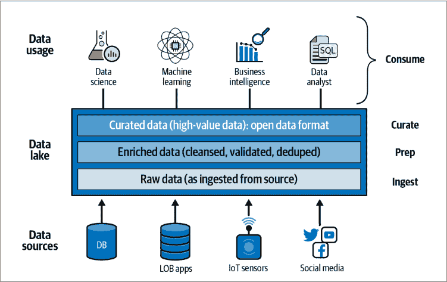

Figure 2-10. Data lakehouse architecture

让我们更详细地看一下。数据仓库提供以下优势：

### Schema definition and enforcement

模式本质上是数据库中数据结构和类型的定义。数据仓库在高度结构化的数据上运行，这意味着你需要在写入数据时就定义和强制执行此结构。这也称为写入时模式。例如，你可以定义表中 age 字段需要为整数，如果你尝试写入非整数值，将会出错。

### ACID-compliant transactions

数据仓库确保事务符合 ACID，这对于保证通常存储在仓库中的高价值数据完整性至关重要。这种完整性非常重要，因为这些数据为用于影响公司收入和运营的关键操作的查询和仪表板提供支持。例如，销售预测仪表板为组织设定收入目标。ACID 指事务的四个关键属性：

### Atomicity

确保事务完成后，整个事务作为一个单元成功执行的完整性得到保证。例如，如果你在查询中请求客户的详细信息并要求姓名、年龄、位置和收入潜力，你会获得所有详细信息，而不仅仅是年龄和位置。

### Consistency

确保遵循所有适当的数据验证规则，并且只有允许的数据才会被写入。如果验证不成功，数据库将回滚到事务之前的状态。例如，如果你想向数据库添加新客户记录，并且你有正确的姓名和年龄但位置无效，则整个事务失败。

### Isolation

确保并发事务处理时，一个不会影响另一个。例如，如果两个用户尝试向数据库添加同一客户，则第一个成功，第二个用户会收到错误，因为客户已存在。

### Durability

确保成功事务后，数据可用性得到保证。例如，当你成功向数据库添加客户时，即使出现停电或硬件故障，你也可以确信客户数据完好无损。

### Optimized for SQL

大多数 BI 和数据分析工具以及生态系统都围绕 SQL 优化，数据仓库提供了一个针对 SQL 优化的查询引擎，支持这些场景。

数据湖提供以下优势：

### Ability to store and process unstructured data

围绕高级分析、数据科学和机器学习的许多新兴场景都依赖于处理非结构化数据。数据湖不对数据的结构或模式做任何假设。在从数据湖读取数据时，你在读取时定义模式。

### Low cost

数据湖是高度优化的存储系统，为用户提供低廉的拥有成本，让你存储任意数量的数据而无需担心费用上涨。

### Rich data management

数据湖提供了一系列帮助管理数据的功能，正如我们在前面章节中看到的。这些包括分层存储、数据复制和数据共享功能。

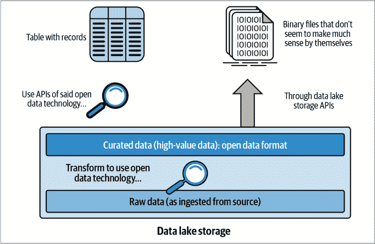

> *Figure 2-11. Open data technologies and lakehouse architecture*

## Data formats

我们已经确定数据格式对于数据湖仓架构至关重要，但为什么会这样呢？正如我们之前看到的，数据仓库中的数据在完整性方面具有强有力的保证；为了为数据湖中的数据提供类似的保证，保持数据受限于少数几个关键规则非常重要。打个比方，一个孩子需要在教室里遵守一定的规则，才能创造出有利于学习的环境，但在公园里，同一个孩子可以为所欲为地奔跑和探索。想象一下，如果要在公园里设立一个教室，你需要做什么；开放式数据格式试图确保数据在非结构化环境中受到某些规则的约束，在本例中，即数据湖存储。

数据格式对于湖仓架构至关重要的原因如下：

- 存储的数据需要*遵循模式*，该模式由元数据定义，元数据是描述数据集表格结构的数据。*模式*在此指的是数据的定义表示或描述。
- 存储的数据*针对查询进行了优化*，尤其是为了支持主要使用类 SQL 查询的 BI 用例。这种优化对于支持与数据仓库相当的查询性能至关重要。

事实证明，解决这些需求也带来了非常好的好处，即这种数据往往具有高度可压缩性，从而带来更快的性能和更低的成本，这意味着你可以鱼与熊掌兼得。

Delta Lake、Apache Iceberg 和 Apache Hudi 等专用格式用于数据湖架构中。我们将在第 6 章中更详细地讨论它们。它们都源自一个基本数据格式 Apache Parquet，它是一种由 Apache Hadoop 生态系统使用的列式数据存储格式。

让我们稍作停顿，了解一下列式格式意味着什么。记住，我们谈论的是表格数据，数据按行和列组织，如图 2-12 所示。谈到这种数据在数据湖中的存储方式，直观的想法是将一条记录——即一行——一起存储。在列式格式中，数据以列为导向的方式存储，其中具有相似值的列数据被存储在一起。正是这种相似数据的捆绑，使得像 Apache Parquet 这样的列式格式具有高度可压缩性。图 2-12 提供了同一数据以行式和列式结构存储的表示。

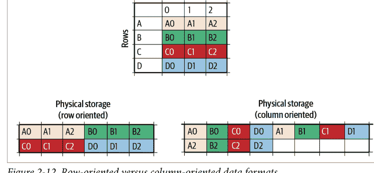

Figure 2-12. Row-oriented versus column-oriented data formats

我们将在第 4 章中更详细地介绍 Apache Parquet。开放式数据技术使用 Apache Parquet 作为其底层数据格式，以便它们可以利用 Apache Parquet 的优化来优化查询。

## Metadata

*元数据*简单地指关于数据的数据。例如，如果你有一个包含 1,000 行的表，以每个数据集 100 行的块存储，则与每个块关联的元数据描述了存储的数据，例如此块包含 101–200 行，姓氏列中的值以 A–B 开头。此外，在表级别存储的元数据具有指向不同块的指针。

这种元数据对于最终用户来说并不太相关，但对于操作数据的计算引擎来说非常重要。这些计算引擎读取元数据，然后去获取相关数据。像 Apache Iceberg、Delta Lake 和 Apache Hudi 这样的技术都有自己的元数据版本，以确定数据如何在不同的 Parquet 文件中存储和组织，哪些数据正在更新以及何时更新，以便它们可以提供数据完整性和一致性，并与计算引擎握手以优化特定场景。

虽然所有选项都合适，但每个选项都是为特定目的而设计的，在设计架构时你需要考虑这一点。Databricks 的 Delta Lake 针对在数据湖上运行高性能 SQL 查询进行了优化，利用元数据进行智能数据跳过，只读取服务查询所需的数据。Apache Hudi 由 Uber 开源，主要设计用于支持增量更新以及使用列式格式的快速查询性能。Apache Iceberg 由 Netflix 开源，主要用于支持刷新数据集，例如在仅追加存储系统如 S3 上支持对现有数据的更新，以及被众多计算引擎如 Apache Spark、Trino、Apache Hive 和 Apache Flink 在不同程度上读取。

## Compute engines

与数据仓库不同，数据仓库的计算和存储经过优化并作为一项服务一起提供，运行数据湖仓需要使用合适的计算引擎来利用数据格式和元数据提供的优化，这些优化用于优化数据存储。换句话说，数据被优化为以表形式写入存储中，你需要一个计算引擎来理解和读取该表以有效查询数据。

例如，在 Delta Lake 的情况下，Delta Lake 是由 Databricks 开发的格式，其计算组件——即他们的 Spark 引擎——针对操作 Delta 表进行了优化，并通过缓存以获得更快的性能以及 Bloom 过滤器索引以实现有效的数据跳过进一步增强性能。我们将在第 6 章中更详细地讨论这些引擎。

## Sample Use Case for Data Lakehouse Architecture

Klodars Corporation 将利用数据湖，将其操作数据库中的数据加载到数据湖存储中，类似于我们在现代数据仓库架构中看到的情况。让我们更仔细地看看这种架构如何影响业务。

数据工程团队现在将使用 Apache Spark 等工具处理其数据库转储和网站点击流中的结构化数据，以生成显示随时间变化的购物和销售趋势的高价值数据。团队还将处理社交媒体 feed 并提取与雨具和冬季装备相关的数据以及这些 feed 指示的任何相关购买。

现在让我们继续了解这些提取的数据将如何处理。数据工程团队将按计划生成高价值数据，例如每日生成销售趋势、库存和供应、网站浏览趋势以及围绕雨具和冬季装备的社交媒体趋势。现在，而不是将数据加载到仓库中，业务分析师可以使用他们熟悉的基于 SQL 的工具以及现代查询工具如 Presto 来查询这些数据，而无需移动数据。与现代数据仓库模式类似，数据科学家可以带来自己的数据集，例如天气数据，以及探索已存在于数据湖中的数据。

湖仓相对于现代数据仓库提供了一个关键优势，即消除了需要在两个地方存储相同数据的需求。假设数据科学团队利用其新数据集，例如天气数据，并构建了一个将销售与天气相关联的新数据集。业务分析师可以立即使用此数据进行更深入的分析，因为每个人都使用相同的存储库，并且可能使用相同的数据格式。同样，如果业务分析生成了一个特定的过滤数据集，数据科学家可以开始将其用于分析。

花点时间思考一下这意味着什么以及影响是什么。这完全颠覆了场景，促进了数据平台不同类别消费者之间的洞察交叉传播。没有孤岛的共享平台意味着 BI 分析师和数据科学家生成的数据可供双方进一步创新，从而使 Klodars Corporation 的数据价值成倍增加。图 2-13 展示了 Klodars Corporation 的数据湖仓架构。

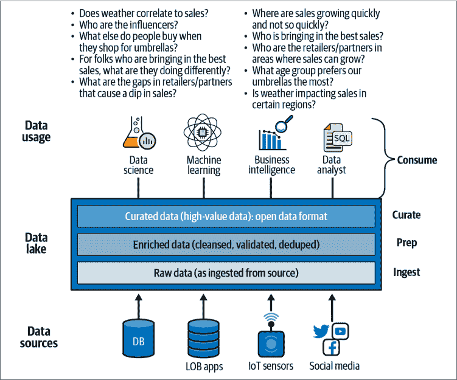

*图 2-13. Klodars Corporation 如何利用数据湖仓架构*

## 数据湖仓架构的优势与挑战

数据湖仓的关键优势在于能够直接在数据湖上运行高性能的 BI/SQL 场景，并且与探索性数据科学和机器学习场景并行运行。正如我们在用例中所看到的，这也有助于数据平台的各个用户群体之间实现共享，从而催生新的场景。此外，与数据仓库相比，数据湖的成本效益非常高。

话虽如此，也确实存在挑战。正如我们在架构部分所看到的，构建数据湖仓需要精心设计和架构组装，选用合适的数据格式和计算引擎以实现最优化的解决方案，从而获得更快的性能。如果缺乏适当的规划，可能会出现许多问题，我们将在第 4 章中详细讨论。数据仓库开箱即用即可提供这种优化路径；然而，它们并不是真正开放的。虽然我没有水晶球，但鉴于数据湖仓架构的快速发展，我的判断是这将是一个会迅速创新的领域，在未来几年内带来简化的端到端体验。

## 云数据湖仓的演进

*与 Dremio Corporation 联合创始人兼首席产品官 Tomer Shiran 共同撰写*

向云数据湖仓架构的演进在很多方面都与云应用从客户端服务器向微服务架构的演进非常相似。打破数据湖与数据仓库之间的壁垒具有非常明确的价值主张。话虽如此，由于技能和工程复杂性，工具生态系统以及入门门槛很高。非常类似于微服务，数据湖仓在这一领域正经历快速创新，使得这一障碍会随着时间的推移而越来越低。我与 Dremio Corporation 的联合创始人兼首席产品官 Tomer Shiran 就这个确切主题进行了有趣的对话，并从中获得了许多收获，我将在本书中分享。

几十年前，从单体本地数据仓库架构演进而来，计算和存储原本是共置的，后来演进为计算与存储分离的方案。虽然这使得云数据仓库能够独立高效地扩展计算和存储，但这仍然是一个封闭系统。这种分离解决了许多人的痛点，并为云数据湖奠定了基础，云数据湖实现了开放生态系统，其中多个计算引擎可以对同一数据进行操作，如图 2-14 所示。在过去 50 年里，我们将数据带入计算引擎。现在，在云数据湖和湖仓的世界里，数据作为架构中的一等实体成为自身的一个层级，引擎走向数据，而不是相反。这种转变引入了使用不同厂商组件构建解决方案的概念，避免了只能使用单一厂商的锁定局面。今天数据湖拥有数亿美元的市场规模，正是因为云的存在。云使得能够依赖在所有区域都可用且可弹性扩展的基础设施成为可能，使数据无处不在，并成为组织现在 heavily 依赖的关键增长驱动力。

开放数据格式在保持数据作为资产完整性的同时实现了开放数据架构，而这原本由于云对象存储的不足而无法实现。开放数据格式还促进了开源技术的发展，围绕这些格式形成了一个社区，共同改进这些产品。云数据湖仓本质上就是云数据仓库 2.0。

任何架构的转型，最初都是困难的，然后会随着时间的推移变得更容易。当我们从大型机转向客户端/服务器架构，再转向微服务时就是这种情况。当存在明确的价值主张时，行业会变得更擅长围绕其构建工具，这使得每个人更容易采用。最初，云数据湖仓仅在处于技术前沿的科技公司中使用。现在，随着公司前来简化数据湖仓架构，企业正在采用云数据湖仓。尽管这些企业并不处于技术的最前沿，但它们足够大，可以拥有专门从事正确问题的团队。我们也开始看到数据湖仓被一些小型且有动力的公司采用，这些公司只有几名数据分析师和数据工程师。入门的门槛每天都在降低，愿景是使其像数据库服务一样易于使用。

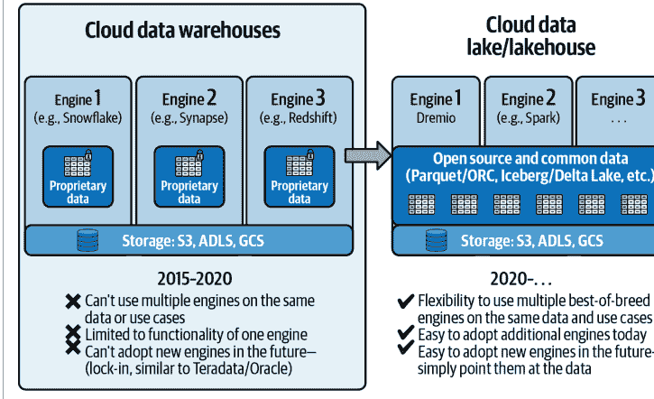

图 2-14. 从云数据仓库到云数据湖仓的演进（由 Tomer Shiran 提供）

## 数据仓库与非结构化数据

如果数据湖可以开始支持数据仓库场景，那么数据仓库是否也可以开始支持数据湖场景呢？答案令人惊讶的是可以。正如我们在上一节所看到的，Azure Synapse Analytics 为 Spark、机器学习和 SQL 提供了一个统一的数据平台。Google BigQuery 支持存储非结构化数据并原生支持 Parquet；它还支持查询存储在 GCS 中的数据。Snowflake 也最近推出了对非结构化数据的支持。无论是数据湖支持数据仓库还是反之，我们当前的创新清楚地表明，统一数据平台和无数据孤岛的数据平台的需求是未来的方向。

## 数据网格

2019 年，Thoughtworks 新兴技术总监 Zhamak Dehghani 发表了一篇关于数据网格的文章，为数据网格架构奠定了基础，该架构使组织能够以去中心化的方式运行数据基础设施和运营，从而在整个组织中实现数据和洞察的民主化。让我们来看看为什么这种去中心化的数据网格很重要或相关。

到目前为止，我们一直在谈论数据湖作为组织数据和智能的中央存储库以及技术选择。这种架构的体现是作为一个集中管理的<|message|> 基础设施。现在让我们看看谁在组织中负责设计和运营数据湖。数据提取和处理由一个中央团队管理，通常称为数据平台团队、数据基础设施团队、数据工程团队，或 <在此插入您喜欢的变体>。在本节中，我们将把该团队称为 *数据平台团队*。

数据平台团队通常拥有以下角色：

- *数据平台架构*
  设计为组织需求服务的计算和存储组件的基础设施。
- *数据管理*
  在云上组织数据集；应用数据管理策略以确保数据满足组织在数据保留和数据驻留方面的合规需求。
- *数据治理*
  控制谁可以访问什么数据，提供目录以便数据平台的消费者发现数据集，并管理审计。
- *数据摄取*
  通常拥有从各种来源、本地系统、物联网等摄取数据的任务，以及可能的数据准备，使其准备好被消费。在某些情况下，数据平台团队倾向于将此摄取委托给数据湖的消费者。

换句话说，数据基础设施是由一个中央团队管理的单体单元，而组织的其余部分则专注于消费场景：BI、数据科学或其他需求。随着基于数据的场景数量的增长，组织规模的扩大，这个通常是精简组织的 数据平台团队，很容易被来自组织各地的请求淹没，并最终成为数据的关键路径，引入瓶颈。

数据网格架构要求进行文化转变，将数据视为可在组织间共享的产品，而不是作为需要收集和处理的数据资产/实体。

这种文化转变意味着什么？此时，我想引用 Zhamak Dehghani 在她的书 *Data Mesh*（O’Reilly）中提出的优秀原则集：

- *在组织上*，责任从由中心数据平台团队包办一切，转变为去中心化模式，每个业务领域都有专注于数据需求的专家。
- *在架构上*，从大型中心数据仓库或数据湖的单体实现，转变为数据湖和数据仓库的分布式网格，它们通过彼此共享数据和洞察，仍然形成数据的单一逻辑表示。
- *在技术上*，从将数据视为独立实体和平台的思路，转向将数据和业务代码作为一个整体单元对待的集成解决方案。
- *在运营上*，从中心化运营模式对数据治理的自上而下指令，转变为联邦式模型，每个业务领域都拥有并遵守组织的政策。
- *在原则上*，从将数据视为被收集的资产，转变为服务于用户并让用户满意的产品。

## 参考架构

数据网格依赖于由多个领域组成的分布式架构。每个领域都是数据及其相关存储和计算组件的独立单元。当组织包含各种产品单元，且每个单元都有自己的数据需求时，每个产品团队都拥有一个领域，并由该产品团队独立运营和治理。角色和职责包括以下内容：

- 中心数据平台团队制定并维护一组关于计算、存储和数据组件架构的蓝图/参考模式。
- 产品团队实施这些蓝图，以将其领域投入运营。

这使得产品团队/领域可以选择使用自己所需的基础设施或技术；例如，一个单元可以在 AWS 上使用湖仓架构，另一个单元可以在 Microsoft Azure 上实现现代数据仓库架构，同时仍然在它们之间共享数据和洞察。这里的关键原则是，领域中的数据在合规和治理边界内跨组织共享，以遵循无孤岛逻辑数据湖的原则，该原则仍然促进数据和洞察的共享。图 2-15 展示了数据网格架构的示意图。

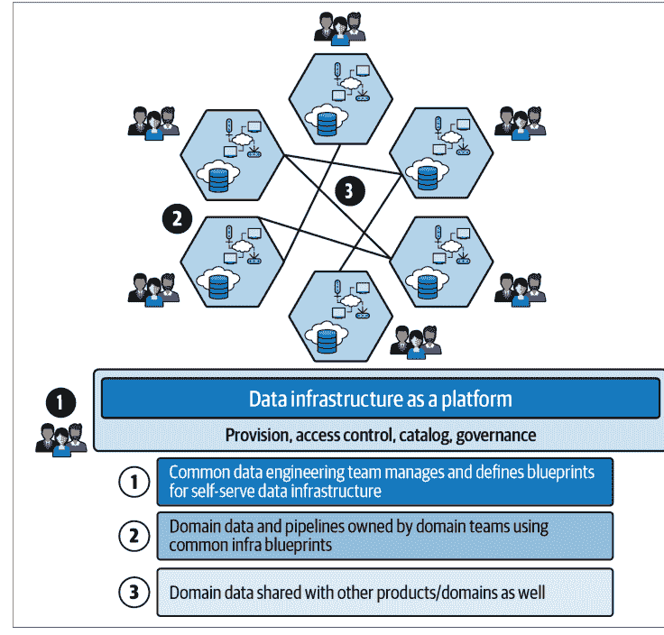

图 2-15. 数据网格架构

## 数据网格架构的示例用例

Klodars 公司在软件产品和团队规模较小时一直运行良好。然而，随着业务增长并在更多地区运营，团队和组织规模显著扩大，中心数据平台已无法再满足扩展需求。此外，由于 Klodars 公司收购了采用不同技术栈的其他公司，它们很难作为一个整体进行整合。Alice 和她的中心数据平台团队决定实施数据网格架构。

Klodars 公司的中心数据平台团队发布架构，以及用于自动化领域部署的部署和配置脚本，并建立了数据治理、合规和数据共享基础设施。Klodars 公司设有销售、营销和客户成功团队，他们实施各自的领域，并与其他组织分享洞察。销售团队发现，鉴于其大量使用运营数据库，现代数据仓库架构适合其需求；而客户成功团队发现，湖仓架构更适合其需求，因为数据源的多样性可同时惠及其 BI 和数据科学团队。数据网格模式使 Klodars 公司能够为其各个领域提供这种选择自由，同时促进数据共享，并保持其统一数据平台的主张。此外，Klodars 公司所收购的公司只需进行少量调整即可保留其现有数据湖。当 Klodars 公司希望扩展到冬季装备业务时，它可以有效地与合作的滑雪公司分享洞察，以促进更好的伙伴关系，从而扩展数据网格架构。Klodars 公司正在快速增长，并希望将业务扩展到欧洲，而欧洲有独特的数据驻留要求和其他合规要求。它可以设立专门针对欧盟（EU）的领域，这些领域同样遵守欧盟特有的要求，而无需承担巨大的开发或重新架构工作。展望未来，当 Klodars 公司收购其他公司时，可以将其所收购公司的数据平台作为领域接入其现有的数据网格。图 2-16 展示了 Klodars 公司数据网格架构的示意图。

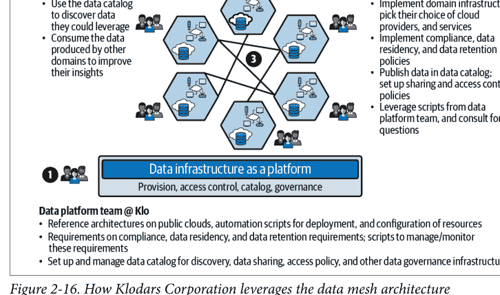

图 2-16. Klodars 公司如何利用数据网格架构

## 数据网格架构的挑战与收益

数据网格具有独特的价值主张，不仅提供基础设施和场景的规模化能力，还帮助转变组织围绕数据的文化，正如我们在上一节所看到的。正如用例所示，数据网格架构带来以下好处：

- 支持自助式架构，可随组织的发展和数据多样性进行扩展
- 为各个领域提供架构和平台的选择灵活性
- 促进数据在整个组织中成为一种文化，而非某个小团队的职责，从而避免瓶颈

这种方法当然也存在挑战。首先最重要的是，这依赖于各个产品团队拥有熟练的软件开发人员，但情况并非总是如此。其次，数据湖架构本身就因数据和生态系统的多样性而具有复杂性；增加分布式层会进一步增加这种复杂性。话虽如此，前期在这一架构上投资会让组织为成功奠定基础，而且基于数据网格日益增长的受欢迎程度，我可以有根据地推测，在简化该架构的部署和管理方面也将会出现快速创新。

## 哪种架构适合我？

在本节中，我们讨论了三种主流的云数据湖架构：

- 现代数据仓库架构，通常普遍存在于各类组织中
- 湖仓架构，支持 BI 场景直接在数据湖上运行
- 数据网格架构，提供了一种管理和运营云数据湖的去中心化方法

你如何知道该选择哪种架构？你又如何知道自己选得对？虽然我们都是边做边学，但我们可以运用一套基本原则来帮助你朝着正确的方向前进。

### 了解你的客户

与每个项目一样，首先要按优先级定义你已知必须实现的目标，并明确你的客户群体。你可以根据组织需求，从以下一个或多个客户群体入手：

*BI/数据分析师*

为他们准备数据集，供其使用数据湖进行分析。这可以通过运行定期任务从各种来源摄取数据，并通过数据处理为你的 BI 用户生成数据集来实现。

### 时间

虽然成本、现代场景和其他驱动因素可能会促使组织迁移到云，但时间有时会决定技术和架构的选择。我见过一些客户在本地硬件或软件许可证的支持即将到期时，才制定迁移到云端的路线图。在这种情况下，你的技术/架构选择就只能由可用时间决定。

### 考虑你的增长和未来场景

虽然你的客户需求和业务驱动因素决定了技术和架构决策的优先级，但你需要确保所选设计不会让自己陷入困境。例如，如果你的数据湖基础设施是由营销部门的需求推动的，该部门需要运行个性化营销活动并更好地了解你的客户群体，那么你将设计数据湖架构的第一个版本来满足这些需求。请确保你专注于从客户系统和社交媒体信息流中摄取数据，并生成可由业务分析师使用的数据集，以便他们选择高优先级细分群体并为其定制营销活动。然而，当第一个场景成功时，你的设计应预见到更多场景和更多客户。我曾与一些客户合作，他们总是假设数据工程团队是唯一能访问数据湖中数据的团队，并且没有实施正确的安全和访问控制，结果却看到场景迅速增加，所有人都能访问一切数据，导致意外删除数据。因此，即使你只有一个客户，也要考虑如何设计一个拥有大量用户的系统，重点关注数据组织、安全和治理。我们将在第 3 章详细讨论这些问题。

### 设计考虑因素

当我与客户讨论他们的数据湖解决方案时，他们经常让我推荐最便宜或最快的方法，而我的答案总是“视情况而定”，我总是微笑着给出这个答案。鉴于云数据湖解决方案以及软件和平台生态系统的灵活性和多样性，选择合适的方案和方法几乎就像规划家庭运营预算一样。虽然我们可以做出诸如“Costco 的价格很实惠！”这样笼统的论断，但鲜为人知的潜台词是“这还取决于你能否确保不浪费批量购买的物品。”云数据湖提供了灵活性和更低的成本，但它们依赖数据平台团队来确保其以优化方式运行。在表 2-1 中，我尝试从几个可预测的维度对这些架构进行评估，以便你以此作为起点，确定适合自己的方案。

### 表 2-1. 架构对比

| 架构 | 解决方案总成本 | 场景灵活性 | 开发复杂度 | 生态成熟度 | 所需组织成熟度 |
|---|---|---|---|---|---|
| 云数据仓库 | 高：由于云数据仓库依赖专有数据格式并提供端到端解决方案，因此成本高。 | 低：云数据仓库针对 BI/SQL 场景进行了优化；对数据科学/探索性场景有一定支持，但受格式限制而受限。 | 低：可移动部件较少，且可几乎立即使用端到端解决方案开始。 | SQL/BI 场景下高。其他场景下低。 | 低：工具和生态系统在很大程度上已被充分理解，任何规模/形态的组织都可使用。 |
| 现代数据仓库 | 中：数据准备和历史数据可以以更低成本迁移到数据湖；你仍然需要云仓库，这很昂贵。 | 中：数据湖中支持多样化的工具生态系统和更多探索性场景；在仓库和数据湖之间关联数据需要数据复制。 | 中：数据工程团队需要确保数据湖设计高效且可扩展；有大量指导和注意事项，包括本书。 | 中：数据准备和数据工程生态系统，如 Spark/Hadoop，成熟度更高；需要针对性能和规模进行调优。通过数据仓库消费为高。 | 中：数据平台团队需要提升技能以理解组织需求并做出正确的设计选择来支持这些需求。 |
| 数据湖仓 | 低：数据湖存储作为统一存储库，无需数据移动；计算引擎在很大程度上无状态，可按需启动和停止。 | 高：运行更多场景的灵活性以及多样化的生态系统支持更多探索性分析，如数据科学，并便于 BI 和数据科学团队之间共享数据。 | 中至高：需要仔细选择合适的数据集和开放数据格式以支持湖仓架构。 | 中至高：虽然 Delta Lake、Apache Iceberg 和 Apache Hudi 等技术正在获得成熟度和采用，但该架构今天仍需要深思熟虑的设计。 | 中至高：数据平台团队需要提升技能以理解组织需求以及仍属新颖的技术选择。 |
| 数据网格 | 中：虽然分布式设计确保成本更低，但在自动化、蓝图和数据治理解决方案方面需要大量投资 | 高：在同一组织中支持不同架构和解决方案具有灵活性，且中央精简组织不会成为瓶颈。 | 高：这依赖于端到端自动化解决方案以及可扩展至 10 倍增长并跨架构/云解决方案共享的架构。 | 低：指导和可用工具集相对较新。 | 高：数据平台和产品/领域团队需要在数据湖方面提升技能。 |

让我们以另一种方式来看这些数据。图 2-17 显示了不同架构之间成本与复杂度的权衡。

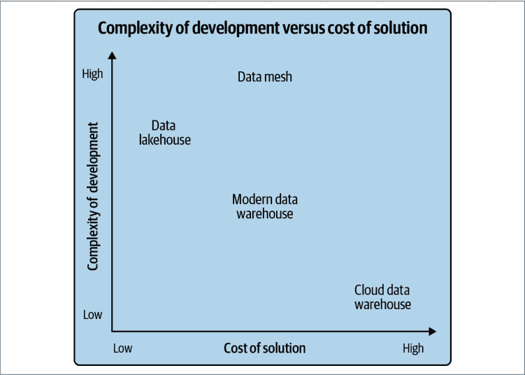

*图 2-17. 云数据湖架构的成本与复杂度*

### 混合方法

根据你的组织需求、场景成熟度以及数据平台战略，你可能会采用混合方法来构建你的数据湖。例如，虽然大多数组织以云数据仓库作为其中央数据存储库运行，但创新中心正在使用精选的一组场景在数据湖架构上工作，并逐步扩展到公司其他部门。或者，虽然大多数组织采用数据湖仓架构，但一些团队仍依赖需要数年时间才能迁移的传统基础设施。

你的场景的细微差别可能如此专属或特定于你的组织，以至于超出了本书的范围。然而，本章中讨论的原则将帮助你提出正确的问题并就数据湖架构做出明智的选择。

大数据生态系统和云数据湖架构是一个快速创新的领域。我相当确定在我完成本章时，指针已经在某些方面被移动了。

### 总结

在本章中，我们深入研究了云数据湖的三种关键架构，并了解了它们与传统云数据仓库架构的比较。首先，我们介绍了现代数据仓库架构，其中你在数据湖中收集和处理数据，以将原始数据相对较低价值密度的数据转换为高价值结构化数据，并将高价值数据加载到云数据仓库中以支持 BI 场景。接下来，我们在此基础上构建了数据湖仓架构，该架构可直接在数据湖上支持 BI 场景（除数据工程和数据科学场景外），从而消除了对云数据仓库的需求。然后，我们探讨了数据网格架构，该架构提供了一种分散的方法来管理和运营数据湖，使其能够可持续地扩展到组织中不断增长的需求和数据快速扩散。最后，我们将所有这些与成熟度、技能组合和组织规模等因素放在一起，以帮助你为你的组织制定正确的云数据湖架构。在第 3 章中，我们将更专注于云数据湖的“数据”部分：组织、管理和保护数据湖中数据的考虑因素，以及治理数据。
