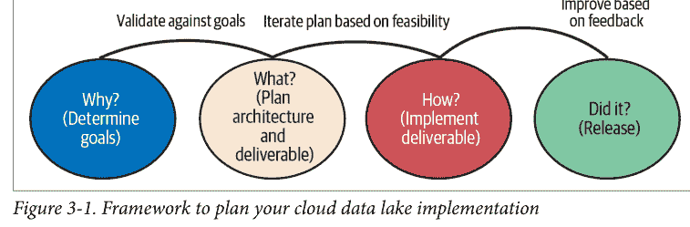
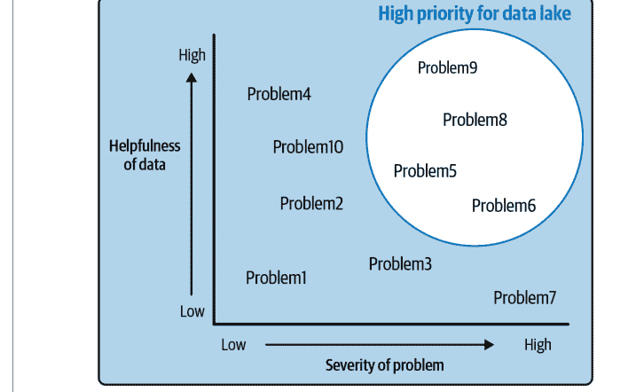
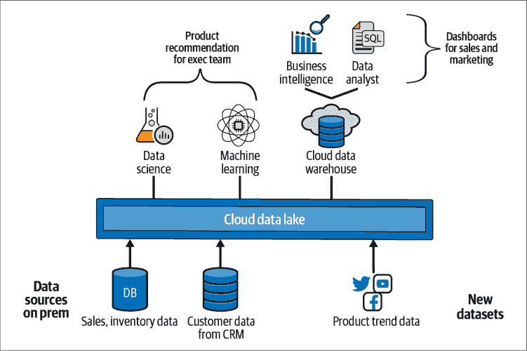
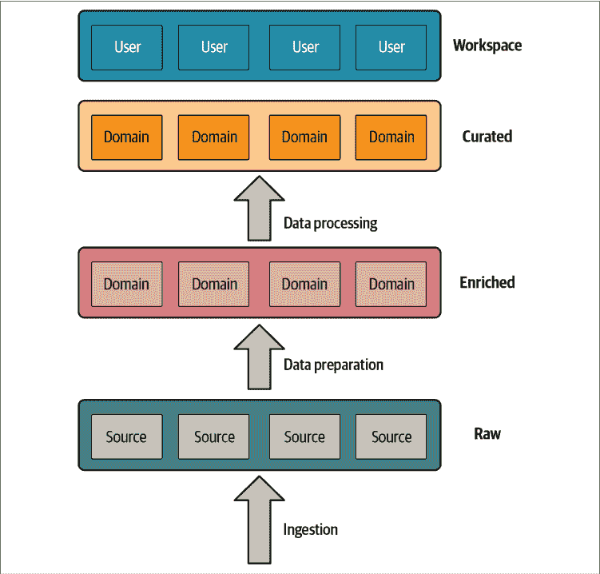
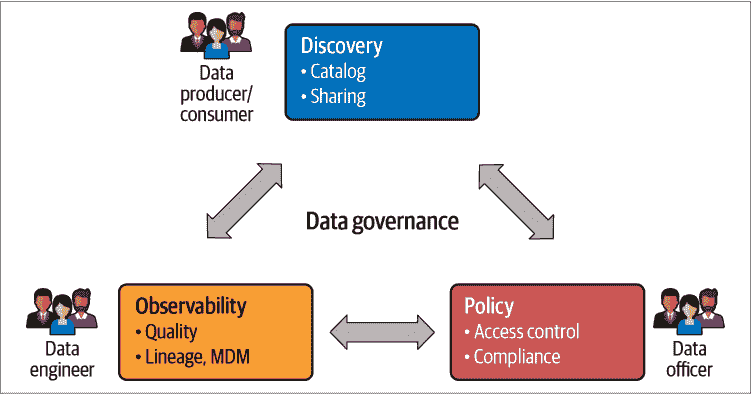
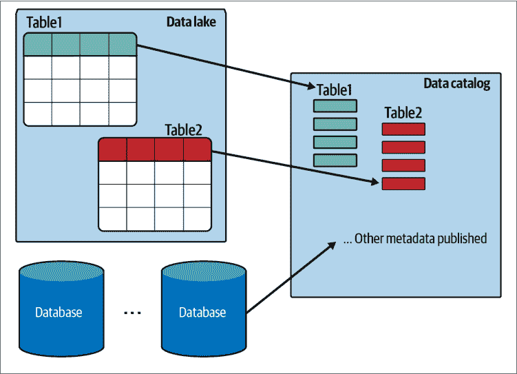
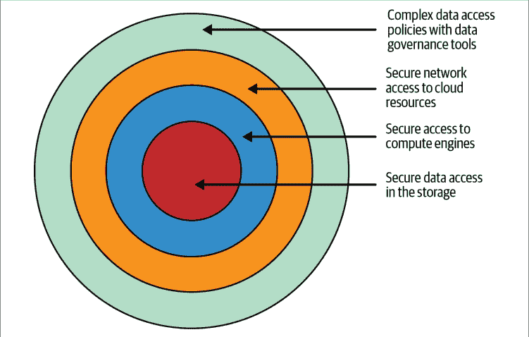
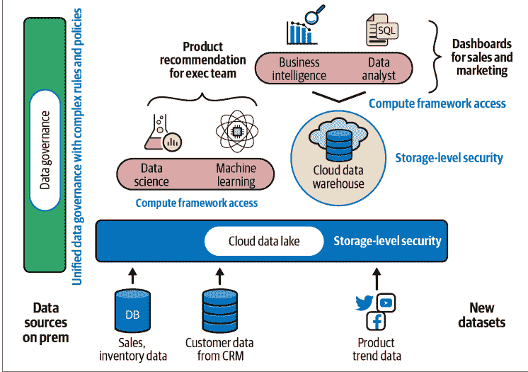
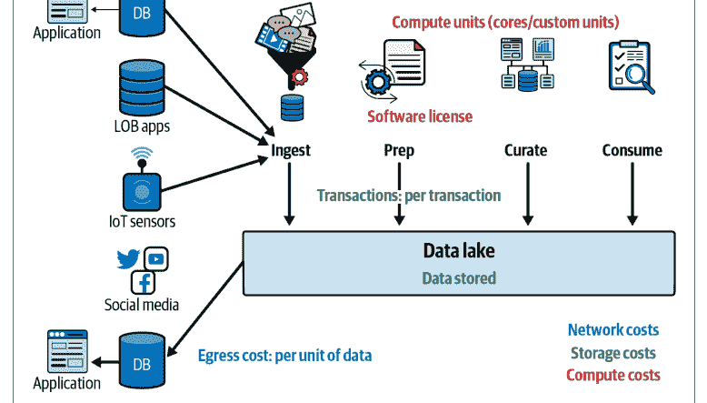
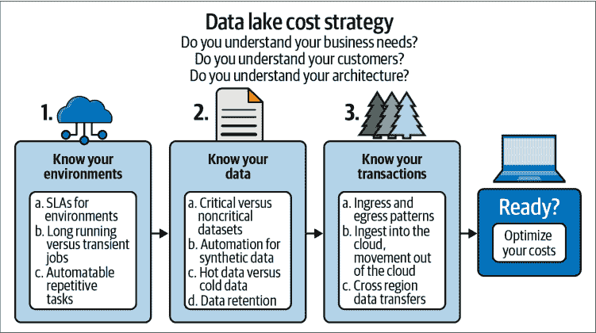

## 为你的数据湖设计考虑

> 不要害怕完美——你永远达不到它。
> ——萨尔瓦多·达利

在第 1 章和第 2 章中，我们从 10,000 英尺的高度了解了云数据湖是什么以及云上广泛使用的数据湖架构。头两章的信息为你提供了足够的背景来开始设计你的云数据湖；你至少应该能够拿起一支白板笔并绘制出代表云数据湖架构组件及其交互方式的框图。

在本章中，我们将深入探讨云数据湖架构实现的细节。正如你所回忆的那样，云数据湖架构由多种 IaaS、PaaS 和 SaaS 产品组成，这些产品被组装成端到端解决方案。将这些单独的服务视为乐高积木，你的解决方案就是你用乐高积木搭建的结构。你可能会搭建堡垒、龙或宇宙飞船——选择仅受你的创造力（和业务需求）限制。然而，有一些基础你需要理解，这正是本章要探讨的内容。

我们将继续使用 Klodars Corporation 来说明一些决策选择的示例。

### 设置云数据湖基础设施

大多数云数据湖架构属于以下两类之一：

- 你想从零开始在云上构建你的云数据湖。你没有先前的数据湖或数据仓库实现，并且从一张干净的白纸开始。
- 你想将你的数据湖从本地系统或其他云提供商迁移到云。在这种情况下，你已有现有的实现，要么是数据仓库，要么是数据湖，你将把它迁移到云。

无论哪种情况，你通往云的旅程的第一步在很大程度上保持不变。你将选择云提供商，你将选择服务，你将设置你的基础设施。云包含多种可供你选择的服务，每种都有其优势和机会，因此在迁移到云之前，首先要记住的是，在进行这一转变时，并没有银弹或规定的 12 步流程。然而，通过与许多客户合作以及我自己参与云迁移，我将客户旅程提炼为一个决策框架，该框架由以下关键步骤组成，如图 3-1 所示：

1. 确定你的目标。
2. 规划你的架构和交付成果。
3. 实现云数据湖，要么从零开始，要么通过将现有系统迁移到云。
4. 运营化和发布。

图 3-1. 规划你的云数据湖实施的框架

让我们更仔细地看看实践中每个步骤。

### 确定你的目标

正如我们在第 1 章中看到的，数据湖对于释放关键洞察以指导和转型业务至关重要。然而，鉴于多种可能性，确定数据将为你的组织提供的具体目标非常重要。这些目标有助于你决定为业务优先考虑何种类型的数据和处理。

作为第一步，你需要确定数据湖的客户是谁；他们可以是组织内部的部门（例如，人力资源、财务、供应链），也可以是组织外部的客户（例如，消费你仪表板的客户）。此外，查看你自己的数据湖实施存在的问题（如果有的话）。例如，你当前的问题可能与数据中心的高成本和运营费用侵蚀预算有关，或者与当前硬件即将停止支持有关，甚至与当前架构无法支持数据科学和机器学习相关的高级场景有关，这使得你的业务在竞争市场中失去优势。一旦你与各个客户沟通并列出他们最关心的难题，你就可以识别出数据可以帮助解决的顶级问题子集。数据湖实施的目标将是解决这些问题，如图 3-2 所示。

图 3-2. 定义你的数据湖目标

如图所示，图 3-2 中，你的团队通过与各个消费者交谈已识别出 10 个问题。然而，当你将它们绘制在严重程度高与云数据湖在解决这些问题方面的有用性高的图表上时，你可以看到你应该优先考虑问题 5、问题 6、问题 8 和问题 9，因为它们在严重程度和云数据湖的有用性方面都排名靠前。

## Klodars Corporation 如何定义数据湖目标

正如我们在第 2 章中所看到的，Klodars Corporation 目前拥有利用运营数据库（SQL Server）管理其库存和销售的遗留应用程序，以及用于管理

- **（必须具备）** 在数据湖上支持数据科学模型，以产品推荐给执行团队的试点参与为衡量标准。
- **（锦上添花）** 在数据湖上支持更多数据科学模型，以销售合作伙伴识别和营销影响者推荐的下一组场景为衡量标准。

## 规划你的架构和交付物

一旦为数据湖定义了目标，下一步就是定义架构和交付物。正如我们在第 2 章中所看到的，常用的架构模式各不相同，每种都有其设计考虑，如“设计考虑”第 58 页所述。考虑数据湖的目标以及其他因素，例如组织成熟度，以确定数据湖的合适架构。以下是确定架构的一些常见考虑因素：

### 解决方案的成本

确定设置解决方案的初始成本以及维护解决方案的长期成本，并将其与收益进行权衡。数据湖比数据仓库便宜得多；然而，数据仓库更容易快速启动运行。

### 实施所需时间

在软件开发领域，开发人员和运营时间与美元账单一样重要，因此在计算中纳入人员和运营方面，并估算解决方案所需的时间和精力。如果你有即将到期的现有硬件，你需要选择一种可以在现有硬件停止支持前实施的模式/架构。

### 向后兼容性

当你拥有需要迁移到云的现有数据基础设施时，可以合理地假设你的云迁移将分阶段进行。你需要确保在将解决方案的某些部分迁移到云时，可以保证业务连续性，而不会对现有应用程序和消费者造成太大干扰。如果你有一个正在支持仪表板的现有运营数据库，那么确保现有应用程序的兼容性是你需要考虑的因素。

### 组织成熟度

这是大多数营销材料中经常被忽视的因素。当你与云提供商或 ISV 交谈时，请务必讨论你组织当前的技能和数据文化，并了解他们的解决方案如何满足当前状态，同时你计划提升组织技能并转型其文化。例如，如果你尚未聘请数据科学家，那么针对数据科学优化的架构就不是最佳选择。

一旦确定了架构，你就可以与客户协作，并根据你将支持的优先场景列表，定义云数据湖架构的目标。然后，你可以创建一个项目计划，跟踪时间线和交付物，以及实现目标的整体进展。

## Klodars Corporation 如何规划其架构和交付物

基于为云数据湖实施定义的目标，Alice 及其团队随后使用以下指导原则调查不同的架构选择：

- 对销售和营销团队消费的现有仪表板造成最小/无干扰。
- 仪表板需要随着数据的增长而扩展，并解决客户面临的性能问题。
- 数据科学场景需要在新平台中得到解决。这包括为执行团队的产品推荐、为销售团队的分销商/零售商推荐以及为营销团队的影响者推荐。
- 鉴于仪表板对业务的关键性和需要考虑的未来增长，新架构需要在未来六个月内推出。

他们在云上评估了以下架构模式（这在很大程度上与特定提供商无关）：

### 云数据仓库

在此架构模式中，不涉及云数据湖，主要组件将是云数据仓库。如果你想复习云数据仓库，请参阅第 34 页的“云数据仓库”。虽然这将是最快实施的时间，并且对销售和营销团队的业务分析师来说是无缝的体验，但数据科学能力有限。因此，这可以作为试点，但当场景变得更高级时，例如引入更多样化的数据集，可能会遇到障碍。

请注意，像 Snowflake 这样的云数据仓库正在模糊数据仓库和数据湖之间的界限。在我撰写本书时，我个人会将 Snowflake 归类为数据仓库，主要是因为 Snowflake 的主要用例是对结构化数据进行操作。

### 现代数据仓库

正如我们在第 36 页的“现代数据仓库架构”中所看到的，这涉及利用云数据湖存储进行数据收集和处理，以及利用云数据仓库进行 BI 场景。这比云数据仓库实施时间稍长。然而，数据湖上丰富的数据科学能力将帮助团队专注于试点，同时通过数据仓库支持数据分析师。此外，数据湖提供更便宜的存储来保存本地数据库的历史数据的多个快照。

### 数据湖仓

正如我们在第 40 页的“数据湖仓架构”中所看到的，这涉及利用云数据湖存储进行端到端实施，而无需云数据仓库组件。对于团队来说，这很有吸引力，因为它同时支持数据科学和数据分析师场景；然而，他们很快意识到需要对工具支持和端到端自动化进行技能提升。

团队没有评估数据网格架构，因为它希望保持对端到端实施的集中控制。他们将在项目的下一阶段评估数据网格。

团队最终选择了现代数据仓库架构，因为它提供了从当前架构的更平滑过渡，同时提供数据科学支持。团队还计划在他们在云上运行后，在项目的下一阶段调查数据湖仓和数据网格架构。

如图所示，图 3-3 中，Klodars Corporation 的现代数据仓库架构由以下组件组成：

- 一个充当数据中央存储库的云数据湖存储
- 摄取系统，将数据从现有来源（例如运营数据存储）以及新数据源（例如社交媒体）上传到云数据湖
- 数据处理引擎，使用复杂的数据转换从云数据湖存储中处理数据，以生成高价值数据

- 供数据科学家用于临时探索性分析的数据科学和机器学习解决方案
- 一个云数据仓库，将这些高价值数据提供给BI用例和数据分析师

*图3-3. Klodars公司拟议的云数据湖架构*

他们项目的交付成果包括以下阶段：

## 阶段1：数据摄取

将数据加载到数据湖中。设置自动化管道，将运营数据库和CRM系统的数据每天备份到数据湖中。存储过去90天的数据。

## 阶段2：处理

这包括两个可以并行运行的阶段：

### 处理BI数据

运行处理管道，每日将数据刷新到云数据仓库中。根据销售和市场营销团队数据分析师的反馈进行验证。

### 高级场景

利用数据科学家，基于运营数据库和CRM系统的数据开发产品推荐模型。

## 阶段3：有限发布

该阶段涉及将数据湖平台发布给销售、市场营销和高管团队中的部分客户，而本地实施仍在运行。这有助于尽早发现问题，并根据客户反馈进行迭代。

## 阶段4：发布至生产环境

这涉及将数据湖发布给Klodars公司的所有客户。此时，本地平台和云平台并行运行。

## 阶段5：关闭本地仪表板

一旦数据湖在云上成功实施，将关闭本地用于分析的仪表板。

## 实施云数据湖

在此阶段，将根据项目计划实施架构。该阶段涉及围绕云服务提供商选择的关键决策，并遵循基础设施的最佳实践。鉴于云服务提供商的选择超出了技术原因，我们在此不做详细讨论。此阶段适用于所有云服务提供商的一些重要考虑因素包括：

### 设置并管理你的云身份

开始使用云的一个关键基础步骤是在云服务提供商处创建身份管理系统。如果你在本地已有身份管理系统，云服务提供商会允许你将本地身份联合到云中。

### 设置你的订阅

创建资源（云上提供的IaaS、PaaS或SaaS）需要订阅。订阅也有与之关联的访问控制；你可以为订阅将云管理身份分配给特定角色（所有者、参与者等）。

### 创建环境

强烈建议你为开发（开发人员可以用来测试代码）、预生产（可让所有开发人员和部分客户访问）和生产创建独立环境。我还建议你为不同环境使用独立的订阅，使它们彼此隔离。如果你在多个地区有业务且这些地区需要满足不同要求，你可以为每个地区（如北美或欧洲）创建独立环境。

### 选择你的服务

云服务提供商为你的云数据湖架构提供了多种服务（IaaS、PaaS或SaaS）。花些时间与云服务提供商沟通，根据机遇、业务需求和成本做出正确选择。

### 投资于自动化和可观测性

除了实施数据湖本身，还要确保你具备按需创建和管理资源所需的自动化。鉴于你需要为云上使用的资源付费（而不是始终保有硬件），自动化将确保你可以按需创建和删除资源以帮助管理成本。同样，确保你在云上有日志记录和监控，以便监控系统的运行状况。

有关更多信息，你可以查看顶级云服务提供商AWS、Microsoft Azure和Google Cloud的入门文档。

## 发布与运维

在此阶段，项目计划得到适当的资源分配、跟踪、实施并发布到生产环境，从而可以放心地关闭本地实施。

此阶段的一些考虑因素包括：

- 考虑尽早并经常向有限的受众发布，以确保你能够更早发现问题，并根据反馈进行迭代。
- 确保发布从开发环境开始，并在发布到生产环境之前，在预生产环境中进行测试。

主流云服务提供商拥有帮助实现可观测性和自动化的工具和平台，例如AWS的Lake Formation用于自动化、CloudWatch用于可观测性；Microsoft Azure的Azure Resource Manager用于自动化、Azure Monitor用于可观测性；Google Cloud的Resource Manager用于自动化、Cloud Monitoring用于可观测性。

在此阶段结束时，你将拥有一个可用的数据湖，可以在开发、预生产和生产环境中进行测试。在接下来的章节中，我们将讨论建立数据湖架构的具体细节，包括组织数据、管理和治理数据湖以及管理成本。

## 在数据湖中组织数据

一旦你完成基础设施的搭建和端到端测试，下一步就是摄取数据。在将数据摄取到数据湖之前，确保你有一个在数据湖中组织数据的策略非常重要。当你布置厨房时，你需要知道在哪些橱柜里存放瓷器、锅碗瓢盆和咖啡。你会确保锅碗瓢盆更靠近炉灶，咖啡、糖和奶精放在一起。为了理解数据湖内的数据组织，让我们看一下数据在数据湖中的生命周期。

### 数据的一天

数据首先从其各种来源以原始自然状态被摄取到数据湖中。然后对其进行清理，并为后续处理做好准备，例如应用模式、删除重复项、删除空值，并在某些情况下使用默认值进行修复。在此数据准备阶段结束时，数据遵循数据准备代码所定义的表格结构。接下来，对这些数据进行聚合、连接和过滤，以提取高价值数据——这一阶段称为数据策展。除了遵循此生命周期的数据之外，数据科学家等消费者还可以引入自己的数据集进行探索性分析。

这个生命周期是你需要记住的一个重要点，因为它预示了一种不同的模式。过去几十年中最常见的数据加载分析模式是ETL：提取、转换、加载。数据从其来源中提取，转换为特定结构，然后加载到存储（Hadoop文件系统或数据仓库）中。如果在此转换过程中丢失了数据中的某个信号，则恢复并不简单，在某些情况下，无法再次从该来源检索该信号。此外，随着云基础设施和芯片的创新，存储成本随时间推移越来越便宜。数据价值的增加与廉价的存储相结合，催生了一种名为ELT的新模式：提取、加载、转换。在这种模式下，数据从其来源中提取，加载到数据湖中，稍后通过数据处理进行转换。

### 数据湖分区

遵循数据的这种生命周期，数据将被组织到数据湖内的不同分区中。现在让我们详细看看这些分区。图3-4展示了每个分区的可视化效果，在本节中，我们将逐一介绍它们。

*图3-4. 云数据湖中的数据湖分区*

数据湖中的数据可以根据处理阶段和封装在数据中的价值密度划分为以下分区：

### 原始数据（青铜）区

该分区包含数据从其来源摄取时的自然状态数据。该分区的数据价值密度最低（即高信噪比），并且这些数据可以进行各种转换以生成有价值的见解。

### 丰富数据（白银）区

该分区包含原始数据的转换版本，遵循与业务场景相关的结构。此时，价值密度为低到中等；但是，数据有一定程度的保证，使其符合模式或结构。

### 精选数据（金）区

该区域包含具有最高价值密度的數據。該區域中的數據是通過對豐富數據進行轉換而生成的。

### 工作區數據區

該區域為數據湖的消費者提供服務，讓他們可以引入自己的數據集。對於該數據區沒有具體的保證；可以將其視為你在數據湖中提供的草稿區。

讓我們現在詳細看看這些部分：

### 原始數據（青銅）區

這是數據湖中數據從外部來源首次落地的部分。在我們談到的 ELT 模式中，這是從源提取並加載到數據湖存儲中的數據。數據從各種來源攝取，例如本地系統、社交媒體、外部開放數據集等等。數據可以以計劃方式（想批量上傳）或實時（想事件）的方式攝取。該區域中的數據具有最小的保證或結構、語義和價值。最常見的模式是，這種攝取通常由一組選定的團隊控制，而不是對所有人開放。該區域中的數據將按攝取來源以及數據的時間戳進行組織。在典型的數據湖場景中，大多數數據都與時間相關（例如，特定一天的 Twitter 動態、特定一天特定小時的服務器日誌等）。因此，該區域通常按來源組織，並在來源內按時間組織；這種時間結構表示數據的新鮮度。

### 豐富數據（白銀）區

原始數據在被攝取到數據湖時並不完全符合特定的結構或格式。如我們在第 23 頁的“關於數據多樣性的說明”中所見，攝取到數據湖的數據可能是結構化、半結構化或非結構化。然後對數據進行清理和處理以適配為表格結構；此過程稱為數據準備或豐富或數據烹飪。此步驟通常會發生三個關鍵事項：

### 模式定義

模式本質上是數據所遵循的結構的定義——即，對數據的不同部分賦予含義，使其成為具有列定義的表格結構。

### 數據清理

一旦模式被定義，可能會有部分數據不符合模式。例如，如果模式指出你的 CSV 文件的第五個字段是郵政編碼，那麼此步驟確保值符合郵政編碼格式（XXXXX 或 XXXXX-XXXX），如果不符合，則
刪除它或用合法值填充它（例如，從地址中查找郵政編碼）。

### 優化

一旦數據符合表格結構，準備數據以優化最常見的消費模式也很重要。最常見的模式是數據寫入一次、讀取多次。例如，如果你有一個銷售數據庫，對此數據最常見的查詢往往是按區域劃分的銷售信息或隨時間的趨勢。在此步驟中，數據被轉換為格式並重新組織，以便對最常見的查詢友好。通常，選擇像 Parquet 這樣的列式格式，我們在第 45 頁的“數據格式”中見過，用於優化查詢。

此數據被不同團隊、數據科學家以及在某些情況下業務分析師更廣泛地用於更臨時的分析。該區域中的數據按領域組織，或按各種消費者可以理解的單位組織，並發布在目錄中（我們將在第 78 頁的“數據治理簡介”中更多地談論這一點）。

### 精選數據（金）區

精選數據區擁有數據湖中價值最高且驅動關鍵業務儀表板的關鍵數據集。將該區域中的數據視為數據價值的摘要或總結，關鍵見解。該區域中的數據通過執行聚合、過濾、從不同數據集關聯數據以及其他複雜計算來處理，從而為業務問題的解決方案提供關鍵見解。該區域中的數據使用精選區中的數據作為其來源，並偶爾使用其他數據源。鑒於其對業務的廣泛影響，該區域中的數據需要符合最高標準的數據質量。

精選數據主要由業務分析師使用，並驅動關鍵業務決策者使用的儀表板。此外，這些數據發布在目錄中，並按業務單位和相關的領域進行組織。

### 工作區或沙箱區（可選）

如我們所討論的，存在於原始、豐富和精選區域中的數據在很大程度上由一組選定的數據工程師或數據平台團隊管理。然而，消費者希望引入數據集用於探索性分析或試水。這種數據可以組織成專門為用戶配置的單元（想想這就像一個草稿區）。此處的數據不遵循任何特定標準或質量，本質上可供任何自由形式使用。

圖 3-5 說明了 Klodars Corporation 的數據組織。

圖 3-5. Klodars Corporation 數據湖內部的數據組織

### 組織機制

雖然不是強需求，但將數據以與使用模式一致的方式組織起來是一個良好的實踐。如我們在第 73 頁的“數據湖區域”中所討論的，數據在數據湖內經歷一定的生命周期，你可以通過按區域對數據進行分組來對齊組織。這種組織在數據和使用的持續增長中非常有幫助，因為你的數據湖肯定會這樣。組織機制在許多方面都很有用，包括以下內容：

以及許多其他方面，你在運營雲數據湖時需要關注。

> 如 Evren Eryurek、Uri Gilad、Valliappa Lakshmanan、Anita Kibunguchy-Grant 和 Jessi Ashdown 所著的 *Data Governance: The Definitive Guide*（O'Reilly）所述，“最終，數據治理的目的在於建立對數據的信任。數據治理的價值在於它在多大程度上增加了利益相關者對數據的信任——具體而言，是對數據如何被收集、分析、發布或使用的方式的信任。”

### 參與數據治理的角色

*數據治理* 是一個總稱，指確保組織使用的數據安全、可訪問、可使用且合規的技術、工具和流程。有四個主要角色參與組織的數據治理。數據治理工具旨在滿足其中一個或多個角色的需求。請注意，角色不總是人類用戶，也可以是應用程序或服務。此外，同一團隊或組織可以扮演一個或多個角色的角色：

### 數據官

該組本質上管理數據被信任的定義和要求，並通過定期審計和審查確保要求得到滿足。這涉及為數據共享要求、數據保留策略以及數據資產需要滿足的合規法規等事項定義和管理控制。他們為數據治理設定標準。

### 數據工程師

這些是實施數據湖架構的角色。他們配置和設置各種服務，為角色管理身份，並部署正確的一組技術和流程，以確保數據及其相關見解具有所需程度的信任。換句話說，他們實施和管理基礎設施和技術，並確保實施符合數據官定義的要求。他們利用各種工具集來了解數據經歷的不同處理階段，一個稱為追踪數據血緣的過程，並保證數據的質量和一致性。他們在提供審查和審計的證據和材料方面也發揮關鍵作用。

如果你听说过*主数据管理*（MDM）这个术语，它本质上是指组织中关于数据资产的数据，包括位置、客户、产品等。这与我们在第2章中看到的元数据不同，元数据是关于描述模式的数据。

## 数据生产者

数据生产者是数据湖用户的一部分。顾名思义，数据生产者将数据带入你的数据资产。这些数据可能是原始数据（从外部和内部来源摄取）、增强数据（已准备/处理并以表格形式呈现的数据）、策展数据（具有高价值洞察的摘要/汇总），或由数据科学家生产和消费的临时数据集。数据生产者非常关心确保数据根据类型达到一定的质量水平，并且他们希望确保自己了解在管理访问方面数据需要如何向组织的其他部分锁定或开放。他们需要遵守数据官员和数据工程师设定的工具和流程，而不是试图绕过护栏。

## 数据消费者

数据消费者是数据湖用户的另一部分。与其他事物一样，产品只有在有客户使用它时才有价值。数据也不例外。无论是使用仪表板、可查询表还是临时数据集，数据消费者都是任何消费数据或洞察的人。数据生产者控制着谁可以使用数据，而数据消费者实际上会按原样或进一步处理来消费这些数据。例如，在数据策展过程中，一组用户或应用程序最终会消费增强数据，并产生策展数据。

图3-6 非常简要地概述了与数据资产（此处指数据湖）交互的各种参与者最关心的一些问题。

针对这些不同的参与者，有许多工具和自动化可用于实现更好的数据治理并遵循最佳实践。话虽如此，你也可以通过手动操作进行数据治理。数据治理可以分为可以通过工具和自动化完成的任务，或通过手动强制执行的流程完成的任务。

*图3-6 数据治理组件*

## 数据分类

数据治理总是从数据官员开始，他们负责定义可收集、存储和处理的数据的需求和控制措施。

*数据类型*指的是组织使用的数据或资产的类型。数据湖中的数据需要使用这些类型中的一个或多个进行标记。数据类型本身，也被称为*信息类型*，具有与之关联的单一含义，例如包含名字或邮政编码的数据。这些信息类型被组织成数据类。例如，姓名和地址属于个人身份信息（PII）数据类，信用卡号属于财务信息数据类。

[图3-7](#) 通过示例说明了这种层次结构。

策略是适用于数据类的规则和限制。例如，你的策略可以是，只有在消费者明确了解你的组织计划如何使用该信息并同意后，才能收集消费者的 PII 数据。

标题或作者。类似地，数据消费者可以利用数据目录来查找他们有权访问的表，无论是通过表名还是某些关键字段。例如，你可能搜索所有关于员工的表。这里要记住的关键是，一个数据目录可以容纳来自各种数据源的数据，包括数据湖、数据仓库以及任何其他存储系统。图3-8说明了这一概念。

*图3-8 数据目录*

一旦组织拥有了关键数据集和高价值洞察，可能会有其他消费者，无论是在组织内部，或者在某些情况下，甚至在组织外部。换句话说，数据就像一个产品，可以与更广泛的受众共享并实现货币化。*数据共享*是数据治理的一种新兴能力，其中数据湖或数据仓库中的数据集可以与组织内外的受众共享，消费者向数据生产者支付数据访问费用。数据目录使这些场景更容易实现。

## 数据访问管理

当我们通过目录和数据共享讨论数据可发现性时，我们必须确保正确的参与者能够访问正确的数据，更重要的是，参与者无法访问其他数据。数据治理的一个关键部分是访问管理，其中有一组能力可让参与者在不同级别管理数据，从对存储数据的访问，到通过其他应用程序（如数据共享）或通过仓库对数据的访问。

我想用环形方法来解释这个概念，即数据访问管理：

-   在最内层核心，是对数据本身的访问，这是一种数据湖存储级安全模型，帮助你锁定对存储本身的访问。
-   下一层涉及对运行在数据湖存储之上的计算引擎的访问，无论是通过 ETL 流程、数据仓库还是仪表板。
-   下一层涉及云系统级别的边界，跨网络边界控制云资源或数据的可见性和可访问性，例如区域访问限制，即哪些数据需要保留在某个区域内，哪些数据可以跨区域处理。
-   最后，你可以使用全面的数据安全工具（如 Apache Ranger）跨多个数据存储中的数据应用高级规则和策略（例如，标记为 PII 的数据除人力资源部门外不得被任何人访问）。

图3-9 说明了这种方法。

图3-9 访问管理的方法

## 数据质量与可观测性

鉴于数据对企业运营的关键性，数据质量已变得与代码质量同等重要，甚至更为重要。无论是像 COVID-19 数据这样阻断关键新闻的故障，还是像 2017 年《爱乐之城》获得奥斯卡奖这样尴尬的错误颁奖公告，数据错误都会在下游产生连锁反应。

组织越来越依赖衡量和监控数据质量作为最佳实践，这也是数据湖领域中一个日益增长的投资领域。虽然这超出了本书的范围，但我建议你查阅有关数据质量和数据可观测性的其他资源，以更深入地了解这些概念，并了解更多可用于数据质量和可观测性解决方案的工具集。在本节中，我将概述数据可观测性的基本概念和方法。

在 Barr Moses、Lior Gavish 和 Molly Vorwerck 所著的*数据质量基础*（O’Reilly）中，对数据可观测性的五大支柱给出了简洁的定义，这些支柱是为了确保数据湖架构中的数据质量而需要衡量的属性。这是思考数据可观测性的一个很好的起点。

特别是在云数据湖架构中，有一系列不同的组件将数据加载到数据湖存储中并处理数据以生成高价值洞察，还有另一组组件负责绘制仪表板。一个组件并不完全了解其他组件。因此，通过采用以数据为中心的方法，数据可观测性对于在数据湖的各个组件之间建立这种共同理解至关重要。

转述自该书，数据可观测性的五大支柱如下：

*新鲜度*

*新鲜度*是数据新近程度的指标。这些数据上次刷新是什么时候？例如，我们在前面的章节中讨论过一种常见模式，即每天将数据从运营数据存储上传到数据湖。新鲜度属性表示这次更新的新鲜程度，因此如果昨晚的数据上传失败，你就能清楚地知道报告基于两天前的数据。

*分布*

*分布*是数据可接受范围或值的指标。这允许你定义数据的可接受范围。通常，当仪表板中的图表看起来不正常时，你会想知道是数据反映了真实问题，还是数据本身就是错误或损坏的。确保为数据设置可接受范围有助于你了解，当数据超出或低于可接受范围时，是数据问题，而不是趋势本身有真实问题。例如，当你的近期销售数据具有

如果数据尚未到达，你可能会看到 $0 销售额，但这不太可能是真的没有销售。同样，如果你发现销售额突然比正常范围飙升了 500%，你就会知道需要调查一下这是否是真正的值得庆祝的原因，还是可能存在重复处理导致销售数据被重复计数。

## *容量*

*容量*是数据可接受大小的指标。与分布类似，它表示数据大小的可接受水平，任何超出此范围的数据都可能表明数据水平存在问题。例如，当你的数据表通常有 10,000 行，而一天的处理后你只看到 10 行或 500 万行，那么你就得到了需要进一步调查的提示。

## *模式*

正如我们之前所看到的，*模式*指的是从数据结构与语义定义两方面对数据的描述。如果上游组件更改了模式，那么一个或多个字段可能会消失，从而破坏下游场景。跟踪模式本身的变化有助于我们理解其对下游组件的影响，并将影响范围隔离出来。

## *血缘*

简单来说，*血缘*可以被描述为数据生产者和消费者之间的依赖关系图。对于给定的数据集，数据血缘描述了数据是如何生成的，以及哪些组件消费了它。当出现错误时，数据血缘提供了线索，你可以沿着这些线索追溯到需要调查的其他组件。

建议组织投资于自动化工具来衡量这些关键支柱，以确保数据具有可接受的质量，并确保数据湖能够在服务级别协议（SLA）方面提供关于数据符合标准的保证。

## 数据质量与可观测性

*作者：Lior Gavish，联合创始人兼首席技术官；Molly Vorwerck，内容与传播部门，Monte Carlo 公司*

*任何由人类创造的东西都会出问题，有时出问题的方式还无法预料。*

正如 Datadog 或 New Relic 支持代码和服务的可观测性一样，数据管道也需要尽量减少不可预测性。随着组织越来越依赖数据来做出关键业务决策，数据质量变得越来越重要。由于数据的多样性和计算引擎的多样性，数据湖中的数据质量比结构化数据仓库中的数据质量更为复杂。

在数据仓库中，计算和存储是一个单一的技术栈，使用点或使用面是单一的。而在数据湖中，有许多不同的计算引擎，例如实时流处理和批量摄取、Spark 或 Hadoop 处理引擎，以及像 Presto 这样的查询引擎，它们都运行在存储之上。很难知道你的数据资产来自哪里，哪些引擎在修改它们，以及谁在消费它们；将所有这些映射在一起是确保数据质量的关键。这种复杂性因数据湖运行的高规模而进一步加剧。

一个有用的数据可靠性框架是确保五个关键支柱都有可衡量的指标：数据新鲜度、分布、容量、模式和血缘。这一框架的实施是理解、衡量和缓解数据质量问题的关键。数据湖加速了将数据质量视为重中之重而非事后之需的需求，以确保数据和见解得到信任。

鉴于数据湖存储了更广泛类型的数据，为数据湖中的*所有*数据实施数据质量可能会非常昂贵且耗时。一个强烈推荐的方法是：首先识别高优先级数据集，并根据五个数据质量支柱为这些数据集定义 SLA 和服务级别目标（SLO），以此启动数据质量计划。这些 SLA 和 SLO 成为目标，也为数据湖实施数据质量提供要求。并非所有数据都同等重要，这种优先级排序是确保你在保持开发敏捷性的同时提供数据质量的关键。

## Klodars 公司的数据治理

Alice 和她的团队深知数据治理对其数据平台架构的重要性，于是着手进行以下更改：

- 他们利用基于开源 Apache Atlas 的数据目录，为其 enriched 和 curated 区域中的数据整理并发布元数据。
- 他们使用正确的类别——PII、财务信息等——和数据类型对 Sales 和 Customer 表中的数据进行分类，并确保数据目录包含有关此数据分类的信息。
- 鉴于他们的场景中并不需要实际的 PII 信息，他们编写了一个 PII 清洗器，确保 PII 数据被脱敏（存储的是值的唯一哈希，而不是明文值）。这样，数据分析师仍然可以查看唯一用户的信息，而不会看到他们的个人信息。
- 从安全和访问控制的角度来看，他们做了以下工作：
  - 他们实施了数据湖存储安全措施，使得对原始数据的访问仅限于平台团队，而对 enriched 数据和 curated 数据集的访问对组织内的业务分析师和数据科学家是只读的。数据科学家和业务分析师对他们被提供的工作区拥有读写访问权限，但除非显式共享，否则无法看到其他用户的工作区。
  - 他们确保产品和执行团队可以访问仪表板，数据科学家可以访问所有数据科学计算框架。摄取管道和数据准备管道严格锁定给数据工程团队。
  - 他们实施了一个数据治理解决方案，该方案在数据湖和数据仓库数据之上同时包含数据目录以及策略和访问管理。

图 3-10. Klodars 公司的数据治理

## 数据治理总结

将所有这些概念汇集在一起，我将把数据治理的方法总结为一系列步骤，你可以通过这些步骤与数据湖的客户建立对数据的信任：

1. 了解数据官（Data Officers）擅长的数据治理策略，以及你的客户（数据生产者和数据消费者）的需求。这些需求决定了数据工程师如何实施数据治理。
2. 理解并分类数据湖中的数据，以确保你知道哪些策略适用于哪些数据集。
3. 构建数据目录来管理元数据，这有助于理解和发现可用的数据集。这使得数据生产者和消费者更容易发布和查找可用的数据集。这也帮助数据工程师实施数据访问和治理策略，并使数据官能够审计和审查数据集以确保合规性。你还可以利用数据共享功能来控制和管理数据的共享方式。
4. 在多个层面（数据层、计算引擎层和网络层）管理数据访问，并设置自定义的自动化数据策略，以确保你控制和限制数据访问，以符合访问策略。
5. 投资适当水平的数据可观测性，以确保你拥有可靠的监控来帮助识别和调试数据质量问题。

## 管理数据湖成本

云数据湖架构最大的价值主张之一是更低的成本。以下是降低成本的几个主要驱动因素：

- *无需维护数据中心和维护费用*——云提供商负责处理这些。
- 云上的*按需付费*模式让你只需为你消耗的资源付费，而不是始终保留硬件。
- *计算与存储分离*让你可以独立扩展计算和存储，从而确保存储需求的增长不会带来相应的存储成本增加。

这提供了灵活性，让你可以在不大幅增加成本的情况下引入更多数据，并在你的数据湖上激活更多场景。虽然数据湖的单位成本更低，但有一些因素会增加数据湖成本，你应该了解这些因素，以便在业务目标与实施之间取得平衡：

- 云服务提供更低的成本，因为你只为所消耗的资源付费。然而，这隐含着你需要按需运行云资源，并在不使用时将其关闭的理解。如果你不对云资源的按需配置和关闭进行管理，你最终会让它们一直运行，而这种*消耗模式可能不适用于*你的情况。
- 如我们前面所见，云数据湖架构采用了分离的计算与存储设计，这优化了成本，因为你可以根据需要独立扩展计算和存储。然而，这种设计也需要意识到服务之间数据传输的*交易成本*，例如计算与存储服务之间的交互。
- 在云架构中，同一区域内配置的云资源之间进行的交易没有网络成本。同样，从其他来源（如你的本地系统）将数据导入云中也没有成本。然而，当你跨区域传输数据或将数据从云中导出——将数据从云传输到云外的组件（如你的本地系统）时，会产生*网络成本*。
- 随着数据湖存储便宜的承诺，存在引入任何和所有类型数据的机会，即使你目前没有立即使用它的需求。这可能会产生导致*数据无控增长*的副作用，使数据湖变成数据沼泽，从而也推高成本。
- 云服务为数据管理、数据持久性和性能提供了丰富的特性集。这些*云服务的特性*在未优化选择时会推高成本。

在本节中，让我们通过了解云交互的工作方式以及它们如何推动你的成本，对这些因素进行更广泛的审视。我们还将了解你如何通过谨慎的设计考虑来优化成本。

## 揭秘云上数据湖成本

你的云数据湖实施主要由以下关键组件构成：

### 数据存储

要么是数据湖存储，要么在某些情况下是数据仓库，在那里数据被存储和组织。这里的计费模型有两个关键支点：存储数据的成本和交易的成本。

### 计算引擎

数据被处理和转换的服务，本质上是计算引擎。这些可能是像 Spark 引擎这样的 IaaS 大数据框架，甚至是 SaaS。这里的成本组成部分主要与计算的利用率有关，例如根据使用的 CPU 和内存量，按计算引擎定义的每单位计算价格，以及按每核心每小时使用量计价。

### 软件成本

你需要按订阅（通常按月）付费来使用软件。

### 网络成本

通过线路传输数据的成本，特别是跨区域传输或从云中导出的数据（导出成本）。价格通常按传输的数据量（每千兆字节）计算。

图 3-11 说明了这些成本与数据湖架构的关系。

图 3-11. 数据湖成本

这些成本的构建块可以以不同的方式表现出来，影响你数据湖的总成本。例如，虽然你知道自己为存储的数据付费，但确切成本取决于你如何设计存储系统。以下是导致存储成本可变的因素：

### *存储层级*

存储层级具有不同的成本。例如，热/标准层级在数据静态存储时的成本高于归档层级，但交易成本更低。因此，如果数据交易频繁，最好将其存储在标准层级，而对于冷存储——即仅用于数据保留目的而不进行交易的数据，如需要满足保留策略的数据——则使用归档层级。

### *数据保护和持久性特性*

诸如版本控制和备份以及跨区域复制等冗余存储特性等数据保护特性为你的数据提供了更高的持久性；然而，它们也伴随着额外副本的价格标签。鉴于数据湖中的所有数据并不相等，最好将这些特性用于高价值数据。

### *交易成本*

有两种特定的交易需要你关注：任何网络成本，特别是与跨区域导出或从云导出到本地系统相关的导出成本，以及不同服务之间传输数据的交易成本。对于存储交易，交易成本按交易次数计算，因此传输相同数据量（例如 1 GB）时，使用许多小文件（例如 1 KB）会比传输较大文件（几百兆字节）成本更高。

建立对云数据湖系统成本驱动因素的关键理解对于你根据需求优化成本是必要的。

## 数据湖成本策略

一个良好的数据湖成本策略始终始于理解业务需求、架构、数据，以及最重要的是你的客户。图 3-12 显示了你需要了解的数据湖的关键因素。

*图 3-12. 数据湖成本策略*

让我们来看一下数据湖架构的关键方面以及相关的成本管理策略。

### 数据湖环境及相关成本

在你的数据湖架构中，就像在你的编码环境中一样，存在不同的环境：供数据开发人员工作的开发环境、用于端到端测试的预生产环境，以及支持你的客户的生产环境。你需要了解这些环境的用途和你承诺的 SLA，以便以适当的配置级别配置它们。例如，对于你的开发环境，你可能不需要非常强大的计算核心，因为在那里运行的工作负载是为了验证功能。你的压力测试环境可能需要大量核心，因为你在推动系统的极限，但你的压力测试可能每周运行一次，你不需要一直保留它们。你的生产环境需要满足客户的 SLA，不能在可用性或性能上妥协。同样，了解作业的性质决定了哪些环境需要一直运行，哪些可以按需生成。例如，供数据科学家使用的笔记本集群可以按需启动，而为关键业务仪表板提供动力的集群需要一直运行。对于按需集群，拥有自动化可以帮助按需启动和关闭资源。自动化对于按需生成合成数据以满足你的用例而不是存储数据也很有用。

### 按需资源快速提示

云服务具有无服务器功能，你可以专注于提交作业或查询，而无需担心管理资源或集群。对于你的按需作业，这些功能值得研究。

### 基于数据的成本策略

数据湖中的并非所有数据都等价，了解数据的价值、可重现性和消费模式对于优化数据成本非常重要：

- 云数据湖存储解决方案提供预留选项，如果你能承诺一定的数据规模（例如至少 100 TB），你将获得更低的价格点。检查一下这是否适合你。
- 云数据湖存储系统提供不同的*数据存储层级*。需要频繁交易的数据称为*热数据*，而需要存储但不频繁交易的数据称为*冷数据*。对于冷数据，使用归档层级，其数据存储成本远低于标准层级，但交易成本很高。归档层级还具有最低保留期，你需要注意。频繁交易的数据使用标准层级。
- 云数据湖存储系统还提供*高数据持久性*特性，例如版本控制：存储数据的多个副本以防止数据损坏，你的数据可以跨多个区域复制以抵御灾难，你的数据可以存储在加固的备份系统中以提供数据保护。这些特性非常适合关键数据集，但对于非关键数据集则并非必要，在这些数据集中你可以容忍损坏或删除。
- 云数据存储系统具有你可以实施的*数据保留策略*，以便在特定时间后自动删除数据。常见做法是从各种来源每日或每周或 <insert your favorite periodicity> 对数据进行快照并加载到数据湖中。这很容易导致成本激增并使数据湖变成数据沼泽。按照数据的生命周期设置保留策略可确保数据湖保持整洁。

