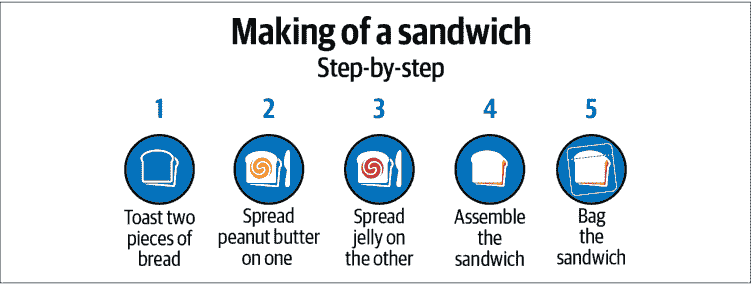
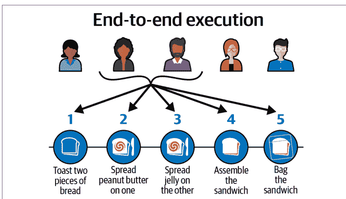
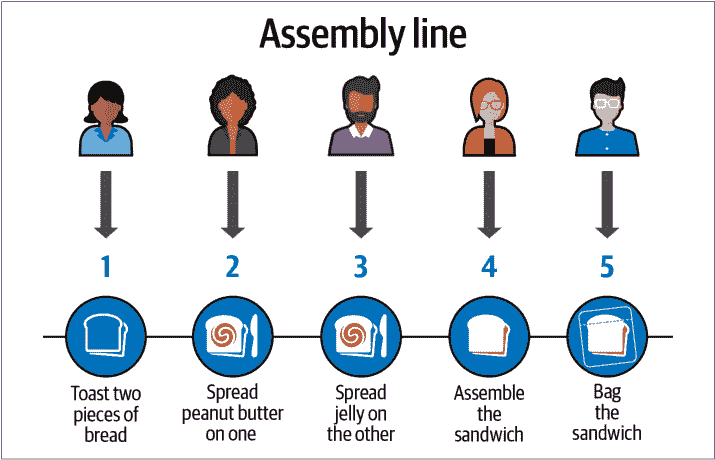
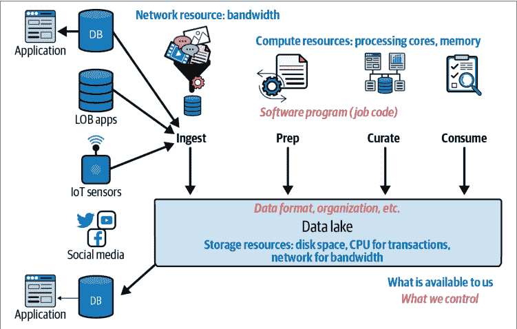
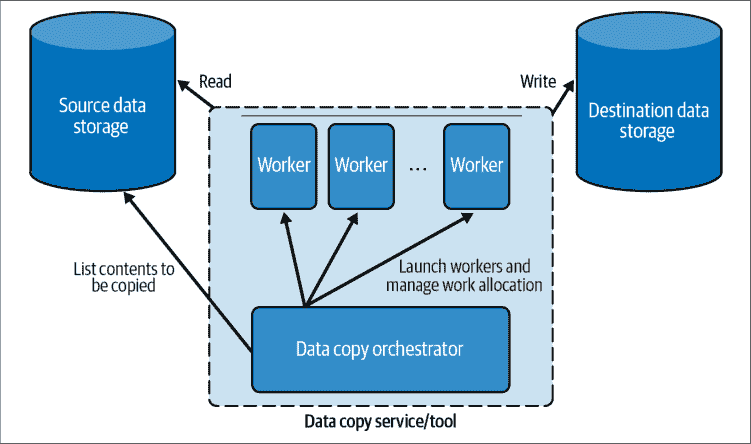
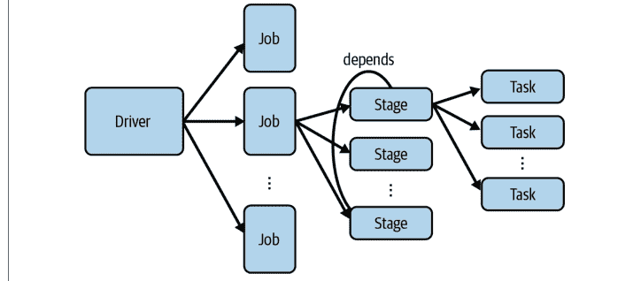
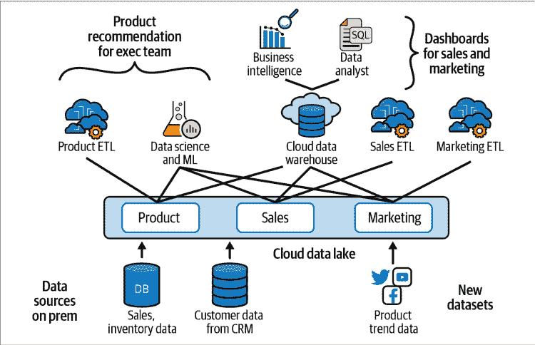

## 可扩展的数据湖

> 如果你改变看待事物的方式，你所看待的事物也会改变。  
> —韦恩·戴尔

在阅读完前三章后，你应该已经拥有在云上以合理的成本配置启动你的数据湖架构所需的一切。理论上，你也已经在生产环境中成功运行了第一批用例和场景。你的数据湖如此成功，以至于对更多场景的需求现在更高，你正忙于满足新客户的需求。你的业务蒸蒸日上，你的数据资产也在迅速增长。正如商业界所说，从零到一是一个不同的挑战，与从一到一百或从一百到一千相比亦然。为了确保你的设计在数据和用例增长时仍具可扩展性并持续保持性能，认识到影响数据湖规模和性能的各种因素非常重要。与普遍看法相反，可扩展性和性能并不总是与成本相悖，而是紧密相连的。在本章中，我们将更深入地审视这些考量，以及在继续优化成本的同时优化数据湖以实现规模的策略。再次，我们将使用虚构组织 Klodars Corporation 来说明我们的策略。我们将在这些基础之上，在第 5 章中重点关注性能。

## 可扩展性预览

规模和性能是你可能在产品推介和营销材料中大量看到的术语。它们到底是什么意思，为什么重要？为了更好地理解，让我们先看看可扩展性的定义。在第 5 章中，我们将深入探讨性能方面。

## 什么是可扩展性？

我见过的关于*可扩展性*的最佳定义来自 Werner Vogels 的 [blog](#)。Vogels 是亚马逊的 CTO，亚马逊托管着地球上最大的超大规模系统之一。根据他的博客，可扩展性的定义如下：

> 当我们增加系统中的资源时，如果导致性能按与所增加资源成比例的方式提升，则称该服务是可扩展的。如果为实现冗余而增加资源不会导致性能下降，则称该始终在线的服务是可扩展的。

这个规模概念非常重要，因为随着你的需求和用量增长，拥有一个能够在不降低性能的情况下保证客户体验一致的架构至关重要。为了更好地说明这一点，我们将规模原则应用于我们都能理解的事情：制作三明治。

## 日常生活中的规模

让我们举一个可扩展性在行动的例子。假设你打包一个花生酱果酱三明治午餐总共需要五分钟，其步骤如下图所示 4-1：

- 1. 烤两片面包。
- 2. 在一侧涂抹花生酱。
- 3. 在另一侧涂抹果酱。
- 4. 组装三明治。
- 5. 装袋三明治。

*图 4-1. 制作花生酱果酱三明治的步骤*

简单吧，没什么大不了的？现在，假设你想制作 100 个花生酱果酱三明治。显而易见的下一步是邀请更多人帮忙。现在，如果一个三明治需要五分钟制作，并且你有五名团队成员制作这 100 个三明治，那么自然会认为制作这 100 个三明治总共需要 100 分钟，假设劳动分配均等且每人制作 20 个三明治。

在这个特定例子中，*性能*以完成的工作单元（一个三明治）输出和该输出所需的时间（制作一个三明治的平均时间）来衡量。*可扩展性*是理解随着完成的工作单元增加，这一平均时间得以保留的程度。

然而，现实可能因你如何用五个人实施而大不相同。让我们看两种方法：

## 端到端执行方法

在此方法中，每个人按照步骤制作一个三明治，然后继续制作下一个三明治，直到完成五个三明治。这在图 4-2 中有所说明。

图 4-2. 端到端执行

## 流水线方法

在此方法中，你有劳动分工，将步骤分配给不同的人：第一个人烤面包，第二个人涂抹花生酱，第三个人涂抹果酱，以此类推，如图 4-3 所示。

*图 4-3. 流水线*

正如你现在可能猜到的，流水线方法比端到端执行方法更高效。但究竟是什么使其更高效？为了理解这一点，我们首先需要了解影响扩展的基本概念：

*资源*

制作三明治可用的材料——在这种情况下，面包、花生酱和果酱是更明显的资源。烤面包机和刀也是制作三明治所需的其他资源。

*任务*

为产生输出而遵循的一系列步骤——在这种情况下，制作三明治所需的五个步骤。

*工人*

执行实际工作的组件——在这种情况下，执行制作三明治任务的人。

*输出*

表明工作完成的结果——在这种情况下，三明治。

*工人*利用*资源*执行产生*输出*的*任务*。这些要素如何有效结合会影响流程的性能和可扩展性。

## 表 4-1. 方法比较

| 区域 | 端到端执行方法 | 流水线方法 |
|---|---|---|
| 资源竞争 | 所有工人最终都会竞争同一组资源（烤面包机、花生酱罐等）。 | 竞争最小，因为不同工人需要不同的资源。 |
| 工人与线程映射的灵活性 | 低——由于工人执行所有任务，分配对所有任务都是均匀的。 | 高——如果某些任务需要比其他任务更多的工人，可以快速调整。 |
| 增加/移除资源的影响 | 增加资源的影响可能取决于系统中的瓶颈而不会有太大差异。然而，增加正确的资源会加快执行。例如，如果你有五个烤面包机而不是一个烤面包机，工人可以更快地烤面包。 | 资源分配的灵活性使得在有更多资源可用时性能得以提升。 |

另外请注意，在端到端执行方法中，一些三明治完成所需的时间会比其他三明治少。例如，当五个人伸手去拿烤面包机时，其中一个人拿到它，那个特定的三明治会比等待烤面包机就绪的其他人更快完成。因此，如果你衡量性能，你会发现制作三明治在第 50 百分位的时间可能是可以接受的，但第 75 和第 99 百分位所需的时间可能会高得多。

可以公平地得出结论，流水线方法在制作三明治方面比端到端执行方法更具可扩展性。虽然这种可扩展性的好处在你的日常生活中并不明显，例如当你可能打包三或四个三明治时，但当工作量急剧增加时，例如制作 3,000 或 4,000 个三明治时，差异就非常明显了。

## 数据湖架构中的可扩展性

在数据湖架构中，正如我们在前几章中所见，资源由云提供给我们：计算、存储和网络资源。此外，还有两个关键因素是我们拥有并控制以最好地利用可用资源的：处理作业，即我们编写的代码，以及数据本身，即我们如何存储和组织它以便处理。这在图 4-4 中有所说明。

*Figure 4-4. Data lake resources*

The key resources available to us in a cloud data lake architecture are as follows:

## Compute resource

The compute resources available to you from the cloud are primarily CPU cores and memory for your data processing needs. Additionally, there is software running on these cores, primarily the software you install in the case of IaaS and the software available to you in terms of PaaS and SaaS that is designed to manipulate and optimize the utilization of the CPU and memory resources. A key understanding of how this works is critical to building your scalable solution. Cloud service providers offer capabilities like autoscaling, where as the compute needs of your solution increases, your cloud services can automatically add more compute without you having to manage the resources. Additionally, there are serverless components like Google’s BigQuery that completely abstract the resourcing aspects of compute and storage from the user, allowing the user to focus solely on their core business scenarios. Serverless components tend to cost more compared to tunable IaaS but offer built-in optimizations and tuning that let you focus on your core scenarios.

## Networking resources

Think of your networking resource as a metaphorical cable that can send data back and forth. This is implemented on networking hardware or, in other cases, is software-defined networking.

## Storage resources

Cloud data lake storage systems provide an elastic distributed storage system that gives you space to store data (in disks, flash storage, and tape drives depending on the tier of data you operate on), along with computational power to perform storage transactions and networking power to transfer data over the wire to other resources inside and outside your cloud provider.

These are the key pieces that you control:

- The code you write
- The way your data is stored and organized, which largely influences how effectively the resources are utilized
- How scalable and performant your solution is

In the next section, we’ll take a deeper look at how big data processing works on a data lake architecture and the factors that affect the scalability and performance of your data lake solution.

Understanding and learning the factors that help scale the system is important for two key reasons:

- The traffic patterns on the data lake tend to be highly variable and bursty in most cases, so scaling up and down are key capabilities that need to be factored into your data lake architecture.
- Understanding the bottlenecks gives you insights into what resources need to be scaled up or down; otherwise, you run the risk of adding the wrong resources without moving the needle on the scalability of the solution.

## Why Do I Need to Worry About Scalability? My Solution Runs Just Fine Today.

Speaking of 10× growth, I often see customers underestimate the value and opportunities that a data lake architecture helps unlock, and optimize their time and efforts for the short-term maxima. If you are thinking along the lines of these statements—“I just need to move my data warehouse now; I don’t see any other data being important as yet,” or “My first priority is to get whatever we are doing on the cloud; let me worry about the rest later,” or “I have a one-year timeline to move my data to the cloud; I can’t afford to think about anything else other than my current workloads”—let me assure you of a few things:

- As with any software development efforts, thinking of future scenarios helps you avoid the technical debt of having to rearchitect your solutions completely when new scenarios are enabled.
- Future-proofing your design is not as hard as you think. It’s more about diligence than effort, which will set you up for success.
- According to a study published by the World Economic Forum, digital transformation is expected to add $100 trillion to the world economy by 2025, and platform-driven interactions will drive at least two-thirds of this $100 trillion growth. It is only a matter of time before these scenarios are unlocked.

## Internals of Data Lake Processing Systems

As seen in Figure 4-4, the key operations involved in big data processing are the following:

*Ingest*

Getting raw data from various sources into a data lake storage

*Prep*

Preparing the raw data to generate enriched data, by applying a schema on demand, removing or fixing erroneous data, and optimizing data formats

*Curate*

Generating curated data with high-value density by aggregating, filtering, and other processing of enriched data

## Consume

Consuming your data through dashboards, queries, or data-science-related explorations, to name a few, and using these insights to modify your application behavior, which falls under consumption as well

In this chapter, we’ll focus on the most common use case of the big data lake, which is batch processing. In batch processing, data is ingested into the data lake in a scheduled, periodic fashion via data copies. This raw data is prepared and enriched and then further curated with ELT/ETL processing engines. Apache Spark and Apache Hadoop are the most common processing engines leveraged for the prep and curate phases. These Spark jobs run in a scheduled fashion after the ingestion or data copy is completed.

There are other use cases, such as real-time processing engines, where data is continuously ingested into the data lake and further prepared and curated. While the principles of scale that we will discuss in batch processing largely apply to real-time processing pipelines as well, there are additional constraints on the design given the continuous nature of the processing. We will not get into depth on the non-batch-processing systems in this book since the most common use cases are pertinent to batch processing. In this chapter, we also won’t dive deep into the consumption use cases for BI queries and data science. There are plenty of resources available on querying patterns and data science.

We’ll look at the two specific aspects of big data processing that are unique to the cloud data lake architecture:

## Data copy

This involves moving data as is from one system to another system, by, for example, ingesting data into the data lake from external sources and copying data from one storage system to another within the cloud service, such as loading data from a data lake into a data warehouse. This is the most common form of ingestion used in big data processing systems.

## ETL/ELT processing

This involves an input and output dataset, where input data is read and transformed via filtering, aggregation, and other operations to generate the output datasets. Generating data in the enriched and curated datasets falls into this category. Hadoop and Spark are the most popular processing engines, with Spark leading the area here in supporting batch, real-time, and streaming operations with the same architecture. These are the most common kinds of data prep and data curation stages of big data processing.

## Data Copy Internals

There are many ways to perform data copy operations. Cloud providers and ISVs offer PaaS that copy data from one system to another in an optimized fashion. You can also leverage tools and software development kits (SDKs) to copy data, such as using the cloud provider’s portal to upload or download data. In this section, we’ll examine the internals of a copy job where data is read from a source and copied as such into the destination. Please note that in real life, you can also extend this simple data copy scenario to more advanced topics, such as copying a constantly changing dataset as well as cleansing datasets periodically to comply with regulatory requirements like GDPR. For the purposes of understanding scalability, we will focus on the simple copy process.

## Components of a data copy solution

The very simplified components involved in data copy are presented in Figure 4-5.

*Figure 4-5. Data copy internals*

The data copy tool has two main components in a simplified form:

## Data copy orchestrator

Understands the work to be done (e.g., how many files need to be copied from the source) and leverages the compute resources available to distribute the copy job across different workers. The orchestrator also preserves the state of the copy job itself, as in, it knows what data has been copied and what hasn’t yet been copied.

## 数据复制 worker

接受编排器的工作单元并执行从源到目标的复制操作的计算单元。

有一个配置可以指定您可以为复制作业提供的 data copy workers 数量。这是一个您可以调节的旋钮，用于配置所需的 worker 数量，要么直接通过设置最大 worker 数，要么通过指定数据复制编排器已定义为可配置值的代理值。

## 了解数据复制作业的资源利用率

影响您的数据复制可扩展性和性能的瓶颈如下：

## 需要复制的文件/对象的数量和大小

数据复制作业的粒度在您的存储系统中的文件/对象级别。大型文件可以被拆分为并行复制，但您无法将多个文件合并为单个复制作业。如果您有大量小文件需要复制，您可以预期这需要很长时间，因为操作员的列出操作可能需要更长时间，而且小文件会导致在单个复制工作单元中传输的数据量较低，无法最大程度地利用您可用的带宽资源。

## 数据复制工具的计算容量

如果您配置数据复制工具拥有足够的计算资源，那么您可以启动更多 worker，有效地进行许多同时的复制操作。相反，计算资源不足会使可用 worker 的数量成为系统的瓶颈。

## 复制可用的网络容量

您拥有的网络容量控制着用于数据传输的管道，尤其是在跨云边界复制数据时。确保您已配置高带宽网络。请注意，当您在同一提供商的云服务之间复制或交易数据时，您不需要配置或利用您的网络；云服务有自己的网络来完成此操作。

## 跨区域数据复制

当您跨区域进行数据复制时，它们必须在网络上经过更长的距离，这会使数据复制变得更慢，并且在某些情况下甚至会超时，导致作业失败。

## ELT/ETL 处理内部

如果您需要复习大数据分析引擎的工作原理，我建议您重新阅读第 28 页的“大数据分析引擎”，特别是第 31 页“Apache Spark”中关于 Spark 的部分。

ELT/ETL 流程主要在非结构化、结构化或半结构化数据上工作，按需应用模式，并通过过滤、聚合和其他处理转换这些数据，以生成表格格式的结构化数据。Apache Hadoop 和 Apache Spark 是属于此类最常见的处理引擎。我们将在本节中更深入地研究 Apache Spark 的内部结构，但这些概念在很大程度上也适用于 Apache Hadoop，只是存在细微差别。Apache Hadoop 虽然可以在云上运行，但设计用于在 HDFS 上本地运行。Apache Spark 更接近云架构。Apache Spark 也是由于其在批处理、流处理和交互式数据管道中的一致性而成为事实上的默认处理引擎，因此我们将在本节中重点介绍 Spark。

您可以在以下方式创建的集群中运行 Apache Spark 作业：

-  provision IaaS 计算资源并安装 Apache Spark 发行版，要么来自开源 Apache Spark，要么来自 Cloudera 等 ISV。
-  provision PaaS，您可以从 Databricks 等供应商或 Amazon EMR 或 Azure Synapse Analytics 等云服务提供商处获得一个已安装 Spark 并准备好使用的集群。

Apache Spark 利用分布式计算架构，其中有一个中央控制器/协调器，也称为 driver，用于编排执行，以及多个 executor 或 worker 单元，执行有助于应用程序的特定任务。借用家庭建筑的类比，您可以将 Apache Spark driver 视为总承包商，而 executor 则视为水管工和电工等熟练工人。我们现在将介绍一些 Apache Spark 的基本关键概念。

## Apache Spark 应用程序的组件

数据开发人员编写 Spark 代码并将其提交到 Spark 集群，然后在执行完成后获取结果。在幕后，用户代码作为 Spark 应用程序执行，并分为以下组件：

## Driver

Driver 是 Spark 进程的中央协调器，也是唯一理解用户代码的组件。Driver 有两个主要组件：定义执行程序所需的作业、任务和 executor 的分解，并协调将这些分配到 Spark 集群的各个可用部分。集群管理器帮助 driver 找到资源。

## Executors

Executors 是实际执行计算的组件。Driver 将代码以及 executor 需要处理的的数据集传达给它。

## Jobs、stages 和 tasks

Apache Spark 应用程序在 Spark 集群内部被翻译为执行计划。该执行计划表示为有向无环图 DAG，其中一组节点表示作业，作业又由可能相互依赖的阶段组成。这些阶段然后被分解为任务，即实际的执行单元，在其中完成工作。这在图 4-6 中显示。分配给任务的 executor 数量取决于需要处理的 数据量。

图 4-6. Spark 作业内部

## 了解 Spark 作业的资源利用率

正如您所见，有两个因素有助于 Spark 代码的资源利用率：

## 代码

需要执行的操作的复杂性

## 数据

需要处理的数据的量和组织

- 当您有需要 *低延迟、安全、直接连接到云* 的场景时，您需要配置专用功能，如 Azure 的 ExpressRoute 或 AWS Direct Connect。您必须配置多个解决方案来移动来自本地系统的数据，从而增加您的成本以及数据传输。

如果您需要混合或多云解决方案，请注意数据传输，并理想情况下确保跨这些多个环境的数据传输最少且经过仔细考虑。

## IaaS 与 PaaS 与 SaaS 解决方案

您的大数据解决方案可以由 IaaS、PaaS 和 SaaS 解决方案的混合组成。以下是运行数据科学家 Spark notebook 的一种场景下各选择之间的差异：

*IaaS 解决方案*

在此解决方案中，您将首先从云提供商处 provision 虚拟机 VM 资源，然后安装软件的发行版——要么来自开源 Apache 基金会，要么来自 Cloudera 等 ISV——并为数据科学家启用 notebook 访问。您对解决方案有端到端控制；然而，您也需要相关技能集来优化性能和规模。企业通常在拥有可以为其需求调整开源软件的工程师时遵循这种方法，并且当它们拥有 Apache Hadoop 或 Apache Spark 等开源工具的自定义版本时。

*PaaS 解决方案*

在此解决方案中，您将从提供您所需软件环境（以及管理更新）的云提供商处 provision 集群。您能够指定所需的资源，例如 CPU、内存和存储，而无需了解大数据处理引擎如何工作的深层机制。大多数组织遵循这种方法。

*SaaS 解决方案*

在此解决方案中，您将订阅 SaaS，例如数据仓库和 notebook 服务，将它们连接起来并立即开始使用。虽然这作为入门解决方案效果很好，但可扩展性和性能的上限是 SaaS 解决方案本身的可扩展性。SaaS 解决方案变得越来越好，因此您需要了解您需要扩展多少并与 SaaS 提供商核实，并通过 PoC 确认。

使用 **表 4-2** 中的摘要来帮助做出最佳选择。

**表4-2：IaaS、PaaS和SaaS解决方案比较**

| 服务类型 | 入门难度 | 解决方案定制灵活性 | 资源控制权 |
|---|---|---|---|
| IaaS | 高投入：需要管理软件、更新等 | 高灵活性：您拥有整个软件栈 | 高控制：您能控制服务的基础设施级细节 |
| PaaS | 高投入：低于IaaS | 中等灵活性：取决于PaaS服务提供商公开的控制程度 | 中等控制：高于IaaS解决方案；低于SaaS解决方案 |
| SaaS | 低投入：几乎可以立即着手解决业务问题 | 低灵活性：易用性源于有限的灵活性；可借助扩展模型在SaaS之上进行构建 | 低控制：SaaS解决方案通常为多租户（不同客户共享资源），且不向客户公开资源级细节 |

## Klodars 公司的云服务选择

Klodars 公司计划将其解决方案实现为混合解决方案，其中遗留组件在本地运行，数据分析组件在云端运行。它为大数据集群和数据湖存储选择了 PaaS，运行 Apache Spark，并利用 SaaS 解决方案来处理其数据仓库和仪表盘组件。Klodars 了解本地解决方案与云提供商之间的网络资源对解决方案性能的影响，并与云提供商规划了适当的容量。它还针对其数据密集型和计算密集型场景之一——产品推荐和销售预测——的数据处理工作负载运行了 PoC（概念验证），并确保选择了一个资源配置得当的大数据集群。

Klodars 还对其集群进行了划分——一个用于销售场景，一个用于营销场景，一个用于产品场景——以确保某个集群出现峰值工作负载时不会影响其他集群的性能。为了促进数据和洞察的共享，数据科学家可以访问来自产品、销售和营销的所有数据，以进行探索性分析。不过，Klodars 还为数据科学家配置了独立的集群，并设置了资源上限，作为防止虚假作业占用资源的护栏。您可以在图4-7中查看此实现的概览。

*图4-7：Klodars 公司的数据湖实现*

## 规划峰值容量

无论您选择哪种类型的解决方案，规划容量并了解在需求增加时如何获取更多容量，都是云数据湖解决方案的关键。*容量规划*是指能够随时间预测您的需求，确保您具备满足该需求的正确资源，并在无法满足时做出正确的业务决策。

第一步是预测需求。可以通过以下方式实现：

- 了解您的*业务需求*以及需要向客户提供的*SLA*。例如，如果您的最后一批数据在晚上10点到达，而您对客户的承诺是他们将在早上8点前看到刷新后的仪表盘，那么您有10小时的处理窗口，如果您想留出缓冲，则可能有8小时。
- 了解您在云上的*资源利用率*。大多数云提供商都提供监控和可观测性解决方案，您可以利用这些方案来了解自己正在使用多少资源。例如，如果您有一个包含4个虚拟CPU（vCPU）和1 GB内存的集群，并且观察到您的工作负载总体使用了80%的CPU和20%的内存，那么您就知道可以改用CPU更高、内存更低的SKU或集群类型，或者您
- **为_峰值需求和峰值利用率_做好规划。** 迁移到云端的最大优势在于云提供的弹性。同时，最好能为峰值需求期间的资源扩展方式制定明确计划。例如，您当前的工作负载由一个具有4个vCPU和1 GB内存的集群支持。当您预计负载会突然增加时，无论是因为您从事金融服务而处于预算结算季，还是您属于零售行业正在为假日需求做准备，您的计划是什么？您会增加现有集群的资源，还是您的工作任务已经充分拆分，可以按需添加额外集群？如果您在此期间还需要从本地系统引入更多数据，您是否也为网络容量规划了适当的突发？

您可以使用两种扩展策略之一：水平扩展或垂直扩展。*水平扩展*，也称为*横向扩展*，涉及确定一个扩展单位（例如 VM 或集群），然后增加更多这样的扩展单位。您的应用程序也需要感知到这个扩展单位。*垂直扩展*，也称为*纵向扩展*，涉及保持扩展单位不变，并按需增加更多资源（例如 CPU 或内存）。只要您了解对业务需求、SLA 和技术实现的影响，任何一种策略都运作良好。

在表4-3中，您将看到有关容量规划的监控和评估需要考虑的一系列因素。还要了解可用的预留模型，这些模型使关键生产工作负载能够在不干扰其他工作负载的情况下运行。

**表4-3：容量规划需要考虑的因素**

| 组件 | 需要考虑的因素 |
|---|---|
| IaaS 计算 | vCPU（核心）、内存、SKU（VM 类型）、可用缓存、磁盘大小（GB/TB）和事务数（TPS） |
| PaaS 计算 | 集群大小、可用时的 vCPU（核心）以及 PaaS 提供商发布的计费单位 |
| 存储 | 数据大小（TB/PB）、事务数（TPS）以及存储层（按性能从高到低依次为闪存、磁盘、磁带驱动器），取决于性能 |
| 数据仓库 | SKU——注意计算、存储和事务 |
| 网络 | 入站和出站、层级（标准/高级）以及私有网络网关 |

为了对容量需求做出最佳估计，我建议您运行一个能代表您当前工作负载的按比例缩放的 PoC。对于 PoC，您需要考虑最能代表生产工作负载的数据集分布。如果您正在运行本地实现，一种很好的方法是在云上运行现有工作负载。如果您利用集群上的自动扩展功能或云提供商的无服务器产品，其中许多方面都会自动为您处理。

## 数据格式和作业特征

您选择的数据格式在数据湖的性能和可扩展性方面起着关键作用。这一点常常被忽略，因为在结构化数据存储系统（数据库或数据仓库）中，这种假设被视为理所当然。数据以最适合数据库/数据仓库服务事务模式的格式存储。然而，鉴于数据湖存储之上运行着众多数据处理应用程序，并且同一份数据可能被多个引擎使用，选择适合场景的正确格式的责任就落在了大数据架构师和开发者身上。而最棒的一点是，一旦您找到了最优格式，您会发现您的解决方案不仅具有高性能和高扩展性，还能降低整体解决方案的成本。随着数据湖仓（lakehouse）的兴起，以及 Apache Spark 等用于批处理、流处理和交互式计算的技术无处不在，Apache Parquet 以及基于 Parquet 的格式（如 Delta Lake 和 Apache Iceberg）正被广泛采用，成为数据湖解决方案的最优格式。我们将在第6章深入探讨这一点。

影响您可扩展性需求的另一个方面是大数据处理作业的构建。通常，作业可以分解为不同的摄取和处理阶段。然而，并非所有阶段都是相同的。例如，假设您的作业包含以下步骤：

1. 读取包含1.5亿条记录的数据集。
2. 筛选出感兴趣的记录，共5000万条。
3. 对5000万条记录进行转换，生成输出数据集。

在此场景中，如果您的输入数据集由多个小文件组成，那么这将成为您整个作业的瓶颈。通过在作业中引入一个新阶段，将多个小文件合并为少量较大的文件，您可以使解决方案更具可扩展性。

## 小结

在本节中，我们深入探讨了云数据湖架构的可扩展性特征，以及可扩展性与性能之间的紧密联系。我们将计算与存储分离模型的大数据架构与同地部署、紧密耦合的架构进行了比较，并考察了这种分离对扩展规模的影响。我们还研究了影响规模的云数据湖架构的各种考虑因素：选择正确的云服务、规划容量，以及调整数据格式和数据组织以匹配查询模式。这些

这些是你在有效调优数据湖实现以扩展10倍规模时需要理解的一些考虑因素。在第5章中，我们将基于这些关于规模的基本概念来优化性能。
