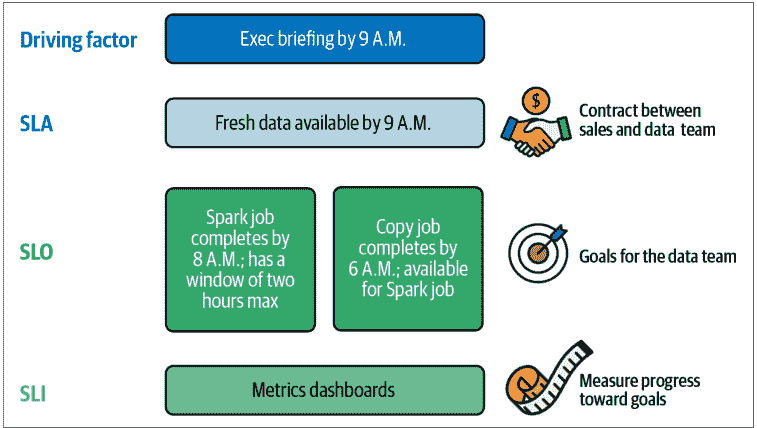
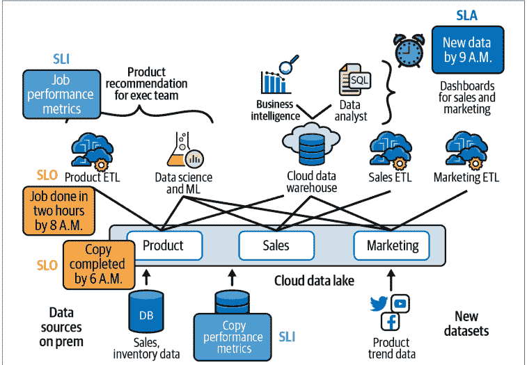
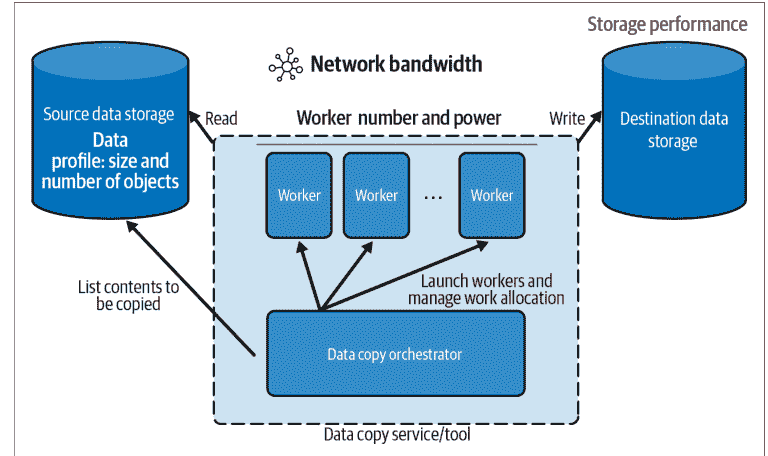
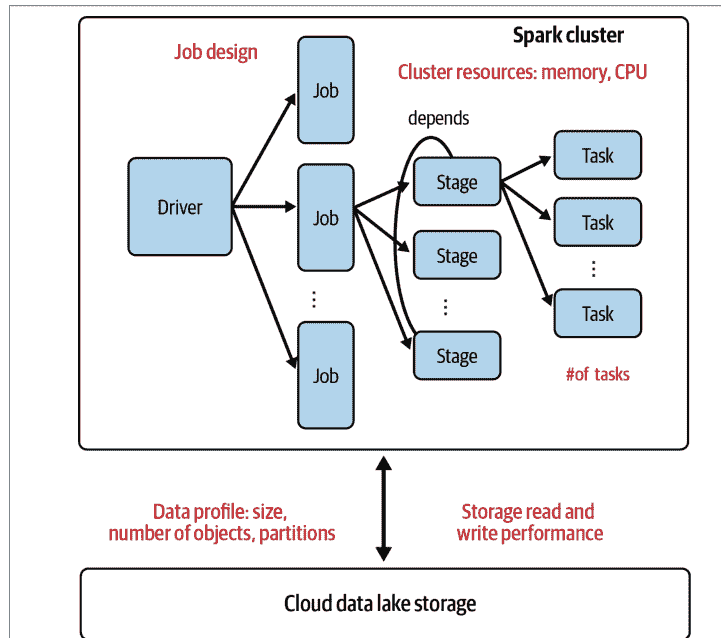
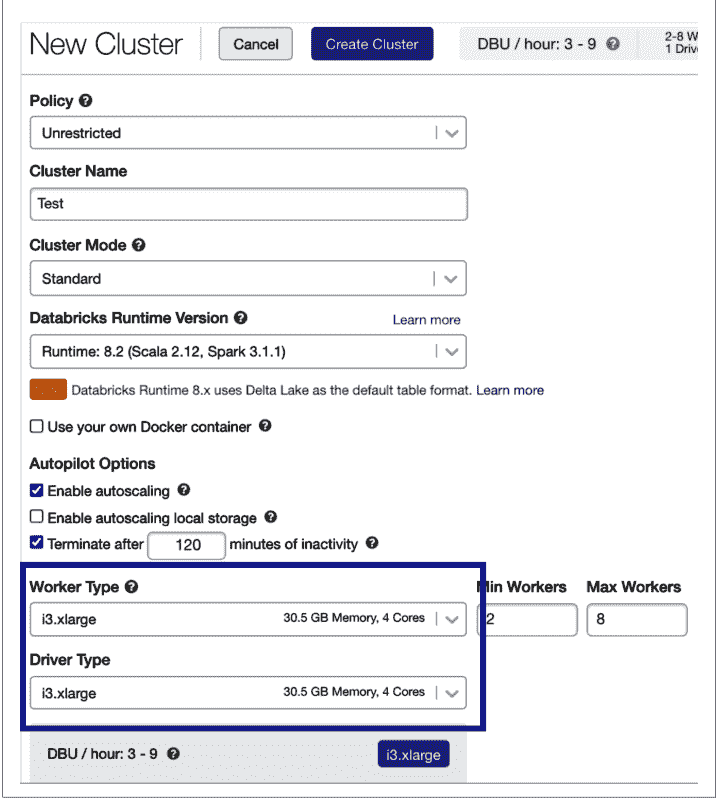
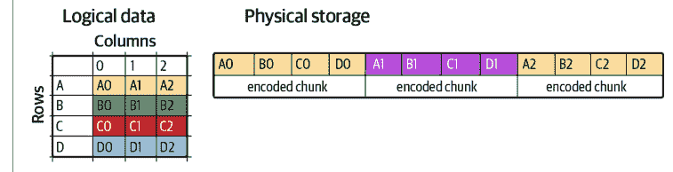
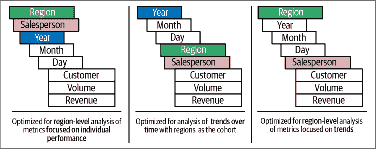
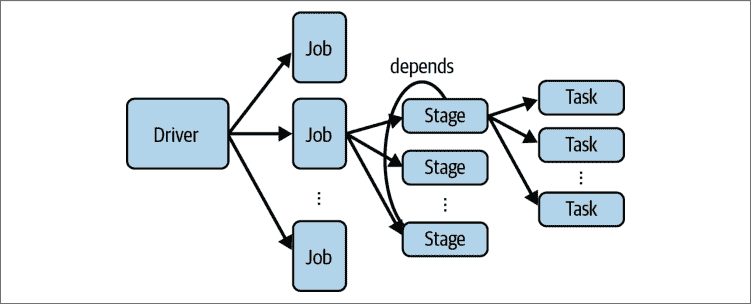
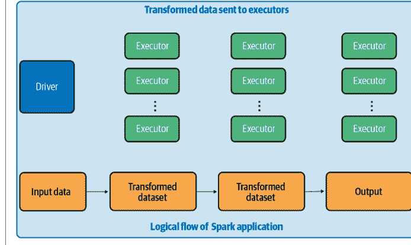

## 优化云数据湖架构以获得最佳性能

> *简单是终极的复杂。*
> 
> —列奥纳多·达·芬奇

*性能*在最简单的意义上可以定义为完成工作的及时性。话虽如此，对于云服务来说，这可能是含义最丰富的术语之一，因为性能没有单一的衡量标准。在本章中，我们将层层剖析性能，深入理解性能的含义、在云数据湖背景下衡量性能所涉及的各种维度，以及帮助你优化和调优云数据湖以获得最佳性能的策略。我们还将使用 Klodars 公司来说明这些概念和策略。

### 衡量性能的基础

当涉及时间和吞吐量。为了衡量性能，我们需要设定一个目标。在三明治制作的例子中，目标是制作五个三明治。接下来，我们需要确定一组相对容易衡量的度量。为了简单起见，我们假设所有工人在制作三明治时的速度相同，并且任务之间没有转换时间。我们将考虑可变度量和常量度量：

可变度量

以下度量是可变的——即你可以通过添加或移除来调整或改变的因素：

- 工人数量 = 五
- 烤面包机数量 = 一台，可容纳四片面包
- 花生酱罐数量 = 一
- 果冻酱罐数量 = 一
- 面包袋数量 = 一
- 袋子数量 = 五（对应所需三明治数量）

常量度量

这些度量在可变度量发生变化时保持相对恒定。在此例中，可变度量是完成每一步所需的时间：

- 步骤1，烤面包：30秒
- 步骤2，为一个三明治涂抹花生酱：5秒
- 步骤3，为一个三明治涂抹果冻：5秒
- 步骤4，将它们合在一起：1秒
- 步骤5，装袋：4秒

鉴于资源有限，在某些情况下，一个人需要等待资源释放后才能执行自己的任务，因此你会发现五个三明治将在不同的时间完成。

现在，你是否在想这本烹饪书里是否不小心混入了食谱书的一页？如果是，请放心。在云数据湖架构中，存储、网络和计算等组件类似于烤面包机或花生酱罐，它们执行某个操作需要一定的时间，这会影响你的大数据处理场景。通过优化执行操作所花费的时间以及控制这些组件的数量，你可以整体优化云数据湖的性能。我以制作三明治来解释这些概念，目的是让它们易于可视化，然后将其应用到云数据湖架构中。

### 衡量性能

现在让我们应用我们定义的变量，来了解完成制作三明治需要多长时间。

在端到端执行方式中，一个人按顺序完成制作三明治所需的所有任务。让我们分解一下三明治制作的过程。当隐喻性的秒表从零开始，人员1和人员2可以使用烤面包机，但其他人必须等待烤面包机。同样，烘烤完成后，人员1将继续在罐子里涂抹花生酱，但人员2必须等他们完成，依此类推。

假设每个人从时间00:00开始（分和秒，小时随意）。表5-1显示了完成三明治所需的时间。

*表5-1. 端到端执行方式下制作三明治所需的时间*

| 三明治 | 步骤1 | 步骤2 | 步骤3 | 步骤4 | 步骤5 | 自00:00起总耗时 |
|---|---|---|---|---|---|---|
| 1 | 00:00–00:30 | 00:30–00:35 | 00:35–00:40 | 00:40–00:41 | 00:41–00:45 | 45秒 |
| 2 | 00:00–00:30 | 00:35–00:40 | 00:40–00:45 | 00:45–00:46 | 00:46–00:50 | 50秒 |
| 3 | 00:30–01:00 | 01:00–01:05 | 01:05–01:10 | 01:10–01:11 | 01:11–01:15 | 75秒 |
| 4 | 00:30–01:00 | 01:05–01:10 | 01:10–01:15 | 01:15–01:16 | 01:16–01:20 | 80秒 |
| 5 | 01:00–01:30 | 01:30–01:35 | 01:35–01:40 | 01:40–01:41 | 01:41–01:45 | 105秒 |

在流水线方式中，我们已经看到采用不同的模型，所需时间也会不同，每个人只执行一项任务，然后将三明治交给下一个人，形成一条流水线。在这种情况下，当第一个人烤好两个三明治的面包后，他们继续烤下一组面包片，而前两个三明治的面包则传递给第二和第三个人，他们分别同时涂抹花生酱和果冻。表5-2展示了这种模型如何影响性能。

*表5-2. 流水线方式下制作三明治所需的时间*

| 三明治 | 步骤1 | 步骤2 | 步骤3 | 步骤4 | 步骤5 | 自00:00起总耗时 |
|---|---|---|---|---|---|---|
| 1 | 00:00–00:30 | 00:30–00:35 | 00:35–00:40 | 00:40–00:41 | 00:41–00:45 | 45秒 |
| 2 | 00:00–00:30 | 00:35–00:40 | 00:40–00:45 | 00:41–00:42 | 00:42–00:46 | 46秒 |
| 3 | 00:30–01:00 | 01:00–01:05 | 01:05–01:10 | 01:10–01:11 | 01:11–01:15 | 75秒 |
| 4 | 00:30–01:00 | 01:05–01:10 | 01:10–01:15 | 01:11–01:12 | 01:12–01:16 | 76秒 |
| 5 | 01:00–01:30 | 01:30–01:35 | 01:35–01:40 | 01:40–01:41 | 01:41–01:45 | 105秒 |

同时涉及了步骤4（将面包片合在一起）和步骤5（将三明治装袋）。端到端执行方式则没有提供这种灵活性。

通过这些更改，让我们看看两种架构的性能如何变化，如表5-3和表5-4所示。

### 表5-3. 添加资源并调整工人后，端到端执行方式下制作三明治所需的时间

| 三明治 | 步骤1 | 步骤2 | 步骤3 | 步骤4 | 步骤5 | 自00:00起总耗时 |
|---|---|---|---|---|---|---|
| 1 | 00:00–00:30 | 00:30–00:35 | 00:35–00:40 | 00:40–00:41 | 00:41–00:45 | 45秒 |
| 2 | 00:00–00:30 | 00:30–00:35 | 00:35–00:40 | 00:40–00:41 | 00:41–00:45 | 45秒 |
| 3 | 00:00–00:30 | 00:35–00:40 | 00:40–00:45 | 00:45–00:46 | 00:46–00:50 | 50秒 |
| 4 | 00:00–00:30 | 00:35–00:40 | 00:40–00:45 | 00:45–00:46 | 00:46–00:50 | 50秒 |
| 5 | 00:30–01:00 | 01:00–01:05 | 01:05–01:10 | 01:10–01:11 | 01:11–01:15 | 75秒 |

在流水线方式中，我们已经看到存在不同的模型，所需时间也会不同。

### 表5-4. 添加资源并调整工人后，流水线方式下制作三明治所需的时间

| 三明治 | 步骤1 | 步骤2 | 步骤3 | 步骤4和5 | 自00:00起总耗时 |
|---|---|---|---|---|---|
| 1 | 00:00–00:30 | 00:30–00:35 | 00:35–00:40 | 00:40–00:45 | 45秒 |
| 2 | 00:00–00:30 | 00:30–00:35 | 00:35–00:40 | 00:40–00:45 | 45秒 |
| 3 | 00:00–00:30 | 00:35–00:40 | 00:40–00:45 | 00:45–00:50 | 50秒 |
| 4 | 00:00–00:30 | 00:35–00:40 | 00:40–00:45 | 00:45–00:50 | 50秒 |
| 5 | 00:30–01:00 | 01:00–01:05 | 01:05–01:10 | 01:10–01:15 | 75秒 |

通过调优，我们能够将两种架构下制作三明治的总时间缩短至75秒，第60和第80百分位数降至50秒。尽管两种架构展现出相似的结果，但很明显，流水线方式在调优方面比端到端执行方式灵活得多，后者提高性能的唯一方法就是添加资源。添加工人不会产生效果，而调整工人的位置也不可能。

通常，性能就是这样衡量的，只不过不是五个三明治，而是考虑云数据湖上的数百万或数十亿次操作。第50百分位数是平均行为的一个代理指标，第75百分位数是理想的感知行为的一个良好代理指标，第90百分位数则是衡量重负载下行为的一个好指标。既然我们理解了这些概念，接下来看看它们如何应用于云数据湖。


## 云数据湖性能

在数据湖的世界里，性能的衡量标准是完成一个作业所需的时间，无论是批处理管道、交互式查询还是数据复制作业，以及随着作业吞吐量——即需要处理或查询的数据——的变化，这个时间如何增加。正如我们在做三明治的例子中所看到的，性能非常依赖于我们正在进行的作业类型以及需要满足的业务需求。在做三明治的例子中，如果一个餐饮服务商需要在早上8点前送达订单，这就是为他们设定的目标。他们通常也不会有无限的时间，因为三明治需要保持新鲜。因此，在这种情况下，他们会根据自己拥有的时间窗口来调整可用人员（三明治制作员）和资源（花生酱和果酱罐、烤面包机）。虽然为这些资源和人员付费会让餐饮服务商花费更多，但不投资或不以正确的方式利用它们，会危及订单交付，从而危及客户满意度和收入。另一方面，如果是制作衣服的零售商，除了人员和资源之外，他们还可以利用时间因素来提前制作库存服装。

同样，构建高性能数据湖的第一步是了解需要完成的作业以及作业需要满足的要求。

### SLAs、SLOs 和 SLIs

为了定义性能要求，你需要了解三个术语：

- **服务等级协议**：SLA 指的是我们向客户做出的保证承诺。这种 SLA 可以用时间、数据新鲜度或其他因素来衡量，或是多种指标的组合。该指标以面向客户的语言来衡量。例如，销售预测数据截至前一天晚上9点的数据将在任何一天早上10点前在数据仓库中为业务分析师提供，99%的时间内。SLA 在服务提供者和客户之间充当合同，未能满足 SLA 会带来后果，例如升级或甚至金钱损失。
- **服务等级目标**：SLO 是为解决方案的每个模块定义的，它们是需要满足的目标，以便能够履行 SLA。该指标在系统层面衡量，并源自客户层面的指标。例如，如果销售预测数据需要在早上10点在仓库中准备好，那么处理该数据的 Spark 作业至少需要在早上8点前准备好，以计入缓冲时间。如果 Spark 作业的输入数据仅在早上5点可用，那么该 Spark 作业的 SLO 就是它需要在三小时内完成。如果未满足 SLO，则 SLA 可能受到威胁，团队必须采取行动。
- **服务等级指标**：SLI 也是为解决方案的每个模块定义的，并深入到模块的各个组件的更深层次。它们是衡量系统实际运行情况的指标。例如，该 Spark 作业的 SLI 将是执行器和驱动程序在第50、第75和第90百分位上的性能指标，以及作业的 CPU、内存、存储和网络使用情况的度量。SLI 作为 SLO 的指标，提醒团队调查风险。

### 示例：Klodars 公司如何管理其 SLA、SLO 和 SLI

为了说明这些概念，让我们去我们虚构的 Klodars 公司，看看他们的销售团队需求。Klodars 公司每天早上9点进行高管简报，在会上查看其产品的每日销售数据；这些数据帮助团队为当天的计划和分配制定策略，然后用于库存规划。该要求定义了 SLA 的需求。销售团队和数据团队同意一份合同，即销售仪表板将在早上9点前用新数据刷新。这成为数据团队向销售团队承诺的 SLA。

数据团队随后从该 SLA 反向工作，并为其复制作业和 Spark 作业定义要求。数据团队知道最新的数据在凌晨3点到达其销售数据库中，并且需要将该数据转储复制到数据湖存储中，以作为 Spark 作业的输入。Spark 作业将该销售数据库中的数据与其他数据一起 crunch，以生成为销售仪表板提供支持的数据集。这种理解帮助数据团队适当地为其复制作业和 Spark 作业设定目标。Spark 作业需要在早上8点前完成，以留出应对任何不可预见问题的1小时缓冲时间。因此，数据团队在凌晨3点至早上8点之间有一个窗口来满足其 SLA。团队运行了几次 PoC 并将目标定义为复制作业三小时或更少，Spark 作业两小时或更少。这些成为 SLO。

团队随后构建了关于复制作业进度跟踪以及 Spark 作业进度跟踪的指标仪表板，以及与这两个作业相关的更精细的详细信息。这些指标充当 SLI。这些概念在图5-3中进行了说明。



图5-3. Klodars 公司正在处理 SLA、SLO 和 SLI

这些指标如何与 Klodars 公司的架构保持一致的图形表示如图5-4所示。



图5-4. Klodars 公司的数据湖架构以及 SLA、SLO 和 SLI

这些成为决定何种架构和技术组件是满足 SLA 的最佳选择，同时优化成本和对数据团队的操作负担的决定性要求。

### 性能驱动因素

在第104页的“数据湖处理系统的内部”中，我们了解了大数据处理引擎内部的工作方式，特别是对于数据复制作业和 ELT/ETL 处理作业。在本节中，我们将在这些概念的基础上，理解每个场景中性能的驱动因素。

### 复制作业的性能驱动因素

复制作业主要从源存储系统读取内容并将其复制到目标存储系统。复制作业的性能驱动因素本质上是创建潜在瓶颈的工人和共享资源，这取决于要复制的内容的类型和数量。例如，如果有大量小对象，则可以增加工人的数量以更快地读取各个对象，从而总体优化作业性能。然而，如果网络带宽不足，那么这些工人将等待带宽可用，然后才能读取文件并复制，因此工人可能会保持空闲，就像我们在第119页的“性能测量的基础”中做三明治的例子中所看到的那样，工人们必须等待烤面包机可用。这些性能驱动因素如何与复制作业内部结构保持一致的表示如图5-5所示。这些是你可以通过修改来调整复制作业性能的变量。



图5-5. 复制作业的性能驱动因素

复制作业由公共云提供商提供的摄取服务执行，例如 Azure Data Factory、AWS Data Pipeline 或 AWS Glue。AWS Glue 和 Azure Data Factory 除了数据复制外还提供与 ELT 处理的集成。复制作业也由提供数据集成能力的各种 ISV 提供，例如 Fivetran、WANdisco 和 Stitch。你也可以通过配置 IaaS 虚拟机并运行自己的软件，例如 Apache Airflow，来编排数据复制作业，以编写自己的数据移动作业。为了优化复制作业以获得更好的性能，你可以调整的不同旋钮如下：

- **工人数量和工人的能力**：PaaS 解决方案提供可增加或减少的打包工作单元，以提高作业性能。作为示例，Azure Data Factory 将其提供为数据集成单元，或 DIU。如果你使用 IaaS 或虚拟机，你将能够调整控制可用 CPU 和内存量的虚拟机配置，以及利用你的数据复制作业配置围绕并行单元，这让你可以配置可以并行运行的工人数量。




图 5-6. Spark 作业的性能驱动因素

控制 Spark 作业性能的参数有四类：

## Spark 集群配置

这一类配置对应你运行 Spark 的 PaaS 或 IaaS 上分配的内存和 CPU 等资源数量。PaaS 会以你可以分配给驱动节点和工作节点的资源来展示这些配置。提醒一下，驱动节点是 Spark 作业的主要编排者，决定数据如何分发给工作节点；工作节点执行实际计算——也就是说，在分配给它们的数据集切片上真正执行 Spark 作业。例如，图 5-7 是 Databricks 文档页面中展示如何在 AWS 上配置 Databricks 集群的截图。你可以将某种 Elastic Compute Cloud (EC2) 虚拟机规格分配给驱动节点，并指定分配给工作节点的 EC2 虚拟机数量和规格。界面还会并排显示集群中的核心数（即 CPU 的代理指标）和可用内存量。Databricks 还提供自动缩放服务，可根据作业需求自动增加或减少计算资源。



图 5-7. AWS 上的 Databricks 集群配置

如果你在 IaaS 虚拟机上运行 Spark，则需要自行管理虚拟机的规格和数量。此时你会问的问题是如何确定所需的资源量。虽然你可以用现有的最佳实践文章作为起点，但在我看来，先做一个 PoC，运行一个缩小规模的作业，并研究资源消耗的特征，是了解作业需求的最准确方法。

## 性能调优的优化原则与技巧

有几个关键原则可以调优作业性能：

- *规划足够的资源*

确保作业有足够的计算、存储和网络资源。配置这些资源的正确数量和规格，并确保非关键作业不会与关键作业争用相同资源，就像我们在第 130 页的“Spark 作业的性能驱动因素”中看到的那样。如果你需要更详细的回顾，我们在第 111 页的“选择正确的云服务”和第 115 页的“为峰值容量做规划”中已经介绍过。

- *利用最佳实践实现最优数据访问*

全面考虑数据格式、数据分区组织方式和作业特征，你都需要确保只访问你想要的数据。如果最终读取更多数据然后再过滤，就没有优化资源使用。

- *花时间找到正确的配置*

所有大数据计算引擎都提供了开箱即用的配置，可以根据你的需求进行微调。正确的配置能确保在执行作业时利用恰当数量的资源。根据你选择的服务，请研究这些配置并更好地理解它们如何适用于你的作业。这些信息与所选技术和提供商密切相关。

让我们更详细地看看数据格式和正确的配置。

## 数据格式

如我们之前所见，数据湖架构支持在同一份数据之上运行许多计算引擎。然而，数据格式优化基于几个关键假设：

- 数据湖中经常进行事务处理的数据大多采用表格格式（按行和列组织）。
- 一次写入的数据会被多次读取。
- 读取模式在很大程度上依赖于条件性数据选择，即筛选出在某些列上相似值的数据，将其返回或聚合分组。

Apache Parquet 是一种已被业界广泛采用的数据格式。接下来我们将更深入地了解 Apache Parquet。

## 探索 Apache Parquet

Apache Parquet 是一种面向列的数据格式，用于存储表格数据：即按行和列组织的表形式数据。Apache Parquet 本质上将一张表拆分为更小的块，并以面向列的格式存储数据。为更好地说明这一点，如图 5-8 所示，有一个包含四行的表。表中单行被称为一条记录。在面向行的格式（如 CSV 文件）中，一条记录的数据存储在一起。然而，在像 Apache Parquet 这样的面向列格式中，某一列的数据会被编码并存储在一起。



图 5-8. Apache Parquet 中的列分块

这种方法有几个优点：

- 存储格式针对读取进行了优化，因为你不会浪费资源去查找和读取查询中不需要的列。
- 由于列中的数据相似，可以打包在一起，从而获得更好的压缩效果。更好的压缩可以降低存储和事务成本。

此外，Apache Parquet 还提供以下优势：

- Parquet 通过其格式选项提供了高度压缩。它还允许用户选择压缩选项（如 Gzip 或 Snappy），并允许用户选择数据编码。
- Parquet 的列式格式非常适合现代 CPU 架构，能更好地利用其原生指令集格式，并提供更好的性能。

当涉及以 Apache Parquet 格式存储数据时，请记住，我们谈论的是包含数亿行的表。将所有数据存储在单个文件中并不是最佳选择，因为这会在单文件操作中导致读写瓶颈。

## 表 5-5. 纽约市黄色出租车行程数据中的部分字段

| 字段 | 描述 |
|---|---|
| VendorID | 提供此数据的服务商 |
| tpep_pickup_datetime | 计价器开始计费的时间 |
| tpep_dropoff_datetime | 计价器停止计费的时间 |
| passenger_count | 乘客人数 |
| trip_distance | 行程距离 |
| payment_type | 付款类型（包括有争议/已作废的付款） |
| fare_amount | 计价器收取的车费 |
| tip_amount | 信用卡付款的小费 |
| total_amount | 总金额，包括车费、小费和税费 |

在 Parquet 中，这些数据将存储在行组中，行组包含黄色出租车行程记录。在行组内，有一个 VendorID 列块，一个上车时间列块，一个下车时间列块，等等。这些列块包含存储实际数据的数据页。Parquet 文件的页脚将包含每一列的数据范围，以便快速查找。

假设你要查询 2022 年 1 月 5 日所有行程的车费和小费。该查询将类似于示例 5-1。请在逻辑上执行以下操作：

- 1. 过滤出 2022 年 1 月 5 日发生的交易。
- 2. 选择车费金额和小费金额并求和。

## 示例 5-1. 查询 2022 年 1 月 5 日所有行程车费和小费的伪代码

```
select (sum of fare_amount) and (sum of tip_amount)
from yellow_taxi_trip_table
where
tpep_pickup_datetime is between 12 AM and 11:59 PM on January 5, 2022 and
tpep_dropoff_datetime is between 12 AM and 11:59 PM on January 5, 2022
```

如果此查询是在 CSV 文件中执行，则需要将所有记录从存储加载到计算环境，过滤和聚合将在计算环境中完成。但是，对 Apache Parquet 文件的查询过程如下：

- 1. 读取 Parquet 文件的页脚，找到该文件中的行组和列块的位置，并检查 tpep_pickup_datetime 和 tpep_dropoff_datetime 的列范围。跳过上车和下车列日期范围在 2022 年 1 月 5 日之外的行组。


+   2. 对于日期范围匹配的行组，只读取与 `fare_amount` 和 `tip_amount` 对应的列，并将它们返回给计算引擎进行聚合。其余列可以跳过。

在一个有 17 列和数百万行的表中，你实际上只读取了与记录子集对应的两列，而跳过了其余部分。这本身就通过最小化过滤所需的计算需求以及最小化存储读取，提供了巨大的优化。

Apache Parquet 提供了可配置的块大小和行组大小参数，你可以根据查询模式来优化性能。最佳实践是让块大小和行组大小尽可能接近。

为了更深入的探索，关于 Apache Parquet 有很多资源和博客。Apache Parquet 文档在细节方面做得很好。我强烈建议你仔细阅读，因为它为理解分析数据处理的基础奠定了坚实的基础。有很多视频和教程深入讨论 Parquet 及其在分析中的应用，我建议你查看以加深理解。其中一个视频是 Boudewijn Braams 在 Spark+AI Summit 2019 上的演讲，题为“Parquet 格式与性能优化机会”。还有一些统计数据，例如 Databricks 发布的关于 Parquet 如何以更小的数据大小提供更低的成本以及查询运行时的性能。

## 其他流行的数据格式

许多基于 Apache Parquet 构建的其他数据格式已经流行起来，包括 Delta Lake、Apache Iceberg 和 Apache Hudi。它们都建立在 Apache Parquet 架构之上，并针对特定场景进行了优化。Delta Lake 旨在支持数据湖仓一体架构，支持数据湖上 BI 场景的类 SQL 查询。Apache Iceberg 的创立是为了克服云对象存储系统仅追加架构的固有缺点，为数据集提供更好的变更管理。Apache Hudi 由 Uber 孵化，用于支持增量数据管道的流式数据场景。我们将在第 6 章更详细地研究这些格式。

## Klodars 公司如何选择其数据格式

Alice 和她的团队理解数据格式在其组织中的重要性，并确保他们的数据准备工作将丰富且经过整理的数据存储在 Apache Parquet 中。根据对其用例的分析，时间值（例如销售日期、库存日期）和区域信息最常用于查询和仪表板，因此他们优化了 Parquet 文件，使其按日期和区域进行组织。这极大地提高了仪表板的查询性能，他们的业务分析师也更有生产力。由于该格式提供了非常高的压缩率，他们得以展示数据存储成本的节省，这得到了财务团队和高层领导的高度赞赏。Alice 和她的团队还在评估使用 Delta Lake 或 Apache Iceberg，作为他们将要探索的数据湖仓一体模式的第一步。

## 数据组织与分区

在上一节中，我们看到了数据格式的重要性，因为它们实际上决定了数据在文件内部的组织方式。此外，在将数据加载到数据湖或使用大数据处理工具写入数据时，理解如何组织数据存储本身也很重要。例如，想象一下整理你的衣橱，你有一个区域放运动服，另一个区域放特殊场合服装，还有一个区域放工作服。在这些区域内，你还可以进一步整理，比如将夏装和冬装分开。类似地，为数据湖划分区域来存储数据，以及如何在这些区域内组织数据存储，将是我们关注的重点。

为什么数据组织很重要？有两个因素：

+   - 读取一个对象或文件涉及两个操作：
+   
+     *元数据操作*
+   
+     通过列出内容在存储中找到文件，进行访问检查以确保调用者有权访问文件/对象，检查文件/对象的完整性等等。虽然元数据操作非常重要，但它们更像是获取实际数据的开销。
+   
+     *数据操作*
+   
+     实际处理文件/对象的内容——读写操作。这些是与业务方面相关的高价值操作。
+   - 从存储到计算的数据传输涉及通过网络进行数据传输。

现在让我们正确认识这对性能和规模的影响。

元数据操作是获取实际数据操作的开销。因此，在你的大数据处理中，需要确保相对于读取/写入的数据，将元数据操作最小化。考虑以下场景，这些场景说明了更大的文件大小如何实现高效的读取操作，从而最小化元数据开销：

*一百个对象，每个大小为 1 MB*

要读取 100 MB 的数据，你需要对 100 个对象执行元数据操作。

*十个对象，每个大小为 10 MB*  
要读取 100 MB 的数据，你需要对 10 个对象执行元数据操作。

*一个对象，大小为 100 MB*  
要读取 100 MB 的数据，你需要对 1 个对象执行元数据操作。

大多数读取操作涉及条件选择性查询。你有多种选择来实现这一点，每种选择都涉及在存储和计算之间通过网络传输数据。正如你所看到的，数据选择的改进可以最小化通过网络传输的数据：

+   - 从存储中读取 500 MB 数据到计算引擎，并在计算引擎中执行过滤以选择相关的 100 MB：这是低效的，因为你在网络上发送了更多数据，并且花费了额外的计算来进行过滤。
+   - 高效地组织这 500 MB 数据，以便你可以通过这种组织找到所需的 100 MB 并通过网络发送：这是一种更高效的方法。

*数据分区*是有效地组织对象中的数据以使其易于检索的过程。无论组织是基于 AWS 或 GCP 存储桶，还是 Azure 文件夹和容器，你都在为检索而优化它。在表格数据结构中，分区通常基于最常被查询的列。

## Klodars 公司的最佳数据组织策略

Alice 和她的团队想要探索各种分区数据的方法。他们仔细研究了大多数客户查询的销售数据，并集思广益地讨论了各种组织方案，如图 5-10 所示：

+   - *选项 1：* 按区域组织数据，然后按销售人员；此选项针对最常使用区域销售模式、其次是个体绩效的查询进行了优化。
+   - *选项 2：* 按时间组织数据，然后按区域；此选项针对最常使用时间趋势、其次是区域透视的查询进行了优化。
+   - *选项 3：* 按区域组织数据，然后按时间；此选项针对最常使用区域销售模式、其次是时间趋势的查询进行了优化。



他们采访了消费者，并查看了数据湖和数据仓库上的查询趋势。他们确定最常见的查询模式是区域性的，其次是时间趋势，因此他们选择了选项 2 作为分区策略。他们对其他数据集重复了这一分析，并确保分区策略符合他们的使用模式。

## 在 Apache Spark 上选择正确的配置

我在第 108 页的“Apache Spark 应用程序的组件”中讨论了 Apache Spark 的内部机制。快速回顾一下，Spark 应用程序包含 Spark 作业的代码，一个作业被分解为多个阶段，阶段又被进一步分解为作为执行单元的任务，如图 5-11 所示。有两个计算单元：驱动程序通过将数据集分配给工作节点来编排作业执行，工作节点则实际执行作业的一部分。数据持久化在称为 RDD 的内存数据集中，执行器对这些数据集进行操作。




Apache Spark 提供了可配置的参数，可以通过调整这些参数，使作业在 CPU 和内存方面实现最优资源利用率。这种为有效利用 CPU 和内存而设置正确参数的过程称为*性能调优*。Apache Spark 的可调参数分为以下几类：

### 数据序列化

Apache Spark 提供了对数据集进行序列化的库——即以高效方式将逻辑对象转换为一系列字节，以便通过网络发送或持久化到磁盘存储中。在编写核心 Spark 应用程序时，你通过过滤、聚合、连接等操作编写代码来转换数据。无论是输入数据集还是转换后的数据集，在发送给执行器之前都会被序列化，如图 5-12 所示。Apache Spark 提供 Java 和 Kryo 库两种序列化方式，其中 Kryo 库比 Java 更快、更高效。利用 Apache Spark 配置改用 Kryo 序列化器可带来性能优化，尤其适用于网络密集型应用程序，这些程序涉及大规模数据传输（伴随更复杂的转换）或使用云数据湖存储来持久化数据集。你可以在 Apache Spark 性能调优——数据序列化文档中阅读更多关于 Kryo 序列化器的内容。



图 5-12. Spark 应用中的数据集和执行器

### 最小化数据传输开销

在云数据湖架构中，关于开销我们需要记住几个关键点。开销是指大数据处理中的任务或步骤，它们会额外增加执行时间，从而降低云数据湖架构的整体性能。这些开销大多还会增加解决方案的成本，因此最小化开销可以优化你的总体成本。以下是几个关键开销：

-   计算与存储之间的网络调用

    正如我们之前看到的，大数据应用涉及由虚拟机（VM）构建的集群，以及集群与数据湖存储之间的调用，这些都涉及网络调用。这些调用会给核心作业执行增加开销。你可以采用以下一些策略来最小化这种开销：

    -   利用缓存来处理频繁使用的数据集，例如参考数据或频繁读取的数据集，你可以将这些数据直接存储在集群内存中，而无需对存储进行网络调用。
    -   编写具有优化查询计划的 Spark 应用程序，利用本章前面讨论的分区技术。只读取作业所需的数据量，而不是读取更多数据并消耗计算资源来过滤出你想要的数据，这有助于提升性能。
    -   优化存储和计算资源的共置。与云提供商沟通他们提供的共置选项。

-   跨区域边界的读写

    任何云处理中的一个基本原则是让计算和存储保持接近。如果你的计算在一个区域，而需要调用另一个区域的存储，就会产生跨区域边界的网络调用。跨区域网络调用的性能更差，因为数据在网络中传输的距离要远得多。此外，它们还会增加解决方案的总体成本，因为网络出站成本——将数据传出区域的成本——相比其他成本要高得多。这是在大数据解决方案中需要重点最小化的模式之一。如果存在需要跨区域使用数据集的场景，应在数据集来源区域完成所有计算，并且只传输完全处理后的数据集。同时，评估使用本地数据集重新计算数据是否比访问远程数据或跨区域传输数据更便宜。

在这种情况下，基于闪存盘的存储凭借更好的存储系统提升了性能，但并未完全解决问题，因此当数据集再次增大时，问题又回来了。正确的解决方案是修复围绕小文件的反模式。当你有一小部分数据被大量事务处理时，基于闪存的存储系统非常有用；这里的典型场景是机器学习。

### 小结

在本节中，我首先介绍了性能的基本含义及其衡量方法。这些概念将帮助你定义数据湖性能相关的需求，以 SLA（服务等级协议）和 SLO（服务等级目标）的形式呈现，以及如何使用 SLI（服务等级指标）来衡量这些指标。然后，我将这些概念应用于云数据湖应用程序，并深入探讨了数据复制和 Spark 应用的性能驱动因素。我还讨论了这些应用的性能优化策略。此外，我谈到了在设计云数据湖解决方案时需要考虑的一些更大层面的模式。最后，我讨论了高级产品以及理解这些高级产品在哪些场景下能够带来好处的必要性。基于对云数据湖架构性能驱动因素以及可用于调优云数据湖性能的配置和选项的理解，你可以根据解决方案中需要调优的性能驱动因素来调整这些旋钮。

需要指出的是，本章提供的是对性能的概念性理解。在实施云数据湖解决方案时，我强烈建议你投资可观测性解决方案来监控性能，并确保你有正确的指标和日志来诊断任何性能问题。这将帮助你将这些概念付诸实践，并衡量优化带来的影响。

在下一章中，我将在数据格式的背景下，以更广阔的视角来看待这种对扩展性和性能的概念性理解，以及数据格式如何为大数据解决方案提供内置优化。
