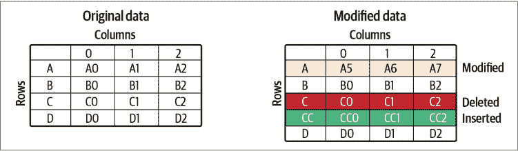
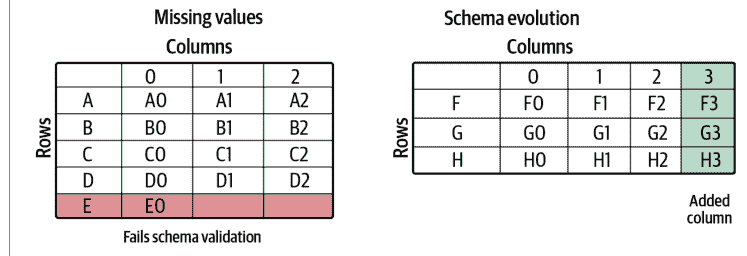
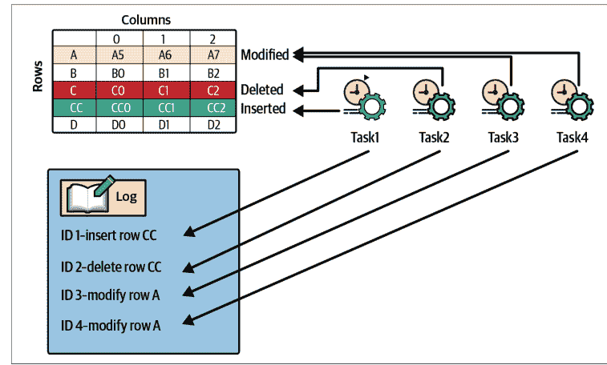
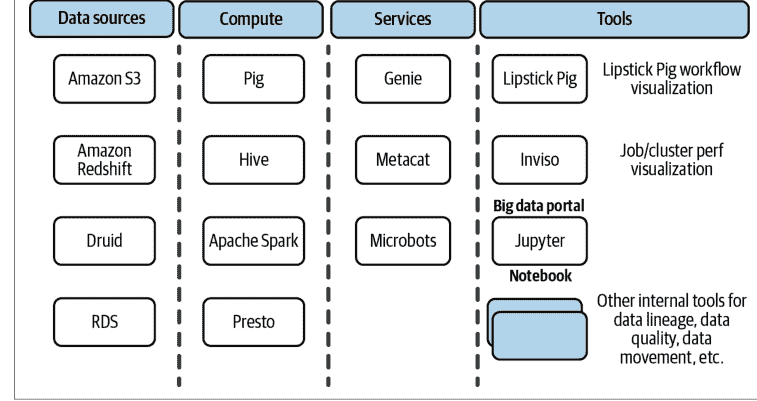
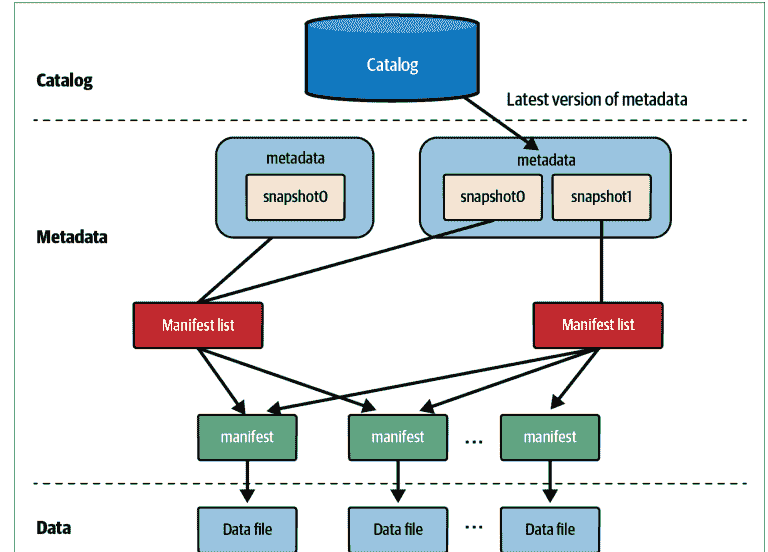
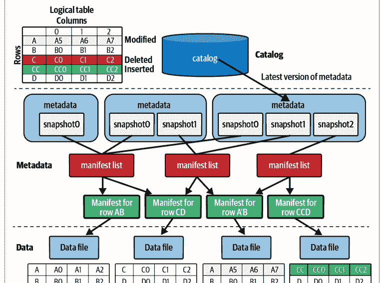
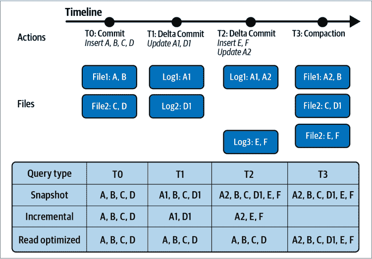

# 深入探讨数据格式

> 设计不只是它看起来和感觉起来的样子。设计在于它如何运作。
> ——史蒂夫·乔布斯

传统上，数据仓库构建在专有数据格式之上，这些格式被用来针对查询模式进行优化。随着云数据湖所服务的场景越来越多，尤其是湖仓一体架构模式的兴起，越来越多的客户和解决方案提供商正在投资于能够直接在云数据湖上运行类似数据仓库的查询的能力。这使得我们接近实现一种架构的承诺，即最大限度地减少为特定目的而在数据存储之间来回复制数据的需要。这种消除数据孤岛的存储承诺，导致越来越多的开放数据格式出现，这些格式支持直接在云数据湖存储上运行类似数据仓库的查询。在本章中，我们将探讨三种此类格式：Apache Iceberg、Delta Lake 和 Apache Hudi。这一章很可能是本书中最偏技术的一章，我们将非常详细地研究这些格式，包括它们如何服务于其设计场景。我希望这一章能让你充分了解这些格式的设计原因，这样当你评估其中一种格式时，你就能提出正确的问题，并为你的云数据湖架构找到合适的数据格式。

### 为什么需要这些开放数据格式？

如果必须用一句话来概括对开放数据格式的需求，我会说，开放数据格式本质上使云数据湖存储能够存储表格数据。这引出了两个问题：为什么我们需要存储表格数据？为什么在云数据湖存储中存储表格数据会成为问题？让我们详细探讨这些问题。

## 为什么需要存储表格数据？

在本书第 134 页的“数据格式”一节中，我讨论了存储在云数据湖中的数据所基于的关键假设，如下：

- 数据湖中会被频繁事务处理的数据，其形式大多为表格格式（按行和列组织）。
- 一次写入的数据会被多次读取。
- 读取模式在很大程度上依赖于对数据的条件选择：将某些列具有相似值的数据筛选出来后返回，或聚合后分组。

我们来看看为什么存储在数据湖中的数据最常见的是表格形式。虽然大数据分析系统中的数据可能来自任何来源，并且具有任意大小和格式，正如“什么是大数据？”（第 2 页）中大数据六个 V 所展示的那样，但这些数据本身被认为是低价值的，且夹杂着大量噪声。大数据架构的核心价值主张是从这些低价值数据中生成高价值的洞察。生成这些高价值洞察的过程涉及多种操作，这些操作主要归入表 6-1 所列的几个高级类别。

表 6-1. 数据湖上的操作类别

| 操作 | 描述 | 来自销售数据集的示例 |
|---|---|---|
| 聚合 | 对数据集进行统计计算 | 按地区统计的总销售额；某销售人员促成的最大发票金额 |
| 过滤 | 从大型数据集中搜索满足特定条件的子集 | 夏季各月的销售额；过去一年中下单金额超过某一数额的客户 |
| 预测 | 基于过去趋势预测未来趋势 | 基于去年趋势的下一年销售预测 |
| 连接 | 将两个不同数据集中的值关联起来，以识别模式 | 社交媒体趋势如何影响销售 |

表格数据结构天然适合这些常见的数据湖操作，因为它提供了将相似数据归组到一起的灵活性。当相似数据被归组后，获取你想要的数据子集并执行计算所需的事务操作就更少。这也是大多数数据格式都针对表格数据存储进行优化的原因。

在大数据分析系统中，进入系统的数据不一定要是表格形式；但是，正如我之前所说，这些数据被视为低价值的原始数据。作为第一步，这些数据会经历一系列转换，被转换为表格数据，然后再用于进一步处理。你可以重新参阅第 73 页的“数据的一天”，了解更多关于数据湖分区的信息。除原始数据区之外的其他数据区中的数据，本质上通常都是表格形式。

## 为什么在云数据湖存储中存储表格数据会是个问题？

当你想到表格数据时，你可能会很自然地想到电子表格，它让你可以把数据组织成行和列。大多数数据库和数据仓库的存储都是按这种方式组织的。然而，正如我们在第 26 页的“云数据湖存储”中所看到的，数据湖架构使用的存储是通用对象存储，它被设计为可以存储任何类型的数据而不施加任何限制。因此，用于存储网站内容、博客和在线相册照片的系统，也同样被用来存储大数据分析应用的数据。这种做法极具吸引力的主要原因在于其低成本，以及能够不受任何限制地存储任意大小和格式的数据；这种组合使组织可以把他们拥有的所有数据都放入数据湖存储，而不必付出高昂成本。

与此同时，数据湖存储本身在存储和处理表格数据方面也有一些明显的限制，如下所示：

### 更新现有数据

数据湖存储系统基本上属于只追加（append-only）存储系统。这意味着，如果需要替换任何现有数据，整个过程并不是很直接。

### Schema 强制与验证

Schema 是指对数据本身的描述。例如，我们知道一个地址包含以下字段：街道地址、城市名称、州缩写和邮政编码。对象存储系统无法保证存储的地址一定会包含所有这些字段。

### 查询性能

正如我们在第 5 章中详细讨论的，确保数据湖具有良好性能涉及很多因素。然而，所有这些因素都需要从业者自行设计，而不是开箱即用的保证，因为对象存储系统本身并不保证性能。

云数据湖架构的灵活性和低成本推动了其被广泛采用。因此，越来越多的关键业务查询和仪表盘依赖于存放在通用对象存储中的数据。为了确保存储在通用对象存储系统中的数据能够针对支持关键业务场景的核心数据湖计算进行优化，客户和云数据从业者孵化出了各种开放数据格式，这些格式主要对数据的表格特性提供保证。处理这些数据的计算引擎也理解这些开放数据格式，从而确保优化的性能。尽管有越来越多的数据格式被孵化出来，我们将深入探讨其中三种：Delta Lake、Apache Iceberg 和 Apache Hudi。

你要知道，无论从成本还是投入的工程精力来看，这都不理想。此外，如果在数据集被重新计算的同时，消费者正在读取该数据集，他们会看到不准确或不完整的结果，因此这种重新计算需要安排在没有任何读取者的时候进行，并且必须进行适当的协调。Delta Lake 提供了一种管理这种增量更新的方式，无需更新整个数据集，并使数据消费者能够在更新执行期间继续读取数据集。

## 处理因 Schema 变化和错误数据导致的错误

在表格数据格式中，*schema* 指的是行和列的值需要满足的规格或描述。由于云数据湖存储系统对数据的大小或形态没有任何限制，传入的数据可能缺少某些部分，从而不符合计算引擎所预期的 schema。例如，如果有一个地址数据集正在传入，而该数据集中有些记录没有街道地址或邮政编码，那么从该数据集提取地址的计算引擎就会失败。类似地，随着时间推移，数据源可能会添加新字段或更改现有字段，计算引擎也会因为同一数据集中既有旧数据又有新数据、并且如今看起来不同而感到困惑。*图 6-3* 中给出了一个示例。Delta Lake 通过提供 schema 强制和 schema 验证来优雅地处理这些场景，因此你可以确保对数据执行检查，并通过使用默认值修复缺失值或拒绝不符合 schema 的记录来主动纠正问题。

这一切听起来都很棒。Delta Lake 是如何实现这些场景的呢？Delta Lake 致力于提供数据的 *ACID* 保证：数据在数据湖存储中的原子性、一致性、完整性和持久性，从而为上述场景的实现奠定基础。如果你想进一步了解 ACID 事务，请参阅第 41 页的“湖仓一体参考架构”。让我们来看看 Delta Lake 的内部机制，以及它如何实现这些场景。

图 6-3. Schema 验证与演进

## Delta Lake 如何工作？

Delta Lake 是一种开放存储格式，用于在数据湖存储系统中存储表格数据，并提供 ACID 保证。一个 Delta Lake 表由以下组件组成：

数据对象
表中的实际数据以 Parquet 文件形式存储。你可以在第 135 页的“探索 Apache Parquet”中回顾 Apache Parquet 背后的概念。

日志
事务日志，或者说账本，用于跟踪表中数据的变更。这些变更称为操作（action），以 JSON 格式存储。Delta 日志跟踪数据本身的变更，即插入、删除或更新操作，以及元数据或 schema 的变更，例如向表中添加或移除列。

日志检查点
日志的压缩版本，其中包含截至某个时间点的非冗余操作。你可以想象，随着时间推移，数据上发生的操作数量非常多，日志可能会变得非常庞大，因此日志检查点是一种性能优化手段。

Delta Lake 文档页面提供了有关如何使用 Delta 表的详细说明。当你创建 Delta 表时，也会为该表创建一个日志。对表的所有更改都会记录在日志中，而该日志对于维护表中数据的完整性至关重要，从而提供了我们前面讨论过的那些保证。

如图 6-4 所示，对 Delta 表的写入涉及两个部分：

-   通过修改 Parquet 文件来更新数据对象。
-   更新 Delta 日志，并将该修改与 Delta 日志中的唯一标识符关联起来。

图 6-4. Delta Lake 写入

除非这两项操作都完成，否则写入不会成功。因此，如果对表有两个同时的写入，它们会通过这个日志自动地按顺序串行化。第二次写入需要等待第一次写入成功并更新日志，然后第二次写入再通过更新日志完成。拥有这个带有事务账本的日志，还使调用者能够进行时间旅行，访问数据的历史版本。

除了提供 ACID 保证和实现诸如时间旅行等场景外，Delta 表还提供了模式强制和模式演化。借助模式强制，你可以确保数据符合你指定的模式（例如，邮政编码必须是五位整数）；借助模式演化，当你添加新列并演进模式时，可以通过设置默认值来确保旧数据仍然可用。这些特性使数据湖上可以运行类 SQL 的场景。

## 何时使用 Delta Lake？

Delta Lake 为存储在通用对象存储中的数据提供了更强的保证。你需要记住的一点是，对于以 Delta Lake 格式存储的数据，你需要利用能够理解该格式的计算引擎才能发挥其能力。我建议你在那些预期要运行类 SQL 查询的数据，或者需要能够保留版本、为机器学习模型提供支持的数据集上使用 Delta Lake。如果你使用 Apache Spark，你可以在很大程度上利用现有管道，只需极少的修改就能将现有数据转换为 Delta Lake 格式。

## Apache Iceberg

Apache Iceberg 由 Netflix 孵化，当时 Netflix 正在数据湖存储之上运行其关键业务应用，而这一做法存在诸多不足，这些不足已在第 151 页的“为什么在云数据湖存储中存储表格数据是一个问题？”中进行了描述。

### 为什么创建 Apache Iceberg？

Netflix 是一家广受欢迎的视频流媒体公司，自成立之初就是一家高度数据驱动的企业。数据支撑着其关键业务场景，例如根据用户的观看模式向用户提供推荐、了解 Netflix 需要创作或发行何种内容来吸引其用户群体，以及监控其服务的健康状况等。尤其是在视频流媒体这样一个竞争激烈、市场参与者众多的领域，数据驱动的洞察和业务是 Netflix 的关键差异化优势之一。

根据 Netflix 技术博客，Netflix 使用的数据集存储在不同的数据存储中：Amazon S3（支撑其云数据湖的通用对象存储）、MySQL（一种操作型数据库），以及 Redshift 和 Snowflake（数据仓库）等等。Netflix 的数据平台确保这些不同的数据存储能够像单个数据仓库一样为其消费者提供互操作。如图 6-5 所示。

图 6-5. 来自 Netflix 技术博客的数据架构图

具体来说，对于存储在 Amazon S3 云数据湖中的数据，Netflix 使用了 Apache Hive 表，这种表格式借助 Apache Hadoop 生态系统支持了类 SQL 查询。Netflix 在使用通用对象存储解决方案时遇到了以下限制：

-   **对现有数据集的更新**

    正如我们在第 152 页“为什么创建 Delta Lake？”中看到的，对象存储系统不能很好地处理对现有数据的更改。强一致性是指读取操作始终返回最后写入数据的这种行为。AWS 在 2020 年宣布支持强一致性写入。然而，在 Apache Iceberg 创建之时，Amazon S3 提供的是最终一致性写入，这无法为 Netflix 用户提供可预测的读取数据。为了克服这一问题，写入需要以不与读取冲突的方式进行协调和编排。

-   **Apache Hive 的性能**

    Apache Hive 将数据以文件和文件夹的形式存储在对象存储文件系统中。这意味着，每当需要查询数据时，都必须列出文件和文件夹以找到目标数据。随着数据规模增长到 PB 级别，以这种规模列出文件的需求变得非常昂贵，并给查询带来了性能瓶颈。

图 6-6. Apache Iceberg 结构

让我们通过图 6-7 中的示例来了解 Apache Iceberg 如何执行写入。可以看到，最初 Apache Iceberg 表包含 A、B、C、D 四行，存储在两个数据文件中。存在指向这些数据文件的清单文件，以及一个包含指向这两个清单文件指针的清单列表。我来为你讲解 Apache Iceberg 中如何管理对此数据集更改的完整顺序：

-   首先修改行 A 时，该数据被写入一个新的数据文件，并创建一个新的清单文件来指向这个新行。然后创建一个新快照，并保存在清单列表文件中。接着，Apache Iceberg 更新目录以指向这个新的清单列表文件。只有当所有这些步骤都成功时，写入才会成功；而且只有当目录文件将元数据指针更新到最新版本时，写入才算完成；这控制了多次写入。
-   当删除行 C 并插入行 CC 时，会重复类似的过程，此时目录会指向数据的最新版本。

当有一个仅过滤行 A 和 B 的读取查询时，清单文件有助于表明可以跳过包含行 CC 和 D 的数据文件，从而避免不必要的文件读取，提高查询性能。

图 6-7. 使用 Apache Iceberg 写入

Apache Iceberg 官方维基提供了关于如何使用 Apache Iceberg 的详细文档。

### 何时使用 Apache Iceberg？

与 Delta Lake 类似，Apache Iceberg 用于已治理数据和增强数据区，这些区域中的数据采用表格形式，也用于查询。应优先考虑那些期望强保证的数据。由于这种场景更新密集，通常对应表中的已治理数据区。Apache Iceberg 最适合在需要对数据提供结构保证，但又不需要底层数据使用特定格式的情况。Apache Iceberg 提供以下你可以在架构中利用的能力：

-   **支持模式演化**

    当模式更新时——即添加新列或删除现有列——这些更新会保留在快照中，你可以利用它们来了解模式是如何随时间演化的。

-   **数据分区优化**

    正如我们在第 134 页的“数据格式”中看到的，将相似数据放置得更近可以提高查询性能，因为你是在优化获取目标数据所需的最少事务数。当底层数据发生变化时，你可以继续调整数据文件的组织方式、更好地对数据进行分区，而应用程序仍然可以继续调用清单，无需了解这些优化，从而可以灵活地优化数据布局，而不必担心破坏应用程序。

-   **时间旅行或回滚**

    特别是在机器学习场景中，模型是基于特定版本的数据构建的，随着数据的变化，模型行为也会发生变化。在 Apache Iceberg 中，快照会保留数据的特定版本，因此你可以通过将应用关联到特定快照或版本来将其绑定到数据的某个版本。这个概念称为 *快照隔离*。此外，如果你较新的更新出现问题或错误，你可以更直接地管理快照并回滚到以前的版本。

尽管 Apache Iceberg 由 Netflix 孵化，但它作为数据湖的开放数据格式，已被众多客户和数据提供商广泛采用。苹果、Airbnb、LinkedIn 和 Expedia Travel 等组织都已采用 Apache Iceberg。此外，Dremio、Snowflake 和 AWS 等数据平台提供商已在其云产品中提供了对 Apache Iceberg 的原生支持。

Apache Iceberg 在数据湖中为数据提供表格结构方面与 Delta Lake 非常相似；然而，它实现这一目标的方式是通过元数据层。Apache Iceberg 也支持非 Parquet 文件格式，因此如果你需要让各种格式的数据具有表格表示，Apache Iceberg 非常合适。借助扫描规划等功能，你可以通过快速缩小查询所关注的数据集来大幅优化大型数据集上的操作性能。

## Apache Hudi

Apache Hudi 由 Uber 孵化，Uber 是最早的网约车应用公司之一。多年来，Uber 已发展成为一家出行即服务提供商，提供额外服务，如食品配送（Uber Eats 和 Postmates）、包裹递送、快递、货运、通过与 Lime 合作提供的电动自行车和电动滑板车租赁，以及与……合作提供的渡轮运输。

本地运算符。这种 Uber 快速扩张的基础在于数据驱动的文化，这是该组织 DNA 的一部分。数据和先进的机器学习能力为关键的 Uber 业务运营提供支持，例如预测司机预计到达时间、为 Uber 客户提供有意义的推荐以订购下一顿晚餐，以及确保乘客和乘车安全，等等。这些功能的及时性——即实时推荐或操作——对于确保良好的客户体验至关重要。这当然对 Uber 的客户满意度和品牌很重要。面临与 Netflix 类似的挑战，以及涉及实时洞察重要性的其他挑战，Uber 孵化了 Apache Hudi，以在数据湖中存储的数据上提供强有力的保证和及时的洞察。Apache Hudi 被设计为支持这些操作和数据保证的规模化，截至 2020 年，在 150 PB 的数据湖上支持每天约 5000 亿条记录更新，并且随着 Uber 业务的持续扩展，这一数字还在增长。

## 为什么要创立 Apache Hudi？

Apache Hudi 的动机在很大程度上与 Apache Iceberg 和 Delta Lake 相似，因为它是为了克服用于驱动数据湖存储的通用对象存储的固有局限性而创立的。具体来说，Uber 希望解决以下场景：

- *高效写入的 Upserts*
  Upsert 指的是数据需要写入的概念，当数据尚不存在时作为插入操作写入，或当行已存在时作为更新操作写入。在不支持 upserts 的场景中，会存在多行而不是一行，并且需要单独的计算来获取这些行并筛选出最新数据。这种解决方案成本更高，并且处理时间更长。对象存储系统在很大程度上是仅追加的，并且不固有地支持 upsert 的概念。

- *理解增量修改*
  正如我们在前几章中所看到的，数据处理管道运行作业处理大量数据集，以生成经过高度整理的构成输入数据聚合、过滤和连接版本的数据。通常，每当输入数据发生变化时，这些处理引擎都会在整个数据集上重新计算整理后的数据。为了加快洞察的时间，而不是重新处理整个批次，有机会仅在发生变化的数据集上运行重新计算，从而仅处理增量更改。为此，需要了解自上次作业以来发生了什么变化，而此操作并非数据湖存储固有支持的。

### 支持实时洞察

正如我们在第 152 页“为什么要创立 Delta Lake？”中所看到的，虽然存在提供实时和批处理流统一计算的编程模型，但实际的架构和实现是不同的。例如，当需要做出决策时，例如为特定乘车寻找最佳司机时，司机的实时位置数据会与地图和交通优化的批处理数据结合，以预订最佳司机。同样，在为 Uber Eats 提供推荐时，客户当下浏览的实时点击流数据会与推荐数据结合，后者可能位于图数据库中，以提供正确的推荐。再一次，数据湖存储本身并未为这些场景原生设计。

Apache Hudi 主要设计用于通过支持 upserts 和增量处理来提高效率，从而实现数据在几分钟内的新鲜度，而无需从头重新计算整个数据集。

## Apache Hudi 如何工作？

Apache Hudi 与其他格式一样，是一种用于存储表格数据的开放数据格式。在支持实时流场景和批处理场景的 Lambda 架构中，数据上有两种写入模式：

- 持续摄取大量数据——想象一下大量 Uber 车辆实时传输信息。
- 批量批量摄取数据——想象一下销售或营销数据的转储，这些数据通过每日作业完成。

为了支持这些模式，Apache Hudi 提供两种类型的表：

### 写时复制

有一个单一的事实来源，表的读写者都与之交互。每次写入都会立即作为对 Apache Hudi 表的更新写入，并且更新会近乎实时地反映给读取者。数据以针对读取优化的列式格式存储，例如 Apache Parquet。

### 读时合并

每次写入都会以写优化的数据格式写入缓冲区域中，行式数据格式例如 Apache Avro，然后稍后更新到为读取者服务的表中，其中数据以列式格式存储，例如 Apache Parquet。

Apache Hudi 为表存储三个主要组件：

### 数据文件

包含实际数据的文件。对于写时复制表，数据以列式格式存储。对于读时合并表，数据以增量写入存储为行式格式以及完整数据集存储为列式格式的组合形式存储。

### 元数据文件

这是作为表上活动的有序时间线存储的所有事务的完整集合。Apache Hudi 表上有四种类型的事务：

### 提交

将一批记录原子写入 Apache Hudi 表中存储的数据集的操作。

### Delta 提交

将一批记录原子写入 delta 日志的操作，该日志需要稍后提交到数据集中；此操作仅在读时合并类型的表上受支持。

### 紧凑

一种后台进程，通过重新组织其文件结构来优化存储的数据，其中 delta 文件合并到数据集中的列式格式中。

### 清理

一种后台进程，其中不再需要的旧版本数据将被删除。

### 索引

一种数据结构，可实现对属于事务的数据文件的有效查找。

Apache Hudi 表支持三种类型的读取：

### 快照查询

查询存储在 Apache Hudi 表中的特定数据快照。快照是指给定时间的版本。此查询返回与查询匹配的所有数据。

### Delta 查询

查询在给定时间段内发生变化的数据。如果您只对发生了什么变化感兴趣，您将使用 delta 查询。

### 读时合并表

读时合并表上事务的图形表示如图 6-9 所示。虽然这在很大程度上与写时复制表相似，如图 6-8 所示，但关键区别在于事实来源是分布式的。

| 查询类型 | T0 | T1 | T2 | T3 |
|---|---|---|---|---|
| 快照 | A, B, C, D | A1, B, C, D1 | A2, B, C, D1, E, F | A2, B, C, D1, E, F |
| 增量 | A, B, C, D | A1, D1 | A2, E, F |  |
| 读取优化 | A, B, C, D | A, B, C, D | A, B, C, D | A2, B, C, D1, E, F |

*Figure 6-9. Transactions on merge-on-read tables*

在读时合并表中，存在一个针对读取优化的列式数据格式的数据集，而写入以写优化格式存储在 delta 日志中，然后被压缩到列式格式的主数据集中。这些表支持三种类型的查询：返回特定时间数据集版本的快照查询、仅返回更改数据的 delta 查询，以及返回列式格式数据集的读取优化查询，后者提供更快的性能，但不包括尚未压缩的数据。

## 何时使用 Apache Hudi？

Apache Hudi 提供了更大的灵活性，其不同类型的表支持不同类型的查询，同时提供强有力的数据保证，具有原子写入和数据版本控制。Apache Hudi 由 Uber 孵化，但此后已在其他公司中获得强劲采用，例如 Amazon、Walmart、

Disney+ Hotstar、GE Aviation、Robinhood 和 TikTok。最近成立的一家公司 Onehouse 提供了一个基于 Apache Hudi 的托管平台。

Apache Hudi 设计用于支持需要以实时和批处理方式处理高频写入的表。它还提供了根据您对性能和数据新鲜度的要求使用不同类型查询的灵活性。

## Summary

在本章中，我们深入探讨了数据格式，并建立了理解，即这些数据格式如何在利用数据湖存储保持成本结构较低的同时，提供对数据强有力的保证并有助于提高查询性能。我介绍了 Delta Lake 是什么以及如何使用它。我还描述了由运行大规模数据湖的客户孵化的 Apache Iceberg 和 Apache Hudi 等数据格式。这些开放数据格式能够实现真正无孤岛的数据湖，可支持各种计算，满足数据工程师、机器学习工程师、数据科学家和 BI 分析师在一个平台上的需求。尽管这些数据格式取得了飞跃，但要利用这些数据格式构建数据湖，仍需要陡峭的学习技能和强大的数据平台团队。像 Dremio、AWS 和 Onehouse 这样的数据解决方案提供商正在构建开箱即用的湖仓托管数据平台解决方案。Tabular 是一个相对较新的组织，提供基于 Apache Iceberg 的数据平台。根据您组织的动机和工程资源，您可以在云数据湖上实现湖仓。在下一章中，我们将重点关注端到端的决策制定策略，将我们在前六章中涵盖的所有概念整合在一起。
