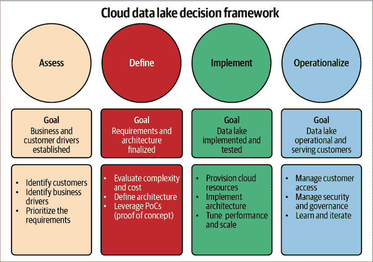
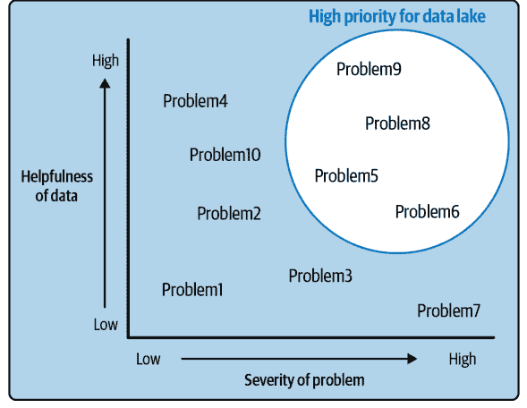
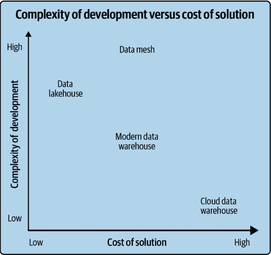

## CHAPTER 7
## Decision Framework for Your Architecture

> > *真正成功的决策依赖于深思熟虑和本能思维之间的平衡。*
> >
> > —Malcolm Gladwell

在前几章的内容中，我已经涵盖了在云上设计大数据处理架构的基本概念、大数据湖的不同架构选择、云数据湖解决方案的设计考虑因素，以及您可用于优化解决方案以实现规模和性能的工具。在本章中，我将把所有这些概念整合在一起，并阐述这种理解如何在您的数据湖之旅的不同阶段为您服务。在构建和消费这些云数据湖解决方案的过程中，我与来自各个行业——金融服务、零售、消费品、医疗保健、制造和技术领域——的数百名客户进行了交流。本章将所有这些客户的经验提炼成一组核心的常见模式和思维过程，反映了不同的组织成熟度水平、可用技能集和当前技术采用状态。

尽管每个客户都有其自身的问题和需求弧线，但对他们来说共同的主题是，他们意识到数据的重要性以及数据如何帮助指导和改变他们的业务。数据被视为保持竞争优势、留住和扩大客户群、并推动运营效率的基本组成部分。在本章中，我们将更深入地探讨概念在消费者问题背景下的应用方式。

我将提供一个决策框架，分为四个关键阶段：评估、定义、实施和运营。在第 3 章中，我在更高层面谈到了这个决策框架，而在本章中，我将把这个框架调整到您所属的细分市场。这些步骤是顺序的；然而，当您在后期阶段发现差距时，您始终可以回到前一阶段。我还在附录中提供了一套模板，您可以用它来规划和跟踪云数据湖的不同阶段。

## Cloud Data Lake Assessment

任何项目的第一步都是了解并确定您所在的位置以及您想要去哪里。为此，我将从一组问题开始，帮助您确定您目前所在的位置以及您对云数据湖的动机。

进行此评估时，您扮演的是您组织的数据平台团队或数据架构师的角色。无论您的实际角色是什么——CTO、工程经理、架构师或高级工程师——请尽可能代表该角色适用于您的组织。我以多项选择格式构建了此评估。对于每个问题，选择最符合您情况和需求的选项。在某些情况下，多个选项都符合您的需求是合理的。我建议在这种情况下将您的问题空间细分为子问题，并为每个子问题进行评估以确定最佳匹配。如果您不知道问题的答案，我建议进行足够的调查以获得大致的了解——记住，进展胜过完美。

一旦您完成了此评估，当您根据最能描述您的选项浏览本书的其他部分时，请重点关注我特别指出代表该选项的那些方面。

## Cloud Data Lake Assessment Questionnaire

好了，现在是时候了。准备好，开始吧！

### Q1: Does your organization currently have an investment in data analytics?

Option A
我们今天在数据方面的投入并不大，几乎是从一张白纸开始。也许如果我眯起眼睛，我可以说我们当前的数据投资是以为我们的应用程序提供支持的几个数据库的形式存在的。

Option B
是的，我们拥有类似 Netezza 或 Oracle RAC 服务器或本地 Hadoop 集群的本地数据仓库。

Option C
我们今天拥有功能正常并为组织服务的云数据湖或云数据仓库，或两者兼有。

### Q2: How would you best describe the skill levels of your data organization?

**Option A**

我们有一些现有人员兼职承担数据职责。我们的重点是保持系统运行，我们会根据有人提出请求时做出反应性投资。

**Option B**

我们有一个现有的数据组织，目前忙于运营管理我们的数据基础设施和数据管道。我们负责组织的数据需求。我们数据平台组织中的典型职位是数据管理员、数据工程师和数据分析师。

**Option C**

我们有一个高度技术化的数据组织，紧跟最新的云产品。我们相信自动化运营任务，并积极努力在扩展到组织数据需求的同时消除瓶颈。

### Q3: How would you best describe the load levels of your data organization?

**Option A**

数据组织主要专注于保持系统运行，没有强烈的依赖关系。

**Option B**

数据组织对于满足整个组织的需求至关重要，并且不断被来自各方的请求以及保持数据平台正常运行所需的工作所压垮。

**Option C**

数据组织对于我组织的核心任务——管理和运营数据湖至关重要。然而，他们提供数据以便不成为客户容量的瓶颈。

### Q4: What is the rough size of the data in your data platform?

**Option A**

根本没有，也许只有几 TB 的数据

**Option B**

几百 TB 到 1 PB

**Option C**

多个 PB

### Q5: How would you best describe your customers?

Option A
我的客户依赖我们教育他们数据如何帮助他们。否则，这并不是他们首要考虑的问题。

Option B
我的客户主要是业务分析师和执行人员，他们消费我们的报告和仪表板。他们依赖数据进行运营。

Option C
我的客户是工程师、数据科学家、业务分析师和执行人员，他们依赖数据为其不断增长的需求提供支持。

### Q6: How you would best describe the data awareness and skill sets of your customers?

Option A
我的客户不一定会考虑数据。对我们客户而言，数据需求，如果有的话，更是完成其任务的手段，例如为其应用程序提供支持的数据库。

Option B
我的客户严重依赖数据，但不擅长编码或数据技术。他们依赖数据团队端到端准备仪表板和报告。

Option C
我的客户高度技术化且精通云。他们可能会消费数据团队生成的一些仪表板和报告，但他们在此基础上进行自己的分析。

## Analysis for Your Cloud Data Lake Assessment

在非常高的层面上，根据您的大多数答案所在的位置，您属于图 7-1 中显示的三个桶中的一个：

- 如果您大多选择了 Option A，那么您几乎是数据湖的新手，并且是从一张白纸开始。
- 如果您大多选择了 Option B，您拥有现有的数据湖或数据仓库。您的云数据湖实施涉及解决现有技术债务以及在组织数据文化中进行文化转变。
- 如果您大多选择了 Option C，那么您已经拥有云数据湖实施，您的努力是使现有实施变得更好、更快、更高效。

| 从空白状态开始 | 现有平台——需要偿还技术债务和文化转型 | 成熟的数据湖平台——从优秀走向卓越 |
|---|---|---|
| { 主要是选项A } | { 主要是选项B } | { 主要是选项C } |

*图7-1 针对您组织的数据平台评估*

下面我们来更详细地了解这些情况。

## 从零开始

如果你对数据湖、云或两者都是新手——也就是说，你的旅程是从零开始的——你首先需要将高度开放的问题空间限定到对组织真正重要的范围内。这将定义随后对云数据湖的设计、实施和运营需求。除了界定问题空间，你很可能还需要向业务领导者说明，对数据湖的投资将如何推动你的业务发展。好消息是，你几乎没有需要偿还的技术债务，而且这些努力更符合组织的需求，能够产生价值和影响。如果你的组织没有现成的数据平台团队（可能是因为这是你第一次涉足数据湖），你可能需要借助现有的软件工程或IT团队来扮演数据平台团队的角色。基于这些经验，你可以计划在组织内部逐步组建数据团队。

## 将现有数据湖或数据仓库迁移到云

如果你的组织有现有的数据仓库或本地运行的数据湖，已经在满足组织的数据需求，这对团队来说是一个很好的起点，可以认识到数据的实用性，而这些成果已经帮助你的业务领导者理解数据的价值。你很可能也有一个现成的数据平台团队；然而，这个团队很可能主要专注于运营，且负载很高。除了关注核心数据导向的举措外，你的数据平台团队还要维护数据中心和本地运行的软件。你在云数据湖上的工作不仅需要综合考虑你当前数据湖或数据仓库所支持的现有解决方案，还需要推动新的机会并用数据解决其他问题。在决策中，一个关键因素是要确保在将数据平台迁移到云时，尽量降低对客户的干扰。你在迁移方面的工作还包括提升数据平台团队的技能，使其能够针对云环境进行设计和运营。

## 改进现有云数据湖

如果你的组织已有云数据湖，你的情况与在本地运行数据湖或数据仓库的客户群类似，主要区别在于你已经在云上有所部署。你的问题要么集中在改进云数据湖架构以解决数据湖上的现有场景，要么集中在添加全新的场景，为客户提供差异化价值。云数据湖是一个快速发展的领域，因此你的决策需要基于当前实现中面临的问题，以及云数据湖上的新创新可能为组织带来的机遇。与前一种情况一样，你的努力不应给现有客户造成太多干扰十分重要。从组织的角度来看，你的数据平台团队已经熟悉云，技能提升主要是为了跟上数据湖领域发生的创新。

## 评估阶段的重要性

这里需要记住的一个重要方面是，在评估阶段投入对于降低数据湖设计、实施和发布的风险至关重要。花时间与客户和业务领导者建立优先事项并达成利益相关方共识。尽管你不可能了解一切，而且情况会不断变化，但一份初步的优先需求清单和利益相关方的认可可以确保变更得到妥善管理。

在接下来的章节中，我将以虚构的Klodars公司为例，逐一介绍这些场景的决策过程。请注意，Klodars公司在数据组织和成熟度方面将呈现多种形态，以最好地说明代表性客户群的当前状态和需求。我将介绍决策框架的各个阶段，它们适用于三个不同的客户群：从零开始、将现有数据湖或数据仓库迁移到云，以及改进现有的云数据湖。图7-2提供了该框架的快速概览。

*图7-2 云数据湖决策框架*

## Klodars公司背景

Klodars公司是一家向其他零售店以及通过网站直接向客户销售雨具和雨伞的企业。其网站由操作数据存储提供支持。Klodars公司有动力投资云数据湖架构，以更好地支持业务的扩张和增长。数据平台团队将定义、构建、发布并运营云数据湖，以满足公司的需求。该数据平台的客户是Klodars内部各部门，它们利用数据来驱动产品或业务洞察。

## 决策框架阶段1：评估

此阶段的目标是定义并优先排序云数据湖的需求，这些需求将驱动架构和实施决策。在此阶段，数据工程团队需要基于两个关键方面识别需求：客户需求和业务驱动因素。

### 理解客户需求

确定你的客户是谁，以及他们当前可以通过数据湖解决的痛点。一个很好的起步方式是与客户访谈，了解他们的目标是什么，以及有哪些障碍妨碍他们达成目标。那么，你如何知道你的客户是谁？你的数据湖的客户是任何能从数据中受益的人。他们既可能是组织中使用你产品的客户，也可能是组织内的其他部门或团队。他们可能从多个方面受益于数据：利用数据提高当前运营效率、识别模式或洞察以帮助聚焦新战略、和/或通过向客户提供洞察创造新的变现机会，等等。例如，Klodars公司的数据湖客户可能是Klodars内部的销售和营销部门，或购买Klodars雨具的批发分销商。一些益处示例包括：零售商能够了解产品需求从而有效管理库存，或内部团队能够制定新的销售策略或营销活动。

需要牢记的一点是，并非所有客户都是技术人员，他们可能并不真正了解数据湖如何帮助他们。请保持提问的开放性，并聚焦于他们的问题或障碍，从而更好地理解数据可以在哪些方面帮助他们。以下列表提供了一组问题，可帮助识别这些制约因素或问题：

- 您的业务目标是什么？是什么阻碍了这些目标的实现？
- 您的客户是谁？您如何预测他们的需求？
- 请详细说明您的客户采用、参与和留存情况。您如何管理这些方面，又如何理解投资对客户旅程的影响？
- 当您的销售或收入出现问题时，您如何了解发生了什么，以及如何修复？
- 您如何使自己与竞争对手区分开来？您如何理解这些战略？
- 您当前运营中存在哪些低效环节？您今天如何解决这些问题？哪些方面可以做得更好？
- 当前流程中的瓶颈有哪些？您的关键路径是什么，它如何影响您的业务和运营？

这些问题是一个很好的起点，您可以根据自己的具体问题对其进行定制或从中提炼洞察。您希望捕获的主要信号，是客户对其缺乏足够可见性的领域。

*致你的数据平台团队*

- 你们目前在日常数据运营上投入了多少精力和时间？这对你的工作负荷和士气有何影响？哪些方面可以做得更好？
- 你们目前的数据运营成本是多少？如果降低这一成本，对你们的运营会有哪些帮助？
- 你们目前处理哪些类型的数据？你是否觉得这限制了你的潜力？你还想把哪些数据引入你的组织？这将如何帮助你的业务和客户？

在这项练习结束时，你将非常清楚地了解客户的需求，以及支持这些场景所需的精力和投资。

## 了解你的业务驱动因素

客户访谈会告诉你，数据能够帮助解决哪些问题。业务驱动因素有助于确定这些问题的优先级。业务驱动因素是一组对业务持续增长和成功至关重要的条件、资源或流程。常见的业务驱动因素包括：

- **降低业务运营成本**

  这包括构建产品和运营业务所涉及的人员、资源和工具成本。例如，以 Klodars 公司为例，这些成本包括制造雨具、运营和维护雨具的仓库及分销渠道，以及支付员工跨部门运营公司的费用。

- **降低风险**

  这包括由于安全实施不力、数据质量或数据治理等问题而引入数据湖的风险，这些风险最终会增加运营成本，并影响组织的关键业务指标。例如，以 Klodars 公司为例，销售数据缺乏数据质量检查，导致高管仪表盘中的趋势让人感觉利润大幅下滑，而实际上这只是数据错误。

- **提高运营效率**

  这项工作主要旨在利用现有工具和流程，减少产生业务成果所需的时间和资源。例如，Klodars 公司需要保持雨具库存，以确保在客户需要时产品齐备。同时，如果库存相对于需求过多，商品就会闲置在仓库中，蚕食利润率。这里注重效率的工作将是准确预测需求，即所谓的*需求预测*，以确保你找到最佳平衡点：客户想要产品时能够买到，而库存中不会有太多积压。

- **推动创新，实现业务和产品的差异化**

  这项工作可以最贴切地描述为“看清拐角后的情况”——也就是说，在尽可能降低风险的同时，采取措施应对未知。这类工作包括创建新的业务或产品线。例如，Klodars 公司目前在太平洋西北地区销售雨具，市场已经饱和。Klodars 可以通过了解该地区的游客并投资雨具租赁业务、向太平洋西北以外地区扩张，或增加围绕冬季装备的新产品线来推动创新。

## 通过确定需求的优先级完成评估阶段

一旦你理解了客户的问题，就可以从两个维度评估这些问题：

### 数据的有用性

你能如何利用数据来帮助最大程度地减少或完全解决这些问题？这个解决方案的可行性如何？

### 问题的严重性

与组织的业务驱动因素相比，这个问题有多严重？请记住，严重性并不总是坏事，也不一定表示出了问题；它也可能带来好处，帮助为你的业务增加差异化价值。

正如我们在第 64 页的“识别你的目标”中简要看到的那样，你现在可以把这些问题按这两个维度绘制出来，以了解哪些问题能带来最佳投资回报。作为回顾，我用图 7-3 来帮你重温一下。你还可以让客户作为利益相关者参与进来，与他们一起解决这些问题。在评估阶段结束时，你将获得一份为你的云数据湖准备好的优先级排序的需求列表。

图 7-3. 根据对业务的严重性和数据的有用性评估问题

优先级排序的需求列表为规划数据湖提供了一个很好的起点。随着设计和实施的推进，预计此列表会发生变化。你可能会遇到影响优先级排序的新阻力，或者发现以前可能遗漏的新客户需求。一个好的经验法则是，以 60%-70% 的准确性和完整性为目标，并将时间范围定为一到两年，这样你的计划既足够扎实，又能适应任何新变化。

## 决策框架第 2 阶段：定义

在第 1 阶段结束时，你将获得一份优先级排序的需求列表，用于定义和实施你的云数据湖。在第 2 阶段，你将定义和规划用于构建云数据湖的技术组件。该阶段的关键目标是完成满足评估阶段确定的客户和业务需求所需的技术设计和项目计划。然后，该计划有助于界定项目所需的时间和资源范围。

作为我们在第 67 页“规划你的架构和交付物”中讨论的设计注意事项的快速回顾，以下因素可作为确定云数据湖正确架构的指南：

### 解决方案的总成本

数据湖在运营方面成本非常低，但构建解决方案的开发工作成本较高。这里的开发成本很高，因为你需要使用不同的计算和存储组件来组装解决方案，而不是获得一个开箱即用的解决方案。此外，数据湖比数据仓库支持更多场景。例如，以 Klodars 公司为例，营销团队希望预测社交媒体趋势。投资云数据湖可以支持利用机器学习和数据科学进行即席探索性分析。

### 实施所需的时间

你可能有一些业务约束决定着项目的时间表。例如，Klodars 公司有支持其操作数据存储的本地硬件，这些硬件即将达到生命周期终点。迁移到云可确保团队节省采购新硬件的成本；然而，现有硬件剩余的使用时间成为云数据湖上线的倒逼因素。如果你的时间不多，与重新架构相比，在云上复用现有的开发成果可以确保更快获得云数据湖。另一个可能决定时间表的因素，是将数据湖的时间表与时间要求紧迫的客户承诺保持一致。例如，Klodars 公司的销售团队需要及时向主要零售商交付季度库存和销售报告，以便为下一财年的预算预测做好准备。将此功能以仪表盘形式提供，是数据湖作为交付物需要满足的关键要求之一。

### 向后兼容性

如果你已有数据湖或数据仓库解决方案，需要考虑的一个重要因素是确保对现有客户的干扰最小。架构模式和交付物需要将此向后兼容性纳入考量，直到客户完成迁移。例如，支持 Klodars 公司网站运行的应用程序依赖于在本地运行的操作数据库。当 Klodars 公司迁移到云数据湖时，需要继续支持这些应用程序，直到它们也能迁移到云端。实现这一目标的一种方法是，将操作数据库保留在本地，并每天将备份摄取到云数据湖，作为数据摄取的一部分。

### 组织成熟度

正如我们所见，云数据湖需要相对较高的技能组合；在做架构选择时，要把这一点考虑进去。你可以将为开发团队安排招聘或技能提升（或两者同时进行）的时间纳入考量，以实施云数据湖。此外，你可以聘请系统集成商来帮助你实施云数据湖。大多数云服务提供商与系统集成商密切合作，可以为你提供推荐列表。例如，要实现营销团队对社交媒体数据进行分析的目标，除了技术选择之外，你还需要有能够进行此类分析的数据科学家。

考虑到这一点，第二阶段有两个成果：

- 确定云数据湖的技术设计选择。
- 制定包含范围、依赖关系和时间线的项目计划，以便与利益相关者沟通。

## 云数据湖的时间线

我经常听到客户问，一旦架构确定，实施云数据湖需要多长时间。这个时间线主要取决于三个因素：架构的复杂性、所选云服务的实施方案以及团队的技术水平。一个好的经验法则是，在确定项目交付物时，用T恤尺码估算来初步确定工作的时间线，如下所示：

- XS 小于一周
- S 一到两周
- M 两到四周
- L 一到两个月
- XL 超过两个月

这将为你的项目提供一个粗略的高层级时间线。你可以经常重新审视这些估算，以了解原始估算如何变化，这是常规项目管理流程（如迭代规划）的一部分。

## 最终确定云数据湖的设计选择

对于云数据湖，可用的选择有很多，包括架构模式、云提供商以及云上的具体服务。在本节中，让我们通过决策框架来仔细看看如何做出这些选择。

### 选择你的架构

在第58页的“设计考量”中，我带你评估了决定云数据湖架构的各种因素。我建议你回顾一下表2-1，以加深记忆。

图7-4中显示的架构成本与复杂度对比在这里也很重要。

*图7-4。 云数据湖架构成本与复杂度对比*

现在你已经回顾了这些概念，可以评估最适合你的架构了。我要再补充几点需要你牢记的因素：

**架构会随着时间推移而演进**

根据你在第一阶段中的发现，你可以采用全有全无或混合的方式满足客户和业务需求。例如，如果市场团队要求支持数据科学场景，销售团队希望支持季度销售预测的仪表盘，一种选择是实施现代数据仓库架构，让数据科学家使用工具直接操作数据湖中的数据，而销售团队的业务分析师则消费数据仓库中的数据并查看仪表盘。或者，你可以从这种现代数据仓库开始，最终将数据仓库场景迁移到直接在数据湖上运行，从而演进为湖仓一体架构。

**架构可以相互组合**

云数据湖架构并不是互斥的，而是可以在彼此之上组合。例如，我与之交谈过的大多数客户都有现有的数据仓库来满足其业务需求。最常见的第一步是引入云数据湖，这主要通过存储历史数据版本来帮助降低成本，并支持机器学习等新场景。第二步，数据仓库迁移到云端，采用现代数据湖或湖仓一体架构，并组合在现有数据湖之上。随着组织的发展，场景的多样性也会增加，你可以在现有架构之上用数据网格进行组合。

**架构跨越多个云提供商**

需要始终牢记的一点是，云数据湖架构并不强制要求在一组组件上采用单一实现，它支持多云或混合云架构。例如，拥有本地架构的组织，其数据分析师会使用本地数据仓库。当他们迁移到云端时，可以从数据科学场景的云数据湖开始，而业务分析师则继续在本地环境中工作，形成混合架构。

总之，你选择的架构不必受实施方案的限制。你可以根据客户和业务需求选择架构，并在实际实施中拥有灵活性。

### 选择你的云提供商

一旦你决定了架构，下一步就是选择云提供商。虽然有许多私有云提供商和混合云产品，但我们重点关注最常见和最受欢迎的选择：公有云提供商。提供云数据湖服务的最热门云提供商包括：利用 Amazon S3 的 AWS Lake Formation、Azure Data Lake Storage，以及由 Google Cloud Storage 和 BigQuery 组成的 Google Cloud 云数据湖产品。AWS、Azure 和 GCP 三大公有云提供商都拥有各自高度可扩展的分布式云数据湖存储解决方案，以及云原生的数据摄取和编排服务，和与 Hadoop、Spark 等开源产品兼容的托管数据处理产品。这些公有云服务在可用性、价格和其他数据相关功能方面相互竞争激烈，为云数据湖客户提供了丰富的服务。

要确定适合你的云服务提供商，需要考虑以下几个因素：

**解决方案的成本**

确定构建云数据湖架构所需的云服务，并确保解决方案的成本符合你的预算。

**云服务能力**

虽然云服务提供商的功能高度相似，但它们也各有独特而细微的能力。例如，AWS Lake Formation 提供了一个简化界面，可帮助你快速上手并编排云数据湖；Azure Data Lake Storage 则提供了真正的非孤岛式数据存储，支持多种协议，包括网络文件系统（NFS）第3版。

**与你其他云服务的集成**

如果你已经使用了某个云提供商的实施方案，那就是云数据湖实施的最佳起点。你可以将当前的云实施扩展到数据服务中。例如，如果你已经在云上运行一个 Web 应用程序，数据平台可以利用从该 Web 应用程序摄取的日志或点击流数据，来实现客户仪表盘或个性化功能等场景。这是一个很好的起点，因为你是在熟悉的环境中，并在扩展现有实施。

评估云提供商能力的最佳方式，是针对你的场景进行 PoC 实施。这将帮助你找到最符合需求的方案，同时让你了解这些解决方案的成本情况。选择一个最能体现客户需求的 PoC。例如，Klodars 公司在评估云数据湖时，可以挑选两个优先级最高的问题：

- 销售仪表盘刷新耗时过长，扰乱了高管审查会议。
- 市场团队需要基于对现有趋势的分析，了解如何最好地定位其社交媒体营销活动。

Klodars 对三家云提供商进行了 PoC 后发现：AWS Lake Formation 为它的云数据湖提供了最简单的实施方案；Azure Data Lake Storage 提供了最低成本，并可通过 NFS v3 支持与本地系统实现互操作；Google BigQuery 在结构化和非结构化数据上均提供了最快的性能，并且在扩展性上优于 AWS 和 Azure 上的数据仓库解决方案。鉴于 Klodars 最大的痛点是性能，它选择 GCP 来实施云数据湖。

### 数据湖迁移的决策要点

如果你有现有的本地基础设施（无论是数据湖还是数据仓库），并希望迁移到云数据湖架构，那么你需要做出一些选择。这些选择可以分为三大类设计决策：

**直接迁移（Lift and shift）**

在这种设计决策中，你保留现有设计，主要将托管迁移到云端。这种方法的优势在于，它需要对代码和组件进行最少量的重构，因此你可以更快地在云上启动。AWS、Azure 和 GCP 等大多数公有云提供商都提供 pro-

程序和自动化针对大多数常见的直接迁移架构进行了优化。然而，这有一个缺点：你无法利用云原生能力以及云解耦架构的关键优势。在这种情况下，你很可能使用 IaaS，并在云上复制你的本地架构。

*重新平台化并改进*
在这种设计选择中，你仍然保留现有的架构和高级设计；但会在实现中融入更好的可扩展性、可靠性和自动化，这也被称为 *重新平台化*。例如，你可以借此机会处理积压已久的技术债务，并利用公有云提供的功能来构建更高的可靠性，例如内置原生故障转移。

*彻底替换*
在这种设计选择中，你将从头重新审视设计，并将应用重新架构/重构为云原生。这本质上等同于从零开始为你的业务问题构建解决方案。实现时间更长，但能帮助你最大程度地利用云的优势。在这种情况下，你可以利用云提供商众多的 PaaS 和 IaaS 产品来构建数据湖解决方案。

## 规划云数据湖项目交付物

规划云数据湖交付物的过程可分为三个阶段：

*将原始数据摄取到数据湖*
第一个交付物是将数据摄取到数据湖中。设置定时摄取和编排作业来摄取相关数据。盘点数据集和摄取频率，并以此指导你的云数据湖摄取。例如，Klodars Corporation 最头痛的问题集中在销售仪表盘性能和营销数据科学场景上。它优先将本地运营数据库中的销售数据每日摄取到云数据湖中，并考虑到分析的探索性质，每周从社交媒体信息流摄取数据。它还通过去重和修复验证错误来准备这些数据集，并通过转换为最佳数据格式（如 Apache Parquet）来优化格式。

*高价值数据处理*
下一个要规划的交付物是数据处理，以便从原始数据集和已整理数据集中生成用于分析的高价值数据。例如，Klodars Corporation 将规划准备销售仪表盘所需的数据处理，以及营销活动所需的社交媒体趋势数据处理。Klodars 使用 Apache Spark 处理这两类数据作业，并继续利用第 5 章中讨论的各种技术来优化其性能。

## 与其他系统集成

最后一个要规划的交付物是将高价值活动与其他系统集成，例如你的云数据仓库，以及根据需要集成的任何其他应用。这些可以是其他云服务，也可以是运行在本地系统中的应用程序。

当你有设计和项目计划的初始版本后，请重新审视你在第一阶段结束时最终确定的客户和业务需求，并确保你的设计和时间表满足这些需求。如果不满足，请酌情调整设计和实现。此外，你可能会发现新的客户或业务需求。在这种情况下，请务必调整第一阶段，以便根据这些发现反映重新确定的优先级。在第二阶段结束时，确保你对优先级排序的需求充满信心，并且架构和设计至少能支撑你未来一到两年。

## 让你的客户和业务领导者参与进来

根据我的经验，我推荐的最佳实践是，将第一阶段和第二阶段的交付物分享给你的客户和业务领导者，以便尽早获得他们的意见和反馈。沟通内容要聚焦于他们关心的问题。例如，不要说“我们将在2022年5月底前完成摄取”，而可以说“销售数据集将在2022年5月底前在云数据湖存储中可用。你可以通过此表单向数据平台团队提交请求来访问这些数据集。”此外，还要在阶段性里程碑期间尽早让一部分客户参与验证交付物。我建议选择两类客户：一类是非常有动力测试数据湖的客户，另一类是需求最苛刻、可能带来风险和意外的客户。让这两类客户合理搭配，有助于你尽早降低交付物的风险。

## 决策框架的第三阶段：实施

当你完成第二阶段后，你已经确定了技术架构和设计，并准备好了一个包含最终计划和范围的项目方案。在第三阶段，俗话说的“好戏开场”，你将按照时间表执行。第一阶段和第二阶段信心高低的一个良好衡量标准是：实施阶段是否顺利运行，没有重大意外或变化。即便如此，也要保持适应能力，以便根据下一层次的发现对计划进行微调。

在第三阶段，除了努力满足客户交付物之外，你需要考虑的主要事情是确保你已具备基础条件，以便随着云数据湖的扩展和增长对其进行管理。我们在第 3 章中详细讨论了云数据湖实现的设计考虑。作为回顾，这里要重点关注的三个关键领域如下：

## 数据组织

数据遵循一个自然生命周期：以原始自然状态被摄取，经过清理并为后续处理做好准备，再通过聚合或筛选进行进一步整理，以生成供消费使用的高价值密度数据。此外，一部分客户（例如数据科学家）会希望引入他们自己的数据集进行分析。请确保你的数据湖中融入了一种组织机制，该机制基于谁来访问数据以及如何访问数据，并且一定要管理好数据保留等策略。

## 数据治理

数据治理的最终目标是建立对数据的信任，考虑到许多关键业务决策都基于数据做出，这一点尤其重要。随着数据湖中数据使用量的增长和扩展，数据治理必须满足以下要求：

-   你的数据湖实现符合数据官定义的策略或合规要求。
-   数据生产者生成的数据集可供数据消费者发现和使用。
-   数据平台团队可以向数据生产者、消费者和数据官提供数据质量保证，建立对数据的信任。

## 数据湖成本管理

云数据湖架构最具价值的主张之一，是以较低成本支持围绕数据的各种用例。然而，这种低成本依赖于架构和实现是以云架构为出发点进行设计的这一事实。这需要你基本了解数据湖的成本驱动因素，即存储成本、计算成本、网络成本以及软件和许可成本。理解这些成本驱动因素，并在满足需求的同时实施遵循最优成本配置的设计，是管理数据湖成本的关键。

我建议在云数据湖实现中参考第 3 章来处理这三个重点领域。在这些领域的投入很大程度上取决于你所在组织的成熟度以及未来两年的预期增长规模。表 7-1 列出了一些可以根据数据湖实现规模遵循的良好经验法则。

### 表7-1. 根据组织规模考虑的云数据湖实施事项

| 投资领域 | 参考 | 小型数据湖（主要由数据平台团队端到端控制） | 大型数据湖（数据平台团队遇到瓶颈，或用例高度多样化，数据团队难以跟踪） |
|---|---|---|---|
| 数据组织 | “在数据湖中组织数据”（第72页） | 使用存储组织机制将云数据湖存储组织为多个区域。 | 将云数据湖存储组织为多个区域。以将关键数据管道与非关键探索性数据使用分离的方式组织计算处理集群。 |
| 数据治理：数据分类 | “数据分类”（第81页） | 手动或半自动分类即可满足要求；规划自动分类。 | 自动数据分类是硬性要求；手动或半自动分类无法扩展。 |
| 数据治理：数据发现 | “元数据管理、数据目录和数据共享”（第82页） | 在成本不高的元数据存储或数据目录产品中发布元数据。如果你与其他组织共享数据集，数据共享会很有用。 | 投资一个可供数据生产者使用的自助式数据目录；数据共享将在很大程度上帮助实现自助式方法。 |
| 数据治理：数据访问管理 | “数据访问管理”（第83页） | 实施存储、计算和网络级别的访问策略。数据访问策略工具最好有，但不是硬性要求。 | 跨组件级别的数据访问工具是一项值得的投资，可以减轻数据团队的负担。根据数据分类规模实施复杂策略，以满足合规要求。在某些情况下，你可以将计算、存储和网络级别的访问权限锁定到最低限度，并利用这些数据访问策略进行端到端数据管理。 |
| 数据治理：数据质量和可观测性 | “数据质量和可观测性”（第85页） | 为关键数据集和作业定义SLA和SLO；监控可以半自动化起步。 | 投资数据质量和数据可观测性解决方案，以便能够扩展到数据湖上运行的各种用例。 |
| 数据湖成本管理 | “管理数据湖成本”（第89页） | 了解云数据湖账单中的每一行，避免意外。实施数据保留策略和分层存储，以优化数据湖存储成本。 | 除了小型数据湖的实践外，还要在各部门之间实施消费配额，确保不会出现意外。 |

在阶段3结束时，目标是及时推出完整的功能集，同时确保数据平台团队为数据湖的平稳运行做好准备。

## 决策框架的阶段4：运营化

当你构建和发布软件时，无论是网站、移动应用还是软件应用，主要关注点都是代码，任何需求和功能的变化都可以通过修改代码来实现。然而，在数据开发中，代码、数据或配置的变化都可能改变消费模式的行为。

将数据湖运营化涉及以下组件：

### 管理新需求或变更请求

你几乎可以肯定，数据湖上运行的用例数量会持续增长，收到新请求只是时间问题。你可以使用类似阶段1的流程来对需求进行分类和排查。

### 故障排除与调试

与软件产品一样，确保你有事件管理的流程和工作流。最佳做法是为数据平台建立类似软件系统支持的待命支持系统。你为数据平台设置的SLA、SLO和SLI对于确定客户问题的参与优先级至关重要。我还建议你跟踪各种事件及其相关根本原因，以确保你能够识别技术债务积累的领域并系统地解决它们。这些可能涉及性能调优或识别规模瓶颈等领域。第4章和第5章提供了更多关于调整云数据湖以实现规模和性能的方法的上下文和信息。

## 总结

在前六章中，我讨论了设计、构建和实施云数据湖解决方案的各个方面。在本章中，我将这些知识整合在一起，向你展示在构建云数据湖解决方案时如何应用这些概念。我引入了一个四步框架：评估、定义、实施和运营化。你可以按原样使用此框架，也可以根据需要进行定制。我强烈建议你花时间评估业务和客户需求，并以此指导设计和实施。你在早期阶段所做的尽职调查可确保后续运营更顺畅。最后，每个阶段都会出现新的发现，因此请回到之前阶段的产出，并根据需要进行调整。
