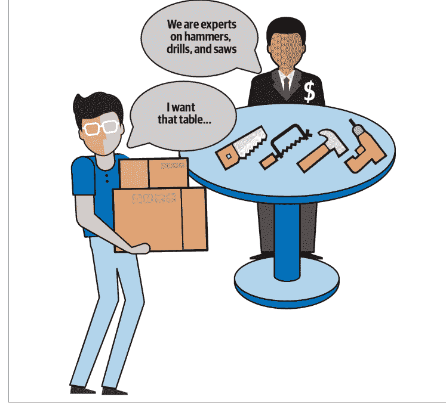

## 第8章

## 面向数据驱动未来的六个经验教训

> *一点点明天就能弥补许多昨天，真是奇妙。*
> 
> —John Guare

云数据湖架构的承诺在于它能够支持无限多样的场景。在前几章中，我们重点介绍了使用Spark和Hadoop风格技术进行数据处理的最常见模式。其他方面——例如对实时数据生成快速洞察的实时流处理，以及在数据湖上构建智能应用的高级分析场景——正在被快速采用。我们在前几章中涵盖的所有概念和框架都有一个共同点：在云数据湖的设计或实施的每个关键时刻，你都有选择，每个选择都伴随着成本、复杂性和灵活性之间的权衡。当你在设计云数据湖时做出这些决定时，自然会产生以下问题：

- 我如何知道自己做出了正确的选择？
- 随着我的组织发展壮大，数据湖上的场景也不断增加，我如何迭代并推动转型？
- 我如何确保我的组织能够敏捷地收集和处理下一批需求？
- 我如何思考全球战略并保持对组织需求的领先？

在本章中，我利用经验教训的形式，为你构建一个思考框架，以帮助你思考那些将助力你的组织实现数据价值的技术、文化和组织决策。

千里之行，始于足下。一旦迈出第一步，你很快就会看到自己飞速前进。

## 经验教训2：能力越大，责任越大——数据也不例外

数据为组织带来强大能力和多样化场景，其中一个重要方面是以负责任的方式端到端管理数据，遵守道德商业实践，并确保为客户提供公平公正的体验。

让我们看一个例子。在数据战略和云数据湖就位后，Klodars公司利用社交媒体趋势，并将其与销售和客户数据关联，以了解消费模式。它发现30至45岁的客户倾向于点击社交媒体上的活动和广告，从其网站购买雨伞和雨具。这帮助其营销部门定向开展活动，并为该年龄段的客户提供折扣和促销。虽然这对业务有帮助，但Klodars无意中优化了针对该年龄段客户的业务，可能产生边缘化老年客户的副作用。老年客户不在该网站购买的原因之一，可能是他们没有像其他人群那样活跃地使用社交媒体，结果对公司不利。从长远来看，这也会影响业务，因为一旦30至45岁市场饱和，Klodars就没有扩展的途径了。

尽管这是我为了说明负责任数据战略问题而编造的例子，但它与现实相距不远。根据《华盛顿邮报》的文章《医疗算法中的种族偏见：白人患者优于病情更重的黑人患者》，一家名为Optum的医疗服务提供商利用数据来了解哪些患者群体可以从额外医疗护理中受益。不幸的是，该公司目前正在接受调查，因为其算法涉嫌因数据集偏向于我们人口中的某一群体而损害了黑人患者的健康需求。

为了确保你在云数据湖战略中从一开始就采用正确的治理、安全和道德实践，以下是一些你可以实施的做法：

纳入并咨询组织中的专家，主动识别数据风险

你的组织中很可能有一个负责其他业务领域的监管机构；这可能是法律部门、合规组织或任何监管事务部门。尽早让他们参与进来，确保你了解与数据相关的风险和最佳实践，并将这些纳入数据湖设计和实施中。与……一起评审你的数据战略

你的监管团队，并纳入他们的反馈。如果他们不了解数据相关风险和最佳实践，确保他们与行业专家和文章进行后续交流，以便为你提供恰当级别的建议。

## *向客户提供透明度，并尊重他们的隐私*

当你收集客户数据时，请确保对他们保持透明，说明你将收集哪些数据以及你将如何使用这些数据。此外，确保你尊重他们的隐私，并为他们提供一种方式来同意共享他们的数据。确保你的数据收集、存储和处理符合隐私和合规政策。这些政策的一些示例包括 **GDPR** 和 **CCPA**。如需完整列表，请咨询你所在组织的专家。同样重要的是，你要么在数据处理过程中清除 PII，要么如果你出于特定原因存储它，明确征求同意，以在实现中保护消费者隐私和安全。

## *尽最大努力识别、预测并避免不平等或不公平的结果*

随着你的数据资产不断增长，并且你更多地利用先进的机器学习技术，识别算法中的不公平结果变得更加困难，例如我们之前讨论的 Optum 案例。此外，任何软件都会存在缺陷，你肯定希望确保这些缺陷不会给客户带来不愉快或不公平的结果，尤其是在涉及他们的数据时。作为数据策略或需求定义的一部分，让你的专家参与进来，在涉及数据时添加关于公平性和伦理的具体要求。特别是如果你在解决方案中使用 AI，数据和算法中的偏差可能会产生意想不到的副作用，这使得对伦理和公平性的投入更加重要。诸如 **AI 伦理全球视角** 之类的课程可以帮助你在这方面建立更多的意识和知识。在实现中将这些要求视为高优先级。归根结底，建立对数据的信任为建立客户对你组织的信任奠定了坚实的基础。

## *确保你同时拥有主动和被动框架来处理数据相关问题*

除了在数据湖策略中主动识别和设计这些最佳实践之外，你还需要具备快速响应事件的能力。类似于你在发布后为支持代码所做的设计，确保你已建立护栏和控制措施来缓解数据问题。投资于数据可观测性，为你的数据确定 SLA 和 SLO，并对其进行监控。

总而言之，确保你在数据策略和云数据湖实现中做到负责任、合乎伦理且公平。此外，与你的云服务提供商和 ISV 讨论他们的公平实践。你在考虑和优先处理这些方面时越主动，你就越能为更顺利的实现和运营做好准备。

## 第 3 课：客户引领技术，而非相反

大数据和分析对技术专家来说是令人兴奋的领域。这些问题非常开放，在这个领域里有大量的创新机会。Apache 软件基金会在大数据技术类别下有 56 个项目，每次我参加数据会议时，我都会对越来越多的供应商设立展位（无论是线下还是线上）印象深刻。当涉及到对你和你的组织重要的事情时，你要避免的一个陷阱是被特定技术的前景所诱惑，后来却发现它们并不在真正重要的客户和业务关键路径上。始终从界定和优先排序你的业务和客户需求开始，然后找到适合你需求的技术。

例如，Klodars 公司已经为其云数据湖实现确定了两个关键场景：为高管销售仪表板提供支持，以及利用社交媒体信息流构建有针对性的营销活动。负责数据平台团队的 Alice 意识到有一个实时的社交媒体信息流流式服务，可以提供社交媒体的实时趋势。虽然这对 Alice 来说非常令人兴奋，但她与数据科学家和营销团队交谈后意识到，实时趋势对他们来说并不关键。相反，他们需要一种按日导入社交媒体信息流的方式，以分析和了解数周内的长期趋势。尽管这项服务提供了创新的技术，但它对她业务需求并不关键，因此她没有立即优先考虑它。

或者考虑一个现实生活中的类比，如图 8-1 所示：当你想买家具时，你不会去商店要求拥有疯狂技能的木匠使用电锯或电钻；你想看到一张适合你书房或餐厅的桌子。同样，当你实现数据湖时，你总是从需求开始，正如我们在第 175 页的“决策框架第 1 阶段：评估”中看到的那样。每当你评估一项技术时，无论是一项服务还是一个服务提供商，确保你将对话集中在你的需求上，并从技术对你的成本和复杂性角度来评估它。技术是非常短暂的，并且可能随着时间的推移而过时；重要的是在你数据湖之上运行的场景的持久性。

图 8-1. 客户需求与技术

## 第 4 课：变化不可避免，所以要有所准备

作为第 195 页“第 3 课：客户引领技术，而非相反”的推论，本着以客户和业务需求为先的精神，你要适应变化，因为变化是不可避免的。好了，当我说变化时，我并不一定是指折腾。折腾指的是当活动和计划处于不断变化中时快速改变它们——这会扰乱你的组织，减缓你的进展。而变化是指需求中不可避免的变动，并帮助你周到地规划并执行这种变动。

对于数据湖而言，有些东西通常保持不变：存储和处理模式。变化可能来自以下任何一种方式：

### 添加新的组件以及处理或消费模式，以响应新的需求

例如，Klodars 公司实现了一个现代数据仓库架构，以支持业务分析师的销售仪表板和数据科学家的定向营销活动工作。随着客户在网站上购物，新的需求被确定下来，需要添加产品推荐功能，因此 Klodars 添加了一个实时处理管道，从网站摄入客户点击流数据，以提供相关推荐。

### 优化现有架构以获得更好的成本或性能

例如，Klodars 公司摄入了其数据库的备份来为其销售仪表板提供支持。然而，它发现备份的体积不断增长，随着时间的推移增加了数据湖存储的成本。此外，还有一些常见模式，如按地区、客户细分和销售人员来识别销售数据。Klodars 通过对数据存储进行优化，将这些数据库格式转换为 Apache Iceberg，由于高度压缩以及列式格式下对数据湖中数据的查询性能更快，这提供了更低的成本。

其中一些变化是增量式的，不会影响现有用例。然而，在某些情况下，你的变化是颠覆性的。确保妥善管理这些颠覆性变化，提前设定期望，并为客户的过渡提供更低障碍的路径。在进行这些过渡时，确保你支持现有设计，并为客户提供充足的时间迁移到新设计。

## 第 5 课：建立同理心，果断设定优先级

确实，数据和数据策略对组织至关重要；然而，除非你是数据或数据相关服务的提供者，否则数据本身只是实现业务或客户影响的手段。例如，如果你身处制造业，数据可以帮助解决预测性维护或供应链优化等关键用例。然而，数据平台本身的影响是通过设备故障率降低或库存减少来实现的，这就是业务语言。因此，可以合理推断，数据平台团队推动效率并优化自身运营是关键。就我个人经验而言，我经常看到数据平台是一个精简组织，需求量总是高于团队在特定时间内所能支持的。

重要的是，数据平台团队要通过确保精简团队能够扩展以满足不断增长的客户需求来为成功做好准备。同时，请确保你在任何时候都怀有对客户的同理心。你是数据专家；你的客户有其他专业领域，数据专业知识不应

be a requirement for them. In your investments, prioritize for end-to-end customer experiences that are seamless, and err on the side of saying no rather than offering a poorly implemented or half-baked solution.

Let me take a fictitious example to illustrate this point. Klodars Corporation has a data platform team that needs to serve sales, marketing, and the rain gear product line as well as a recent acquisition of a winter gear business. So the team implements a data mesh architecture and offers blueprints for a data lake domain that these customers can implement with a self-serve model. The blueprint includes templates to provision cloud resources required for the data lake, and the customers can choose the cloud services. However, the sales, marketing, and rain gear teams do not have enough information on whether they need to choose a data lake alone or a data lake and data warehouse. So the sales and marketing teams approach the data platform team with questions. But the rain gear product team chooses a data lake alone, when its need is to build a warehouse for its supply chain inventory. This ends up creating dissatisfaction for the customers while increasing the load for the data platform team, who has to react to their questions and issues.

An alternative path for the data platform team would be to do an end-to-end implementation with the sales and marketing team while deprioritizing the use cases for the time being for the other customers. Based on the learnings from this implementation, the data platform team can evaluate the readiness for a self-serve architecture with a data mesh and roll it out more broadly.

In summary, setting expectations up front is more optimal than setting the customer up for disappointment later. Be transparent and clear about your prioritizations, and set expectations with your customers about when you’ll be able to serve them.

## Lesson 6: Big Impact Does Not Happen Overnight

Finally, this is probably more of a life lesson that also applies to data lake architectures. The culmination of big impact has many steps and lessons and failures behind it. Cloud data lake architectures offer great promise, but they also require a lot of learning and iterations before you get them right. As an example, Apache Iceberg, a very popular open source technology that supports the lakehouse pattern today, had humble beginnings in Netflix, which started with an implementation to overcome the then-shortcomings of Amazon S3 object storage. The Netflix team believed in the power of data for its organization and thoughtfully implemented Apache Iceberg to serve its customers with high-quality data with strong guarantees on top of lower-cost object storage. As they say, the rest is history, and you can learn more about this by revisiting “Apache Iceberg” on page 157.

Plan for customer impact, and prepare to learn and fine-tune as you progress. Make choices based on the impact they offer to customers, and stay consistent in your implementation while keeping open-minded for learnings. Especially if you are an early adopter of a technology, you can help develop the technology with the provider and thus get ample support from the technology provider in return. Similarly, identify highly motivated early adopters within your customer base and offer to develop your solution with them. Celebrate your successes together, and share your credits.

## Summary

I was brainstorming with my editors on various ways to end this book, and I thought it fitting that I end with a set of six lessons that you can apply regardless of where you’re in your data lake journey. First and foremost, huge kudos to you for taking this step, and remember that you’re already on your path to innovating your business—it is only a matter of time before things fall into place. Data is the future, and cloud is where this future is happening as we speak. We’re all part of defining this future by investing in cloud data lakes.

The technologies and cloud offerings themselves have seen rapid improvements over time, and these changes can be overwhelming. I personally always start with the basics of what is important to a project and why it is important, and I have structured my book to build this fundamental framework that can be leveraged in spite of the technologies used. To keep on top of the various technologies, I recommend that you watch the conferences from data vendors and public cloud providers to stay abreast of trends. There are also a ton of resources available for various technologies on podcasts and YouTube. I would especially recommend that, in addition to watching the sessions from the technology builders, you watch the customer sessions on what problems they solved, which will give you great ideas. Data+AI Summit is one of my favorite conferences, and the sessions are available on demand for your viewing.

We’re at that point where this book has reached its natural conclusion, and I thank you for being a great audience. I’m really excited to learn more about where your cloud data lake journey takes you. If you want to share your experiences or ask a question, or you want to brainstorm about what is a good choice for you, reach out to me, and I’ll be more than happy to chat more. I’m on Twitter as @rukmanigopalan, and you can find me on LinkedIn at https://www.linkedin.com/in/rukmanig.
