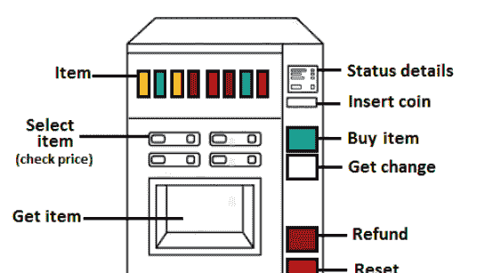
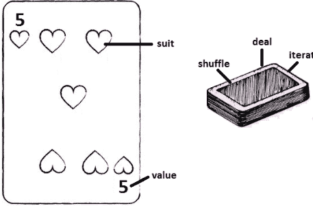
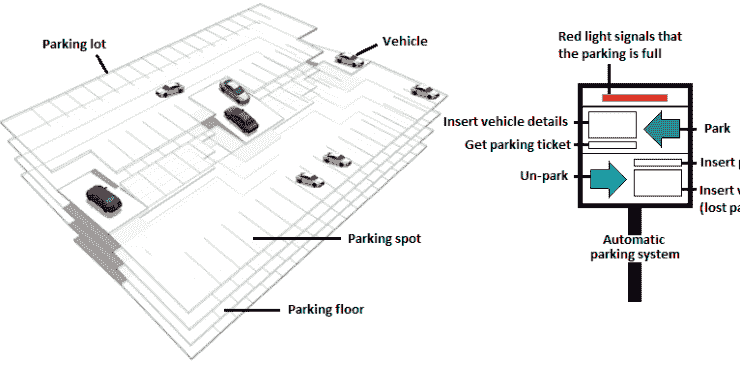
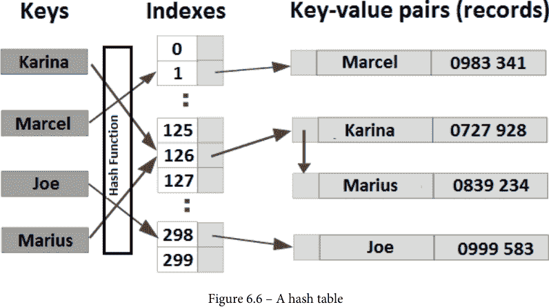

# 3
## 一般非技术性问题及回答方法

在本章中，我们将处理非技术性面试问题的核心方面。面试的这一部分通常由招聘经理甚至人力资源人员进行。准备这场面试意味着要熟悉以下问题：

- 非技术性问题的目的是什么？
- 你的经验是什么？
- 你最喜欢的编程语言是什么？
- 你想做什么？
- 你的职业目标是什么？
- 你的工作风格是什么？
- 你为什么想换工作？

## 1. 全球跨境电商物流市场持续增长

近年来，全球跨境电商物流市场规模持续扩大。数据显示，2026年全球跨境电商物流市场规模预计将达到约2.5万亿美元，年复合增长率保持在12%以上。

随着全球化进程的加快和数字经济的蓬勃发展，跨境电商已成为推动国际贸易增长的重要引擎。物流作为跨境电商的关键环节，其效率和成本直接影响着整个产业链的运作。

北美、欧洲和亚太地区是全球跨境电商物流的主要市场，其中亚太地区增长最为迅速。新兴市场的崛起和消费升级趋势，为跨境电商物流行业带来了巨大的发展机遇。

## 2. 跨境电商物流行业发展趋势

跨境电商物流行业正朝着智能化、数字化、绿色化方向发展。物流企业积极拥抱新技术，不断提升服务质量和运营效率。

智能仓储、自动化分拣、大数据预测、区块链溯源等技术的应用，正在重塑跨境电商物流的服务模式。物流企业通过技术创新，实现了对跨境物流全链条的可视化管理和智能决策。

同时，绿色物流理念逐渐深入人心。越来越多的物流企业开始采用环保包装、优化运输路线、推广新能源运输工具，以实际行动践行可持续发展承诺。


图：2019-2026年全球跨境电商物流市场规模走势图

大多数时候，问题需要某种形式的数据（字符串、数字、位、对象等）操作，例如排序、排序、过滤、反转、展平、搜索、计算等。数据存在的地方，也存在数据结构（数组、列表、集合、映射、树等）。诀窍在于找到所需的数据操作与数据结构之间的适当匹配。通常，适当的匹配意味着以下几点：

- 你可以轻松地对数据结构应用某些操作。
- 你可以获得良好的性能（Big O – 参见 *第7章，算法的Big O分析*）。
- 你可以保持所使用的数据结构之间的和谐。这意味着你不需要繁重或复杂的算法，也不需要进行转换来在数据结构之间移动/利用数据。

这些是拼图的重大部分。设法识别适当的匹配就是工作的一半。另一半是将这些部分组合起来形成解决方案。换句话说，你需要将逻辑带入等式。

在阅读问题后或在理解问题并在脑海中勾勒出解决方案的大致轮廓后，立即开始编码是非常诱人的。*不要那样做！* 通常，这会导致一系列失败，使你失去耐心。很快，你所有的想法都将被一层浓厚的怀疑迷雾所包围，你会开始仓促编码，甚至出现荒谬的错误。

> **重要提示**
> 
> 在开始编码之前，花时间深入思考解决方案。

现在，是时候开始编码你的解决方案并用你的编码技能给面试官留下深刻印象了。

# 编码骨架

从骨架开始编码解决方案。更准确地说，在没有实现（行为/操作）的情况下定义你的类、方法和接口。你将在下一步用代码填充它们。这样，你就向面试官展示了你的编码阶段遵循一条清晰的路线。不要太仓促地跳入代码？此外，尊重编程的基本原则，例如 **单一职责、开放-封闭、里氏替换、接口隔离、依赖倒置（SOLID）** 和 **不要重复自己（DRY）**。面试官很可能会关注这些原则。

## 什么是封装？

你在回答中应封装的关键点如下：

- 封装是OOP的核心概念之一。
- 封装是一种技术，通过该技术对象的状态被隐藏在外部世界之外，并公开一组用于访问此状态的公共方法。
- 当每个对象在其类内部将状态保持为私有 时，就实现了封装。
- 封装被称为 *数据隐藏* 机制。
- 封装具有许多重要的优势，例如松耦合、可重用、安全且易于测试的代码。
- 在Java中，封装是通过访问修饰符实现的 – `public`、`private` 和 `protected`。

现在，我们可以按如下方式呈现答案：

*封装是OOP的核心概念之一。* 主要地，封装将代码和数据绑定在一起形成一个单一的工作单元（一个类），并充当防御盾，不允许外部代码直接访问此数据。主要地，*它是隐藏对象状态以免外部世界看到并公开一组用于访问此状态的* `public` *方法的技术。当每个对象在其类内部将状态保持为* `private` *时，我们可以说封装已经实现。这就是为什么封装也被称为* **数据隐藏机制**。*利用封装的代码是松耦合的*（例如，我们可以更改类变量的名称而不会破坏客户端代码），可重用、安全（客户端不知道数据在类内部是如何操作的），并且易于测试（测试方法比测试字段更容易）。在Java中，封装可以通过访问修饰符 `public`、`private` 和 `protected` 实现。通常，当一个对象管理自己的状态时，其状态通过 `private` 变量声明，并通过 `public` 方法访问和/或修改。让我们考虑一个例子：一个Cat类可以用mood、hungry和energy等字段表示其状态。虽然Cat类外部的代码不能直接修改这些字段中的任何一个，但它可以调用 `public` 方法，例如 `play()`、`feed()` 和 `sleep()`，这些方法在内部修改Cat状态。Cat类也可能有 `private` 方法，这些方法在类外部不可访问，例如 `meow()`。这就是封装。

如果需要进一步的细节，那么你可以使用屏幕共享或使用纸和笔来编写你的示例。


## 遵循 ISP

为了遵守 ISP，我们需要分离 Connection 接口。由于 connect() 方法是任何客户端都必需的，我们将其保留在此接口中：

```
public interface Connection {
    public void connect();
}
```

http() 和 socket() 方法被分布到分别扩展 Connection 接口的独立接口中，如下所示：

```
public interface HttpConnection extends Connection {
    public void http();
}
```

```
public interface SocketConnection extends Connection {
    public void socket();
}
```

这次，WwwPingConnection 类可以仅实现 HttpConnection 接口并使用 http() 方法：

```
public class WwwPingConnection implements HttpConnection {
    private final String www;

    public WwwPingConnection(String www) {
        this.www = www;
    }

    @Override
    public void http() {
        System.out.println("Setup an HTTP connection to "
            + www);
    }
}
```

```
@Override
public void connect() {
    System.out.println("Connect to " + www);
}
}
```

完成！现在，代码遵循了 ISP。完整的应用程序名为 *InterfaceSegregationPrinciple*。继续前进，让我们谈谈 SOLID 的最后一个原则，依赖倒置原则。

## 什么是 DIP？

你应该在回答中概括的关键点如下：

- *D* 代表 **依赖倒置原则 (DIP)**。
- *D* 代表 *依赖抽象，而非依赖具体实现*。
- *D* 维持使用抽象层来绑定具体的模块，而不是让具体的模块依赖于其他具体的模块。
- *D* 维持具体模块的解耦。

现在，我们可以按如下方式给出答案：

首先，SOLID 是罗伯特·C·马丁，也被称为 Uncle Bob (*可选短语*) 提出的首五个 **面向对象设计 (OOD)** 原则的缩写。*D* 是 SOLID 中的最后一个原则，被称为 **依赖倒置原则 (DIP)**。该原则代表 *依赖抽象，而非依赖具体实现*。这意味着我们应该 *依赖抽象层来绑定具体的模块，而不是让具体的模块依赖于其他具体的模块*。为了实现这一点，所有具体模块都应仅暴露抽象。这样，具体模块允许扩展功能或插入另一个具体模块，同时保持具体模块的解耦。通常，高耦合发生在高级具体模块与低级具体模块之间。

如果需要进一步的细节，那么你可以使用屏幕共享或使用纸和笔来编码一个示例。

一个数据库 JDBC URL，`PostgreSQLJdbcUrl`，可以是一个低级模块，而一个连接到数据库的类可能代表一个高级模块，例如 `ConnectToDatabase#connect()`。

接下来，PostgreSQLJdbcUrl 实现 JdbcUrl 以返回特定于 PostgreSQL 数据库的 JDBC URL：

```
public class PostgreSQLJdbcUrl implements JdbcUrl {

    private final String dbName;

    public PostgreSQLJdbcUrl(String dbName) {
        this.dbName = dbName;
    }

    @Override
    public String get() {
        return "jdbc://..." + this.dbName;
    }
}
```

以完全相同的方式，我们可以编写 MySQLJdbcUrl、OracleJdbcUrl 等。最后，ConnectToDatabase#connect() 方法依赖于 JdbcUrl 抽象，因此它可以连接到实现此抽象的任何 JDBC URL：

```
public class ConnectToDatabase {

    public void connect(JdbcUrl jdbcUrl) {
        System.out.println("Connecting to " + jdbcUrl.get());
    }
}
```

完成！完整的应用程序名为 DependencyInversionPrinciple。

到目前为止，我们已经涵盖了 OOP 基本概念和流行的 SOLID 原则。如果你计划申请一个包括应用程序设计和架构的 Java 职位，那么建议你也看看通用职责分配软件原则 (GRASP)（https://en.wikipedia.org/wiki/GRASP_(object-oriented_design)）。这在面试中不是热门话题，但你永远不知道！

- 重写方法不能降低被重写方法的访问性，但相反是可以的。
- 重写方法不能抛出比被重写方法抛出的受检异常更高层次的异常。
- 对于重写方法，始终使用 `@Override` 注解。

Java 中重写方法的示例可在本书捆绑的代码中找到，名称为 *MethodOverriding*。

## 什么是 OOP（Java）中的方法重载？

*方法重载是一种面向对象编程技术，允许开发者编写两个方法（均为静态或非静态）具有相同的名称，但签名不同且功能不同。* 通过不同的签名，我们理解为参数数量不同、参数类型不同和/或参数列表顺序不同。*返回类型不是方法签名的一部分。* 因此，两个方法具有相同的签名但返回类型不同的情况不是有效的方法重载情况。所以，这是一种强大的技术，允许我们编写具有相同名称但输入不同的（静态或非静态）方法。*编译器将重载的方法调用绑定到实际方法；因此，运行时不进行绑定。* 方法重载的著名示例是 `System.out.println()`。`println()` 方法有几种重载形式。

因此，有四个主要规则来规范方法重载：

- 重载是通过改变方法签名实现的。
- 返回类型不是方法签名的一部分。
- 我们可以重载 `private`、`static` 和 `final` 方法。
- 我们可以在同一类中重载方法（但不能在同一类中重写它）。

如果需要进一步的细节，你可以尝试编码一个示例。Java 中重载方法的示例可在本书捆绑的代码中找到，名称为 *MethodOverloading*。

## 重要说明

> 除了上述两个问题之外，你可能还需要回答一些其他相关问题，包括 *什么规则规范方法重载和重写（见上文）？*、*方法重载和重写之间主要有什么区别（见上文）？*、*我们能否重写静态或私有方法*（简短答案是 *否*，见上文）？、*我们能否重写 final 方法*（简短答案是 *否*，见上文）？、*我们能否重载静态方法*（简短答案是 *是*，见上文）？、*我们能否更改重写方法的参数列表*（简短答案是 *否*，见上文）？因此，建议提取并准备这些问题的答案。所有所需信息均可在前一节中找到。
> 
> 另外，请注意诸如 *我们是否只能通过 final 修饰符来防止方法重写？* 这样的问题。这种措辞旨在混淆候选人，因为答案需要对所涉及的概念进行概述。这里的答案可以表述为 *这不是真的，因为我们也可以通过将方法标记为 private 或 static 来防止方法重写。这样的 方法不能被重写。*

继续前进，让我们检查与重写和重载方法相关的几个其他问题。

## 什么是 Java 中的协变方法重写？

协变方法重写是 Java 5 中引入的较少为人知的特性。通过此特性，*重写方法可以返回其实际返回类型的子类型。* 这意味着重写方法的客户端不需要对返回类型进行显式类型转换。例如，Java 的 `clone()` 方法返回 `Object`。这意味着，当我们重写此方法以返回克隆时，我们得到一个必须显式转换为我们需要的 `Object` 的实际子类。*然而，如果我们利用 Java 5 的协变方法重写特性，那么重写的 `clone()` 方法可以直接返回所需子类而不是 `Object`。*


几乎总是，这样的问题需要示例作为答案的一部分，所以让我们考虑实现 `Cloneable` 接口的 `Rectangle` 类。`clone()` 方法可以返回 `Rectangle` 而不是 `Object`，如下所示：

```java
public class Rectangle implements Cloneable {

    ...

    @Override
    protected Rectangle clone()
            throws CloneNotSupportedException {

        Rectangle clone = (Rectangle) super.clone();

        return clone;
    }
}
```

调用 `clone()` 方法不需要显式强制转换：

```java
Rectangle r = new Rectangle(4, 3);
Rectangle clone = r.clone();
```

完整应用程序名为 *CovariantMethodOverriding*。请注意关于协变方法重写的较间接的问题。例如，可以这样表述：*在重写时，我们可以将方法的返回类型修改为子类吗？*这个问题的答案与 *Java 中什么是协变方法重写？* 相同，这里讨论。

> **重要说明**
> 
> 知道针对 Java 较少为人知特性的问题的答案，在面试中可能是一个很大的加分项。这向面试官表明你有深层次的知识，并且跟上了 Java 的发展。如果你需要通过大量示例和最少理论来快速更新 JDK 8 到 JDK 13 的所有特性，那么你会喜欢我由 Packt 出版的名为 *Java Coding Problems* 的书（packtpub.com/au/programming/java-coding-problems）。

## 在重写和重载方法时，处理异常的主要限制是什么？

首先，让我们讨论重写方法。*如果讨论非受检异常，那么我们必须说在重写方法中使用它们没有限制。* 这样的方法可以抛出非受检异常，因此可以是任何 `RuntimeException`。另一方面，*对于受检异常，重写方法只能抛出被重写方法的受检异常或该受检异常的子类。* 换句话说，重写方法不能抛出比被重写方法抛出的受检异常范围更广的受检异常。例如，如果被重写方法抛出 `SQLException`，那么重写方法可以抛出诸如 `BatchUpdateException` 的子类，但不能抛出诸如 `Exception` 的父类。

第二，让我们讨论重载方法。*这样的方法不施加任何限制。* 这意味着我们可以根据需要修改 `throw` 子句。

> **重要说明**
> 
> 注意那些措辞如 *主要问题是什么...？，你能列举某些...？，你能指定...？，你能强调...？* 等等的问题。通常，当问题包含诸如 *主要、某些、指定* 和 *强调* 等词时，面试官期望一个清晰简洁的答案，听起来像是一个项目符号列表。回答这类问题的最佳做法是直接进入回答，并将每一项列举为一个压缩而有意义的陈述。不要犯常见的错误，在给出预期答案之前对涉及的概念进行长篇大论。面试官希望看到你综合和提炼事物并提取本质的能力，同时检查你的知识水平。

如果需要更多细节，那么你可以编写一个类似于本书附带代码中的示例。请考虑查看 *OverridingException* 和 *OverloadingException* 应用程序。现在，让我们继续更多问题。

## 如何从子类重写方法中调用父类被重写的方法？

我们可以通过 Java 的 `super` 关键字从子类重写方法中调用父类被重写的方法。例如，考虑一个包含方法 `foo()` 的父类 A，以及名为 B 的 A 的子类。如果我们在子类 B 中重写 `foo()` 方法，并从重写方法 B#foo() 中调用 `super.foo()`，那么我们调用了被重写的方法 A#foo()。

## 我们可以重写或重载 main() 方法吗？

我们必须记住，`main()` 方法是静态的。这意味着我们可以重载它。但是，我们不能重写它，因为静态方法在编译时解析，而我们可以重写的方法在运行时根据对象的类型解析。

## 在 Java 中，我们可以将非静态方法重写为静态方法吗？

不。*我们不能将非静态方法重写为静态方法。* 此外，反过来也不可能。两者都会导致编译错误。

> **重要说明**
> 
> 像前面两个问题那样切中要害的问题，值得简短而简洁的回答。面试官抛出这类闪电式问题是为了衡量你分析情况并做出决策的能力。主要来说，答案很简短，但你需要一些时间来说“是”或“不是”。这类问题分值不高，但如果你不知道答案，可能会产生严重的负面影响。如果你知道答案，面试官可能会在心里说：*嗯，好吧，反正这是个简单的问题！但是，如果你不知道答案，那么他可能会说，他错过了一个简单的问题！她/他的基础知识存在严重缺陷。*

接下来，让我们看看与其他面向对象概念相关的更多问题。

```java
}

@Override
public void slowDown() {
    System.out.println("Slow down the steam car ...");
}
}
```

由于 `SteamCar` 类实现了 `Vehicle` 接口，它重写了 `speedUp()` 和 `slowDown()` 方法。过了一段时间，汽油汽车被发明了，人们开始关心马力和燃油消耗。因此，我们的代码必须演进以支持汽油汽车。为了计算消耗水平，我们可以通过添加 `computeConsumption()` 默认方法来演进 `Vehicle` 接口，如下所示：

```java
public interface Vehicle {

    public void speedUp();

    public void slowDown();

    default double computeConsumption(int fuel,
            int distance, int horsePower) {
        // simulate the computation
        return Math.random() * 10d;
    }
}
```

演进 `Vehicle` 接口不会破坏 `SteamCar` 的兼容性。此外，电动汽车也被发明了。计算电动汽车的消耗与汽油汽车不同，但公式依赖于相同的术语：燃料、距离和马力。这意味着 `ElectricCar` 将重写 `computeConsumption()`，如下所示：

```java
public class ElectricCar implements Vehicle {

    private String name;
    private int horsePower;
```

> **重要说明**
> 
> 当你必须列举两个概念之间的一系列差异或相似之处时，注意将你的答案限制在问题设定的范围内。例如，对于前面的问题，不要说一个差异在于接口支持多重继承而抽象类不支持。这是接口和类之间的一般差异，而不是 Java 8 接口和抽象类之间的具体差异。

## 抽象类和接口之间的主要区别是什么？

在 Java 8 之前，抽象类和接口之间的主要区别在于，抽象类可以包含非抽象方法，而接口不能包含此类方法。从 Java 8 开始，主要区别在于，抽象类可以有构造器和状态，而接口两者都不能有。

## 我们可以有一个没有抽象方法的抽象类吗？

是的，我们可以。通过向类添加 `abstract` 关键字，它就变成了抽象类。它不能被实例化，但它可以有构造器和仅有非抽象方法。

## 我们可以有一个同时是抽象和 final 的类吗？

一个 final 类不能被继承。抽象类是为了被扩展而使用的。因此，final 和抽象是两个相反的概念。这意味着它们不能同时应用于同一个类。编译器将抛出一个错误。

## 多态、重写和重载之间有什么区别？

在这个问题的上下文中，重载技术被称为**编译时多态**，而重写技术被称为**运行时多态**。重载涉及使用静态（或早期）绑定，而重写使用动态（或晚期）绑定。


如果需要进一步的细节，那么你可以写一个示例。考虑 `Vehicle` 超类拥有 `move()` 静态方法：

```
```java
public class Vehicle {

    public static void move() {
        System.out.println("Moving a vehicle");
    }
}
```
```

现在，考虑 `Car` 子类拥有相同的静态方法：

```
```java
public class Car extends Vehicle {

    // this method hides Vehicle#move()
    public static void move() {
        System.out.println("Moving a car");
    }
}
```
```

现在，让我们从 `main()` 方法调用这两个静态方法：

```
```java
public static void main(String[] args) {

    Vehicle.move(); // call Vehicle#move()
    Car.move();     // call Car#move()
}
```
```

输出结果显示这两个静态方法相互隐藏：

```
```text
Moving a vehicle
Moving a car
```
```

注意我们是通过类名调用静态方法。通过实例调用静态方法是非常不好的做法，所以在面试中要避免这样做！

## 我们可以在 Java 中编写虚方法吗？

可以！实际上，在 Java 中，所有非静态方法默认都是虚方法。我们可以通过使用 `private` 和/或 `final` 关键字来编写一个非虚方法。换句话说，可以被继承以实现多态行为的方法是虚方法。或者，如果我们反过来思考这个说法，那么不能被继承（标记为 `private`）的方法和不能被重写（标记为 `final`）的方法是非虚的。

## 多态和抽象有什么区别？

抽象和多态代表了两个相互依存的基本 OOP 概念。抽象允许开发者设计可重用且可定制的通用解决方案，而多态允许开发者在运行时推迟选择应执行代码。抽象通过接口和抽象类实现，而多态则依赖于重写和重载技术。

## 你认为重载是实现多态的一种方法吗？

这是一个有争议的话题。有些人并不认为重载是多态；因此，他们不接受编译时多态的观点。这些声音坚持认为只有重写方法才是真正的多态。支持这一说法的论点是，只有重写才能让代码根据运行时条件表现出不同的行为。换句话说，表现出多态行为是方法重写的特权。我认为只要我们理解重载和重写的 premises，我们也就能理解这两种变体如何支撑多态行为。

**重要提示**
涉及有争议话题的问题很微妙，很难正确处理。因此，建议直接用这句话跳入答案：*This is a controversial topic.* 当然，面试官也想听听你的观点，但他会很高兴看到你了解问题的两面。作为经验法则，尽量客观地回答，不要以激进或论据不足的方式偏向某一面。争议性的事物最终仍然是有争议的，现在并不是澄清它们的时候和地点。

好，现在让我们继续进行一些基于 SOLID 原则和著名的必不可少的 **Gang Of Four (GOF)** 设计模式的问题。注意，本书不涵盖 GOF 设计模式，但有许多优秀的书籍和视频专门致力于这个主题。我推荐你尝试 *Learn Design Patterns with Java*，作者 Aseem Jain（`https://www.packtpub.com/application-development/learn-design-patterns-java-video`）。

## 哪种 OOP 概念服务于装饰器设计模式？

服务于装饰器设计模式的 OOP 概念是 **组合**。通过这种 OOP 概念，装饰器设计模式可以在不修改原始类的情况下提供新功能。

## 何时应该使用单例设计模式？

单例设计模式似乎在我们只需要一个应用级（全局）类的实例时是合适的选择。尽管如此，单例应该谨慎使用，因为它会增加类之间的耦合，并在开发、测试和调试期间成为瓶颈。正如著名的 *Effective Java* 所指出的，使用 Java 枚举是实现此模式的最佳方式。依赖单例模式进行全局配置（例如，记录器、`java.lang.Runtime`）、硬件访问、数据库连接等是一个常见场景。

> **重要提示**
> 
> 每当你可以引用或提及著名参考资料时，就这样做。

## 策略模式和状态模式有什么区别？

状态设计模式旨在根据 *状态* 做某事（在不同的 *状态* 下表现出某些行为而不改变类）。而策略设计模式则旨在用于在不修改使用它的代码的情况下在一系列算法之间切换（客户端通过组合和运行时委托以互换方式使用算法）。此外，在状态模式中，我们有明确的 *状态* 转换顺序（流程是通过将每个 *状态* 链接到另一个状态创建的），而在策略模式中，客户端可以按任意顺序选择想要的算法。例如，状态模式可以定义向客户发送包裹的 *状态*。

包裹从 *ordered state* 开始，然后继续 *delivered state*，依此类推，直到它经过每个状态并到达最终 *状态*，客户 *received* 包裹为止。另一方面，策略模式为完成每个状态定义不同的策略（例如，我们可能有不同的策略来投递包裹）。

## 代理模式和装饰器模式有什么区别？

代理设计模式对于为某物提供访问控制网关很有用。通常，此模式创建代表真实对象的代理对象。对真实对象的每个请求都必须通过代理对象，代理对象决定如何以及何时将其转发给真实对象。装饰器设计模式从不创建对象，它只是在运行时用新功能装饰现有对象。虽然链接代理不是一个明智的做法，但在特定顺序下链接装饰器可以以正确的方式利用此模式。例如，虽然代理模式可以代表互联网的代理服务器，但装饰器模式可用于用不同的自定义设置装饰代理服务器。

## 外观模式和装饰器模式有什么区别？

虽然装饰器设计模式旨在为对象添加新功能（换句话说，装饰对象），但外观设计模式根本不添加新功能。它只是外观化现有功能（隐藏系统的复杂性），并在幕后通过向客户端公开的 *友好界面* 调用它们。外观模式可以公开一个简单的接口，该接口调用各个组件以完成复杂任务。例如，装饰器模式可用于通过用发动机、变速箱等装饰底盘来组装汽车，而外观模式可以通过公开一个简单的接口来隐藏组装汽车的复杂性，该接口可命令知道构建过程细节的工业机器人。

## 适配器模式和桥接模式的关键区别是什么？

适配器模式力求在现有代码（例如第三方代码）和新系统或接口之间提供兼容性，而我们无法修改现有代码。另一方面，桥接模式是预先实现的，旨在将抽象与实现解耦，以避免产生大量类。因此，适配器力求在事物设计之后提供兼容性（想想 A 来自 After），而桥接是预先构建的，以便让抽象和实现独立变化（想想 B 来自 Before）。虽然适配器充当两个独立工作但无法相互通信的系统之间的中间人（它们没有兼容的输入/输出），但桥接模式在我们的难题可以通过正交类层次结构解决，但我们因可扩展性问题和有限扩展而受阻时登场。例如，考虑两个类，ReadJsonRequest 和 ReadXmlRequest，它们能够从多个设备读取，例如 D1、D2 和 D3。D1 和 D2 只生成 JSON 请求，而 D3 只生成 XML 请求。通过适配器，我们可以在 JSON 和 XML 之间转换，这意味着这两个类可以与全部三个设备通信。另一方面，通过桥接模式，我们可以避免最终得到许多类，例如 ReadXMLRequestD1、ReadXMLRequestD2、ReadXMLRequestD3、ReadJsonRequestD1、ReadJsonRequestD2 和 ReadJsonRequestD3。

我们可以继续比较设计模式，直到完成所有可能的组合。最后几个问题涵盖了最流行的问题类型 Design Pattern 1 versus Design Pattern 2。强烈建议你挑战自己这类问题，并尝试识别两个或多个给定设计模式之间的相似性和差异。大多数时候，这些问题使用同一类别的两个设计模式（例如两个结构型或两个创建型模式），但它们也可以来自不同类别。在这种情况下，这是面试官期望听到的第一句话。因此，在这种情况下，首先说明所涉及的每个设计模式属于哪个类别。

注意我们跳过了所有简单的问题类型，例如，什么是接口？什么是抽象类？等等。通常避免此类问题，因为它们并不能说明太多关于你的理解水平，更像是背诵一些定义。面试官可以问抽象类和接口的主要区别是什么？，他可以从你的回答中推断出你是否知道接口和抽象类是什么。始终准备好举例。无法举出例子揭示了对事物本质的严重缺乏理解。


拥有面向对象编程知识只是完成了一半。另一半则是具备将这一知识应用于应用程序设计的远见和敏捷性。这正是我们在接下来的10个示例中要做的。请记住，我们关注的是设计，而不是实现。

## 编程挑战

接下来，我们将解决几个关于面向对象编程的编程挑战。对于每个问题，我们将遵循*第5章：如何应对编程挑战*中的图5.2。我们主要会先向面试官提问，例如*“设计约束是什么？”*通常，围绕OOD的编程挑战会由面试官以一般性的方式提出。这是有意为之，目的是让你询问设计约束的细节。

一旦我们对约束有了清晰的了解，就可以尝试一个示例（可以是草图、一步步的运行时可视化、项目符号列表等）。然后，我们找出算法/解决方案，最后提供设计骨架。

## 示例1：点唱机

**亚马逊、谷歌**

**问题：** 设计点唱机音乐设备的主要类。

**要问什么：** 点唱机播放什么介质——CD、MP3？我应该设计什么——点唱机的构建过程、它的工作原理，还是别的什么？它是免费点唱机还是需要投币？

**面试官：** 免费点唱机只播放CD吗？设计它的主要功能，从而设计它的运作方式。

```
private final CDPlayer cdPlayer;

public Jukebox(CDPlayer cdPlayer) {
    this.cdPlayer = cdPlayer;
}

@Override
public void nextSongBtn() {...}

// rest of Selector methods omitted for brevity
}
```

CDPlayer是点唱机的核心。通过Selector，我们控制CDPlayer的行为。CDPlayer必须能够访问可用的CD集合以及播放列表：

```
public class CDPlayer {

    private CD cd;

    private final Set<CD> cds;
    private final Playlist playlist;

    public CDPlayer(Playlist playlist, Set<CD> cds) {
        this.playlist = playlist;
        this.cds = cds;
    }

    protected void playNextSong() {...}
    protected void playPrevSong() {...}
    protected void addCD(CD cd) {...}
    protected void removeCD(CD cd) {...}

    // getters omitted for brevity
}
```

**要问什么：** 这是一个使用不同类型硬币和商品的自动售货机吗？它是否提供诸如查看商品价格、购买商品、退款和重置等功能？

**面试官：** 是的，完全正确！对于硬币，你可以考虑一分、五分、十分和二十五分。

**解决方案：** 为了理解我们的设计中应该涉及哪些类，我们可以尝试绘制一个自动售货机的草图。自动售货机有很多种类型。只需绘制一个你熟悉的（如下图中的那个）：



图6.2 – 自动售货机

首先，我们立即注意到商品和硬币非常适合用作Java枚举。我们有四种硬币和多种商品，因此可以编写两个Java枚举，如下所示。除以下代码外，你还可以使用这里的UML图：https://github.com/PacktPublishing/The-Complete-Coding-Interview-Guide-in-Java/blob/master/Chapter06/VendingMachine/VendingMachineUML.png

```
public enum Coin {
    PENNY(1), NICKEL(5), DIME(10), QUARTER(25);
    ...
}
```

```
public enum Item {
    SKITTLES("Skittles", 15), TWIX("Twix", 35) ...
    ...
}
```

自动售货机需要一个内部库存来跟踪商品和硬币的状态。我们可以将其泛型化设计如下：

```
public final class Inventory<T> {

    private Map<T, Integer> inventory = new HashMap<>();

    protected int getQuantity(T item) {...}
    protected boolean hasItem(T item) {...}
    protected void clear() {...}
    protected void add(T item) {...}
    protected void put(T item, int quantity) {...}
    protected void deduct(T item) {...}
}
```

接下来，我们关注客户端用来与自动售货机交互的按钮。正如你在之前的示例中看到的，通常将这些按钮提取为一个接口，如下所示：

```
public interface Selector {

    public int checkPriceBtn(Item item);
    public void insertCoinBtn(Coin coin);
    public Map<Item, List<Coin>> buyBtn();

    public List<Coin> refundBtn();
    public void resetBtn();
}
```

最后，自动售货机可以实现`Selector`接口，并提供一组用于完成内部任务的私有方法：

```
public class VendingMachine implements Selector {

    private final Inventory<Coin> coinInventory
        = new Inventory<>();
    private final Inventory<Item> itemInventory
        = new Inventory<>();
```

```
```java
private int totalSales;
private int currentBalance;

private Item currentItem;

public VendingMachine() {
    initMachine();
}

private void initMachine() {
    System.out.println("Initializing the
        vending machine with coins and items ...");
}

// override Selector methods omitted for brevity
}
```
```

完整的应用程序名为*VendingMachine*。通过借鉴上述两个示例，你可以尝试设计ATM机、洗衣机以及类似的东西。

## 示例3：扑克牌

**亚马逊、谷歌、Adobe、微软**

**问题：** 设计一副通用扑克牌的主要类。

**要问什么：** 既然一张牌几乎可以是任何东西，你能定义*通用*吗？

**面试官：** 一张牌以花色和点数来表征。例如，考虑一副标准的52张牌。

**解决方案：** 为了理解我们的设计中应该涉及哪些类，我们可以快速绘制一张牌和一副标准52张牌的草图，如图6.3所示：



图6.3 – 一副扑克牌

由于每张牌都有花色和点数，我们将需要一个封装这些字段的类。我们称这个类为`StandardCard`。`StandardCard`的花色包含*黑桃、红心、方块*或*梅花*，因此花色很适合用Java枚举表示。`StandardCard`的点数可以在1到13之间。

一张牌可以独立存在，也可以成为一叠牌的一部分。多张牌组成一叠牌（例如，一副标准的52张牌就构成一叠牌）。一叠牌中的数量通常由可能的花色与点数的笛卡尔积得出（例如，4种花色 × 13个点数 = 52张牌）。因此，52个`StandardCard`对象构成`StandardPack`。

最后，一副扑克牌应该是一个能够对这个`StandardPack`执行某些操作的类。例如，一副扑克牌可以洗牌、发一手牌或发一张牌等。这意味着还需要一个`Deck`类。

到目前为止，我们已经确定要有一个Java枚举以及`StandardCard`、`StandardPack`和`Deck`类。如果再加上避免这些具体层之间高度耦合所需的抽象层，我们就会得到以下实现。除以下代码外，你还可以使用这里的UML图：`https://github.com/PacktPublishing/The-Complete-Coding-Interview-Guide-in-Java/blob/master/Chapter06/DeckOfCards/DeckOfCardsUML.png`

- 标准扑克牌实现：

```
```java
public enum StandardSuit {
    SPADES, HEARTS, DIAMONDS, CLUBS;
}
```
```

```
}

public abstract class Card {

    private final Enum suit;
    private final int value;

    private boolean available = Boolean.TRUE;

    public Card(Enum suit, int value) {
        this.suit = suit;
        this.value = value;
    }

    // code omitted for brevity
}

public class StandardCard extends Card {

    private static final int MIN_VALUE = 1;
    private static final int MAX_VALUE = 13;

    public StandardCard(StandardSuit suit, int value) {
        super(suit, value);
    }

    // code omitted for brevity
}
```

- 标准牌组的实现给出以下代码：

```
public abstract class Pack<T extends Card> {

    private List<T> cards;

    protected abstract List<T> build();
```


```java
public int packSize() {
    return cards.size();
}

public List<T> getCards() {
    return new ArrayList<>(cards);
}

protected void setCards(List<T> cards) {
    this.cards = cards;
}
}

public final class StandardPack extends Pack {

    public StandardPack() {
        super.setCards(build());
    }

    @Override
    protected List<StandardCard> build() {

        List<StandardCard> cards = new ArrayList<>();

        // code omitted for brevity

        return cards;
    }
}
```

- 牌组（Deck）实现提供以下代码：

```java
public class Deck<T extends Card> implements Iterable<T> {

    private final List<T> cards;

    public Deck(Pack pack) {
```
```
this.cards = pack.getCards();
}

public void shuffle() {...}
public List<T> dealHand(int numberOfCards) {...}
public T dealCard() {...}
public int remainingCards() {...}
public void removeCards(List<T> cards) {...}

@Override
public Iterator<T> iterator() {...}
}
```

可以快速编写如下演示代码：

```
// create a single classical card
Card sevenHeart = new StandardCard(StandardSuit.HEARTS, 7);

// create a complete deck of standards cards
Pack cp = new StandardPack();
Deck deck = new Deck(cp);

System.out.println("Remaining cards: "
    + deck.remainingCards());
```

此外，通过扩展 Card 和 Pack 类，你可以轻松添加更多类型的牌。完整代码名为 DeckOfCards。

## 示例 4：停车场

Amazon、Google、Adobe、Microsoft

问题：设计停车场的主要类。

需要澄清的问题：停车场是单层还是多层？所有停车位是否相同？我们要停放什么类型的车辆？停车是否免费？是否需要使用停车票？

**面试官：**这是一个同步自动化的多层免费停车场。所有停车位大小相同，但我们预期有汽车（需要 1 个车位）、面包车（需要 2 个车位）和卡车（需要 5 个车位）。其他类型的车辆应该无需修改代码即可添加。系统会发放一张停车票，之后可用于取车。但如果驾驶员只提供车辆信息（假设票据丢失），系统仍应能正常工作，在停车场中定位该车辆并将其取出。

**解决方案：**为了理解设计中应该涉及哪些类，我们可以快速勾勒一个停车场，以识别主要参与者和行为，如图 6.4 所示：



图 6.4 – 停车场

该图揭示了两个主要参与者：停车场和自动停车系统。

首先，让我们聚焦于停车场。停车场的主要目的是停放车辆；因此，我们需要构建可接受的车辆类型（汽车、面包车和卡车）。这看起来像是抽象类（`Vehicle`）和三个子类（`Car`、`Van` 和 `Truck`）的典型案例。但事实并非如此！驾驶员提供的是其车辆的信息，并不会真的把车辆（对象）推入停车系统，因此我们的系统并不需要专门为汽车、面包车、卡车等创建对象。从停车场的角度想一想：它需要的是车辆牌照和停车所需的空闲车位数量，并不关心面包车或卡车的特性。因此，我们可以如下设计 `Vehicle` 类。除了下面的代码，你还可以使用这里的 UML 图：https://github.com/PacktPublishing/The-Complete-Coding-Interview-Guide-in-Java/blob/master/Chapter06/ParkingLot/ParkingLotUML.png

```java
public enum VehicleType {
    CAR(1), VAN(2), TRUCK(5);
```
```
}

public class Vehicle {

    private final String licensePlate;
    private final int spotsNeeded;
    private final VehicleType type;

    public Vehicle(String licensePlate,
                   int spotsNeeded, VehicleType type) {
        this.licensePlate = licensePlate;
        this.spotsNeeded = spotsNeeded;
        this.type = type;
    }

    // getters omitted for brevity

    // equals() and hashCode() omitted for brevity
}
```

接下来，我们需要设计停车场。通常，停车场有若干层（或楼层），每层都有停车位。除此之外，停车场还应该提供停车/取车的方法。这些方法会将停车/取车的任务分派给每一层（或某一层），直到成功，或者没有楼层可扫描为止：

```java
public class ParkingLot {

    private String name;
    private Map<String, ParkingFloor> floors;

    public ParkingLot(String name) {
        this.name = name;
    }

    public ParkingLot(String name,
                      Map<String, ParkingFloor> floors) {
        this.name = name;
```
```
private int totalFreeSpots;

public ParkingFloor(String name, int totalSpots) {
    this.name = name;
    this.totalSpots = totalSpots;

    initialize(); // create the parking spots
}

protected ParkingTicket parkVehicle(Vehicle vehicle) {...}

//we have to find the vehicle by looping the parking spots
protected boolean unparkVehicle(Vehicle vehicle) {...}

// we have the ticket, so we have the needed information
protected boolean unparkVehicle(
    ParkingTicket parkingTicket) {...}

protected boolean isFull(VehicleType type) {...}
protected int countFreeSpots(
    VehicleType vehicleType) {...}

// getters omitted for brevity

private List<ParkingSpot> findSpotsToFitVehicle(
    Vehicle vehicle){...}
private void assignVehicleToParkingSpots(
    List<ParkingSpot> spots, Vehicle vehicle) {...}
private ParkingTicket releaseParkingTicket(
    Vehicle vehicle) {...}
private ParkingTicket findParkingTicket(
    Vehicle vehicle) {...}
private void registerParkingTicket(
    ParkingTicket parkingTicket) {...}
private boolean unregisterParkingTicket(
    ParkingTicket parkingTicket) {...}
```
```
```java
private void initialize() {...}
}
```

最后，停车位是一个对象，包含其名称（标签或编号）、可用性（是否空闲）以及车辆（是否有车辆停在该车位上）等信息。它还拥有将车辆分配到此车位/从此车位移除车辆的方法：

```java
public class ParkingSpot {

    private boolean free = true;
    private Vehicle vehicle;

    private final String label;
    private final ParkingFloor parkingFloor;

    protected ParkingSpot(ParkingFloor parkingFloor,
                          String label) {
        this.parkingFloor = parkingFloor;
        this.label = label;
    }

    protected boolean assignVehicle(Vehicle vehicle) {...}
    protected boolean removeVehicle() {...}

    // getters omitted for brevity
}
```

至此，我们已经有了停车场的主要类。接下来，我们将专注于自动停车系统。可以将其建模为一个充当停车场调度器的单一类：

```java
public class ParkingSystem implements Parking {

    private final String id;
    private final ParkingLot parkingLot;

    public ParkingSystem(String id, ParkingLot parkingLot) {
        this.id = id;
```
```
this.parkingLot = parkingLot;
}

@Override
public ParkingTicket parkVehicleBtn(
    String licensePlate, VehicleType type) {...}

@Override
public boolean unparkVehicleBtn(
    String licensePlate, VehicleType type) {...}

@Override
public boolean unparkVehicleBtn(
    ParkingTicket parkingTicket) {...}

// getters omitted for brevity
}
```

包含部分实现的完整应用程序名为 *ParkingLot*。

## 示例 5：在线阅读器系统

**问题：**设计一个在线阅读器系统的主要类。

**需要澄清的问题：**需要实现哪些功能？同一时间可以阅读多少本书？

**面试官：**系统应能够管理读者和书籍。你的代码应能添加/删除读者/书籍，并显示读者/书籍。系统一次只能服务一位读者和一本图书。


```java
public class Book {

    private final String author;
    private final String title;
    private final String isbn;

    // constructor omitted for brevity

    public String fetchPage(int pageNr) {...}

    // getters, equals() and hashCode() omitted for brevity
}
```

接下来，如果我们考虑到书籍通常由图书馆管理，那么我们可以将多个功能（例如添加、查找和移除书籍）封装在一个类中，如下所示：

```java
public class Library {

    private final Map<String, Book> books = new HashMap<>();

    protected void addBook(Book book) {
        books.putIfAbsent(book.getIsbn(), book);
    }

    protected boolean remove(Book book) {
        return books.remove(book.getIsbn(), book);
    }

    protected Book find(String isbn) {
        return books.get(isbn);
    }
}
```

最后，我们只需将 `Library`、`ReaderManager` 和 `Displayer` 封装在 `OnlineReaderSystem` 类中。该类如下所示：

```java
public class OnlineReaderSystem {

    private final Displayer displayer;
    private final Library library;
    private final ReaderManager readerManager;

    private Reader reader;
    private Book book;

    public OnlineReaderSystem() {
        displayer = new Displayer();
        library = new Library();
        readerManager = new ReaderManager();
    }

    public void displayReader(Reader reader) {
        this.reader = reader;
        displayer.displayReader(reader);
    }

    public void displayReader(String email) {
        this.reader = readerManager.find(email);
        if (this.reader != null) {
            displayer.displayReader(reader);
        }
    }

    public void displayBook(Book book) {
        this.book = book;
        displayer.displayBook(book);
    }

    public void displayBook(String isbn) {
        this.book = library.find(isbn);
```

```java
if (this.book != null) {
    displayer.displayBook(book);
}

public void nextPage() {
    displayer.nextPage();
}

public void previousPage() {
    displayer.previousPage();
}

public void addBook(Book book) {
    library.addBook(book);
}

public boolean deleteBook(Book book) {
    if (!book.equals(this.book)) {
        return library.remove(book);
    }

    return false;
}

public void addReader(Reader reader) {
    readerManager.addReader(reader);
}

public boolean deleteReader(Reader reader) {
    if (!reader.equals(this.reader)) {
        return readerManager.remove(reader);
    }

    return false;
}
```

当哈希函数为不同的键生成两个相同的索引时，我们就面临索引冲突。解决索引冲突最常用的技术是*线性探测*（该技术在线性表中搜索下一个空闲槽位，试图在数组中找到不包含键值对的槽位（索引））和*链地址法*（该技术将哈希表实现为链表的数组——冲突以链表节点的形式存储在同一个数组索引处）。下图是一个用于存储*姓名-电话*对的哈希表。它具有链地址法能力（查看*Marius-0838234*条目，它链到了*Karina-0727928*，因为它们的键*Marius*和*Karina*导致了相同的数组索引126）：



**解决方案：** 首先，我们需要设计一个哈希表条目（`HashEntry`）。如前面的图所示，一个键值对包含三个主要部分：键、值，以及指向下一个键值对的链接（这样我们就实现了*链地址法*）。由于哈希表条目只能通过专用方法（如 `get()` 和 `put()`）访问，因此我们将其封装如下：

```java
public class HashTable<K, V> {

    private static final int SIZE = 10;

    private static class HashEntry<K, V> {

        K key;
        V value;
```

```java
HashEntry <K, V> next;

HashEntry(K k, V v) {
    this.key = k;
    this.value = v;
    this.next = null;
}
}
...
```

接下来，我们定义保存 `HashEntry` 的数组。出于测试目的，10 个元素的大小就足够了，而且它使我们能够轻松测试*链地址法*（较小的尺寸容易发生冲突）。实际上，这样的数组要大得多：

```java
private final HashEntry[] entries
    = new HashEntry[SIZE];
...
```

接下来，我们添加 `get()` 和 `put()` 方法。它们的代码相当直观：

```java
public void put(K key, V value) {

    int hash = getHash(key);

    final HashEntry hashEntry = new HashEntry(key, value);

    if (entries[hash] == null) {
        entries[hash] = hashEntry;
    } else { // collision => chaining
        HashEntry currentEntry = entries[hash];
        while (currentEntry.next != null) {
            currentEntry = currentEntry.next;
        }

        currentEntry.next = hashEntry;
    }
}
```

## 示例 7：文件系统

**问题：** 设计文件系统的主要类。

**需要询问：** 需要哪些功能？文件系统由哪些部分组成？

**面试官：** 你的设计应支持目录和文件的添加、删除和重命名。我们谈论的是大多数操作系统都具有的目录和文件的层次结构。

**解决方案：** 完整的应用程序名为*FileSystem*。请访问以下链接查看UML：https://github.com/PacktPublishing/The-Complete-Coding-Interview-Guide-in-Java/blob/master/Chapter06/FileSystem/FileSystemUML.png

## 示例 8：元组

**Amazon, Google**

**问题：** 设计一个元组数据结构。

**需要询问：** 元组可以有 1 到 *n* 个元素。那么，你期望的是什么样的元组？元组中应存储哪些数据类型？

**面试官：** 我期望的是一个包含两个泛型元素的元组。元组也称为*对*。

**解决方案：** 完整的应用程序名为*Tuple*。

## 示例 9：带有电影票预订系统的电影院

**Amazon, Google, Adobe, Microsoft**

**问题：** 设计一个带有电影票预订系统的电影院。

**需要询问：** 电影院的主要结构是什么？它是否有多个影厅？我们有哪几种类型的门票？如何播放电影（只在某个影厅播放，每天只播放一次）？

**面试官：** 我期望的是一个拥有多个相同影厅的电影院。一部电影可以同时在多个影厅放映，也可以在同一天在同一个影厅多次放映。根据座位类型，有三种门票：普通票、银票和金票。电影可以非常灵活地添加/移除（例如，我们可以从某些影厅的特定开始时间移除一部电影，也可以向所有影厅添加一部电影）。

**解决方案：** 完整的应用程序名为*MovieTicketBooking*。请访问以下链接查看UML：https://github.com/PacktPublishing/The-Complete-Coding-Interview-Guide-in-Java/blob/master/Chapter06/MovieTicketBooking/MovieTicketBookingUML.png

## 示例 10：循环字节缓冲区

**Amazon, Google, Adobe**

**问题：** 设计一个循环字节缓冲区。

**需要询问：** 它应该可调整大小吗？

**面试官：** 是的，它应该可调整大小。主要的是，我希望你设计所有你认为必要的方法的签名。

**解决方案：** 完整的应用程序名为*CircularByteBuffer*。

到目前为止还不错！我建议你也尝试自己设计前面这 10 个问题。不要认为所提供的解决方案是唯一正确的。尽可能多地通过改变问题的情境来练习，并挑战其他问题。

本章的源代码包以*Chapter06*的名称提供。

## 总结

本章涵盖了关于面向对象编程（OOP）基础的最热门问题，以及 10 个在面试中非常流行的设计编码挑战。在第一部分，我们从 OOP 概念（对象、类、抽象、封装、继承、多态、关联、聚合和组合）开始，接着讨论了 SOLID 原则，最后以结合 OOP 概念、SOLID 原则和设计模式知识的综合性问题结束。在第二部分，我们应对了 10 个精心设计的设计编码挑战，包括设计点唱机、自动售货机和著名的哈希表。

练习这些问题和难题将使你具备解决面试中遇到的任何 OOP 问题的能力。

在下一章中，我们将讨论大 O 表示法和时间复杂度。


