# 7
算法的大O分析

本章将在技术面试的背景下，介绍分析算法效率和可扩展性的最流行度量标准——大O表示法。

关于这个主题，已有大量文章。有些是纯数学（学术）角度的，另一些则尝试用更友好的方式来解释。纯数学的方法很难理解，在面试中也不太实用，因此我们将采用一种更友好的方式，这种方式对面试官和开发者来说会更加熟悉。

即便如此，这也不是一项容易的任务，因为除了作为衡量算法效率和可扩展性的最流行度量标准之外，大O表示法还常常是你明知每次面试都会遇到，却始终没有足够动力去学习的东西。从初级到资深开发者，大O表示法可能是所有人最大的阿喀琉斯之踵。然而，让我们努力把这个阿喀琉斯之踵变成面试中的强项。

我们将快速回顾大O表示法，并重点讲解最重要的内容。接下来，我们会进入精心设计的示例，这些示例覆盖了广泛的问题，因此到本章结束时，你将能够为几乎任何给定的代码片段确定并表达其大O复杂度。我们的议程包括以下内容：

- 类比
- 大O复杂度时间
- 最佳情况、最坏情况和预期情况
- 大O示例

那么，让我们开始大O之旅吧！

## 类比

想象这样一个场景：你在网上找到了最喜欢的一部电影。你可以订购它，也可以下载它。既然你想尽快观看，哪种方式最好呢？如果订购，需要一天才能送到；如果下载，需要半天时间。所以，下载更快。就这么办！

但是等等！正当你准备下载时，你发现了一部价格很不错的*指环王典藏合集*，于是也想把它下载下来。只不过这次下载需要2天。而如果订购，仍然只需要1天。所以，订购更快！

现在，我们可以得出结论：无论订购多少件商品，配送时间都保持不变。我们称之为O(1)。这是一个常数运行时间。

此外，我们可以得出结论：下载时间与文件大小成正比。我们称之为O(n)。这是一个渐近运行时间。

从日常观察中，我们还可以得出结论：在线订购的扩展性优于在线下载。

**这正是大O时间的含义：一种渐近运行时测量或一个渐近函数。**

作为一种渐近测量，我们讨论的是大O复杂度时间（也可以是复杂度空间）。

## 大O复杂度时间

下图显示，在某个时刻，O(n)会超过O(1)。所以，在O(n)超过O(1)之前，我们可以说O(n)的性能优于O(1)：

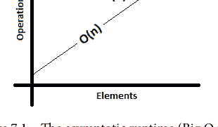

图7.1 – 渐近运行时（大O时间）

除了O(1)——常数时间——和O(n)——线性时间——之外，我们还有很多其他运行时间，例如O(log n)、O(n log n)——对数时间、O(n²)——二次时间、O(2ⁿ)——指数时间以及O(n!)——阶乘时间。这些是最常见的运行时间，但还存在着更多。

下图展示了大O复杂度图：

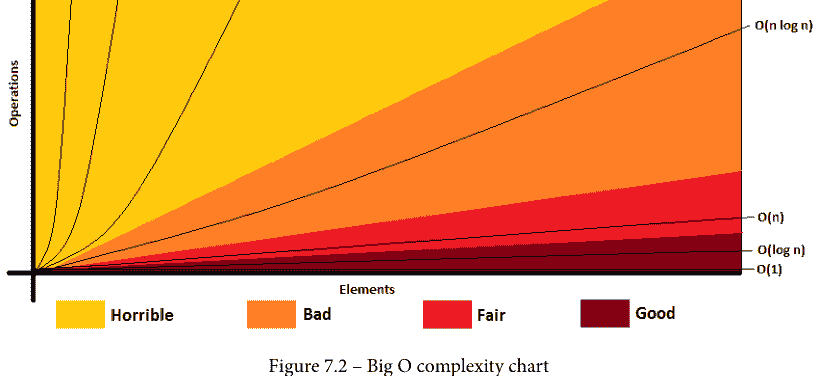

图7.2 – 大O复杂度图

正如你所看到的，并非所有O时间都有相同的性能。O(n!)、O(2ⁿ)和O(n²)被认为是糟糕的，我们应该努力编写性能避开这一区域的算法。O(n log n)比O(n!)好，但仍然不佳。O(n)被认为尚可，而O(log n)和O(1)则很好。

有时，我们需要多个变量来表达运行时性能。例如，修剪一个足球场草坪的时间可以表示为O(wl)，其中w是足球场的宽度，l是足球场的长度。或者，如果你需要修剪p个足球场，那么可以表示为O(wlp)。

然而，这并不全是关于时间。我们也关心空间。例如，构建一个包含n个元素的数组需要O(n)空间。构建一个n x n元素的矩阵需要O(n²)空间。

## 最佳情况、最坏情况和预期情况

如果简化一下，我们可以从*最佳情况、最坏情况和预期情况*的角度来思考算法的效率。最佳情况是算法的输入满足某些特殊条件，使其能够发挥出最佳性能。最坏情况则处于另一个极端，输入处于不利形态，使得算法暴露出最差的性能。但通常，这些极好或极坏的情况不会发生。因此，我们引入了预期性能。

大多数时候，我们关心的是最坏情况和预期情况，对于大多数算法而言，这两者通常是相同的。最佳情况是一种理想化的性能，因此它始终只是理想。基本上，几乎对于任何算法，我们都能找到一种特殊的输入，使其达到O(1)的最佳性能。

关于大O的更多细节，我强烈建议你阅读大O速查表（https://www.bigocheatsheet.com/）。

现在，让我们来处理一批示例。

## 大O示例

我们将尝试为不同的代码片段确定大O复杂度，正如你在面试中会遇到的那样，同时我们会讲解几个需要掌握的相关要点。换句话说，让我们采用一种*通过示例学习*的方法。

前六个示例将突出大O的基本规则，如下所示：

- 去掉常数
- 去掉非主导项
- 不同的输入意味着不同的变量
- 不同的步骤相加或相乘

让我们开始尝试这些示例。

### 示例 1 – O(1)

请考虑以下三段代码，并计算每段代码的大O复杂度：

```java
// snippet 1
return 23;
```

由于这段代码返回一个常数，所以大O为O(1)。无论其余代码做什么，这行代码都会以恒定速率执行：

```java
// snippet 2 – 'cars' is an array
int thirdCar = cars[3];
```

按索引访问数组的时间复杂度为O(1)。无论数组中有多少元素，从特定索引获取元素都是一个常数时间的操作：

```java
// snippet 3 – 'cars' is a 'java.util.Queue'
Car car = cars.peek();
```

Queue#peek()方法会检索但不移除队列的头部（第一个元素）。无论头部后面有多少元素，通过peek()方法检索头部的时间复杂度都是O(1)。

因此，前面代码块中的所有三段代码都具有O(1)复杂度时间。类似地，在队列中插入和移除、在栈中压入和弹出、在链表中插入节点，以及从存储在数组中的树节点获取左/右子节点，也都属于O(1)时间的情况。

### 示例 2 – O(n)，线性时间算法

请考虑以下代码片段并计算大O复杂度：

```java
// snippet 1 – 'a' is an array
for (int i = 0; i < a.length; i++) {
    System.out.println(a[i]);
}
```

为了确定这段代码的大O值，我们必须回答以下问题：*这个for循环迭代了多少次？*答案是a.length次。我们无法确切地说这代表了多长时间，但可以说时间会随着给定数组（代表输入）的大小线性增长。因此，这段代码的时间复杂度为O(a.length)，被称为线性时间，记为O(n)。

```java
// snippet 1

int min = Integer.MAX_VALUE;

int max = Integer.MIN_VALUE;

for (int i = 0; i < a.length; i++) {
    if (a[i] < min) {
        min = a[i];
    }
    if (a[i] > max) {
        max = a[i];
    }
}
```

```java
// snippet 2

int min = Integer.MAX_VALUE;

int max = Integer.MIN_VALUE;

for (int i = 0; i < a.length; i++) {
    if (a[i] < min) {
        min = a[i];
    }
}

for (int i = 0; i < a.length; i++) {
    if (a[i] > max) {
        max = a[i];
    }
}
```

## 7.3 – 代码比较

现在，这两个代码片段中哪一个运行得更快？

第一个代码片段使用单个循环，但有两个if语句；而第二个代码片段使用两个循环，但每个循环只有一个if语句。

这样想会让人发疯！对语句的计数还可以在更深的层次上继续。例如，我们可以继续在编译器层面上对语句（操作）进行计数，或者考虑编译器优化。然而，这并不是大O所要讨论的内容！

> **重要说明**
> 
> 大O并不是用来统计代码语句数量的。其目标是表达随输入规模变化的运行时增长，并展示运行时的扩展方式。简而言之，大O只描述运行时的增长率。

此外，不要陷入这样的陷阱：认为第一个片段只有一个循环，所以大O是O(n)，而第二个片段有两个循环，所以大O是O(2n)。只需从2n中移除2，因为2是一个常数！


重要提示  
一般来说，当表示 Big O 时，应舍去运行时间中的常数项。

因此，前面两个代码片段的 Big O 值都是 O(n)。

## 示例4 – 舍去非主导项

考虑以下代码片段并计算其 Big O（a 是一个数组）：

```
for (int i = 0; i < a.length; i++) {
    System.out.println(a[i]);
}
```

O(n)

```
for (int i = 0; i < a.length; i++) {
    for (int j = 0; j < a.length; j++) {
        System.out.println(a[i] + a[j]);
    }
}
```

O(n²)

### 7.4 - 在 O(n) 时间内执行的代码片段

第一个 for 循环以 O(n) 执行，而第二个 for 循环以 O(n²) 执行。因此，我们可能会认为这个问题的答案是 O(n) + O(n²) = O(n + n²)。但事实并非如此！增长速率由 n² 决定，而 n 是非主导项。如果数组大小增加，n² 对增长速率的影响远大于 n，因此 n 无关紧要。再考虑几个例子：

- O(2ⁿ + 2n) -> 舍去常数项和非主导项 -> O(2ⁿ)。
- O(n + log n) -> 舍去非主导项 -> O(n)。
- O(3*n² + n + 2*n) -> 舍去常数项和非主导项 -> O(n²)。

### 示例6 – 不同步骤的相加或相乘

考虑以下两个代码片段（a 和 b 是数组）。你会如何分别表达它们的 Big O？

```java
// snippet 1
for (int i=0;i<a.length;i++){
    System.out.println(a[i]);
}

for (int j=0;j<b.length;j++){
    System.out.println(b[j]);
}
```

```java
// snippet 2
for (int i=0;i<a.length;i++){
    for (int j=0;j<b.length;j++){
        System.out.println(a[i]+b[j]);
    }
}
```

### 7.6 – 代码片段 a 和 b

根据之前的例子，我们已经知道，对于第一个代码片段，Big O 是 O(a + b)。我们将其运行时间相加，因为它们的操作不像第二个代码片段那样相互交织。因此，在第二个代码片段中，我们不能将运行时间相加，因为对于每一个 a[i]，代码都会遍历 b 数组，所以 Big O 是 O(a * b)。

在决定将运行时间相加还是相乘之前，需要深思熟虑。这是面试中常见的错误。此外，人们常常没有注意到输入不止一个（这里有两个），从而错误地使用单一变量来表示 Big O。那样就错了！始终要注意有多少个输入。对于每一个影响运行时间增长速度的输入，你都应该有一个单独的变量（参见示例5）。

> **重要提示**
> 
> 一般来说，不同的步骤可以相加或相乘。运行时间应根据以下两种表述来决定是相加还是相乘：
> 
> 如果你将算法描述为*它先执行 foo，完成后再执行 buzz*，那么将运行时间相加。
> 
> 如果你将算法描述为*每次执行 foo 时，都会执行 buzz*，那么将运行时间相乘。

现在，让我们讨论 *log n* 运行时间。

### 示例7 – log n 运行时间

编写一段 Big O 为 O(log n) 的伪代码片段。

为了理解 O(log n) 运行时间，让我们从二分查找算法开始。二分查找算法的详细内容和实现见*第14章，排序与搜索*。该算法描述了在数组 a 中查找元素 x 的步骤。考虑一个有 16 个元素的有序数组 a，如下所示：

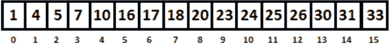

图7.7 – 包含16个元素的有序数组

首先，我们将 x 与数组的中点 p 进行比较。如果相等，则返回对应的数组索引作为最终结果。如果 x > p，则在数组右侧搜索。如果 x < p，则在数组左侧搜索。下面是用二分查找算法查找数字17的图形表示：

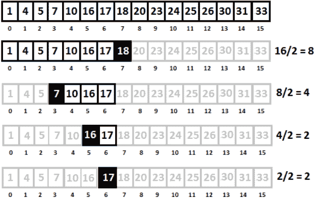

图7.8 – 二分查找算法

注意，我们从16个元素开始，以1个元素结束。第一步之后，我们剩下16/2 = 8个元素。第二步，剩下8/2 = 4个元素。第三步，剩下4/2 = 2个元素。最后一步，我们找到了所查找的数字17。如果我们将该算法转换为伪代码，则可以得到如下内容：

```
search 17 in {1, 4, 5, 7, 10, 16, 17, 18, 20,
             23, 24, 25, 26, 30, 31, 33}
```

```
compare 17 to 18 -> 17 < 18
search 17 in {1, 4, 5, 7, 10, 16, 17, 18}
    compare 17 to 7 -> 17 > 7
    search 17 in {7, 10, 16, 17}
        compare 17 to 16 -> 17 > 16
        search 17 in {16, 17}
            compare 17 to 17
            return
```

现在，让我们为这段伪代码表示 Big O。我们可以观察到，该算法持续将数组对半缩减，直到只剩下一个元素。因此，总运行时间取决于我们需要多少步才能找到数组中的某个特定数字。

在我们的示例中，我们用了4步（我们将数组对半分4次），可以表示为：

16 * 1/2 = 8; 8 * 1/2 = 4; 4 * 1/2 = 2; 2 * 1/2 = 1

或者，如果我们简化一下，就会得到：

16 * (1/2)^4 = 1

更进一步，我们可以针对一般情况将其表示为（n 是数组的大小，k 是达到解所需的步数）：

n * (1/2)^k = 1 ≡ n * 1/2^k = 1 ≡ 2^k * n/2^k = 2^k ≡ 2^k = n

但是，2^k = n 正是对数的含义——即一个量，表示必须将一个固定数（底数）提升到哪个幂才能得到给定的数。因此，我们可以写成如下形式：

2^k = n -> log₂ n = k

在我们的例子中，2^k = n 意味着 2^4 = 16，也就是 log₂ 16 = 4。

因此，二分查找算法的 Big O 是 O(log n)。然而，对数的底数在哪里呢？简短的答案是：在表示 Big O 时不需要底数，因为不同底数的对数仅相差一个常数因子。

> **重要提示**
> 
> 一般来说，当你要为一个在每一步/每次迭代中将输入减半的算法表示 Big O 时，它很可能是 O(log n) 的情况。

接下来，让我们讨论如何评估递归运行时间的 Big O。

### 示例8 – 递归运行时间

以下代码片段的 Big O 是多少？

```
int fibonacci(int k) {
    if (k <= 1) {
        return k;
    }

    return fibonacci(k - 2) + fibonacci(k - 1);
}
```

初次印象中，我们可能会将 Big O 表示为 O(n²)。我们很可能得出这个结果，因为我们会受到 `return` 中两次调用 `fibonacci()` 方法的误导。然而，让我们给 k 赋个值，并快速画出运行时间的草图。例如，如果我们调用 `fibonacci(7)`，并将递归调用表示为一棵树，则会得到下图：

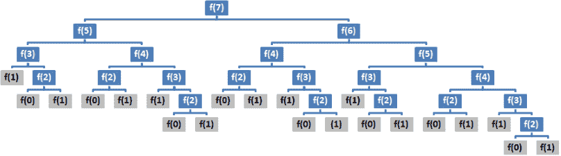

图7.9 – 调用树

我们几乎立即注意到，这棵树的深度等于7，因此一般树的深度等于 k。此外，除终端层级外，每个节点都有两个子节点，因此几乎每一层的调用数量都是其上一层调用数量的两倍。这意味着我们可以将 Big O 表示为 O(branches^depth)。在我们的例子中，就是 O(2^k)，记为 O(2ⁿ)。

在面试中，只说 O(2ⁿ) 应该是一个可以接受的答案。如果我们想要更精确，那么我们应该考虑终端层级，尤其是最后一层（或调用栈的底部），该层有时可能只包含一个调用。这意味着我们并不总是有两个分支。更精确的答案应该是 O(1.6ⁿ)。提到真实值小于2应该足以让任何面试官满意。

如果我们想要以空间复杂度的形式表示 Big O，则会得到 O(n)。不要被运行时复杂度是 O(2ⁿ) 这一事实所迷惑。在任何时刻，我们都不可能拥有超过 k 个数字。如果我们观察前面的树，只能看到从1到7的数字。

### 示例9 – 二叉树的中序遍历

考虑一棵给定的完美二叉搜索树。如果你需要快速回顾一下二叉树的知识，可以参阅*第13章，树与图*中的*概述*部分。以下代码片段的 Big O 是多少？

```java
void printInOrder(Node node) {
    if (node != null) {
        printInOrder(node.left);
        System.out.print(" " + node.element);
        printInOrder(node.right);
    }
}
```

完美二叉搜索树是一种二叉搜索树，其内部节点恰好有两个子节点，并且所有叶节点都在同一层或深度。在下图中，我们有一棵典型的完美二叉搜索树（再次强调，可视化运行时输入非常有用）：

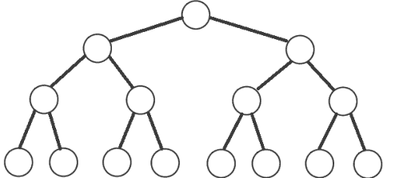

图7.10 – 高度平衡的二叉搜索树


我们从经验中知道（更准确地说，从前面的例子中知道），当我们面对一个具有分支的递归问题时，我们可能会遇到 O(branches^depth) 的情况。在我们的例子中，我们有两个分支（每个节点有两个子节点），因此我们有 O(2^depth)。指数级的时间看起来很奇怪，但让我们看看节点数量与深度之间的关系。在前面的图中，我们有 15 个节点，深度为 4。如果我们有 7 个节点，那么深度将为 3，如果我们有 31 个节点，那么深度将为 5。现在，如果我们还没有从理论上知道完美二叉树的深度是对数级的，那么也许我们可以观察到以下内容：

- 对于 15 个节点，我们有深度为 4；因此，我们有 2^4 = 16，等价于 log₂16 = 4。
- 对于 7 个节点，我们有深度为 3；因此，我们有 2^3 = 8，等价于 log₂8 = 3。
- 对于 31 个节点，我们有深度为 5；因此，我们有 2^5 = 32，等价于 log₂32 = 5。

基于前面的观察，我们可以得出结论，我们可以将 Big O 表示为 O(2^log n)，因为深度大致为 log n。所以，我们可以写下以下内容：

2^log n = X ≡ log₂X = log n ≡ X = n ≡ O(X) = O(n)

Figure 7.11 – Big O expression

因此，在这种情况下，Big O 为 O(n)。如果我们认识到这段代码实际上是二叉树的 In-Order 遍历，我们也可以得出相同的结论，在这种遍历中（正如 Pre-Order 和 Post-Order 遍历的情况一样），每个节点只会被访问一次。此外，对于每个遍历的节点，都有一段恒定的工作量，因此 Big O 为 O(n)。

## Example 10 – n may vary

以下代码片段的 Big O 是什么？

```
void printFibonacci(int k) {
    for (int i = 0; i < k; i++) {
        System.out.println(i + ": " + fibonacci(i));
    }
}

int fibonacci(int k) {
```

```
```java
if (k <= 1) {
    return k;
}

return fibonacci(k - 2) + fibonacci(k - 1);
}
```
```

从 *Example 8* 中，我们已经知道 `fibonacci()` 方法的 Big O 值为 O(2ⁿ)。`printFibonacci()` 调用 `fibonacci()` n 次，因此很容易将总 Big O 值表示为 O(n)*O(2ⁿ) = O(n2ⁿ)。然而，这是真的吗，还是我们急于给出一个看似容易的答案？

好吧，这里的小技巧是 *n* 是变化的。例如，让我们可视化运行时间：

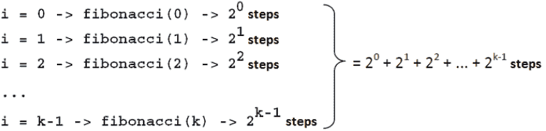

我们不能说我们执行相同的代码 *n* 次，所以这不是 O(2ⁿ)。

## Example 11 – memoization

以下代码片段的 Big O 是什么？

```
```java
void printFibonacci(int k) {
    int[] cache = new int[k];
    for (int i = 0; i < k; i++) {
        System.out.println(i + ": " + fibonacci(i, cache));
    }
}

int fibonacci(int k, int[] cache) {
    if (k <= 1) {
        return k;
    } else if (cache[k] > 0) {
        return cache[k];
    }
```

```
}

cache[k] = fibonacci(k - 2, cache)
+ fibonacci(k - 1, cache);

return cache[k];
}
```

这段代码通过递归计算斐波那契数。然而，这段代码使用了一种称为 Memoization 的技术。主要思想是缓存返回值并使用它来减少递归调用。我们已经从 Example 8 知道 fibonacci() 方法的 Big O 为 O(2ⁿ)。由于 Memoization 应该减少递归调用（它引入了优化），我们可以猜测这段代码的 Big O 应该比 O(2ⁿ) 好。然而，这只是直觉，所以让我们可视化 k = 7 时的运行时间：

```
Calling fibonacci(0):
Result of fibonacci(0) is 0

Calling fibonacci(1):
Result of fibonacci(1) is 1

Calling fibonacci(2):
    fibonacci(0)
    fibonacci(1)
    fibonacci(2) is computed and cached at cache[2]
Result of fibonacci(2) is 1

Calling fibonacci(3):
    fibonacci(1)
    fibonacci(2) is fetched from cache[2] as: 1
    fibonacci(3) is computed and cached at cache[3]
Result of fibonacci(3) is 2

Calling fibonacci(4):
    fibonacci(2) is fetched from cache[2] as: 1
    fibonacci(3) is fetched from cache[3] as: 2
    fibonacci(4) is computed and cached at cache[4]
Result of fibonacci(4) is 3
```

```
Calling fibonacci(5):
    fibonacci(3) is fetched from cache[3] as: 2
    fibonacci(4) is fetched from cache[4] as: 3
    fibonacci(5) is computed and cached at cache[5]
Result of fibonacci(5) is 5

Calling fibonacci(6):
    fibonacci(4) is fetched from cache[4] as: 3
    fibonacci(5) is fetched from cache[5] as: 5
    fibonacci(6) is computed and cached at cache[6]
Result of fibonacci(6) is 8
```

每个 fibonacci(k) 方法都是从缓存的 fibonacci(k-1) 和 fibonacci(k-2) 方法计算出来的。从缓存中获取计算值并求和是一段恒定时间的工作。由于我们执行这项工作 k 次，这意味着 Big O 可以表示为 O(n)。

除了 *Memoization* 之外，我们还可以使用另一种方法，称为 *Tabulation*。更多细节请参见 *Chapter 8, Recursion and Dynamic Programming*。

## Example 12 – looping half of the matrix

以下两个代码片段的 Big O 是什么（a 是一个数组）？

```
```java
// snippet 1                         // snippet 2
for (int i=0;i<a.length;i++){        for (int i=0;i<a.length;i++){
  for (int j=0;j<a.length;j++){        for (int j=i+1;j<a.length;j++){
    System.out.println(a[i]+a[j]);       System.out.println(a[i]+a[j]);
  }                                     }
}                                     }
```
```

7.12 – Code snippets for Big O

这两个代码片段几乎相同，只是第一个片段中 j 从 0 开始，而第二个片段中它从 i+1 开始。

我们可以很容易地给数组大小赋值并可视化这两个代码片段的运行时间。例如，假设数组大小为 5。左边的矩阵是第一个片段的运行时间，而右边的矩阵对应于第二个片段的运行时间：

## Example 16 – looping with O(log n)

以下代码片段的 Big O 是什么（a 是一个数组）？

```
for (int i = 0; i < a.length; i++) {
    for (int j = a.length; j > 0; j /= 2) {
        System.out.println(a[i] + ", " + j);
    }
}
```

让我们只关注外层循环。根据之前示例的经验，我们可以快速将 Big O 表示为 O(n)。

内层循环呢？我们可以注意到 j 从数组长度开始，每次迭代时它会被减半。记住 Example 7 中的重要提示：当你需要为每次迭代都将输入减半的算法表达 Big O 时，很有可能是 O(log n) 的情况。

Important note
每当你认为有很大可能是一个 O(log n) 的情况时，建议你使用除数的幂作为测试数字。如果输入被除以 2（即减半），则使用 2 的幂的数字（例如，2³ = 8，2⁴ = 16，2⁵ = 32，等等）。如果输入被除以 3，则使用 3 的幂的数字（例如，3² = 9，3³ = 27，等等）。这样，很容易计算除法的次数。

所以，让我们给 a.length 赋值并可视化运行时间。假设 a.length 为 16。这意味着 j 将取 12、8、4、2 和 1 的值。我们将 j 除以 2 恰好四次，因此我们有以下情况：

2⁴ = 16 ≡ log₂16 = 4

Figure 7.14 – Loop with O (log n)

因此，内层循环的 Big O 为 O(log n)。要计算总的 Big O，我们考虑外层循环执行 n 次，在该循环内部，另一个循环执行 log n 次。因此，总的 Big O 结果为 O(n)* O (log n) = O(n log n)。

作为提示，很多排序算法（例如，Merge Sort 和 Heap Sort）具有 O(n log n) 的运行时间。此外，很多 O(n log n) 算法是递归的。一般来说，被归类为分治法（D&C）类别的算法是 O(n log n)。希望记住这些提示在面试中会非常有用。

## Example 17 – string comparison

以下代码片段的 Big O 是什么？（注意 a 是一个数组，并且务必仔细阅读注释）：

```
String[] sortArrayOfString(String[] a) {
    for (int i = 0; i < a.length; i++) {
        // sort each string via O(n log n) algorithm
    }

    // sort the array itself via O(n log n) algorithm

    return a;
}
```

sortArrayOfString() 接收一个 String 数组并执行两个主要操作。它对该数组中的每个字符串进行排序，并对数组本身进行排序。两种排序都是通过运行时间表示为 O(n log n) 的算法完成的。

现在，让我们关注 for 循环，看看候选人常给出的错误答案。我们已经知道对单个字符串排序给我们 O(n log n)。对每个字符串都这样做意味着 O(n) * (n log n) = O(n*n log n) = O(n² log n)。接下来，我们对数组本身进行排序，这也给出 O(n log n)。把所有结果放在一起，总的 Big O 值为 O(n² log n) + O(n log n) = O(n² log n + n log n)，即 O(n² log n)，因为 n log n 是一个非主导项。然而，这正确吗？简短的答案是否定的！但为什么呢？！我们犯了两个主要错误：我们用 n 表示了两件事（数组的大小和字符串的长度），并且我们假设比较 String 需要恒定时间，就像固定宽度整数的情况一样。

让我们详细说明第一个问题。对单个字符串排序给我们 O(n log n)，其中 n 表示该字符串的长度。我们对 a.length 个字符串进行排序，因此 n 现在表示数组的大小。这就是混淆的来源，因为当我们说 for 循环是 O(n² log n) 时，我们指的是哪个 n？由于我们处理两个变量，我们需要用不同的符号表示它们。例如，我们可以考虑以下情况：

- s: 最长 String 的长度。
- p: String 数组的大小。


## 示例 19 – 谨慎使用 n 表示法

以下两个代码片段的 Big O 是什么？

```cpp
int multiply(int x, int y) {
    int result = 1;

    for (int i=1; i<=y; i++) {
        result *= x;
    }

    return result;
}

int powerxy(int x, int y) {
    if (y < 0) {
        return 0;
    } else if (y == 0) {
        return 1;
    } else {
        return x*powerxy(x, y-1);
    }
}
```

7.15 – 代码片段

第一个片段（左侧）对 y 次执行恒定工作。x 输入不影响运行时间增长速率，因此 Big O 可以表示为 O(y)。请注意，我们不说 O(n)，因为 n 可能会与 x 混淆。

第二个片段（右侧）递归遍历 y-1, y-2, ..., 0。每个 y 输入只被遍历一次，因此 Big O 可以表示为 O(y)。同样，x 输入不影响运行时间增长速率。此外，我们避免说 O(n)，因为存在多个输入，O(n) 会造成混淆。

## 示例 20 – 求和与计数

以下代码片段的 Big O 是什么（x 和 y 为正数）？

```cpp
int div(int x, int y) {
    int count = 0;
    int sum = y;
    while (sum <= x) {
        sum += y;
        count++;
    }

    return count;
}
```

让我们给 x 和 y 赋予值并观察计数变量，该变量计数迭代次数。考虑 x=10 且 y=2。对于此场景，count 将为 5（10/2 = 5）。遵循相同的逻辑，我们有 x=14, y=4, count=3（14/4 = 3.5），或 x=22, y=3, count=7（22/3 = 7.3）。我们可以注意到在最坏情况下，count 为 x/y，因此 Big O 可以表示为 O(x/y)。

## 示例 21 – Big O 中的迭代次数

以下代码片段试图猜测一个数字的平方根。Big O 是什么？

```c
int sqrt(int n) {
    for (int guess = 1; guess * guess <= n; guess++) {
        if (guess * guess == n) {
            return guess;
        }
    }

    return -1;
}
```

让我们考虑数字（n）是一个完全平方根，例如 144，我们已经知道 sqrt(144) = 12。由于 guess 变量从 1 开始并在 guess*guess <= n 时停止，步长为 1，计算 guess 将取值为 1, 2, 3, ..., 12 非常简单。当 guess 为 12 时，我们有 12*12 = 144，循环停止。因此，我们进行了 12 次迭代，这正好是 sqrt(144)。

我们对非完全平方根遵循相同的逻辑。让我们考虑 n 为 15。这次，guess 将取值为 1, 2 和 3。当 guess=4 时，我们有 4*4 > 15 循环停止。返回值为 -1。因此，我们进行了 3 次迭代。

总之，我们有 sqrt(n) 次迭代，因此 Big O 可以表示为 O(sqrt(n))。

## 示例 22 – 数字

以下代码片段对整数的数字求和。Big O 是什么？

```c
int sumDigits(int n) {
    int result = 0;
    while (n > 0) {
        result += n % 10;
        n /= 10;
```

## 技术要求

本章中呈现的所有代码都可以在 GitHub 上找到，地址为 `https://github.com/PacktPublishing/The-Complete-Coding-Interview-Guide-in-Java/tree/master/Chapter08`。

## 递归概览

直接/间接调用自身的 方法称为递归。这种方法被称为递归方法。著名的斐波那契数问题可以递归实现，如下所示：

```java
int fibonacci(int k) {

    // base case
    if (k <= 1) {
        return k;
    }

    // recursive call
    return fibonacci(k - 2) + fibonacci(k - 1);
}
```

此代码中有两个重要部分：

- **Base case:** 在没有后续递归调用的情况下返回一个值。对于特殊输入，函数可以在没有递归的情况下求值。
- **Recursive call:** 由于 `fibonacci()` 方法调用自身，我们有一个递归方法。

## 识别递归问题

在尝试通过递归算法解决一个问题之前，我们必须将其识别为此类算法的良好候选者。面试中使用的大多数递归问题都很著名，因此我们可以通过名称识别它们。例如，斐波那契数、求数字列表之和、最大公约数、数字的阶乘、递归二分查找、反转字符串等问题都是众所周知的递归问题。

但这些问题有什么共同点？一旦我们知道答案，我们也将能够识别其他递归问题。答案很简单：所有这些问题都可以基于子问题构建。换句话说，我们可以表示方法返回的值以该方法返回的其他值来表示。

**重要说明**

当一个问题可以基于子问题构建时，它是递归求解的良好候选者。通常，这类问题包含诸如 list top/last n ..., compute the nᵗʰ or all..., count/find all solutions that ..., generate all cases that ... 等词语。为了计算 nᵗʰ...，我们必须计算 nᵗʰ⁻¹, nᵗʰ⁻² 等，以便将问题分解为子问题。换句话说，计算 f(n) 需要计算 f(n-1), f(n-2) 等。

练习是识别和解决递归问题的关键。解决大量递归问题将帮助你像眨眼一样轻松地识别它们。

接下来，我们将重点介绍动态规划的主要方面，并学习如何通过动态规划优化纯递归。

## 动态规划概览

当我们谈论优化递归时，我们谈论的是动态规划。这意味着递归问题的求解可以使用纯递归算法或动态规划来完成。

现在，让我们将动态规划应用于斐波那契数，从纯递归算法开始：

```java
int fibonacci(int k) {
    if (k <= 1) {
        return k;
    }

    return fibonacci(k - 2) + fibonacci(k - 1);
}
```

记忆化是一种用于消除方法中重复工作的技术。它保证方法对相同输入只调用一次。为此，记忆化缓存给定输入的结果。这意味着，当方法应被调用以计算已计算过的输入时，记忆化将避免此调用并从缓存中返回结果。

以下代码使用记忆化来优化斐波那契数的纯递归算法（缓存由 cache 数组表示）：

```java
int fibonacci(int k) {
    return fibonacci(k, new int[k + 1]);
}

int fibonacci(int k, int[] cache) {
    if (k <= 1) {
        return k;
    } else if (cache[k] > 0) {
        return cache[k];
    }

    cache[k] = fibonacci(k - 2, cache)
        + fibonacci(k - 1, cache);

    return cache[k];
}
```

如果我们重新绘制前述代码的调用树，则得到以下图表：

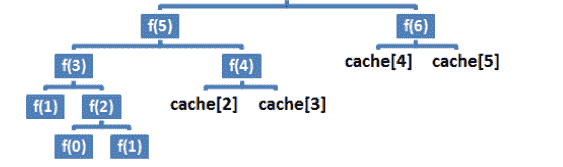

图 8.3 – 调用树（记忆化）

```java
return k;
}

int first = 1;
int second = 0;
int result = 0;

for (int i = 1; i < k; i++) {
    result = first + second;
    second = first;
    first = result;
}

return result;
}
```

该算法的运行时间仍然为 O(n)，但空间复杂度从 O(n) 降低到 O(1)。因此，回顾斐波那契数算法，我们有以下内容：

- **plain recursion** 算法具有 O(2ⁿ) 的运行时间和 O(n) 的空间复杂度。
- **Memoization recursion** 算法具有 O(n) 的运行时间和 O(n) 的空间复杂度。
- **Tabulation** 算法具有 O(n) 的运行时间和 O(1) 的空间复杂度。

现在，是时候练习一些编码挑战了。

## 编码挑战

在以下 15 个编码挑战中，我们将利用递归和动态规划。这些问题经过精心设计，以帮助你理解并涵盖此类问题的广泛范围。到本次编码挑战结束时，你应该能够在面试环境中识别和解决递归问题。


## 编程挑战 1 – 机器人网格 (I)

Adobe, Microsoft

问题：我们有一个 m x n 网格。机器人被放置在这个网格的左上角。机器人只能在任何时候向右或向下移动，但不允许进入某些单元格。机器人的目标是从左上角找到一条路径到网格的右下角。

解决方案：首先，我们需要设定 m x n 网格的一些约定。假设右下角的坐标为 (0, 0)，而左上角的坐标为 (m, n)，其中 m 是行，n 是列。于是，机器人从 (m, n) 开始，必须找到一条到 (0, 0) 的路径。如果我们为 6x6 网格绘制一个示例，那么我们可以得到如下所示的内容：

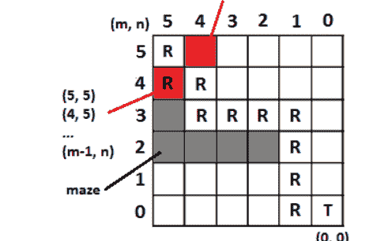

图 8.4 – 确定移动模式

这里，我们可以看到机器人可以从一个单元格 (m, n) 移动到相邻单元格，可以是 (m-1, n) 或 (m, n-1)。例如，如果机器人被放置在 (5, 5)，那么它可以移动到 (4, 5) 或 (5, 4)。此外，从 (4, 5)，它可以移动到 (3, 5) 或 (4, 4)，而从 (5, 4)，它可以移动到 (5, 3) 或 (4, 4)。

因此，我们有一个可以分解为子问题的问题。我们必须找到单元格的最终路径（问题），如果我们能够找到到相邻单元格的路径（子问题），就可以做到。这听起来像是一个递归算法。在递归中，我们从上到下处理问题，因此我们从 (m, n) 开始并向原点 (0, 0) 回溯，如前面的图表所示。这意味着从单元格 (m, n)，我们尝试进入 (m, n-1) 或 (m-1, n)。

将其写入代码可以如下完成（maze[][] 矩阵是一个布尔矩阵，对于我们不允许进入的单元格，其值为 true – 例如，maze[3][1] = true 意味着我们不允许进入单元格 (3,1)）：

```
public static boolean computePath(int m, int n,
        boolean[][] maze, Set<Point> path) {

    // we fell off the grid so we return
    if (m < 0 || n < 0) {
        return false;
    }

    // we cannot step at this cell
    if (maze[m][n]) {
        return false;
    }

    // we reached the target
    // (this is the bottom-right corner)
    if ((m == 0) && (n == 0)
        // or, try to go to the right
        || computePath(m, n - 1, maze, path)
        // or, try to go to down
        || computePath(m - 1, n, maze, path)) {

        // we add the cell to the path
        path.add(new Point(m, n));

        return true;
    }

    return false;
}
```

完整的应用程序称为 *HanoiTowers*。

## 编程挑战 3 – 约瑟夫环

Amazon, Google, Adobe, Microsoft, Flipkart

**问题：** 考虑一组 *n* 个男人排成一个圆圈 (1, 2, 3, ..., *n*)。每隔 *k* 个男人就会被杀死，直到只剩下一个幸存者。编写一个算法来找到这个幸存者的 *k* 位置。这就是约瑟夫问题。

**解决方案：** 记住我们之前说过，当一个问题包含 *compute the nᵗʰ* 之类的词时，那么它可能是通过递归求解的良好候选。这里，我们有 *find the k position*，这是一个可以分解为子问题并通过递归求解的问题。

让我们考虑 *n*=15 和 *k*=3。于是，有 15 个男人，每第三个男人将被从圆圈中淘汰，直到只剩下一个。让我们通过以下图表来可视化这一点（这对于弄清楚杀戮模式非常有用）：

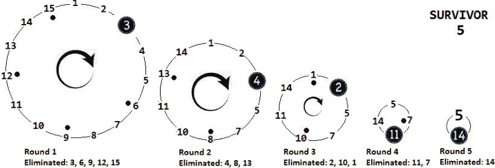

图 8.6 – n=15 且 k=3 的约瑟夫环

于是，我们有五轮直到找到幸存者，如下所示：

- **第 1 轮：** 第一次淘汰是位置 3；接下来，6、9、12 和 15 被淘汰。
- **第 2 轮：** 第一次淘汰是位置 4（1 和 2 被跳过，因为第 1 轮最后淘汰的是位置 15）；接下来，8 和 13 被淘汰。
- **第 3 轮：** 第一次淘汰是位置 2（14 和 1 被跳过，因为第 2 轮最后淘汰的是位置 13）；接下来，10 和 1 被淘汰。
- **第 4 轮：** 第一次淘汰位置是 11，随后是位置 7。
- **第 5 轮：** 14 被淘汰，5 是幸存者。

尝试识别模式或递归调用可以根据以下观察来完成。在第一个男人（第 k 个）被淘汰后，剩下 n-1 个男人。这意味着我们调用 josephus(n - 1, k) 来获取第 n-1 个人的位置。然而，请注意，josephus(n - 1, k) 返回的位置将考虑到从 k%n + 1 开始的位置。换句话说，我们必须调整 josephus(n - 1, k) 返回的位置以获得 (josephus(n - 1, k) + k - 1) % n + 1。递归方法如下所示：

```
public static int josephus(int n, int k) {
    if (n == 1) {
        return 1;
    } else {
        return (josephus(n - 1, k) + k - 1) % n + 1;
    }
}
```

如果你觉得这种方法相当棘手，那么你可以通过基于队列的迭代方法来尝试。首先，用 n 个男人填充队列。接下来，循环队列，对于每个男人，检索并移除该队列的头部（poll()）。如果检索到的男人不是第 k 个，则将该男人重新插入队列（add()）。如果这是第 k 个男人，则中断循环并重复此过程，直到队列大小为 1。该代码如下：

```
public static void printJosephus(int n, int k) {
    Queue<Integer> circle = new ArrayDeque<>();
    for (int i = 1; i <= n; i++) {
        circle.add(i);
    }
    while (circle.size() != 1) {
        for (int i = 1; i <= k; i++) {
            int eliminated = circle.poll();
            if (i == k) {
                System.out.println("Eliminated: " + eliminated);
                break;
            }
        }
    }
```

```
circle.add(eliminated);
}
}

System.out.println("Using queue! Survivor: "
    + circle.peek());
}
```

完整的应用程序称为 Josephus。

## 编程挑战 4 – 彩色斑点

Amazon, Google, Adobe, Microsoft, Flipkart

问题：考虑一个 r x c 网格，其中 r 代表行，c 代表列。每个单元格都有一个由数字 k 表示的颜色（例如，对于三种颜色，k=3）。我们定义单元格的连通集（或彩色斑点）为我们可以通过在行或列上进行连续位移从相应单元格到达的总单元格数，同时保持颜色。目标是确定最大连通集的颜色和单元格数。换句话说，我们需要确定最大的彩色斑点。

解决方案：让我们考虑一个 5x5 网格和三种颜色，其中 r=c=5 且 k=3。接下来，让我们按以下图表表示网格：

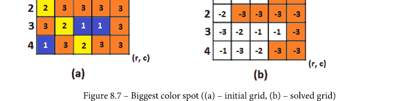

图 8.7 – 最大的彩色斑点（(a) – 初始网格，(b) – 已解决网格）

让我们关注图像 (a)。这里，我们可以看到从一个单元格移动到另一个单元格最多可以在四个方向进行（上、下、左、右）。这意味着，从一个单元格 (r,c)，我们可以尝试移动到 (r-1, c)、(r+1, c)、(r, c-1) 和 (r, c+1)。如果我们有掉出网格的风险或目标单元格的颜色与当前单元格不同，则我们不能执行移动。因此，通过迭代每个单元格（(0, 0)、(0, 1)、...(r, c)），我们可以确定该单元格的连通集的大小（彩色斑点的大小），通过访问每个允许的单元格并计数。在图像 (a) 中，我们有四个颜色为 1 的斑点，其大小分别为 1、1、1 和 2。我们还有六个颜色为 2 的斑点，其大小分别为 1、1、2、1、1 和 1。最后，我们有三个颜色为 3 的斑点，其大小分别为 11、1 和 1。

从中，我们可以得出结论，最大的彩色斑点大小为 11，颜色为 3。主要是，我们可以认为第一个单元格的彩色斑点是最大斑点，每当我们找到比它更大的彩色斑点时，我们就用找到的斑点替换它。

现在，让我们关注图像 (b)。为什么我们有负值？因为当我们访问一个单元格时，我们将其颜色值切换为 -color。这是一种方便的约定，用于避免多次计算同一单元格的连通集。这就像说我们将此单元格标记为已访问。根据约定，我们不能移动到颜色值为负的单元格，因此我们不会两次计算同一彩色斑点的大小。

现在，将这些观察结果组合起来形成一个递归方法会得到以下代码：

```
public class BiggestColorSpot {

    private int currentColorSpot;

    void determineBiggestColorSpot(int cols,
        int rows, int a[][]) {
        ...
    }

    private void computeColorSpot(int i, int j,
        int cols, int rows, int a[][], int color) {

        a[i][j] = -a[i][j];
        currentColorSpot++;

        if (i > 1 && a[i - 1][j] == color) {
```


```
computeColorSpot(i - 1, j, cols,
    rows, a, color);
}

if ((i + 1) < rows && a[i + 1][j] == color) {
    computeColorSpot(i + 1, j, cols, rows, a, color);
}

if (j > 1 && a[i][j - 1] == color) {
    computeColorSpot(i, j - 1, cols,
        rows, a, color);
}

if ((j + 1) < cols && a[i][j + 1] == color) {
    computeColorSpot(i, j + 1, cols,
        rows, a, color);
}
}
```

在前面的递归方法 `computeColorSpot()` 可以从给定单元格开始计算颜色斑点的大小时，以下方法确定最大的颜色斑点：

```
void determineBiggestColorSpot(int cols,
    int rows, int a[][]) {

    int biggestColorSpot = 0;
    int color = 0;

    for (int i = 0; i < rows; i++) {
        for (int j = 0; j < cols; j++) {

            if (a[i][j] > 0) {
                currentColorSpot = 0;

                computeColorSpot(i, j, cols,
rows, a, a[i][j]);

if (currentColorSpot > biggestColorSpot) {
    biggestColorSpot = currentColorSpot;
    color = a[i][j] * (-1);
}
}
}
}

System.out.println("\nColor: " + color
+ " Biggest spot: " + biggestColorSpot);
}
```

完整的应用程序称为 *BiggestColorSpot*。

## 编程挑战 5 – 硬币

**Google, Adobe, Microsoft**

**问题：** 考虑 n 分的金额。计算使用任意数量的四分之一硬币（25 分）、十分硬币（10 分）、五分硬币（5 分）和一分硬币（1 分）兑换该金额的方法数。

**解决方案：** 让我们想象我们要兑换 50 分。从一开始，我们就可以看出，兑换 50 分是一个可以通过子问题解决的问题。例如，我们可以使用 0、1 或 2 个四分之一硬币来兑换 50 分。或者我们可以使用 0、1、2、3、4 或 5 个十分硬币来兑换。我们也可以使用 0、1、2、3、4、5、6、7、8、9 或 10 个五分硬币来兑换。最后，我们可以使用 0、1、2、3、...、50 个一分硬币来兑换。假设我们有 1 个四分之一硬币、1 个十分硬币、2 个五分硬币和 5 个一分硬币。我们可以用我们的四分之一硬币说以下内容：

*calculateChange*(50) = **1 个四分之一硬币** + ...

但这就像说以下内容：

*calculateChange*(25) = **0 个四分之一硬币** + ...

我们没有更多的四分之一硬币；因此，我们加上一个十分硬币：

*calculateChange*(25) = **0 个四分之一硬币** + **1 个十分硬币** + ...

这可以简化如下：

*calculateChange*(15) = **0 个四分之一硬币** + **0 个十分硬币** + ...

我们没有更多的十分硬币。我们加上五分硬币：

calculateChange(15) = 0 个四分之一硬币 + 0 个十分硬币 + 2 个五分硬币 + ...

这可以简化为以下内容：

calculateChange(5) = 0 个四分之一硬币 + 0 个十分硬币 + 0 个五分硬币 + ...

最后，由于我们没有更多的五分硬币，我们加上了一分硬币：

calculateChange(5) = 0 个四分之一硬币 + 0 个十分硬币 + 0 个五分硬币 + 5 个一分硬币

这可以简化为以下内容：

calculateChange(0) = 0 个四分之一硬币 + 0 个十分硬币 + 0 个五分硬币 + 0 个一分硬币

如果我们尝试表示所有可能的简化，我们得到以下图表：

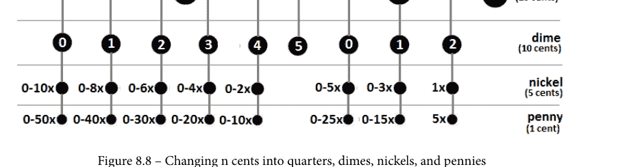

图 8.8 – 将 n 分兑换为四分之一硬币、十分硬币、五分硬币和一分硬币

实现这种可归约算法可以通过递归来完成，如以下代码所示。请注意，我们正在使用记忆化来避免多次兑换相同的金额：

```
public static int calculateChangeMemoization(int n) {
    int[] coins = {25, 10, 5, 1};
    int[][] cache = new int[n + 1][coins.length];

    return calculateChangeMemoization(n, coins, 0, cache);
}

private static int calculateChangeMemoization(int amount,
    int[] coins, int position, int[][] cache) {
    if (cache[amount][position] > 0) {
        return cache[amount][position];
    }

    if (position >= coins.length - 1) {
        return 1;
    }

    int coin = coins[position];
    int count = 0;
    for (int i = 0; i * coin <= amount; i++) {
        int remaining = amount - i * coin;
        count += calculateChangeMemoization(remaining,
            coins, position + 1, cache);
    }

    cache[amount][position] = count;

    return count;
}
```

完整的应用程序称为 Coins。它还包含不带记忆化的纯递归方法。

## 编程挑战 6 – 五座塔

**问题：** 考虑一个 5x5 网格，其中有五座防御塔分布在网格中。为了为网格提供最佳防御，我们必须在网格的每一行上建造一座塔。找出建造这些塔的所有解决方案，使得它们之间不会共享相同的列和对角线。

**解决方案：** 我们知道，在每一行上，我们必须建造一座塔，而且在网格上建造它们的顺序并不重要。让我们勾画一个解决方案和一个失败的例子，如下所示：

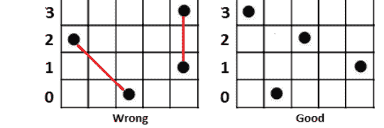

图 8.9(a) – 失败和解决方案

让我们关注解决方案并从第一行开始：行 0。我们可以在该行上的任意列建造一座塔；因此，我们可以说以下内容：

- 尝试在 (0, 0)、(0,1)、(0, 2)、(0, 3) 或 (0,4) 建造第一座塔
- 第一座塔可以建在 (0, 0)、(0,1)、(0, 2)、(0, 3) 或 (0,4)
- 第一座塔建在 (0,2)

图 8.9(b)：建造塔的逻辑的第一部分

如果我们继续使用相同的逻辑，那么我们可以说以下内容：

- 第一行：
  - 尝试在 (0, 0)、(0,1)、(0, 2)、(0, 3) 或 (0,4) 建造第一座塔
  - 第一座塔可以建在 (0, 0)、(0,1)、(0, 2)、(0, 3) 或 (0,4)
  - 第一座塔建在 (0, 2)
    - 第二行：
      - 尝试在 (1, 0)、(1,1)、(1, 2)、(1, 3) 或 (1,4) 建造第二座塔
      - 第二座塔可以建在 (1, 3) 或 (1, 4)
      - 第二座塔建在 (1, 4)
        - 第三行：
          - 尝试在 (2, 0)、(2,1)、(2, 2)、(2, 3) 或 (2,4) 建造第三座塔
          - 第三座塔可以建在 (2, 0) 或 (2, 2)
          - 第三座塔建在 (2, 2)
          ...

图 8.9(c)：建造塔的逻辑的第二部分

```
```java
// cannot build on the same column
if (currentColumn == nextColumn) {
    return false;
}

int columnsDistance
    = Math.abs(currentColumn - nextColumn);
int rowsDistance = nextRow - currentRow;

// cannot build on the same diagonal
if (columnsDistance == rowsDistance) {
    return false;
}
}

return true;
```
```

完整的应用程序称为 *FiveTowers*。

## 编程挑战 7 – 魔法索引

**Adobe, Microsoft**

**问题：** 考虑一个允许重复的 *n* 个元素的排序数组。索引 *k* 是魔法的，如果 *array[k] = k*。编写一个递归算法来查找第一个魔法索引。

```
private static int find(int[] arr,
    int startIndex, int endIndex) {

    if (startIndex > endIndex) {
        return -1; // return an invalid index
    }

    // halved the indexes
    int middleIndex = (startIndex + endIndex) / 2;

    // value (element) of middle index
    int value = arr[middleIndex];

    // check if this is a magic index
    if (value == middleIndex) {
        return middleIndex;
    }

    // search from middle of the array to the left
    int leftIndex = find(arr, startIndex,
        Math.min(middleIndex - 1, value));
    if (leftIndex >= 0) {
        return leftIndex;
    }

    // search from middle of the array to the right
    return find(arr, Math.max(middleIndex + 1,
        value), endIndex);
}
```

完整的应用程序称为 MagicIndex。

## 编程挑战 9 – 最高的彩色塔

**Adobe, Microsoft, Flipkart**

**问题：** 考虑 n 个宽度为 (w₁…n)、高度为 (h₁…n)、颜色为 (c₁…n) 的不同盒子。找到满足以下条件的最高盒子塔：

- 你不能旋转盒子。
- 你不能放置两个连续的相同颜色的盒子。
- 每个盒子在宽度和高度上都严格大于它上面的盒子。

**解决方案：** 让我们尝试可视化它，如下所示：

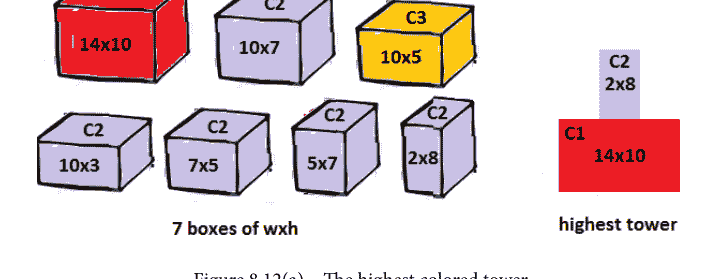

图 8.12(a) – 最高的彩色塔

我们有七个不同尺寸和颜色的盒子。我们可以想象最高的塔将包含所有这些盒子，b₁…b₇。但我们有几个约束条件不允许我们简单地堆叠盒子。我们可以选择其中一个盒子作为基座盒子，并在其顶部放置另一个允许的盒子，如下所示：

- 选择 14x10 盒子作为基座盒子
  - 在 14x10 盒子顶部我们可以添加 10x7 盒子
    - 在 10x7 盒子顶部我们不能再添加盒子；总高度为 17
  - 在 14x10 盒子顶部我们可以添加 10x5 盒子
    - 在 10x5 顶部我们不能再添加盒子；总高度为 15，因此我们可以忽略它，因为它小于 17
  - ...
  - 在 14x10 盒子顶部我们可以添加 2x8
    - 在 2x8 顶部我们不能再添加盒子；总高度为 18，因此我们将高度更新为 18，这就是最终结果

图 8.12(b) 选择盒子建造最高塔的逻辑


```
int base, int[] cache) {
    if (base < boxes.size() && cache[base] > 0) {
        return cache[base];
    }

    Box current = boxes.get(base);

    int highest = 0;
    // since the boxes are sorted we don’t
    // look in [0, base + 1)
    for (int i = base + 1; i < boxes.size(); i++) {
        if (boxes.get(i).canBeNext(current)) {

            int height = buildMemoization(boxes, i, cache);
            highest = Math.max(height, highest);
        }
    }

    highest = highest + current.getHeight();
    cache[base] = highest;

    return highest;
}
```

完整应用名为 *HighestColoredTower*。代码中还包含了针对该问题的普通递归方法（不使用 *记忆化*）。

## 编程挑战 10 – 字符串排列

**Amazon、Google、Adobe、Microsoft、Flipkart**

**问题：** 编写一个算法，计算字符串的所有排列，并满足以下两个条件：

- 给定的字符串可能包含重复字符。
- 返回的排列列表不应包含重复项。

**解决方案：** 如同任何递归问题一样，关键在于识别不同子问题之间的关系和模式。我们马上会直观地感觉到，对包含重复字符的字符串进行排列，应该比对包含唯一字符的字符串进行排列更复杂。这意味着我们必须首先理解具有唯一字符的字符串的排列。

对字符串中的字符进行排列，最自然的方式可以遵循一个简单的模式：字符串中的每个字符都将成为字符串的第一个字符（交换它们的位置），然后使用递归调用排列所有剩余字母。让我们深入讨论一般情况。对于一个只包含一个字符的字符串，我们有单一排列：

$P(c_1)=c_1$

如果我们添加另一个字符，那么我们可以将排列表示如下：

$P(c_1c_2)=c_1c_2$ 和 $c_2c_1$

如果我们再添加一个字符，则必须使用 $c_1c_2$ 来表达这些排列。$c_1c_2c_3$ 的每个排列都表示 $c_1c_2$ 的一种顺序，如下所示：

$c_1c_2 \rightarrow c_1c_2c_3, c_1c_3c_2, c_3c_1c_2$

$c_2c_1 \rightarrow c_2c_1c_3, c_2c_3c_1, c_3c_2c_1$

让我们用 ABC 替换 $c_1c_2c_3$。接下来，我们将 P(ABC) 表示为示意图：

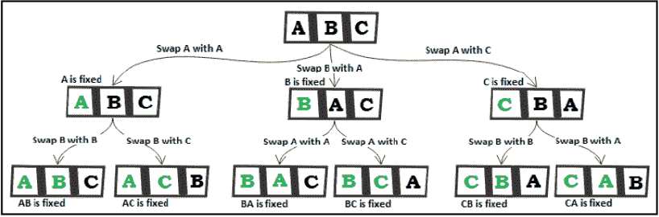

图 8.13 – 对 ABC 进行排列

## 编程挑战 11 – 骑士巡游

**Amazon、Google**

**问题：** 考虑一个国际象棋棋盘（8x8 网格）。将一枚骑士放在棋盘上，并打印它的所有唯一移动。

**解决方案：** 正如你已经看到的，处理此类问题的最佳方法是拿起纸笔，画出情景草图。一图胜千言：

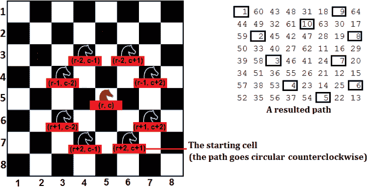

图 8.14 – 骑士巡游

正如我们所见，骑士可以从 $(r, c)$ 格子移动到最多八个其他有效格子，即 $(r+2, c+1)$、$(r+1, c+2)$、$(r-1,c+2)$、$(r-2, c+1)$、$(r-2, c-1)$、$(r-1, c-2)$、$(r+1, c-2)$ 和 $(r+2, c-1)$。因此，为了获得从 1 到 64 的路径（如上图右侧所示），我们可以从给定位置开始，递归地尝试访问每个有效移动。如果当前路径不构成解，或者我们已经尝试了全部八个格子，那么我们就回溯。

为了尽可能高效，我们考虑以下几个方面：

- 我们从棋盘的一个角落开始：这样，骑士最初只能往两个方向移动，而不是八个方向。
- 我们按固定顺序检查有效格子：保持一条循环路径，将有助于我们比随机挑选更快地找到新移动。从 $(r, c)$ 出发的逆时针循环路径是 $(r+2, c+1)$、$(r+1, c+2)$、$(r-1, c+2)$、$(r-2, c+1)$、$(r-2, c-1)$、$(r-1, c-2)$、$(r+1, c-2)$ 和 $(r+2, c-1)$。

```
for (int i = 0; i < str.length(); i++) {
    if (table[i]) {
        Node node = head;
        for (int j = i; j < str.length(); j++) {
            if (node == null) {
                break;
            }
            node = node.next[str.charAt(j) - 'a'];
            // [0, i]: use our known decomposition
            // [i+1, j]: use this String in the Trie
            if (node != null && node.leaf) {
                table[j + 1] = true;
            }
        }
    }
    // table[n] would be true if
    // all characters of str can be segmented
    return table[str.length()];
}
```

显然，由于我们有两个嵌套循环，该解决方案的运行时为 O(n²)。实际上，如果节点为 null，内层循环就会中断。而在最坏情况下，这发生在 k 步之后，其中 k 是 Trie 中的最深路径。因此，对于一个包含大小为 z 的最长单词的字典，我们有 k=z+1。这意味着内层循环的时间复杂度为 O(z)，总时间复杂度为 O(nz)。额外空间为 O(Trie 的空间 + str.length)。

完整应用名为 *WordBreak*。该应用还包含一个方法，用于打印可以为给定字符串生成的所有字符串。例如，如果给定字符串是 "thisisafamousproblem"，字典是 { "this", "th", "is", "a", "famous", "f", "a", "m", "o", "u", "s", "problem" }，那么输出将包含四个序列：

- th is is a f a m o u s problem
- th is is a famous problem
- this is a f a m o u s problem
- this is a famous problem

完成！现在，是时候总结本章了。

## 总结

在本章中，我们讨论了面试中最热门的主题之一：递归和动态规划。掌握这个主题需要大量的练习。幸运的是，本章提供了一套全面的问题，涵盖了最常见的递归模式。从排列到基于网格的问题，从汉诺塔等经典问题到生成花括号等棘手问题，本章涵盖了广泛的递归案例。

不要忘记，解决递归问题的关键在于画出有意义的草图并练习多个案例。这样，你就能识别模式和递归调用。

在下一章中，我们将讨论需要位操作的问题。

因此，我们存储了 110011，这是 51 的二进制表示。其余 26 位为零（00000000 00000000 00000000 00110011）。反向过程从右到左进行，涉及在位等于 1 的位置加上 2 的幂。所以这里，51 = 2^0+2^1+2^4+2^5。下面的示意图可以帮助我们理解这一点：

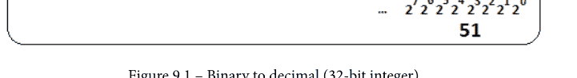

图 9.1 – 二进制转十进制（32 位整数）

在 Java 中，我们可以通过 Integer#toString(int i, int radix) 或 Integer#toBinaryString(int i) 快速查看一个数字的二进制表示。例如，基数为 2 表示二进制：

```
// 110011
System.out.println("Binary: " + Integer.toString(51, 2));
System.out.println("Binary: " + Integer.toBinaryString(51));
```

反向过程（从二进制到十进制）可以通过 Integer#parseInt(String nr, int radix) 获得：

```
System.out.println("Decimal: "
    + Integer.parseInt("110011", 2));  //51
```

接下来，让我们处理位运算符。这些运算符允许我们操作位，因此理解它们非常重要。

## 位运算符

- **一元按位取反运算符 [~]**：作为一元运算符，它需要位于数字之前的单个操作数。该运算符取数字的每一位并翻转其值，因此 1 变为 0，反之亦然；例如，5 = 101，~5 = 010。
- **按位与 [&]**：该运算符需要两个操作数，并置于两个数字之间。该运算符逐个比较两个数字的位。它类似于逻辑与 (&&)，意味着仅当比较的位都等于 1 时才返回 1；例如，5 = 101，7 = 111，5 & 7 = 101 & 111 = 101 = 5。


## 无符号右移 [>>>]

无符号右移，或逻辑右移 [>>>]，接受两个操作数。无符号右移获取第一个操作数（左操作数）的位模式，并将其向右移动第二个操作数（右操作数）指定的位数。MSB 被设为 0。这意味着，对于正数，带符号右移和无符号右移返回相同的结果，而负数总是变成正数。

例如，-75 >>> 1 的结果如下（-75 是一个 8 位整数，其中符号位是 MSB）：

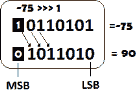

图 9.6 – 无符号右移

> **重要说明**
> 
> 移动的位数会自动缩减为模 32；也就是说，23 >>> 35 等价于 23 >>> (35 % 32)，等价于 23 >>> 3。

现在你已经对位移运算符有了一个概念，是时候来攻克更多技巧了。

## 技巧与窍门

操作位在处理位运算符时需要极高的技巧，并且了解一些技巧和窍门。你在本章前面已经看到了一些技巧。现在，让我们再以项目符号列表的形式添加一些：

- 如果我们对一个数进行偶数次 XOR，则结果为 0（x ^ x = 0; x ^ x ^ x ^ x = (x ^ x) ^ (x ^ x) = 0 ^ 0 = 0）。
- 如果我们对一个数进行奇数次 XOR，则结果为该数（x ^ x ^ x = (x ^ (x ^ x)) = (x ^ 0) = x; x ^ x ^ x ^ x ^ x = (x ^ (x ^ x) ^ (x ^ x)) = (x ^ 0 ^ 0) = x）。

> > 我在代码审阅中发现的一些问题

昨天,团队在 review 我提交的 PR。有人提了一个很尖锐的问题:虽有成形的方案,但我们的 coding agent 只依赖静态分析,没有真正执行代码去验证行为。

这个反馈让我想了很多。coding agent 不能只是"读代码",更需要"运行代码"去验证假设。而当我们提及"让 agent 运行代码",不仅仅是执行几个测试那么简单,而是要面对 Linux 容器环境中的权限、安全隔离,以及环境一致性等一系列复杂的问题。

为了模拟这些挑战,我设计了一个安全的演练环境,利用 Docker-in-Docker 构建一个隔离的 Linux 沙盒,并把沙盒工具化,让 coding agent 能:

- 创建隔离的 Linux 容器
- 在容器内执行任意命令
- 支持文件读写、安装依赖、运行测试

下面,我把构建过程、关键决策和遇到的实际问题完整记录下来。

## 项目概览

目标是构建一个沙盒工具,与 coding agent 集成(coding agent 通过 Tool Calling 调用该工具),在容器内安全地抽象和验证代码行为。

整体架构如下:


## 核心设计原则

- **隔离性**: 每个沙盒运行在独立的 Docker 容器中,互不干扰
- **安全性**: Agent 没有宿主机权限,仅限容器内操作
- **可重复性**: 环境配置通过 Dockerfile 和脚本固化,保证环境一致
- **可观测性**: 所有命令输出和操作日志都会被捕获

## Tool Calling 接口设计

sandbox 以 Tool 的形式对 agent 开放,关键接口如下:

```

```json
{
  "type": "function",
  "function": {
    "name": "sandbox_exec",
    "description": "在隔离的容器中执行命令并返回输出",
    "parameters": {
      "type": "object",
      "properties": {
        "image": { "type": "string" },
        "cmd": { "type": "array" },
        "timeout": { "type": "number" }
      }
    }
  }
}
```

```

So, we cleared the bits between MSB and k=6. Generally speaking, we need a bit-mask that contains 0s between the MSB and k (inclusive) and 1s between k (exclusive) and LSB. We can do this by left shifting the bits of 1 with k positions (for example, for k=6, we obtain 1000000) and subtracting 1. This way, we obtain the needed bit-mask, 0111111. So, in terms of code, we have the following:

```

public static int clearFromMsb(int n, int k) {

    return n & ((1 << k) - 1);

}

```

How about clearing the bits between the given k and the LSB? Let me show you the code:

```

public static int clearFromPosition(int n, int k) {

    return n & ~((1 << k) - 1);

}

```

Now, take your time and dissect this solution. Moreover, we can replace this solution with this one: n & (-1 << (k + 1)).

Again, use a paper and a pen and take it step by step. The complete application is called ClearBits.

## 编程挑战 4 - 在纸上求二进制和

**问题：** 考虑若干个正的 32 位整数。拿起笔和纸，展示你如何求出它们的二进制表示之和。

**说明：** 这并不是一个严格意义上的编程挑战，但了解这一点很重要。

**解答：** 求二进制数之和可以有多种方法。一种简单的方法如下：

1. 求当前列的所有位之和（第一列是 LSB 列）。
2. 将结果转换为二进制（例如，通过连续除以 2）。
3. 保留最右边的位作为结果。
4. 将剩余的位进位到剩余的列（每列一位）。
5. 进入下一列并从步骤 1 重复。

## 编程挑战 8 - 在纸上做二进制减法

问题：考虑两个正的 32 位整数 q 和 p。拿起纸和笔，展示你如何减去这两个数的二进制表示（q-p）。

说明：这并不是一个严格意义上的编程挑战，但了解这一点很重要。

解答：二进制减法可以简化为计算 0 减 1。主要我们知道 1 减 1 等于 0，0 减 0 等于 0，1 减 0 等于 1。要计算 0 减 1，我们必须执行以下步骤：

1. 从当前列开始，向左列搜索直到找到一个 1 位。
2. 借用该位并将其放在前一列作为两个 1 的值。
3. 再从前一列借用其中一个 1 的值作为另外两个 1。
4. 对每个列重复步骤 3，直到到达当前列。
5. 现在，我们可以执行计算。
6. 如果我们再次遇到 0 减 1，则从步骤 1 重复此过程。

让我们做 124 (1111100) - 29 (011101) = 95 (1011111)。

下图表示我们计算的结果：

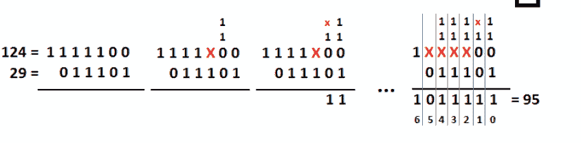

图 9.16 – 减去二进制数

现在，让我们一步步来看：

1. 从第 0 列开始，即从 0 减 1。我们在左侧列中搜索直到找到一个 1 位。我们在第 2 列找到它（该位对应于 2²=4）。我们借用该位到第 1 列并将其用作两个 1 的值（换句话说，两个 2 是 2¹+2¹）。我们从第 1 列借用其中一个 1 的值（这是 2¹=2）到第 0 列并将其用作另外两个 1 的值（换句话说，两个 1 是 2⁰+2⁰）。现在，我们可以进行计算 2 减 1 等于 1。我们写下 1 并继续到第 1 列。


现在，让我们一步步来看（重点关注前一张图的左侧）：

- 子被除数 = 1，10 > 1 因为 2 > 1，因此我们在商中追加 0。
- 子被除数 = 10，10 = 10 因为 2 = 2，因此我们在商中追加 1。
- 做减法，10 - 10 = 0。
- 子被除数 = 01，10 > 01 因为 2 > 1，因此我们在商中追加 0。
- 子被除数 = 011，10 < 011 因为 2 < 3，因此我们在商中追加 1。
- 做减法，011 - 10 = 1。
- 被除数中没有更多位需要处理，所以我们可以说 11/2 的商为 101（即 5），余数为 1。

如果你看前一张图的右侧，那么你会看到我们可以通过应用步骤 c.b 来继续计算，直到余数为 0。

## 编程挑战 11 – 在代码中除二进制数

Amazon, Google, Adobe

问题：考虑两个 32 位整数 q 和 p。编写一段代码片段，使用它们的二进制表示计算 q/p。

解决方案：我们可以使用多种方法来除两个二进制数。让我们专注于实现一个仅计算商的解决方案，这意味着我们跳过余数。

这种方法相当直接。我们知道 32 位整数包含我们在 31 到 0 之间计数的位。我们要做的就是将除数（p）左移 i 位（i=31, 30, 29, ..., 2, 1, 0），并检查结果是否小于被除数（q）。每次我们找到这样的位时，我们就更新第 i 位。我们累积结果并将其传递到下一个位置。以下代码不言自明：

```
private static final int MAX_BIT = 31;
...
public static long divideWithoutRemainder(long q, long p) {

// obtain the sign of the division
long sign = ((q < 0) ^ (p < 0)) ? -1 : 1;

// ensure that q and p are positive
```

```
q = Math.abs(q);

p = Math.abs(p);

long t = 0;
long quotient = 0;

for (int i = MAX_BIT; i >= 0; --i) {

    long halfdown = t + (p << i);

    if (halfdown <= q) {

        t = t + p << i;
        quotient = quotient | 1L << i;
    }
}

return sign * quotient;
}
```

完整的应用程序称为 *DividingBinaries*。它还包含计算余数的实现。

## 编程挑战 12 – 替换位

Amazon, Google, Adobe

**问题：** 考虑两个正 32 位整数 q 和 p，以及两个位位置 i 和 j。编写一段代码片段，用 p 的位替换 q 中位置 i 到 j 之间的位。你可以假设在 i 和 j 之间有足够的空间容纳 p 的所有位。

```
count += xor & 1; // only 1 & 1 = 1
xor = xor >> 1;
}

return count;
}
```

完整的应用程序称为 Conversion。

## 编程挑战 16 – 最大化表达式

**问题：** 考虑两个正 32 位整数 q 和 p，其中 q ≠ p。q 和 p 之间是什么关系，使得表达式 (q AND s) * (p AND s) 最大化，其中 AND 是逻辑运算符 [&]？

**解决方案：** 这是听起来很难但实际上极其简单的问题。让我们从一个简单的 a * b 开始。什么时候 a * b 最大？让我们考虑 b = 4。什么时候 a * 4 最大？让我们写一些测试用例：

a = 1, 1 * 4 = 4

a = 2, 2 * 4 = 8

a = 3, 3 * 4 = 12

a = 4, 4 * 4 = 16

所以，当 a = b 时，我们达到了最大值 16。然而，a 可以是 5 而 5 * 4 = 20 > 16。这是对的，但这意味着 b 也可以是 5，所以 5 * 5 = 25 > 20。这远非数学证明，但我们可以注意到 a * b 在 a = b 时达到最大值。

对于感兴趣数学证明的人来说，让我们说我们有以下内容：

(a − b)² ≥ 0 → (a + b)² − 4 * a * b ≥ 0 → a * b ≤ (a + b)² / 4

Figure 9.29 – Maximizing expressions (1)

看这个减法的结果。1s 正好位于位置 i=3（包含）和 j=7（包含）之间。这正是我们要找的数字：248。被除数和除数是通过将 1 左移 (j+1) 位和 i 位分别得到的。

有了这些陈述，把它们放入代码就非常容易了：

```
public static int setBetween(int left, int right) {
    
    return (1 << (right + 1)) - (1 << left);
}
```

完整的应用程序称为 NumberWithOneInLR。

## 编程挑战 20 – 唯一元素

Amazon, Google, Adobe, Microsoft, Flipkart

问题：考虑一个给定的整数数组 arr。此数组中的每个元素恰好出现三次，除了一个元素只出现一次。这使得它唯一。编写一段代码片段以 O(n) 时间复杂度和 O(1) 额外空间找到这个唯一元素。

解决方案：让我们考虑给定的数组为 arr={4, 4, 3, 1, 7, 7, 7, 1, 1, 4}，所以 3 是唯一元素。如果我们写出这些数字的二进制表示，我们得到以下结果：100, 100, 011, 001, 111, 111, 111, 001, 001, 100。现在，让我们对同一位置的位求和并检查结果和是否为 3 的倍数，如下所示：

- Sum of first bits % 3 = 0+0+1+1+1+1+1+1+1+0 = 7 % 3 = 1
- Sum of second bits % 3 = 0+0+1+0+1+1+1+0+0+0 = 4 % 3 = 1
- Sum of third bits % 3 = 1+1+0+0+1+1+1+0+0+1 = 6 % 3 = 0

唯一数字是 011 = 3。

代码如下：

```
private static final int INT_SIZE = 32;

public static int unique(int arr[]) {

    int n = arr.length;
    int result = 0;

    int nr;
    int sumBits;

    // iterate through every bit
    for (int i = 0; i < INT_SIZE; i++) {

        // compute the sum of set bits at
        // ith position in all array
        sumBits = 0;
        nr = (1 << i);
        for (int j = 0; j < n; j++) {
            if ((arr[j] & nr) == 0) {
                sumBits++;
            }
        }

        // the sum not multiple of 3 are the
        // bits of the unique number
        if ((sumBits % 3) == 0) {
            result = result | nr;
        }
    }

    return result;
}
```

所以，如果我们取 XOR[^] 结果的任意一个置位位（例如最右边的位）并将数组元素分成两组，那么一组将包含具有相同置位位的元素，另一组将包含具有相同位未置位的元素。换句话说，我们通过将 XOR[^] 的最右边置位位与每个元素中相同位置的位进行比较来将元素分成两组。通过这样做，我们将得到一组中的 p 和另一组中的 q。

现在，如果我们对第一组中的所有元素应用 XOR[^] 运算符，那么我们将得到第一个不重复的元素。对另一组做同样的操作将得到第二个不重复的元素。

让我们将此流程应用于我们的数据，arr={2, 7, 1, 5, 9, 4, 1, 2, 5, 4}。所以，7 和 9 是不重复的值。首先，我们对所有数字应用 XOR[^] 运算符：

xor = 2 ^ 7 ^ 1 ^ 5 ^ 9 ^ 4 ^ 1 ^ 2 ^ 5 ^ 4 = 0010 (2) ^ 0111 (7) ^ 0001 (1) ^ 0101 (5) ^ 1001 (9) ^ 0100 (4) ^ 0001 (1) ^ 0010 (2) ^ 0101 (5) ^ 0100 (4) = 1110 = 7 ^ 9 = 0111 & 1001 = 1110 = 14。

所以，7 ^ 9 != 0 如果 7 != 9。因此，至少会有一个置位位（至少一个位为 1）。我们可以取任意置位位，但取最右边的位作为 xor & ~(xor-1) 非常简单。所以，我们有 1110 & ~(1101) = 1110 & 0010 = 0010。随意取其他置位位。

到目前为止，我们找到了这个置位位（0010）在这两个数字（7 和 9）的 XOR[^] 中，所以这个位必须存在于 7 或 9 中（在本例中存在于 7 中）。接下来，让我们通过将 XOR[^] 的最右边置位位与每个元素中相同位置的位进行比较来将元素分成两组。我们得到第一组，包含元素 {2, 7, 2}，第二组，包含元素 {1, 5, 9, 4, 1, 5, 4}。由于 2、7 和 2 包含置位位，它们在第一组中，而 1、5、9、4、1、5 和 4 不包含置位位，这意味着它们是第二组的一部分。

有了这个，我们就在一组中分离出了第一个不重复的元素（7），并将第二个不重复的元素（9）放在了另一组中。此外，每个重复元素将位于相同的位表示组中（例如，{2, 2} 将始终位于同一组中）。

最后，我们对每组应用 XOR[^]。所以，我们有 xor_first_set = 2 ^ 7 ^ 2 = 010 ^ 111 ^ 010 = 111 = 7（第一个不重复元素）。

对于第二组，我们有：

xor_second_set = 1 ^ 5 ^ 9 ^ 4 ^ 1 ^ 5 ^ 4 = 0001 ^ 0101 ^ 1001 ^ 0100 ^ 0001 ^ 0101 ^ 0100 = 1001 = 9（第二个不重复元素）。

完成！


