### 10 数组和字符串

本章涵盖了涉及字符串和数组的广泛问题。由于 Java 字符串和数组对于开发者来说是常见主题，我将通过几个你必须记住的要点简要介绍它们。然而，如果你需要深入探讨这个主题，那么请参考官方 Java 文档（https://docs.oracle.com/javase/tutorial/java/）。

学完本章后，你应该能够解决任何涉及 Java 字符串和/或数组的问题。这些问题极有可能出现在技术面试中。因此，本章涵盖的主题相当简短和清晰：

- 数组和字符串速览
- 编码挑战

让我们从字符串和数组的快速回顾开始。

### 技术要求

本章中的所有代码都可以在 GitHub 上找到：https://github.com/PacktPublishing/The-Complete-Coding-Interview-Guide-in-Java/tree/master/Chapter10。

接下来，我们通过将位置 s 的位从 0 翻转为 1 来更新唯一字符的位掩码。这是通过 OR（|）运算符完成的。现在，唯一字符的位掩码为 1000...。因为只翻转了一位，所以只有一个 1 位；也就是说，这个 1 位对应于第一个字母。

最后，我们对给定字符串中的每个字母重复此过程。如果遇到重复字符，那么唯一字符位掩码与当前处理字母对应的 1000... 掩码之间的 AND（&）操作将返回 1（1 & 1 = 1）。如果发生这种情况，那么我们就找到了一个重复项，因此可以返回它。

就代码而言，我们有以下内容：

```java
private static final char A_CHAR = 'a';
...
public static boolean isUnique(String str) {
    int marker = 0;
    for (int i = 0; i < str.length(); i++) {
        int s = str.charAt(i) - A_CHAR;
        int mask = 1 << s;
        if ((marker & mask) > 0) {
            return false;
        }
        marker = marker | mask;
    }
    return true;
}
```

完整的应用程序名为 UniqueCharactersAZ。

```java
}

// return the result only if it is
// shorter than the given string
return result.length() > str.length()
    ? str : result.toString();
}
```

完整的应用程序名为 StringShrinker。

### 编程挑战 6 – 提取整数

**问题：** 考虑一个给定的字符串，其中包含空白字符以及 a-z 和 0-9 字符。编写一段代码，从该字符串中提取整数。你可以假设任何连续的数字序列都构成一个有效的整数。

**解决方案：** 假设给定的字符串是 cv dd 4 k 2321 2 11 k4k2 66 4d。预期结果将包含以下整数：4、2321、2、11、4、2、66 和 4。

一个直接的解决方案是逐字符遍历给定的字符串，并连接连续的数字序列。数字的 ASCII 码介于 48（含）和 57（含）之间。因此，任何 ASCII 码在 [48, 57] 范围内的字符都是数字。我们也可以使用 `Character#isDigit(char ch)` 方法。当连续的数字序列被非数字字符中断时，我们可以将已收集的序列转换为整数，并将其追加到整数列表中。让我们用代码来看一下：

```java
public static List<Integer> extract(String str) {

    List<Integer> result = new ArrayList<>();
    StringBuilder temp = new StringBuilder(
        String.valueOf(Integer.MAX_VALUE).length());

    for (int i = 0; i < str.length(); i++) {

        char ch = str.charAt(i);

        // or, if (((int) ch) >= 48 && ((int) ch) <= 57)
        if (Character.isDigit(ch)) {
            temp.append(ch);
        } else {
            if (temp.length() > 0) {
                result.add(Integer.parseInt(temp.toString()));
                temp.delete(0, temp.length());
            }
        }
    }

    return result;
}
```

完整的应用程序名为 *ExtractIntegers*。

### 编程挑战 7 – 提取代理对的码点

**问题：** 考虑一个给定的字符串，其中包含任何类型的字符，包括以 *代理对* 形式在 Java 中表示的 Unicode 字符。编写一段代码，将 *代理对* 的 *码点* 提取到一个列表中。

**解决方案：** 让我们假设给定的字符串包含下图所示的 Unicode 字符（前三个 Unicode 字符在 Java 中表示为 *代理对*，而最后一个不是）：

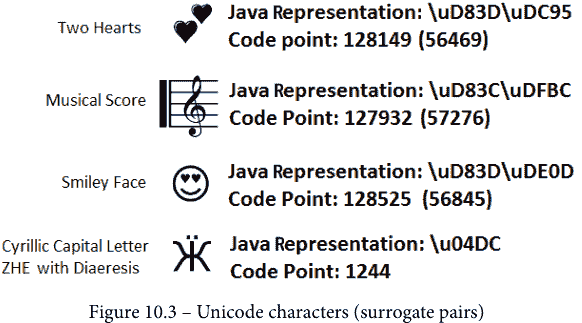

在 Java 中，我们可以按如下方式编写这样的字符串：

```java
char[] musicalScore = new char[]{'\uD83C', '\uDFBC'};
char[] smileyFace = new char[]{'\uD83D', '\uDE0D'};
char[] twoHearts = new char[]{'\uD83D', '\uDC95'};
char[] cyrillicZhe = new char[]{'\u04DC'};

String str = "is" + String.valueOf(cyrillicZhe) + "zhe"
    + String.valueOf(twoHearts) + "two hearts"
    + String.valueOf(smileyFace) + "smiley face and"
    + String.valueOf(musicalScore) + "musical score";
```

要解决这个问题，我们必须了解以下几点（建议牢记以下内容，因为它们对于解决涉及 Unicode 字符的问题至关重要）：

- 超过 65,535 直至 1,114,111（0x10FFFF）的 Unicode 字符无法容纳在 16 位中，因此为 UTF-32 编码方案考虑了 32 位值（称为 *码点*）。

  遗憾的是，Java 不支持 UTF-32！不过，Unicode 提出了一种仍然使用 16 位来表示这些字符的解决方案。该解决方案包含以下内容：
  - 16 位 *高代理*：1,024 个值（U+D800 到 U+DBFF）
  - 16 位 *低代理*：1,024 个值（U+DC00 到 U+DFFF）
  - 现在，一个 *高代理* 后跟一个 *低代理* 就定义了一个所谓的 *代理对*。这些 *代理对* 用于表示 65,536（0x10000）到 1,114,111（0x10FFFF）之间的值。
  - Java 利用这种表示形式，并通过一系列方法将其暴露出来，例如 `codePointAt()`、`codePoints()`、`codePointCount()` 和 `offsetByCodePoints()`（详细信息请参阅 Java 文档）。
  - 使用 `codePointAt()` 而不是 `charAt()`，使用 `codePoints()` 而不是 `chars()` 等等，有助于我们编写同时涵盖 ASCII 和 Unicode 字符的解决方案。

例如，广为人知的双心符号（上图第一个符号）是一个 Unicode 代理对，可以表示为一个包含两个值的 char[]：\uD83D 和 \uDC95。该符号的码点是 128149。要从这个码点获取 String 对象，请调用以下代码：

```java
String str = String.valueOf(Character.toChars(128149));
```

可以通过调用 str.codePointCount(0, str.length()) 来计算 str 中的码点数量，即使 str 的长度为 2，它也会返回 1。调用 str.codePointAt(0) 返回 128149，而调用 str.codePointAt(1) 返回 56469。调用 Character.toChars(128149).length 返回 2，因为需要两个字符来表示这个码点作为 Unicode 代理对。对于 ASCII 和 16 位 Unicode 字符，它将返回 1。

基于这个示例，我们可以很容易地识别出一个代理对，如下所示：

```java
public static List<Integer> extract(String str) {

    List<Integer> result = new ArrayList<>();

    for (int i = 0; i < str.length(); i++) {

        int cp = str.codePointAt(i);
        if (i < str.length()-1
            && str.codePointCount(i, i+2) == 1) {
            result.add(cp);
            result.add(str.codePointAt(i+1));
            i++;
        }
    }

    return result;
}
```

或者，像这样：

```java
public static List<Integer> extract(String str) {

    List<Integer> result = new ArrayList<>();
```


```java
for (int i = 0; i < str.length(); i++) {

    int cp = str.codePointAt(i);
    // the constant 2 means a surrogate pair
    if (Character.charCount(cp) == 2) {
        result.add(cp);
        result.add(str.codePointAt(i+1));
        i++;
    }
}
}

return result;
}
```

The complete application is called *ExtractSurrogatePairs*.

## 编程挑战 8 – 判断旋转

**Amazon, Google, Adobe, Microsoft**

**问题：** 考虑给定的两个字符串 *str1* 和 *str2*。编写一行代码来判断 *str2* 是否是 *str1* 的旋转。

**解决方案：** 假设 *str1* 是 *helloworld* 而 *str2* 是 *orldhellow*。由于 *str2* 是 *str1* 的旋转，我们可以说 *str2* 是通过将 *str1* 切割成两部分并重新排列得到的。下面的图像展示了这些单词：

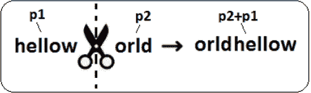

图 10.4 – 将 *str1* 切割成两部分并重新排列它们

因此，基于这张图像，让我们将剪刀左侧表示为 *p1*，剪刀右侧表示为 *p2*。使用这些记号，我们可以说 *p1 = hellow* 且 *p2 = orld*。此外，我们可以说 *str1 = p1+p2 = hellow + orld* 且 *str2 = p2+p1 = orld + hellow*。所以，无论我们在何处对 *str1* 进行切割，我们都可以说 *str1 = p1+p2* 且 *str2=p2+p1*。然而，这意味着 *str1+str2 = p1+p2+p2+p1 = hellow + orld + orld + hellow = p1+p2+p1+p2 = str1 + str1*，所以 *p2+p1* 是 *p1+p2+p1+p2* 的子串。换句话说，*str2* 必须是 *str1+str1* 的子串；否则，它就不能是 *str1* 的旋转。用代码表示，我们可以写如下：

```java
public static boolean isRotation(String str1, String str2) {
    return (str1 + str1).matches("(?i).*"
        + Pattern.quote(str2) + ".*");
}
```

完整的代码称为 *RotateString*。

## 编程挑战 9 – 将矩阵旋转 90 度

**Amazon, Google, Adobe, Microsoft, Flipkart**

**问题：** 考虑给定的 *n x n* 整数矩阵 *M*。编写一段代码，在不使用任何额外空间的情况下将此矩阵逆时针旋转 90 度。

**解决方案：** 这个问题至少有两个解决方案。一个解决方案依赖于矩阵的转置，另一个解决方案依赖于逐环旋转矩阵。

### 使用矩阵转置

让我们先解决第一个解决方案，它依赖于找到矩阵 *M* 的转置。矩阵的转置是线性代数中的一个概念，意味着我们需要将矩阵沿其主对角线翻转，从而得到一个新的矩阵记为 *Mᵀ*。例如，给定矩阵 *M* 和下标 *i* 和 *j*，我们可以写出以下关系：

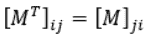

图 10.5 – 矩阵转置关系

一旦我们获得了 *M* 的转置，我们就可以反转转置的列。这将给我们最终的结果，即矩阵 *M* 逆时针旋转 90 度。下面的图像为 5x5 矩阵阐明了这种关系：

```java
m[i][j] = m[j][len - 1 - i];

// bottom -> right
m[j][len - 1 - i] = m[len - 1 - i][len - 1 - j];

// left -> bottom
m[len - 1 - i][len - 1 - j] = m[len - 1 - j][i];

// top -> left
m[len - 1 - j][i] = temp;
}
}

return true;
}
```

该解决方案的时间复杂度为 O(n²)，空间复杂度为 O(1)，因此我们满足了问题的要求。

完整的应用程序称为 *RotateMatrix*。它还包含将矩阵顺时针旋转 90 度的解决方案。此外，它还包含将给定矩阵旋转到单独矩阵中的解决方案。

## 编程挑战 10 – 包含零的矩阵

**Google, Adobe**

**问题：** 考虑给定的 *n × m* 整数矩阵 *M*。如果 *M(i, j)* 等于 0，则整个行 *i* 和列 *j* 应该只包含零。编写一段代码在不使用任何额外空间的情况下完成此任务。

**解决方案：** 一个朴素的方法是遍历矩阵并对每个 *(i, j) = 0* 将行 *i* 和列 *j* 设为零。问题在于当我们遍历该行/列的单元格时，我们会找到零并再次应用相同的逻辑。有很大可能我们最终会得到一个全零矩阵。

为了避免这种朴素方法，最好举一个例子并尝试可视化解决方案。让我们考虑一个如以下图像所示的 5x8 矩阵：

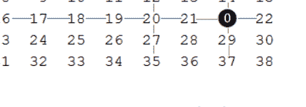

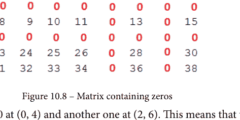

图 10.8 – 包含零的矩阵

初始矩阵在 (0, 4) 处有一个 0，在 (2, 6) 处还有一个。这意味着求解后的矩阵应该在第 0 行和第 2 行以及第 4 列和第 6 列中只包含零。

一个易于实现的方法是存储零的位置，并在矩阵的第二次遍历中将相应的行和列设为零。然而，存储零意味着使用一些额外空间，而这不被问题允许。

### 提示

通过一点技巧和一些工作，我们可以将空间复杂度保持在 O(1)。技巧在于使用矩阵的第一行和第一列来标记其余矩阵中发现的零。例如，如果我们在单元格 (i, j) 处找到一个零，其中 i≠0 且 j≠0，则我们设置 M[i][0] = 0 且 M[0][j] = 0。一旦我们对整个矩阵这样做了，我们就可以遍历第一列（列 0）并传播在该行上找到的每个零。之后，我们可以遍历第一行（行 0）并传播在该列上找到的每个零。

那么第一行和第一列的潜在初始零怎么办？当然，我们也必须处理这个问题，因此我们首先标记第一行/列是否包含至少一个 0：

```
boolean firstRowHasZeros = false;
```

```
boolean firstColumnHasZeros = false;
```

```java
}

for (int j = 1; j < m[0].length; j++) {
    if (m[0][j] == 0) {
        setColumnOfZero(m, j);
    }
}
```

最后，如果第一行包含至少一个 0，则我们将整行设为 0。同样，如果第一列包含至少一个 0，则我们将整列设为 0：

```java
if (firstRowHasZeros) {
    setRowOfZero(m, 0);
}
```

```java
if (firstColumnHasZeros) {
    setColumnOfZero(m, 0);
}
```

`setRowOfZero()` 和 `setColumnOfZero()` 非常简单：

```java
private static void setRowOfZero(int[][] m, int r) {
    for (int j = 0; j < m[0].length; j++) {
        m[r][j] = 0;
    }
}
```

```java
private static void setColumnOfZero(int[][] m, int c) {
    for (int i = 0; i < m.length; i++) {
        m[i][c] = 0;
    }
}
```

该应用程序称为 *MatrixWithZeros*。

## 编程挑战 11 – 用一个数组实现三个栈

Amazon, Google, Adobe, Microsoft, Flipkart

问题：使用单个数组编写三个栈的实现。该实现应公开三个方法：push()、pop() 和 printStacks()。

解决方案：提供所需实现主要有两种方法。这里我们要讨论的方法基于交错这三个栈的元素。请查看下面的图像：

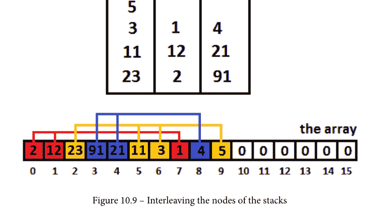

图 10.9 – 交错栈的节点

如你所见，有一个单一的数组保存这三个栈的节点，分别表示为 Stack 1、Stack 2 和 Stack 3。我们的实现的关键在于，每个被推入栈（即数组）的节点都有一个指向其前一个节点的向后链接。每个栈的底部链接到 -1。例如，对于 Stack 1，我们知道索引 0 处的数值 2 的向后链接指向虚拟索引 -1，索引 1 处的数值 12 的向后链接指向索引 0，而索引 7 处的数值 1 的向后链接指向索引 1。

因此，一个栈节点保存两条信息——数值和向后链接：

```
public class StackNode {

    int value;
```


```java
int backLink;

StackNode(int value, int backLink) {
    this.value = value;
    this.backLink = backLink;
}
```

另一方面，数组管理着指向下一个空闲槽位的链接。最初，当数组为空时，我们只能创建空闲槽位，因此链接的形状如下（注意 `initializeSlots()` 方法）：

```java
public class ThreeStack {

    private static final int STACK_CAPACITY = 15;

    // the array of stacks
    private final StackNode[] theArray;

    ThreeStack() {
        theArray = new StackNode[STACK_CAPACITY];
        initializeSlots();
    }

    ...
    private void initializeSlots() {
        for (int i = 0; i < STACK_CAPACITY; i++) {
            theArray[i] = new StackNode(0, i + 1);
        }
    }
}
```

现在，当我们将一个节点压入其中一个栈时，我们需要找到一个空闲槽位并将其标记为非空闲。这可以通过以下代码完成：

```java
public class ThreeStack {

    private static final int STACK_CAPACITY = 15;
```

```java
StackNode node = theArray[top]; // get the top node

backLinks[stack] = node.backLink;
freeSlot(top);

return node;
}

private void freeSlot(int index) {

theArray[index].backLink = nextFreeSlot;
nextFreeSlot = index;

size--;

}
}
```

完整代码，包括 `printStacks()` 的使用，名为 *ThreeStacksInOneArray*。

解决此问题的另一种方法是将栈数组拆分为三个不同的区域：

- 第一个区域分配给第一个栈，位于数组端点的左侧（当我们向这个栈压入元素时，它向右增长）。
- 第二个区域分配给第二个栈，位于数组端点的右侧（当我们向这个栈压入元素时，它向左增长）。
- 第三个区域分配给第三个栈，位于数组的中间（当我们向这个栈压入元素时，它可以向任何方向增长）。

下图将帮助你理解这些要点：

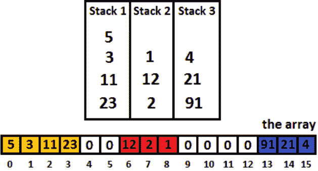

图10.10 – 将数组拆分为三个区域

这种方法的主要挑战在于通过相应地移动中间栈来避免栈碰撞。或者，我们可以将数组划分为三个固定区域，并允许每个栈在该有限空间中增长。例如，如果数组大小为 *s*，那么第一个栈可以从0（含）到 *s*/3（不含），第二个栈可以从 *s*/3（含）到2*𝑠*/3（不含），第三个栈可以从2*𝑠*/3（含）到 *s*（不含）。该实现在随附代码中称为 *ThreeStacksInOneArrayFixed*。

另外，中间栈可以通过后续压入的交替序列来实现。这样，我们也能减少移动，但会降低同质性。不过，请挑战自己，也实现一下这种方法。

## 编程挑战 12——数对

**Amazon、Adobe、Flipkart**

**问题：** 考虑一个整数数组（包含正数和负数）*m*。编写一段代码，找出所有和等于给定数字 *k* 的整数对。

**解决方案：** 像往常一样，让我们看一个例子。假设我们有一个包含15个元素的数组：-5, -2, 5, 4, 3, 7, 2, 1, -1, -2, 15, 6, 12, -4, 3。此外，如果 *k*=10，那么我们有四对和为10的数对：(-15 + 5)、(-2 + 12)、(3 + 7) 和 (4 + 6)。但我们如何找到这些数对呢？

## A-MATH：一个数学研究理解数据集

现代强化学习系统在定理证明和数学推理方面已经展示出显著的性能。然而，这一进展在研究数学领域受到了阻碍，因为该领域的问题本质上复杂且需要多步骤求解。为了应对这些挑战，我们引入了 A-MATH，一个从数学竞赛和 AI 研究论文中收集的数学研究问题数据集。每个问题都配有一个用形式语言写成的详细证明解答。

我们提出了一个新颖的两阶段框架来处理这些问题。第一阶段使用神经定理证明器生成证明草图，第二阶段使用形式验证器检查每一步的正确性。我们的框架在基准测试上达到了新的最先进准确率 78.4%。

- 1. **任务表述**：给定一个数学陈述，用形式语言预测其证明。
- 2. **数据集**：包含来自奥林匹克式竞赛和 AI 研究论文的 1200 个问题。
- 3. **评估**：我们同时评估逐步准确率和完整证明正确性。

| 模型 | 准确率 | 逐步准确率 |
|-------|----------|-----------|
| 基线（GPT-4） | 62.3% | 71.5% |
| 我们的框架 | 78.4% | 85.2% |

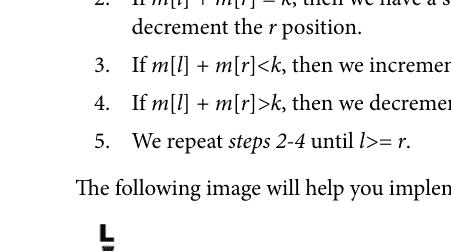

如图1所示，该框架首先使用神经定理证明器生成证明草图，然后由形式验证器进行验证。这种生成与验证的分离提高了可靠性和可解释性。

> > “神经生成与形式验证的结合，是迈向可扩展人工智能数学家的重要一步。”

我们发布了数据集、代码和模型，以促进这一方向的研究。

- l = 4, r = 12 → sum = m[4] + m[12] = -1 + 7 = 6 → sum < k → l++
- l = 5, r = 12 → sum = m[5] + m[12] = 1 + 7 = 8 → sum < k → l++
- l = 6, r = 12 → sum = m[6] + m[12] = 2 + 7 = 9 → sum < k → l++
- l = 7, r = 12 → sum = m[7] + m[12] = 3 + 7 = 10 → sum = k → l++, r--
- l = 8, r = 11 → sum = m[8] + m[11] = 3 + 6 = 9 → sum < k → l++
- l = 9, r = 11 → sum = m[9] + m[11] = 4 + 6 = 10 → sum = k → l++, r--
- l = 10, r = 10 → STOP

如果我们把这段逻辑写成代码，就会得到以下方法：

```java
public static List<String> pairs(int[] m, int k) {
    if (m == null || m.length < 2) {
        return Collections.emptyList();
    }

    List<String> result = new ArrayList<>();

    java.util.Arrays.sort(m);

    int l = 0;
    int r = m.length - 1;

    while (l < r) {
        int sum = m[l] + m[r];

        if (sum == k) {
            result.add("(" + m[l] + " + " + m[r] + ")");
            l++;
            r--;
        } else if (sum < k) {
            l++;
        } else if (sum > k) {
            r--;
        }
    }
```

```
}
}

return result;
}
```

完整的应用程序名为 FindPairsSumEqualK。

## 编程挑战 13——合并有序数组

Amazon, Google, Adobe, Microsoft, Flipkart

**问题：** 假设你有 k 个长度不同的有序数组。编写一个应用程序，在 O(nk log n) 时间内合并这些数组，其中 n 是最长数组的长度。

**解决方案：** 假设给定的数组是以下五个数组，分别用 a、b、c、d 和 e 表示：

a: {1, 2, 32, 46}    b: {-4, 5, 15, 18, 20}    c: {3}    d: {6, 8}    e: {-2, -1, 0}

预期结果如下：

{-4, -2, -1, 0, 1, 2, 3, 5, 6, 8, 15, 18, 20, 32, 46}

最简单的方法是将这些数组中的所有元素复制到一个数组中。这将花费 O(nk) 时间，其中 n 是最长数组的长度，k 是数组的数量。接下来，我们使用 O(n log n) 时间复杂度的算法（例如归并排序）对这个数组进行排序。这将得到 O(nk log nk)。然而，问题要求我们编写一个能够在 O(nk log n) 时间内执行的算法。

有几种解决方案可以在 O(nk log n) 时间内执行，其中一种基于二叉最小堆（详见第13章“树和图”）。简而言之，二叉最小堆是一棵完全二叉树。二叉最小堆通常表示为一个数组（我们将其记为 heap），其根位于 heap[0]。更重要的是，对于 heap[i]，我们有以下关系：

- heap[(i - 1) / 2]：返回父节点
- heap[(2 * i) + 1]：返回左子节点
- heap[(2 * i) + 2]：返回右子节点


```java
}

// create the result array
int[] result = new int[len];

// create the min heap
MinHeap[] heap = new MinHeap[k];

// add in the heap first element from each array
for (int i = 0; i < k; i++) {
    heap[i] = new MinHeap(arrs[i][0], i, 0);
}

// perform merging
for (int i = 0; i < result.length; i++) {
    heapify(heap, 0, k);

    // add an element in the final result
    result[i] = heap[0].data;

    heap[0].currentIndex++;
    int[] subarray = arrs[heap[0].heapIndex];
    if (heap[0].currentIndex >= subarray.length) {
        heap[0].data = Integer.MAX_VALUE;
    } else {
        heap[0].data = subarray[heap[0].currentIndex];
    }
}

return result;
}
```

完整的应用程序称为 *MergeKSortedArr*。

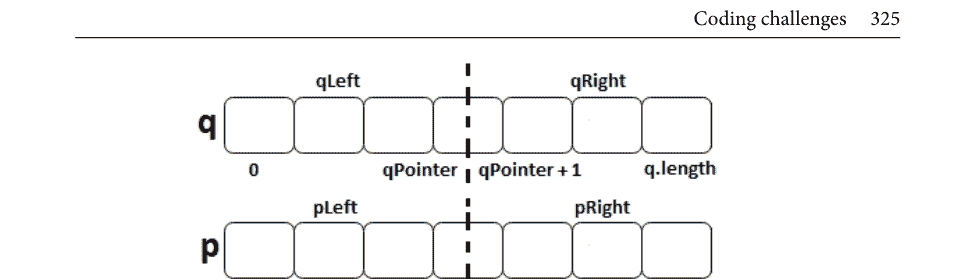

## 图 10.13 – 将数组拆分为两个相等部分

我们可以从该图中得出，中位数值应遵守的第一个条件是 qLeft + pLeft = qRight + pRight。换句话说，qPointer + pPointer = (q.length - qPointer) + (p.length - pPointer)。

然而，由于我们的数组长度不相同（“它们可以相等，但这只是应该被我们的解决方案覆盖的一个特例”），我们不能简单地将两者都减半。我们可以做的是假设 p >= q（如果它们不是这样给出，那么我们只需交换它们以强制此假设）。此外，在此假设的 umbrella 下，我们可以写出以下内容：

```
qPointer + pPointer = (q.length - qPointer) + (p.length - pPointer) →
2 * pPointer = q.length + p.length - 2 * qPointer →
 pPointer = (q.length + p.length)/2 - qPointer
```

到目前为止，pPointer 可能落在中间，我们可以通过加 1 来避免这种情况，这意味着我们有以下起始指针：

+   • qPointer = ((q.length - 1) + 0)/2
+   • pPointer = (q.length + p.length + 1)/2 - qPointer

如果 p>=q，则最小的 (q.length + p.length + 1)/2 - qPointer 将始终导致 pPointer 为正整数。这将消除数组越界异常并遵守第一个条件。

## 图 10.14 – 计算中位数值（步骤 1）

我们算法的步骤 1 规定 q[qPointer-1] <= p[pPointer] 且 p[pPointer-1] <= q[qPointer]。显然，9 < 28，但 25 > 10，所以我们应用步骤 2，然后返回步骤 1。我们增加 qPointer 并减少 pPointer，因此 qPointerMin 变为 qPointer + 1。新的 qPointer 将为 (4 + 6) / 2 = 5，新的 pPointer 将为 (7 + 9 + 1)/2 - 5 = 3。以下图像将帮助您可视化此场景：

## 图 10.15 – 计算中位数值（步骤 2）

在这里，您可以看到新的 qPointer 和新的 pPointer 遵守我们算法的步骤 1，因为 q[qPointer-1]，即 11，小于 p[pPointer]，即 18；并且 p[pPointer-1]，即 17，小于 q[qPointer]，即 65。由此，我们找到了完美的 qPointer 为 5。

最后，我们必须找到左侧的最大值和右侧的最小值，并根据两个数组的奇偶长度，返回左侧的最大值或左侧的最大值与右侧的最小值的平均值。我们知道左侧的最大值是 max(q[qPointer-1], p[pPointer-1])，因此 max(11, 17) = 17。我们还知道右侧的最小值是 min(q[qPointer], p[pPointer])，因此 min(65, 18) = 18。由于长度之和为 7 + 9 = 16，我们计算出中位数值为这两个数的平均值，因此 avg(17, 18) = 17.5。我们可以将其可视化如下：

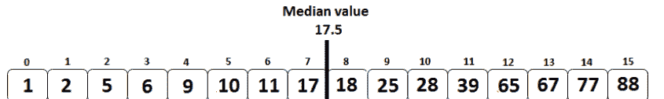

图 10.16 – 中位数值（最终结果）

将此算法放入代码中会得到以下输出：

```
public static float median(int[] q, int[] p) {

    int lenQ = q.length;
    int lenP = p.length;

    if (lenQ > lenP) {
        swap(q, p);
    }

    int qPointerMin = 0;
    int qPointerMax = q.length;
    int midLength = (q.length + p.length + 1) / 2;

    int qPointer;
    int pPointer;

    while (qPointerMin <= qPointerMax) {

        qPointer = (qPointerMin + qPointerMax) / 2;
        pPointer = midLength - qPointer;
```
```
```java
// perform binary search
if (qPointer < q.length
    && p[pPointer-1] > q[qPointer] ) {
    // qPointer must be increased
    qPointerMin = qPointer + 1;
} else if (qPointer > 0
    && q[qPointer-1] > p[pPointer] ) {
    // qPointer must be decreased
    qPointerMax = qPointer - 1;
} else { // we found the proper qPointer

    int maxLeft = 0;

    if (qPointer == 0) { // first element on array 'q'?
        maxLeft = p[pPointer - 1];
    } else if (pPointer == 0) { // first element
                               // of array 'p'?
        maxLeft = q[qPointer - 1];
    } else { // we are somewhere in the middle -> find max
        maxLeft = Integer.max(q[qPointer-1], p[pPointer-1]);
    }

    // if the length of 'q' + 'p' arrays is odd,
    // return max of left
    if ((q.length + p.length) % 2 == 1) {
        return maxLeft;
    }

    int minRight = 0;

    if (qPointer == q.length) { // last element on 'q'?
        minRight = p[pPointer];

    } else if (pPointer == p.length) { // last element
                                       // on 'p'?
        minRight = q[qPointer];
    } else { // we are somewhere in the middle -> find min
```
```
```
minRight = Integer.min(q[qPointer], p[pPointer]);
}

return (maxLeft + minRight) / 2.0f;
}
}

return -1;
}
```

我们的解决方案在 O(log(max(q.length, p.length))) 时间内执行。完整的应用程序称为 MedianOfSortedArrays。

## 编程挑战 15 – 全为一的子矩阵

Amazon, Microsoft, Flipkart

问题：假设您被给定一个 m x n 的矩阵，只包含 0 和 1（二进制矩阵）。编写一段代码返回仅包含元素 1 的最大正方形子矩阵的大小。

解决方案：让我们假设给定的矩阵是以下图像中的矩阵（5x7 矩阵）：

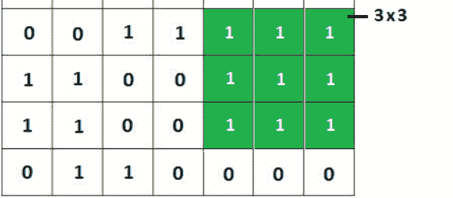

图 10.17 – 给定的 5 x 7 二进制矩阵

正如您所见，仅包含元素 1 的正方形子矩阵的大小为 3。暴力方法，或朴素方法，将是找到所有包含全为 1 的正方形子矩阵并确定哪个具有最大尺寸。然而，对于具有 *z=min(m, n)* 的 *m x n* 矩阵，时间复杂度将为 O(z³mn)。您可以在本书捆绑的代码中找到暴力实现。当然，在查看解决方案之前先挑战自己。

现在，让我们尝试找到更好的方法。让我们假设给定的矩阵为 *n x n* 大小并研究 4x4 样本矩阵的几种场景。在 4x4 矩阵中，我们可以看到全为 1 的最大正方形子矩阵可以为 3x3 大小，因此在 *n x n* 矩阵中，全为 1 的最大正方形子矩阵可以为 *n-1 x n-1* 大小。此外，以下图像揭示了对 *m x n* 矩阵也为真的两个基本情况：

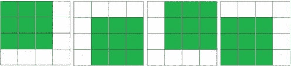

图 10.18 – 4 x 4 矩阵中全为 1 的最大子矩阵

这些情况解释如下：

+   - 如果给定的矩阵只包含一行，则其中为 1 的单元格将是正方形子矩阵的最大尺寸。因此，最大尺寸为 1。
+   - 如果给定的矩阵只包含一列，则其中为 1 的单元格将是正方形子矩阵的最大尺寸。因此，最大尺寸为 1。

接下来，让我们假设 *subMatrix[i][j]* 表示以单元格 *(i,j)* 结尾的全为 1 的最大正方形子矩阵的大小：

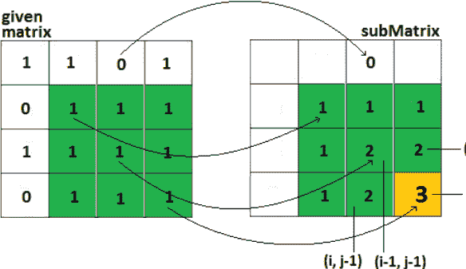

图 10.19 – 整体递推关系

前面的图使我们能够在给定的矩阵和辅助 *subMatrix*（与给定矩阵大小相同的矩阵，应根据递推关系填充）之间建立递推关系：

+   - 这并不容易直观，但我们可以看出如果 *matrix[i][j]* = 0，则 *subMatrix[i][j]* = 0
+   - 如果 *matrix[i][j]* = 1，则 *subMatrix[i][j]* = 1 + min(*subMatrix[i - 1][j]*, *subMatrix[i][j - 1]*, *subMatrix[i - 1][j - 1]*)

如果我们将此算法应用于我们的 5 x 7 矩阵，则得到以下结果：

**给定矩阵**

| 0 | 0 | 1 | 1 | 0 | 0 | 0 |
|---|---|---|---|---|---|---|
| 0 | 0 | 1 | 1 | 1 | 1 | 1 |
| 1 | 1 | 0 | 0 | 1 | 1 | 1 |
| 1 | 1 | 0 | 0 | 1 | 1 | 1 |
| 0 | 1 | 1 | 0 | 0 | 0 | 0 |

**subMatrix**

| 0 | 0 | 1 | 1 | 0 | 0 | 0 |
|---|---|---|---|---|---|---|
| 0 | 0 | 1 | 2 | 1 | 1 | 1 |
| 1 | 1 | 0 | 0 | 1 | 2 | 2 |
| 1 | 2 | 0 | 0 | 1 | 2 | 3 |
| 0 | 1 | 1 | 0 | 0 | 0 | 0 |

图 10.20 – 解析我们的 5 x 7 矩阵

将前面的基本情况和递推关系组合起来得到以下算法：

+   1. 创建一个与给定矩阵大小相同的辅助矩阵（*subMatrix*）。
+   2. 将给定矩阵的第一行和第一列复制到此辅助 *subMatrix*（这些是基本情况）。
+   3. 对于给定矩阵中的每个单元格（从 (1, 1) 开始），执行以下操作：
+      a. 填充 *subMatrix* 符合前面的递推关系。
+      b. 跟踪 *subMatrix* 的最大元素，因为该元素给出了包含全为 1 的子矩阵的最大尺寸。

以下实现阐明了任何剩余的细节：

```
```java
public static int ofOneOptimized(int[][] matrix) {

    int maxSubMatrixSize = 1;
    int rows = matrix.length;
```


```java
int cols = matrix[0].length;

int[][] subMatrix = new int[rows][cols];

// 复制第一行
for (int i = 0; i < cols; i++) {
    subMatrix[0][i] = matrix[0][i];
}

// 复制第一列
for (int i = 0; i < rows; i++) {
    subMatrix[i][0] = matrix[i][0];
}

// 对于矩阵的其余部分，检查 matrix[i][j] 是否为 1
for (int i = 1; i < rows; i++) {
    for (int j = 1; j < cols; j++) {
        if (matrix[i][j] == 1) {
            subMatrix[i][j] = Math.min(subMatrix[i - 1][j - 1],
                    Math.min(subMatrix[i][j - 1],
                             subMatrix[i - 1][j])) + 1;

            // 计算当前子矩阵的最大值
            maxSubMatrixSize = Math.max(
                maxSubMatrixSize, subMatrix[i][j]);
        }
    }
}

return maxSubMatrixSize;
}
```

由于我们迭代了 *m×n* 次来填充辅助矩阵，因此该解决方案的整体复杂度为 O(mn)。完整应用程序称为 *MaxMatrixOfOne*。

## 编程挑战 16 —— 盛最多水的容器

Google、Adobe、Microsoft

**问题：** 假设给定 *n* 个正整数 *p₁, p₂, ..., pₙ*，其中每个整数表示坐标 (*i*, *pᵢ*) 处的一个点。接着绘制 *n* 条垂直线，使得第 *i* 条线的两个端点分别为 (*i*, *pᵢ*) 和 (*i*, 0)。编写一段代码，找出两条线与 X 轴一起构成的容器能盛最多水。

**解决方案：** 假设给定的整数是 1、4、6、2、7、3、8、5 和 3。根据问题描述，我们可以绘制出 *n* 条垂直线（第 1 行：{(0, 1), (0, 0)}，第 2 行：{(1, 4), (1, 0)}，第 3 行：{(2, 6), (2, 0)}，依此类推）。如下图所示：

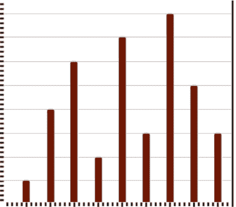

*图 10.21 —— n 条垂直线的表示*

首先，让我们看看应该如何理解这个问题。我们必须找到盛水最多的容器。这意味着，在我们的二维表示中，必须找到面积最大的矩形。在三维表示中，这个容器将具有最大的体积，因此它能盛最多的水。

从暴力破解的角度来思考解决方案是相当直接的。对于每条线，我们计算它与其余各线形成的面积，同时跟踪找到的最大面积。这需要两个嵌套循环，如下所示：

```java
public static int maxArea(int[] heights) {
    int maxArea = 0;
    for (int i = 0; i < heights.length; i++) {
        for (int j = i + 1; j < heights.length; j++) {
            // 遍历每个 (i, j) 对
            maxArea = Math.max(maxArea,
                Math.min(heights[i], heights[j]) * (j - i));
        }
    }

    return maxArea;
}
```

这段代码的问题在于其运行时间为 O(n²)。一种更好的方法是采用称为*双指针*的技术。别担心——这是一种非常简单的技术，在你的工具包中很有用。你永远不知道什么时候会用到它！

我们知道我们在寻找最大面积。既然我们讨论的是矩形面积，这意味着最大面积必须尽可能兼顾*最大宽度*和*最大高度*之间的最佳比例。*最大宽度*是从 0 到 n-1（在我们的示例中是从 0 到 8）。要找到*最大高度*，我们必须在调整最大宽度的同时跟踪最大面积。为此，我们可以从最大宽度开始，如下图所示：

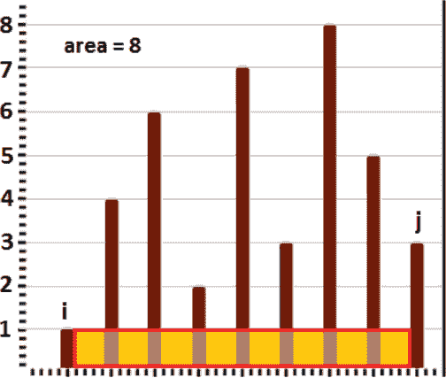

*图 10.22 —— 最大宽度时的面积*

就代码而言，我们有以下内容：

```java
public static int maxAreaOptimized(int[] heights) {

    int maxArea = 0;

    int i = 0; // 左侧指针
    int j = heights.length - 1; // 右侧指针

    // 面积不能为负，
    // 因此 i 不应大于 j
    while (i < j) {

        // 计算每对线之间的面积
        maxArea = Math.max(maxArea, Math.min(heights[i],
            heights[j]) * (j - i));

        if (heights[i] <= heights[j]) {
            i++; // 左指针的高度小于等于右指针
        } else {
            j--; // 右指针的高度小于左指针
        }
    }

    return maxArea;
}
```

这段代码的运行时间为 O(n)。完整应用程序称为 *ContainerMostWater*。

## 编程挑战 17 —— 在循环有序数组中搜索

Amazon、Google、Adobe、Microsoft、Flipkart

**问题：** 假设给定一个循环有序的整数数组 m，其中没有重复元素。编写一个程序，在 O(log n) 的时间复杂度内搜索给定的 x。

**解决方案：** 如果我们能在 O(n) 的时间复杂度内解决这个问题，那么暴力破解方法就是最简单的解决方案。对数组进行线性搜索会给出所搜索 x 的索引。然而，我们需要一个 O(log n) 的解决方案，因此我们需要从另一个角度来处理这个问题。

我们有足够的线索指向著名的二分搜索算法，我们在第 7 章“算法的大 O 分析”和第 14 章“排序与搜索”中讨论过该算法。我们有一个有序数组，需要找到某个值，并且需要在 O(log n) 的时间复杂度内完成。因此，有三个线索指向二分搜索算法。当然，最大的问题在于有序数组的循环性，所以我们不能直接应用普通的二分搜索算法。

假设 m = {11, 14, 23, 24, -1, 3, 5, 6, 8, 9, 10}，x = 14，我们期望输出索引 1。下图介绍了一些记号，并作为解决当前问题的指南：

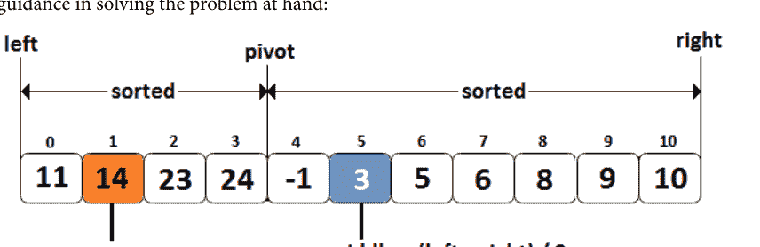

*图 10.25 —— 循环有序数组与二分搜索算法*

由于有序数组是循环的，因此我们有一个*枢轴*。这是一个指向数组头部的索引。枢轴左侧的元素已经被旋转。当数组未被旋转时，它将是 {-1, 3, 5, 6, 8, 9, 10, **11**, 14, 23, **24**}。现在，让我们看看基于二分搜索算法的解决步骤：

1. 我们应用二分搜索算法，因此首先计算数组的*中间*位置为 *(left + right) / 2*。
2. 我们检查 *x = m[middle]* 是否成立。如果成立，则返回 *middle*。如果不成立，则继续下一步。
3. 接下来，我们检查数组的右半部分是否有序。如果 *m[middle] <= m[right]*，则范围 *[middle, right]* 内的所有元素都是有序的：
   a. 如果 *x > m[middle]* 且 *x <= m[right]*，则忽略左半部分，设置 *left = middle + 1*，然后从 *步骤 1* 重复。
   b. 如果 *x <= m[middle]* 或 *x > m[right]*，则忽略右半部分，设置 *right = middle - 1*，然后从 *步骤 1* 重复。
4. 如果数组的右半部分不是有序的，那么左半部分必然是有序的：
   a. 如果 *x >= m[left]* 且 *x < m[middle]*，则忽略右半部分，设置 *right = middle - 1*，然后从 *步骤 1* 重复。
   b. 如果 *x < m[left]* 或 *x >= m[middle]*，则忽略左半部分，设置 *left = middle + 1*，然后从 *步骤 1* 重复。

我们重复*步骤 1-4*，直到找到 *x* 或 *left <= right* 不再成立。

让我们将上述算法应用于我们的案例。

因此，*middle* 为 *(left + right) / 2 = (0 + 10) / 2 = 5*。由于 *m[5] ≠ 14*（请记住 14 是 *x*），我们继续执行步骤 3。由于 *m[5] < m[10]*，我们得出结论右半部分是有序的。然而，我们注意到 *x > m[right]*（14 > 10），因此我们应用*步骤 3b*。基本上，我们忽略右半部分，并设置 *right = middle - 1 = 5 - 1 = 4*。我们再次应用*步骤 1*。

新的 *middle* 为 *(0 + 4) / 2 = 2*。由于 *m[2] ≠ 14*，我们继续执行步骤 3。由于 *m[2] > m[4]*，我们得出结论左半部分是有序的。我们注意到 *x > m[left]*（14 > 11）且 *x < m[middle]*（14 < 23），因此我们应用*步骤 4a*。我们忽略右半部分，并设置 *right = middle - 1 = 2 - 1 = 1*。我们再次应用*步骤 1*。


新的 *middle* 是 (0 + 1) / 2 = 0。 由于 *m[0]*≠14，我们继续进行 *step 3*。 由于 *m[0]<m[1]*，我们得出结论右半部分是有序的。我们注意到 *x > m[middle]* (14 > 11) 且 *x = m[right]* (14 = 14)，所以我们应用 *step 3a*。我们忽略左半部分并设置 *left = middle + 1 = 0 + 1 = 1*。我们再次应用 *step 1*。

新的 *middle* 是 (1 + 1) / 2 = 1。 由于 *m[1]=14*，我们停止并返回 1 作为在数组中找到所搜索值的索引。

让我们将其放入代码中：

```
```java
public static int find(int[] m, int x) {

    int left = 0;
    int right = m.length - 1;

    while (left <= right) {

        // halve the search space
        int middle = (left + right) / 2;

        // we found the searched value
        if (m[middle] == x) {
            return middle;
        }

        // check if the right-half is sorted (m[middle ... right])
        if (m[middle] <= m[right]) {

            // check if x is in m[middle ... right]
            if (x > m[middle] && x <= m[right]) {
                left = middle + 1;  // search in the right-half
            } else {
                right = middle - 1;  // search in the left-half
            }
        } else { // the left-half is sorted (A[left ... middle])
            // check if x is in m[left ... middle]
            if (x >= m[left] && x < m[middle]) {
                right = middle - 1; // search in the left-half
```
```

**Step 2:** 接下来，我们关注第二个区间 ([2, 4])。 [2, 4] 的开始等于栈顶区间的结束 [1, 2]，所以我们不将 [2, 4] 压入栈。我们继续比较 [1, 2] 的结束与 [2, 4] 的结束。由于 2 小于 4，我们将区间 [1, 2] 更新为 [1, 4]。因此，我们合并了 [1, 2] 与 [2, 4]。

**Step 3:** 接下来，我们关注区间 [4, 7]。 [4, 7] 的开始等于栈顶区间的结束 [1, 4]，所以我们不将 [4, 7] 压入栈。我们继续比较 [1, 4] 的结束与 [4, 7] 的结束。由于 4 小于 7，我们将区间 [1, 4] 更新为 [1, 7]。因此，我们合并了 [1, 4] 与 [4, 7]。

**Step 4:** 接下来，我们关注区间 [9, 11]。 [9, 11] 的开始大于栈顶区间的结束 [1, 7]，所以区间 [1, 7] 和 [9, 11] 不重叠。这意味着我们可以将区间 [9, 11] 压入栈。

**Step 5:** 接下来，我们关注区间 [12, 15]。 [12, 15] 的开始大于栈顶区间的结束 [9, 11]，所以区间 [9, 11] 和 [12, 15] 不重叠。这意味着我们可以将区间 [12, 15] 压入栈。

**Step 6:** 接下来，我们关注区间 [12, 17]。 [12, 17] 的开始等于栈顶区间的结束 [12, 15]，所以我们不将 [12, 17] 压入栈。我们继续比较 [12, 15] 的结束与 [12, 17] 的结束。由于 15 小于 17，我们将区间 [12, 15] 更新为 [12, 17]。因此，这里我们合并了 [12, 15] 与 [12, 17]。

**Step 7:** 最后，我们关注区间 [16, 18]。 [16, 18] 的开始小于栈顶区间的结束 [12, 17]，所以区间 [16, 18] 和 [12, 17] 是重叠的。这次，我们必须用该区间结束与 [16, 18] 结束之间的最大值来更新栈顶区间的结束。由于 18 大于 17，栈顶区间变为 [12, 17]。

现在，我们可以弹出栈的内容来查看合并后的区间，[[12, 18], [9, 11], [1, 7]]，如下图所示：

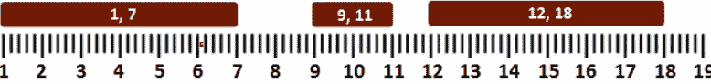

*Figure 10.28 – The merged intervals*

基于这些步骤，我们可以创建以下算法：

+   1. 按其开始位置升序对给定的区间进行排序。
+   2. 将第一个区间压入栈。

+   3. 对于其余区间，执行以下操作：
+      a. 如果当前区间与栈顶区间不重叠，则将其压入栈。
+      b. 如果当前区间与栈顶区间重叠且当前区间的结束大于栈顶的结束，则用当前区间的结束更新栈顶。
+   4. 最后，栈中包含合并后的区间。

从代码角度来看，该算法如下所示：

```
```java
public static void mergeIntervals(Interval[] intervals) {

    // Step 1
    java.util.Arrays.sort(intervals,
            new Comparator<Interval>() {
        public int compare(Interval i1, Interval i2) {
            return i1.start - i2.start;
        }
    });

    Stack<Interval> stackOfIntervals = new Stack();

    for (Interval interval : intervals) {

        // Step 3a
        if (stackOfIntervals.empty() || interval.start
                > stackOfIntervals.peek().end) {
            stackOfIntervals.push(interval);
        }

        // Step 3b
        if (stackOfIntervals.peek().end < interval.end) {
            stackOfIntervals.peek().end = interval.end;
        }
    }
}
```
```

```
```java
// print the result
while (!stackOfIntervals.empty()) {
    System.out.print(stackOfIntervals.pop() + " ");
}
}
```
```

此代码的运行时间为 O(n log n)，辅助空间为 O(n) 用于栈。虽然面试官应能接受这种方法，但他/她可能会要求你进行优化。更具体地说，我们能否去掉栈并获得 O(1) 的空间复杂度？

如果我们去掉栈，那么我们必须原地执行合并操作。能够做到这一点的算法是自解释的：

+   1. 按其开始位置升序对给定的区间进行排序。
+   2. 对于其余区间，执行以下操作：
+      a. 如果当前区间不是第一个区间并且与前一个区间重叠，则合并这两个区间。对所有前一个区间重复相同操作。
+      b. 否则，将当前区间添加到区间输出数组中。

请注意，这次区间按其开始位置降序排序。这意味着我们可以通过比较前一个区间的开始与当前区间的结束来检查两个区间是否重叠。让我们看看代码：

```
```java
public static void mergeIntervals(Interval intervals[]) {

    // Step 1
    java.util.Arrays.sort(intervals,
        new Comparator<Interval>() {
            public int compare(Interval i1, Interval i2) {
                return i2.start - i1.start;
            }
        });

    int index = 0;

    for (int i = 0; i < intervals.length; i++) {

        // Step 2a
```
```

```
if (index != 0 && intervals[index - 1].start
    <= intervals[i].end) {
    while (index != 0 && intervals[index - 1].start
        <= intervals[i].end) {

        // merge the previous interval with
        // the current interval
        intervals[index - 1].end = Math.max(
            intervals[index - 1].end, intervals[i].end);
        intervals[index - 1].start = Math.min(
            intervals[index - 1].start, intervals[i].start);
        index--;
    }
    // Step 2b
} else {
    intervals[index] = intervals[i];
}

index++;

// print the result
for (int i = 0; i < index; i++) {
    System.out.print(intervals[i] + " ");
}
}
```

此代码的运行时间为 O(n log n)，辅助空间为 O(1)。完整的应用程序称为 *MergeIntervals*。

暴力（或朴素）方法可以依赖于一个简单的陈述：我们从每个加油站开始并尝试完成整个环线。这很容易实现但其运行时间将为 O(n²)。挑战自己想出更好的实现。

为更高效地解决此问题，我们需要理解并使用以下事实：

+   - 如果 *fuel* 的总和 ≥ *distance* 的总和，则可以完成环线。
+   - 如果加油站 X 无法在序列 X → Y → Z 中到达加油站 Z，则 Y 也无法到达。

虽然第一条是常识性的，但第二条需要一些额外的证明。以下是第二条背后的推理：

如果 *fuel[X]* < *dist[X]*，则 X 甚至无法到达 Y

因此要从 X 到达 Z，*fuel[X]* 必须 ≥ *dist[X]*。

鉴于 X 无法到达 Z，我们有 *fuel[X]* + *fuel[Y]* < *dist[X]* + *dist[Y]*，且 *fuel[X]* ≥ *dist[X]*。

因此，*fuel[Y]* < *dist[Y]* 且 Y 无法到达 Z。

基于这两点，我们可以提出以下实现：

```
public static int circularTour(int[] fuel, int[] dist) {

    int sumRemainingFuel = 0; // track current remaining fuel
    int totalFuel = 0;         // track total remaining fuel
    int start = 0;

    for (int i = 0; i < fuel.length; i++) {

        int remainingFuel = fuel[i] - dist[i];

        //if sum remaining fuel of (i-1) >= 0 then continue
        if (sumRemainingFuel >= 0) {
            sumRemainingFuel += remainingFuel;

            //otherwise, reset start index to be current
        } else {
            sumRemainingFuel = remainingFuel;
            start = i;
        }
    }
```


```java
totalFuel += remainingFuel;
}

if (totalFuel >= 0) {
    return start;
} else {
    return -1;
}
}
```

要理解这段代码，试着用纸和笔将给定数据集代入代码运行。此外，你可能还想尝试以下几组数据：

```java
// start point 1
int[] dist = {2, 4, 1};
int[] fuel = {0, 4, 3};

// start point 1
int[] dist = {6, 5, 3, 5};
int[] fuel = {4, 6, 7, 4};

// no solution, return -1
int[] dist = {1, 3, 3, 4, 5};
int[] fuel = {1, 2, 3, 4, 5};

// start point 2
int[] dist = {4, 6, 6};
int[] fuel = {6, 3, 7};
```

这段代码的运行时为 O(n)。完整应用程序名为 *PetrolBunks*。

那么，这里我们最多可以容纳的水量为 16。这个问题的解法取决于我们如何看待水。例如，我们可以看柱子之间的水，也可以看每根柱子顶上的水。第二种视角正是我们需要的。

请看下图，它提供了关于如何单独查看每根柱子顶部水量的更多指导：

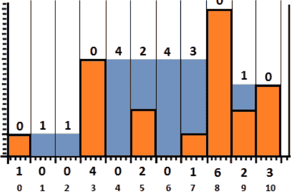

图 10.32 – 每根柱子顶部的水

所以，在柱子 0 上方没有水。柱子 1 上方有 1 单位水，柱子 2 上方有 1 单位水，依此类推。如果把这些值加起来，得到 0 + 1 + 1 + 0 + 4 + 2 + 4 + 3 + 0 + 1 + 0 = 16，这正是我们拥有的水量。然而，要确定柱子 *x* 顶部的水量，我们必须知道左右两侧最高柱子之间的最小值。换句话说，对于每一根柱子（即 1、2、3……9，注意我们不用柱子 0 和 10，因为它们位于边界），我们必须找出左右两侧的最高柱子，并计算两者之间的最小值。下图展示了我们的计算过程（中间的柱子范围是 1 到 9）：

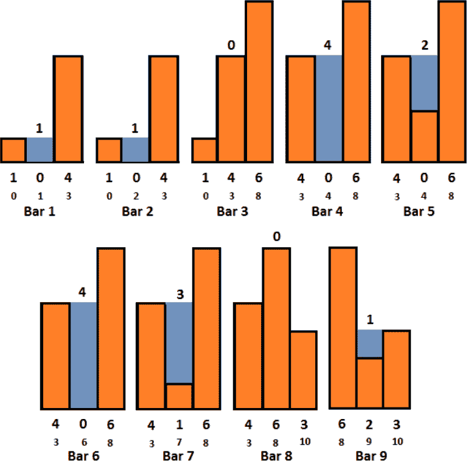

图 10.33 – 左右两侧最高的柱子

因此，我们可以得出结论：一个简单的解决方案是遍历每根柱子，找出左右两侧的最高柱子。这两根柱子的最小值可以按如下方式利用：

- 如果最小值小于当前柱子的高度，那么当前柱子顶部无法存水。
- 如果最小值大于当前柱子的高度，那么当前柱子顶部可以存储的水量等于最小值与当前柱子高度之差。

因此，这个问题可以通过计算每根柱子左右两侧的最高柱子来解决。一种高效的实现方式是，在 O(n) 时间内预先计算出每根柱子左右两侧的最高柱子。然后，我们需要利用这些结果来找出每根柱子顶部的水量。下面的代码应该能澄清其他细节：

```java
public static int trap(int[] bars) {
    int n = bars.length - 1;
    int water = 0;

    // store the maximum height of a bar to
    // the left of the current bar
    int[] left = new int[n];
    left[0] = Integer.MIN_VALUE;

    // iterate the bars from left to right and
    // compute each left[i]
    for (int i = 1; i < n; i++) {
        left[i] = Math.max(left[i - 1], bars[i - 1]);
    }

    // store the maximum height of a bar to the
    // right of the current bar
    int right = Integer.MIN_VALUE;

    // iterate the bars from right to left
    // and compute the trapped water
    for (int i = n - 1; i >= 1; i--) {
        right = Math.max(right, bars[i + 1]);

        // check if it is possible to store water
        // in the current bar
        if (Math.min(left[i], right) > bars[i]) {
            water += Math.min(left[i], right) - bars[i];
        }
    }
}
```

```java
water += (maxBarRight - bars[right]);
}
}

return water;
}
```

这段代码的运行时为 O(n)，空间复杂度为 O(1)。完整应用程序名为 *TrapRainWater*。

## 编程挑战 21 – 买卖股票

**Amazon，Microsoft**

**问题：** 假设给定一个正整数数组，表示股票每天的价格。因此，数组的第 *i* 个元素代表股票在第 *i* 天的价格。一般来说，你不能同时进行多笔交易（买卖序列称为一笔交易），并且必须在再次购买之前卖出股票。编写一段代码，在以下场景之一中返回最大利润（通常面试官会给你以下场景之一）：

- 你只允许买卖股票一次。
- 你只允许买卖股票两次。
- 你可以无限次地买卖股票。
- 你只允许买卖股票 *k* 次（*k* 已给定）。

**解决方案：** 假设给定的价格数组为 *prices*={200, 500, 1000, 700, 30, 400, 900, 400, 550}。让我们逐一处理前面的场景。

### 只买卖股票一次

在这个场景中，我们必须通过只买卖一次股票来获得最大利润。这相当简单且直观。思路是在股票最便宜的时候买入，在最贵的时候卖出。让我们通过下面的价格趋势图来说明这一点：

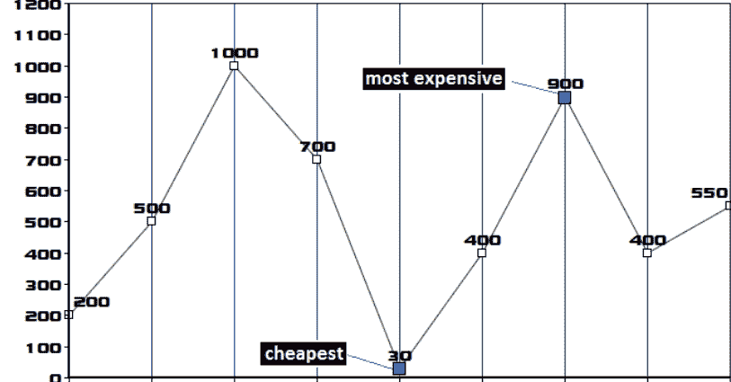

图 10.34 – 价格趋势图

与上图一致，我们应该在第 5 天以 30 的价格买入股票，并在第 7 天以 900 的价格卖出。这样，利润将达到最大值（870）。为了确定最大利润，我们可以采用一个简单的算法，如下所示：

1. 在第 1 天考虑*最低价格*，并且没有利润（*最大利润*为 0）。
2. 遍历其余的天（第 2、3、4 天，……）并执行以下操作：
   a. 对于每一天，将*最大利润*更新为 max(*当前最大利润*, *今天的价格* - *最低价格*)。
   b. 将*最低价格*更新为 min(*当前最低价格*, *今天的价格*)。

让我们将该算法应用于我们的数据。因此，我们将*最低价格*视为 200（第 1 天的价格），*最大利润*为 0。下表逐日展示了计算过程：

| | 第 1 天 | 第 2 天 | 第 3 天 | 第 4 天 | 第 5 天 | 第 6 天 | 第 7 天 | 第 8 天 | 第 9 天 |
| --- | --- | --- | --- | --- | --- | --- | --- | --- | --- |
| 价格 | 200 | 500 | 1000 | 700 | 30 | 400 | 900 | 400 | 550 |
| 最低价格（从第 1 天到今天） | 200 | 200 | 200 | 200 | 30 | 30 | 30 | 30 | 30 |
| 价格 - 最低价格 | 0 | 300 | 800 | 500 | 0 | 370 | 870 | 370 | 520 |
| 最大利润 max(最大利润, 价格 - 最低价格) | 0 | 300 | 800 | 800 | 800 | 800 | 870 | 870 | 870 |
| | | | | | | | 最大利润 | | |

图 10.35 – 计算最大利润

**第 1 天：** *最低价格*为 200；*第 1 天的价格 - 最低价格* = 0；因此，到目前为止的*最大利润*为 0。

**第 2 天：** *最低价格*为 200（因为 500 > 200）；*第 2 天的价格 - 最低价格* = 300；因此，到目前为止的*最大利润*为 300（因为 300 > 0）。

**第 3 天：** *最低价格*为 200（因为 1000 > 200）；*第 3 天的价格 - 最低价格* = 800；因此，到目前为止的*最大利润*为 800（因为 800 > 300）。

**第 4 天：** *最低价格*为 200（因为 700 > 200）；*第 4 天的价格 - 最低价格* = 500；因此，到目前为止的*最大利润*为 800（因为 800 > 500）。

**第 5 天：** *最低价格*为 30（因为 200 > 30）；*第 5 天的价格 - 最低价格* = 0；因此，到目前为止的*最大利润*为 800（因为 800 > 0）。

**第 6 天：** *最低价格*为 30（因为 400 > 30）；*第 6 天的价格 - 最低价格* = 370；因此，到目前为止的*最大利润*为 800（因为 800 > 370）。

**第 7 天：** *最低价格*为 30（因为 900 > 30）；*第 7 天的价格 - 最低价格* = 870；因此，到目前为止的*最大利润*为 870（因为 870 > 800）。

**第 8 天：** *最低价格*为 30（因为 400 > 30）；*第 8 天的价格 - 最低价格* = 370；因此，到目前为止的*最大利润*为 870（因为 870 > 370）。

**第 9 天：** *最低价格*为 30（因为 550 > 30）；*第 9 天的价格 - 最低价格* = 520；因此，到目前为止的*最大利润*为 870（因为 870 > 520）。

最后，*最大利润*为 870。


让我们看看代码：

```java
public static int maxProfitOneTransaction(int[] prices) {

    int min = prices[0];
    int result = 0;
    for (int i = 1; i < prices.length; i++) {
        result = Math.max(result, prices[i] - min);
        min = Math.min(min, prices[i]);
    }

    return result;
}
```

这段代码的时间复杂度为 O(n)。接下来，我们看看下一个场景。

## 只进行两次股票买卖

在这个场景中，我们必须通过仅买卖两次股票来获得最大利润。思路是在股票最便宜时买入，在最贵时卖出。我们这样做两次。让我们通过以下价格趋势图来说明这一点：

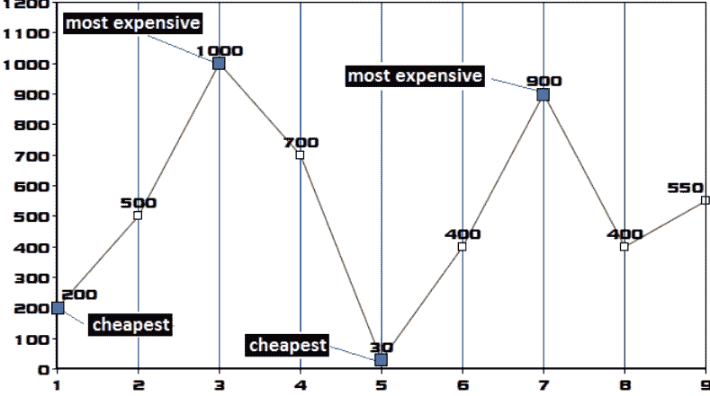

图10.36 – 价格趋势图

根据上图，我们应在第1天以200的价格买入股票，并在第3天以1000的价格卖出。这笔交易带来800的利润。接下来，我们应该在第5天以30的价格买入股票，并在第7天以900的价格卖出。这笔交易带来870的利润。因此，最大利润为870+800=1670。

为了确定*最大利润*，我们必须找到两笔最赚钱的交易。我们可以通过动态规划和*分治*技术来做到这一点。我们将算法*划分*为两部分。算法的第一部分包含以下步骤：

- 1. 考虑第1天的*最低价格*。
- 2. 遍历其余天数（2，3，4，...）并执行以下操作：
  - a. 将*最低价格*更新为 min(*当前最低价格，今日价格*)。
  - b. 将今天的*最大利润*记录为 max(*前一日最大利润，（今日价格 - 最低价格）*)。

在此算法结束时，我们将得到一个数组（我们将其记为*left[]*），它表示每一天（含当天）之前可以获得的最大利润。例如，到第3天（含第3天）为止，最大利润是800，因为你可以在第1天以200的价格买入，并在第3天以1000的价格卖出；到第7天（含第7天）为止，最大利润是870，因为你可以在第5天以30的价格买入，并在第7天以900的价格卖出，以此类推。

该数组通过*步骤2b*获得。我们可以用如下表格来表示我们的数据：

|  | 第1天 | 第2天 | 第3天 | 第4天 | 第5天 | 第6天 | 第7天 | 第8天 | 第9天 |
|---|---|---|---|---|---|---|---|---|---|
| 价格 | 200 | 500 | 1000 | 700 | 30 | 400 | 900 | 400 | 550 |
| left[day] 截至当天最大利润 | 0 | 300 | 800 | 800 | 800 | 800 | 870 | 870 | 870 |
|  | left[0] | left[1] | left[2] | left[3] | left[4] | left[5] | left[6] | left[7] | left[8] |

图10.37 – 从第1天开始计算截至每天的最大利润

*left[]* 数组在我们完成算法第二部分后会很有用。接下来，算法的第二部分如下：

- 1. 考虑最后一天的*最高价格*。
- 2. 从（最后一天-1）到第一天（last-1，last-2，last-3，...）遍历其余天数，并执行以下操作：
  - a. 将*最高价格*更新为 max(*当前最高价格，今日价格*)。
  - b. 将今天的最大利润记录为 max(次日的最大利润，（最高价格 - 今日价格）)。

在此算法结束时，我们将得到一个数组（记为right[]），它表示每天（含当天）之后可以获得的最大利润。例如，在第3天（含第3天）之后，最大利润是870，因为你可以在第5天以30的价格买入，并在第7天以900的价格卖出；或者在第7天之后，最大利润是150，因为你可以在第8天以400的价格买入，并在第9天以550的价格卖出，以此类推。该数组通过步骤2b获得。我们可以用如下表格表示我们的数据：

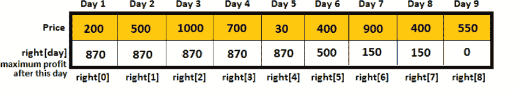

图10.38 – 从最后一天的前一天开始计算每天之后的最大利润

到目前为止，我们已经完成了“分”的部分。现在是“治”的部分。两笔交易所能获得的最大利润可以通过 max(left[day]+right[day]) 得到。我们可以在下图中看到这一点：

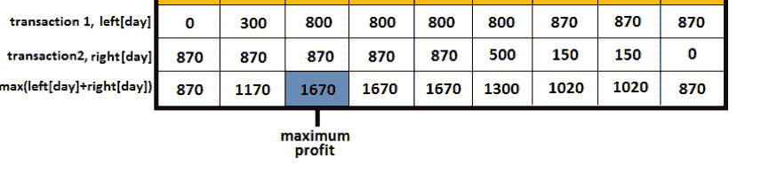

图10.39 – 计算第一笔和第二笔交易的最终最大利润

现在，让我们看看代码：

```java
public static int maxProfitTwoTransactions(int[] prices) {

    int[] left = new int[prices.length];
    int[] right = new int[prices.length];

    // Dynamic Programming from left to right
    left[0] = 0;
    int min = prices[0];
```

```java
for (int i = 1; i < prices.length; i++) {
    min = Math.min(min, prices[i]);
    left[i] = Math.max(left[i - 1], prices[i] - min);
}

// Dynamic Programming from right to left
right[prices.length - 1] = 0;
int max = prices[prices.length - 1];
for (int i = prices.length - 2; i >= 0; i--) {
    max = Math.max(max, prices[i]);
    right[i] = Math.max(right[i + 1], max - prices[i]);
}

int result = 0;
for (int i = 0; i < prices.length; i++) {
    result = Math.max(result, left[i] + right[i]);
}

return result;
}
```

这段代码的时间复杂度为 O(n)。现在，让我们看看下一个场景。

## 无限次买卖股票

在这个场景中，我们必须通过无限次买卖股票来获得最大利润。你可以通过以下价格趋势图来理解这一点：

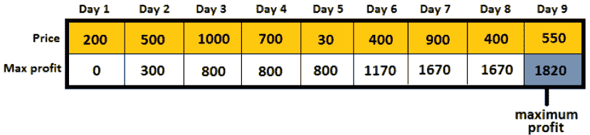

图10.42 – 计算最终最大利润

**第1天：** *最大利润*为 0。

**第2天：** *最大利润*为 0 + (500 - 200) = 0 + 300 = 300。

**第3天：** *最大利润*为 300 + (1000 - 500) = 300 + 500 = 800。

**第4天：** *最大利润*仍为 800，因为 700 - 1000 < 0。

**第5天：** *最大利润*仍为 800，因为 30 - 700 < 0。

**第6天：** *最大利润*为 800 + (400 - 30) = 800 + 370 = 1170。

**第7天：** *最大利润*为 1170 + (900 - 400) = 1170 + 500 = 1670。

**第8天：** *最大利润*仍为 1670，因为 400 - 900 < 0。

**第9天：** *最大利润*为 1670 + (550 - 400) = 1670 + 150 = 1820。

最终的*最大利润*为 1820。

就代码而言，如下所示：

```
public static int maxProfitUnlimitedTransactions(
    int[] prices) {

    int result = 0;
    for (int i = 1; i < prices.length; i++) {
        int diff = prices[i] - prices[i - 1];
        if (diff > 0) {
            result += diff;
        }
    }

    return result;
}
```

这段代码的时间复杂度为 O(n)。接下来，让我们看看最后一个场景。

## 只买卖股票 k 次（k 给定）

该场景是“只进行两次股票买卖”场景的泛化版本。主要来说，通过解决这个场景，我们也解决了 k=2 时的“只进行两次股票买卖”场景。

基于我们在前面场景中的经验，我们知道可以通过动态规划来解决这个问题。更准确地说，我们需要跟踪两个数组：

- • 第一个数组将跟踪当最后一笔交易发生在第 q 天时，p 笔交易的最大利润。
- • 第二个数组将跟踪截至第 q 天时，p 笔交易的最大利润。

如果我们将第一个数组记为 temp，第二个数组记为 result，那么我们有以下两个关系式：

temp[p] = Math.max(result[p - 1] + Math.max(diff, 0), temp[p] + diff);

result[p] = Math.max(temp[p], result[p]);

为了更好地理解，让我们将这些关系式放到代码上下文中：

```
public static int maxProfitKTransactions(
    int[] prices, int k) {
    int[] temp = new int[k + 1];
    int[] result = new int[k + 1];
    for (int q = 0; q < prices.length - 1; q++) {
        int diff = prices[q + 1] - prices[q];
        for (int p = k; p >= 1; p--) {
            temp[p] = Math.max(result[p - 1] + Math.max(diff, 0), temp[p] + diff);
            result[p] = Math.max(temp[p], result[p]);
        }
    }
    return result[k];
}
```


```
}
}
return result[k];
}
```

此代码的运行时间为 O(kn)。完整的应用程序名为 BestTimeToBuySellStock。

## 编程挑战 22 – 最长序列

Amazon, Adobe, Microsoft

假设给你一个整数数组。编写一段代码片段来查找整数的最长序列。请注意，序列仅包含连续的不同的元素。给定数组中元素的顺序并不重要。

让我们假设给定的数组是 { 4, 2, 9, 5, 12, 6, 8 }。最长序列包含三个元素，它由 4、5 和 6 组成。或者，如果给定的数组是 {2, 0, 6, 1, 4, 3, 8}，那么最长序列包含五个元素，它由 2、0、1、4 和 3 组成。同样，请注意给定数组中元素的顺序并不重要。

暴力或朴素的方法是对数组按升序排序并找到连续整数的最长序列。由于数组已排序，间隙会中断序列。然而，这种实现的运行时间为 O(n log n)。

更好的方法是采用哈希技术。让我们使用以下图片作为我们解决方案的支持：


```
```text
longestSequence = Math.max(
    longestSequence, sequenceLength);
}
}

return longestSequence;
}
```
```

此代码的运行时间为 O(n)，辅助空间为 O(n)。挑战自己并打印最长序列。完整的应用程序名为 *LongestConsecutiveSequence*。

## 编程挑战 23 – 计数游戏得分

**Amazon, Google, Microsoft**

**问题：** 考虑一个游戏，玩家在一次移动中可以得 3、5 或 10 分。此外，假设给你一个总得分 *n*。编写一段代码片段返回达到此得分的方法数。

**解决方案：** 假设给定的得分为 33。有七种方法可以达到此得分：

(10+10+10+3) = 33

(5+5+10+10+3) = 33

(5+5+5+5+10+3) = 33

(5+5+5+5+5+5+3) = 33

(3+3+3+3+3+3+3+3+3+3+3) = 33

(3+3+3+3+3+3+5+5+5) = 33

(3+3+3+3+3+3+5+10) = 33

## 数组和字符串

此代码在 O(n log n) 内执行（因为我们对数组进行了排序）并且 O(1) 辅助空间。如果我们想编写一个在 O(n) 时间内执行的实现，我们还必须考虑 O(n) 辅助空间。例如，我们可以依赖哈希（如果你不熟悉哈希的概念，那么请阅读第 6 章 面向对象编程，哈希表问题）。在 Java 中，我们可以通过内置的 HashSet 实现使用哈希，因此无需从头编写哈希实现。但这个 HashSet 有什么用？在我们遍历给定数组时，我们将数组中的每个元素添加到 HashSet。但如果当前元素已存在于 HashSet 中，这意味着我们找到了重复项，因此我们可以停止并返回：

```
public static boolean checkDuplicates(int[] arr) {
	Set<Integer> set = new HashSet<>();
	for (int i = 0; i < arr.length; i++) {
		if (set.contains(arr[i])) {
			return true;
		}
		set.add(arr[i]);
	}
	return false;
}
```

因此，此代码在 O(n) 时间内执行，辅助空间为 O(n)。但如果我们记住 HashSet 不接受重复项，我们可以简化前面的代码。换句话说，如果我们将给定数组的所有元素插入 HashSet，并且该数组包含重复项，则 HashSet 的大小将与数组的大小不同。此实现和基于 Java 8 的实现具有 O(n) 运行时间和 O(n) 辅助空间，可以在本书捆绑的代码中找到。

如果我们想要一个具有 O(n) 运行时间和 O(1) 辅助空间的实现呢？这是可能的，如果我们考虑给定数组的两个重要约束：

- 给定数组不包含负元素。
- 元素位于范围 [0, n-1] 内，其中 n=arr.length。

在这两个约束的 umbrella 下，我们可以采用以下算法。

1. 我们遍历给定数组，对于每个 arr[i]，我们执行以下操作：
   a. 如果 arr[abs(arr[i])] 大于 0，则我们使其变为负数。
   b. 如果 arr[abs(arr[i])] 等于 0，则我们使其变为 -(arr.length-1)。
   c. 否则，我们返回 true（存在重复）。

让我们考虑我们的数组，arr={1, 4, 5, 4, 2, 3}，并应用前面的算法：

- i=0，因为 arr[abs(arr[0])] = arr[1] = 4 > 0 结果为 arr[1] = -arr[1] = -4。
- i=1，因为 arr[abs(arr[1])] = arr[4] = 2 > 0 结果为 arr[4] = -arr[4] = -2。
- i=2，因为 arr[abs(arr[5])] = arr[5] = 3 > 0 结果为 arr[5] = -arr[5] = -3。
- i=3，因为 arr[abs(arr[4])] = arr[4] = -2 < 0 返回 true（我们找到了重复项）

现在，让我们看一下 arr={1, 4, 5, 3, 0, 2, 0}：

- i=0，因为 arr[abs(arr[0])] = arr[1] = 4 > 0 结果为 arr[1] = -arr[1] = -4。
- i=1，因为 arr[abs(arr[1])] = arr[4] = 0 = 0 结果为 arr[4] = -(arr.length-1) = -6。
- i=2，因为 arr[abs(arr[2])] = arr[5] = 2 > 0 结果为 arr[5] = -arr[5] = -2。
- i=3，因为 arr[abs(arr[3])] = arr[3] = 3 > 0 结果为 arr[3] = -arr[3] = -3。
- i=4，因为 arr[abs(arr[4])] = arr[6] = 0 = 0 结果为 arr[6] = -(arr.length-1) = -6。
- i=5，因为 arr[abs(arr[5])] = arr[2] = 5 > 0 结果为 arr[2] = -arr[2] = -5。
- i=6，因为 arr[abs(arr[6])] = arr[6] = -6 < 0 返回 true（我们找到了重复项）。

让我们将此算法放入代码中：

```
public static boolean checkDuplicates(int[] arr) {
    for (int i = 0; i < arr.length; i++) {
        if (arr[Math.abs(arr[i])] > 0) {
            arr[Math.abs(arr[i])] = -arr[Math.abs(arr[i])];
        } else if (arr[Math.abs(arr[i])] == 0) {
            arr[Math.abs(arr[i])] = -(arr.length-1);
        } else {
            return true;
        }
    }
}
return false;
}
```

完整的应用程序名为 DuplicatesInArray。

对于接下来的五个编程挑战，你可以在本书捆绑的代码中找到解决方案。花点时间挑战自己在查看捆绑代码之前想出一个解决方案。

## 编程挑战 25 – 最长不同子串

**问题：** 假设给你一个字符串 str。str 的接受字符属于扩展 ASCII 表（256 个字符）。编写一段代码片段来查找包含不同字符的 str 的最长子串。

**解决方案：** 作为提示，使用滑动窗口技术。如果你不熟悉此技术，请在继续之前考虑阅读 Zengrui Wang 的 Sliding Window Technique（https://medium.com/@zengruiwang/sliding-window-technique-360d840d5740）。完整的应用程序名为 LongestDistinctSubstring。你可以访问以下链接来检查代码：https://github.com/PacktPublishing/The-Complete-Coding-Interview-Guide-in-Java/tree/master/Chapter10/LongestDistinctSubstring

## 编程挑战 26 – 用秩替换元素

**问题：** 假设给你一个没有重复的数组 m。编写一段代码片段，用元素的秩替换该数组的每个元素。数组中的最小元素秩为 1，第二小的秩为 2，以此类推。

**解决方案：** 作为提示，你可以使用 TreeMap。完整的应用程序名为 ReplaceElementWithRank。你可以访问以下链接来检查代码：https://github.com/PacktPublishing/The-Complete-Coding-Interview-Guide-in-Java/tree/master/Chapter10/ReplaceElementWithRank

## 编程挑战 27 – 每个子数组中的不同元素

**问题：** 假设给你一个数组 *m* 和一个整数 *n*。编写一段代码片段来计算每个大小为 *n* 的子数组中的不同元素数量。

**解决方案：** 作为提示，使用 `HashMap` 来存储当前窗口中元素的频率，其大小为 *n*。完整的应用程序名为 *CountDistinctInSubarray*。你可以访问以下链接来检查代码：https://github.com/PacktPublishing/The-Complete-Coding-Interview-Guide-in-Java/tree/master/Chapter10/CountDistinctInSubarray

## 编程挑战 28 – 旋转数组 k 次

**问题：** 假设给你一个数组 *m* 和一个整数 *k*。编写一段代码片段将数组向右旋转 k 次（例如，数组 {1, 2, 3, 4, 5}，旋转三次后结果为 {3, 4, 5, 1, 2}）。

**解决方案：** 作为提示，依赖于取模 (%) 运算符。完整的应用程序名为 *RotateArrayKTimes*。你可以访问以下链接来检查代码：https://github.com/PacktPublishing/The-Complete-Coding-Interview-Guide-in-Java/tree/master/Chapter10/RotateArrayKTimes。

## 编程挑战 29 – 排序数组中的不同绝对值

**问题：** 假设给你一个整数排序数组 *m*。编写一段代码片段来计算不同的绝对值（例如，-1 和 1 被视为单个值）。

**解决方案：** 作为提示，使用 *滑动窗口* 技术。如果你不熟悉此技术，请在继续之前考虑阅读 Zengrui Wang 的 *Sliding Window Technique*（https://medium.com/@zengruiwang/sliding-window-technique-360d840d5740）。完整的应用程序名为 *CountDistinctAbsoluteSortedArray*。你可以访问以下链接来检查代码：https://github.com/PacktPublishing/The-Complete-Coding-Interview-Guide-in-Java/tree/master/Chapter10/CountDistinctAbsoluteSortedArray


## 本章小结

本章的目标是帮助你掌握涉及字符串和/或数组的各种编程挑战。希望本章中的编程挑战能为你提供各种技术与技巧，这些技巧对大量属于该范畴的编程挑战非常有用。别忘了，你还可以通过同样由 Packt 出版的《Java Coding Problems》（https://www.amazon.com/gp/product/1789801419/）一书来进一步提升技能。《Java Coding Problems》包含 35 个以上本书未涉及的字符串和数组问题。

在下一章中，我们将讨论链表和映射。
