## 11 链表和映射

本章涵盖了编码面试中你会遇到的与映射和链表相关的最流行的编码挑战。由于技术面试中更青睐单向链表，本章的大多数问题都围绕单向链表展开。不过，你也可以挑战自己，尝试在双向链表的背景下解决每个此类问题。通常来说，对于双向链表而言，这些问题会更容易解决，因为双向链表为每个节点维护两个指针，允许我们在链表内前后导航。

到本章结束时，你将了解所有涉及链表和映射的常见问题，并且掌握足够多的技术与理解，从而能够解决该类别中的任何其他问题。我们的议程相当简单；我们将涵盖以下主题：

- 链表简介
- 映射简介
- 编程挑战

### 技术要求

本章所有代码文件均可在 GitHub 上获取，访问地址为 https://github.com/PacktPublishing/The-Complete-Coding-Interview-Guide-in-Java/tree/master/Chapter11。

不过，在进入编程挑战之前，让我们先了解链表和映射。

### 链表简介

链表是一种线性数据结构，表示一系列节点。第一个节点通常称为头节点，最后一个节点通常称为尾节点。当每个节点指向下一个节点时，我们得到的是单向链表，如下图所示：

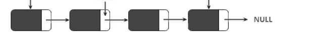

图 11.1 – 单向链表

当每个节点既指向下一个节点又指向前一个节点时，我们得到的是双向链表，如下图所示：

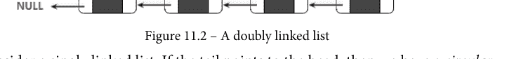

图 11.2 – 双向链表

让我们考虑单向链表。如果尾节点指向头节点，那么我们就有了循环单向链表。另外，让我们考虑双向链表。如果尾节点指向头节点且头节点指向尾节点，那么我们就有了循环双向链表。

在单向链表中，节点保存数据（例如整数或对象）以及指向下一个节点的指针。以下代码表示单向链表的节点：

```java
private final class Node {

    private int data;
    private Node next;
}
```

双向链表还需要指向前一个节点的指针：

```java
private final class Node {
	private int data;
	private Node next;
	private Node prev;
}
```

与数组不同，链表无法在常量时间内访问第 n 个元素。我们必须遍历 n-1 个元素才能获得第 n 个元素。我们可以从链表（单向和双向）的头部在常量时间内插入、删除和更新节点。如果我们的实现管理了双向链表的尾节点（称为双头双向链表），那么我们也就可以从链表的尾部在常量时间内插入、删除和更新节点；否则，我们需要遍历链表直到最后一个节点。如果我们的实现管理了单向链表的尾节点（称为双头单向链表），那么我们可以从链表的尾部在常量时间内插入节点；否则，我们需要遍历链表直到最后一个节点。

本书的代码捆绑包包含以下应用程序（每个应用程序都暴露了 insertFirst ()、insertLast ()、insertAt ()、delete ()、deleteByIndex () 和 print () 方法）：

- SinglyLinkedList：双头单向链表的实现
- SinglyLinkedListOneHead：单头单向链表的实现
- DoublyLinkedList：双头双向链表的实现
- DoublyLinkedListOneHead：单头双向链表的实现

强烈建议你自行深入剖析每个应用程序。每个应用程序都带有大量注释，以帮助你理解每一步。以下编程挑战都依赖于这些链表实现。

### 映射简介

想象一下你在字典中查找一个单词。单词本身是唯一的，可以被视为键。这个单词的含义可以被视为值。因此，单词及其含义构成一个键值对。类似地，在计算中，键值对容纳一段数据，其中可以通过键进行搜索来找到值。换句话说，我们知道键，就可以用它来找到值。

映射是一种抽象数据类型（ADT），通过数组管理键值对（称为条目）。映射的特征包括：

- 键是唯一的（即不允许重复键）。
- 我们可以查看键列表、值列表，或两者都查看。
- 使用映射最常见的操作方法是 get ()、put () 和 remove ()。

现在我们已经简要了解了链表和映射的概念，让我们开始编程挑战吧。

### 编程挑战

在接下来的 17 个编程挑战中，我们将涵盖许多涉及映射和链表的问题。由于链表在技术面试中更受欢迎，我们将为它们分配更多的问题。然而，要掌握映射数据结构的概念，尤其是 Java 内置的映射实现，我强烈建议你购买同样由 Packt Publishing 出版的《Java Coding Problems》一书（https://www.packtpub.com/programming/java-coding-problems）。除了作为本书的绝佳伴侣外，《Java Coding Problems》还包含以下与映射相关的问题（请注意，这不是完整列表）：

- 创建不可修改/不可变集合
- 映射默认值
- 计算 Map 中某个值是否存在
- 从 Map 中移除
- 替换 Map 中的条目
- 比较两个映射
- 对 Map 排序
- 复制 HashMap
- 合并两个映射
- 移除集合中所有匹配谓词的元素

现在我们对链表和映射有了基本了解，让我们来看看面试中与映射和链表相关的最常见问题。

接下来，我们可以专注于将这个数组作为映射来为客户端服务。只有当条目的键在整个映射中是唯一的时，才能将条目放入映射。如果给定的键已存在，那么我们只需更新其值。此外，只要不超过映射容量，我们就可以添加条目。在这种情况下，典型方法是把映射大小加倍。基于这些语句的代码如下：

```java
private int size;
public void put(K key, V value) {
    boolean success = true;
    for (int i = 0; i < size; i++) {
        if (entries[i].getKey().equals(key)) {
            entries[i].setValue(value);
            success = false;
        }
    }
    if (success) {
        checkCapacity();
        entries[size++] = new MyEntry<>(key, value);
    }
}
```

下面的辅助方法用于将映射容量加倍。由于 Java 数组无法调整大小，我们需要通过创建初始数组的副本来解决这个问题，但副本的大小是初始数组的两倍：

```java
private void checkCapacity() {
    if (size == entries.length) {
        int newSize = entries.length * 2;
        entries = Arrays.copyOf(entries, newSize);
    }
}
```


获取值是通过键完成的。如果给定的键未找到，则我们返回 `null`。获取值不会从映射中移除条目。让我们看一下代码：

```java
public V get(K key) {

    for (int i = 0; i < size; i++) {
        if (entries[i] != null) {
            if (entries[i].getKey().equals(key)) {
                return entries[i].getValue();
            }
        }
    }

    return null;
}
```

最后，我们需要使用键移除一个条目。从数组中移除一个元素涉及将剩余元素向后移动一个位置。元素移动后，倒数第二个和最后一个元素相等。可以通过将数组的最后一个元素置空来避免内存泄漏。忘记这一步是常见的错误：

```java
public void remove(K key) {

    for (int i = 0; i < size; i++) {
        if (entries[i].getKey().equals(key)) {
            entries[i] = null;

            size--;

            condenseArray(i);
        }
    }
}

private void condenseArray(int start) {

    int i;
    for (i = start; i < size; i++) {
```

```java
entries[i] = entries[i + 1];
}
entries[i] = null; // don't forget this line
}
```

映射的生产实现比这里展示的要复杂得多（例如，映射使用桶）。然而，在面试中，你可能不需要知道比此实现更多的东西。尽管如此，告诉面试官你理解问题的复杂性并且你意识到这一点是个好主意。

完成！完整的应用程序名为 Map。

## 编程挑战 2 – 映射键集和值

问题：考虑之前的编程挑战作为映射数据结构的基础实现。用返回键集的方法 keySet() 和返回值集合的方法 values() 来丰富此实现。

解决方案：返回键集是一个直接的操作，涉及循环映射的键并逐个将它们添加到 Set 中。以下代码不言自明：

```java
public Set<K> keySet() {
    Set<K> set = new HashSet<>();
    for (int i = 0; i < size; i++) {
        set.add(entries[i].getKey());
    }
    return set;
}
```

要返回值的集合，我们循环映射并逐个将值添加到 List 中。我们使用 List 因为值可以包含重复项：

```java
public Collection<V> values() {
    List<V> list = new ArrayList<>();
    for (int i = 0; i < size; i++) {
        list.add(entries[i].getValue());
    }
    return list;
}
```

完成！这很简单；为生产实现的映射比这里展示的复杂得多。例如，值是缓存的而不是每次都提取。告诉面试官这一点，这样她/他可以看到你知道生产映射的工作方式。花点时间检查 Java 内置的 Map 和 HashMap 源代码。

完整的应用程序名为 Map。

## 编程挑战 3 – 螺母和螺栓

**Google, Adobe**

**问题：** 给定 n 个螺母和 n 个螺栓，考虑它们之间的一一映射。编写一段代码，用最少的迭代次数找到螺母和螺栓之间的所有匹配。

**解决方案：** 让我们考虑螺母和螺栓由以下两个数组表示：

```
char[] nuts = {'$', '%', '&', 'x', '@!'};
char[] bolts = {'%', '@', 'x', '$', '&'};
```

最直观的解决方案依赖于暴力方法。我们可以选择一个螺母并迭代螺栓以找到它的配对。例如，如果我们选择 nuts[0]，我们可以用 bolts[3] 找到它的配对。此外，我们可以取 nuts[1] 并用 bolts[0] 找到它的配对。此算法非常简单，可以通过两个 for 语句实现，时间复杂度为 O(n²)。

或者，我们可以考虑对螺母和螺栓进行排序。这样，螺母和螺栓之间的匹配将自动对齐。这也有效，但不会包含最少的迭代次数。

为了获得最少的迭代次数，我们可以使用哈希映射。在此哈希映射中，首先，我们将每个螺母作为键放入，并将其在给定的螺母数组中的位置作为值。接下来，我们迭代螺栓，并检查哈希映射是否包含每个螺栓作为键。如果哈希映射包含当前螺栓的键，那么我们就找到了一个匹配（一个对）；否则，此螺栓没有匹配。让我们看一下代码：

```
public static void match(char[] nuts, char[] bolts) {

    // in this map, each nut is a key and
    // its position is as value
    Map<Character, Integer> map = new HashMap<>();
    for (int i = 0; i < nuts.length; i++) {
        map.put(nuts[i], i);
    }

    //for each bolt, search a nut
    for (int i = 0; i < bolts.length; i++) {
        char bolt = bolts[i];
        if (map.containsKey(bolt)) {
            nuts[i] = bolts[i];
        } else {
            System.out.println("Bolt " + bolt + " has no nut");
        }
    }

    System.out.println("Matches between nuts and bolts: ");
    System.out.println("Nuts: " + Arrays.toString(nuts));
    System.out.println("Bolts: " +Arrays.toString(bolts));
}
```

此代码的运行时间为 O(n)。完整的代码名为 NutsAndBolts。

## 编程挑战 4 – 移除重复项

Amazon, Google, Adobe, Microsoft

问题：考虑一个未排序的单向整数链表。编写一段代码来移除重复项。

# 388 链表和映射

```
} else {
            dataSet.add(currentNode.data);
            prevNode = currentNode;
        }

        currentNode = currentNode.next;
    }
```

此解决方案在时间和空间复杂度为 O(n) 下工作，其中 n 是链表中节点的数量。我们可以尝试另一种方法，将空间复杂度降低到 O(1)。首先，让我们考虑以下图表作为下一步的指南：

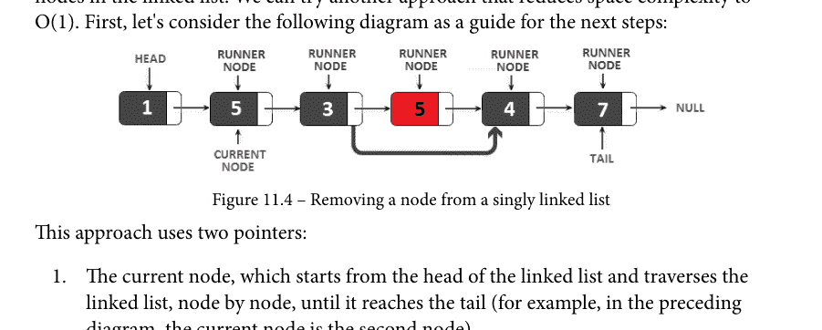

此方法使用两个指针：

+   1. 当前节点，从链表的头部开始并遍历链表，逐个节点，直到到达尾部（例如，在前面的图表中，当前节点是第二个节点）。
+   
+   2. 运行节点，从与当前节点相同的位置开始，即链表的头部。

此外，运行节点遍历链表并检查每个节点的数据是否等于当前节点的数据。在运行代码遍历链表时，当前节点的位置保持固定。

如果运行节点检测到重复项，则将其从链表中移除。当运行节点到达链表的尾部时，当前节点 advances 到下一个节点，并且运行节点再次从当前节点开始遍历链表。所以，这是一个 O(n²) 时间复杂度算法，但空间复杂度为 O(1)。让我们看一下代码：

```
public void removeDuplicates() {
    Node currentNode = head;
    Node runnerNode = head;
}
```

```
while (currentNode != null) {
Node runnerNode = currentNode;
while (runnerNode.next != null) {
if (runnerNode.next.data == currentNode.data) {
if (runnerNode.next == tail) {
tail = runnerNode;
}
runnerNode.next = runnerNode.next.next;
size--;
} else {
runnerNode = runnerNode.next;
}
}
currentNode = currentNode.next;
}
```

完整的代码名为 LinkedListRemoveDupicates。

## 编程挑战 5 – 重新排列链表

Adobe, Flipkart, Amazon

问题：考虑一个未排序的单向整数链表和一个给定的整数 n。编写一段代码来围绕 n 重新排列节点。换句话说，到最后，链表将包含所有小于 n 的值，后跟所有大于 n 的节点。节点的顺序可以改变，并且 n 本身可以在大于 n 的值之间任意位置。


## 链表和映射

**解决方案：** 考虑给定的链表为 1 → 5 → 4 → 3 → 2 → 7 → null，且 n=3，所以 3 是我们的枢轴。 其余节点应围绕此枢轴重新排列以符合问题要求。 解决此问题的方案之一是逐节点迭代链表，并将小于枢轴的每个节点置于头部，而将大于枢轴的每个节点置于尾部。 下图帮助我们可视化此解决方案：

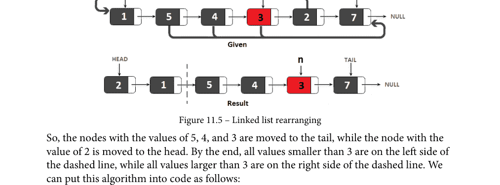

因此，值为 5、4 和 3 的节点被移动到尾部，而值为 2 的节点被移动到头部。 最后，所有小于 3 的值都在虚线的左侧，而所有大于 3 的值都在虚线的右侧。 我们可以将此算法编码如下：

```java
public void rearrange(int n) {
    Node currentNode = head;
    head = currentNode;
    tail = currentNode;
    while (currentNode != null) {
        Node nextNode = currentNode.next;
        if (currentNode.data < n) {
            // insert node at the head
            currentNode.next = head;
            head = currentNode;
        } else {
            // insert node at the tail
            tail.next = currentNode;
            tail = currentNode;
        }
        currentNode = nextNode;
    }
    tail.next = null;
}
```

完整的应用程序名为 LinkedListRearranging。

### 编程挑战 6 – 第 n 个倒数节点

Adobe, Flipkart, Amazon, Google, Microsoft

**问题：** 考虑一个整数单链表和给定的整数 n。 编写代码片段返回第 n 个倒数节点的数值。

**解决方案：** 我们有一堆节点，需要找到满足给定约束的第 n 个节点。 根据我们在第 8 章 递归和动态规划 中的经验，我们可以推断此问题有涉及递归的解决方案。 但我们也可以通过迭代解决方案来解决它。 由于迭代解决方案更有趣，我将在此处介绍它，而递归解决方案可在捆绑代码中找到。

让我们使用以下图表来展示算法（从上到下跟随图表）：


图 11.6 – 第 n 个倒数节点

因此，我们得到一个链表 2 → 1 → 5 → 9 → 8 → 3 → 7 → null，我们想要找到第五个倒数节点值，即 5（你可以在前述图表的顶部看到这一点）。 迭代解决方案使用两个指针； 让我们将它们表示为 runner1 和 runner2。 最初，它们都指向链表的头部。 在步骤 1（前述图表的中间），我们将 runner1 从头部移动到第 5 个头部（或第 n 个头部）节点。 这很容易通过从 0 到 5（或 n）的 for 循环实现。 在步骤 2（前述图表的底部），我们同时移动 runner1 和 runner2，直到 runner1 为 null。 当 runner1 为 null 时，runner2 将指向从头部算起第 n 个倒数节点。 在代码行中，我们这样做：

```java
public int nthToLastIterative(int n) {
	// both runners are set to the start
	Node firstRunner = head;
	Node secondRunner = head;

	// runner1 goes in the nth position
	for (int i = 0; i < n; i++) {
		if (firstRunner == null) {
			throw new IllegalArgumentException(
				"The given n index is out of bounds");
		}
		firstRunner = firstRunner.next;
	}

	// runner2 runs as long as runner1 is not null
	// basically, when runner1 cannot run further (is null),
	// runner2 will be placed on the nth to last node
	while (firstRunner != null) {
		firstRunner = firstRunner.next;
		secondRunner = secondRunner.next;
	}

	return secondRunner.data;
}
```

完整的应用程序名为 LinkedListNthToLastNode。

### 编程挑战 7 – 循环起点检测

Adobe, Flipkart, Amazon, Google, Microsoft

**问题：** 考虑一个包含循环的整数单链表。 换句话说，链表的尾部指向其中一个先前节点从而形成循环或环状。 编写代码片段检测循环的第一个节点（即循环开始的节点）。

**解决方案：** 如果我们管理链表的尾节点，那么很明显所搜索的节点（循环起点）位于 `tail.next`。 如果我们不管理尾部，那么我们可以搜索有两个节点指向它的节点。 这也很容易实现。 如果我们知道链表的大小，那么我们可以从 0 迭代到 size，最后一个 node.next 指向标记循环起点的节点。

#### 快速跑者/慢速跑者 方法

然而，让我们尝试另一种需要更多想象力的算法。 这种方法称为快速跑者/慢速跑者 方法。 它很重要，因为它可用于涉及链表的某些问题中。

主要地，快速跑者/慢速跑者 方法涉及使用两个指针从链表头部开始同时迭代列表，直到满足某些条件。 一个指针名为慢速跑者（SR），因为它逐节点迭代列表。 另一个指针名为快速跑者（FR），因为它在每次移动时跳过下一个节点。 下图是四次移动的示例：

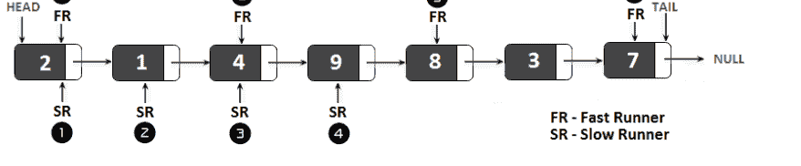

图 11.7 – 快速跑者/慢速跑者 示例

因此，在第一次移动时，FR 和 SR 都指向头部。 在第二次移动时，SR 指向值为 1 的 head.next 节点，而 FR 指向值为 4 的 head.next.next 节点。 移动继续遵循此模式。 当 FR 到达链表尾部时，SR 指向中间节点。

```java
public void findLoopStartNode() {

    Node slowRunner = head;
    Node fastRunner = head;

    // fastRunner meets slowRunner
    while (fastRunner != null && fastRunner.next != null) {
        slowRunner = slowRunner.next;
        fastRunner = fastRunner.next.next;
        if (slowRunner == fastRunner) { // they met
            System.out.println("\nThe meet point is at the node with value: " + slowRunner);
            break;
        }
    }

    // if no meeting point was found then there is no loop
    if (fastRunner == null || fastRunner.next == null) {
        return;
    }

    // the slowRunner moves to the head of the linked list
    // the fastRunner remains at the meeting point
    // they move simultaneously node-by-node and
    // they should meet at the loop start
    slowRunner = head;
    while (slowRunner != fastRunner) {
        slowRunner = slowRunner.next;
        fastRunner = fastRunner.next;
    }

    // both pointers point to the start of the loop
    System.out.println("\nLoop start detected at the node with value: " + fastRunner);
}
```

因此，当 FR 到达链表末尾并且 SR 到达第四个节点（链表中间）时，栈包含值 2、1 和 4。 接下来，我们可以继续以 1 个节点的速率移动 SR 直到链表末尾。 在每次移动时，我们从栈中弹出一个值，并将其与当前节点值进行比较。 如果我们发现不匹配，则链表不是回文。 在代码中，我们有以下内容：

```java
public boolean isPalindrome() {

    Node fastRunner = head;
    Node slowRunner = head;

    Stack<Integer> firstHalf = new Stack<>();

    // the first half of the linked list is added into the stack
    while (fastRunner != null && fastRunner.next != null) {

        firstHalf.push(slowRunner.data);

        slowRunner = slowRunner.next;
        fastRunner = fastRunner.next.next;
    }

    // for odd number of elements we have to skip the middle node
    if (fastRunner != null) {
        slowRunner = slowRunner.next;
    }

    // pop from the stack and compare with the nodes of the second half of the linked list
    while (slowRunner != null) {
        int top = firstHalf.pop();

        // a mismatch means that the list is not a palindrome
        if (top != slowRunner.data) {
            return false;
        }
    }
```


```java
slowRunner = slowRunner.next;
}

return true;
}
```

完整的应用程序名为 *LinkedListPalindrome*。

## 编程挑战 9 – 两个链表求和

**Adobe、Flipkart、Microsoft**

**问题：** 考虑两个正整数和两个单向链表。第一个整数逐位存储于第一个链表中（第一位是第一个链表的头节点）。第二个整数逐位存储于第二个链表中（第一位是第二个链表的头节点）。编写一段代码，将这两个数字相加，并以每个节点包含一位数字的链表形式返回总和。

**解决方案：** 让我们先看一个测试用例的可视化图示：

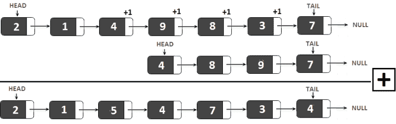

*图 11.11 – 以链表形式对两个数求和*

如果按上述图示逐步计算总和，我们会得到以下结果：

我们计算 7 + 7 = 14，因此写下 4，进位 1：

结果链表为 4 → ?

我们计算 3 + 9 + 1 = 13，因此写下 3，进位 1：

结果链表为 4 → 3 → ?

我们计算 8 + 8 + 1 = 17，因此写下 7，进位 1：

结果链表为 4 → 3 → 7 → ?

```java
if (node1 != null || node2 != null) {
    Node more = sum(node1 == null
        ? null : node1.next, node2 == null
        ? null : node2.next, value >= 10 ? 1 : 0);

    resultNode.next = more;
}

return resultNode;
}
```

完整的应用程序名为 *LinkedListSum*。

## 编程挑战 10 – 链表相交

**Adobe、Flipkart、Google、Microsoft**

**问题：** 考虑两个单向链表。编写一段代码，检查这两个链表是否相交。这里的相交基于引用而非值，但你应返回相交节点的值。也就是说，通过引用检查相交，并返回值。

**解决方案：** 如果你不确定*两个链表的相交*是什么意思，那么我们建议你画出一个测试用例，并与面试官讨论细节。下图展示了这样一个例子：

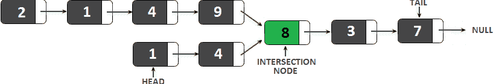

图 11.12 – 两个链表的相交

在这个图中，两个链表在值为 8 的节点处相交。由于我们讨论的是基于引用的相交，这意味着值为 9 的节点和值为 4 的节点都指向值为 8 的节点所在的内存地址。

```java
// the first linked list is longer than the second one
if (s1 > s2) {
    for (int i = 0; i < (s1 - s2); i++) {
        currentNode1 = currentNode1.next;
    }
} else {
    // the second linked list is longer than the first one
    for (int i = 0; i < (s2 - s1); i++) {
        currentNode2 = currentNode2.next;
    }
}
// iterate both lists until the end or the intersection node
while (currentNode1 != null && currentNode2 != null) {
    // we compare references not values!
    if (currentNode1 == currentNode2) {
        return currentNode1.data;
    }
    currentNode1 = currentNode1.next;
    currentNode2 = currentNode2.next;
}
return -1;
}
```

完整的应用程序名为 LinkedListsIntersection。在代码中，你会看到一个名为 `generateTwoLinkedListWithIntersection()` 的辅助方法。它用于生成带有相交点的随机链表。

## 编程挑战 11 – 交换相邻节点

**Amazon、Google**

**问题：** 考虑一个单向链表。编写一段代码交换相邻节点，使得形如 1 → 2 → 3 → 4 → null 的链表变为 2 → 1 → 4 → 3 → null。请注意是交换相邻节点，而不是它们的值！

**解决方案：** 我们可以将问题简化为交换两个连续节点 *n1* 和 *n2*。交换两个值（例如两个整数 *v1* 和 *v2*）的一种众所周知的技术依赖一个辅助变量，可以写成如下形式：

*aux = v1; v1 = v2; v2 = aux;*

然而，我们不能将这种简单的方法直接应用于节点，因为我们必须处理它们的链接。仅仅写出下面这样是不够的：

*aux = n1; n1 = n2; n2 = aux;*

如果我们依赖这种简单的方法来交换 *n1* 和 *n2*，那么我们会得到类似于下图的结果（注意，交换 *n1* 和 *n2* 之后，我们得到 *n1.next = n3* 和 *n2.next = n1*，这完全错误）：

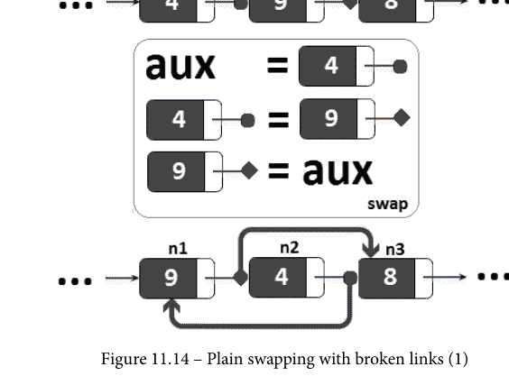

图 11.14 – 简单交换导致的链接断开（1）

但我们可以修复这些链接，对吧？嗯，我们可以显式地将 *n1.next* 指向 *n2*，并将 *n2.next* 指向 *n3*：

*n1.next = n2*

*n2.next = n3*

现在应该没问题了！我们可以交换两个连续节点。然而，当我们交换一对节点时，同时也会断开两对连续节点之间的链接。下图说明了这个问题（我们交换并修复了 *n1-n2* 对和 *n3-n4* 对的链接）：

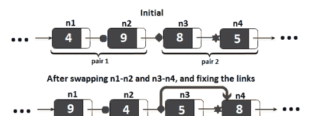

图 11.15 – 简单交换导致的链接断开（2）

注意，在交换这两对之后，n2.next 指向 n4，这是错误的。因此，我们也必须修复这个链接。为此，我们可以保存 n2，并在交换 n3-n4 之后，通过设置 n2.next = n3 来修复链接。现在一切看起来都很好，我们可以将其写成代码：

```java
public void swap() {
    if (head == null || head.next == null) {
        return;
    }

    Node currentNode = head;
    Node prevPair = null;

    // consider two nodes at a time and swap their links
    while (currentNode != null && currentNode.next != null) {
        Node node1 = currentNode;          // first node
        Node node2 = currentNode.next;     // second node
        Node node3 = currentNode.next.next; // third node

        // swap node1 node2
        Node auxNode = node1;
        node1 = node2;
        node2 = auxNode;

        // repair the links broken by swapping
        node1.next = node2;
        node2.next = node3;

        // if we are at the first swap we set the head
        if (prevPair == null) {
            head = node1;
        } else {
            // we link the previous pair to this pair
            prevPair.next = node1;
        }

        // there are no more nodes, therefore set the tail
        if (currentNode.next == null) {
            tail = currentNode;
        }

        // prepare the prevNode of the current pair
        prevPair = node2;
        // advance to the next pair
        currentNode = node3;
    }
}
```

完整的应用程序名为 LinkedListPairwiseSwap。不妨挑战一下自己，交换 n 个节点的序列。

## 编程挑战 12 – 合并两个有序链表

**Amazon、Google、Adobe、Microsoft、Flipkart**

**问题：** 考虑两个有序的单向链表。编写一段代码，在不使用额外空间的情况下合并这两个链表。

**解决方案：** 那么，我们有两个有序链表，list1：4 → 7 → 8 → 10 → null 和 list2：5 → 9 → 11 → null，我们希望得到结果 4 → 5 → 7 → 8 → 9 → 10 → 11 → null。此外，我们希望在不分配新节点的情况下得到这个结果。

由于不能分配新节点，我们必须选择其中一个链表作为最终结果，也就是合并后的链表。换句话说，我们可以从 list1 作为合并链表开始，并将 list2 中的节点添加到 list1 的适当位置。处理完每次比较后，我们将指针（list1）移动到合并链表中的最后一个节点。

例如，我们首先比较这两个链表的头节点。如果 list1 的头节点小于 list2 的头节点，我们就选择 list1 的头节点作为合并链表的头节点。否则，如果 list1 的头节点大于 list2 的头节点，我们就交换头节点。

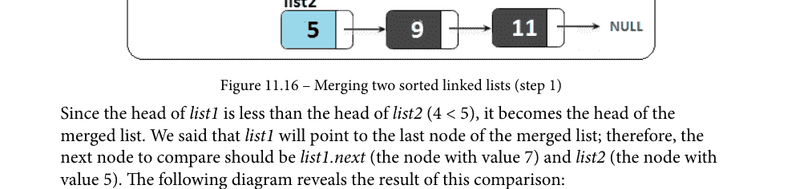

图 11.16 – 合并两个有序链表（第 1 步）

由于 list1 的头节点小于 list2 的头节点（4 < 5），它成为合并链表的头节点。我们说过 list1 将指向合并链表的最后一个节点；因此，下一个要比较的节点应该是 list1.next（值为 7 的节点）和 list2（值为 5 的节点）。下图显示了这次比较的结果：

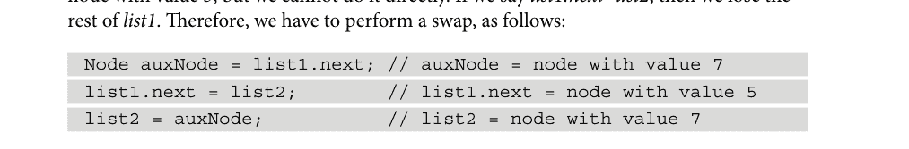

图 11.17 – 合并两个有序链表（第 2 步）

由于 list1 始终指向合并链表（最终结果）的末尾节点，所以我们必须将 list1.next 指向值为 5 的节点，但不能直接这样做。如果我们直接写 list1.next = list2，就会丢失 list1 的剩余部分。因此，我们必须执行一次交换，如下所示：

```java
Node auxNode = list1.next; // auxNode = node with value 7
list1.next = list2; // list1.next = node with value 5
list2 = auxNode; // list2 = node with value 7
```


接下来，我们将 *list1* 移动到 *list1.next*，即值为 9 的节点。我们比较 *list.next* 与 *list2*；因此，我们比较 9 与 7。以下图表揭示了此次比较的结果：

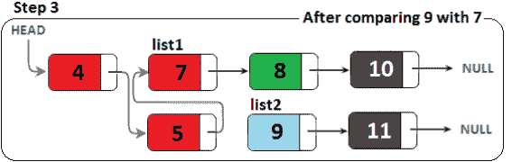

由于 *list1* 遵循合并后的列表（最终结果），我们必须将 *list1.next* 移动到值为 7 的节点（因为 7 < 9），并且我们使用之前讨论过的交换来实现。接下来，我们将 *list1* 移动到 *list1.next*，即值为 8 的节点。我们比较 *list.next* 与 *list2*；因此，我们比较 8 与 9。以下图表揭示了此次比较的结果：

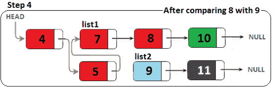

由于 8 < 9，无需交换。我们将 *list1.next* 移动到下一个节点（值为 10 的节点）并比较 10 与 9。下一个图表揭示了此次比较的结果：

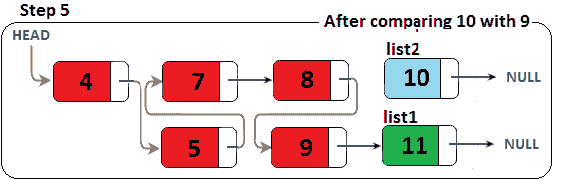

## 410 链表和映射

```
head = list1;
} else {
head = list2;
list2 = list1;
list1 = head;
}

// compare the nodes from list1 with the nodes from list2
while (list1.next != null) {
if (list1.next.data > list2.data) {
Node auxNode = list1.next;
list1.next = list2;
list2 = auxNode;
}

// advance to the last node in the merged linked list
list1 = list1.next;
}

// add the remaining list2
if (list1.next == null) {
list1.next = list2;
}
}
```

完整的应用程序名为 LinkedListMergeTwoSorted。类似的问题可能要求你通过递归合并两个已排序的链表。虽然你可以找到名为 LinkedListMergeTwoSortedRecursion 的应用程序，但我建议你挑战自己尝试实现。此外，基于递归实现，挑战自己合并 n 个链表。完整的应用程序名为 LinkedListMergeNSortedRecursion。

## 编程挑战 13 – 删除冗余路径

**问题：** 考虑一个存储矩阵中路径的单链表。节点的<|message|> 为 (*row, column*) 类型，或简写为 (*r, c*)。路径只能是水平的（按 *column*）或垂直的（按 *row*）。完整的路径由所有水平和垂直路径的端点给出；因此，中间点（或中间点）是冗余的。编写一段代码来删除冗余路径。

**解决方案：** 让我们考虑一个包含以下路径的链表：(0, 0) → (0, 1) → (0, 2) → (1, 2) → (2, 2) → (3, 2) → (3, 3) → (3, 4) → null。冗余路径包括以下节点：(0, 1)、(1, 2)、(2, 2) 和 (3, 3)。因此，删除冗余路径后，我们应该保留一个包含四个节点的列表：(0, 0) → (0, 2) → (3, 2) → (3, 4) → null。以下图表表示冗余路径：

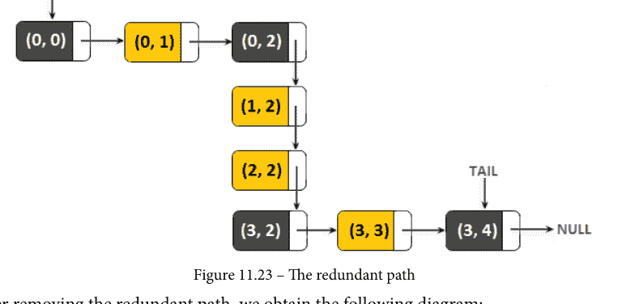

图 11.23 – 冗余路径

删除冗余路径后，我们得到以下图表：


图 11.24 – 删除冗余后剩余的路径

前面的图表应该提示了此问题的解决方案。请注意，定义垂直路径的节点具有相同的列，因为我们只在行上向下/向上移动，而定义水平路径的节点具有相同的行，因为我们只在列上向左/向右移动。这意味着如果我们考虑三个连续节点具有相同的列值或行值，则可以删除中间节点。重复此过程对相邻三元组将删除所有冗余节点。代码应该很容易理解：

```
```java
public void removeRedundantPath() {

    Node currentNode = head;

    while (currentNode.next != null
            && currentNode.next.next != null) {

        Node middleNode = currentNode.next.next;

        // check for a vertical triplet (triplet with same column)
        if (currentNode.c == currentNode.next.c
                && currentNode.c == middleNode.c) {

            // delete the middle node
            currentNode.next = middleNode;

        } // check for a horizontal triplet
        else if (currentNode.r == currentNode.next.r
                && currentNode.r == middleNode.r) {

            // delete the middle node
            currentNode.next = middleNode;

        } else {
            currentNode = currentNode.next;
        }
    }
}
```
```

完整的应用程序名为 *LinkedListRemoveRedundantPath*。

## 编程挑战 14 – 将最后一个节点移到前面

**问题**：考虑一个单链表。编写一段代码，通过两种方法将最后一个节点移到前面。因此，链表的最后一个节点成为其头。

**解决方案**：这是一个听起来简单并且确实简单的问题。第一种方法将遵循以下步骤：

- 1. 将指针移动到倒数第二个节点（我们将其表示为 *currentNode*）。
- 2. 存储 *currentNode.next*（我们将其表示为 *nextNode* – 这是最后一个节点）。
- 3. 将 *currentNode.next* 设置为 null（因此，最后一个节点成为尾部）。
- 4. 将新的头设置为存储的节点（因此，头成为 *nextNode*）。

在代码行中，我们有以下内容：

```
public void moveLastToFront() {

    Node currentNode = head;

    // step 1
    while (currentNode.next.next != null) {
        currentNode = currentNode.next;
    }

    // step 2
    Node nextNode = currentNode.next;

    // step 3
    currentNode.next = null;

    // step 4
    nextNode.next = head;
    head = nextNode;
}
```

第二种方法可以用以下步骤完成：

- 1. 将指针移动到倒数第二个节点（我们将其表示为 *currentNode*）。
- 2. 将链表转换为循环列表（将 *currentNode.next.next* 链接到头）。
- 3. 将新的头设置为 *currentNode.next*。
- 4. 通过将 *currentNode.next* 设置为 null 来打破循环性。

在代码行中，我们有以下内容：

```
public void moveLastToFront() {

    Node currentNode = head;

    // step 1
    while (currentNode.next.next != null) {
        currentNode = currentNode.next;
    }

    // step 2
    currentNode.next.next = head;

    // step 3
    head = currentNode.next;

    // step 4
    currentNode.next = null;
}
```

完整的应用程序名为 *LinkedListMoveLastToFront*。

## 编程挑战 15 – 以 k 个一组反转单链表

**Amazon, Google, Adobe, Microsoft**

**问题：** 考虑一个单链表和一个整数 *k*。编写一段代码来反转链表的节点以 *k* 个一组。

**解决方案：** 假设给定的链表为 7 → 4 → 3 → 1 → 8 → 2 → 9 → 0 → null 且 *k*=3。结果应为 3 → 4 → 7 → 2 → 8 → 1 → 0 → 9 → null。

假设给定的 *k* 等于链表的大小。在这种情况下，我们将问题简化为反转给定的链表。例如，如果给定的列表为 7 → 4 → 3 → null 且 *k*=3，则结果应为 3 → 4 → 7 → null。那么，我们如何获得此结果？

为了反转节点，我们需要当前节点（*current*）、当前节点之后的节点（*next*）和当前节点之前的节点（*previous*），并应用以下表示节点重新排列的算法：

- 1. 从 0 开始计数。
- 2. 当 *current* 节点（最初为头）不为 null 且我们尚未达到给定的 *k* 时，以下情况发生：
  - a. *next* 节点（最初为 null）变为 *current* 节点之后的节点（最初为头）。
  - b. *current* 节点（最初为头）之后的节点变为 *previous* 节点（最初为 null）。
  - c. *previous* 节点变为 *current* 节点（最初为头）。
  - d. *current* 节点变为 *next* 节点（来自 *step 2a* 的节点）。
  - e. 增加计数器。

## 416 链表和映射

因此，如果我们应用此算法，我们可以反转整个列表。但我们需要按组反转它；因此，我们必须解决我们所做的 k 个子问题。如果这听起来像递归，那么你是对的。在前面的算法结束时，步骤 2a 中设置的节点（next）指向计数器指向的节点。我们可以说我们已经反转了前 k 个节点。接下来，我们通过递归从下一个节点开始继续下一个 k 个节点的组。以下图表说明了这个想法：

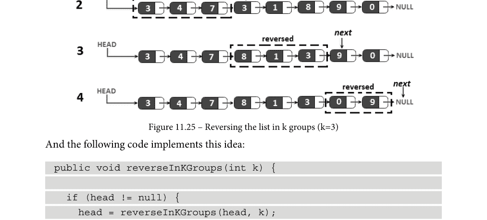

图 11.25 – 以 k 个一组反转列表（k=3）

```
public void reverseInGroups(int k) {
    if (head != null) {
        head = reverseInKGroups(head, k);
    }
}

private Node reverseInKGroups(Node head, int k) {
    Node current = head;
    Node next = null;
    Node prev = null;
    int counter = 0;
```


```java
// reverse first 'k' nodes of linked list
while (current != null && counter < k) {
next = current.next;
current.next = prev;
prev = current;
current = next;
counter++;
}

// 'next' points to (k+1)th node
if (next != null) {
head.next = reverseInKGroups(next, k);
}

// 'prev' is now the head of the input list
return prev;
```

此代码的运行时间为 O(n)，其中 n 为给定链表中的节点数。完整的应用程序名为 ReverseLinkedListInGroups。

## Coding challenge 16 – Reverse a doubly linked list

Microsoft, Flipkart

Problem: Consider a doubly linked list. Write a snippet of code that reverses its nodes.

Solution: Reversing a doubly linked list can take advantage of the fact that a doubly linked list maintains the link to the previous node. This means that we can simply swap the previous pointers and the next pointers for each node, as shown in the following code:

```java
public void reverse() {
Node currentNode = head;
Node prevNode = null;
```

```java
while (currentNode != null) {

    // swap next and prev pointers of the current node
    Node prev = currentNode.prev;
    currentNode.prev = currentNode.next;
    currentNode.next = prev;

    // update the previous node before moving to the next node
    prevNode = currentNode;

    // move to the next node in the doubly linked list
    currentNode = currentNode.prev;
}

// update the head to point to the last node
if (prevNode != null) {
    head = prevNode;
}
}
```

完整的应用程序名为 *DoublyLinkedListReverse*。要对单链表和双链表进行排序，请参阅 *Chapter 14, Sorting and Searching*。

## Coding challenge 17 – LRU cache

**Amazon, Google, Adobe, Microsoft, Flipkart**

**Problem:** Write a snippet of code to implement a fixed-size LRU cache. LRU cache stands for Least Recently Used Cache. This means that, when the cache is full, adding a new entry will instruct the cache to automatically evict the least recently used entry.

**Solution:** Any cache implementation must provide a fast and efficient way of retrieving data. This means that our implementation must respect the following constraints:

- **Fixed size:** The cache must use a limited amount of memory. Therefore, it needs to have some bounds (for example, a fixed size).
- **Fast access to data:** Inserting and searching operations should be fast; preferably, O(1) complexity time.
- **Fast eviction of data:** When the cache is full (it has reached its allocated bounds), the cache should empower an efficient algorithm to evict an entry.

In the context of the last bullet point, eviction from an LRU cache means evicting the least recently used data. To accomplish this, we have to keep track of the recently used entries and of the entries that have not been used for a long time. Moreover, we have to ensure O(1) complexity time for inserting and searching operations. There is no built-in data structure in Java that can give us this cache out of the box.

But we can start with a HashMap data structure. In Java, a HashMap allows us to insert and search (lookup) data by key in O(1) time. So, using a HashMap solves half of the problem. The other half, that is, keeping track of the recently used entries and of the entries that have not been used for a long time, cannot be accomplished with a HashMap.

However, if we imagine a data structure that provides fast insertions, updates, and deletions, then we have to think of a doubly linked list. Essentially, if we know the address of a node in a doubly linked list, then inserting, updating, and deleting can be performed in O(1).

This means that we can provide an implementation that relies on the symbiosis between a HashMap and a doubly linked list. Essentially, for each entry (key-value pair) in the LRU cache, we can store the key of the entry and the address of the associated linked list's node in the HashMap, while this node will store the value of the entry. The following diagram is a visual representation of this statement:

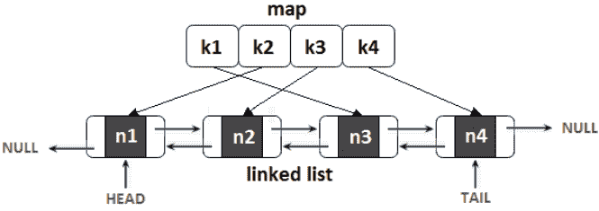

Figure 11.26 – An LRU cache using a HashMap and doubly linked list

But how does the doubly linked list help us to track the recently used entries? The secret relies on the following points:

- Inserting a new entry in the cache will result in adding the corresponding node to the head of the linked list (so, the head of the linked list holds the most recently used value).
- When an entry is accessed, we move its corresponding node to the head of the linked list.
- When we need to evict an entry, we evict the tail of the linked list (so, the tail of the linked list holds the least recently used value).

Well, based on these statements, we can provide the following straightforward implementation:

```java
public final class LRUCache {

    private final class Node {
        private int key;
        private int value;
        private Node next;
        private Node prev;
    }

    private final Map<Integer, Node> hashmap;
    private Node head;
    private Node tail;

    // 5 is the maximum size of the cache
    private static final int LRU_SIZE = 5;

    public LRUCache() {
        hashmap = new HashMap<>();
    }

    public int getEntry(int key) {
```

```java
Node node = hashmap.get(key);

// if the key already exist then update its usage in cache
if (node != null) {
    removeNode(node);
    addNode(node);

    return node.value;
}

// by convention, data not found is marked as -1
return -1;
}

public void putEntry(int key, int value) {

Node node = hashmap.get(key);

// if the key already exist then update
// the value and move it to top of the cache
if (node != null) {

    node.value = value;

    removeNode(node);
    addNode(node);

} else {
    // this is new key
    Node newNode = new Node();
    newNode.prev = null;
    newNode.next = null;
    newNode.value = value;
    newNode.key = key;

    // if we reached the maximum size of the cache then
```

```java
// we have to remove the Least Recently Used
if (hashmap.size() >= LRU_SIZE) {

    hashmap.remove(tail.key);
    removeNode(tail);

    addNode(newNode);
} else {
    addNode(newNode);
}

hashmap.put(key, newNode);
}
}

// helper method to add a node to the top of the cache
private void addNode(Node node) {
    node.next = head;
    node.prev = null;
    if (head != null) {
        head.prev = node;
    }
    head = node;
    if (tail == null) {
        tail = head;
    }
}

// helper method to remove a node from the cache
private void removeNode(Node node) {

    if (node.prev != null) {
        node.prev.next = node.next;
    } else {
        head = node.next;
    }
}
```

```text
if (node.next != null) {
    node.next.prev = node.prev;
} else {
    tail = node.prev;
}
}
}
```

完整的应用程序名为 *LRUCache*。

Well, this was the last coding challenge of the chapter. It's time to summarize the chapter!

## Summary

This chapter brought your attention to the most common problems involving linked lists and maps. Among these problems, the ones that involve singly linked lists are preferred; therefore, this chapter was primarily focused on this category of coding challenges.

In the next chapter, we will tackle coding challenges related to stacks and queues.
