## Stacks and Queues

This chapter covers the most popular interview coding challenges involving stacks and queues. Mainly, you will learn how to provide a stack/queue implementation from scratch and how to tackle coding challenges via Java's built-in implementations, such as the Stack class, and the Queue interface implementations, especially ArrayDeque. Commonly, a coding challenge from this category will ask you to build a stack/queue or will ask you to solve a certain problem using Java's built-in implementations. Depending on the problem, it may explicitly disallow you to call certain built-in methods that will lead you to finding an easy solution.

By the end of this chapter, you'll have a deep insight into stacks and queues, you'll be able to exploit their capabilities, and also recognize and write solutions that depend on stacks and queues.

In this chapter, you'll learn about the following topics:

- Stacks in a nutshell
- Queues in a nutshell
- Coding challenges

Let's start by briefly covering the data structures of stacks.


# 技术要求

本章中展示的所有代码文件均可在 GitHub 上获取，地址为 https://github.com/PacktPublishing/The-Complete-Coding-Interview-Guide-in-Java/tree/master/Chapter12。

## 栈概览

栈是一种线性数据结构，采用后进先出 LIFO 原则。想象一叠需要洗的盘子。你从顶部取第一块盘子（它是最后被添加的那块）并清洗它。之后，你再从顶部取下一块盘子，以此类推。这正是现实生活中的栈（例如，一叠盘子、一叠书、一叠 CD 等）的工作方式。

因此，从技术上讲，在栈中，元素只能从其一端（称为顶部）添加（称为 push 操作）和移除（称为 pop 操作）。

在栈中执行的最常见操作如下：

- push(E e): 在栈顶部添加一个元素
- E pop(): 从栈中移除顶部元素
- E peek(): 返回（但不移除）栈顶元素
- boolean isEmpty(): 如果栈为空则返回 true
- int size(): 返回栈的大小
- boolean isFull(): 如果栈已满则返回 true

与数组不同，栈不能在常数时间内访问第 n 个元素。然而，它在添加和移除元素时提供常数时间。栈可以基于数组实现，甚至可以基于链表实现。此处使用的实现基于数组，名为 MyStack。其存根如下所示：

```
public final class MyStack<E> {

    private static final int DEFAULT_CAPACITY = 10;

    private int top;
    private E[] stack;
}
```

```
MyStack() {
    stack = (E[]) Array.newInstance(
        Object[].class.getComponentType(),
        DEFAULT_CAPACITY);

    top = 0; // the initial size is 0
}

public void push(E e) {}
public E pop() {}
public E peek() {}
public int size() {}
public boolean isEmpty() {}
public boolean isFull() {}
private void ensureCapacity() {}
}
```

向栈中推送一个元素意味着将该元素添加到底层数组的末尾。在推送元素之前，我们必须确保栈未满。如果已满，则可以通过消息/异常来提示，或者我们可以增加其容量，如下所示：

```
// add an element 'e' in the stack
public void push(E e) {

    // if the stack is full, we double its capacity
    if (isFull()) {
        ensureCapacity();
    }

    // adding the element at the top of the stack
    stack[top++] = e;
}

// used internally for doubling the stack capacity
private void ensureCapacity() {
```

```
int newSize = stack.length * 2;
stack = Arrays.copyOf(stack, newSize);
}
```

正如你所见，每当达到栈的容量时，我们就会将其大小加倍。从栈中弹出一个元素意味着返回最后添加到底层数组的元素。该元素通过将最后一个索引置空从底层数组中移除，如下所示：

```
// pop top element from the stack
public E pop() {

    // if the stack is empty then just throw an exception
    if (isEmpty()) {
        throw new EmptyStackException();
    }

    // extract the top element from the stack
    E e = stack[--top];

    // avoid memory leaks
    stack[top] = null;

    return e;
}
```

从栈中查看一个元素意味着返回最后添加到底层数组的元素，但不将其从该数组中移除：

```
// return but not remove the top element in the stack
public E peek() {

    // if the stack is empty then just throw an exception
    if (isEmpty()) {
        throw new EmptyStackException();
    }

```

```
return stack[top - 1];
}
```

由于此实现可以代表你在面试中可能面临的编码挑战，建议你花时间仔细分析其代码。完整的应用程序称为 *MyStack*。

## 队列概览

队列是一种线性数据结构，采用**先进先出 FIFO**原则。想象人们排队买东西。你也可以想象成蚂蚁以队列队形行走。

因此，从技术上讲，元素是从队列中按它们被添加的相同顺序移除的。在队列中，元素在称为 rear 的一端添加（此操作称为 enqueue 操作），并从称为 front 的另一端移除（此操作称为 dequeue 或 poll 操作）。

队列中的常见操作如下：

- `enqueue(E e)`: 在队列 rear 添加一个元素
- `E dequeue()`: 从队列 front 移除并返回元素
- `E peek()`: 返回（但不移除）队列 front 的元素
- `boolean isEmpty()`: 如果队列为空则返回 true
- `int size()`: 返回队列的大小
- `boolean isFull()`: 如果队列已满则返回 true

与数组不同，队列不能在常数时间内访问 *n*th 元素。然而，它在添加和移除元素时提供常数时间。队列可以基于数组实现，甚至可以基于链表或栈实现（栈基于数组或链表构建）。此处使用的实现基于数组，名为 MyQueue。其存根如下所示：

```
public final class MyQueue<E> {

    private static final int DEFAULT_CAPACITY = 10;

    private int front;
    private int rear;
```

```
```java
private int count;
private int capacity;
private E[] queue;

MyQueue() {
    queue = (E[]) Array.newInstance(
        Object[].class.getComponentType(),
        DEFAULT_CAPACITY);
    count = 0; // the initial size is 0
    front = 0;
    rear = -1;
    capacity = DEFAULT_CAPACITY;
}

public void enqueue(E e) {}
public E dequeue() {}
public E peek() {}
public int size() {}
public boolean isEmpty() {}
public boolean isFull() {}
private void ensureCapacity() {}
```
```

向队列中入队一个元素意味着将该元素添加到底层数组的末尾。在入队元素之前，我们必须确保队列未满。如果已满，则可以通过消息/异常来提示，或者我们可以增加其容量，如下所示：

```
```java
// add an element 'e' in the queue
public void enqueue(E e) {
    // if the queue is full, we double its capacity
    if (isFull()) {
        ensureCapacity();
    }
}
```

```
}

// adding the element in the rear of the queue
rear = (rear + 1) % capacity;
queue[rear] = e;

// update the size of the queue
count++;
}

// used internally for doubling the queue capacity
private void ensureCapacity() {
    int newSize = queue.length * 2;
    queue = Arrays.copyOf(queue, newSize);

    // setting the new capacity
    capacity = newSize;
}
```

从队列中出队一个元素意味着返回底层数组开头的下一个元素。该元素从数组中移除：

```
// remove and return the front element from the queue
public E dequeue() {

    // if the queue is empty we just throw an exception
    if (isEmpty()) {
        throw new EmptyStackException();
    }

    // extract the element from the front
    E e = queue[front];
    queue[front] = null;

    // set the new front
    front = (front + 1) % capacity;
```

```
```java
// decrease the size of the queue
count--;
return e;
}
```

从队列中查看一个元素意味着返回底层数组开头的下一个元素，但不将其从数组中移除：

```
```java
public E peek() {
	// if the queue is empty we just throw an exception
	if (isEmpty()) {
		throw new EmptyStackException();
	}
	return queue[front];
}
```

由于此实现可以代表你在面试中可能面临的编码挑战，建议你花时间仔细分析其代码。完整的应用程序称为 MyQueue。

## 编码挑战

在接下来的 11 个编码挑战中，我们将涵盖过去几年在众多招聘 Java 开发人员的公司面试中出现的涉及栈和队列的最流行问题。其中最常见的问题之一，使用一个数组实现三个栈，已在第 10 章 数组和字符串 中介绍过。

以下编码挑战的解决方案依赖于 Java 内置的 Stack 和 ArrayDeque API。那就开始吧！

## 编码挑战 1 – 反转字符串

问题：假设你已获得一个字符串。使用栈将其反转。


**解决方案：** 使用栈反转字符串可以按如下方式完成：

- 1. 从左到右遍历字符串并将每个字符压入栈中。
- 2. 遍历栈并逐个弹出字符。每个弹出的字符放回字符串中。

基于这两种步骤的代码如下：

```java
public static String reverse(String str) {
    Stack<Character> stack = new Stack<>();
    // push characters of the string into the stack
    char[] chars = str.toCharArray();
    for (char c : chars) {
        stack.push(c);
    }
    // pop all characters from the stack and
    // put them back to the input string
    for (int i = 0; i < str.length(); i++) {
        chars[i] = stack.pop();
    }
    // return the string
    return new String(chars);
}
```

完整的应用程序称为 StackReverseString。

## 编程挑战 2 – 花括号栈

Amazon, Google, Adobe, Microsoft, Flipkart

**问题：** 假设你得到一个包含花括号的字符串。编写一段代码，如果存在匹配的花括号对则返回 true。如果我们能按正确顺序为一个左花括号找到对应的右花括号，那么我们就可以说它们是一对匹配的。例如，包含匹配对的字符串看起来像这样：{}{}{}{}。

**解决方案：** 我们的解决方案应考虑两个主要场景。首先，如果左花括号的数量不等于右花括号的数量，则返回 false。其次，如果数量相等，则它们必须按正确顺序排列；否则返回 false。所谓正确顺序，我们理解为最后一个左花括号是第一个被关闭的，其前一个是第二个被关闭的，以此类推。

如果我们依赖栈，那么我们可以详细说明以下算法：

- 1. 对于给定字符串的每个字符，做出以下决定之一：
  - a. 如果字符是左花括号，`{`，则将其压入栈。
  - b. 如果字符是右花括号，`}`，则执行以下操作：
    - i. 检查栈顶，如果是 `{`，则弹出并移动到下一个字符。
    - ii. 如果不是 `{`，则返回 false。
- 2. 如果栈为空，则返回 true（我们找到了所有配对）；否则返回 false（栈中包含不匹配的花括号）。

将这些步骤放入代码中得到以下结果：

```java
public static boolean bracesMatching(String bracesStr) {
    Stack<Character> stackBraces = new Stack<>();
    int len = bracesStr.length();
    for (int i = 0; i < len; i++) {
        switch (bracesStr.charAt(i)) {
            case '{':
                stackBraces.push(bracesStr.charAt(i));
                break;
            case '}':
                if (stackBraces.isEmpty()) { // we found a mismatch
                    return false;
                }
                // for every match we pop the corresponding '{'
                stackBraces.pop();
                break;
            default:
                return false;
        }
    }
    return stackBraces.empty();
}
```

完整的应用程序称为 StackBraces。挑战自己实现一个类似的问题，但适用于多种类型的括号（例如，允许在同一给定字符串中使用 () {} []）。

## 编程挑战 3 – 盘子栈

Amazon, Google, Adobe, Microsoft, Flipkart

**问题：** 考虑一个有 n 个盘子的栈。如果盘子的数量大于 n，则我们需要在新的 n 个盘子的栈中排列它们。因此，每当当前栈超过 n 容量时，就会创建一个该容量的新栈。编写一段代码来塑造这些栈，使它们像一个栈一样工作。换句话说，push() 和 pop() 方法的工作方式就像只有一个栈一样。此外，编写一个 popAt(int stackIndex) 方法，该方法会根据 stackIndex 指示从栈中弹出一个值。

**解决方案：** 我们知道如何处理单个栈，但如何将多个栈连接起来呢？嗯，既然要连接，不如用链表？如果链表的每个节点都包含一个栈，那么节点的 next 指针将指向下一个栈。以下图表可视化了此解决方案：


图 12.1 – 栈的链表

每当当前栈容量被超过时，我们创建一个新节点并将其附加到链表。Java 的内置链表（LinkedList）通过 getLast() 方法让我们访问最后一个节点。换句话说，通过 LinkedList#getLast()，我们可以轻松地对当前栈进行操作（例如，我们可以 push 或 pop 一个元素）。通过 LinkedList#add() 方法添加新栈非常简单。基于这些陈述，我们可以实现 push() 方法，如下所示：

```java
private static final int STACK_SIZE = 3;

private final LinkedList<Stack<Integer>> stacks
    = new LinkedList<>();

public void push(int value) {
    // if there is no stack or the last stack is full
    if (stacks.isEmpty() || stacks.getLast().size()
        >= STACK_SIZE) {
        // create a new stack and push the value into it
        Stack<Integer> stack = new Stack<>();
        stack.push(value);
        // add the new stack into the list of stacks
        stacks.add(stack);
    } else {
        // add the value in the last stack
        stacks.getLast().push(value);
    }
}
```

如果我们想弹出一个元素，则必须从最后一个栈中弹出，因此 LinkedList#getLast() 在这里非常方便。这里的边界情况是弹出最后一个栈中的最后一个元素时发生的情况。当这种情况发生时，我们必须移除最后一个栈，在这种情况下，其前一个（如果有）将成为最后一个。以下代码不言自明：

```java
public Integer pop() {

    // find the last stack
    Stack<Integer> lastStack = stacks.getLast();

    // pop the value from the last stack
    int value = lastStack.pop();

    // if last stack is empty, remove it from the list of stacks
    removeStackIfEmpty();

    return value;
}

private void removeStackIfEmpty() {
    if (stacks.getLast().isEmpty()) {
        stacks.removeLast();
    }
}
```

最后，让我们专注于实现 popAt(int stackIndex) 方法。我们可以通过简单地调用 stacks.get(stackIndex).pop() 从 stackIndex 栈中弹出。一旦我们弹出一个元素，就必须移动剩余的元素。下一个栈的底部元素将成为 stackIndex 指向的栈的顶部元素，以此类推。如果最后一个栈只包含一个元素，则移动其他元素将消除最后一个栈，其前一个将成为最后一个。让我们用代码来看一下：

```java
public Integer popAt(int stackIndex) {

    // get the value from the corresponding stack
    int value = stacks.get(stackIndex).pop();

    // pop an element -> must shift the remaining elements
    shift(stackIndex);

    // if last stack is empty, remove it from the list of stacks
    removeStackIfEmpty();

    return value;
}

private void shift(int index) {
    for (int i = index; i < stacks.size() - 1; ++i) {
        Stack<Integer> currentStack = stacks.get(i);
        Stack<Integer> nextStack = stacks.get(i + 1);
        currentStack.push(nextStack.remove(0));
    }
}
```

完整的应用程序称为 StackOfPlates。

## 编程挑战 4 – 股票跨度

Amazon, Google, Adobe, Microsoft, Flipkart

**问题：** 假设你得到一个单一股票在多个连续交易日的价格数组。股票跨度表示为在当前日（今天）之前连续的天数，在这些天里股票价格小于或等于当前日的价格。例如，考虑覆盖 10 天的股票价格；即，{55, 34, 22, 23, 27, 88, 70, 42, 51, 100}。得到的股票跨度为 {1, 1, 1, 2, 3, 6, 1, 2, 10}。请注意，对于第一天，股票跨度始终为 1。编写一段代码来计算给定价格列表的股票跨度。

**解决方案：** 我们可以从给定的示例开始并尝试将其可视化，如下所示：


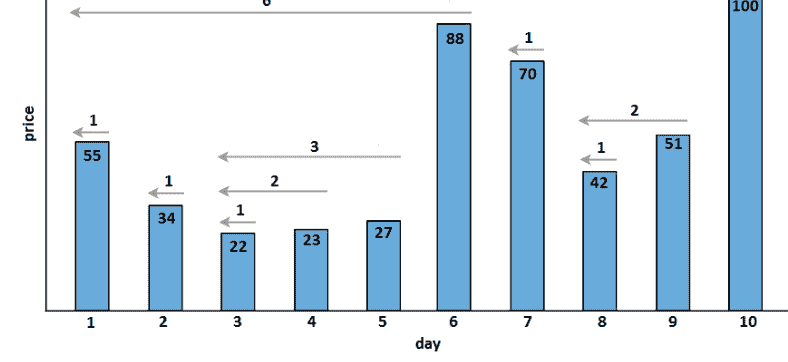

图12.2 – 10天的股票跨度

从前面的图中，我们可以观察到以下几点：

- 对于第一天，跨度始终为1。
- 对于第2天，价格为34。由于34小于前一天的价格（55），因此第2天的股票跨度也为1。
- 对于第3天，价格为22。由于22小于前一天的价格（34），因此第3天的股票跨度也为1。第7天和第8天属于相同情况。
- 对于第4天，价格为23。由于23大于前一天的价格（22），但小于第2天的价格，因此股票跨度为2。第9天与第4天类似。
- 对于第5天，价格为27。由于该价格大于第3天和第4天的价格，但小于第2天的价格，因此股票跨度为3。
- 对于第6天，价格为88。这是迄今为止最大的价格，因此股票跨度为6。
- 对于第10天，价格为100。这是迄今为止最大的价格，因此股票跨度为10。

请注意，我们将当前日的股票跨度计算为当前日索引与最后一个最大股票价格对应日索引之差。在追踪这一情景后，我们首先想到的思路可能是：对于每一天，扫描其之前的所有天，并递增股票跨度，直到股票价格大于当前日。换句话说，我们使用的是暴力破解法。正如我本书前面提到的，在面试中应最后才使用暴力破解法，因为它性能较差，而且不会给面试官留下深刻印象。在这种情况下，暴力破解法的时间复杂度为O(n²)。

然而，让我们尝试另一种思考角度。对于每一天，我们想要找到一个价格大于当前日价格的前一天。换句话说，我们正在寻找最后一个大于当前日价格的价格。

在这里，我们应选择一个LIFO（后进先出）数据结构，它允许我们以降序压入价格，并弹出最后压入的价格。一旦我们有了这个结构，就可以遍历每一天，并将栈顶价格与当前日价格进行比较。只要栈顶价格小于当前日价格，我们就从栈中弹出。但如果栈顶价格大于当前日价格，那么我们将当前日股票跨度计算为当前日与栈顶价格对应日之间的天数差。如果我们以降序将价格压入栈中，这将是可行的——最大的价格位于栈顶。然而，由于我们可以将股票跨度计算为当前日索引与最后一个最大股票价格对应日索引之差（我们将其表示为 i），我们可以简单地将索引 i 存储在栈中；stackPrices[i]（我们将价格数组记为 stackPrices）将返回第 i 天的股票价格。

这可以通过以下算法完成：

1. 第一天的股票跨度为1，索引为0——我们将此索引压入栈中（我们将其记为 dayStack；因此，dayStack.push(0)）。
2. 我们遍历剩余的天数（第2天索引为1，第3天索引为2，依此类推），并执行以下操作：
   a. 当 stockPrices[i] > stockPrices[dayStack.peek()] 且 !dayStack.empty() 时，我们从栈中弹出（dayStack.pop()）。
3. 如果 dayStack.empty()，则股票跨度为 i+1。
4. 如果 stockPrices[i] <= stockPrices[dayStack.peek()]，则股票跨度为 i - dayStack.peek()。
5. 将当前天的索引 i 压入栈中（dayStack）。

让我们看看该算法如何用于我们的测试用例：

1. 第一天的股票跨度为1，索引为0——我们将此索引压入栈中，dayStack.push(0)。
2. 对于第二天，stockPrices[1]=34，stockPrices[0]=55。由于34 < 55，第2天的股票跨度为 i - dayStack.peek() = 1 - 0 = 1。我们将1压入栈中，dayStack.push(1)。

3. 对于第三天，stockPrices[2]=22，stockPrices[1]=34。由于22 < 34，第3天的股票跨度为 2 - 1 = 1。我们将2压入栈中，dayStack.push(2)。

4. 对于第四天，stockPrices[3]=23，stockPrices[2]=22。由于23 > 22且栈不为空，我们弹出栈顶，因此弹出值2。由于23 < 34（stockPrices[1]），第4天的股票跨度为 3 - 1 = 2。我们将3压入栈中，dayStack.push(3)。

5. 对于第五天，stockPrices[4]=27，stockPrices[3]=23。由于27 > 23且栈不为空，我们弹出栈顶，因此弹出值3。接下来，27 < 34（请记住，我们在上一步中弹出了值2，因此下一个栈顶的值为1），第5天的股票跨度为 4 - 1 = 3。我们将4压入栈中，dayStack.push(4)。

6. 对于第六天，stockPrices[5]=88，stockPrices[4]=27。由于88 > 27且栈不为空，我们弹出栈顶，因此弹出值4。接下来，88 > 34且栈不为空，因此我们弹出值1。接下来，88 > 55且栈不为空，因此我们弹出值0。接下来，栈为空，第6天的股票跨度为 5 + 1 = 6。

嗯，我想你已经明白了思路，所以现在挑战一下自己，继续到第10天。目前，我们已有足够的信息将该算法编写成代码：

```
public static int[] stockSpan(int[] stockPrices) {

    Stack<Integer> dayStack = new Stack<>();
    int[] spanResult = new int[stockPrices.length];

    spanResult[0] = 1; // first day has span 1
    dayStack.push(0);

    for (int i = 1; i < stockPrices.length; i++) {

        // pop until we find a price on stack which is
        // greater than the current day's price or there
        // are no more days left
        while (!dayStack.empty()
            && stockPrices[i] > stockPrices[dayStack.peek()]) {
            dayStack.pop();
        }
```

```
// if there is no price greater than the current
// day's price then the stock span is the numbers of days
if (dayStack.empty()) {
    spanResult[i] = i + 1;
} else {
    // if there is a price greater than the current
    // day's price then the stock span is the
    // difference between the current day and that day
    spanResult[i] = i - dayStack.peek();
}

// push current day onto top of stack
dayStack.push(i);
}

return spanResult;
}
```

完整的应用程序名为 *StockSpan*。

## 编程挑战5 – 栈最小值

**Amazon、Google、Adobe、Microsoft、Flipkart**

**问题：** 设计一个栈，在常数时间内计算最小值。`push()`、`pop()` 和 `min()` 方法应在 O(1) 时间内运行。

**解决方案：** 经典方法包括声明一个保存栈最小值的实例变量。当从栈中弹出的值等于最小值时，我们在栈中搜索新的最小值。这可以正常工作，但不满足本问题的约束条件，该条件要求 `push()` 和 `pop()` 在 O(1) 时间内运行。

```
if (stackOfMin.isEmpty()) {
		return Integer.MAX_VALUE;
	} else {
		return stackOfMin.peek();
	}
}
```

完成！我们的解决方案以 O(1) 时间复杂度运行。完整的应用程序名为 MinStackConstantTime。一个与此相关的问题要求你在常数时间和空间内实现相同的功能。该问题的解决方案有以下几项限制：

- pop() 方法返回 void，以避免返回不正确的值。
- 给定值乘以2后不应超出 int 数据类型范围。

简而言之，这些限制是由解决方案本身造成的。我们不能使用额外空间，因此我们将使用初始的值栈同时存储最小值。此外，我们需要将给定值乘以2，所以应确保不超过 int 范围。为什么我们需要将给定值乘以2呢？

让我们来阐明这一点！假设我们需要将一个值压入一个具有某个最小值的栈中。如果这个值大于或等于当前最小值，那么我们可以直接将其压入栈中。但如果它小于最小值，则我们压入 2*value - minimum，它应小于该值本身。然后，我们将当前最小值更新为 value。

当我们弹出一个值时，必须考虑两个方面。如果弹出的值大于或等于最小值，那么这就是先前压入的真实值。否则，弹出的值不是压入的值。真实压入的值存储在最小值中。在我们弹出栈顶（即最小值）之后，必须恢复前一个最小值。前一个最小值通过 2*minimum - top 获得。换句话说，由于当前栈顶是 2*value - previous_minimum，且 value 是当前最小值，因此前一个最小值是 2*current_minimum - top。以下代码说明了该算法：

```
public class MyStack {
	private int min;
	private final Stack<Integer> stack = new Stack<>();
}
```


```java
public void push(int value) {
	// we don't allow values that overflow int/2 range
	int r = Math.addExact(value, value);
	if (stack.empty()) {
		stack.push(value);
		min = value;
	} else if (value > min) {
		stack.push(value);
	} else {
		stack.push(r - min);
		min = value;
	}
}

// pop() doesn't return the value since this may be a wrong
// value (a value that was not pushed by the client)!
public void pop() {
	if (stack.empty()) {
		throw new EmptyStackException();
	}
	int top = stack.peek();
	if (top < min) {
		min = 2 * min - top;
	}
	stack.pop();
}

public int min() {
	return min;
}
```

完整的应用程序名为 MinStackConstantTimeAndSpace。

## 编码挑战 6 – 通过栈实现队列

Google、Adobe、Microsoft、Flipkart

问题：通过两个栈来设计一个队列。

解决方案：为了找到这个问题的正确解决方案，我们必须从队列和栈的主要区别开始。我们知道，队列按 FIFO（先进先出）工作，而栈按 LIFO（后进先出）工作。接下来，我们必须考虑主要操作（push、pop 和 peek），并找出它们的区别。二者都以相同的方式压入新元素。当我们向队列中压入元素时，我们将它压入一端（队列的尾部）。当我们向栈中压入元素时，我们将它压入栈的新顶部，这可以认为与队列的尾部是一样的。当我们从栈中弹出（pop）或查看（peek）一个值时，我们是从栈顶进行的。然而，当我们在队列上执行相同的操作时，我们是从队首进行的。这意味着，在弹出或查看元素时，反转后的栈将充当队列。下面的图说明了这一点：

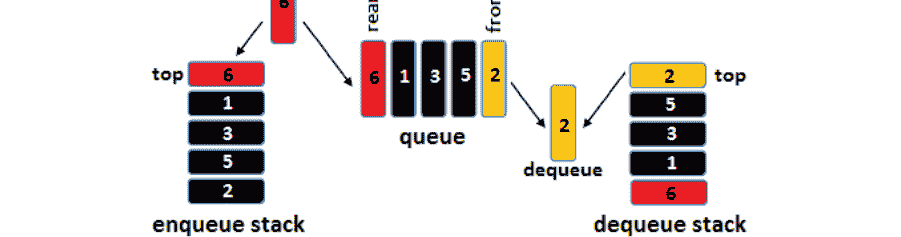

图 12.3 – 通过两个栈实现的队列

因此，每个新元素都会作为新的栈顶被压入入队栈。当我们需要弹出或查看一个值时，我们使用出队栈，它是入队栈的反转版本。请注意，我们不必在每次 pop/peek 操作时都反转入队栈。我们可以让元素留在出队栈中，直到我们确实需要反转这些元素。换句话说，对于每次 pop/peek 操作，我们可以检查出队栈是否为空。只要出队栈不为空，我们就不需要反转入队栈，因为我们至少有一个元素可以弹出/查看。

让我们用代码来看一下：

```java
public class MyQueueViaStack<E> {
	private final Stack<E> stackEnqueue;
	private final Stack<E> stackDeque;
	public MyQueueViaStack() {
		stackEnqueue = new Stack<>();
		stackDeque = new Stack<>();
	}
	public void enqueue(E e) {
		stackEnqueue.push(e);
	}
	public E dequeue() {
		reverseStackEnqueue();
		return stackDeque.pop();
	}
	public E peek() {
		reverseStackEnqueue();
		return stackDeque.peek();
	}
	public int size() {
		return stackEnqueue.size() + stackDeque.size();
	}
	private void reverseStackEnqueue() {
		if (stackDeque.isEmpty()) {
			while (!stackEnqueue.isEmpty()) {
				stackDeque.push(stackEnqueue.pop());
			}
		}
	}
}
```

如上述图的左侧所示，向栈和队列中压入元素是一个简单的操作。上述图的右侧显示，当我们想要从充当栈的队列中弹出/查看元素时，就会出现问题。主要地，在弹出/查看元素之前，我们必须把位于队列（在上述图中记为 *queue1*）中 (*rear-1*) 和 *front* 之间的元素移动到另一个队列（在上述图中记为 *queue2*）中。在上述图的右侧，我们从 *queue1* 中取出元素 2、5、3 和 1，并将它们添加到 *queue2*。接着，我们从 *queue1* 中弹出/查看最后一个元素。如果我们弹出元素 6，那么 *queue1* 将保持为空。如果我们查看元素 6，那么 *queue1* 将保留这个元素。

现在，剩余的元素都在 *queue2* 中，因此为了执行另一个操作（push、peek 或 pop），我们有两个选择：

-   将剩余元素从 *queue2* 移回，以恢复 *queue1*。
-   像使用 *queue1* 一样使用 *queue2*，这意味着交替使用 *queue1* 和 *queue2*。

对于第二个选择，我们避免了将元素从 *queue2* 移回 *queue1* 的开销，而这样做是为了在 *queue1* 上执行下一个操作。你可以挑战自己去实现第一个选择，但让我们更多地关注第二个选择。

要交替使用 *queue1* 和 *queue2*，我们可以认为，下一次操作应该使用的队列是非空的那个队列。由于我们在这两个队列之间移动元素，所以它们中总有一个是空的。因此，当我们查看一个元素时就会出现问题，因为 peek 操作不会移除元素，所以其中一个队列会保留该元素。由于两个队列都不为空，我们不知道下一个操作应该使用哪个队列。解决方案很简单：即使是 peek 操作，我们也取出最后一个元素，并将其存储为实例变量。后续的 peek 操作将返回这个实例变量。push 操作会在压入给定值之前，先将这个实例变量压回队列，并将该实例变量设置为 null。pop 操作会检查这个实例变量是否为 null。如果不为 null，那么它就是要弹出的元素。

让我们看看代码：

```java
public class MyStackViaQueue<E> {

    private final Queue<E> queue1;
    private final Queue<E> queue2;
    private E peek;
    private int size;
```

## 450 栈和队列

```java
public MyStackViaQueue() {
    queue1 = new ArrayDeque<>();
    queue2 = new ArrayDeque<>();
}

public void push(E e) {
    if (!queue1.isEmpty()) {
        if (peek != null) {
            queue1.add(peek);
        }
        queue1.add(e);
    } else {
        if (peek != null) {
            queue2.add(peek);
        }
        queue2.add(e);
    }
    size++;
    peek = null;
}

public E pop() {
    if (size() == 0) {
        throw new EmptyStackException();
    }
    if (peek != null) {
        E e = peek;
        peek = null;
        size--;
        return e;
    }
}
```

``` 
} 
E e;
if (!queue1.isEmpty()) {
	e = switchQueue(queue1, queue2);
} else {
	e = switchQueue(queue2, queue1);
}
size--;
return e;
}

public E peek() {
	if (size() == 0) {
		throw new EmptyStackException();
	}
	if (peek == null) {
		if (!queue1.isEmpty()) {
			peek = switchQueue(queue1, queue2);
		} else {
			peek = switchQueue(queue2, queue1);
		}
	}
	return peek;
}

public int size() {
	return size;
}

private E switchQueue(Queue from, Queue to) {
```

``` 
while (from.size() > 1) {
	to.add(from.poll());
}

return (E) from.poll();
}
```

完整的应用程序名为 StackViaQueue。

## 编码挑战 8 – 最大直方图面积

Amazon、Google、Adobe、Microsoft、Flipkart

问题：假设你得到了如下图中所示的直方图：

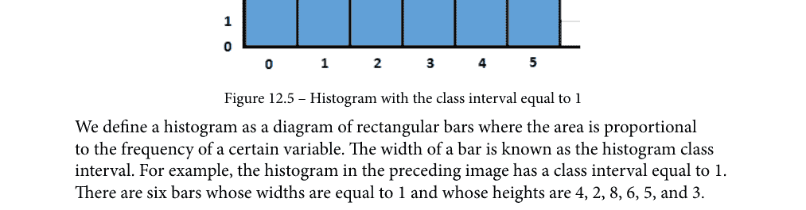

我们将直方图定义为一种由矩形条构成的图表，其中面积与某个变量的频率成比例。条形的宽度称为直方图的组距。例如，上图中的直方图组距为 1。有六个条形，宽度均为 1，高度分别为 4、2、8、6、5 和 3。

假设你已将这些高度以整数数组的形式给出（这是问题的输入）。编写一段使用栈的代码，用于计算直方图中的最大矩形面积。为了更好地理解这一点，下图突出显示了可以形成的几个矩形（并非全部）：

### 图 12.6 – 直方图的矩形

在上图中，最大的矩形面积（也就是最大的矩形）是中间的那个，3 x 5 = 15。

解决方案：这个问题比乍看起来要难得多。首先，我们需要分析给定的图像并阐述几个结论。例如，非常重要的一点是：只有当条形的高度小于或等于该矩形区域的高度时，它才能成为该矩形区域的一部分。此外，对于每个条形，我们可以说，左侧所有高于当前条形的条形都可以与当前条形形成一个矩形区域。类似地，右侧所有高于当前条形的条形也都可以与当前条形形成一个矩形区域。

这意味着每个矩形区域都由左边界和右边界界定，并且 (right - left) * current_bar 给出了该区域的值。我们应该计算所有可能的区域，并挑出最大的区域作为我们实现的输出。下图突出显示了 3 x 5 矩形的左右边界：

### 图 12.7 – 左右边界


## 栈与队列

请记住，我们必须使用栈来解决这个问题。既然我们已经有一些能引导我们找到解决方案的表述，现在是时候将栈引入讨论了。主要来说，我们可以使用栈来计算左右边界。

我们从第一个条形开始，将其索引（索引 0）压入栈中。然后继续处理剩余的条形，并执行以下操作：

- 1. 只要当前条形小于栈顶元素且栈不为空，就重复步骤 1a、1b 和 1c：
- a. 弹出栈顶元素。
- b. 计算左边界。
- c. 计算在所计算的左边界条形与当前条形之间能够形成的矩形区域的宽度。
- d. 通过将计算出的宽度乘以步骤 1a 中弹出的条形的高度来计算面积。
- e. 如果该面积大于之前的面积，则存储当前这个面积。
- 2. 将当前条形的索引压入栈中。
- 3. 从步骤 1 开始重复，直到所有条形都被处理完毕。

```
public static int maxAreaUsingStack(int[] histogram) {
    Stack<Integer> stack = new Stack<>();
    int maxArea = 0;
    for (int bar = 0; bar <= histogram.length; bar++) {
        int barHeight;
        if (bar == histogram.length) {
            barHeight = 0; // take into account last bar
        } else {
            barHeight = histogram[bar];
        }
        while (!stack.empty()
            && barHeight < histogram[stack.peek()]) {
```

```
// we found a bar smaller than the one from the stack
int top = stack.pop();
// find left boundary
int left = stack.isEmpty() ? -1 : stack.peek();
// find the width of the rectangular area
int areaRectWidth = bar - left - 1;
// compute area of the current rectangle
int area = areaRectWidth * histogram[top];
maxArea = Integer.max(area, maxArea);
}
// add current bar (index) into the stack
stack.push(bar);
}
return maxArea;
```

这段代码的时间复杂度为 O(n)。此外，额外的空间复杂度为 O(n)。完整的应用程序名为 StackHistogramArea。

## 编程挑战 9 – 最小数字

问题：假设给定一个由 n 位数字组成的字符串。编写一段代码，在移除给定的 k 个数字后打印出可能的最小数字。

解法：假设给定的数字是 n=4514327，k=4。在这种情况下，移除四个数字后的最小数字是 127。如果 n=2222222，那么最小的数字是 222。

该解法可以很容易地通过栈和以下算法实现：

- 1. 从左到右逐位遍历给定的数字。
- a. 当给定的 k 大于 0、栈不为空且栈顶元素大于当前遍历的数字时：
- i. 从栈中弹出栈顶元素。
- ii. 将 k 减 1。
- b. 将当前数字压入栈中。
- 2. 当给定的 k 大于 0 时，执行以下操作（以处理特殊情形，如 222222）：
- a. 从栈中弹出元素。
- b. 将 k 减 1。

就代码而言，我们有如下实现：

```
public static void smallestAfterRemove(String nr, int k) {

    int i = 0;
    Stack<Character> stack = new Stack<>();
    while (i < nr.length()) {
        // if the current digit is less than the previous
        // digit then discard the previous one
        while (k > 0 && !stack.isEmpty()
            && stack.peek() > nr.charAt(i)) {
            stack.pop();
            k--;
        }

        stack.push(nr.charAt(i));
        i++;
    }

    // cover corner cases such as '2222'
    while (k > 0) {
        stack.pop();
        k--;
    }
```

```
System.out.println("The number is (as a printed stack; " + "ignore leading 0s (if any)): " + stack);
```

完整的应用程序名为 SmallestNumber。

## 编程挑战 10 – 岛屿

亚马逊、Adobe

问题：假设给定一个 m x n 的矩阵，其中只包含 0 和 1。按照惯例，1 表示陆地，0 表示水域。编写一段代码来计算岛屿的数量。岛屿被定义为一组被 0 包围的 1。

解法：让我们直观地看一个测试用例。下面是一个 10x10 的矩阵，其中包含 6 个岛屿，分别用 1、2、3、4、5 和 6 标出。

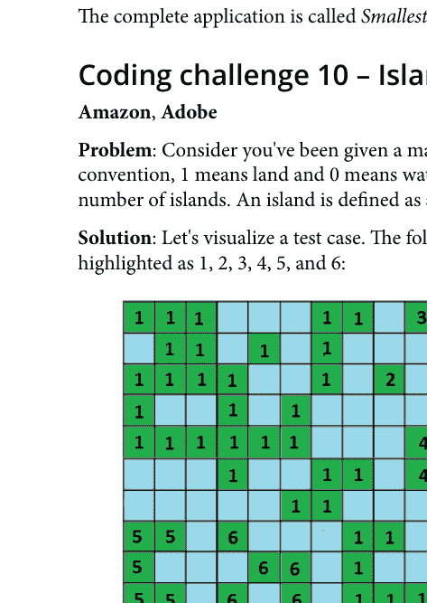

+ 1, 1, 1, 0, 0, 0, 1, 1, 0, 1
+ 0, 1, 1, 0, 1, 0, 1, 0, 0, 0
+ 1, 1, 1, 1, 0, 0, 1, 0, 1, 0
+ 1, 0, 0, 1, 0, 1, 0, 0, 0, 0
+ 1, 1, 1, 1, 1, 1, 0, 0, 0, 1
+ 0, 0, 0, 1, 0, 0, 1, 1, 0, 1
+ 0, 0, 0, 0, 0, 1, 1, 0, 0, 0
+ 1, 1, 0, 1, 0, 0, 0, 1, 1, 0
+ 1, 0, 0, 0, 1, 1, 0, 1, 1, 0
+ 1, 1, 0, 1, 0, 1, 0, 1, 1, 1

图 12.8 – 通过 10x10 矩阵表示的岛屿

水域（浅蓝色）
陆地（绿色）

- 3. 将当前单元格出队，并处理其所有八个相邻单元格——处理一个单元格意味着如果它有效则将其入队并将其标记为已标记。
- 4. 重复步骤 3，直到队列为空。当队列为空时，这意味着我们已经找到了一个岛屿。
- 5. 从步骤 2 开始重复，直到不再有有效的单元格。

就代码而言，我们有如下实现：

```
private static class Cell {
    int r, c;
    public Cell(int r, int c) {
        this.r = r;
        this.c = c;
    }
}

// there are 8 possible movements from a cell
private static final int POSSIBLE_MOVEMENTS = 8;

// top, right, bottom, left and 4 diagonal moves
private static final int[] ROW = {-1, -1, -1, 0, 1, 0, 1, 1};
private static final int[] COL = {-1, 1, 0, -1, -1, 1, 0, 1};

public static int islands(int[][] matrix) {
    int m = matrix.length;
    int n = matrix[0].length;
    // stores if a cell is flagged or not
    boolean[][] flagged = new boolean[m][n];
    int island = 0;
    for (int i = 0; i < m; i++) {
        for (int j = 0; j < n; j++) {
```

```
if (matrix[i][j] == 1 && !flagged[i][j]) {
    resolve(matrix, flagged, i, j);
    island++;
}
}
}
return island;
}

private static void resolve(int[][] matrix,
    boolean[][] flagged, int i, int j) {
    Queue<Cell> queue = new ArrayDeque<>();
    queue.add(new Cell(i, j));

    // flag source node
    flagged[i][j] = true;

    while (!queue.isEmpty()) {
        int r = queue.peek().r;
        int c = queue.peek().c;
        queue.poll();

        // check for all 8 possible movements from current
        // cell and enqueue each valid movement
        for (int k = 0; k < POSSIBLE_MOVEMENTS; k++) {

            // skip this cell if the location is invalid
            if (isValid(matrix, r + ROW[k], c + COL[k], flagged)) {
                flagged[r + ROW[k]][c + COL[k]] = true;
                queue.add(new Cell(r + ROW[k], c + COL[k]));
            }
        }
    }
}
```

完整的应用程序名为 Queuelands。

## 编程挑战 11 – 最短路径

亚马逊、谷歌、Adobe

问题：假设给定一个 m x n 的矩阵，其中只包含 0 和 1。按照惯例，1 表示安全的陆地，而 0 表示不安全的陆地。更准确地说，0 表示一个不应被激活的传感器。此外，所有八个相邻单元格都可能激活该传感器。编写一段代码，计算从第一列的任意单元格到最后一列的任意单元格的最短路径。你每次只能移动一步，可以是左、右、上或下。最终的路径（如果存在）应只包含值为 1 的单元格。

解法：让我们直观地看一个测试用例。下面是一个 10 x 10 的矩阵。

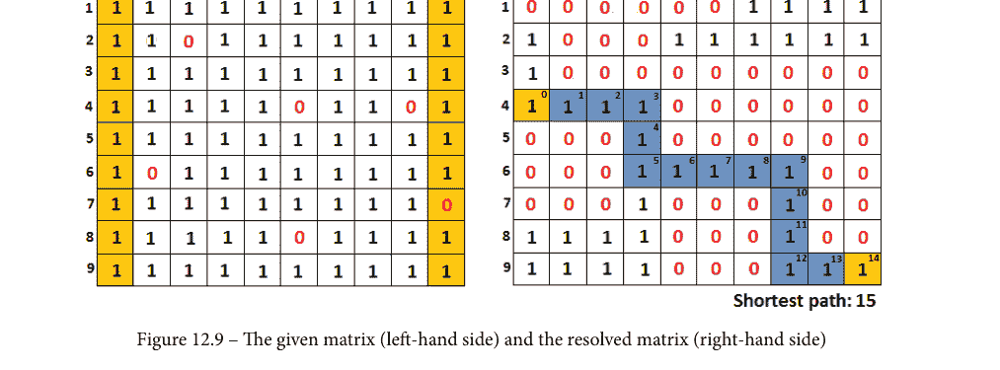

在下图的左侧，你可以看到给定的矩阵。注意值为 0 的传感器不应被激活。在右侧，你可以看到应用程序所使用的矩阵以及一个可能的解决方案。该矩阵是通过扩展传感器的覆盖区域从给定矩阵得到的。请记住，传感器的八个相邻单元格也可能激活传感器。该解决方案从第一列（单元格 (4, 0)）开始，到最后一列（单元格 (9, 9)）结束，包含 15 步（从 0 到 14）。你可以在下图中看到这些步骤：

最短路径：15

图 12.9 – 给定矩阵（左侧）和已处理矩阵（右侧）


从坐标为 (r, c) 的安全格出发，我们可以在四个安全方向移动：(r-1, c)、(r, c-1)、(r+1, c) 和 (r, c+1)。如果我们把可能的移动视为方向（边），把格子视为顶点，那么我们可以在图的概念下可视化这个问题。边是可能的移动，而顶点是我们可到达的格子。每次移动都保存着从当前格到起始格（起始格为第一列的格）的距离。对于每次移动，距离增加 1。因此，在图的上下文中，该问题归结为在图中寻找最短路径。因此，我们可以使用 **广度优先搜索（BFS）** 方法来解决这个问题。在 *第 13 章，树和图* 中，你已获得 BFS 算法的描述，并且以与此处求解相同的方式解决过另一个问题——*国际象棋骑士* 问题。

现在，基于前一个问题提供的经验，我们可以详细阐述该算法：

- 1. 从一个空队列开始。
- 2. 将第一列的所有安全格入队，并将其距离设为 0（这里，0 表示每个格到自身的距离）。此外，这些格被标记为已访问或已标记。
- 3. 只要队列不为空，就执行以下操作：
- a. 弹出队列顶部的格。
- b. 如果弹出的格是目标格（即位于最后一列），则直接返回其距离（目标格到第一列源格的距离）。
- c. 如果弹出的格不是目标格，则对于该格的四个相邻格，将每个有效格（安全且未访问）以距离 (+1) 入队并标记为已访问。
- d. 如果我们在未到达目标的情况下处理完队列中的所有格，则无解。返回 -1。

由于我们依赖 BFS 算法，我们知道所有最短路径为 1 的格会被首先访问。接下来，被访问的格是其最短路径为 1+1=2 的相邻格，以此类推。因此，具有最短路径的格等于其父节点的最短路径 + 1。这意味着，当我们第一次遍历目标格时，就得到了最终结果。这是最短路径。让我们看看与此最相关的代码部分：

```
private static int findShortestPath(int [] [] board) {
	// stores if cell is visited or not
	boolean[][] visited = new boolean[M][N];
	Queue<Cell> queue = new ArrayDeque<>();
	// process every cell of first column
	for (int rl = 0; rl < M; rl++) {
		// if the cell is safe, mark it as visited and
		// enqueue it by assigning it distance as 0 from itself
		if (board[rl][0] == 1) {
			queue.add(new Cell(rl, 0, 0));
			visited[rl][0] = true;
		}
	}
	while (!queue.isEmpty()) {
		// pop the front node from queue and process it
		int rIdx = queue.peek().r;
		int cIdx = queue.peek().c;
		int dist = queue.peek().distance;
		queue.poll();
		// if destination is found then return minimum distance
		if (cIdx == N - 1) {
			return (dist + 1);
		}
		// process all adjacent cells
		for (int i = 0; i < 4; i++) {
			int nRow = rIdx + dr[i];
			int nCol = cIdx + dc[i];
			if (nRow >= 0 && nRow < M && nCol >= 0 && nCol < N && board[nRow][nCol] == 1 && !visited[nRow][nCol]) {
				queue.add(new Cell(nRow, nCol, dist + 1));
				visited[nRow][nCol] = true;
			}
		}
	}
	return -1;
}
```

如果我们有三个操作数 a、b 和 c，我们可以写出以下图所示的表达式：

| 中缀 | 后缀 | 前缀 |
|-------|---------|--------|
| (a + b) * c | a b + c * | * a b c |
| a + (b * c) | a b c * + | + a * b c |

Figure 12.10 – Infix, postfix, and prefix

最常见的问题是指求值前缀和后缀表达式以及在前缀、中缀和后缀表达式之间转换。所有这些问题都有依赖于栈（或二叉树）的解决方案，并在任何一本专门介绍基础算法的严肃书籍中都有涉及。花点时间收集一些关于此主题的资源以熟悉它。由于该主题在专门书籍中被广泛覆盖，并且在面试中不是常见话题，我们在此不会涵盖它。

## Summary

本章涵盖了任何准备 Java 开发者技术面试的候选人都必须掌握的栈和队列问题。栈和队列出现在许多实际应用中，因此掌握它们是面试官会重点考察的顶级技能之一。

在下一章，Trees, Tries, and Graphs 中，你会看到栈和队列也经常用于解决涉及树和图的问题，这意味着它们也值得你关注。

## General tree

粗略地说，我们可以将树分为二叉树和其余允许的树。二叉树是每个节点最多有两个子节点的树。在下面的图中，左侧图像是非二叉树，而右侧图像是二叉树：

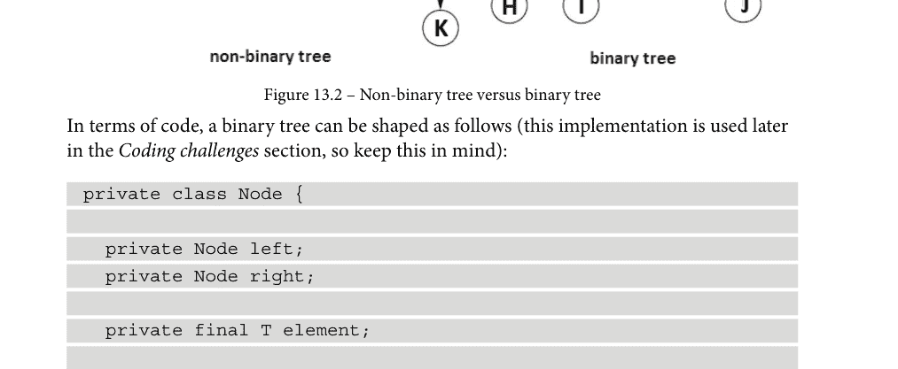

> Figure 13.2 – Non-binary tree versus binary tree

就代码而言，二叉树可以如下塑造（此实现在后面的 Coding challenges 部分中使用，因此请记住这一点）：

```
private class Node {
  private Node left;
  private Node right;
  private final T element;

  public Node(T element) {
    this.element = element;
    this.left = null;
    this.right = null;
  }

  public Node(Node left, Node right, T element) {
    this.element = element;
    this.left = left;
    this.right = right;
  }
}
```

```
// operations
}
```

正如你所见，每个 Node 保留对另外两个 Node 元素的引用，以及一个通用数据（element）。左节点和右节点代表当前节点的子节点。面试中遇到的大多数树编码挑战都使用二叉树，因此值得特别关注。二叉树可以如下分类。

## Knowing binary tree traversal

在参加技术面试之前，你必须知道如何遍历二叉树。通常，遍历二叉树本身不会成为问题，但你必须熟悉广度优先搜索（BFS）和深度优先搜索（DFS）算法，以及它们的三种变体：Pre-Order、In-Order 和 Post-Order。下面的图表示每种遍历类型的结果：

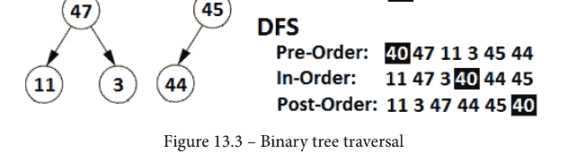

让我们简要概述 BFS 和 DFS 算法。

## Breadth-first Search (BFS) for trees

树的 BFS 也被称为 Level-Order 遍历。主要思想是维护一个节点队列，以确保遍历顺序。初始时，队列中仅包含根节点。算法步骤如下：

- 1. 从队列中弹出第一个节点作为当前节点。
- 2. 访问当前节点。
- 3. 如果当前节点有左节点，则将该左节点入队。
- 4. 如果当前节点有右节点，则将该右节点入队。
- 5. 重复从步骤 1 开始，直到队列为空。

就代码而言，我们有以下内容：

```
private void printLevelOrder(Node node) {
    Queue<Node> queue = new ArrayDeque<>();
    queue.add(node);

    while (!queue.isEmpty()) {
        // Step 1
        Node current = queue.poll();

        // Step 2
        System.out.print(" " + current.element);

        // Step 3
        if (current.left != null) {
            queue.add(current.left);
        }

        // Step 4
        if (current.right != null) {
            queue.add(current.right);
        }
    }
}
```

接下来，让我们关注 DFS。

## Depth-first Search (DFS) for trees

树的 DFS 有三种变体：Pre-Order、In-Order 和 Post-Order。

Pre-Order 遍历在访问其子节点之前先访问当前节点，如下所示（root | left sub-tree | right sub-tree）：

```
private void printPreOrder(Node node) {
    if (node != null) {
        System.out.print(" " + node.element);
        printPreOrder(node.left);
```


```java
    printPreOrder(node.right);
}
```

中序遍历先访问左分支，然后访问当前节点，最后访问右分支，如下所示（左子树 | 根节点 | 右子树）：

```java
private void printInOrder(Node node) {
    if (node != null) {
        printInOrder(node.left);
        System.out.print(" " + node.element);
        printInOrder(node.right);
    }
}
```

后序遍历在其子节点之后访问当前节点，如下所示（左子树 | 右子树 | 根节点）：

```java
private void printPostOrder(Node node) {
    if (node != null) {
        printPostOrder(node.left);
        printPostOrder(node.right);
        System.out.print(" " + node.element);
    }
}
```

完整应用程序名为 BinaryTreeTraversal。除了前面的示例外，完整代码还包含返回 `List` 和 `Iterator` 的 BFS 和 DFS 实现。

## 二叉搜索树

**二叉搜索树**（BST）是一种遵循排序规则的二叉树。通常，在 BST 中，左后代（根节点左侧的所有元素）小于或等于根元素，右后代（根节点右侧的所有元素）大于根元素。然而，这种顺序不仅适用于根元素，还适用于每个节点 *n*。因此，在 BST 中，*n 的左后代* ≤ *n* < *n 的右后代*。在下图中，左侧是二叉树，右侧是 BST：

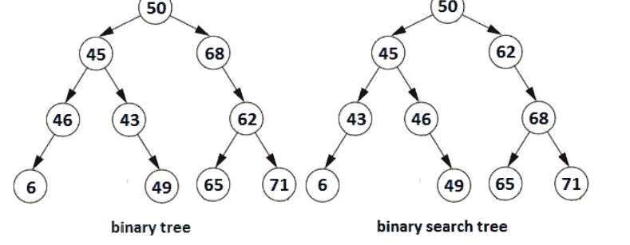

图 13.4 – 二叉树与 BST 对比

通常，BST 不允许重复值，但若允许，重复值可以位于一侧（例如仅在左侧）或两侧。重复值也可以存储在单独的哈希映射中，或者通过计数器直接存储在树结构中。请注意并与面试官确认这些细节。在 BST 中处理重复值是在 Amazon、Flipkart 和 Microsoft 的面试中遇到的问题，因此将在*编码挑战*一节中进行讨论。

在本书附带的代码中，你可以找到一个名为 *BinarySearchTreeTraversal* 的应用程序，它提供了以下方法：`insert(T element)`、`contains(T element)`、`delete(T element)`、`min()`、`max()`、`root()`、`size()` 和 `height()`。此外，它还包含 BFS 和 DFS 的实现，用于打印节点以及将节点作为 `List` 或 `Iterator` 返回。请花时间仔细剖析这些代码。

## 平衡二叉树与不平衡二叉树

当一棵二叉树能在 O(log n) 时间内完成插入和查找操作时，我们可以说这是一棵平衡二叉树，但它不一定尽可能平衡。当树中任意节点的左子树与右子树的高度差不超过 1 时，该树是高度平衡的。在下图中，左侧是一棵不平衡二叉树，中间是一棵平衡但非高度平衡的二叉树，右侧是一棵高度平衡的二叉树：

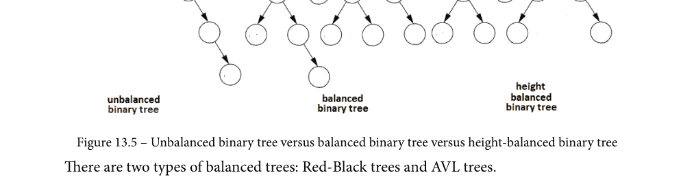

图 13.5 – 不平衡二叉树对比平衡二叉树对比高度平衡二叉树

平衡树有两种类型：红黑树和 AVL 树。

### 红黑树

红黑树是一种自平衡 BST，其中每个节点遵循以下规则：

- 每个节点要么是红色，要么是黑色
- 根节点始终是黑色
- 每个叶节点（NULL）都是黑色
- 红色节点的两个子节点都是黑色
- 从任一节点到 NULL 节点的每条路径都有相同数量的黑色节点

下图表示一棵红黑树：

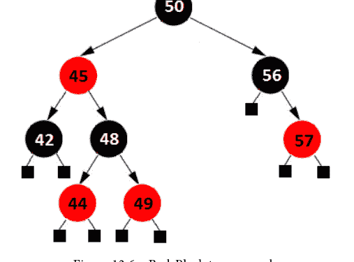

图 13.6 – 红黑树示例

红黑树永远不会严重失衡。如果所有节点都是黑色，那么这棵树就会变成一棵完全平衡的树。当最长路径上的节点交替为黑色和红色时，红黑树达到最大高度。红黑树的高度始终小于或等于 2log₂(n+1)，因此其高度始终在 O(log n) 量级。

由于实现复杂且耗时，涉及红黑树的问题在面试中并不常见。然而，一旦出现，可能会要求你实现插入、删除或查找操作。在本书附带的代码中，你可以找到一个展示这些操作的红黑树实现。请花时间研究代码并熟悉红黑树的概念。该应用程序名为 RedBlackTreeImpl。

更多你可能想查看的实现可以在 github.com/williamfiset/data-structures/blob/master/com/williamfiset/datastructures/balancedtree/RedBlackTree.java 和 algs4.cs.princeton.edu/33balanced/RedBlackBST.java.html 找到。关于图形化可视化，请参考 www.cs.usfca.edu/~galles/visualization/RedBlack.html。

如果你需要深入探讨这个话题，我强烈建议你阅读一本专门讲数据结构的书，因为这是一个相当广泛的主题。

### AVL 树

AVL 树（以其发明者 Adelson-Velsky 和 Landis 的名字命名）是一种自平衡 BST，遵循以下规则：

- 子树的高度最多相差 1。
- 节点 (n) 的平衡因子（BF）为 -1、0 或 1，定义为高度（h）差：BF = h(right_subtree(n)) - h(left_subtree(n)) 或 BF = h(left_subtree(n)) - h(right_subtree(n))。

下图表示一棵 AVL 树：

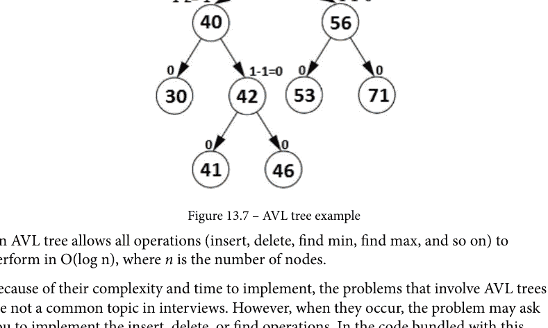

AVL 树允许所有操作（插入、删除、查找最小值、查找最大值等）在 O(log n) 时间内执行，其中 n 是节点数。

由于实现复杂且耗时，涉及 AVL 树的问题在面试中并不常见。然而，一旦出现，可能会要求你实现插入、删除或查找操作。在本书附带的代码中，你可以找到一个展示这些操作的 AVL 树实现。请花时间研究代码并熟悉 AVL 树的概念。该应用程序名为 AVLTreeImpl。

更多你可能想查看的实现可以在 github.com/williamfiset/data-structures/blob/master/com/williamfiset/datastructures/balancedtree/AVLTreeRecursiveOptimized.java 和 algs4.cs.princeton.edu/code/edu/princeton/cs/algs4/AVLTreeST.java.html 找到。关于图形化可视化，请参考 www.cs.usfca.edu/~galles/visualization/AVLtree.html。如果你需要深入探讨这个话题，我强烈建议你阅读一本专门讲数据结构的书，因为这是一个相当广泛的主题。

## 完全二叉树

完全二叉树是一种二叉树，其中除最后一层外，每一层都被完全填满。此外，所有节点都尽可能靠左。在下图中，左侧展示的是一棵非完全二叉树，右侧展示的是一棵完全二叉树：

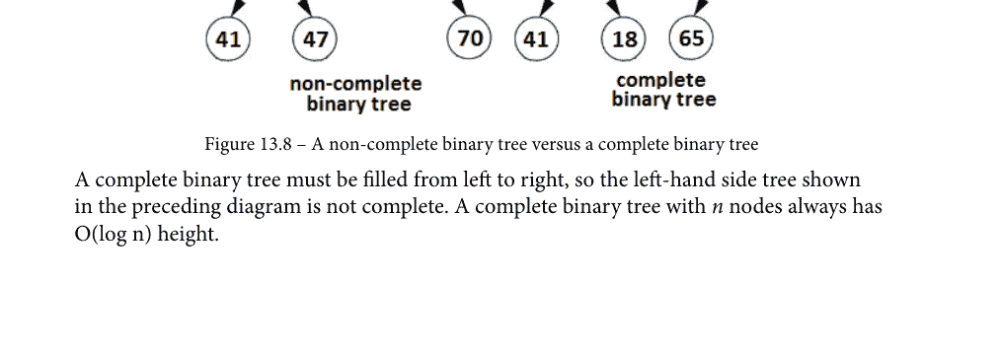

完全二叉树必须从左到右填充，因此上图中左侧的树不是完全二叉树。一棵有 n 个节点的完全二叉树的高度始终为 O(log n)。

## 满二叉树

满二叉树是一种二叉树，其中每个节点要么有两个子节点，要么没有子节点。换句话说，一个节点不能只有一个子节点。在下图中，左侧展示的是一棵非满二叉树，右侧展示的是一棵满二叉树：

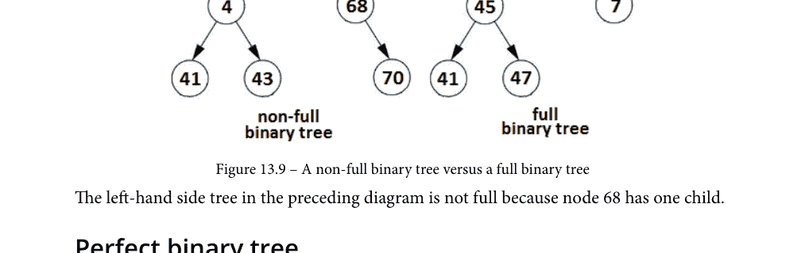

上图中左侧的树不是满二叉树，因为节点 68 只有一个子节点。

## 完美二叉树

完美二叉树既是完全二叉树又是满二叉树。下图展示了这样一棵树：

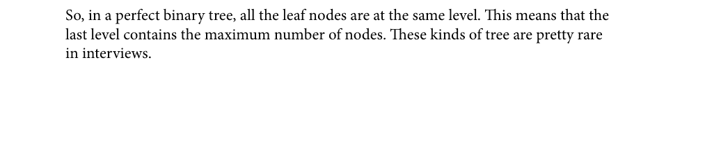

因此，在完美二叉树中，所有叶节点都处于同一层。这意味着最后一层包含最大数量的节点。这类树在面试中相当少见。


**重要说明**
请注意类似这样的问题：*假设你已获得一棵二叉树。编写一段代码来...* 不要对给定的二叉树做任何假设！务必向面试官询问更多细节，例如 *这是一棵平衡树吗？它是一棵满二叉树吗？它是一棵 BST 吗？*。换句话说，不要基于可能不适用于给定二叉树的假设来构建你的解决方案。

现在，让我们更详细地讨论二叉堆。

## 二叉堆

简而言之，二叉堆是一个具有 *堆属性* 的完全二叉树。当元素按升序排列时（堆属性表示每个节点的元素大于或等于其父节点的元素），我们得到一个最小二叉堆（最小元素是根元素），而当它们按降序排列时（堆属性表示每个节点的元素小于或等于其父节点的元素），我们得到一个最大二叉堆（最大元素是根元素）。

下图显示了一棵完全二叉树（左侧）、一个最小二叉堆（中间）和一个最大二叉堆（右侧）：

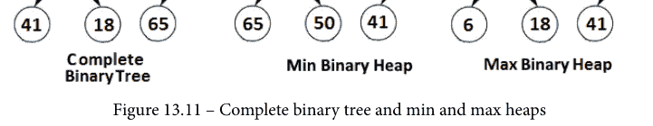

图 13.11 – 完全二叉树以及最小堆和最大堆

二叉堆不是有序的。它是部分有序的。同一层上的节点之间没有任何关系。

二叉堆通常表示为一个数组（我们将其表示为 *heap*），其根位于 *heap[0]*。更重要的是，对于 *heap[i]*，我们有以下关系：

- *heap[(i - 1) / 2]*：返回父节点
- *heap[(2 * i) + 1]*：返回左子节点
- *heap[(2 * i) + 2]*：返回右子节点

从堆中弹出元素也是一个 O(log n) 时间操作。在我们弹出堆的根元素后，我们必须修复堆以使其遵守堆属性。此操作称为堆化向下。堆化向下的算法有三个步骤：

1. 从堆的根作为当前节点开始。
2. 确定当前节点子节点之间的最大节点。
3. 如果当前节点小于其最大的子节点，则交换这两个节点并从步骤 2 重复；否则，没有其他事情可做，停止。

最后，窥视是一个 O(1) 操作，返回堆的根元素。

在本書附帶的代碼中，你可以找到一個名為 MaxHeap 的應用程序，它公開了以下一組方法：add (T element)、peek () 和 poll ()。

**重要说明**

树的一种特殊情况被称为 Trie。也称为数字树或前缀树，Trie 是一种有序树结构，常用于存储字符串。它的名字来源于 Trie 是一种检索数据结构。它的性能优于二叉树。Trie 在我的书《Java Coding Problems》(https://www.packtpub.com/programming/java-coding-problems) 中有详细说明，旁边还有其他数据结构，如元组、 disjoint-set、二叉索引树（Fenwick 树）和布隆过滤器。

## 图概览

图是一种用于表示可以由边连接的节点集合的数据结构。例如，图可用于表示社交媒体平台上的成员网络，因此它是表示现实生活连接的绝佳数据结构。换句话说，树（如上一节所述）是一种特殊的图。在图术语中，没有环的图称为无环图。

- 顶点表示信息（例如，成员、狗或值）
- 边是两个顶点之间的连接或关系

连接可以是单向的（如二叉树的情况）或双向的。当连接是双向的（如双向街道）时，图称为无向图，它具有无向边。当连接是单向的（如单向街道）时，图称为有向图，它具有有向边。

图的边可以携带称为权重的信息（例如，道路的长度）。在这种情况下，图称为加权图。当图具有指向同一顶点的单条边时，它称为自环图。下图提供了每种图类型的表示：

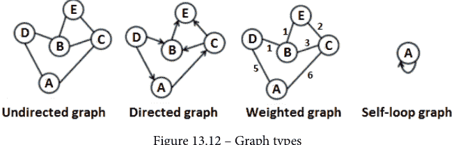

图 13.12 – 图类型

与二叉树不同，通过节点链接表示图并不实用。在计算机中，图通常通过邻接矩阵或邻接表表示。让我们先处理前者；即邻接矩阵。

## 邻接矩阵

邻接矩阵由一个布尔二维数组（或仅包含 0 和 1 的整数二维数组）表示，其大小为 n x n，其中 n 为顶点数。如果我们将这个二维数组表示为 matrix，则 matrix[i][j] 为 true（或 1）如果顶点 i 到顶点 j 存在一条边；否则为 false（或 0）。下图显示了一个无向图的邻接矩阵示例：

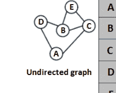

|   | A | B | C | D | E |
|---|---|---|---|---|---|
| A | 0 | 0 | 1 | 1 | 0 |
| B | 0 | 0 | 1 | 1 | 1 |
| C | 1 | 1 | 0 | 0 | 1 |
| D | 1 | 1 | 0 | 0 | 0 |
| E | 0 | 1 | 1 | 0 | 0 |

图 13.13 – 一个无向图的邻接矩阵

为了节省空间，也可以采用位矩阵。

在加权图的情况下，邻接矩阵可以存储边的权重，而 0 可用于表示边的缺失。

基于邻接矩阵实现图可以如下进行（我们只需要顶点列表，因为边作为邻接矩阵传递给必须遍历图的每个方法）：

```
public class Graph<T> {
	// the vertices list
	private final List<T> elements;
	public Graph() {
		this.elements = new ArrayList<>();
	}
	// operations
}
```

另一种在计算机中表示图的方法是邻接表。

## 邻接表

邻接表是一个数组的列表，其大小等于图中的顶点数。每个顶点都存储在这个数组中，并且它存储一个相邻顶点的列表。换句话说，数组中索引 i 处的列表包含数组中索引 i 处存储的顶点的相邻顶点。下图显示了一个无向图的邻接表示例：

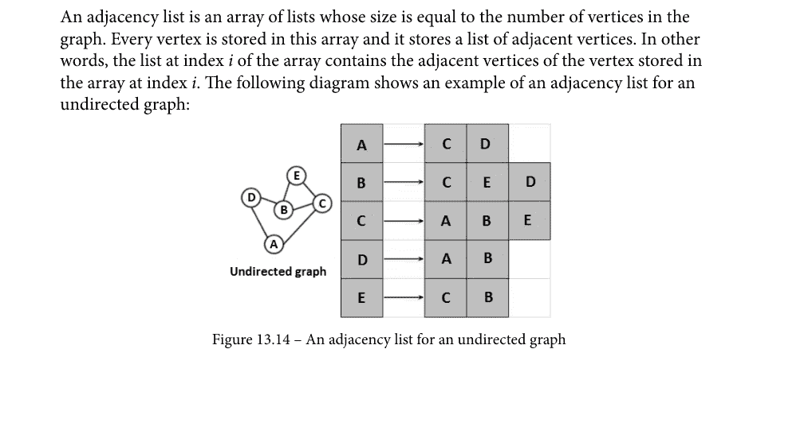

基于邻接表实现图可以如下进行（这里，我们使用 Map 来实现邻接表）：

```
public class Graph<T> {

    // the adjacency list is represented as a map
    private final Map<T, List<T>> adjacencyList;

    public Graph() {
        this.adjacencyList = new HashMap<>();
    }

    // operations
}
```

接下来，让我们简要介绍图的遍历。

## 图遍历

遍历图最常见的两种方式是通过深度优先搜索（DFS）和广度优先搜索（BFS）。让我们分别回顾一下。BFS 主要用于图。

对于图，我们必须考虑图可能存在环。普通的 BFS 实现（如你在二叉树情况下看到的）不考虑环，因此在遍历 BFS 队列时我们可能会陷入无限循环。消除这种风险可以通过一个额外的集合来实现，该集合保存已访问的节点。该算法的步骤如下：

1. 将起始节点（当前节点）标记为已访问（将其添加到已访问节点集合中）并将其添加到 BFS 队列中。
2. 从队列中弹出当前节点。
3. 访问当前节点。
4. 获取当前节点的相邻节点。

```
while (!queue.isEmpty()) {
T element = queue.poll();
List<T> adjacents = adjacencyList.get(element);
if (adjacents != null) {
for (T t : adjacents) {
if (t != null && !visited.contains(t)) {
visited.add(t);
queue.add(t);
// we reached the destination (the 'to' node)
if (t.equals(to)) {
return true;
}
}
}
}
return false;
}
```

完整的应用程序称为 DirectedGraphPath。

## 编程挑战 2 – 有序数组到最小 BST

Amazon, Google

问题：假设你已获得一个按升序排序的整数数组。编写一段代码，从该数组创建最小 BST。我们将最小 BST 定义为高度最小的 BST。


**Solution:** 将给定的数组视为 {-2, 3, 4, 6, 7, 8, 12, 23, 90}。从该数组可以创建的最小 BST 如下所示：

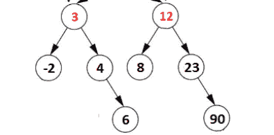

Figure 13.16 – Sorted array to minimal BST

为了获得高度最小的 BST，我们必须努力在左子树和右子树中分配相等数量的节点。牢记这一点，注意到我们可以选择排序后数组的中间作为根。中间左侧数组中的元素小于中间，因此它们可以形成左子树。中间右侧数组中的元素大于中间，因此它们可以形成右子树。

因此，我们可以选择 7 作为树的根。接下来，-2、3、4 和 6 应该形成左子树，而 8、12、23 和 90 应该形成右子树。然而，我们知道不能简单地将这些元素添加到左子树或右子树，因为我们必须遵守 BST 属性：在 BST 中，对于每个节点 n，n 的左后代 ≤ n < n 的右后代。

然而，我们可以简单地遵循相同的技术。如果我们将 -2、3、4 和 6 视为一个数组，则其中间是 3，如果我们将 8、12、23 和 90 视为一个数组，则其中间是 12。因此，3 是包含 -2 的左子子树的根，右子子树是包含 4 和 6 的那个。类似地，12 是包含 8 的左子子树的根，右子子树是包含 23 和 90 的那个。

好吧，我认为我们有足够的经验可以直觉地认为相同的技术可以一直应用，直到我们处理完所有子数组。此外，很直观地认为该解决方案可以通过递归来实现（如果你不认为递归是你的顶级技能之一，请复习第 8 章，递归和动态规划）。因此，我们可以以四步恢复我们的算法：

- 1. 将数组的中间元素插入树中。
- 2. 将左子数组的元素插入左子树中。
- 3. 将右子数组的元素插入右子树中。
- 4. 触发递归调用。

以下实现将这些步骤放入代码中：

```java
public void minimalBst(T m[]) {
    root = minimalBst(m, 0, m.length - 1);
}
```

```java
private Node minimalBst(T m[], int start, int end) {
    if (end < start) {
        return null;
    }
    int middle = (start + end) / 2;
    Node node = new Node(m[middle]);
    nodeCount++;
    node.left = minimalBst(m, start, middle - 1);
    node.right = minimalBst(m, middle + 1, end);
    return node;
}
```

完整的应用程序称为 SortedArrayToMinBinarySearchTree。

## Coding challenge 3 – List per level

**Problem:** 假设你已获得一棵二叉树。编写一段代码，为树的每个层级创建元素列表（例如，如果树有深度 d，则你将有 d 个列表）。

**Solution:** 让我们考虑以下图表中所示的二叉树：

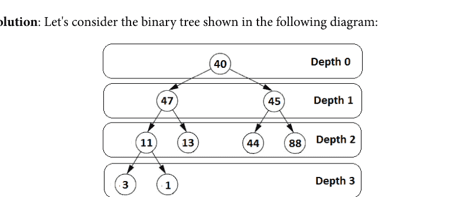

因此，我们有一棵深度为 3 的二叉树。在深度 0，我们有根 40。在深度 1，我们有 47 和 45。在深度 2，我们有 11、13、44 和 88。最后，在深度 3，我们有 3 和 1。

很直观地思考如下：如果我们按层级遍历二叉树，那么我们可以为每个层级创建元素列表。换句话说，我们可以以这样的方式调整 BFS 算法（也称为 Level-Order 遍历），即在遍历每个层级时捕获该层级的元素。更精确地说，我们首先遍历根（并创建包含该元素的列表），然后继续遍历第 1 层（并创建包含该层元素的列表），以此类推。

当我们到达第 i 层时，我们已经完全访问了前一层 i-1 的所有节点。这意味着为了获取第 i 层的元素，我们必须遍历前一层 i-1 的节点的所有子节点。以下解决方案运行时间为 O(n)：

```java
public List<List<T>> fetchAllLevels() {
    // each list holds a level
    List<List<T>> allLevels = new ArrayList<>();
    // first level (containing only the root)
    Queue<Node> currentLevelOfNodes = new ArrayDeque<>();
    List<T> currentLevelOfElements = new ArrayList<>();
    currentLevelOfNodes.add(root);
    currentLevelOfElements.add(root.element);
    // and so on.
    while (!currentLevelOfNodes.isEmpty()) {
        // store the current level as the previous level
        Queue<Node> previousLevelOfNodes = currentLevelOfNodes;
        // add level to the final list
        allLevels.add(currentLevelOfElements);
        // go to the next level as the current level
        currentLevelOfNodes = new ArrayDeque<>();
        currentLevelOfElements = new ArrayList<>();
        // traverse all nodes on current level
        for (Node parent : previousLevelOfNodes) {
            if (parent.left != null) {
                currentLevelOfNodes.add(parent.left);
                currentLevelOfElements.add(parent.left.element);
            }
            if (parent.right != null) {
                currentLevelOfNodes.add(parent.right);
                currentLevelOfElements.add(parent.right.element);
            }
        }
    }
    return allLevels;
}
```

完整的应用程序称为 ListPerBinaryTreeLevel。

## Coding challenge 4 – sub-tree

Adobe, Microsoft, Flipkart

**Problem:** 假设你已获得两棵二叉树 p 和 q。编写一段代码，如果 q 是 p 的子树则返回 true。

**Solution:** 考虑以下图表：

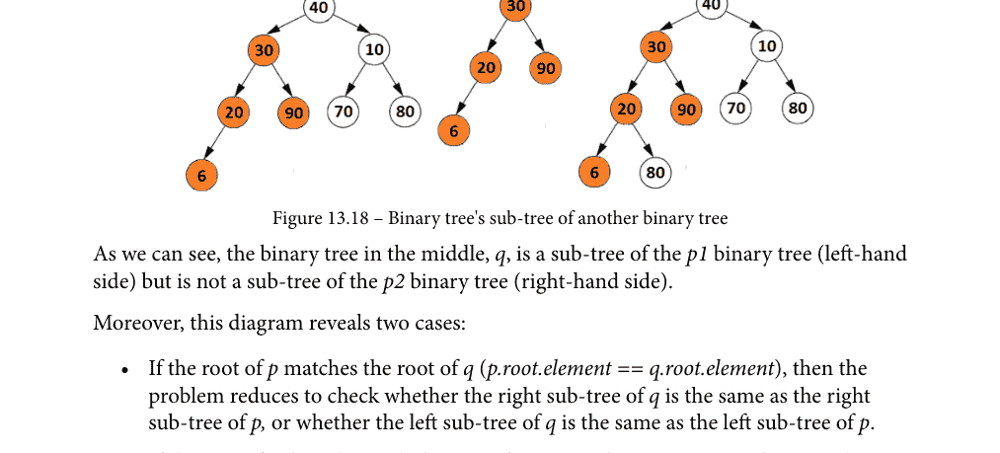

正如我们所见，中间的二叉树 q 是左侧 p1 二叉树的子树，但不是右侧 p2 二叉树的子树。

此外，该图表揭示了两种情况：

- 如果 p 的根与 q 的根匹配（p.root.element == q.root.element），则问题简化为检查 q 的右子树是否与 p 的右子树相同，或者 q 的左子树是否与 p 的左子树相同。
- 如果 p 的根与 q 的根不匹配（p.root.element != q.root.element），则问题简化为检查 p 的左子树是否与 q 相同，或者 p 的右子树是否与 q 相同。

为了实现第一个要点，我们需要两个方法。为了更好地理解为什么我们需要两个方法，请查看以下图表：


如果 p 和 q 的根匹配但左/右子树中的某些节点不匹配，则我们必须回到我们开始的 p 和 q 的位置，以检查 q 是否是 p 的子树。第一个方法应该在它们的根相同后检查树是否相同。第二个方法应该处理树不相同但从某个节点开始的情况。请注意这一点，因为许多候选人没有考虑到这一点。

因此，就代码而言，我们有以下内容（对于 n 个节点，这运行时间为 O(n)）：

```java
public boolean isSubtree(BinaryTree q) {
    return isSubtree(root, q.root);
}

private boolean isSubtree(Node p, Node q) {
    if (p == null) {
        return false;
    }

    // if the roots don't match
    if (!match(p, q)) {
        return (isSubtree(p.left, q) || isSubtree(p.right, q));
    }

    return true;
}

private boolean match(Node p, Node q) {
    if (p == null && q == null) {
        return true;
    }

    if (p == null || q == null) {
        return false;
    }

    return (p.element == q.element
        && match(p.left, q.left)
        && match(p.right, q.right));
}
```

应用程序称为 BinaryTreeSubtree。

## Coding challenge 5 – Landing reservation system

Amazon, Adobe, Microsoft

**Problem:** 假设有一个只有一个跑道的机场。该机场接收来自不同飞机的着陆请求。着陆请求包含着陆时间（例如，9:56）和完成程序所需的时间（以分钟为单位，例如 5 分钟）。我们将其表示为 9:56 (5)。编写一段代码，使用 BST 设计此预订系统。由于只有一个跑道，代码应拒绝任何与现有请求重叠的着陆请求。请求的顺序决定了预订的顺序。

**Solution:** 让我们考虑我们着陆时间线的某个时间快照（着陆请求的顺序为 10:10 (3)、10:14 (3)、9:55 (2)、10:18 (1)、9:58 (5)、9:47 (2)、9:41 (2)、10:22 (1)、9:50 (6) 和 10:04 (4)。这可以在以下图表中看到。

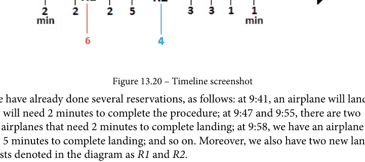

因此，我们已经完成了以下预订：在 9:41，一架飞机将着陆，完成程序需要 2 分钟；在 9:47 和 9:55，有另外两架飞机需要 2 分钟完成着陆；在 9:58，我们有一架飞机需要 5 分钟完成着陆；等等。此外，我们还有两个新的着陆请求，在图表中表示为 R1 和 R2。

请注意，我们不能批准 R1 着陆请求。着陆时间是 9:50，需要 6 分钟完成，因此在 9:56 结束。然而，在 9:56，我们已经有来自 9:55 的飞机在跑道上。由于我们只有一个跑道，我们拒绝此着陆请求。我们将此类情况视为重叠。


另一方面，我们批准了 R2 的降落请求。请求时间为 10:04，完成需要 4 分钟，因此在 10:08 结束。在 10:08 时，跑道上没有其他飞机，因为下一次降落是在 10:10。

请注意，我们必须使用 BST 来解决这个问题，但使用数组（排序或未排序）或链表（排序或未排序）也是一种有效的方法。使用未排序的数组（或链表）插入降落请求需要 O(1) 时间，检查潜在重叠需要 O(n) 时间。如果我们使用排序的数组（或链表）和二分搜索算法，那么我们可以以 O(log n) 检查潜在重叠。然而，要插入降落请求，我们需要 O(n)，因为我们必须将插入位置起的所有元素向右移动。

使用 BST 怎么样？首先，让我们将前面的时间线截图表示为 BST。查看下面的图表（降落请求的顺序为 10:10 (3)、10:14 (3)、9:55 (2)、10:18 (1)、9:58 (5)、9:47 (2)、9:41 (2)、10:22 (1)、9:50 (6) 和 10:04 (4)）：

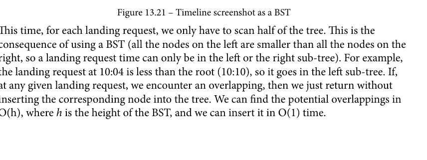

这次，对于每个降落请求，我们只需要扫描树的一半。这就是使用 BST 的结果（左边的节点都小于右边的节点，所以降落请求时间只能在左子树或右子树中）。例如，10:04 的降落请求小于根节点（10:10），所以它进入左子树。如果在任何给定的降落请求时，我们遇到重叠，那么我们就直接返回而不将对应节点插入树中。我们可以在 O(h) 时间内找到潜在的重叠，其中 h 是 BST 的高度，并且可以在 O(1) 时间内插入它。

重叠由以下简单计算给出（我们使用的是 Java 8 Date-Time API，但你也可以将其简化为简单的整数——如果你不熟悉 Java 8 Date-Time API，那么我强烈建议你购买我的书，*Java Coding Problems*，由 Packt 出版（https://www.packtpub.com/programming/java-coding-problems）。这本书有一章关于这个主题的精彩内容，是任何候选人必读的：

```
long t1 = Duration.between(current.element.
    plusMinutes(current.time), element).toMinutes();

long t2 = Duration.between(current.element,
    element.plusMinutes(time)).toMinutes();

if (t1 <= 0 && t2 >= 0) {
    // overlapping found
}
```

因此，在 *t1* 中，我们计算当前节点的（*降落时间 + 完成所需时间*）与当前请求的 *降落时间* 之间的时间。在 *t2* 中，我们计算当前节点的 *降落时间* 与（*当前请求降落时间 + 完成所需时间*）之间的时间。如果 *t1* 小于或等于 *t2*，那么我们就找到了重叠，因此拒绝当前降落请求。让我们看看完整的代码：

```
public class BinarySearchTree<Temporal> {

    private Node root = null;

    private class Node {

        private Node left;
        private Node right;

        private final LocalTime element;
        private final int time;

        public Node(LocalTime element, int time) {
            this.time = time;
            this.element = element;
```

```
this.left = null;
this.right = null;
}

public Node(Node left, Node right,
    LocalTime element, int time) {
    this.time = time;
    this.element = element;
    this.left = left;
    this.right = right;
}
}

public void insert(LocalTime element, int time) {
    if (element == null) {
        throw new IllegalArgumentException("...");
    }

    root = insert(root, element, time);
}

private Node insert(Node current,
    LocalTime element, int time) {
    if (current == null) {
        return new Node(element, time);
    }

    long t1 = Duration.between(current.element.
        plusMinutes(current.time), element).toMinutes();
    long t2 = Duration.between(current.element,
        element.plusMinutes(time)).toMinutes();

    if (t1 <= 0 && t2 >= 0) {
    System.out.println("Cannot reserve the runway at "
```

```
+ element + " for " + time + " minutes !");

    return current;
}

    if (element.compareTo(current.element) < 0) {
        current.left = insert(current.left, element, time);
    } else {
        current.right = insert(current.right, element, time);
    }

    return current;
}

public void printInOrder() {
    printInOrder(root);
}

private void printInOrder(Node node) {
    if (node != null) {
        printInOrder(node.left);
        System.out.print(" " + node.element
            + "(" + node.time + ")");
        printInOrder(node.right);
    }
}
}
```

请注意，我们可以通过使用 BST 的中序遍历轻松打印时间线。完整的应用程序称为 BinaryTreeLandingReservation。

## 编程挑战 6 – 平衡二叉树

Amazon, Microsoft

**问题：** 假设你得到了一棵二叉树。我们认为它在任意节点的两个子树的高度相差不超过一时是平衡的（这就是我们所说的高度平衡二叉树）。编写一段代码，如果二叉树是平衡的则返回 `true`。

**解决方案：** 因此，为了拥有一棵平衡二叉树，对于每个节点，两个子树的高度不能相差超过一。符合这一陈述，右侧的图像代表一棵平衡二叉树，而左侧的图像代表一棵不平衡二叉树：

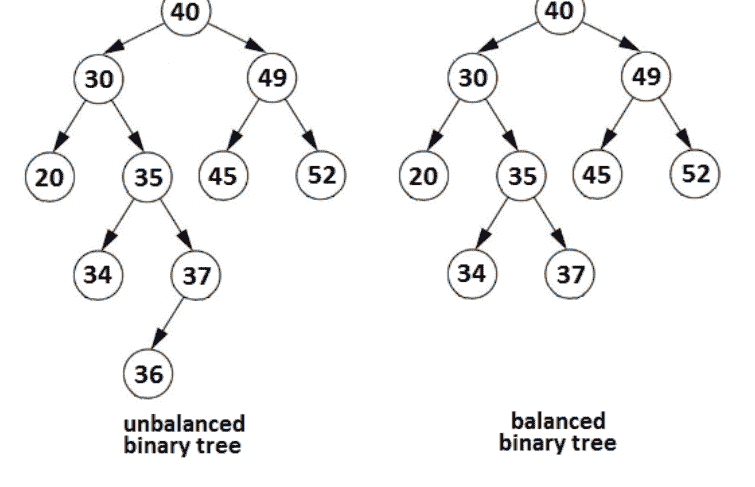

图 13.22 – 不平衡和平衡二叉树

左侧的二叉树是不平衡的，因为节点 40（根）和 30 对应的左子树与右子树的高度差大于一（例如，left-height(40) = 4 而 right-height(40) = 2）。

右侧的二叉树是平衡的，因为对于每个节点，左子树高度与右子树高度之差不超过一。

基于此示例，我们可以推断出一个简单的解决方案由递归算法组成。我们可以遍历每个节点并计算左右子树的高度。如果这些高度之差大于一，则返回 false。就代码而言，这相当直接：

```
public boolean isBalanced() {
    return isBalanced(root);
}

private boolean isBalanced(Node root) {
    if (root == null) {
        return true;
    }

    if (Math.abs(height(root.left) - height(root.right)) > 1) {
        return false;
    } else {
        return isBalanced(root.left) && isBalanced(root.right);
    }
}

private int height(Node root) {
    if (root == null) {
        return 0;
    }

    return Math.max(height(root.left), height(root.right)) + 1;
}
```

这种方法在 O(n log n) 时间内执行，因为在每个节点上，我们通过其整个子树应用递归。因此，问题在于 height () 调用的次数。此时，height () 方法只计算高度。但它可以改进为同时检查树是否平衡。我们需要做的就是通过错误代码发出不平衡子树的信号。另一方面，对于平衡树，我们返回相应的高度。代替错误代码，我们可以使用 Integer.MIN_VALUE，如下所示：

```
public boolean isBalanced() {
	return checkHeight(root) != Integer.MIN_VALUE;
}

private int checkHeight(Node root) {
	if (root == null) {
		return 0;
	}
	int leftHeight = checkHeight(root.left);
	if (leftHeight == Integer.MIN_VALUE) {
		return Integer.MIN_VALUE; // error
	}
	int rightHeight = checkHeight(root.right);
	if (rightHeight == Integer.MIN_VALUE) {
		return Integer.MIN_VALUE; // error
	}
	if (Math.abs(leftHeight - rightHeight) > 1) {
		return Integer.MIN_VALUE; // pass error back
	} else {
		return Math.max(leftHeight, rightHeight) + 1;
	}
}
```

此代码在 O(n) 时间和 O(h) 空间内运行，其中 h 是树的高度。应用程序称为 BinaryTreeBalanced。


## 编程挑战 7 – 二叉树是 BST

Amazon, Google, Adobe, Microsoft, Flipkart

问题：假设你得到了一棵可能包含重复元素的二叉树。编写一段代码片段，如果这棵树是二叉搜索树（BST），则返回 true。

解决方案：从一开始，我们就注意到问题明确提到给定的二叉树可能包含重复元素。为什么这很重要？因为如果二叉树不允许重复，那么我们就可以依赖简单的中序遍历和一个数组。如果我们将每个遍历的元素添加到数组中，那么只有当二叉树是 BST 时，结果数组才会是有序的。让我们通过以下图表来澄清这一点：

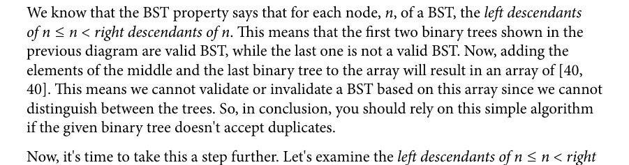

我们知道 BST 属性说对于 BST 的每个节点 n，n 的左后代 ≤ n < n 的右后代。这意味着前面图表中显示的前两棵二叉树是有效的 BST，而最后一棵不是有效的 BST。现在，将中间和最后一棵二叉树的元素添加到数组中会得到数组 [40, 40]。这意味着我们无法根据此数组验证或否定 BST，因为我们无法区分这些树。因此，总之，如果给定的二叉树不接受重复，你应该依赖这个简单算法。

现在，是时候更进一步了。让我们检查以下二叉树中显示的左后代 n ≤ n < 右后代 n 语句：


看这个！对于每个节点 n，我们可以写出 n.left ≤ n < n.right，但很明显 55 在错误的位置。所以，让我们重申当前节点的所有左节点应小于或等于当前节点，而当前节点必须小于所有右节点。

换句话说，仅验证当前节点的左右节点是不够的。我们必须验证每个节点相对于一个范围。更准确地说，左子树或右子树的所有节点都应相对于由最小接受元素分别最大接受元素界定的范围进行验证（min, max）。让我们考虑以下树：

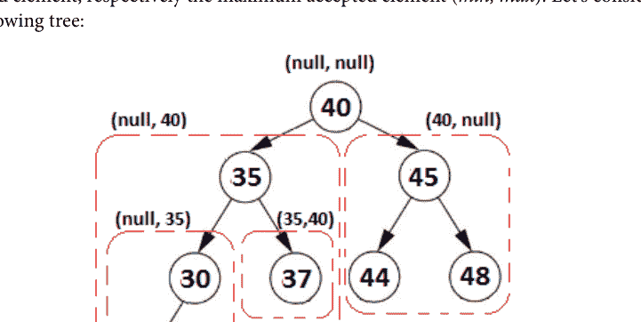

我们从根节点（40）开始，并考虑（min=null, max=null），因此 40 满足条件，因为没有最小或最大限制。接下来，我们进入左子树（我们将此子树表示为 40-left-sub-tree）。40-left-sub-tree 的所有节点应介于（null, 40）之间。接下来，我们再次向左移动，并遇到 35-left-sub-tree，它应介于（null, 35）之间。基本上，我们继续向左移动，直到没有节点为止。此时，我们开始向右移动，因此 35-right-sub-tree 应介于（35, 40）之间，40-right-sub-tree 应介于（40, null）之间，以此类推。因此，当我们向左移动时，最大值会更新。当我们向右移动时，最小值会更新。如果出现任何问题，则停止并返回 false。让我们看看基于此算法的代码：

```
public boolean isBinarySearchTree() {
	return isBinarySearchTree(root, null, null);
}
```

```
}

private boolean isBinarySearchTree(Node node,
    T minElement, T maxElement) {

    if (node == null) {
        return true;
    }

    if ((minElement != null &&
        node.element.compareTo(minElement) <= 0)
        || (maxElement != null && node.element.
            compareTo(maxElement) > 0)) {
        return false;
    }

    if (!isBinarySearchTree(node.left, minElement, node.element)
        || !isBinarySearchTree(node.right,
            node.element, maxElement)) {
        return false;
    }

    return true;
}
```

完整的应用程序称为 *BinaryTreeIsBST*。

## 编程挑战 8 – 后继节点

Google, Microsoft

**问题：** 假设你得到了一棵**二叉搜索树（BST）**和该树中的一个节点。编写一段代码片段，打印该节点在中序遍历上下文中的后继节点。

解决方案：那么，让我们回顾一下二叉树的中序遍历。这种深度优先搜索（DFS）风格会遍历左子树，然后是当前节点，然后是右子树。现在，假设我们从 BST 中任意选择一个节点（我们将其表示为 n），并且我们想找到它在中序遍历上下文中的后继节点（我们将其表示为 s）。

让我们考虑以下图表作为给定的 BST。我们可以用它作为区分可能情况的支持：

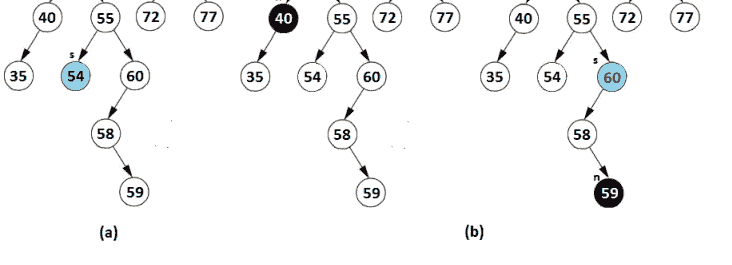

图 13.26 – 带有起始节点和后继节点的 BST 示例

如前图所示，我们将两种主要情况表示为（a）和（b）。在情况（a）中，节点 n 具有右子树。在情况（b）中，节点 n 不包含右子树。

情况（a），在左侧 BST 中举例说明，揭示了如果节点 n 具有右子树，则后继节点 s 是该右子树的左most 节点。例如，对于 n=50，后继节点是 54。

情况（b）有两个子情况：简单情况和棘手情况。简单情况由前图所示的中间 BST 举例说明。当节点 n 不包含右子树并且 n 是其父节点的左子节点时，则后继节点是该父节点。例如，对于 n=40，后继节点是 50。这是（b）的简单子情况。

情况（b）的棘手子情况由前图所示的右侧 BST 举例说明。当节点 n 不包含右子树并且 n 是其父节点的右子节点时，我们必须向上遍历，直到 n 成为其父节点的左子节点。一旦完成，我们返回该父节点。例如，如果 n=59，则后继节点是 60。

此外，我们必须考虑如果 n 是遍历中的最后一个节点，则我们返回根的父节点，它可以为 null。

如果我们将这些情况粘合起来形成一些伪代码，则得到以下内容：

```
Node inOrderSuccessor(Node n) {
    if (n has a right sub-tree) {
        return the leftmost child of right sub-tree
    }

    while (n is a right child of n.parent) {
        n = n.parent; // traverse upwards
    }

    return n.parent; // parent has not been traversed
}
```

现在，我们可以将此伪代码翻译成代码，如下所示：

```
public void inOrderSuccessor() {

    // choose the node
    Node node = ...;

    System.out.println("\n\nIn-Order:");
    System.out.print("Start node: " + node.element);
    node = inOrderSuccessor(node);
    System.out.print(" Successor node: " + node.element);
}

private Node inOrderSuccessor(Node node) {

    if (node == null) {
        return null;
    }

    // case (a)
    if (node.right != null) {
        return findLeftmostNode(node.right);
    }
}
```

```
// case (b)
while (node.parent != null && node.parent.right == node) {
    node = node.parent;
}

return node.parent;
}
```

完整的应用程序称为 BinarySearchTreeSuccessor。该应用程序还包含相同的问题，但通过前序和后序遍历解决。在检查前序和后序上下文的解决方案之前，你应该通过识别可能的情况并绘制伪代码及其实现来挑战自己。

## 编程挑战 9 – 拓扑排序

Amazon, Google, Adobe, Microsoft, Flipkart

问题：假设你得到了一张有向无环图（DAG）；即，一张没有环的有向图。编写一段代码片段，返回顶点的线性排序，使得对于每条有向边 XY，顶点 X 在排序中出现在 Y 之前。换句话说，对于每条边，源节点在目标节点之前。这也称为拓扑排序，并且仅适用于 DAG。

解决方案：让我们通过以下 DAG 深入研究这个问题：

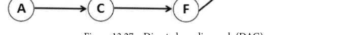

图 13.27 – 有向无环图（DAG）


这里，我们可以看到给定的节点可能位于不同的子树（左树和右树）中，也可能位于同一子树（中间树）中。因此，我们可以从根开始遍历树，使用类型为 `commonAncestor(Node root, Node n1, Node n2)` 的方法并按如下方式返回它（*n1* 和 *n2* 是两个给定的节点）：

- 如果根的子树包含 *n1*（且不包含 *n2*），则返回 *n1*
- 如果根的子树包含 *n2*（且不包含 *n1*），则返回 *n2*
- 如果根的子树中既不包含 *n1* 也不包含 *n2*，则返回 `null`
- 否则，返回 *n1* 和 *n2* 的最近公共祖先。

当 `commonAncestor(n.left, n1, n2)` 和 `commonAncestor(n.right, n1, n2)` 返回非空值时，这意味着 *n1* 和 *n2* 位于不同的子树中，且 *n* 是最近公共祖先。让我们通过代码来看这一点：

```
```java
public T commonAncestor(T e1, T e2) {

    Node n1 = findNode(e1, root);
    Node n2 = findNode(e2, root);


    if (n1 == null || n2 == null) {
        throw new IllegalArgumentException("Both nodes
                must be present in the tree");
    }

    return commonAncestor(root, n1, n2).element;
}

private Node commonAncestor(Node root, Node n1, Node n2) {

    if (root == null) {
        return null;
    }


    if (root == n1 && root == n2) {
        return root;
    }
```
```

```
Node left = commonAncestor(root.left, n1, n2);
if (left != null && left != n1 && left != n2) {
    return left;
}

Node right = commonAncestor(root.right, n1, n2);
if (right != null && right != n1 && right != n2) {
    return right;
}

// n1 and n2 are not in the same sub-tree
if (left != null && right != null) {
    return root;
} else if (root == n1 || root == n2) {
    return root;
} else {
    return left == null ? right : left;
}
}
```

完整的应用程序称为 *BinaryTreeCommonAncestor.*

## 编程挑战 11 – 国际象棋骑士

Amazon, Microsoft, Flipkart

**问题：** 假设你有一个国际象棋棋盘和一个骑士。最初，骑士被放置在一个格子（起始格子）中。编写一段代码来计算将骑士从起始格子移动到给定目标格子所需的最小移动次数。

**解决方案：** 让我们考虑一个例子。国际象棋棋盘大小为 8x8，骑士从格子 (1, 8) 开始。目标格子是 (8, 1)。如下图所示，骑士需要最少 6 次移动才能从格子 (1, 8) 到达格子 (8, 1)：

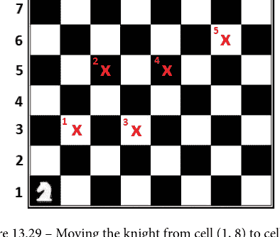

图 13.29 – 将骑士从格子 (1, 8) 移动到格子 (8, 1)

如该图像所示，骑士可以从一个 (r, c) 格子移动到另外八个有效格子，如下所示：(r+2, c+1)、(r+1, c+2)、(r-1,c+2)、(r-2, c+1)、(r-2, c-1)、(r-1, c-2)、(r+1, c-2) 和 (r+2, c-1)。因此，有八种可能的移动。如果我们将这些可能的移动视为方向（边），将格子视为顶点，那么我们可以在图论的上下文中可视化这个问题。边是可能的移动，而顶点是骑士可能的格子。每一步移动都保存了从当前格子到起始格子的距离。对于每次移动，距离增加 1。因此，在图的上下文中，该问题简化为寻找图中的最短路径。因此，我们可以使用 BFS 来解决这个问题。

该算法的步骤如下：

- 1. 创建一个空队列。
- 2. 将起始格子入队，使其与自身的距离为 0。
- 3. 只要队列不为空，就执行以下操作：
  - a. 从队列中弹出下一个未访问的格子。
  - b. 如果弹出的格子是目标格子，则返回其距离。
  - c. 如果弹出的格子不是目标格子，则将该格子标记为已访问，并将八个可能的移动分别入队，距离增加 1。

## 编程挑战 513

由于我们依赖 BFS 算法，我们知道所有最短路径为 1 的格子会先被访问。接下来，被访问的格子是其最短路径为 1+1=2 的相邻格子，以此类推；因此任何格子的最短路径等于其父节点的最短路径 + 1。这意味着当我们第一次遍历目标格子时，它就给出了最终结果。这是最短路径。让我们看一下代码：

```
private int countknightMoves(Node startCell,
Node targetCell, int n) {
	// store the visited cells
	Set<Node> visited = new HashSet<>();
	// create a queue and enqueue the start cell
	Queue<Node> queue = new ArrayDeque<>();
	queue.add(startCell);
	while (!queue.isEmpty()) {
		Node cell = queue.poll();
		int r = cell.r;
		int c = cell.c;
		int distance = cell.distance;
		// if destination is reached, return the distance
		if (r == targetCell.r && c == targetCell.c) {
			return distance;
		}
		// the cell was not visited
		if (!visited.contains(cell)) {
			// mark current cell as visited
			visited.add(cell);
			// enqueue each valid movement into the queue
			for (int i = 0; i < 8; ++i) {
```

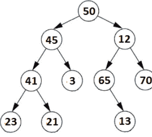

因此，主要思想是打印每一层的最左和最右节点。这意味着层序遍历（BFS）是有用的，因为我们可以遍历每一层。我们要做的就是识别每一层上的第一个和最后一个节点。为此，我们需要通过添加一个条件来调整经典的层序遍历，该条件用于确定当前节点是否代表一个角落。代码不言自明：

```
```java
public void printCorners() {

    if (root == null) {
        return;
    }

    Queue<Node> queue = new ArrayDeque<>();
    queue.add(root);

    int level = 0;
    while (!queue.isEmpty()) {

        // get the size of the current level
        int size = queue.size();
        int position = size;

        System.out.print("Level: " + level + ": ");
        level++;

        // process all nodes present in current level
        while (position > 0) {
```
```

```
```java
Node node = queue.poll();
position--;

// if corner node found, print it
if (position == (size - 1) || position == 0) {
    System.out.print(node.element + " ");
}

// enqueue left and right child of current node
if (node.left != null) {
    queue.add(node.left);
}

if (node.right != null) {
    queue.add(node.right);
}
}

// level done
System.out.println();
}
}
```
```

该应用程序称为 *BinaryTreePrintCorners*.

## 编程挑战 13 – 最大路径和

**Amazon, Google, Adobe, Microsoft, Flipkart**

**问题：** 假设你有一个非空二叉树。编写一段代码来计算最大路径和。路径被认为是树中从任意节点开始并在任意节点结束的节点序列，沿着父子连接。路径必须至少包含一个节点，并且可能不经过树的根。

**解决方案：** 下图显示了三个最大路径和的例子：

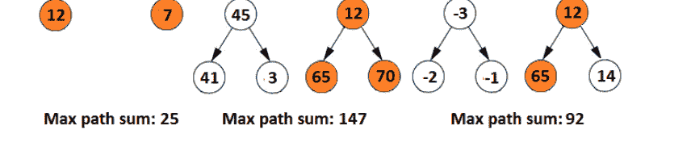

图 13.31 – 三个最大路径和的例子

解决这个问题需要我们识别当前节点可以成为最大路径的一部分的方式。通过检查前面的例子，我们可以分离出四种情况，如下图所示（花点时间查看更多例子，直到得出相同结论）：

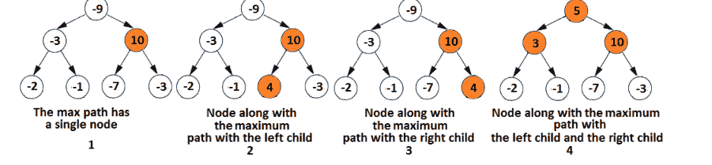

图 13.32 – 当前节点可以成为最大路径的一部分的方式数量

因此，成为最大路径一部分的节点被归入以下四种情况之一：

- 1. 该节点是最大路径中唯一的节点
- 2. 该节点是最大路径中与其左子节点相邻的一部分
- 3. 该节点是最大路径中与其右子节点相邻的一部分
- 4. 该节点是最大路径中与其左子节点和右子节点相邻的一部分

这四步引导我们得出明确的结论：我们必须遍历树的全部节点。一个好的选择是 DFS 算法，但更精确地说，是后序树遍历，其遍历顺序为 **左子树 | 右子树 | 根**。在遍历树时，我们将剩余树的最大值传递给父节点。下图揭示了该算法：

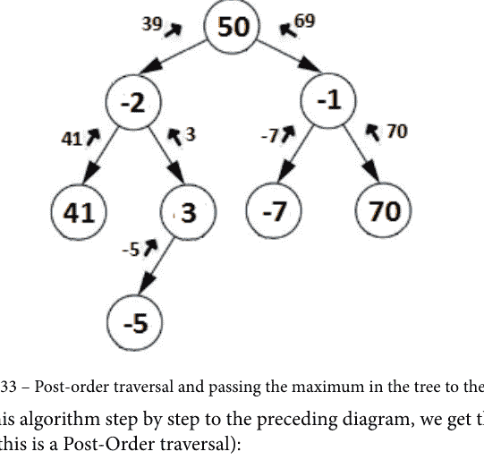

图 13.33 – 后序遍历并将最大值在树中传递给父节点

因此，如果我们逐步将该算法应用于前面的图，我们得到以下结果（请记住这是后序遍历）：

- 41 没有子节点，所以 41 加到 max(0, 0)，41+max(0, 0)=41。
- 3 只有左子节点 -5，所以 3 加到 max(-5, 0)，3+max(-5, 0)=3。
- -2 加到 max(41, 3) 子树，所以 -2+max(41, 3)=39。
- -7 没有子节点，所以 -7 加到 max(0, 0)，-7+max(0, 0)=-7。
- 70 没有子节点，所以 70 加到 max(0, 0)，70+max(0, 0)=70。
- -1 加到 max(-7, 70) 子树，所以 -1+70=69。
- 50 加到左子树（39）和右子树（69）的最大值，所以 39+69+50=158（这是最大路径和）。


The following code reveals the implementation of this algorithm:

```
public int maxPathSum() {
maxPathSum(root);
return max;
}
```

```
private int maxPathSum(Node root) {
if (root == null) {
return 0;
}

// maximum of the left child and 0
int left = Math.max(0, maxPathSum(root.left));

// maximum of the right child and 0
int right = Math.max(0, maxPathSum(root.right));

// maximum at the current node (all four cases 1,2,3 and 4)
max = Math.max(max, left + right + root.element);

//return the maximum from left, right along with current
return Math.max(left, right) + root.element;
}
```

The application is called BinaryTreeMaxPathSum.

## Coding challenge 14 – Diagonal traversal

Amazon, Adobe, Microsoft

Problem: Consider you've been given a non-empty binary tree. Write a snippet of code that prints all the nodes for each negative diagonal (). A negative diagonal has a negative slope.

**Solution:** If you are not familiar with the notion of a binary tree negative diagonal, then ensure you clarify this aspect with the interviewer. They will probably provide you with an example, similar to the one shown in the following diagram:

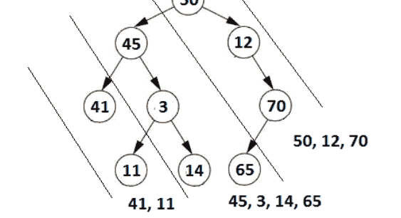

Figure 13.34 – Negative diagonals of a binary tree

In the preceding diagram, we have three diagonals. The first diagonal contains nodes 50, 12, and 70. The second diagonal contains nodes 45, 3, 14, and 65. Finally, the third diagonal contains nodes 41 and 11.

### Recursion-based solution

One solution to this problem is to use recursion and hashing (if you are not familiar with the concept of hashing, then please read Chapter 6, Object-Oriented Programming, the Hash table problem). In Java, we can use hashing via the built-in HashMap implementation, so there is no need to write a hashing implementation from scratch. But how is this HashMap useful? What should we store in an entry (key-value pair) of this map?

We can associate each diagonal in the binary tree with a key in the map. Since each diagonal (key) contains multiple nodes, it is very convenient to represent the value as a List. While we traverse the binary tree, we need to add the current node to the proper List, so under the proper diagonal. For example, here, we can perform a Pre-Order traversal. Every time we go to the left sub-tree, we increase the diagonal by 1, and every time we go to the right sub-tree, we maintain the current diagonal. This way, we obtain something similar to the following:

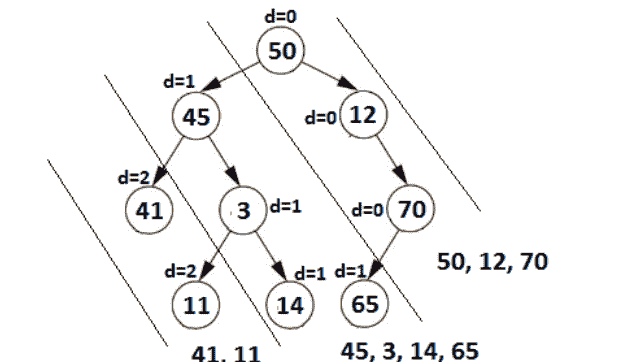

Figure 13.35 – Pre-Order traversal and increasing the diagonal by 1 for the left child

The time complexity of the following solution is O(n log n) with an auxiliary space of O(n), where n is the number of nodes in the tree:

```
// print the diagonal elements of given binary tree
public void printDiagonalRecursive() {

    // map of diagonals
    Map<Integer, List<T>> map = new HashMap<>();

    // Pre-Order traversal of the tree and fill up the map
    printDiagonal(root, 0, map);

    // print the current diagonal
    for (int i = 0; i < map.size(); i++) {
        System.out.println(map.get(i));
    }
}

// recursive Pre-Order traversal of the tree
// and put the diagonal elements in the map
private void printDiagonal(Node node,
    int diagonal, Map<Integer, List<T>> map) {
```

When this pseudocode is put into code, we get the following:

```
```java
public void printDiagonalIterative() {
Queue<Node> queue = new ArrayDeque<>();
// mark the end of a diagonal via dummy null value
Node dummy = new Node(null);
// enqueue all the nodes of the first diagonal
while (root != null) {
    queue.add(root);
    root = root.right;
}
// enqueue the dummy node at the end of each diagonal
queue.add(dummy);
// loop while there are more nodes than the dummy
while (queue.size() != 1) {
    Node front = queue.poll();
    if (front != dummy) {
        // print current node
        System.out.print(front.element + " ");
        // enqueue the nodes of the next diagonal
        Node node = front.left;
        while (node != null) {
            queue.add(node);
            node = node.right;
        }
    } else {
        // at the end of the current diagonal enqueue the dummy
        queue.add(dummy);
    }
}
}
```
```

```
System.out.println();
}
}
}
```

The preceding code runs in O(n) time with an auxiliary space of O(n), where n is the number of nodes in the tree. The complete application is called BinaryTreePrintDiagonal.

## Coding challenge 15 – Handling duplicates in BSTs

Amazon, Microsoft, Flipkart

Problem: Consider you've been given a BST that allows duplicates. Write an implementation that supports the insert and delete operations while handling duplicates.

Solution: We know that the property of a BST claims that for each node, n, we know that the left descendants of n ≤ n < right descendants of n. Commonly, problems that involve BSTs don't allow duplicates, so duplicates cannot be inserted. However, if duplicates are allowed, then our convention will be to insert the duplicate into the left sub-tree.

However, the interviewer probably expects to see an implementation that allows us to associate a count with each node, as shown in the following diagram:

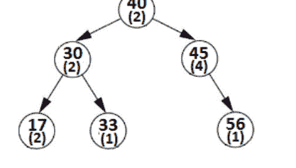

Figure 13.36 – Handling duplicates in a BST

To provide this implementation, we need to modify the structure of a classical BST so that it supports a counter:

```
private class Node {

private T element;
private int count;
private Node left;
```

```
private Node right;

private Node(Node left, Node right, T element) {
    this.element = element;
    this.left = left;
    this.right = right;
    this.count = 1;
}
}
```

Every time we create a new node (a node that doesn’t exist in the tree), the counter will be equal to 1.

When we insert a node, we need to distinguish between a new node and a duplicate node. If we insert a duplicate node, then all we need to do is increase the counter of that node by one, without creating a new node. The relevant part of the insert operation is listed here:

```
private Node insert(Node current, T element) {

    if (current == null) {
        return new Node(null, null, element);
    }

    // START: Handle inserting duplicates
    if (element.compareTo(current.element) == 0) {
        current.count++;

        return current;
    }
    // END: Handle inserting duplicates
    ...
}
```

Deleting a node follows similar logic. If we delete a duplicate node, then we just decrease its counter by one. If the counter is already equal to 1, then we just delete the node. The relevant code is as follows:

```
private Node delete(Node node, T element) {

    if (node == null) {
        return null;
    }

    if (element.compareTo(node.element) < 0) {
        node.left = delete(node.left, element);
    } else if (element.compareTo(node.element) > 0) {
        node.right = delete(node.right, element);
    }

    if (element.compareTo(node.element) == 0) {

        // START: Handle deleting duplicates
        if (node.count > 1) {
            node.count--;
            return node;
        }
        // END: Handle deleting duplicates
        ...
    }
}
```

The complete application is called BinarySearchTreeDuplicates. Another solution to this problem consists of using a hash table to keep count of the nodes. This way, you don't modify the tree structure. Challenge yourself and complete this implementation.

## Coding challenge 16 – Isomorphism of binary trees

Amazon, Google, Microsoft

Problem: Consider you've been given two binary trees. Write a snippet of code that decides whether these two binary trees are isomorphic to each other.

**Solution:** If you are not familiar with the term *isomorphic*, then you have to clarify this with the interviewer. This term is very well-defined in mathematics, but the interviewer probably won't give a mathematical explanation/demonstration, and, as you know, mathematicians have their own language that hardly passes for fluent and easy-to-understand English. Moreover, in mathematics, the notion of isomorphism refers to any two structures, not only binary trees. So, the interviewer will probably give you an explanation, as follows (let's denote the trees as T1 and T2):

### **Definition 1:** T1 and T2 are isomorphic if T1 can be changed to T2 via swapping the children several times. T1 and T2 don't have to be the same physical shape at all.

### **Definition 2:** T1 and T2 are isomorphic if you can translate T1 into T2 and T2 into T1 without losing information.

### **Definition 3:** Think of two strings, AAB and XXY. If A is transformed into X and B is transformed into Y, then AAB becomes XXY, so these two strings are isomorphic. So, two binary trees are isomorphic if T2 is a structure-wise mirror of T1.

No matter what definition you get from the interviewer, I am pretty sure that all of them will attempt to give you an example. The following diagram shows a bunch of examples of isomorphic binary trees:

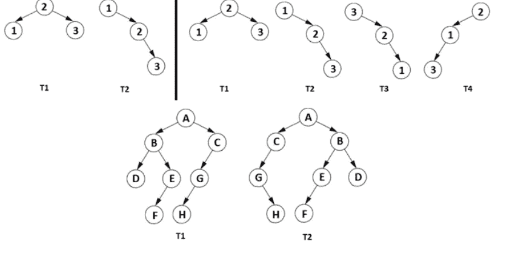

Figure 13.37 – Isomorphic binary tree examples


基于前述定义和示例，我们可以形成以下判断两棵二叉树是否同构的算法：

1. 如果 *T1* 和 *T2* 都是 `null`，则它们是同构的，返回 `true`。
2. 如果 *T1* 或 *T2* 是 `null`，则它们不是同构的，返回 `false`。
3. 如果 *T1.data* 不等于 *T2.data*，则它们不是同构的，返回 `false`。
4. 遍历 *T1* 的左子树和 *T2* 的左子树。
5. 遍历 *T1* 的右子树和 *T2* 的右子树：
   a. 如果 *T1* 和 *T2* 的结构相同，则返回 `true`。
   b. 如果 *T1* 和 *T2* 的结构不相同，则我们检查一棵树（或子树）是否镜像另一棵树（子树），
6. 遍历 *T1* 的左子树和 *T2* 的右子树。
7. 遍历 *T1* 的右子树和 *T2* 的左子树：
   a. 如果结构是镜像的，则返回 `true`；否则，返回 `false`。

将此算法放入代码中得到以下内容：

```java
private boolean isIsomorphic(Node treeOne, Node treeTwo) {

    // step 1
    if (treeOne == null && treeTwo == null) {
        return true;
    }

    // step 2
    if ((treeOne == null || treeTwo == null)) {
        return false;
    }

    // step 3
    if (!treeOne.element.equals(treeTwo.element)) {
        return false;
    }

    // steps 4, 5, 6 and 7
    return (isIsomorphic(treeOne.left, treeTwo.right)
        && isIsomorphic(treeOne.right, treeTwo.left)
        || isIsomorphic(treeOne.left, treeTwo.left)
        && isIsomorphic(treeOne.right, treeTwo.right));
}
```

完整的应用程序称为 TwoBinaryTreesAreIsomorphic。

## 编程挑战 17 – 二叉树右视图

Amazon, Google, Adobe, Microsoft, Flipkart

问题：假设给你一棵二叉树。编写一段代码打印这棵树的右视图。打印右视图意味着打印从二叉树的右侧看可以看到的所有节点。

解决方案：如果不确定二叉树的右视图是什么，请向面试官澄清。例如，下图突出显示了代表二叉树右视图的节点：

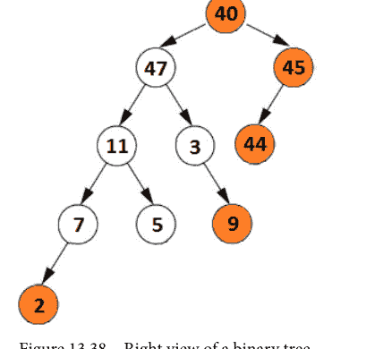

图 13.38 – 二叉树的右视图

因此，如果你站在这棵树的右侧，你只能看到节点 40、45、44、9 和 2。如果我们考虑层序遍历（BFS），我们得到以下输出：

- 40, 47, 45, 11, 3, 44, 7, 5, 9, 2

突出显示的节点代表右视图。然而，每个节点都代表树中每一层的最右节点。这意味着我们可以调整 BFS 算法并打印每一层的最后一个节点。

这是一个 O(n) 复杂度的算法，辅助空间为 O(n)（由队列表示），其中 n 是树中节点的数量：

```
private void printRightViewIterative(Node root) {
    if (root == null) {
        return;
    }

    // enqueue root node
    Queue<Node> queue = new ArrayDeque<>();
    queue.add(root);

    Node currentNode;
    while (!queue.isEmpty()) {

        // number of nodes in the current level is the queue size
        int size = queue.size();

        int i = 0;

        // traverse each node of the current level and enqueue its
        // non-empty left and right child
        while (i < size) {

            i++;
            currentNode = queue.poll();

            // if this is last node of current level just print it
            if (i == size) {
                System.out.print(currentNode.element + " ");
            }

            if (currentNode.left != null) {
```

暴力解决方案非常简单，并且在 O(n) 时间内运行，其中 n 是树中节点的数量。我们要做的就是提取一个数组并将其放在树的 中序遍历（**左子树 | 根 | 右子树**）中：45, 47, 50, 52, 54, 55, 56。一旦我们这样做了，我们就可以找到第 k 个元素作为 array[n-k]。例如，对于 k=3，第三个元素是 array[7-3] = array[4]=54。你可以挑战自己，如果愿意，提供此实现。

然而，另一种基于 反向中序遍历（**右子树 | 根 | 左子树**）的方法，其运行时间为 O(k+h) 复杂度，其中 h 是 BST 的高度，可以写出来，这给我们按降序排列的元素：56, 55, 54, 52, 50, 47, 45。

代码不言自明（c 变量计数已访问的节点）：

```
public void kthLargest(int k) {
    kthLargest(root, k);
}

private int c;
private void kthLargest(Node root, int k) {
    if (root == null || c >= k) {
        return;
    }
    kthLargest(root.right, k);
    c++;
    // we found the kth largest value
    if (c == k) {
        System.out.println(root.element);
    }
    kthLargest(root.left, k);
}
```

完整的应用程序称为 *BinarySearchTreeKthLargestElement*。

## 编程挑战 19 – 镜像二叉树

Amazon, Google, Adobe, Microsoft

问题：假设给你一棵二叉树。编写一段代码构造这棵树的镜像。

解决方案：镜像树如下所示（右侧的树是左侧树的镜像版本）：

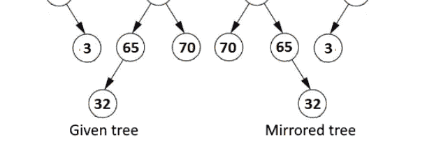

图 13.40 – 给定树和镜像树

因此，镜像树就像给定树的水平翻转。要创建树的镜像，我们必须决定是否将镜像树作为新树返回，还是就地镜像给定树。

### 在新树中镜像给定树

通过递归算法可以按以下步骤完成将镜像作为新树返回：

1. 对于给定树的每个节点：
   a. 在镜像树中创建对应的节点
   b. 调用方法（递归）用于镜像树的子节点，如下：
      i. 左子节点 = 使用给定树的右子节点调用方法
      ii. 右子节点 = 使用给定树的左子节点调用方法

图 13.41 – 递归算法

```
auxNode = node.left;
node.left = node.right;
node.right = auxNode;
}
```

完整的应用程序称为 MirrorBinaryTree。

## 编程挑战 20 – 二叉树的螺旋层序遍历

Amazon, Google, Microsoft

问题：假设给你一棵二叉树。编写一段代码打印这棵二叉树的螺旋层序遍历。更精确地说，位于第 1 层的节点应从左到右打印，随后位于第 2 层的节点从右到左打印，随后位于第 3 层的节点从右到左打印，依此类推。因此，奇数层应从左到右打印，偶数层应从右到左打印。

解决方案：螺旋层序遍历可以按以下两种方式表述：

- 奇数层应从左到右打印，偶数层从右到左打印。
- 奇数层应从右到左打印，偶数层从左到右打印。

下图表示这些陈述：

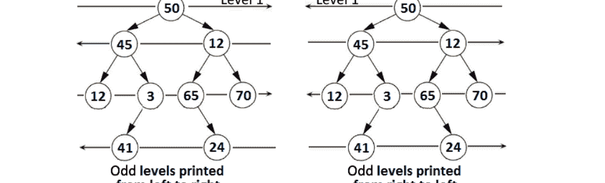

图 13.42 – 螺旋顺序遍历

因此，在左侧，我们得到 50, 12, 45, 12, 3, 65, 70, 24 和 41。在右侧，我们得到 50, 45, 12, 70, 65, 3, 12, 41 和 24。

### 递归方法

让我们尝试实现上图左侧的螺旋顺序遍历。注意，奇数层应从左到右打印，而偶数层应按相反顺序打印。基本上，我们需要通过翻转偶数层的方向来调整众所周知的层序遍历。这意味着我们可以使用布尔变量来交替打印顺序。因此，如果布尔变量为 true（或 1），则我们从左到右打印当前层；否则，我们从右到左打印它。在每次迭代（层）中，我们翻转布尔值。

通过递归应用此方法可以如下完成：

```
public void spiralOrderTraversalRecursive() {
    if (root == null) {
        return;
    }

    int level = 1;
    boolean flip = false;

    // as long as printLevel() returns true there
    // are more levels to print
    while (printLevel(root, level++, flip = !flip)) {
        // there is nothing to do
    };
}

// print all nodes of a given level
private boolean printLevel(Node root,
    int level, boolean flip) {

    if (root == null) {
        return false;
    }

    if (level == 1) {
```


```
System.out.print(root.element + " ");
return true;
}

if (flip) {
// process left child before right child
boolean left = printLevel(root.left, level - 1, flip);
boolean right = printLevel(root.right, level - 1, flip);

return left || right;
} else {
// process right child before left child
boolean right = printLevel(root.right, level - 1, flip);
boolean left = printLevel(root.left, level - 1, flip);

return right || left;
}
}
```

这段代码的运行时间为 O(n²)，效率相当低下。我们能否更高效地实现？可以的——我们可以用额外空间 O(n) 在 O(n) 时间内通过迭代方法实现。

## 迭代方法

让我们尝试从给定图表的右侧实现螺旋顺序遍历。这次我们将通过迭代方法来实现。主要，我们可以使用两个栈（Stack）或双端队列（Deque）。让我们学习如何通过两个栈来实现。

使用两个栈的主要思想非常简单：我们使用一个栈来打印从左到右的节点，另一个栈来打印从右到左的节点。在每次迭代（或每一层）中，我们在其中一个栈中有对应的节点。在从一个栈打印节点的同时，我们将下一层的节点推入另一个栈。

以下代码将这些陈述以代码形式呈现：

```
private void printSpiralTwoStacks(Node node) {

if (node == null) {
return;
}
}
```

```
// create two stacks to store alternate levels
Stack<Node> rl = new Stack<>(); // right to left
Stack<Node> lr = new Stack<>(); // left to right

// Push first level to first stack 'rl'
rl.push(node);

// print while any of the stacks has nodes
while (!rl.empty() || !lr.empty()) {

    // print nodes of the current level from 'rl'
    // and push nodes of next level to 'lr'
    while (!rl.empty()) {

        Node temp = rl.peek();
        rl.pop();

        System.out.print(temp.element + " ");

        if (temp.right != null) {
            lr.push(temp.right);
        }

        if (temp.left != null) {
            lr.push(temp.left);
        }
    }

    // print nodes of the current level from 'lr'
    // and push nodes of next level to 'rl'
    while (!lr.empty()) {
        Node temp = lr.peek();
        lr.pop();

        System.out.print(temp.element + " ");
```

```
if (temp.left != null) {
    rl.push(temp.left);
}

if (temp.right != null) {
    rl.push(temp.right);
}
}
```

完整的应用程序称为 *BinaryTreeSpiralTraversal*。在此应用程序中，你还可以找到基于 Deque 的实现。

## 编程挑战 21 – 与叶子节点距离为 k 的节点

**Amazon, Google, Microsoft, Flipkart**

**问题：** 假设你已获得一个整数二叉树和一个整数 k。编写一段代码打印出与叶子节点距离为 k 的所有节点。

**解决方案：** 我们可以推断，与叶子节点的距离为 k 意味着在叶子节点上方 k 层。但为澄清任何疑问，让我们遵循经典方法并尝试可视化一个示例。以下图表表示一棵二叉树；突出显示的节点（40、47 和 11）表示与叶子节点距离 k=2 的节点：

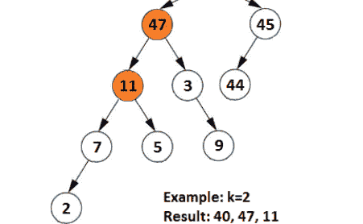

图 13.43 – 与叶子节点距离为 k=2 的节点

从前面的图表中，我们可以得出以下观察结果：

- 节点 40 与叶子 44 的距离为 2。
- 节点 47 与叶子 9 和叶子 5 的距离为 2。
- 节点 11 与叶子 2 的距离为 2。

如果我们查看每一层，则可以看到以下内容：

- 与叶子节点距离为 1 的节点是 3、11、7 和 45。
- 与叶子节点距离为 2 的节点是 11、47 和 40。
- 与叶子节点距离为 3 的节点是 40 和 47。
- 与叶子节点距离为 4 的节点是 40。

因此，根节点是距离叶子最远的节点，并且 k 不合理地大于层数；即 1。如果我们从根开始并向下遍历树直到找到叶子，则 resulting 路径应包含距离该叶子为 k 的节点。

例如，一个可能的路径是 40（根）、47、11、7 和 2（叶子）。如果 k=2，则节点 11 与叶子的距离为 2。另一个可能的路径是 40（根）、47、11 和 5（叶子）。如果 k=2，则节点 47 与叶子的距离为 2。 yet 另一个路径是 40（根）、47、3 和 9（叶子）。如果 k=2，则节点 47 与叶子的距离为 2。我们已经找到了该节点；因此，我们现在必须注意并删除重复项。

迄今为止列出的路径表明存在树的先序遍历（根 | 左子树 | 右子树）。在遍历期间，我们必须跟踪当前路径。换句话说，构造的路径由先序遍历中当前节点的祖先组成。当我们找到叶子节点时，我们必须打印距离该叶子为 k 的祖先。

为了消除重复，我们可以使用一个 Set（我们将其表示为 nodesAtDist），如以下代码所示：

```
private void leafDistance(Node node,
    List<Node> pathToLeaf, Set<Node> nodesAtDist, int dist) {

    if (node == null) {
        return;
    }

```
// for each leaf node, store the node at distance 'dist'
if (isLeaf(node) && pathToLeaf.size() >= dist) {
    nodesAtDist.add(pathToLeaf.get(pathToLeaf.size() - dist));
    
    return;
}

// add the current node into the current path
pathToLeaf.add(node);

// go to left and right subtree via recursion
leafDistance(node.left, pathToLeaf, nodesAtDist, dist);
leafDistance(node.right, pathToLeaf, nodesAtDist, dist);

// remove the current node from the current path
pathToLeaf.remove(node);
}

private boolean isLeaf(Node node) {
    return (node.left == null && node.right == null);
}
```

前面的代码运行时间为 O(n)，辅助空间为 O(n)，其中 *n* 是树中节点的数量。完整的应用程序称为 *BinaryTreeDistanceFromLeaf*。

## 编程挑战 22 – 给定和的配对

**Amazon, Google, Adobe, Microsoft, Flipkart**

**问题**：假设你已获得一棵 BST 和一个和。编写一段代码，如果存在节点对的和为此和，则返回 `true`。

解决方案：让我们考虑以下图表中所示的 BST 和 sum=74：

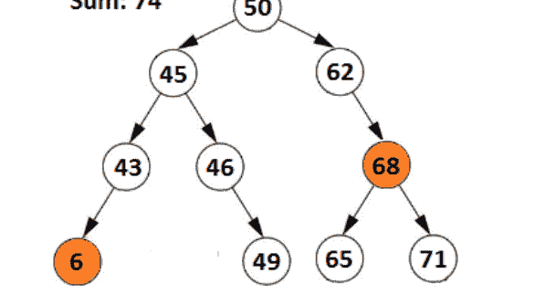

图 13.44 – 和为 74 的配对包含节点 6 和 68

因此，对于 sum=74，我们可以找到配对 (6, 68)。如果 sum=89，则配对为 (43, 46)。如果 sum=99，则配对为 (50, 49)。构成配对的节点可以来自同一子树或不同子树，也可以包括根节点和叶子节点。

解决此问题的其中一个方案依赖于哈希和递归。主要，我们使用中序遍历遍历树（左子树 | 根 | 右子树），并将每个节点的元素插入到一个集合中（例如 HashSet）。此外，在将当前节点插入集合之前，我们检查（给定和 - 当前节点的元素）是否存在于集合中。如果存在，则我们找到了一个配对，因此我们停止该过程并返回 true。否则，我们将当前节点插入集合并继续此过程，直到找到配对或遍历完成。

代码如下所示：

```
public boolean findPairSum(int sum) {

    return findPairSum(root, sum, new HashSet());
}

private static boolean findPairSum(Node node,
        int sum, Set<Integer> set) {

    // base case
    if (node == null) {
        return false;
```

```
```
}
}
return false;
```
```

此代码的运行时间为 O(n)，辅助空间为 O(n)。完整的应用程序称为 BinarySearchTreeSum。

## 编程挑战 23 – 二叉树中的垂直和

Amazon, Google, Flipkart

问题：假设你已获得一棵二叉树。编写一段代码，计算此二叉树的垂直和。

解决方案：为了对该问题有一个清晰的认识，非常重要的是你绘制一个有意义的图表。使用带方格的笔记本（数学笔记本）会很有用。这很有用，因为你必须以 45 度绘制节点之间的边；否则，可能无法正确看到节点的垂直轴。通常，当我们绘制二叉树时，我们不关心节点之间的角度，但在这种情况下，这是理解问题并找到解决方案的重要方面。

以下图表是二叉树的草图。它显示了一些有用的地标，这将引导我们找到解决方案：


图 13.45 – 二叉树中的垂直和


如果我们从左侧扫描树到右侧，我们可以识别出七个垂直轴，其和分别为 5、7、16、35、54、44 和 6。在图表顶部，我们添加了每个节点相对于根节点的水平距离。如果我们将根节点视为距离为 0，那么我们就可以通过从根的左侧或右侧分别递减、递增 1 来唯一地识别每个垂直轴，即 -3、-2、-1、0（根）、1、2、3。

每个轴都由其与根的距离唯一标识，并且每个轴都包含我们需要求和的节点。如果我们将轴的唯一距离视为键，将该轴上节点的和视为值，那么我们可以直觉地认为这个问题可以通过哈希来解决（如果你不熟悉哈希的概念，请参阅第 6 章 面向对象编程 中的哈希表问题）。在 Java 中，我们可以通过内置的 HashMap 实现来使用哈希，因此无需从头编写哈希实现。

但我们如何填充这个映射呢？很明显，我们在填充映射的同时必须遍历树。我们可以从根开始，将键 0 添加到映射中（0 对应包含根的轴），值设为根（21）。接下来，我们可以使用递归向根的左轴移动，同时将与根的距离减 1。我们也可以使用递归向根的右轴移动，同时将与根的距离加 1。在每个节点处，我们更新映射中对应于标识当前轴的键的值。因此，如果我们递归地遵循路径 root|left sub-tree|right sub-tree，那么我们使用的是二叉树的先序遍历。

最后，我们的映射应包含以下键值对：(-3, 5)、(-2, 7)、(-1, 16)、(0, 35)、(1, 54)、(2, 44) 和 (3, 6)。

将此算法放入代码中得到以下结果（map 包含垂直和）：

```
private void verticalSum(Node root,
    Map<Integer, Integer> map, int dist) {

    if (root == null) {
        return;
    }

    if (!map.containsKey(dist)) {
        map.put(dist, 0);
    }

    map.put(dist, map.get(dist) + root.element);

    // or in functional-style
    /*
    BiFunction<Integer, Integer, Integer> distFunction
        = (distOld, distNew) -> distOld + distNew;
    map.merge(dist, root.element, distFunction);
    */

    // decrease horizontal distance by 1 and go to left
    verticalSum(root.left, map, dist - 1);

    // increase horizontal distance by 1 and go to right
    verticalSum(root.right, map, dist + 1);
}
```

前述代码的运行时间为 O(n log n)，辅助空间为 O(n)，其中 n 为树的总节点数。向映射中添加操作的复杂度为 O(log n)，由于我们为树的每个节点都进行一次加法，因此得到 O(n log n)。对于面试来说，这里展示的解决方案应该足够了。然而，你可以挑战自己并通过使用额外的双向链表将时间复杂度降低到 O(n)。主要的是，你需要在链表的节点中存储每个垂直和。首先，将对应于包含根的轴的垂直和添加到链表中。然后，链表的 node.next 和 node.prev 应存储根轴左侧和右侧轴的垂直和。最后，依赖递归在遍历树的同时更新链表。

完整的应用程序称为 BinaryTreeVerticalSum。

## 编程挑战 23 – 将最大堆转换为最小堆

Amazon, Google, Adobe, Microsoft, Flipkart

**问题：** 假设你已获得一个表示最小二叉堆的数组。编写一段代码，将给定的最小二叉堆在线性时间内且不使用额外空间转换为最大二叉堆。

**解决方案：** 该问题的解决方案受启发于堆排序算法（该算法在第 14 章 排序和搜索 中介绍）。

最初，这个问题可能听起来很复杂，但在几分钟的思考后，你可能会得出结论，问题可以简化为从未排序数组构建最大二叉堆。因此，给定数组是最小二叉堆还是不是并不重要。我们可以通过以下两个步骤从任何数组（已排序或未排序）构建所需的最大二叉堆：

1. 从给定数组的最右侧、最底部的节点（最后一个内部节点）开始。
2. *Heapify* 所有节点，通过自底向上的技术。

代码不言自明：

```
public static void convertToMinHeap(int[] maxHeap) {

    // build heap from last node to all
    // the way up to the root node
    int p = (maxHeap.length - 2) / 2;
    while (p >= 0) {
        heapifyMin(maxHeap, p--, maxHeap.length);
    }
}

// heapify the node at index p and its two direct children
private static void heapifyMin(int[] maxHeap,
    int p, int size) {

    // get left and right child of node at index p
    int left = leftChild(p);
    int right = rightChild(p);

    int smallest = p;

    // compare maxHeap[p] with its left and
    // right child and find the smallest value
    if ((left < size) && (maxHeap[left] < maxHeap[p])) {
        smallest = left;
    }

    if ((right < size)
        && (maxHeap[right] < maxHeap[smallest])) {
        smallest = right;
    }

    // swap 'smallest' with 'p' and heapify
    if (smallest != p) {
        swap(maxHeap, p, smallest);
        heapifyMin(maxHeap, smallest, size);
    }
}

/* Helper methods */
private static int leftChild(int parentIndex) {
    return (2 * parentIndex + 1);
}

private static int rightChild(int parentIndex) {
    return (2 * parentIndex + 2);
}

// utility function to swap two indices in the array
private static void swap(int heap[], int i, int j) {
    int aux = heap[i];
    heap[i] = heap[j];
    heap[j] = aux;
}
```

此代码的运行时间为 O(n)，无需额外空间。完整的应用程序称为 MaxHeapToMinHeap。它还包含最小二叉堆到最大二叉堆的转换。

## 编程挑战 24 – 判断二叉树是否对称

Amazon, Google, Adobe, Microsoft, Flipkart

**问题：** 假设你已获得一棵二叉树。编写一段代码，如果该二叉树是对称的（自身镜像或不是；左子树和右子树是彼此的镜像），则返回 `true`。

**解决方案：** 首先，让我们看一下包含对称和不对称二叉树的图表。标记为 (a)、(b) 和 (d) 的二叉树是不对称的，而标记为 (c)、(e) 和 (f) 的二叉树是对称的。请注意，二叉树是对称的，如果结构和数据都是对称的：

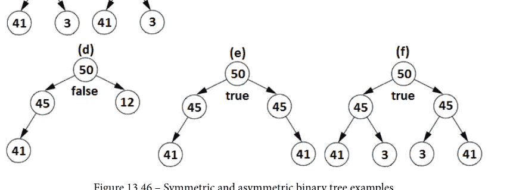

图 13.46 – 对称和不对称二叉树示例

我们可以将这个问题视为镜像 *root.left* 并检查它是否与 *root.right* 相同。如果它们相同，则二叉树是对称的。然而，我们也可以通过以下三个条件来表达两个二叉树的对称性，如下所示（理解这些条件的最简单方法是将其中的每一个与前述图表中的示例进行对照）：

1. 根节点的元素相同。
2. 左树的左子树和右树的右子树必须是镜像。
3. 左树的右子树和右树的左子树必须是镜像。

我认为我们有足够的经验可以认识到这些条件可以通过递归来实现，如下所示：

```
private boolean isSymmetricRecursive(
    Node leftNode, Node rightNode) {

    boolean result = false;

    // empty trees are symmetric
    if (leftNode == null && rightNode == null) {
        result = true;
    }

    // conditions 1, 2, and 3 from above
    if (leftNode != null && rightNode != null) {
        result = (leftNode.element.equals(rightNode.element))
            && isSymmetricRecursive(leftNode.left, rightNode.right)
            && isSymmetricRecursive(leftNode.right, rightNode.left);
    }

    return result;
}
```


该代码的时间复杂度为 O(n)，额外空间为 O(h)，其中 h 为树的高度。迭代实现如何？我们可以通过队列提供迭代实现。以下代码是对该方法的最佳解释：

```
public boolean isSymmetricIterative() {

    boolean result = false;
    Queue<Node> queue = new LinkedList<>();

    queue.offer(root.left);
    queue.offer(root.right);

    while (!queue.isEmpty()) {
        Node left = queue.poll();
        Node right = queue.poll();

        if (left == null && right == null) {

            result = true;
        } else if (left == null || right == null
                   || left.element != right.element) {

            result = false;
            break;
        } else {
            queue.offer(left.left);
            queue.offer(right.right);

            queue.offer(left.right);
            queue.offer(right.left);
        }
    }

    return result;
}
```

该代码的时间复杂度为 O(n)，额外空间为 O(h)，其中 h 为树的高度。完整的应用程序称为 *IsSymmetricBinaryTree*。

## 编程挑战 25 – 以最小成本连接 *n* 根绳子

**Amazon, Google, Adobe, Microsoft, Flipkart**

**问题：** 假设你被给出一个包含 *n* 根绳子长度的数组，我们需要将所有这些绳子连接成一根绳子。假设连接两根绳子的成本等于它们长度之和。编写一段代码，以最小成本将所有绳子连接成一根绳子。

**解决方案：** 假设我们有四根长度分别为 1、3、4 和 6 的绳子。让我们先连接最短的两根绳子。这意味着我们需要连接长度为 1 和 3 的绳子，其成本为 1+3=4。继续同样的逻辑，下两根绳子的长度分别为 4（我们刚刚得到的）和 4。成本为 4+4=8，因此总成本为 4+8=12。我们剩下长度为 8 和 6 的两根绳子。连接它们的成本为 8+6=14。因此，总的最终成本为 12+14=26。

现在，让我们尝试另一种策略。让我们先连接最长的两根绳子。这意味着我们需要连接长度为 4 和 6 的绳子，其成本为 4+6=10。继续同样的逻辑，下两根绳子的长度分别为 10（我们刚刚得到的）和 3。成本为 10+3=13，因此总成本为 10+13=23。我们剩下长度为 13 和 1 的两根绳子。连接它们的成本为 13+1=14。因此，总的最终成本为 23+14=37。

由于 37>26，很明显第一种方法比第二种方法更好。但问题出在哪里？好吧，如果你还没有注意到，第一次连接的绳子的长度会在其余的连接中再次出现。例如，当我们连接绳子 1 和 3 时，我们写 1+3=4。所以，4 是迄今为止的总成本。接下来，我们加上 4+4=8，因此新的总成本是之前的总成本 + 8，即 4+8，但 4 是由 1+3 得到，所以 1+3 再次出现。最后，我们连接 8+6=14。新的总成本是之前的成本 + 14，即 12 + 14，但 12 是由 4+8 得到，而 4 是由 1+3 得到，所以 1+3 再次出现。

分析前述陈述让我们得出结论，如果重复添加的绳子是最小的，然后是第二小的，以此类推，我们就可以获得连接所有绳子的最小成本。换句话说，我们可以这样思考该算法：

+   1. 按长度降序对绳子进行排序。
+   2. 连接前两根绳子并更新部分最小成本。
+   3. 用得到的结果替换前两根绳子。

```
```text
while (size() > 1) {
    int l1 = poll();
    int l2 = poll();

    totalLength += (l1 + l2);

    add(l1 + l2);
}

return totalLength;
}
```
```

完整的应用程序称为 *HeapConnectRopes*。

## 高级主题

从一开始，你就应该知道以下主题在技术面试中很少遇到。首先，让我将这些主题列举为一个非详尽的列表：

+   - AVL 树（代码捆绑中附带了简要描述和实现）
+   - 红黑树（代码捆绑中附带了简要描述和实现）
+   - Dijkstra 算法
+   - Rabin-Karp 子串搜索
+   - Bellman-Ford 算法
+   - Floyd-Warshall 算法
+   - 区间树
+   - 最小生成树
+   - B 树
+   - 二分图
+   - 图着色
+   - P、NP 和 NP-完全

## 14
