## 排序和搜索

本章涵盖了在技术面试中遇到的最流行的排序和搜索算法。我们将涵盖 Merge Sort、Quick Sort、Radix Sort、Heap Sort 和 Bucket Sort 等排序算法，以及 Binary Search 等搜索算法。

到本章结束时，你应该能够处理涉及排序和搜索算法的各种问题。我们将涵盖以下主题：

+   - 排序算法
+   - 搜索算法
+   - 编程挑战

让我们开始吧！

### 技术要求

你可以在 GitHub 上找到本章的所有代码文件，地址为 `https://github.com/PacktPublishing/The-Complete-Coding-Interview-Guide-in-Java/tree/master/Chapter14`。

## 排序算法

从准备面试的人的角度来看排序算法，可以揭示出两个主要类别：一个类别包含大量相对简单的排序算法，它们不会出现在面试中，例如 Bubble Sort、Insertion Sort、Counting Sort 等，另一个类别包含 Heap Sort、Merge Sort、Quick Sort、Bucket Sort 和 Radix Sort。这些代表了在技术面试中出现的五大排序算法。

如果你不熟悉简单的排序算法，那么我强烈建议你购买我的书 Java Coding Problems (www.packtpub.com/programming/java-coding-problems)，由 Packt 出版。在 Java Coding Problems 的第 5 章 Arrays, Collections, and Data Structures 中，你可以找到 Bubble Sort、Insertion Sort、Counting Sort 等的详细介绍。

此外，名为 SortArraysIn14Ways 的应用程序包含了你应该知道的 14 种不同排序算法的实现。完整列表如下：

+   - Bubble Sort
+   - 带比较器的 Bubble Sort
+   - 优化的 Bubble Sort
+   - 带比较器的优化 Bubble Sort
+   - Pancake Sort
+   - Exchange Sort
+   - Selection Sort
+   - Shell Sort
+   - Insertion Sort
+   - 带比较器的 Insertion Sort
+   - Counting Sort
+   - Merge Sort
+   - Heap Sort
+   - 带比较器的 Heap Sort
+   - Bucket Sort
+   - Cocktail Sort

+   - Cycle Sort
+   - Quick Sort
+   - 带 `Comparator` 的 Quick Sort
+   - Radix Sort

在以下各节中，我们将对面试中遇到的主要算法进行简要概述：Heap Sort、Merge Sort、Quick Sort、Bucket Sort 和 Radix Sort。如果你已经熟悉这些算法，那么可以考虑直接跳到 *Searching algorithms* 部分，甚至跳到 *Coding challenges* 部分。

## Heap Sort

如果你不熟悉堆的概念，那么请考虑阅读 *Chapter 13, Trees and Graphs* 的 *Binary Heaps* 部分。

Heap Sort 是一种依赖于二叉堆（完全二叉树）的算法。时间复杂度情况如下：最佳情况 O(n log n)，平均情况 O(n log n)，最坏情况 O(n log n)。空间复杂度情况为 O(1)。

可以通过 Max Heap（父节点始终大于或等于子节点）按升序对元素进行排序，并通过 Min Heap（父节点始终小于或等于子节点）按降序排序。

Heap Sort 算法有几个主要步骤，如下所示：

+   1. 将给定的数组转换为 Max Binary Heap。
+   2. 接下来，将根与堆中的最后一个元素交换，并将堆的大小减少 1（这就像删除堆的根元素）。因此，更大的元素（堆根）会移动到最后一个位置。换句话说，位于堆根的元素一个接一个地以排序顺序出现。
+   3. 最后一步是对剩余的堆进行 *heapifying*（应用自上而下的递归过程，重建最大堆）。
+   4. 重复从 *step 2* 开始，直到堆大小大于 1。


下图展示了应用堆排序算法的一个测试用例：

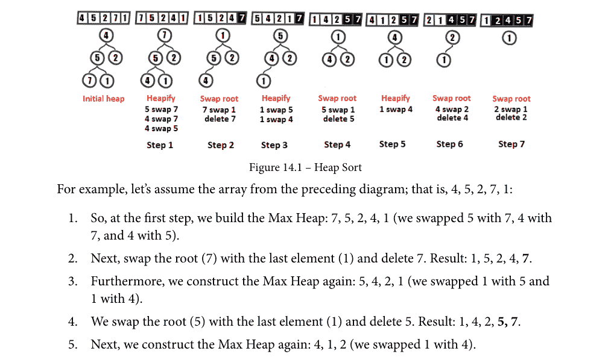

图14.1 – 堆排序

例如，假设我们采用上图所示的数组：4, 5, 2, 7, 1：

1. 首先，我们构建最大堆 7, 5, 2, 4, 1（我们将5与7交换，4与7交换，4与5交换）。
2. 接下来，将根节点（7）与最后一个元素（1）交换，并删除7。结果：1, 5, 2, 4, 7。
3. 此外，我们再次构建最大堆：5, 4, 2, 1（我们将1与5交换，并将1与4交换）。
4. 我们将根节点（5）与最后一个元素（1）交换，并删除5。结果：1, 4, 2, 5, 7。
5. 接下来，我们再次构建最大堆：4, 1, 2（我们将1与4交换）。
6. 我们将根节点（4）与最后一个元素（2）交换，并删除4。结果：2, 1, 4, 5, 7。
7. 这已经是最大堆，因此我们只需将根节点（2）与最后一个元素（1）交换，并移除2：1, 2, 4, 5, 7。
8. 完成！堆中只剩下一个元素（1）。因此，最终结果为1, 2, 4, 5, 7。

在代码方面，上述示例可以概括如下：

```java
public static void sort(int[] arr) {
    int n = arr.length;
    buildHeap(arr, n);
    while (n > 1) {
        swap(arr, 0, n - 1);
        n--;
        heapify(arr, n, 0);
    }
}

private static void buildHeap(int[] arr, int n) {
    for (int i = arr.length / 2; i >= 0; i--) {
        heapify(arr, n, i);
    }
}

private static void heapify(int[] arr, int n, int i) {
    int left = i * 2 + 1;
    int right = i * 2 + 2;
    int greater;
    if (left < n && arr[left] > arr[i]) {
        greater = left;
    } else {
        greater = i;
    }
    if (right < n && arr[right] > arr[greater]) {
        greater = right;
    }
    if (greater != i) {
        swap(arr, i, greater);
        heapify(arr, n, greater);
    }
}

private static void swap(int[] arr, int x, int y) {
    int temp = arr[x];
    arr[x] = arr[y];
    arr[y] = temp;
}
```

堆排序并不是一种稳定算法。稳定算法能保证重复元素的顺序。完整的应用名为*HeapSort*。该应用还包含一个基于`Comparator`的实现——这对于对象排序很有用。

## 归并排序

现在，我们来讨论归并排序算法。时间复杂度情况如下：最优情况 O(n log n)，平均情况 O(n log n)，最坏情况 O(n log n)。空间复杂度可能因所选数据结构的不同而变化（可以是 O(n)）。

归并排序算法是一种基于著名*分治*策略的递归算法。假设给定一个未排序的数组，应用归并排序算法需要你不断地将数组对半拆分，直到得到空子数组或只包含单个元素的子数组（这就是*分治*）。如果子数组为空或只包含一个元素，那么根据定义它就已经是有序的——这就是递归的*基线条件*。

如果尚未到达*基线条件*，我们会再次划分这两个子数组，并尝试对它们排序。因此，如果数组包含多个元素，我们将其拆分，并递归地对两个子数组调用排序操作。下图展示了数组 52, 28, 91, 19, 76, 33, 43, 57, 20 的拆分过程：

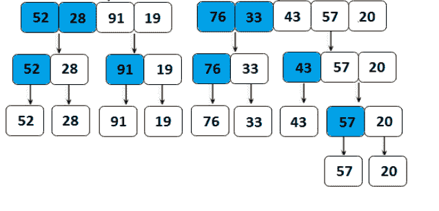

图14.2 – 在归并排序算法中拆分给定数组

拆分完成后，我们调用该算法的核心操作：*合并*操作（也称为*组合*操作）。合并是指将两个较小的有序子数组组合成一个新的有序子数组的操作。如此反复，直到整个给定数组有序。下图展示了我们数组的合并操作：

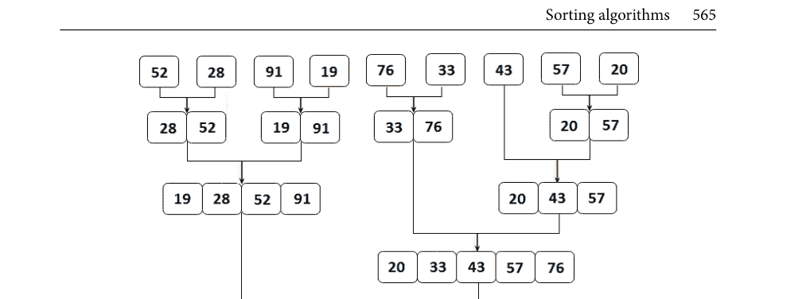

图14.3 – 归并排序的合并操作

以下代码实现了归并排序算法。流程从 sort() 方法开始。这里，我们首先检查基线条件。如果数组长度大于1，则调用 leftHalf() 和 rightHalf() 方法，它们会将给定数组拆分为两个子数组。sort() 中其余代码负责调用 merge() 方法，该方法对两个未排序的子数组进行排序：

```java
public static void sort(int[] arr) {
    if (arr.length > 1) {
        int[] left = leftHalf(arr);
        int[] right = rightHalf(arr);
        sort(left);
        sort(right);
        merge(arr, left, right);
    }
}
```

```java
private static int[] leftHalf(int[] arr) {
    int size = arr.length / 2;
    int[] left = new int[size];
    System.arraycopy(arr, 0, left, 0, size);
    return left;
}
```

```java
private static int[] leftHalf(int[] arr) {
    int size1 = arr.length / 2;
    int size2 = arr.length - size1;
    int[] left = new int[size1];
    for (int i = 0; i < size1; i++) {
        left[i] = arr[i];
    }
    return left;
}
```

```java
private static int[] rightHalf(int[] arr) {
    int size1 = arr.length / 2;
    int size2 = arr.length - size1;
    int[] right = new int[size2];
    for (int i = 0; i < size2; i++) {
        right[i] = arr[i + size1];
    }
    return right;
}
```

接下来，合并操作会反复从有序子数组中取出最小的元素，逐个将元素放回原始数组：

```java
private static void merge(int[] result,
        int[] left, int[] right) {
    int t1 = 0;
    int t2 = 0;
    for (int i = 0; i < result.length; i++) {
        if (t2 >= right.length
            || (t1 < left.length && left[t1] <= right[t2])) {
            result[i] = left[t1];
            t1++;
        } else {
            result[i] = right[t2];
            t2++;
        }
    }
}
```

请注意，`left[t1] <= right[t2]` 这一语句保证了算法的稳定性。稳定算法能保证重复元素的顺序。

完整的应用名为*MergeSort*。

## 快速排序

快速排序是另一种基于著名*分治*策略的递归排序算法。时间复杂度情况如下：最优情况 O(n log n)，平均情况 O(n log n)，最坏情况 O(n²)。空间复杂度为 O(log n) 或 O(n)。

快速排序算法始于一个重要选择。我们必须选择给定数组中的某个元素作为*基准*。接下来，我们对给定数组进行分区，使得所有小于*基准*的元素都排在所有大于基准的元素之前。分区操作通过一系列交换完成。这就是*分治*中的*分*步骤。

接下来，左右子数组再次使用相应的基准进行分区。这是通过将子数组递归地传入算法来实现的。这就是*分治*中的*治*步骤。

最坏情况（O(n²)）发生在给定数组的所有元素都小于所选基准或都大于所选基准时。选择基准元素至少有四种方式，如下所示：

- 选择第一个元素作为基准。
- 选择最后一个元素作为基准。
- 选择中间元素作为基准。
- 选择随机元素作为基准。

考虑数组 4, 2, 5, 1, 6, 7, 3。这里，我们将基准设为最后一个元素。下图描绘了快速排序的工作原理：

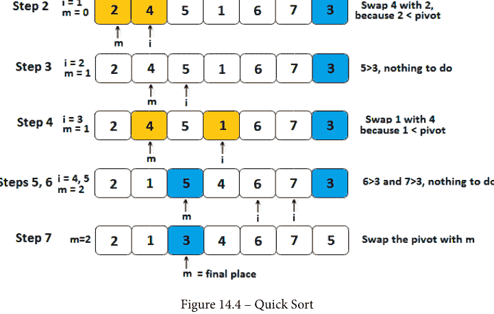

图14.4 – 快速排序

步骤1：我们选择最后一个元素作为基准，因此基准是3。分区开始时先定位两个位置标记——我们称它们为i和m。最初，两者都指向给定数组的第一个元素。接下来，将位置i处的元素与基准比较，即将4与3比较。由于4 > 3，无需任何操作，i变为1（i++），而m保持为0。

步骤2：将位置i处的元素与基准比较，即将2与3比较。由于2 < 3，我们交换位置m处的元素与位置i处的元素，即将4与2交换。m和i都增加1，因此m变为1，i变为2。

步骤3：将位置i处的元素与基准比较，即将5与3比较。由于5 > 3，无需任何操作，因此i变为3（i++），而m保持为1。

步骤4：将位置i处的元素与基准比较，即将1与3比较。由于1 < 3，我们交换位置m处的元素与位置i处的元素，即将1与4交换。m和i都增加1，因此m变为2，i变为4。

步骤5和6：我们继续将位置i处的元素与基准比较。由于6 > 3且7 > 3，这两个步骤无需任何操作。在这些步骤之后，i = 7。


```java
sort(arr, left, m - 1);
sort(arr, m + 1, right);
}

private static int partition(int[] arr, int left, int right) {
    int pivot = arr[right];
    int m = left;
    for (int i = m; i < right; i++) {
        if (arr[i] <= pivot) {
            swap(arr, i, m++);
        }
    }
    swap(arr, right, m);
    return m;
}
```

快速排序可以交换不相邻的元素，因此它是不稳定的。完整的应用名为 QuickSort。该应用还包含一个基于 Comparator 的实现——这对于对象排序非常有用。

## 桶排序

桶排序（Bucket Sort，或 Bin Sort）是面试中会遇到的另一种排序技术。它在计算机科学中很常用，并且当元素在某个范围内均匀分布时非常有用。时间复杂度的情况如下：最佳和平均情况为 O(n+k)，其中 O(k) 是创建桶的时间（对于链表或哈希表，这将是 O(1)），而 O(n) 是将给定数组的元素放入桶中所需要的时间（对于链表或哈希表，这也是 O(1)）。最坏情况为 O(n²)。空间复杂度为 O(n+k)。

它依赖于将给定数组的元素划分为若干组，这些组称为桶。接下来，使用另一种合适的排序算法或通过递归使用桶排序算法，对每个桶单独进行排序。

创建桶可以通过多种方式完成。一种方法依赖于定义桶的数量，并将给定数组中的特定范围的元素填入每个桶（这被称为*散射*）。接下来，对每个桶进行排序（通过桶排序或其他排序算法）。最后，从每个桶中收集元素，得到排序后的数组（这被称为*聚集*）。这也被称为*散射-排序-聚集*技术，并在下图中示例说明。这里，我们对数组 4, 2, 11, 7, 18, 3, 14, 7, 4, 16 使用桶排序：

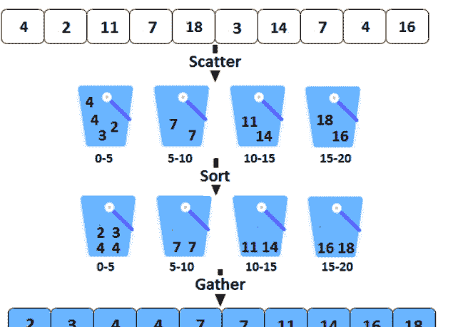

图 14.5 – 通过散射-排序-聚集方法进行桶排序

因此，如前面的图所示，我们为区间内的元素定义了四个桶；即 0-5、5-10、10-15 和 15-20。给定数组的每个元素都放入一个桶中。将给定数组的所有元素分配到桶中后，我们对每个桶进行排序。第一个桶包含元素 2、3、4 和 4。第二个桶包含元素 7、7 等。最后，我们（从左到右）从桶中收集元素，得到排序后的数组；即 2、3、4、4、7、7、11、14、16、18。

因此，为此我们可以编写以下伪代码：

```
sort(array)
    create N buckets each of which can hold a range of elements
    for all the buckets
        initialize each bucket with 0 values
    for all the buckets
        put elements into buckets matching the range
    for all the buckets
        sort elements in each bucket
        gather elements from each bucket
end
```

使用列表对该伪代码的一种实现可以如下完成（此代码中调用的 hash() 方法可在本书附带的代码中找到）：

```
/* Scatter-Sort-Gather approach */
public static void sort(int[] arr) {

    // get the hash codes
    int[] hashes = hash(arr);

    // create and initialize buckets
    List<Integer>[] buckets = new List[hashes[1]];
    for (int i = 0; i < hashes[1]; i++) {
        buckets[i] = new ArrayList();
    }

    // scatter elements into buckets
    for (int e : arr) {
        buckets[hash(e, hashes)].add(e);
    }

    // sort each bucket
    for (List<Integer> bucket : buckets) {
        Collections.sort(bucket);
    }

    // gather elements from the buckets
    int p = 0;
    for (List<Integer> bucket : buckets) {
        for (int j : bucket) {
            arr[p++] = j;
        }
    }
}
```

另一种创建桶的方法是将单个元素放入一个桶中，如下图所示（这次不涉及排序）：

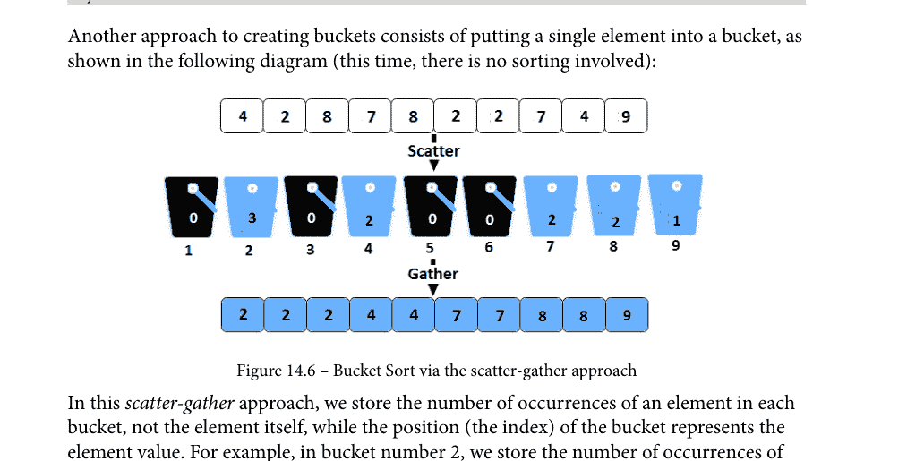

图 14.6 – 通过散射-聚集方法进行桶排序

在这种散射-聚集方法中，我们在每个桶中存储元素出现的次数，而不是元素本身，而桶的位置（索引）表示元素的值。例如，在 2 号桶中，我们存储元素 2 的出现次数，在数组 4, 2, 8, 7, 8, 2, 2, 7, 4, 9 中它出现了三次。由于元素 1、3、5 和 6 不在给定数组中，它们的桶是空的（其中为 0）。聚集操作从左到右收集元素，得到排序后的数组。

```
sort (array)
    create N buckets each of which can track a counter of a single element
    for all the buckets
        initialize each bucket with 0 values
    for all the buckets
        put elements into buckets matching a single element per bucket
    for all the buckets
        gather elements from each bucket
end
```

该伪代码的一种实现可能如下所示：

```
/* Scatter-Gather approach */
public static void sort(int[] arr) {

    // get the maximum value of the given array
    int max = arr[0];
    for (int i = 1; i < arr.length; i++) {
        if (arr[i] > max) {
            max = arr[i];
        }
    }

    // create max buckets
    int[] bucket = new int[max + 1];

    // the bucket[] is automatically initialized with 0s,
    // therefore this step is redundant
    for (int i = 0; i < bucket.length; i++) {
        bucket[i] = 0;
    }

    // scatter elements in buckets
    for (int i = 0; i < arr.length; i++) {
        bucket[arr[i]]++;
    }

    // gather elements from the buckets
    int p = 0;
    for (int i = 0; i < bucket.length; i++) {
        for (int j = 0; j < bucket[i]; j++) {
            arr[p++] = i;
        }
    }
}
```

桶排序不是一个稳定的算法。稳定算法保证重复元素的顺序。完整的应用名为 *BucketSort*。

## 基数排序

基数排序是一种对整数非常有效的排序算法。在基数排序中，我们通过按数字在数值中的位置对各个位进行分组来对元素排序。接下来，我们通过对每个有效位置上的位进行排序来对元素排序。通常，这是通过计数排序完成的（计数排序算法在 Packt 出版的《*Java 编码问题*》（www.packtpub.com/programming/java-coding-problems）一书中有详细介绍，但你可以在名为 *SortArraysIn14Ways* 的应用中找到它的实现）。主要来说，对位进行排序可以通过任何稳定的排序算法完成。

理解基数排序算法的一个简单方法是借助示例。让我们考虑数组 323, 2, 3, 123, 45, 6, 788。下图揭示了通过依次对个位、十位和百位进行排序来对该数组进行排序的步骤：

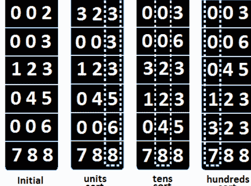

图 14.7 – 基数排序

因此，首先，我们根据个位对应的数字对元素排序。其次，我们根据十位对应的数字对元素排序。第三，我们根据百位对应的数字对元素排序。当然，根据数组中的最大数，该过程会继续到千位、万位等，直到没有剩余的位为止。

以下代码是基数排序算法的一种实现：

```java
public static void sort(int[] arr, int radix) {

    int min = arr[0];
    int max = arr[0];
    for (int i = 1; i < arr.length; i++) {
        if (arr[i] < min) {
            min = arr[i];
        } else if (arr[i] > max) {
            max = arr[i];
        }
    }

    int exp = 1;
    while ((max - min) / exp >= 1) {
        countSortByDigit(arr, radix, exp, min);
        exp *= radix;
    }
}

private static void countSortByDigit(
    int[] arr, int radix, int exp, int min) {

    int[] buckets = new int[radix];
    for (int i = 0; i < radix; i++) {
        buckets[i] = 0;
    }

    int bucket;
    for (int i = 0; i < arr.length; i++) {
        bucket = (int) (((arr[i] - min) / exp) % radix);
        buckets[bucket]++;
    }

    for (int i = 1; i < radix; i++) {
        buckets[i] += buckets[i - 1];
```


```
}

int[] out = new int[arr.length];
for (int i = arr.length - 1; i >= 0; i--) {
    bucket = (int) (((arr[i] - min) / exp) % radix);
    out[--buckets[bucket]] = arr[i];
}

System.arraycopy(out, 0, arr, 0, arr.length);
}
```

基数排序的时间复杂度取决于用于对位数进行排序的算法（请记住，这可以是任何稳定的排序算法）。由于我们使用的是计数排序算法，因此时间复杂度为 O(d(n+b))，其中 n 是元素个数，d 是位数，b 是基数（在我们的例子中，基数为 10）。空间复杂度为 O(n+b)。

完整的应用程序名为 RadixSort。到目前为止，我们已经介绍了技术面试中出现的五大排序算法。现在，让我们快速概述搜索算法。

## 搜索算法

在面试中，作为独立问题或另一个问题的一部分出现的主要搜索算法是二分搜索算法。最佳情况时间复杂度为 O(1)，而平均和最坏情况为 O(log n)。对于迭代实现，二分搜索的最坏情况辅助空间复杂度为 O(1)，而对于递归实现，由于调用栈的原因，为 O(log n)。

二分搜索算法依赖于分治策略。该算法首先将给定数组分成两个子数组。然后，它丢弃其中一个子数组，并以迭代或递归方式对另一个子数组进行操作。换句话说，在每一步中，该算法都将搜索空间（最初是整个给定数组）减半。

因此，这些算法描述了在数组 a 中查找元素 x 的步骤。考虑一个包含 16 个元素的有序数组 a，如下图所示：

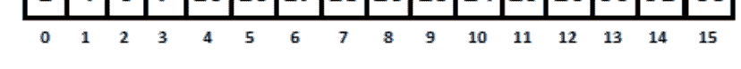

图 14.8 – 包含 16 个元素的有序数组

首先，我们将 x 与数组的中点 p 进行比较。如果相等，则返回。如果 x > p，则搜索数组的右侧并丢弃左侧（搜索空间是数组的右侧）。如果 x < p，则搜索数组的左侧并丢弃右侧（搜索空间是数组的左侧）。以下是二分搜索算法查找数字 17 的图形表示：

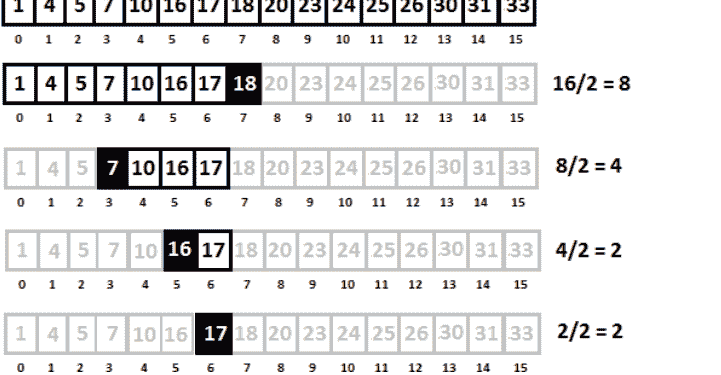

图 14.9 – 二分搜索算法

请注意，我们从 16 个元素开始，到 1 个元素结束。第一步之后，我们减少到 16/2 = 8 个元素。第二步，减少到 8/2 = 4 个元素。第三步，减少到 4/2 = 2 个元素。最后一步，我们找到搜索的数字 17。如果将此算法写成伪代码，则会得到类似以下内容：

```
search 17 in {1, 4, 5, 7, 10, 16, 17, 18, 20,
            23, 24, 25, 26, 30, 31, 33}
compare 17 to 18 -> 17 < 18
```

```
search 17 in {1, 4, 5, 7, 10, 16, 17, 18}
    compare 17 to 7 -> 17 > 7
    search 17 in {7, 10, 16, 17}
        compare 17 to 16 -> 17 > 16
        search 17 in {16, 17}
            compare 17 to 17
            return
```

迭代实现如下所示：

```
public static int runIterative(int[] arr, int p) {

    // the search space is the whole array
    int left = 0;
    int right = arr.length - 1;

    // while the search space has at least one element
    while (left <= right) {

        // half the search space
        int mid = (left + right) / 2;

        // if domain overflow can happen then use:
        // int mid = left + (right - left) / 2;
        // int mid = right - (right - left) / 2;

        // we found the searched element
        if (p == arr[mid]) {
            return mid;
        } // discard all elements in the right of the
            // search space including 'mid'
        else if (p < arr[mid]) {
            right = mid - 1;
        } // discard all elements in the left of the
            // search space including 'mid'
        else {
            left = mid + 1;
```

```
}
}

// by convention, -1 means element not found into the array
return -1;
}
```

完整的应用程序名为 *BinarySearch*。它还包含二分搜索算法的递归实现。在 *第 10 章，数组和字符串* 中，您可以找到利用二分搜索算法的不同编码挑战。

## 编码挑战

到目前为止，我们已经介绍了技术面试中最常见的排序和搜索算法。建议您练习这些算法，因为它们可能会作为独立问题出现，需要伪代码或实现。

话虽如此，让我们解决与排序和搜索算法相关的 18 个问题。

### 编码挑战 1 – 合并两个有序数组

**Amazon, Google, Adobe, Microsoft, Flipkart**

**问题：** 假设给定两个有序数组 *p* 和 *q*。数组 *p* 足够大，可以在其末尾容纳 *q*。编写一段代码，按有序顺序合并 *p* 和 *q*。

**解决方案：** 需要强调一个事实：*p* 末尾有足够的空间容纳 *q*。这暗示解决方案不应该涉及任何辅助空间。解决方案应通过按顺序将 *q* 中的元素插入 *p* 中，以有序顺序输出合并 *p* 和 *q* 的结果。

主要地，我们应该比较 *p* 和 *q* 中的元素，并按顺序将它们插入 *p*，直到处理完 *p* 和 *q* 中的所有元素。让我们看一个揭示此操作的有意义图示（*p* 包含元素 -1、3、8、0、0，而 *q* 包含元素 2、4）：

### 图 14.10 – 合并两个有序数组

让我们逐步查看这个测试用例（用 pIdx 表示 p 中最后一个元素的索引，用 qIdx 表示 q 中最后一个元素的索引）。在上一张图中，pIdx=2（对应元素 8），qIdx=1（对应元素 4）。

第 1 步：我们将 p 中的最后一个元素（索引 pIdx 处的元素）与 q 中的最后一个元素（索引 qIdx 处的元素）进行比较，因此我们将 8 与 4 进行比较。由于 8 > 4，我们将 8 复制到 p 的末尾。由于两个数组都是有序的，8 是这些数组中的最大值，所以它必须放在 p 中的最后一个位置（索引）。它将占用 p 中的一个空槽位（请记住，p 足够大，可以在其末尾容纳 q）。我们将 pIdx 减 1。

第 2 步：我们将 p 中的最后一个元素（索引 pIdx 处的元素）与 q 中的最后一个元素（索引 qIdx 处的元素）进行比较，因此我们将 3 与 4 进行比较。由于 3 < 4，我们将 4 复制到 p 的末尾。我们将 qIdx 减 1。

第 3 步：我们将 p 中的最后一个元素（索引 pIdx 处的元素）与 q 中的最后一个元素（索引 qIdx 处的元素）进行比较，因此我们将 3 与 2 进行比较。由于 3 > 2，我们将 3 复制到 p 的末尾。我们将 pIdx 减 1。

第 4 步：我们将 p 中的最后一个元素（索引 pIdx 处的元素）与 q 中的最后一个元素（索引 qIdx 处的元素）进行比较，因此我们将 -1 与 2 进行比较。由于 -1 < 2，我们将 2 复制到 p 的末尾。我们将 qIdx 减 1。没有更多元素需要比较，p 已有序。

看看吧！每次比较后，我们都会将元素插入 p 的末尾。这样，我们不需要移动任何元素。然而，如果我们选择将元素插入 p 的开头，那么我们必须向后移动元素，以便为每个插入的元素腾出空间。这并不高效！

现在，是时候看看该算法的实现了：

```
public static void merge(int[] p, int[] q) {

    int pLast = p.length - q.length;
    int qLast = q.length;

    if (pLast < 0) {
        throw new IllegalArgumentException("p cannot fit q");
    }

    int pIdx = pLast - 1;
    int qIdx = qLast - 1;
    int mIdx = pLast + qLast - 1;

    // merge p and q
    // start from the last element in p and q
    while (qIdx >= 0) {

        if (pIdx >= 0 && p[pIdx] > q[qIdx]) {
            p[mIdx] = p[pIdx];
            pIdx--;
        } else {
            p[mIdx] = q[qIdx];
            qIdx--;
        }

        mIdx--;
    }
}
```


完整的应用程序名为 *MergeTwoSortedArrays*。如果你想查看/回顾如何合并 *k* 个有序数组，请重新阅读第10章“数组与字符串”中的“以 O(nk log k) 合并 k 个有序数组”编程挑战。

## 编程挑战2——将变位词分组

Adobe、Flipkart

**问题：** 假设你有一个字符串数组（包含从‘a’到‘z’的字符），表示多个混杂在一起的变位词（例如，"calipers"、"caret"、"slat"、"cater"、"thickset"、"spiracle"、"trace"、"last"、"salt"、"bowel"、"crate"、"loop"、"polo"、"thickest"、"below"、"thickets"、"pool"、"elbow"、"replicas"）。编写一段代码，输出该数组，使所有这些变位词被分组在一起（例如，"calipers"、"spiracle"、"replicas"、"caret"、"cater"、"trace"、"crate"、"slat"、"last"、"salt"、"bowel"、"below"、"elbow"、"thickset"、"thickest"、"thickets"、"loop"、"polo"、"pool"）。

**解法：** 首先，这里快速回顾一下变位词。如果两个或多个字符串（单词）包含相同的字符但顺序不同，则它们被视为变位词。

基于该问题给出的示例，让我们定义以下混杂变位词数组：

```
String[] words = {
    "calipers", "caret",  "slat",  "cater",  "thickset",
    "spiracle", "trace",  "last",  "salt",  "bowel",  "crate",
    "loop",  "polo",  "thickest",  "below",  "thickets",
    "pool",  "elbow",  "replicas"
};
```

由于变位词包含完全相同的字符，这意味着如果我们对它们进行排序，那么它们将会是相同的（例如，对"slat"、"salt"和"last"排序后都会得到"alst"）。因此，我们可以通过比较排序后的版本来判断两个字符串（单词）是否为变位词。换句话说，我们只需要一种排序算法。最方便的方法是依赖Java内置的排序算法，即对于基本类型使用双轴快速排序，对于对象使用TimSort。

内置解决方案名为`sort()`，在`java.util.Arrays`类中有许多不同版本（15+种）。其中两种版本具有以下签名：

- `void sort(Object[] a)`
- `<T> void sort(T[] a, Comparator<? super T> c)`

如果我们将字符串（单词）转换为char []，那么我们可以对其字符进行排序，并通过以下辅助方法返回新的字符串：

```
// helper method for sorting the chars of a word
private static String sortWordChars(String word) {

    char[] wordToChar = word.toCharArray();
    Arrays.sort(wordToChar);

    return String.valueOf(wordToChar);
}
```

接下来，我们只需要一个Comparator，它表明互为变位词的两个字符串是等价的：

```
public class Anagrams implements Comparator<String> {

    @Override
    public int compare(String s1, String s2) {
        return sortStringChars(s1).compareTo(sortStringChars(s2));
    }
}
```

最后，我们通过这个compareTo()方法对给定的字符串（单词）数组进行排序：

```
Arrays.sort(words, new Anagrams());
```

然而，这个问题实际上并不要求我们对给定的变位词数组进行排序；问题要求我们将变位词分组打印。为此，我们可以依赖哈希（如果你不熟悉哈希的概念，请阅读第6章“面向对象编程”中的“哈希表”问题）。在Java中，我们可以通过内置的HashMap实现来使用哈希，因此无需从头编写哈希实现。那么这个HashMap有什么用处呢？我们应该在这个映射的条目（键值对）中存储什么？

每一组变位词都会收敛到相同的排序版本（例如，包含字符串（单词）"slat"、"salt"和"last"的变位词组具有唯一且共同的排序版本"alst"）。由于排序版本是唯一的，因此它是我们映射中键的良好候选。接下来，值表示变位词列表。因此，算法非常简单；它包含以下步骤：

1. 遍历给定的单词数组。
2. 对每个单词的字符进行排序。
3. 填充映射（添加或更新映射）。
4. 打印结果。

代码如下：

```
/* Group anagrams via hashing (O(nm log m) */
public void printAnagrams(String words[]) {

    Map<String, List<String>> result = new HashMap<>();

    for (int i = 0; i < words.length; i++) {

        // sort the chars of each string
        String word = words[i];
        String sortedWord = sortWordChars(word);

        if (result.containsKey(sortedWord)) {
            result.get(sortedWord).add(word);
        } else {
            // start a new group of anagrams
            List<String> anagrams = new ArrayList<>();
            anagrams.add(word);
            result.put(sortedWord, anagrams);
        }
    }

    // print the result
    System.out.println(result.values());
}
```

如果n是字符串（单词）的数量，且每个字符串（单词）最多有m个字符，那么上述两种方法的时间复杂度为O(nm log m)。

我们能做得更好吗？要做得更好，我们必须识别上述两种方法的问题。问题在于我们对每个字符串（单词）进行排序，这会花费额外的时间。然而，我们可以使用一个额外的char []来统计字符串（单词）中每个字符出现的次数（频率）。在构造好这个char []后，我们将其转换为String，从而得到必须在HashMap中搜索的键。由于Java处理char类型的方式与处理（无符号）short相同，我们可以用char进行计算。让我们看看代码（wordToChar数组跟踪给定数组中每个字符串（单词）中从a到z的字符频率）：

```
/* Group anagrams via hashing (O(nm)) */
public void printAnagramsOptimized(String[] words) {

    Map<String, List<String>> result = new HashMap<>();

    for (int i = 0; i < words.length; i++) {

        String word = words[i];
        char[] wordToChar = new char[RANGE_a_z];

        // count up the number of occurrences (frequency)
        // of each letter in 'word'
        for (int j = 0; j < word.length(); j++) {
            wordToChar[word.charAt(j) - 'a']++;
        }

        String computedWord = String.valueOf(wordToChar);

        if (result.containsKey(computedWord)) {
            result.get(computedWord).add(word);
        } else {
            List<String> anagrams = new ArrayList<>();
            anagrams.add(word);
            result.put(computedWord, anagrams);
        }
    }
}
```

```
System.out.println(result.values());
}
```

如果*n*是字符串（单词）的数量，且每个字符串（单词）最多包含*m*个字符，那么上述两种方法的时间复杂度为O(nm)。如果你需要支持更多字符，而不仅仅是*a*到*z*，那么请使用`int []`数组和`codePointAt()`方法——更多细节见第10章“数组与字符串”中的“提取代理对代码点”编程挑战。完整的应用程序名为*GroupSortAnagrams*。

## 编程挑战3——未知大小的列表

**问题：** 假设你有一个数据结构，表示一个未知大小的有序列表（这意味着没有`size()`或类似的方法），且只包含正数。该列表的代码如下：

```
public class SizelessList {

    private final int[] arr;

    public SizelessList(int[] arr) {
        this.arr = arr.clone();
    }

    public int peekAt(int index) {
        if (index >= arr.length) {
            return -1;
        }

        return arr[index];
    }
}
```

然而，正如你所见，有一个名为peekAt()的方法，它能在O(1)时间内返回给定索引处的元素。如果给定索引超出了此列表的边界，那么peekAt()返回-1。请编写一段代码，返回元素p出现的索引。

**解法：** 当我们必须搜索一个有序的数据结构（例如，有序数组）时，我们知道二分查找是正确的选择。那么，在这种情况下我们能用二分查找吗？由于给定的列表是有序的，并且我们可以在O(1)时间内访问其任何元素，这意味着二分查找应该是一个不错的选择。除此之外，二分查找算法需要数据结构的大小，因为我们必须将搜索空间减半（例如，list.size()/2）来找到中点。而给定的数据结构（列表）没有暴露其大小。

因此，问题就简化为找到这个列表的大小。我们知道，如果给定索引超出列表边界，peekAt()会返回-1，所以我们可以循环遍历列表并计算迭代次数，直到peekAt()返回-1。当peekAt()返回-1时，我们应该知道列表的大小，从而可以应用二分查找算法。与其逐个元素地循环列表（线性算法），我们不如尝试指数级地循环。因此，与其循环peekAt(1)、peekAt(2)、peekAt(3)、peekAt(4)……，我们改为循环peekAt(1)、peekAt(2)、peekAt(4)、peekAt(8)……。换句话说，与其以O(n)时间完成，我们可以以O(log n)时间完成，其中n是列表的大小。我们能这样做是因为给定的列表是有序的！

下面的代码应该能阐明这种方法以及其余细节：

```
public static int search(SizelessList sl, int element) {
    int index = 1;
    while (sl.peekAt(index) != -1
        && sl.peekAt(index) < element) {
        index *= 2;
    }
    return binarySearch(sl, element, index / 2, index);
}

private static int binarySearch(SizelessList sl,
    int element, int left, int right) {
    int mid;
```


```
while (left <= right) {
	mid = (left + right) / 2;
	int middle = sl.peekAt(mid);
	if (middle > element || middle == -1) {
		right = mid - 1;
	} else if (middle < element) {
		left = mid + 1;
	} else {
		return mid;
	}
}
return -1;
```

完整的应用程序称为 UnknownSizeList。

## 编程挑战 4 – 合并排序一个链表

- Amazon
- Google
- Adobe
- Microsoft
- Flipkart

问题：假设你有一个单链表。编写一段代码，使用归并排序算法对该链表进行排序。

解决方案：解决此问题需要掌握本书中已涵盖的多个主题。首先，你必须熟悉链表。该主题在第 11 章《链表和映射》中进行了介绍。其次，你需要阅读过本章的归并排序部分。

## 590 排序和搜索

遵循归并排序算法，我们必须不断将链表分成两半，直到获得空子列表或仅包含一个元素的子列表为止（这是分而治之的方法）。如果子列表为空或包含一个元素，则按定义已排序——这称为基本情况递归。以下图表展示了初始链表 2 → 1 → 4 → 9 → 8 → 3 → 7 → null 的此过程：

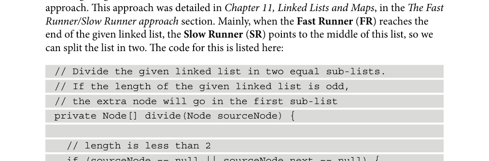

可以通过快速跑者/慢速跑者方法来执行这种分割给定的链表的方式。该方法在第 11 章《链表和映射》中，*快速跑者/慢速跑者方法*部分进行了详细介绍。主要来说，当快速跑者（FR）到达给定链表的末尾时，慢速跑者（SR）指向该列表的中间，因此我们可以将其拆分为两部分。代码如下所示：

// Divide the given linked list in two equal sub-lists.
// If the length of the given linked list is odd,
// the extra node will go in the first sub-list
private Node[] divide(Node sourceNode) {
	// length is less than 2
	if (sourceNode == null || sourceNode.next == null) {
		return new Node[]{sourceNode, null};
	}
	Node fastRunner = sourceNode.next;
	Node slowRunner = sourceNode;
	// advance 'firstRunner' two nodes,
	// and advance 'secondRunner' one node
```

```
while (fastRunner != null) {
  fastRunner = fastRunner.next;
  if (fastRunner != null) {
    slowRunner = slowRunner.next;
    fastRunner = fastRunner.next;
  }
}

// 'secondRunner' is just before the middle point
// in the list, so split it in two at that point
Node[] headsOfSublists = new Node[] {
  sourceNode, slowRunner.next
};
  slowRunner.next = null;
  return headsOfSublists;
}
```

其余代码是经典的归并排序实现。sort() 方法负责递归排序子列表。接下来，merge() 方法通过反复从已排序的子列表中取出最小元素，一次一个地将元素放回原始链表：

// sort the given linked list via the Merge Sort algorithm
public void sort() {
  head = sort(head);
}

private Node sort(Node head) {
  if (head == null || head.next == null) {
    return head;
  }

  // split head into two sublists
  Node[] headsOfSublists = divide(head);
}
```

```
Node head1 = headsOfSublists[0];
Node head2 = headsOfSublists[1];

// recursively sort the sublists
head1 = sort(head1);
head2 = sort(head2);

// merge the two sorted lists together
return merge(head1, head2);
}

// takes two lists sorted in increasing order, and merge
// their nodes together (which is returned)
private Node merge(Node head1, Node head2) {

    if (head1 == null) {
        return head2;
    } else if (head2 == null) {
        return head1;
    }

    Node merged;

    // pick either 'head1' or 'head2'
    if (head1.data <= head2.data) {
        merged = head1;
        merged.next = merge(head1.next, head2);
    } else {
        merged = head2;
        merged.next = merge(head1, head2.next);
    }

    return merged;
}
```

完整的应用程序称为 *MergeSortSinglyLinkedList*。对双向链表进行排序非常相似。你可以在名为 *MergeSortDoublyLinkedList* 的应用程序中找到这样的实现。

## 编程挑战 5 – 夹杂空字符串的字符串

**Amazon, Google, Adobe, Microsoft, Flipkart**

**问题**：假设你有一个包含空字符串的已排序字符串数组。编写一段代码，返回给定非空字符串的索引。

**解决方案**：当我们必须在已排序的数据结构中搜索（例如在已排序数组中）时，我们知道二分搜索算法是正确选择。那么，在这种情况下我们能使用二分搜索吗？我们知道给定数组的大小，因此我们可以将搜索空间减半并找到中间点。如果我们将数组的索引 0 表示为 *left*，而 *array.length-1* 表示为 *right*，那么我们可以写出 *mid = (left + right) / 2*。因此，*mid* 是给定数组的中间点。

但如果 *mid* 索引落在空字符串上，我们该怎么办？在这种情况下，我们不知道应该去 *right* 还是 *left*。换句话说，应该丢弃哪一半，继续搜索时应该使用哪一半？答案可以在以下图表中找到（给定的字符串为 "cat", "", "", "", "", "", "", "rear", ""）：

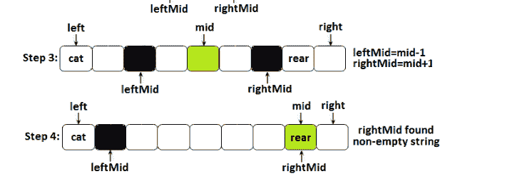

图 14.12 – 在空字符串情况下计算中间点

因此，当中间点 (*mid*) 落在空字符串上时，我们必须通过将其移动到最近的非空字符串来修正其索引。如前述图表的 *步骤 2* 所示，我们选择 *leftMid* 为 *mid-1*，*rightMid* 为 *mid+1*。我们不断远离 *mid* 移动，直到 *leftMid* 或 *rightMid* 索引指向一个非空字符串（在前述图表中，*rightMid* 在 *步骤 3 和 4* 后找到了字符串 "rear"）。当这种情况发生时，我们更新 *mid* 位置并继续经典的二分搜索（*步骤 4*）。

就代码而言，这非常直接：

```
public static int search(String[] stringsArr, String str) {
    return search(stringsArr, str, 0, stringsArr.length - 1);
}

private static int search(String[] stringsArr,
    String str, int left, int right) {
    if (left > right) {
        return -1;
    }

    int mid = (left + right) / 2;

    // since mid is empty we try to find the
    // closest non-empty string to mid
    if (stringsArr[mid].isEmpty()) {

        int leftMid = mid - 1;
        int rightMid = mid + 1;

        while (true) {

            if (leftMid < left && rightMid > right) {
                return -1;
            } else if (rightMid <= right
                && !stringsArr[rightMid].isEmpty()) {
                mid = rightMid;
                break;
```

**解决方案：** 解决此问题的方案必须包含一个额外的队列，因此我们必须思考如何在排序给定队列时使用这个额外队列。有不同的方法，但对于面试来说，一个方便的方法可以总结如下：

- 1. 只要从给定队列中取出元素是按升序排列的（从队列前端开始），我们就将其出队并入队到额外队列中。
- 2. 如果某个元素破坏了前述陈述，则将其出队并重新入队到给定队列中，而不触及额外队列。
- 3. 通过 *步骤 1* 或 *2* 处理完所有元素后，我们将所有元素从额外队列中出队并重新入队到给定队列中。
- 4. 只要额外队列的大小不等于给定队列的初始大小，我们就从 *步骤 1* 开始重复，因为队列尚未排序。

假设给定队列包含以下元素：rear → 3 → 9 → 1 → 8 → 5 → 2 → front。以下图表表示给定队列和额外队列（最初为空）：

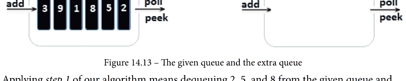

图 14.13 – 给定队列和额外队列

应用我们算法的 *步骤 1* 意味着从给定队列中出队 2、5 和 8 并将它们入队到额外队列中，如下图所示：

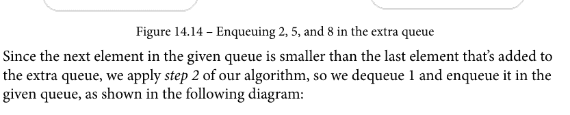

图 14.14 – 将 2、5 和 8 入队到额外队列

由于给定队列中的下一个元素小于添加到额外队列的最后一个元素，我们应用我们算法的 *步骤 2*，因此我们出队 1 并将其入队到给定队列中，如下图所示：


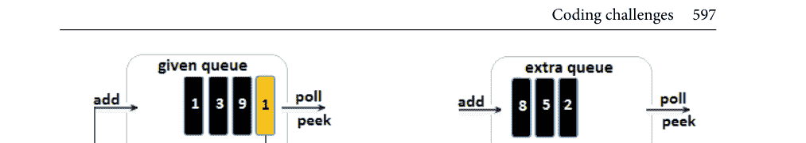

此外，因为9（给定队列的队首）大于添加到额外队列的最后一个元素（8），所以我们再次应用步骤1。因此，9进入额外队列，如下图所示：

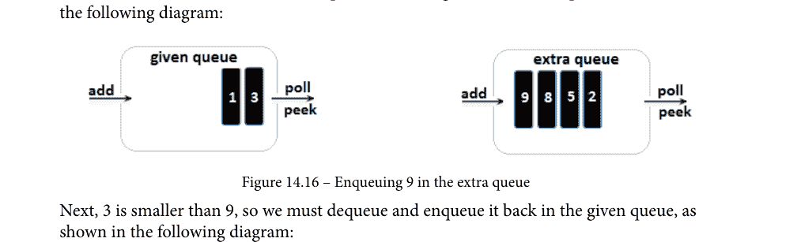

接下来，3小于9，所以我们必须将其出队并重新入队到给定队列中，如下图所示：

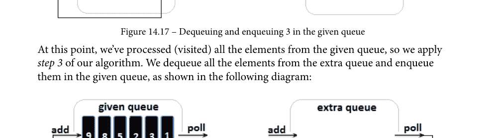

此时，我们已经处理（访问）了给定队列中的所有元素，因此应用算法的步骤3。我们将所有元素从额外队列中出队，并将它们入队到给定队列中，如下图所示：


现在，我们重复整个过程，直到给定队列按升序排序。让我们看看代码：

```
public static void sort(Queue<Integer> queue) {
if (queue == null || queue.size() < 2) {
return;
}

// this is the extra queue
Queue<Integer> extraQueue = new ArrayDeque<>();

int count = 0; // count the processed elements
boolean sorted = false; // flag when sorting is done

int queueSize = queue.size(); // size of the given queue
int lastElement = queue.peek(); // we start from the front
// of the given queue

while (!sorted) {
// Step 1
if (lastElement <= queue.peek()) {
lastElement = queue.poll();
extraQueue.add(lastElement);
} else { // Step 2
queue.add(queue.poll());
}
}

// still have elements to process
count++;
if (count != queueSize) {
continue;
}

// Step 4
if (extraQueue.size() == queueSize) {
sorted = true;
}
}
```

```
}

// Step 3
while (extraQueue.size() > 0) {
    queue.add(extraQueue.poll());
    lastElement = queue.peek();
}

count = 0;
}
}
```

这段代码的运行时为O(n²)。完整的应用称为*SortQueueViaTempQueue*。

## 编程挑战7——不使用额外空间对队列进行排序

**亚马逊、谷歌、Adobe、微软、Flipkart**

**问题**：假设给定一个整数队列。编写一段代码，在不使用额外空间的情况下对该队列进行排序。

**解决方案**：在前面的问题中，我们必须解决相同的问题，但使用了额外的队列。这次我们不能使用额外的队列，因此必须原地对队列进行排序。

我们可以将排序视为一个持续的过程：从给定队列中找到最小元素，将其从当前位置提取出来，并添加到该队列的尾部。扩展这个想法可能得到以下算法：

- 1. 将当前最小值视为`Integer.MAX_VALUE`。
- 2. 从队列的未排序部分（最初，未排序部分是整个队列）中取出一个元素。
- 3. 将此元素与当前最小值进行比较。
- 4. 如果此元素小于当前最小值，则执行以下操作：
  - a. 如果当前最小值是Integer.MAX_VALUE，则此元素成为当前最小值，我们不再将其重新入队。
  - b. 如果当前最小值不是Integer.MAX_VALUE，则我们将当前最小值重新入队，并且此元素成为当前最小值。
- 5. 如果此元素大于当前最小值，则将其重新入队。
- 6. 从步骤2开始重复，直到遍历完整个未排序部分。
- 7. 此时，当前最小值是整个未排序部分的最小值，因此我们将其重新入队。
- 8. 设置未排序部分的新边界，并从步骤1开始重复，直到未排序部分的大小为0（每次执行此步骤时，未排序部分的大小减少1）。

下图是此算法对队列的快照；即，rear → 3 → 9 → 1 → 8 → 5 → 2 → front：

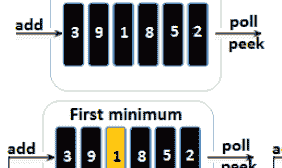

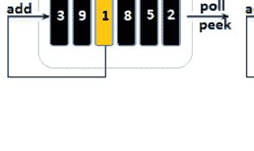

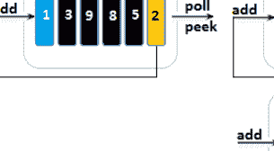

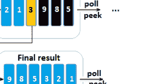

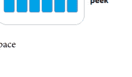

图14.19——不使用额外空间对队列进行排序

请注意，未排序部分（最初是整个队列）的每个最小值如何被添加回队列，并成为队列已排序部分的一员。让我们看看代码：

```
public static void sort(Queue<Integer> queue) {

    // traverse the unsorted part of the queue
    for (int i = 1; i <= queue.size(); i++) {

        moveMinToRear(queue, queue.size() - i);
    }
}

// find (in the unsorted part) the minimum
// element and move this element to the rear of the queue
private static void moveMinToRear(Queue<Integer> queue,
        int sortIndex) {

    int minElement = Integer.MAX_VALUE;
    boolean flag = false;

    int queueSize = queue.size();
    for (int i = 0; i < queueSize; i++) {

        int currentElement = queue.peek();

        // dequeue
        queue.poll();

        // avoid traversing the sorted part of the queue
        if (currentElement <= minElement && i <= sortIndex) {

            // if we found earlier a minimum then
            // we put it back into the queue since
            // we just found a new minimum
            if (flag) {
                queue.add(minElement);
            }
```

```
flag = true;
minElement = currentElement;
} else {
// enqueue the current element which is not the minimum
queue.add(currentElement);
}
}

// enqueue the minimum element
queue.add(minElement);
}
```

这段代码的运行时为O(n²)。完整的应用称为*SortQueueWithoutExtraSpace*。

## 编程挑战8——借助另一个堆栈对堆栈进行排序

**亚马逊、谷歌、Adobe、微软、Flipkart**

**问题**：假设给定一个未排序的堆栈。编写一段代码，按降序或升序对该堆栈进行排序。你只能使用一个额外的临时堆栈。

**解决方案**：如果我们能使用两个额外的堆栈，那么我们可以实现一个算法，反复在给定堆栈中查找最小值，并将其推入最终或结果堆栈。在搜索给定堆栈时，第二个额外堆栈将用作缓冲区。然而，问题要求我们只使用一个额外的临时堆栈。

由于这个限制，我们不得不从给定堆栈（我们将其记为s1）中弹出，并按顺序推入额外堆栈（我们将其记为s2）。为此，我们使用一个临时或辅助变量（我们将其记为t），如下图所示（给定堆栈是top → 1 → 4 → 5 → 3 → 1 → 2）：

### 图14.20——对堆栈进行排序

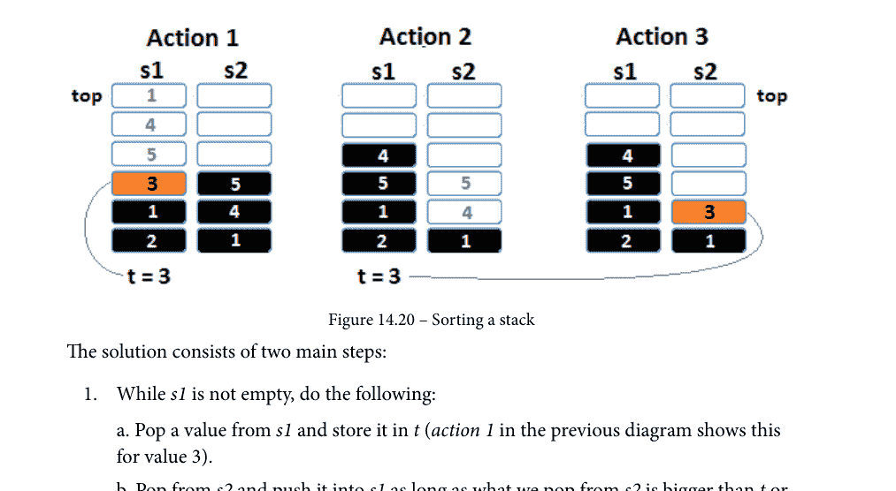

解决方案包括两个主要步骤：

- 1. 当s1不为空时，执行以下操作：
  - a. 从s1弹出一个值并将其存储在t中（上图中的动作1显示了值3的情况）。
  - b. 只要从s2中弹出的值大于t，或者s2不为空，就从s2中弹出并推入s1（上图中的动作2）。
  - c. 将t推入s2（上图中的动作3）。
- 2. 步骤1完成后，s1为空，s2已排序。最大的值在底部，因此结果堆栈是top → 5 → 4 → 3 → 2 → 1 → 1。第二步包括将s2复制到s1中。这样，s1按s2的逆序排序，因此最小的值位于s1的顶部（top → 1 → 1 → 2 → 3 → 4 → 5）。

让我们看看代码：

```
public static void sort(Stack<Integer> stack) {
    Stack<Integer> auxStack = new Stack<>();
    // Step 1 (a, b and c)
    while (!stack.isEmpty()) {
        int t = stack.pop();
        while (!auxStack.isEmpty() && auxStack.peek() > t) {
            stack.push(auxStack.pop());
        }
    }
```

```
}

auxStack.push(t);
}

// Step 2
while (!auxStack.isEmpty()) {
    stack.push(auxStack.pop());
}
}
```

完整的代码称为*SortStack*。

## 编程挑战9——原地对堆栈进行排序

**亚马逊、谷歌、Adobe、微软、Flipkart**

**问题**：假设给定一个未排序的堆栈。编写一段代码，原地对该堆栈进行排序。请注意，此问题的一个变体会明确提到你不能使用任何重复语句，例如`for`、`while`等。

**解决方案**：在前面的问题中，我们必须解决相同的问题，但使用了一个显式的额外堆栈。这次我们不能使用显式的额外堆栈，因此必须原地对堆栈进行排序。

让我们假设给定的堆栈是top → 4 → 5 → 3 → 8 → 2 → 1。解决方案从弹出堆栈中的值开始，直到堆栈为空。之后，我们将递归调用堆栈中的值按排序位置插入回给定堆栈中。

让我们尝试将此方法应用于我们的堆栈。下图揭示了从堆栈中弹出值直到堆栈为空的过程。左侧是初始状态，右侧是结果：


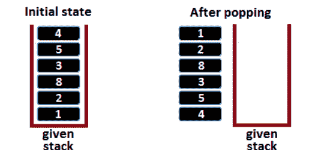

Figure 14.21 – Sorting the stack in place (1)

接下来，只要当前要压入的元素小于栈顶元素或栈为空，我们就继续将元素压回栈中。因此，我们会压入 1、2 和 8。我们不压入 3（下一个要压入的元素），因为 3 小于 8（你可以在下面的图中将此语句视为动作 1）。此时，我们需要为 3 腾出空间，因此必须弹出栈顶元素 8（你可以在下面的图中将此语句视为动作 2）。最后，我们压入 3，然后再将 8 压入栈中（你可以在下面的图中将此语句视为动作 3）：

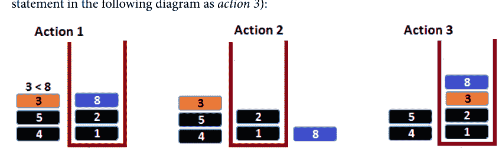

Figure 14.22 – Sorting the stack in place (2)

到目前为止，一切顺利！接下来，我们必须重复前面图中展示的流程。因此，从递归调用栈中要压入给定栈的下一个元素是 5。但 5 小于 8，所以我们无法将其压入（你可以在下面的图中将此语句视为动作 1）。此时，我们需要为 5 腾出空间，因此必须弹出栈顶元素，即 8（你可以在下面的图中将此语句视为动作 2）。最后，我们压入 5，然后再将 8 压入栈中（你可以在下面的图中将此语句视为动作 3）：

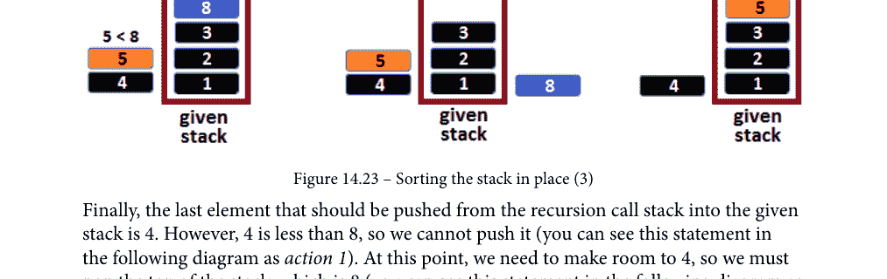

最后，从递归调用栈中要压入给定栈的最后一个元素是 4。然而，4 小于 8，所以我们无法将其压入（你可以在下面的图中将此语句视为动作 1）。此时，我们需要为 4 腾出空间，因此必须弹出栈顶元素，即 8（你可以在下面的图中将此语句视为动作 2）。然而，我们仍然无法将 4 压入栈中，因为 4 小于 5（弹出 8 后的新栈顶元素）。我们还必须弹出 5（你可以在下面的图中将此语句视为动作 3）。现在，我们可以压入 4。接下来，我们压入 5 和 8。你可以在下面的图中将此视为动作 4：

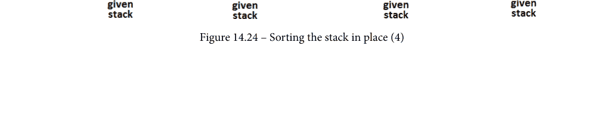

完成！给定栈已被排序。让我们看看代码：

```
public static void sort(Stack<Integer> stack) {
	// stack is empty (base case)
	if (stack.isEmpty()) {
		return;
	}
	// remove the top element
	int top = stack.pop();
	// apply recursion for the remaining elements in the stack
	sort(stack);
	// insert the popped element back in the sorted stack
	sortedInsert(stack, top);
}

private static void sortedInsert(
	Stack<Integer> stack, int element) {
	// the stack is empty or the element
	// is greater than all elements in the stack (base case)
	if (stack.isEmpty() || element > stack.peek()) {
		stack.push(element);
		return;
	}
	// the element is smaller than the top element,
	// so remove the top element
	int top = stack.pop();
	// apply recursion for the remaining elements in the stack
	sortedInsert(stack, element);
	// insert the popped element back in the stack
	stack.push(top);
}
```

因此，如果我们将给定的矩阵视为一个数组，那么我们可以将对已排序数组应用二分查找的问题简化。没有必要物理地将矩阵转换为数组。我们需要做的只是使用以下语句相应地表达二分查找：

- 数组的最左整数位于索引 0（我们将其表示为 *left*）。
- 数组的最右整数位于索引 (*rows* * *cols*) - 1（我们将其表示为 *right*）。
- 数组的中间点位于 (*left* + *right*) / 2。
- 中间点索引处的整数位于 *matrix[mid / cols][mid % cols]*，其中 *cols* 是矩阵中的列数。

有了这些语句，我们可以编写以下实现：

```
public static boolean search(int[][] matrix, int element) {
    int rows = matrix.length;      // number of rows
    int cols = matrix[0].length; // number of columns

    // search space is an array as [0, (rows * cols) - 1]
    int left = 0;
    int right = (rows * cols) - 1;

    // start binary search
    while (left <= right) {
        int mid = (left + right) / 2;
        int midElement = matrix[mid / cols][mid % cols];

        if (element == midElement) {
            return true;
        } else if (element < midElement) {
            right = mid - 1;
        } else {
            left = mid + 1;
        }
    }
}
```
```
return false;
}
```

前面的代码以 O(log mn) 的时间执行，其中 m 是给定矩阵的行数，n 是列数。该应用程序称为 SearchInFullSortedMatrix。

## Coding challenge 11 – Searching in a sorted matrix

Amazon, Microsoft, Flipkart

Problem: Consider you’ve been given a sorted matrix of integers of size rows x cols. Each row and each column are sorted in ascending order. Write a snippet of code that returns true if a given integer is in this matrix.

Solution: 请注意，这个问题不像之前的编码挑战，因为每一行的第一个整数不一定大于前一行的最后一个整数。如果我们应用二分查找算法（就像我们对之前的编码挑战所做的那样），那么我们必须对每一行应用它。由于二分查找的时间复杂度为 O(log n)，并且我们必须对每一行应用它，这意味着这种方法将以 O(m log n) 的时间执行，其中 m 是给定矩阵的行数，n 是列数。

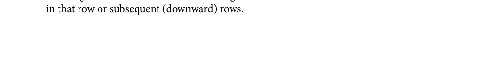

假设我们搜索元素 80，它可以在 (2, 3) 处找到。让我们尝试推断这个位置。这个推断的高潮围绕着矩阵具有已排序的行和列这一事实。让我们分析列的开头：如果某列的开头大于 80（例如第 4 列），那么我们知道 80 不可能在该列中，因为该列的开头是该列中的最小元素。此外，80 不可能在该列右侧的任何列中找到，因为从左到右每列的起始元素必须增大。此外，我们可以对行应用相同的逻辑。如果某行的开头大于 80，那么我们知道 80 不可能在该行或其后的（向下）行中。

现在，如果我们查看列和行的末尾，我们可以推断出一些类似的结论（镜像结论）。如果某列的末尾小于 80（例如第 2 列），那么我们知道 80 不可能在该列中，因为该列的末尾是该列中的最大元素。此外，80 不可能在该列左侧的任何列中找到，因为从右到左每列的起始元素必须减小。此外，我们可以对行应用相同的逻辑。如果某行的末尾小于 80，那么我们知道 80 不可能在该行或其后的（向上）行中。

如果我们将这些结论对元素 p 进行连接、综合和概括，那么我们可以推断出以下内容：

- 如果某列的开头大于 p，则 p 必须在该列的左侧。
- 如果某行的开头大于 p，则 p 必须在该行的上方。
- 如果某列的末尾小于 p，则 p 必须在该列的右侧。
- 如果某行的末尾小于 p，则 p 必须在该行的下方。

这已经开始看起来像一个算法了。不过，我们还必须决定一件事。我们从哪里开始？从哪一行和哪一列开始？幸运的是，我们有几个选择。例如，我们可以从最大列（0，最后一个列）开始并向左工作在同一行，或从最大行（最后一行，0）开始并向上工作在同一列。

假设我们选择从最大列（0，最后一个列）开始并向左查找元素 p。这意味着我们的流程将如下所示（我们令 i=0 且 j=cols-1）：

- 1. 如果 matrix[i][j] > p，则在同一行向左移动。该列中的元素肯定大于 matrix[i][j]，因此也大于 p。所以，我们丢弃当前列，将 j 减 1，并重复。
- 2. 如果 matrix[i][j] < p，则在同一列向下移动。该行中的元素肯定小于 matrix[i][j]，因此也小于 p。所以，我们丢弃当前行，将 i 加 1，并重复。
- 3. 如果 p 等于 matrix[i][j]，返回 true。


如果我们将此算法应用于在我们的 4 x 6 矩阵中查找元素 80，那么从 (0, 5) 到 (2, 3) 的路径如下：

|   | 0 | 1 | 2 | 3 | 4 | 5 |
|---|----|----|----|----|----|----|
| 0 | 11 | 22 | 48 | 77 | 78 | 84 |
| 1 | 12 | 24 | 55 | 78 | 83 | 90 |
| 2 | 25 | 56 | 58 | 80 | 85 | 95 |
| 3 | 33 | 57 | 60 | 85 | 86 | 99 |

Figure 14.27 – Path to the solution

如果我们将此算法放入代码中，则得到以下内容：

```
public static boolean search(int[][] matrix, int element) {

    int row = 0;
    int col = matrix[0].length - 1;

    while (row < matrix.length && col >= 0) {

        if (matrix[row][col] == element) {
            return true;
        } else if (matrix[row][col] > element) {
            col--;
        } else {
            row++;
        }
    }

    return false;
}
```

该算法的时间复杂度为 O(m+n)，其中 m 是行数，n 是列数。完整的应用程序称为 SearchInSortedMatrix。它还包含此算法的递归实现。

## Coding challenge 12 – First position of first one

Amazon, Google, Adobe

Problem: Consider you’ve been given an array that contains only values of 0 and 1. There is at least a 0 and a 1. All 0s comes first, followed by 1s. Write a snippet of code that returns the index of the first 1 in this array.

Solution: Consider the array arr=[0, 0, 0, 1, 1, 1, 1]. The searched index is 3 since arr[3] is 1, and this is the first 1.

Since 0s comes first, followed by 1s, the array is sorted.

> Note
> Since this is a very common topic in interviews, I’ll say it again: when we have to find something in a sorted array, we have to consider the Binary Search algorithm.

In this case, the Binary Search algorithm can be implemented quite easily. The middle point that’s computed in Binary Search can fall on 0 or 1. Since the array is sorted, if the middle point falls on 0, then we know for sure that the first value of 1 must be on the right-hand side of the middle point, so we discard the left-hand side of the middle point. On the other hand, if the middle point falls on 1, then we know that the first value of 1 must on the left-hand side of the middle point, so we discard the right-hand side of the middle point. The following code clarifies this:

```
public static int firstOneIndex(int[] arr) {
    if (arr == null) {
        return -1;
    }
    int left = 0;
    int right = arr.length - 1;
    while (left <= right) {
        int middle = left + (right - left) / 2;
        if (arr[middle] == 0) {
            left = middle + 1;
        } else {
            right = middle - 1;
        }
    }
    if (arr[left] == 1) {
        return left;
    }
    return -1;
}
```

The complete application is called PositionOfFirstOne.

## Coding challenge 13 – Maximum difference between two elements

Problem: Consider you've been given an array of integers, arr. Write a snippet of code that return the maximum difference between two elements when the larger integer appears after the smaller integer.

Solution: Let's consider several examples.

If the given array is 1, 34, 21, 7, 4, 8, 10, then the maximum difference is 33 (computed as 34 (index 1) - 1 (index 0)). If the given arrays is 17, 9, 2, 26, 32, 27, 3, then the maximum difference is 30 (computed as 32 (index 4) - 2 (index 2)).

How about an array sorted in ascending order, such as 3, 7, 9, 11? In this case, the maximum difference is 11 - 3 = 8, so this is the difference between the maximum and the minimum element. How about an array sorted in descending order such as 11, 9, 7, 6? In this case, the maximum difference is 6 - 7 = -1, so the maximum difference is the difference closest to 0.

Based on these examples, we can think of several solutions. For example, we can start by computing the minimum and maximum of the array. Next, if the index of the maximum is greater than the index of the minimum, then the maximum difference is the difference between the maximum and the minimum of the array. Otherwise, we need to compute the next minimum and maximum of the array and repeat this process. This can lead to a complexity time of O(n²).

This code runs in O(n) time. The complete application is called *MaxDiffBetweenTwoElements.*

## Coding challenge 14 – Stream ranking

**Problem:** Consider you’ve been given a stream of integers (such as a continuous flux of integer values). Periodically, we want to inspect the rank of a given integer, *p*. By rank, we understand the number of values less than or equal to *p*. Implement the data structure and algorithm that supports this operation.

**Solution:** Let’s consider the following stream: 40, 30, 45, 15, 33, 42, 56, 5, 17, 41, 67. The rank of 45 is 8, the rank of 5 is 0, the rank of 17 is 2, and so on.

The brute-force approach may work on a sorted array. Each time a new integer is generated, we add it to this array. While this will be very convenient for returning the rank of a given integer, this approach has an important drawback: each time we insert an element, we have to shift the elements greater than the new integer to make room for it. This is needed to maintain the array when it’s sorted in ascending order.

A much better choice consists of a **Binary Search Tree (BST)**. A BST maintains a relative order and inserting a new integer will update the tree accordingly. Let’s add the integers from our stream to a Binary Search Tree, as follows:

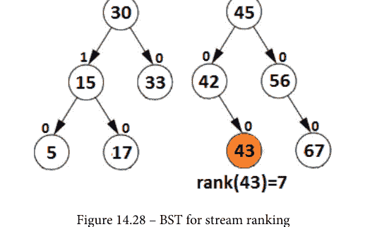

Figure 14.28 – BST for stream ranking

Let’s suppose that we want to find rank 43. First, we compare 43 with the root and we conclude that 43 must be in the right sub-tree of the root, 40. However, the root has 5 nodes in its left sub-tree (obviously, all of them are smaller than the root), so the rank of 43 is at least 6 (5 nodes of the left sub-tree of the root, plus the root). Next, we compare 43 with 45 and we conclude that 43 must be to the left of 45, so the rank remains 5. Finally, we compare 43 with 42, and we conclude that 43 must be in the right sub-tree of 42. The rank must be increased by 1, so the rank of 43 is 7.

So, how can we generalize this example with an algorithm? Here, we noticed that, for each node, we already know the rank of its left sub-tree. This doesn’t need to be computed each time the rank is required since this will be quite inefficient. We can track and update the rank of the left sub-tree each time a new element is generated and inserted into the tree. In the preceding diagram, each node has its sub-tree rank highlighted above the node. When the rank of a node is required, we already know the rank of its left sub-tree. Next, we have to consider the following recursive steps, which are applied via
int getRank(Node node, int element):

+   1. If element is equal to node.element, then return node.leftTreeSize.
+   2. If element is on the left of node, then return getRank(node.left, element).
+   3. If element is on the right of node, then return node.leftTreeSize + 1 + getRank(node.right, element).

If the given integer is not found, then we return -1. The relevant code is listed here:

```
public class Stream {

    private Node root = null;

    private class Node {

        private final int element;
        private int leftTreeSize;
        private Node left;
        private Node right;

        private Node(int element) {
            this.element = element;
            this.left = null;
            this.right = null;
        }
    }

    /* add a new node into the tree */
    public void generate(int element) {

        if (root == null) {
            root = new Node(element);
        } else {
            insert(root, element);
        }
    }

    private void insert(Node node, int element) {

        if (element <= node.element) {
            if (node.left != null) {
                insert(node.left, element);
            } else {
                node.left = new Node(element);
            }
            node.leftTreeSize++;
        } else {
            if (node.right != null) {
                insert(node.right, element);
            } else {
                node.right = new Node(element);
            }
        }
    }

    /* return rank of 'element' */
    public int getRank(int element) {
        return getRank(root, element);
    }
}
```


```java
private int getRank(Node node, int element) {
    if (element == node.element) {
        return node.leftTreeSize;
    } else if (element < node.element) {
        if (node.left == null) {
            return -1;
        } else {
            return getRank(node.left, element);
        }
    } else {
        int rightTreeRank = node.right == null
            ? -1 : getRank(node.right, element);
        if (rightTreeRank == -1) {
            return -1;
        } else {
            return node.leftTreeSize + 1 + rightTreeRank;
        }
    }
}
```

上述代码在平衡树上运行时间为 O(log n)，在非平衡树上运行时间为 O(n)，其中 n 是树中节点的数量。完整的应用程序名为 RankInStream。

## 编程挑战 15 – 峰与谷

- Amazon, Google, Adobe, Microsoft, Flipkart

**问题：** 假设你有一个表示地形高程的正整数数组。如果数组中的某个整数大于或等于其邻居（相邻整数），那么这个整数被称为峰。另一方面，如果数组中的某个整数小于或等于其邻居（相邻整数），那么这个整数被称为谷。例如，对于数组 4, 5, 8, 3, 2, 1, 7, 8, 5, 9，我们可以看到 8（两个都是）和 9 是峰，而 4、1 和 5（最后一个除外）是谷。请编写一段代码，将给定数组排序为峰与谷交替的序列。

**解决方案：** 乍一看，一种简便的解决方案是先按升序对数组排序。一旦数组排序为 *l1 ≤ l2 ≤ l3 ≤ l4 ≤ l5 ...*，我们可以将每个三元组视为 *l1 ≤ l2 ≤ l3*。如果我们交换 *l2* 和 *l3*，那么 *l1 ≤ l3 ≥ l2*，因此 *l3* 成为一个峰。对于下一个三元组，*l2 ≤ l4 ≤ l5*，我们交换 *l4* 和 *l5* 得到 *l2 ≤ l5 ≥ l4*，因此 *l5* 是一个峰。对于下一个三元组，*l4 ≤ l6 ≤ l7*，我们交换 *l6* 和 *l7* 得到 *l4 ≤ l7 ≥ l6*，因此 *l7* 是一个峰。如果我们继续这些交换，就会得到类似这样的结果：*l1 ≤ l3 ≥ l2 ≤ l5 ≥ l4 ≤ l7 ≥ l6 ...*。但这高效吗？由于我们必须对数组排序，可以说该解决方案的时间复杂度为 O(n log n)。我们能做得更好吗？是的，可以！假设我们的数组表示如下：

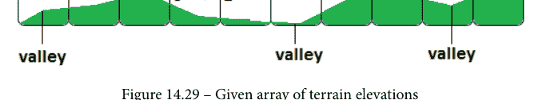

图 14.29 – 给定的地形高程数组

现在，我们可以清楚地看到给定数组中的峰与谷。如果我们关注第一个三元组 (4, 5, 8) 并尝试得到一个峰，那么我们必须将中间的值 (5) 与其邻居（相邻整数）中的最大值交换。因此，通过将 5 与 max(4, 8) 交换，我们得到 (4, 8, 5)。因此，8 是一个峰，可以表示如下：

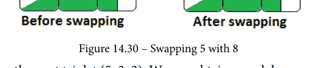

图 14.30 – 将 5 与 8 交换

接下来，让我们关注下一个三元组 (5, 3, 2)。我们可以通过将 3 与 max(5, 2) 交换来得到一个峰，也就是将 3 与 5 交换。结果如下所示：(3, 5, 2)。

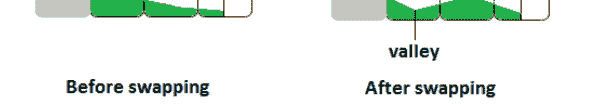

图 14.31 – 将 3 与 5 交换

现在，5 是峰，3 是谷。我们应该继续处理三元组 (2, 1, 7)，将 1 与 7 交换，得到峰 (2, 7, 1)。下一个三元组将是 (1, 8, 5)，其中 8 是峰（无需交换）。最终，我们得到最终结果，如下图所示：

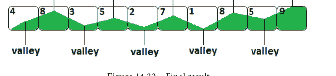

图 14.32 – 最终结果

面试官会希望你注意细节并提及它们。例如，当我们将中间值与左值交换时，是否会破坏已经处理过的地形？是否会破坏谷或峰？答案是否定的，我们不会破坏任何东西。这是因为当我们交换中间值和左值时，我们已经知道中间值小于左值，并且左值是一个谷。因此，我们只是通过在那个位置添加一个更小的值，创造了一个更深的谷。

基于这些陈述，实现非常简单。下面的代码将阐明任何剩余的细节：

```java
public static void sort(int[] arr) {
    for (int i = 1; i < arr.length; i += 2) {
        int maxFoundIndex = maxElementIndex(arr, i - 1, i, i + 1);
        if (i != maxFoundIndex) {
            swap(arr, i, maxFoundIndex);
        }
    }
}

private static int maxElementIndex(int[] arr,
    int left, int middle, int right) {
    int arrLength = arr.length;
    int leftElement = left >= 0 && left < arrLength
        ? arr[left] : Integer.MIN_VALUE;
    int middleElement = middle >= 0 && middle < arrLength
        ? arr[middle] : Integer.MIN_VALUE;
    int rightElement = right >= 0 && right < arrLength
        ? arr[right] : Integer.MIN_VALUE;

    int maxElement = Math.max(leftElement,
        Math.max(middleElement, rightElement));

    if (leftElement == maxElement) {
        return left;
    } else if (middleElement == maxElement) {
        return middle;
    } else {
        return right;
    }
}
```

这段代码的时间复杂度为 O(n)。完整的应用程序名为 *PeaksAndValleys*。

## 编程挑战 16 – 最近的左侧较小数

- Amazon, Google, Adobe, Microsoft, Flipkart

**问题：** 假设给你一个整数数组 *arr*。编写一段代码，为每个元素找出并打印其左侧最近的较小数，即该较小元素位于左侧。

**解决方案：** 让我们考虑给定的数组，即 4, 1, 8, 3, 8, 2, 6, 7, 4, 9。预期结果是 _, _, 1, 1, 3, 1, 2, 6, 2, 4。从左到右，我们有：

- *arr*[0]=4，其左侧没有元素，所以我们打印 _。
- *arr*[1]=1，其左侧没有比它更小的元素，所以我们打印 _。
- *arr*[2]=8，其左侧最近的较小元素是 1，所以我们打印 1。
- *arr*[3]=3，其左侧最近的较小元素是 1，所以我们打印 1。
- *arr*[4]=8，其左侧最近的较小元素是 3，所以我们打印 3。
- *arr*[5]=2，其左侧最近的较小元素是 1，所以我们打印 1。
- *arr*[6]=6，其左侧最近的较小元素是 2，所以我们打印 2。
- *arr*[7]=7，其左侧最近的较小元素是 6，所以我们打印 6。
- *arr*[8]=4，其左侧最近的较小元素是 2，所以我们打印 2。
- *arr*[9]=9，其左侧最近的较小元素是 4，所以我们打印 4。

一个简单但低效的解决方案依赖于两个循环。外层循环可以从第二个元素（索引 1）开始，直到数组的长度（*arr.length* - 1），而内层循环遍历外层循环所选元素左侧的所有元素。一旦找到一个更小的元素，它就停止该过程。这样的算法非常容易实现，但其时间复杂度为 O(n²)。

然而，我们可以通过栈将时间复杂度降低到 O(n)。主要地，我们可以从 0 到 *arr.length* - 1 遍历给定数组，并依靠一个栈来跟踪到目前为止已遍历的、且比任何后续元素都小的元素子序列。虽然这句话听起来可能很复杂，但让我们通过查看该算法的步骤来阐明：

1. 创建一个新的空栈。
2. 对于 *arr* 中的每个元素（*i* = 0 到 *arr.length* - 1），我们执行以下操作：
   - 当栈不为空且栈顶元素大于或等于 *arr[i]* 时，我们从栈中弹出。
   - 如果栈为空，那么 *arr[i]* 的左侧没有元素。我们可以打印一个表示未找到元素的符号（例如，-1 或 _）。
   - 如果栈不为空，那么 *arr[i]* 的最近较小值就是栈顶元素。我们可以查看并打印该元素。
   - 将 *arr[i]* 压入栈中。

对应的代码如下：

```java
public static void leftSmaller(int arr[]) {

    Stack<Integer> stack = new Stack<>();

    // While the top element of the stack is greater than
    // equal to arr[i] remove it from the stack
    for (int i = 0; i < arr.length; i++) {
        while (!stack.empty() && stack.peek() >= arr[i]) {
            stack.pop();
```


// if stack is empty there is no left smaller element
if (stack.empty()) {
    System.out.print("_, ");
} else {
    // the top of the stack is the left smaller element
    System.out.print(stack.peek() + ", ");
}

// push arr[i] into the stack
stack.push(arr[i]);
}
}

这段代码的运行时间为 O(n)，其中 n 是给定数组中的元素数量。完整的应用程序称为 FindNearestMinimum。

## 编程挑战 17 – 单词搜索

Amazon, Google

问题：假设你有一个 2D 棋盘（矩阵）和一个单词。棋盘的每个单元格包含一个字母。你可以通过连接水平或垂直相邻的单元格的字母来构造一个单词。编写一段代码，如果给定的单词存在于棋盘上则返回 true。相同的字母单元格不能使用超过一次。

解决方案：假设我们有以下棋盘：

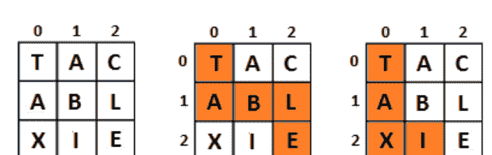

图 14.33 – 棋盘示例

请记住，这并不是我们第一次需要解决在网格中寻找特定路径的问题。在第 8 章《递归与动态规划》中，我们有机器人网格问题，包括 Color spots、Five Towers、The falling ball 和 Knight tour。在第 12 章《栈与队列》中，我们有 Islands。最后，在第 13 章《树与图》中，我们有 Chess knight。

基于你从这些问题中积累的经验，挑战自己在没有任何进一步说明的情况下为此问题编写实现。完整的应用程序称为 WordSearch。如果 k 是给定单词的长度，棋盘大小为 m x n，则该应用程序运行时间为 O(m * n * 4^k)。

## 编程挑战 18 – 基于另一个数组对数组排序

Amazon, Google, Microsoft

问题：假设你有两个数组。编写一段代码，根据第二个数组定义的顺序重新排列第一个数组的元素。

| int [] firstArr | {4, 1, 8, 1, 3, 8, 6, 7, 4, 9, 8, 2, 5, 3} |
| int [] secondArr | {7, 4, 8, 11, 2} |

期望结果是 {7, 4, 4, 8, 8, 2, 1, 1, 3, 5, 6, 9}。

该问题的解决方案依赖于哈希。更精确地说，我们可以使用以下算法：

- 1. 统计并存储第一个数组中每个元素的频率到一个映射中。
- 2. 对于第二个数组中的每个元素，检查当前元素是否在映射中。

然后，执行以下操作：
- a. 如果是，则在第一个数组中设置 n 次（n 是第二个数组中当前元素在第一个数组中的频率）。
- b. 从映射中删除当前元素，这样最后映射中只会包含存在于第一个数组中但不存在于第二个数组中的元素。

- 3. 将映射中的元素追加到第一个数组的末尾（这些元素已经排序，因为我们使用了 TreeSet）。

让我们看一下代码：

```
public static void custom(int[] firstArr, int[] secondArr) {

    // store the frequency of each element of first array
    // using a TreeMap stores the data sorted
    Map<Integer, Integer> frequencyMap = new TreeMap<>();

    for (int i = 0; i < firstArr.length; i++) {
        frequencyMap.putIfAbsent(firstArr[i], 0);
        frequencyMap.put(firstArr[i],
            frequencyMap.get(firstArr[i]) + 1);
    }

    // overwrite elements of first array
    int index = 0;

    for (int i = 0; i < secondArr.length; i++) {

        // if the current element is present in the 'frequencyMap'
        // then set it n times (n is the frequency of
        // that element in the first array)
        int n = frequencyMap.getOrDefault(secondArr[i], 0);
        while (n-- > 0) {
            firstArr[index++] = secondArr[i];
        }

        // remove the element from map
        frequencyMap.remove(secondArr[i]);
    }

    // copy the remaining elements (the elements that are
    // present in the first array but not present
    // in the second array)
    for (Map.Entry<Integer, Integer> entry :
        frequencyMap.entrySet()) {
```

```
int count = entry.getValue();
while (count-- > 0) {
firstArr[index++] = entry.getKey();
}
}
}
```

这段代码的运行时间是 O(m log m + n)，其中 m 是第一个数组中的元素数量，n 是第二个数组中的元素数量。完整的应用程序称为 SortArrayBasedOnAnotherArray。

好吧，这是本章的最后一个问题。现在，是时候总结我们的工作了！

# 总结

这是一章全面的内容，涵盖了排序和搜索算法。你看到了归并排序、快速排序、基数排序、堆排序、桶排序和二分搜索的实现。此外，本书附带的<|message|> 代码中有一个名为 SortArraysIn14Ways 的应用程序，其中包含 14 种排序算法的实现。

在下一章中，我们将涵盖一系列被归类为数学和谜题问题的题目。
