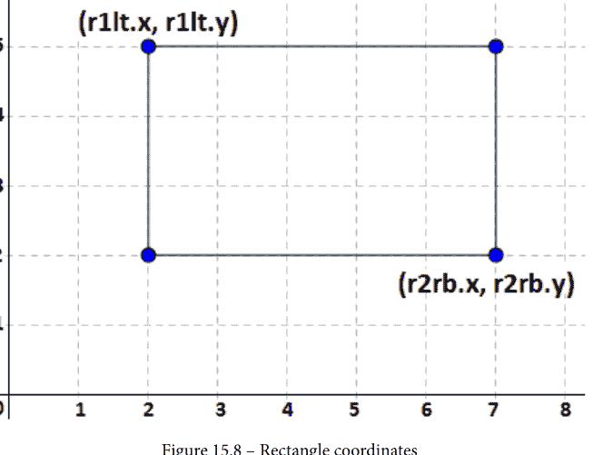
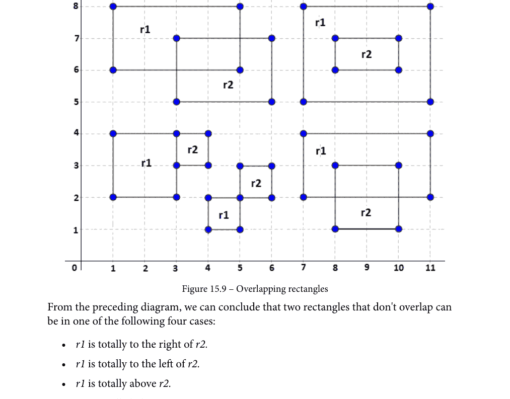
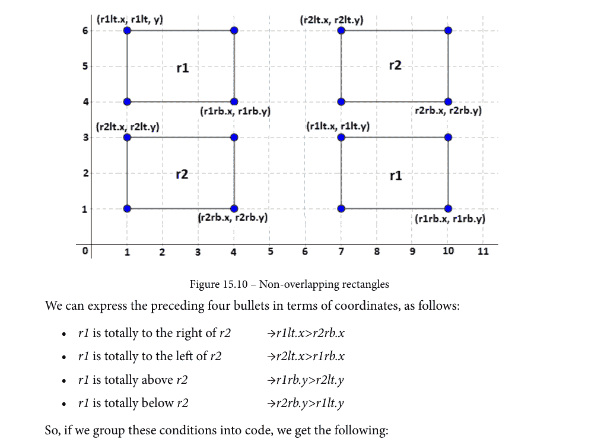
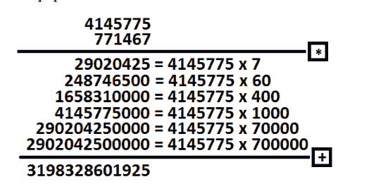
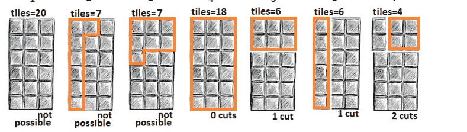
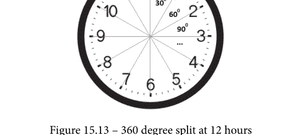
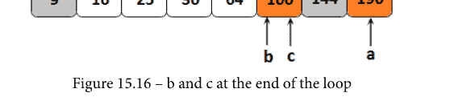
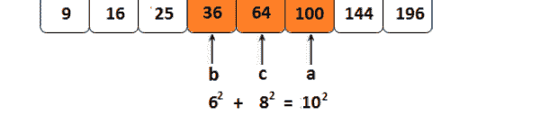
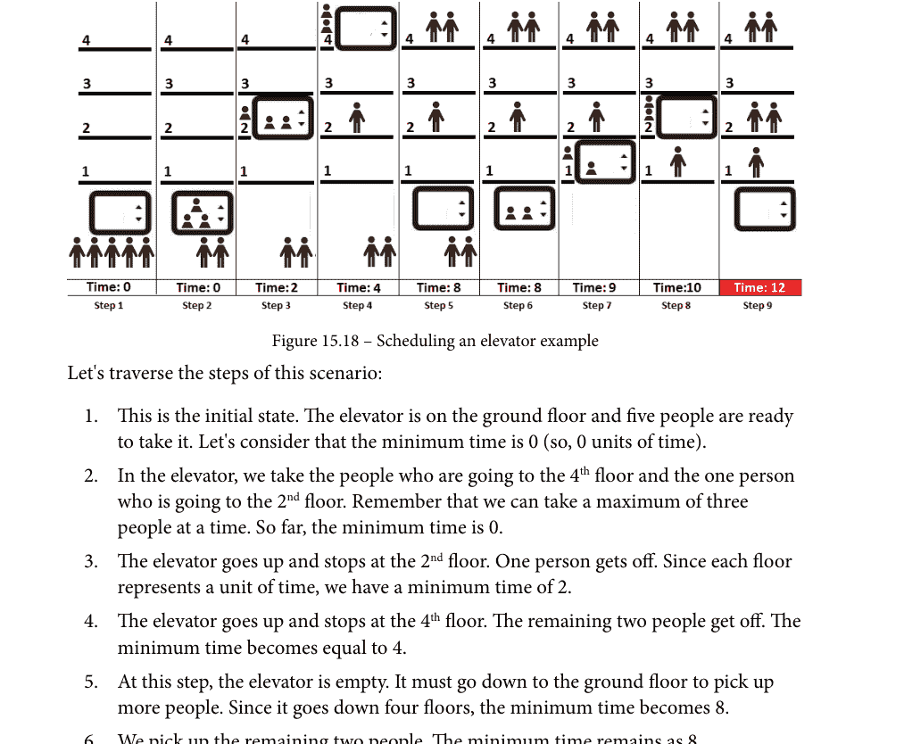

# 15
数学与谜题

本章涵盖了一个在面试中备受争议的话题：数学和谜题问题。大量公司认为这类问题不应成为技术面试的一部分，而其他公司仍然认为该主题相关。

该主题包含的问题具有脑力激荡性，可能需要相当程度的数学和逻辑知识。如果你计划申请在学术领域工作的公司（数学、物理、化学等），你应该预期此类问题。然而，像 Amazon 和 Google 这样的大公司也愿意依赖此类问题。

在本章中，我们将涵盖以下主题：

- 技巧和建议
- 编程挑战

到本章结束时，你应该熟悉这类问题，并能够探索更多此类问题。

## 技术要求

本章中出现的所有代码文件都可在 GitHub 上获取，地址为 https://github.com/PacktPublishing/The-Complete-Coding-Interview-Guide-in-Java/tree/master/Chapter15。

## 技巧和建议

当你遇到一个脑筋急转弯问题时，最重要的方面是不惊慌。多次阅读问题并以系统的方式写下你的结论。必须明确识别输入、输出和应遵守的约束条件。

尝试举几个例子（输入数据样本），做一些草图，并在分析问题时与面试官保持交流。面试官并不期望你立即给出解决方案，但他们期望听到你在尝试解决问题时的思路。这样，面试官可以追踪你的思路逻辑并了解你如何处理问题。

此外，写下你在开发解决方案时注意到的任何规则或模式非常重要。随着你写下每一条陈述，你就更接近解决方案。通常，如果你从解决方案的角度来看（你知道解决方案），这类问题并不极其困难；它们只需要高度的观察力和更强的注意力。

让我们尝试一个简单的例子。两个父亲和两个儿子坐下来吃鸡蛋。他们总共吃三个鸡蛋；每个人都有一个鸡蛋。这是可能的吗？

如果你第一次看到这样的问题，你可能会认为它不合逻辑或无法解决。正常情况下你会认为文本中存在错误（可能有四个鸡蛋，而不是三个）并反复阅读。这些是对脑筋急转弯问题的最常见反应。一旦你看到解决方案，它看起来就很简单。

现在，让我们扮演面试官面前的候选人。以下段落遵循 *大声思考* 方法。

乍一看似乎很明显，如果每个人都有一个鸡蛋并且有三个鸡蛋，那么其中一个人没有鸡蛋。所以，你可能会认为答案是三个人吃一个鸡蛋（他们每人吃一个鸡蛋），而第四个人什么都不吃。但问题说两个父亲和两个儿子坐下来吃鸡蛋，所以四个人都吃鸡蛋。

要不要这样想：每个人都有一个鸡蛋，他们（四个人）总共吃三个鸡蛋，所以它并没有说每个人 *吃* 一个鸡蛋；他们只是 *有* 一个鸡蛋。也许其中一个人与另一个人分享了他的鸡蛋。嗯，这似乎不太合理！


是否可能只有三个人？如果其中一位父亲同时也是祖父，那就意味着另一位父亲既是儿子又是父亲。这样一来，通过三个人，我们就有了两位父亲和两个儿子。他们吃了三个鸡蛋，每个人都有一个鸡蛋。问题解决了！

可以看到，这个解决方案是一连串推理的结果，它逐一排除了错误的解法。通过逻辑推理来排除错误的解法，是解决这类问题的方法之一。其他问题则只是纯粹的计算问题。大多数情况下，问题并不涉及复杂或大量的计算，但需要数学知识和/或推理。

很难说存在什么技巧和窍门能让你在几秒钟内解决数学和逻辑谜题。最好的方法是尽可能多地练习。既然如此，让我们继续进入“编码挑战”部分。

## 编码挑战

在接下来的15个编码挑战中，我们将重点讨论数学和逻辑谜题类别中最常见的问题。让我们开始吧！

### 编码挑战 1 – FizzBuzz

Adobe、Microsoft

问题：假设给你一个正整数 n。编写一个程序，打印从 1 到 n 的数字。对于 5 的倍数，打印 fizz；对于 7 的倍数，打印 buzz；对于既是 5 的倍数又是 7 的倍数，打印 fizzbuzz。在每个字符串或数字后打印一个新行。

解决方案：这是一个简单的问题，依赖于你对除法和 Java 取模（%）运算符的了解。当我们用被除数除以除数时，会得到商和余数。在 Java 中，我们可以通过取模（%）运算符获得除法的余数。换句话说，如果 X 是被除数，Y 是除数，那么 X modulus Y（在 Java 中写作 X % Y）返回 X 除以 Y 的余数。例如，11（被除数）/ 2（除数）= 5（商）1（余数），所以 11 % 2 = 1。

换句话说，如果余数为 0，那么被除数就是除数的倍数；否则就不是。因此，5 的倍数必须满足 X % 5 = 0，而 7 的倍数必须满足 X % 7 = 0。基于这些关系，我们可以按如下方式写出这个问题的解决方案：

```
public static void print(int n) {
	for (int i = 1; i <= n; i++) {
		if ((i % 5) == 0 && (i % 7) == 0) { // multiple of 5&7
			System.out.println("fizzbuzz");
		} else if ((i % 5) == 0) { // multiple of 5
			System.out.println("fizz");
		} else if ((i % 7) == 0) { // multiple of 7
			System.out.println("buzz");
		} else {
			System.out.println(i); // not a multiple of 5 or 7
		}
	}
}
```

完整的应用程序名为 FizzBuzz。

### 编码挑战 2 – 罗马数字

Amazon、Google、Adobe、Microsoft、Flipkart

问题：假设给你一个正整数 n。编写一段代码，将该数字转换为其罗马数字表示形式。例如，如果 n=34，则罗马数字为 XXXIV。你已获得以下包含罗马数字符号的常量：

| 符号 | 值 |
|--------|-------|
| I | 1 |
| IV | 4 |
| V | 5 |
| IX | 9 |
| X | 10 |
| XL | 40 |
| L | 50 |
| XC | 90 |
| C | 100 |
| CD | 400 |
| D | 500 |
| CM | 900 |
| M | 1000 |

图 15.1 – 罗马数字

**解决方案**：这个问题依赖于罗马数字是常识这一事实。如果你从未听说过罗马数字，建议你向面试官说明这一点。他们很可能会同意换一个编码挑战给你。但如果你确实知道什么是罗马数字，那很好——让我们看看如何编写一个解决这个问题的应用程序。

这个问题的算法可以通过几个例子推导出来。让我们看几个用例：

+   - *n* = 73 = 50+10+10+1+1+1 = L+X+X+I+I+I = LXXIII
+   - *n* = 558 = 500+50+5+1+1+1 = D+L+V+I+I+I = DLVIII
+   - *n* = 145 = 100+(50-10)+5 = C+(L-X)+V = C+XL+V = CXLV
+   - *n* = 34 = 10+10+10+(5-1) = X+X+X+(V-I) = X+X+X+IV = XXXIV
+   - *n* = 49 = (50-10)+(10-1) = (L-X)+(X-I) = XL+IX = XLIX

粗略地说，我们取给定的数字，并尝试找到对应于个位、十位、百位或千位的罗马符号。这个算法可以表述如下：

+   1. 从千位开始，打印相应的罗马数字。例如，如果千位上的数字是 4，则打印 4000 的罗马数字等价形式，也就是 MMMM。
+   2. 继续使用百位上的数字对该数进行除法，并打印相应的罗马数字。
+   3. 继续使用十位上的数字对该数进行除法，并打印相应的罗马数字。
+   4. 继续使用个位上的数字对该数进行除法，并打印相应的罗马数字。

就代码而言，该算法的工作原理如下：

```
private static final String HUNDREDTHS[]
= {"", "C", "CC", "CCC", "CD", "D",
    "DC", "DCC", "DCCC", "CM"};
private static final String TENS[]
= {"", "X", "XX", "XXX",
    "XL", "L", "LX", "LXX", "LXXX", "XC"};
private static final String ONES[]
= {"", "I", "II", "III", "IV", "V",
    "VI", "VII", "VIII", "IX"};

public static String convert(int n) {
    String roman = "";
    // Step 1
    while (n >= 1000) {
        roman = roman + 'M';
        n -= 1000;
    }
    // Step 2
    roman = roman + HUNDREDTHS[n / 100];
    n = n % 100;
    // Step 3
    roman = roman + TENS[n / 10];
    n = n % 10;
    // Step 4
    roman = roman + ONES[n];
```

```
return roman;
}
```

完整的应用程序名为 RomanNumbers。另一种方法依赖于连续的减法，而不是除法。RomanNumbers 应用程序也包含了这种实现。

### 编码挑战 3 – 访问并切换 100 扇门

Adobe、Microsoft、Flipkart

问题：假设给你一排 100 扇门，初始状态都是关闭的。你需要访问这些门 100 次，每次访问都从第一扇门开始。对于每一扇访问到的门，你都会切换它的状态（如果它是关闭的，就打开它；反之亦然）。第一次访问时，你访问全部 100 扇门。第二次访问时，你访问每一扇第二扇门（#2、#4、#6 ...）。第三次访问时，你访问每一扇第三扇门（#3、#6、#9 ...）。按照这种模式，直到你只访问第 100 扇门。编写一段代码，揭示 100 次访问后门的状态（关闭或打开）。

解决方案：这个问题的解决方案可以通过遍历几个步骤来直观理解。在初始状态下，所有 100 扇门都是关闭的（在下图中，每个 0 代表一扇关闭的门，每个 1 代表一扇打开的门）：

0000000000000000000000000000000000000000000000000000000000000000000000000000000000000000000000000000

图 15.2 – 所有门都处于关闭状态（初始状态）

现在，让我们看看在接下来的每一步中我们能观察到并得出什么结论：

在第一轮访问中，我们打开每一扇门（我们访问每一扇门：#1、#2、#3、#4、...、#100）：

1111111111111111111111111111111111111111111111111111111111111111111111111111111111111111111111111111

图 15.3 – 所有门都处于打开状态（步骤 1）

第二轮访问中，我们只访问偶数门（#2、#4、#6、#8、#10、#12 ...），因此偶数门被关闭，奇数门被打开：

1010101010101010101010101010101010101010101010101010101010101010101010101010101010101010101010101010

图 15.4 – 偶数门关闭，奇数门打开（步骤 2）

注意前一张图片中突出显示的步骤。第 12 扇门的状态在第 1、2、3、4、6 和 12 步发生了变化。所有这些步骤都是 12 的约数。此外，第 1 步打开门，第 2 步关闭门，第 3 步打开门，第 4 步关闭门，第 6 步打开门，第 12 步关闭门。从这个观察出发，我们可以得出结论：对于每一对约数，门最终都会回到其初始状态，即关闭状态。换句话说，每扇拥有偶数个约数的门最终都会保持关闭。

让我们看看这对一个完全平方数（例如 9）是否成立。选择完全平方数的原因在于，完全平方数总是拥有奇数个正约数。例如，9 的约数是 1、3 和 9。这意味着第 9 扇门保持打开。

基于这两段内容，我们可以得出结论：在 100 次访问之后，保持打开状态的门是那些完全平方数（#1、#4、#9、#16、...、#100），而其余的门保持关闭。

```
```java
private static final int DOORS = 100;
public static int[] visitToggle() {
	// 0 - closed door
	// 1 - opened door
	int[] doors = new int[DOORS];
	for (int i = 0; i <= (DOORS - 1); i++) {
		doors[i] = 0;
	}
	for (int i = 0; i <= (DOORS - 1); i++) {
		for (int j = 0; j <= (DOORS - 1); j++) {
			if ((j + 1) % (i + 1) == 0) {
				if (doors[j] == 0) {
					doors[j] = 1;
				} else {
					doors[j] = 0;
				}
			}
		}
	}
	return doors;
}
```
```


```
}
}
}
}

    return doors;
}
```

完整的应用程序名为 *VisitToggle100Doors*。

## 编程挑战 4 – 8 支队伍

**Amazon, Google, Adobe**

**问题：** 假设有一个比赛，有 8 支队伍。每支队伍与其他队伍各比赛两次。从所有这些队伍中，只有 4 支进入半决赛。一支队伍需要赢多少场比赛才能晋级半决赛？

**解决方案：** 设队伍为 T1、T2、T3、T4、T5、T6、T7 和 T8。如果 T1 与 T2...T8 比赛，它们将进行 7 场比赛。由于每支队伍必须与其它队伍各比赛两次，我们有 8*7=56 场比赛。如果在每场比赛中，一支队伍可以赢得 1 分，那么我们有 56 分分配给 8 支队伍。

让我们考虑最坏情况。T0 输掉所有比赛。这意味着 T0 得到 0 分。另一方面，T1 在对阵 T0 时赢得 2 分并输掉所有其它比赛，T2 在对阵 T0 和 T1 时赢得 4 分并输掉所有其它比赛，T3 在对阵 T0、T1 和 T2 时赢得 6 分并输掉所有其它比赛，依此类推。T4 赢得 8 分，T5 赢得 10 分，T6 赢得 12 分，T7 赢得 14 分。因此，一支队伍赢得所有比赛可赢得 14 分。最后四支队伍（进入半决赛的队伍）共赢得 8+10+12+14=44 分。因此，一支队伍如果获得至少 44/4=11 分就可以确保晋级半决赛。

## 编程挑战 5 – 寻找质因数仅为 3、5 和 7 的第 k 个数

Adobe, Microsoft

设计一个算法来寻找仅有质因数 3、5 和 7 的第 k 个数。

拥有一个仅有质因数 3、5 和 7 的数列意味着一个如下所示的数列：1, 3, 5, 7, 9, 15, 21, 25，等等。或者，更具启发性地，可以写成如下形式：1, 1*3, 1*5, 1*7, 3*3, 3*5, 3*7, 5*3, 3*3*5, 5*7, 3*3*5, 7*7，等等。

通过这种启发式表示，我们可以看到我们可以初始将值 1 插入到一个列表中，而其余元素必须计算得到。理解确定其余元素的算法最简单的方法是查看实现本身，所以让我们看一下：

```
public static int kth(int k) {
	int count3 = 0;
	int count5 = 0;
	int count7 = 0;
	List<Integer> list = new ArrayList<>();
	list.add(1);
	while (list.size() <= k + 1) {
		int m = min(min(list.get(count3) * 3, list.get(count5) * 5), list.get(count7) * 7);
		list.add(m);
		if (m == list.get(count3) * 3) {
			count3++;
		}
		if (m == list.get(count5) * 5) {
			count5++;
		}
		if (m == list.get(count7) * 7) {
			count7++;
		}
	}
	return list.get(k);
}
```

```
if (m == list.get(count7) * 7) {
    count7++;
}
}

return list.get(k - 1);
}
```

我们也可以通过三个队列提供一种实现。该算法的步骤如下：
- 1. 初始化一个整数，minElem=1。
- 2. 初始化三个队列；即 queue3、queue5 和 queue7。
- 3. 从 1 循环到给定的 k-1：
  - a. 将 minElem*3、minElem*5 和 minElem*7 分别插入 queue3、queue5 和 queue7。
  - b. 将 minElem 更新为 min(queue3.peek, queue5.peek, queue7.peek)。
  - c. 如果 minElem 是 queue3.peek，则执行 queue3.poll。
  - d. 如果 minElem 是 queue5.peek，则执行 queue5.poll。
  - e. 如果 minElem 是 queue7.peek，则执行 queue7.poll。
- 4. 返回 minElem。

完整的应用程序名为 KthNumber357。它包含本节中介绍的两种解决方案。

## 编程挑战 6 - 计数解码数字序列

Amazon, Microsoft, Flipkart

问题：假设 A 为 1，B 为 2，C 为 3，... Z 为 26。对于任意给定的数字序列，编写一段代码来计算可能的解码数（例如，1234 可以解码为 1 2 3 4、12 3 4 和 1 23 4，这意味着分别对应 ABCD、LCD 和 AWD）。给定的数字序列有效，如果它包含 0 到 9 的数字。不允许前导 0，不允许额外尾随 0，且不允许两个或更多连续的 0。

**解决方案**：该问题可以通过递归或动态规划解决。两种技术都在 *第 8 章，递归和动态规划* 中介绍过。所以，让我们来看一下针对 *n* 位数字序列的递归算法：
- 1. 将解码总数初始化为 0。
- 2. 从给定的数字序列末尾开始。
- 3. 如果最后一位数字不是 0，则对 (*n*-1) 位数字应用递归，并使用结果更新解码总数。
- 4. 如果最后两位数字代表一个小于 27 的数（因此是一个有效字符），则对 (*n*-2) 位数字应用递归，并使用结果更新解码总数。

就代码而言，我们有以下内容：

```
public static int decoding(char[] digits, int n) {

    // base cases
    if (n == 0 || n == 1) {
        return 1;
    }

    // if the digits[] starts with 0 (for example, '0212')
    if (digits == null || digits[0] == '0') {
        return 0;
    }

    int count = 0;

    // If the last digit is not 0 then last
    // digit must add to the number of words
    if (digits[n - 1] > '0') {
        count = decoding(digits, n - 1);
    }

    // If the last two digits represents a number smaller
    // than or equal to 26 then consider last two digits
    // and call decoding()
```

```
if (digits[n - 2] == '1'
    || (digits[n - 2] == '2' && digits[n - 1] < '7')) {
    count += decoding(digits, n - 2);
}

return count;
}
```

此代码运行时间为指数级。但我们可以通过类似的非递归算法应用动态规划将运行时间降低到 O(n)，如下所示：

```
public static int decoding(char digits[]) {

    // if the digits[] starts with 0 (for example, '0212')
    if (digits == null || digits[0] == '0') {
        return 0;
    }

    int n = digits.length;

    // store results of sub-problems
    int count[] = new int[n + 1];

    count[0] = 1;
    count[1] = 1;

    for (int i = 2; i <= n; i++) {
        count[i] = 0;

        // If the last digit is not 0 then last digit must
        // add to the number of words
        if (digits[i - 1] > '0') {
            count[i] = count[i - 1];
        }

        // If the second last digit is smaller than 2 and
        // the last digit is smaller than 7, then last
```

```
// two digits represent a valid character
if (digits[i - 2] == '1' || (digits[i - 2] == '2'
    && digits[i - 1] < '7')) {
    count[i] += count[i - 2];
}
}

return count[n];
}
```

此代码运行时间为 O(n)。完整的应用程序名为 *DecodingDigitSequence*。

## 编程挑战 7 – ABCD

**问题：** 找到一个四位数类型 ABCD，使得乘以 4 后得到 DCBA。

**解决方案：** 这类问题通常相当困难。在这种情况下，我们必须使用一些数学来解决它。

让我们从一些简单的不等式开始：
- 1 <= A <= 9 （A 不能为零，因为 ABCD 是一个四位数）
- 0 <= B <= 9
- 0 <= C <= 9
- 4 <= D <= 9 （D 必须至少为 4* A，所以它应该至少为 4）

接下来，我们可以假设我们的数字 ABCD 写成 1000A + 100B + 10C + D。根据问题陈述，我们可以将 ABCD 乘以 4 得到 DCBA，可以写成 1000D + 100C + 10B + A。

符合 4 的整除性，BA 是一个能被 4 整除的两位数。现在，较大的 ABCD 是 2499，因为大于 2499 的数乘以 4 后结果将是五位数。

接下来，A 可以是 1 和 2。然而，如果 BA 是一个能被 4 整除的两位数，则 A 必须为偶数，所以它必须是 2。

继续这种逻辑，这意味着 D 要么是 8 要么是 9。然而，由于 D 乘以 4 的个位为 2，D 必须是 8。

此外，4000A + 400B + 40C + 4D = 1000D + 100C + 10B + A。由于 A=2 且 D=8，这可以写成 2C-13B=1。B 和 C 只能是 [1, 7] 中的一位整数，但 B 必须为奇数，因为 BA 是一个能被 4 整除的两位数。由于最大可能数为 2499，这意味着 B 可以是 1 或 3。

因此，结果是 2178，因为 2178*4=8712，所以 ABCD*4=DCBA。

我们也可以使用暴力方法找到这个数。以下代码不言自明：

```
public static void find() {

    for (int i = 1000; i < 2499; i++) {

        int p = i;
        int q = i * 4;

        String m = String.valueOf(p);
        String n = new StringBuilder(String.valueOf(q))
            .reverse().toString();

        p = Integer.parseInt(m);
        q = Integer.parseInt(n);

        if (p == q) {
            System.out.println("\n\nFound: " + p + " : " + (q * 4));
            break;
        }
    }
}
```

完整的应用程序名为 Abcd。

## 编程挑战 8 – 矩形重叠

Amazon, Google, Microsoft

问题：假设你被给出两个矩形。编写一段代码片段，如果这些矩形重叠（也称为碰撞或相交），则返回 true。


**解决方案：**这个问题听起来有点模糊。重要的是与面试官讨论并就两个重要方面达成一致：

- 两个矩形彼此平行，并与水平面成 0 度角（它们平行于坐标轴），还是可以旋转一个角度？

大多数情况下，给定的矩形彼此平行且平行于坐标轴。如果涉及旋转，那么解决方案需要一些几何知识，这些知识在面试中并不那么明显。很可能，面试官想测试你的逻辑能力，而不是你的几何知识，但挑战自己，同时实现非平行矩形的解决方案。

- 矩形的坐标是在笛卡尔坐标系中给出的吗？

答案应该是肯定的，因为这是数学中常用的坐标系。这意味着矩形从左到右、从下到上增大其大小。

所以，让我们将这两个矩形记为 r1 和 r2。每个矩形通过左上角和右下角的坐标给出。r1 的左上角坐标为 r1lt.x 和 r1lt.y，而右下角坐标为 r1rb.x 和 r1rb.y，如下图所示：



**图 15.8 – 矩形坐标**

我们可以说，如果两个矩形相互接触（它们至少有一个公共点），则它们是重叠的。换句话说，下图中显示的五对矩形是重叠的：



从前面的图中，我们可以得出结论：两个不重叠的矩形可以处于以下四种情况之一：

- r1 完全在 r2 的右侧。
- r1 完全在 r2 的左侧。
- r1 完全在 r2 的上方。
- r1 完全在 r2 的下方。

下图展示了这四种情况：

**图 15.10 – 不重叠的矩形**



我们可以用坐标来表示上述四点，如下所示：

- r1 完全在 r2 的右侧 → r1lt.x > r2rb.x
- r1 完全在 r2 的左侧 → r2lt.x > r1rb.x
- r1 完全在 r2 的上方 → r1rb.y > r2lt.y
- r1 完全在 r2 的下方 → r2rb.y > r1lt.y

```java
public static boolean overlap(Point r1lt, Point r1rb,
        Point r2lt, Point r2rb) {
    // r1 is totally to the right of r2 or vice versa
    if (r1lt.x > r2rb.x || r2lt.x > r1rb.x) {
        return false;
    }
    // r1 is totally above r2 or vice versa
    if (r1rb.y > r2lt.y || r2rb.y > r1lt.y) {
        return false;
    }
    return true;
}
```

这段代码在 O(1) 时间内运行。或者，我们可以将这两个条件合并为一个条件，如下所示：

```java
public static boolean overlap(Point r1lt, Point r1rb,
        Point r2lt, Point r2rb) {

    return (r1lt.x <= r2rb.x && r1rb.x >= r2lt.x
            && r1lt.y >= r2rb.y && r1rb.y <= r2lt.y);
}
```

完整的应用程序名为 *RectangleOverlap*。请注意，面试官可能以不同的方式定义*重叠*。基于这个问题，你应该能够相应地调整代码。

## 编程挑战 9 – 大数乘法

Amazon, Microsoft

**问题：**假设你得到了两个以字符串形式表示的正大数 *a* 和 *b*。这些数字不适合 `int` 或 `long` 域。编写一段代码来计算 `a*b`。

**解决方案：**让我们假设 `a=4145775` 和 `b=771467`。那么 `a*b=3198328601925`。解决这个问题依赖于数学。下图描绘了可以在纸上应用并同样可以编码的 `a*b` 解决方案：



**图 15.11 – 两个大数相乘**

```java
// loop 'b' from right to left
for (int j = lenB - 1; j >= 0; j--) {
    // current digit of second number
    int n2 = b.charAt(j) - '0';
    // multiply with current digit of first number
    int sum = n1 * n2 + c[idx1 + idx2] + carry;
    // carry of the next iteration
    carry = sum / 10;
    c[idx1 + idx2] = sum % 10;
    idx2++;
}

// store carry
if (carry > 0) {
    c[idx1 + idx2] += carry;
}

// shift position to left after every
// multiplication of a digit in 'a'
idx1++;
}

// ignore '0's from the right
int i = c.length - 1;
while (i >= 0 && c[i] == 0) {
    i--;
}

// If all were '0's - means either both or
// one of 'a' or 'b' were '0'
if (i == -1) {
    return "0";
}

String result = "";
while (i >= 0) {
    result += (c[i--]);
}

return result;
}
```

完整的应用程序名为 *MultiplyLargeNumbers*。

## 编程挑战 10 – 具有相同数字的下一个最大数字

Amazon, Google, Microsoft

**问题：**假设你得到一个正整数。编写一段代码，返回具有相同数字的下一个最大数字。

**解决方案：**这个问题的解决方案可以通过几个例子来观察。让我们考虑以下示例：

- 示例 1：6 → 不可能
- 示例 2：1234 → 1243
- 示例 3：1232 → 1322
- 示例 4：321 → 不可能
- 示例 5：621873 → 623178

从前面的示例中，我们可以直观地看出，解决方案可以通过重新排列给定数字的各位数字来获得。因此，如果我们能找到导致目标数字的交换数字规则集，那么我们就可以尝试实现。

让我们尝试几个观察：

- 从示例 1 和 4 中，我们可以看到，如果给定数字的各位数字按降序排列，那么就不可能找到更大的数字。任何交换都会导致更小的数字。
- 从示例 2 中，我们可以看到，如果给定数字的各位数字按升序排列，那么可以通过交换最后两位数字来获得具有相同数字的下一个更大数字。
- 从示例 3 和 5 中，我们可以看到，我们需要找到所有更大数字中最小的那个。为此，我们必须从最右侧开始处理这个数字。下面的算法阐明了这一说法。

基于这三个观察，我们可以详细阐述以下算法，该算法以数字 621873 为例进行了说明：

1. 我们从最右侧开始逐位遍历数字。我们一直遍历，直到找到一个比前一个遍历的数字更小的数字。例如，如果给定数字是 621873，那么我们将遍历到 621873 中的数字 1。数字 1 是第一个比先前遍历的数字 8 更小的数字。
2. 接下来，我们关注在第 1 步找到的数字右侧的数字。我们想在这些数字中找到最小的数字（我们将其记为 t）。由于这些数字按降序排列，最小的数字位于最后一位。例如，在 621873 中，1 的右侧数字中最小的数字是 3。
3. 我们交换这两个数字（1 和 3），得到 623871。
4. 最后，我们将 t 右侧的所有数字按升序排序。但由于我们知道，t 右侧的所有数字（除了最后一个数字）都是按降序排序的，我们可以应用线性反转。这意味着结果是 623178。这就是要查找的数字。

该算法可以很容易地实现，如下所示：

```java
public static void findNextGreater(int arr[]) {

    int min = -1;
    int len = arr.length;

    int prevDigit = arr[arr.length - 1];
```

```java
while (start < end) {
    swap(arr, start, end);
    start++;
    end--;
}
}

private static void swap(int[] arr, int i, int j) {
    int aux = arr[i];
    arr[i] = arr[j];
    arr[j] = aux;
}
```

这段代码在 O(n) 时间内运行。完整的应用程序名为 NextElementSameDigits。

## 编程挑战 11 – 一个可被其各位数字整除的数字

Amazon, Google, Adobe, Microsoft

**问题：**假设你得到一个整数 n。编写一个程序，如果给定数字能被其各位数字整除，则返回 true。

**解决方案：**让我们考虑 n=412。输出应为 true，因为 412 能被 2、1 和 4 整除。另一方面，如果 n=143，则输出应为 false，因为 143 不能被 3 和 4 整除。

如果你认为这个问题很简单，那你完全正确。这类问题被用作热身问题，有助于快速筛选大量候选人。大多数情况下，你应该在给定的时间内（例如 2-3 分钟）解决它。

> **重要说明**
> 建议像对待任何其他问题一样认真地对待这些简单问题。一个小错误可能会让你过早地被淘汰出局。

因此，对于这个问题，算法包含以下步骤：

1. 获取给定数字的所有各位数字。
2. 对于每个数字，检查给定数字 % digit 是否为 0（这意味着可整除）。


+   3. 如果其中任何一个非零，则返回 false。

+   4. 如果对于所有数字，给定数字 % 数字 为 0，则返回 true。

就代码而言，我们有以下内容：

```
public static boolean isDivisible(int n) {
    int t = n;
    while (n > 0) {
        int k = n % 10;
        if (k != 0 && t % k != 0) {
            return false;
        }
        n /= 10;
    }
    return true;
}
```

完整的应用程序称为 NumberDivisibleDigits。

## 编程挑战 12 – 打破巧克力

Amazon, Google, Adobe, Microsoft, Flipkart

**问题：** 假设你被给定一块大小为 width x height 的矩形巧克力棒和一定数量的方块。正如通常一样，巧克力由许多小方块组成，因此 width 和 height 给出了方块的数量（例如，巧克力大小为 4 x 3，包含 12 个方块）。编写一段代码来计算我们需要对给定的巧克力进行多少次断裂（切割）才能获得恰好具有所需数量方块的一块。你可以通过一次垂直或水平的断裂（切割）沿着方块边缘将给定的巧克力分成两块矩形。

解决方案：让我们考虑以下图像中显示的巧克力（一块 3 x 6 的巧克力棒，有 18 个方块）：



图 15.12 – 一块 3 x 6 巧克力棒

前面的图像揭示了七种可能导致我们得到解决方案的情况，如下所示：

- 情况 1、2 和 3：如果给定的方块数量大于 3 x 6 或者我们无法将方块沿着巧克力的宽度或高度排列，则无法获得解决方案。对于无解，我们返回 -1。
- 情况 4：如果给定的方块数量等于 3 x 6 = 18，则这是解决方案，所以我们有 0 次切割。我们将返回 0。
- 情况 5：如果给定的方块数量可以沿着巧克力棒的宽度排列，则有一次切割。我们将返回 1。
- 情况 6：如果给定的方块数量可以沿着巧克力棒的高度排列，则有一次切割。我们将返回 1。
- 情况 7：在所有其他情况下，我们需要 2 次切割。我们将返回 2。

让我们看看代码：

```
public static int breakit(int width, int height, int nTiles) {

    if (width <= 0 || height <= 0 || nTiles <= 0) {
        return -1;
    }

    // case 1
    if (width * height < nTiles) {
        return -1;
    }
}
```
// case 4
if (width * height == nTiles) {
    return 0;
}

// cases 5 and 6
if ((nTiles % width == 0 && (nTiles / width) < height)
    || (nTiles % height == 0 && (nTiles / height) < width)) {
    return 1;
}

// case 7
for (int i = 1; i <= Math.sqrt(nTiles); i++) {
    if (nTiles % i == 0) {
        int a = i;
        int b = nTiles / i;
        if ((a <= width && b <= height)
            || (a <= height && b <= width)) {
            return 2;
        }
    }
}

// cases 2 and 3
return -1;
}
```

完整的应用程序称为 BreakChocolate。

## 编程挑战 13 – 时钟角度

Google, Microsoft

问题：假设你被给定 h:m 格式的时间。编写一段代码来计算模拟钟表上时针和分针之间的较短角度。

解决方案：从一开始，我们必须考虑到几个公式，这将帮助我们得出解决方案。

首先，时钟被分成 12 个相等的小时（或 12 个相等部分），由于它是一个完整的圆，因此有 360°。所以，1 小时有 360°/12 = 30°。所以，在 1:00 时，时针与分针形成 30° 的角度。在 2:00 时，时针与分针形成 60° 的角度，依此类推。以下图像阐明了这一点：



在此基础上进一步推断，一个小时有 60 分钟和 30°，所以一分钟有 30/60 = 0.5°。所以，如果我们只参考时针，那么在 1:10 时，我们有 30° + 10*0.5° = 30° + 5° = 35° 的角度。或者，在 4:17 时，我们有 4*30° + 17*0.5° = 120° + 8.5° = 128.5° 的角度。

到目前为止，我们知道对于给定的 h:m 时间，我们可以计算时针的角度为 h*30° + m*0.5°。对于计算分针的角度，我们可以认为，在 1 小时内，分针进行一次完整的 360° 旋转，所以 360°/60 分钟 = 每分钟 6°。所以，在 h:24 时，分针形成 24 * 6° = 144° 的角度。在 h:35 时，分针形成 35 * 6° = 210° 的角度，依此类推。

所以，时针和分针之间的角度是 abs((h*30° + m*0.5°) - m*6°)。如果返回的结果大于 180°，则我们必须返回 (360° - result)，因为问题要求我们计算时针和分针之间的较短角度。

现在，让我们尝试计算以下图像中显示的时钟所需的角度：


### 时钟 1，10:10：

- 时针：10*30° + 10*0.5° = 300° + 5° = 305°
- 分针：10 * 6° = 60°
- 结果：abs(305° - 60°) = abs(245°) = 245° > 180°，所以返回 360° - 245° = 115°

### 时钟 2，9:40：

- 时针：9*30° + 40*0.5° = 270° + 20° = 290°
- 分针：40 * 6° = 240°
- 结果：abs(290° - 240°) = abs(50°) = 50°

### 时钟 3，4:40：

- 时针：4*30° + 40*0.5° = 120° + 20° = 140°
- 分针：40 * 6° = 240°
- 结果：abs(140° - 240°) = abs(-100°) = 100°

基于这些陈述，我们可以编写以下代码：

```
public static float findAngle(int hour, int min) {
    float angle = (float) Math.abs(((30f * hour) + (0.5f * min)) - (6f * min));
    return angle > 180f ? (360f - angle) : angle;
}
```

完整的应用程序称为 HourMinuteAngle。

## 编程挑战 14 – 毕达哥拉斯三元组

Google, Adobe, Microsoft

问题：毕达哥拉斯三元组是一组三个正整数 {a, b, c}，使得 a² = b² + c²。假设你被给定一个正整数数组 arr。编写一段代码来打印此数组的所有毕达哥拉斯三元组。



图 15.16 – 循环结束时的 b 和 c

接下来，遵循步骤 7，我们设置 a=144，b=9，c=100。此过程针对每个 a 重复。当 a 变为 100 时，我们找到第一个毕达哥拉斯三元组；即 a=100，b=36，c=64，如下所示：



图 15.17 – 一个毕达哥拉斯三元组

让我们将此算法放入代码中：

```
public static void triplet(int arr[]) {

    int len = arr.length;

    // Step1
    for (int i = 0; i < len; i++) {
        arr[i] = arr[i] * arr[i];
    }

    // Step 2
    Arrays.sort(arr);

    // Steps 3, 4, and 5
    for (int i = len - 1; i >= 2; i--) {

        int b = 0;
        int c = i - 1;

        // Step 6
```
```
while (b < c) {
    // Step 6c
    if (arr[b] + arr[c] == arr[i]) {
        System.out.println("Triplet: " + Math.sqrt(arr[b])
            + ", " + Math.sqrt(arr[c]) + ", "
            + Math.sqrt(arr[i]));
        b++;
        c--;
    }
    // Steps 6a and 6b
    if (arr[b] + arr[c] < arr[i]) {
        b++;
    } else {
        c--;
    }
}
}
```

完整的应用程序称为 PythagoreanTriplets。

## 编程挑战 15 – 安排一台电梯

Amazon, Google, Adobe, Microsoft, Flipkart

问题：假设你被给定一个数组，表示 n 个人的目的地楼层。电梯的容量为给定的 k。最初，电梯和所有人都在 0 层（地面层）。电梯从当前楼层到达任何相邻楼层（上或下）需要 1 个单位时间。编写一段代码，以这样的方式安排电梯，使我们获得将所有人送到其目的地楼层然后返回地面层所需的最小总时间。

解决方案：让我们假设给定的目的地数组为 floors = {4, 2, 1, 2, 4} 且 k=3。所以，我们有五个人：一人去一楼，两人去二楼，两人去四楼。电梯一次可以搭载三个人。那么，我们如何安排电梯以最短的时间将这五个人送到他们的楼层呢？


解决方案在于按降序将人们送到各自的楼层。让我们根据以下图片来分析这个场景：



让我们遍历这个场景的步骤：

- 1. 这是初始状态。电梯在地面楼层，五个人准备乘坐。让我们认为最小时间为 0（即 0 个时间单位）。
- 2. 在电梯中，我们带上要去 4 楼的两个人以及要去 2 楼的一个人。请记住，我们一次最多只能带三个人。到目前为止，最小时间为 0。
- 3. 电梯向上行驶并停在 2 楼。一人下车。由于每层楼代表一个时间单位，我们的最小时间为 2。
- 4. 电梯向上行驶并停在 4 楼。剩下的两人下车。最小时间变为 4。
- 5. 在此步骤中，电梯是空的。它必须下到地面楼层去接更多的人。由于它下降了四层，最小时间变为 8。
- 6. 我们接上剩下的两人。最小时间保持为 8。
- 7. 电梯向上行驶并停在 1 楼。一人下车。最小时间变为 9。
- 8. 电梯向上行驶并停在 2 楼。一人下车。最小时间变为 10。
- 9. 在此步骤中，电梯是空的。它必须下到地面楼层。由于它下降了两层，最小时间变为 12。

因此，总最小时间为 12。基于这个场景，我们可以阐述以下算法：

- 1. 按目的地降序对给定的数组进行排序。
- 2. 创建 k 个人的组。每个组所需的时间为 2 * floors[group]。

因此，对测试数据进行排序后得到 floors = {4, 4, 2, 2, 1}。我们有两个组。一个组包含三个人（4, 4, 2），另一个组包含两个人（2, 1）。总最小时间为 (2 * floors[0]) + (2 * floors[3]) = (2 * 4) + (2 * 2) = 8 + 4 = 12。

在代码方面，我们有以下内容：

```
public static int time(int k, int floors[]) {

    int aux;
    for (int i = 0; i < floors.length - 1; i++) {
        for (int j = i + 1; j < floors.length; j++) {
            if (floors[i] < floors[j]) {
                aux = floors[i];
                floors[i] = floors[j];
                floors[j] = aux;
            }
        }
    }

    // iterate the groups and update
    // the time needed for each group
    int time = 0;
    for (int i = 0; i < floors.length; i += k) {
        time += (2 * floors[i]);
    }

    return time;
}
```

当然，你可能会选择更好的排序算法。完整的应用程序称为 ScheduleOneElevator。这是本章的最后一个编码挑战。

## 调度多个电梯

但我们如何调度具有任意楼层数的多个电梯呢？嗯，很可能在面试中，你不需要为超过一台电梯实现解决方案，但你可能会被问及你将如何为多台电梯设计解决方案。

调度多个电梯的问题及其算法是著名且困难的。对于这个问题没有最佳算法。换句话说，创建一个可应用于现实世界电梯调度的算法是真的很困难，而且显然它是专利的。

电梯算法（https://en.wikipedia.org/wiki/Elevator_algorithm）是一个很好的起点。在思考如何为多电梯设计解决方案之前，你必须列出所有想要考虑的假设或约束。每个可用解决方案/算法都有一个假设或约束列表，涉及楼层数、电梯数量、每台电梯的容量、平均人数、高峰时段、电梯速度、装卸时间等等。主要，有三种解决方案，如下所示：

- **扇区：** 每台电梯分配到一个扇区（它服务于一组楼层）。
- **最近电梯：** 每个人都被分配到最近的电梯（它根据电梯的位置、呼叫方向和电梯当前方向来决定）。
- **考虑容量的最近电梯：** 这与最近电梯选项类似，但它考虑了每台电梯的负载。

### 扇区

例如，一个有八层楼和三台电梯的建筑可以这样服务：

- 电梯 1 服务 1、2 和 3 层。
- 电梯 2 服务 1、4 和 5 层。
- 电梯 3 服务 1、6、7 和 8 层。

每台电梯都服务地面楼层，因为地面楼层的到达率最高。

### 最近电梯

为每台电梯分配一个分数。该分数代表当新人员到达时电梯的适用性分数：

- 朝向呼叫，相同方向：FS = (N + 2) - d
- 朝向呼叫，相反方向：FS = (N + 1) - d
- 远离呼叫：FS = 1

其中，N = #Floors – 1，d = 电梯与呼叫之间的距离。

### 考虑容量的最近电梯

这与最近电梯情况完全相同，但它考虑了电梯的剩余容量：

- 朝向呼叫，相同方向：FS = (N + 2) - d + C
- 朝向呼叫，相反方向：FS = (N + 1) - d + C
- 远离呼叫：FS = 1 + C

这里，N 是 #Floors – 1，d 是电梯与呼叫之间的距离，C 是剩余容量。

我强烈建议你搜索并研究该问题的不同实现，并尝试学习你认为最适合你的那个。我建议你从这里开始：

- https://github.com/topics/elevator-simulation
- https://austingwalters.com/everyday-algorithms-elevator-allocation/.

现在，让我们总结本章。

## 总结

在本章中，我们涵盖了最受欢迎的适合数学和谜题类别的问题。虽然许多公司避免此类问题，但仍有像 Google 和 Amazon 这样的大公司在面试中依赖这类问题。

练习此类问题代表了我们大脑的良好锻炼。除了数学知识之外，这些问题还维持了基于推理和直觉的分析思维，这意味着它们是任何程序员的良好支持。

在下一章中，我们将处理面试中的一个热门话题：并发（多线程）。
