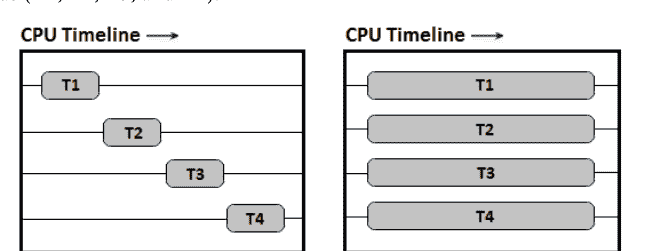
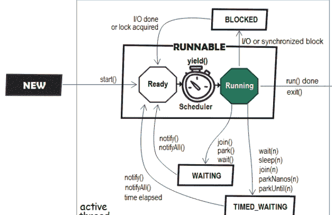
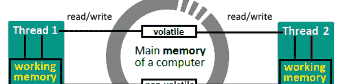
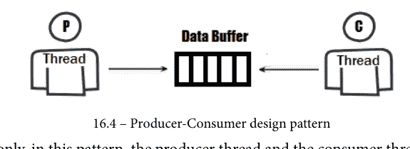

## 第 4 部分：奖励 – 并发和函数式编程

公司对并发和函数式编程等主题非常敏感。本章涵盖了围绕这两个主题最流行的问题。这四个章节是奖励章节，其方法与迄今为止阅读的章节不同。由于主题的性质，我们将简要涉及它们，阐述在各自主题的面试中提出的问题。你可以在本章技术要求部分共享的 GitHub 仓库链接中找到本章使用的代码。

- 第 16 章，并发
- 第 17 章，函数式编程
- 第 18 章，单元测试
- 第 19 章，系统可扩展性

### 16 并发

开发单线程 Java 应用程序很少可行。因此，你的大多数项目都将是多线程的（即它们将在多线程环境中运行）。这意味着迟早你必须处理某些多线程问题。换句话说，在某个时候，你必须亲手处理直接或通过专用 API 操作 Java 线程的代码。

本章涵盖了 Java 语言一般面试中最流行关于 Java 并发（多线程）的问题。如往常一样，我们将从简要介绍开始，涵盖 Java 并发的各个主要方面。因此，我们的议程很直接，涵盖以下主题：

- Java 并发（多线程）概览
- 问题和编码挑战

让我们从主题的基础知识 Java 并发开始。使用以下概览部分来提取关于并发的一些基本问题的答案，例如 什么是并发？、什么是 Java 线程？、什么是多线程？ 等等。


## 技术要求

本章使用的代码可在 GitHub 上找到：https://github.com/PacktPublishing/The-Complete-Coding-Interview-Guide-in-Java/tree/master/Chapter16

## Java 并发（多线程）简述

我们的计算机可以同时运行多个程序或应用程序（例如，我们可以一边用媒体播放器听音乐，一边浏览互联网）。进程是程序或应用程序的执行实例（例如，双击计算机上的 NetBeans 图标，就会启动一个进程来运行 NetBeans 程序）。此外，线程是轻量级子进程，代表进程中最小可执行工作单元。Java 线程的开销相对较低，并与其他线程共享公共内存空间。一个进程可以有多个线程，其中有一个主线程。

> **重要说明**
>
> 进程与线程的主要区别在于，线程共享公共内存空间，而进程不共享。通过共享内存，线程节省了大量开销。

并发是应用程序处理其正在处理的多个任务的能力。程序或应用程序可以一次处理一个任务（顺序处理），也可以同时处理多个任务（并发处理）。

不要将并发与并行混为一谈。并行是应用程序处理每个单独任务的能力。应用程序可以串行处理每个任务，也可以将任务拆分为可并行处理的子任务。

> **重要说明**
>
> 并发关乎同时处理（而不是执行）很多事情，而并行关乎同时执行很多事情。

并发是通过*多线程*实现的。*多线程*是一种使程序或应用程序能够同时处理多个任务并同步这些任务的技术。这意味着多线程通过几乎同时执行两个或多个任务，使 CPU 得到最大限度的利用。我们这里说*几乎同时*，是因为这些任务看起来像是同时运行的；然而，本质上它们做不到同时运行。它们利用了 CPU 的*上下文切换*或操作系统的*时间片*特性。换句话说，CPU 时间在所有运行中的任务之间共享，每个任务被安排运行一定的时间段。因此，多线程是*多任务处理*的关键。

> **重要说明**
>
> 对于单核 CPU，我们可以实现并发，但*不*能实现并行。

总之，线程可以制造多任务处理的假象；然而，在任何给定时刻，CPU 只执行一个线程。CPU 在线程之间切换控制的速度如此之快，以至于造成任务并行执行（或推进）的假象。实际上，它们是并发执行的。不过，随着硬件技术的进步，多核机器和计算机如今已很常见。这意味着应用程序可以利用这些架构，让每个线程都由一个专用 CPU 来运行。

下图通过四个线程（T1、T2、T3 和 T4）阐明了并发与并行之间的混淆：



16.1 – 并发与并行

因此，应用程序可以是以下之一：

- **并发但不并行**：它同时执行多个任务，但没有任何两个任务在同一时刻执行。
- **并行但不并发**：它在多核 CPU 上同时执行一个任务的多个子任务。
- **既不并行也不并发**：它逐个执行所有任务（顺序执行）。
- **既并行又并发**：它在多核 CPU 上同时并发执行多个任务。

一组被分配执行任务的同质工作线程称为*线程池*。完成任务的线程会返回池中。通常，线程池与任务队列绑定，并可根据其持有的线程数进行调整。通常，为了获得最佳性能，线程池的大小等于 CPU 核心数。

多线程环境的*同步*是通过*锁*实现的。锁用于在多线程环境中协调并限制对资源的访问。

如果多个线程可以访问同一资源而不会导致错误或不可预测的行为/结果，那么我们就处于*线程安全*的环境中。*线程安全*可以通过各种同步技术（例如 Java 的 `synchronized` 关键字）实现。

接下来，让我们解决几个关于 Java 并发的问题和编程挑战。

## 问题和编程挑战

在本节中，我们将介绍 20 个在面试中非常流行的并发问题和编程挑战。

你应该知道，Java 并发是一个广泛而复杂的主题，任何 Java 开发人员都需要非常详细地掌握它。对 Java 并发有基本的了解应该足以通过一般的 Java 语言面试，但对于特定的面试来说还不够（例如，如果你申请的工作需要开发并发 API，那么你必须深入钻研这个主题并学习高级概念——面试很可能以并发为核心）。

### 编程挑战 1 - 线程生命周期状态

**问题：** 用几句话列举并解释 Java 线程的状态。

**解决方案：** Java 线程的状态可通过 `Thread.State` 枚举获得。Java 线程的可能状态如下图所示：



16.2 – Java 线程状态

Java 线程的不同生命周期状态如下：

- **新建状态：** 已创建但尚未启动的线程（在调用 `Thread#start()` 方法之前，线程处于此状态）。
- **可运行状态：** 通过调用 `Thread#start()` 方法，线程从新建状态进入可运行状态。在可运行状态中，线程可以正在运行或准备运行。等待 JVM（Java 虚拟机）线程调度器分配必要资源和运行时间的线程已准备就绪，但尚未运行。一旦 CPU 可用，线程调度器就会运行该线程。
- **阻塞状态：** 执行同步块或 I/O 任务的线程可能进入阻塞状态。例如，如果线程 t1 试图进入一个已被另一个线程 t2 访问的同步代码块（例如，标记为 synchronized 的代码块），那么 t1 将一直被阻塞，直到它获得所需的锁。
- **等待状态：** 线程 t1 等待另一个线程 t2 完成其工作（没有设置显式超时时间）时，处于等待状态。
- **定时等待状态：** 线程 t1 等待另一个线程 t2 完成其工作，但设置了显式等待时间（通常以毫秒或秒为单位）时，处于定时等待状态。
- **`TERMINATED` 状态：** 被异常中断或成功完成其工作的 Java 线程处于 `TERMINATED` 状态。

除了描述 Java 线程的可能状态外，面试官还可能要求你为每种状态编写一个示例。这就是为什么我强烈建议你花时间分析名为 *ThreadLifecycleState* 的应用程序（为简洁起见，本书未列出代码）。该应用程序的结构非常直观，并且开头的注释解释了每种场景/状态。

### 编程挑战 2 - 死锁

**问题：** 向我们解释死锁，我们就录用你！

**解决方案：** 录用我，我就解释给你听。

这里，我们刚刚描述了一个死锁。

死锁可以这样解释：线程 *T1* 持有锁 *P*，并试图获取锁 *Q*。与此同时，存在线程 *T2* 持有锁 *Q*，并试图获取锁 *P*。这种死锁被称为*循环等待*或*致命拥抱*。

Java 不提供死锁检测和/或解决机制（例如，数据库所具备的机制）。这意味着死锁会让应用程序陷入非常尴尬的境地。死锁可能部分或完全阻塞应用程序。这会导致严重的性能损失、意外的行为/结果等等。通常，死锁很难发现和调试，并且会迫使你重启应用程序。

避免此类死锁的最佳方法是避免使用嵌套锁或不必要的锁。嵌套锁非常容易导致死锁。

模拟死锁的一个常见问题是**哲学家就餐**问题。你可以在 *《Java 编码问题》* 这本书中找到对这个问题的详细解释和实现（`https://www.packtpub.com/programming/java-coding-problems`）。*《Java 编码问题》* 包含两个专门讨论 Java 并发的章节，旨在通过具体问题深入探讨这个主题。

在本书的代码包中，你可以找到一个名为 *Deadlock* 的导致死锁的简单示例。


## 编程挑战 3 – 竞态条件

**问题：** 解释什么是 *竞态条件*。

**解答：** 首先，我们必须提到，可以由多个线程执行（即并发执行）并且暴露共享资源（例如共享数据）的代码片段/块被称为 *临界区*。

*竞态条件* 发生在线程在没有线程同步的情况下通过此类临界区时。线程 *竞相* 通过临界区尝试读写共享资源。根据线程完成此竞争的顺序，应用程序的输出会发生变化（应用程序的两次运行可能产生不同的输出）。这会导致应用程序行为不一致。

避免竞态条件的最佳方法是通过使用锁、同步块、原子/volatile 变量、同步器和/或消息传递来正确同步临界区。

## 编程挑战 4 – 可重入锁

**问题：** 解释什么是 *可重入锁* 概念。

**解答：** 一般来说，*可重入锁* 指的是一个进程可以多次获取锁而不会导致自身死锁的过程。如果锁不可重入，那么进程仍然可以获取它。然而，当进程再次尝试获取锁时，它将被阻塞（死锁）。可重入锁可以由另一个线程获取，也可以由同一线程递归获取。

可重入锁可用于不包含可能破坏它的更新的代码片段。如果代码包含可以更新的共享状态，那么再次获取锁将破坏共享状态，因为代码在执行时被调用。

在 Java 中，可重入锁通过 `ReentrantLock` 类实现。可重入锁的工作方式如下：当线程第一次进入锁时，保持计数设置为一。在解锁之前，线程可以重新进入锁，每次进入时保持计数加一。每次解锁请求都会使保持计数减一，当保持计数为零时，被锁定的资源将被打开。

## 编程挑战 5 - Executor 和 ExecutorService

**问题：** `Executor` 和 `ExecutorService` 是什么？

**解答：** 在 `java.util.concurrent` 包中，有许多接口专门用于执行任务。其中最简单的一个名为 `Executor`。该接口公开了单个方法名为 `execute (Runnable command)`。

一个更复杂且全面的接口，提供许多额外方法，是 `ExecutorService`。这是 `Executor` 的增强版本。Java 提供了 `ExecutorService` 的完整实现，名为 `ThreadPoolExecutor`。

在本書的代码包中，你可以在名为 *ExecutorAndExecutorService* 的应用程序中找到使用 `Executor` 和 `ThreadPoolExecutor` 的简单示例。

## 编程挑战 6 - Runnable 与 Callable

**问题：** `Callable` 接口和 `Runnable` 接口有什么区别？

**解答：** `Runnable` 接口是一个函数式接口，包含单个名为 `run()` 的方法。`run()` 方法不接受任何参数且返回 void。此外，它不能抛出受检异常（只能抛出 `RuntimeException`）。这些特性使 `Runnable` 适用于我们不期望线程执行结果的场景。`run()` 的签名如下：

```
void run()
```

另一方面，`Callable` 接口是一个函数式接口，包含单个名为 `call()` 的方法。`call()` 方法返回一个泛型值并且可以抛出受检异常。通常，`Callable` 用于 `ExecutorService` 实例中。它适用于启动异步任务，然后调用返回的 `Future` 实例以获取其值。`Future` 接口定义了获取由 `Callable` 对象生成的结果以及管理其状态的方法。`call()` 的签名如下：

```
V call() throws Exception
```

请注意，这两个接口都表示一个任务，旨在由单独的线程并发执行。

在本書的代码包中，你可以在名为 *RunnableAndCallable* 的应用程序中找到使用 `Runnable` 和 `Callable` 的简单示例。

## 编程挑战 7 – 饥饿

**问题：** 解释什么是线程 *饥饿*。

**解答：** 一个从未（或很少）获得 CPU 时间或访问共享资源的线程就是经历了 *饥饿* 的线程。由于它无法定期访问共享资源，因此该线程无法推进其工作。这是因为其他线程（所谓的 *贪婪* 线程）在该线程之前获得访问权，并使资源在长时间内不可用。

避免线程饥饿的最佳方法是使用 *公平* 锁，例如 Java `ReentrantLock`。*公平* 锁授予等待时间最长的线程访问权。通过 Java `Semaphore` 可以在防止饥饿的同时让多个线程同时运行。*公平* 的 `Semaphore` 在竞争情况下使用 FIFO 保证许可的授予。

## 编程挑战 8 – 活锁

**问题：** 解释什么是线程 *活锁*。

**解答：** 活锁发生在两个线程不断对另一个线程的动作做出反应时。线程无法推进自己的工作。请注意，线程并未被阻塞；它们都太忙于相互响应而无法恢复工作。

这里有一个活锁的例子：想象两个人试图在走廊中交叉而行。Mark 向右移动以让 Oliver 通过，Oliver 向左移动以让 Mark 通过。他们现在互相阻挡。Mark 看到自己阻挡了 Oliver 就向左移动，Oliver 在看到自己阻挡了 Mark 后向右移动。他们永远无法交叉，继续互相阻挡。

我们可以通过 `ReentrantLock` 避免活锁。这样，我们可以确定哪个线程等待时间最长并分配锁给它。如果线程无法获取锁，它应该释放先前获取的锁并稍后再试。

## 编程挑战 9 – Start() 与 run()

**问题：** 解释 Java Thread 中 `start()` 方法和 `run()` 方法的主要区别。

**解答：** `start()` 和 `run()` 的主要区别在于 `start()` 方法会创建一个新线程，而 `run()` 方法不会。`start()` 方法创建一个新线程并调用该新线程的 `run()` 方法中编写的代码块。`run()` 方法在同一线程（即调用线程）上执行该代码，而不创建新线程。

## 编程挑战 12 – wait() 与 sleep()

**问题：** 解释 wait() 方法和 sleep() 方法的主要区别。

**解答：** wait() 方法和 sleep() 方法的主要区别在于 wait() 必须从同步上下文中调用（例如从同步方法中调用），而 sleep() 方法不需要同步上下文。从非同步上下文调用 wait() 将抛出 IllegalMonitorStateException。

此外，重要的是要提到 wait() 作用于 Object，而 sleep() 作用于当前线程。从本质上讲，wait() 是在 java.lang.Object 中定义的一个非静态方法，而 sleep() 是在 java.lang.Thread 中定义的静态方法。

此外，wait() 方法会释放锁，而 sleep() 方法不会释放锁。sleep() 方法仅暂停当前线程一段时间。两者都会抛出 InterruptedException 并且可以被中断。

最后，wait() 方法应在决定何时释放锁的循环中调用。另一方面，不建议在循环中调用 sleep() 方法。

## 编程挑战 13 – ConcurrentHashMap 与 Hashtable

**问题：** 为什么 ConcurrentHashMap 比 Hashtable 快？

**解答：** ConcurrentHashMap 比 Hashtable 快是因为其特殊的内部设计。ConcurrentHashMap 内部将映射划分为段（或桶），并且在更新操作期间仅锁定特定段。另一方面，Hashtable 在更新操作期间锁定整个映射。因此，Hashtable 对整个数据使用单个锁，而 ConcurrentHashMap 对不同的段（桶）使用多个锁。

此外，使用 get() 从 ConcurrentHashMap 读取是无锁的（无需锁），而所有 Hashtable 操作都是同步的。


## 编程挑战 14 – ThreadLocal

**问题：** Java `ThreadLocal` 是什么？

**解答：** Java 线程共享相同的内存。然而，有时我们需要为每个线程提供专用的内存。Java 提供了 `ThreadLocal` 作为为每个线程单独存储和检索值的一种手段。单个 `ThreadLocal` 实例可以存储和检索多个线程的值。如果线程 A 在同一个 `ThreadLocal` 实例中存储 x 值，而线程 B 存储 y 值，那么之后，线程 A 检索 x 值，线程 B 检索 y 值。Java `ThreadLocal` 通常用于以下两种场景：

- 1. 提供每个线程的实例（线程安全和内存效率）
- 2. 提供每个线程的上下文

## 编程挑战 15 – submit() 与 execute()

**问题：** 解释 `ExecutorService#submit()` 和 `Executor#execute()` 方法之间主要的区别。

**解答：** 虽然这两种方法都用于提交 `Runnable` 任务以供执行，但它们并不相同。主要区别只需查看它们的签名即可观察到。请注意，`submit()` 返回一个结果（即表示该任务的 `Future` 对象），而 `execute()` 返回 `void`。返回的 `Future` 对象可用于稍后以编程方式取消正在运行的线程（提前）。此外，通过使用 `Future#get()` 方法，我们可以等待任务完成。如果我们提交一个 `Callable`，那么 `Future#get()` 方法将返回调用 `Callable#call()` 方法的结果。

## 编程挑战 16 – interrupted() 和 isInterrupted()

**问题：** 解释 `interrupted()` 和 `isInterrupted()` 方法之间主要的区别。

**解答：** Java 多线程中断技术使用一个内部标志，称为 *中断状态*。`Thread.interrupt()` 方法中断当前线程并将此标志设置为 `true`。

`interrupted()` 和 `isInterrupted()` 方法之间主要的区别在于 `interrupted()` 方法会清除中断状态，而 `isInterrupted()` 不会。

如果线程被中断，则 Thread.interrupted() 将返回 true。然而，除了测试之外，如果当前线程被中断，Thread.interrupted() 会清除线程的中断状态（即将其设置为 false）。

非静态的 isInterrupted() 方法不会更改中断状态标志。

作为经验法则，在捕获 InterruptedException 之后，不要忘记通过调用 Thread.currentThread().interrupt() 来恢复中断。这样，我们代码的调用者就会意识到中断。

## 编程挑战 17 – 取消线程

**问题：** 我们如何停止或取消线程？

**解答：** Java 不提供预先停止线程的方法。因此，为了取消任务，常见做法是依赖于使用标志条件的循环。任务的职责是定期检查此标志，并在发现标志被设置时尽快停止。请注意，此标志通常声明为 volatile（也称为轻量级同步机制）。作为 volatile 标志，它不会被线程缓存，并且对其的操作不会在内存中重新排序；因此，线程无法看到旧值。读取 volatile 字段的任何线程都将看到最近写入的值。这正是我们为了将取消操作传达给所有对该操作感兴趣的正在运行的线程所需要的。下面的图表说明了这一点：



请注意，volatile 变量不适合读-改-写场景。对于此类场景，我们将依赖原子变量（例如 AtomicBoolean、AtomicInteger 和 AtomicReference）。

在本图书的代码包中，你可以找到取消线程的示例。该应用程序名为 CancelThread。

## 编程挑战 18 – 线程间共享数据

**问题：** 我们如何在这两个线程之间共享数据？

**解答：** 在两个（或更多）线程之间共享数据可以通过线程安全的共享对象或数据结构来完成。Java 带有内置的一组线程安全数据结构，例如 BlockingQueue、LinkedBlockingQueue 和 ConcurrentLinkedDeque。依靠这些数据结构在线程之间共享数据非常方便，因为你不必担心线程安全和线程间通信。

## 编程挑战 19 – ReadWriteLock

**问题：** 解释 Java 中 ReadWriteLock 是什么。

**解答：** ReadWriteLock 的主要目的是在并发环境中维持读写操作的效率和线程安全。它通过锁分段概念实现这一目标。换句话说，ReadWriteLock 使用读写锁。更准确地说，ReadWriteLock 保留一对锁：一个用于只读操作，一个用于写入操作。只要没有写入者线程，多个读取者线程可以同时持有读锁（共享悲观锁）。一次只能有一个写入者进行写入（独占/悲观锁定）。因此，ReadWriteLock 可以显著提高应用程序的性能。

除了 ReadWriteLock，Java 还提供 ReentrantReadWriteLock 和 StampedLock。ReentrantReadWriteLock 类将可重入锁定概念（参见编程挑战 4）添加到 ReadWriteLock。另一方面，StampedLock 的性能优于 ReentrantReadWriteLock 并支持乐观读。但它不可重入；因此，容易发生死锁。

## 编程挑战 20 – 生产者-消费者

**问题：** 为著名的生产者-消费者问题提供一个实现。

> 注意
> 这是任何 Java 多线程面试中的一个热门问题！

**解答：** 生产者-消费者问题是一种设计模式，可以表示如下：



16.4 – 生产者-消费者设计模式

最常见的是，在此模式中，生产者线程和消费者线程通过队列进行通信（生产者将数据入队，消费者将数据出队）以及针对所建模业务的特定规则集。此队列称为数据缓冲区。当然，根据流程设计，其他数据结构也可以充当数据缓冲区的角色。

现在，让我们假设以下场景（规则集）：

- - 如果数据缓冲区为空，则生产者生产一个产品（通过将其添加到数据缓冲区）。
- - 如果数据缓冲区不为空，则消费者消费一个产品（通过将其从数据缓冲区中移除）。
- - 只要数据缓冲区不为空，生产者就等待。
- - 只要数据缓冲区为空，消费者就等待。

接下来，让我们通过两种常见方法解决此场景。我们将从基于 wait() 和 notify() 方法的解决方案开始。

### 通过 wait() 和 notify() 实现生产者-消费者

一些面试官可能会要求你使用 wait() 和 notify() 方法实现生产者-消费者应用程序。换句话说，他们不允许你使用内置的线程安全队列，例如 BlockingQueue。

例如，让我们考虑数据缓冲区（队列）由 LinkedList 表示，即非线程安全数据结构。为了确保此共享 LinkedList 能以线程安全的方式被生产者和消费者访问，我们依赖 synchronized 关键字。

### 生产者

如果队列不为空，则生产者等待消费者完成。为此，生产者依赖 wait() 方法，如下所示：

```
synchronized (queue) {
    while (!queue.isEmpty()) {
        logger.info("Queue is not empty ...");
        queue.wait();
    }
}
```

另一方面，如果队列为空，则生产者入队一个产品并通过 notify() 通知消费者线程，如下所示：

```
synchronized (queue) {
    String product = "product-" + rnd.nextInt(1000);

    // simulate the production time
    Thread.sleep(rnd.nextInt(MAX_PROD_TIME_MS));

    queue.add(product);
    logger.info(() -> "Produced: " + product);

    queue.notify();
}
```

在将产品添加到队列后，消费者应该准备好消费它。

### 消费者

如果队列为空，则消费者等待生产者完成。为此，生产者依赖 wait() 方法，如下所示：

```
synchronized (queue) {
    while (queue.isEmpty()) {
        logger.info("Queue is empty ...");
        queue.wait();
    }
}
```


另一方面，如果队列不为空，消费者会从队列中取出一个产品，并通过 `notify()` 通知生产者线程，如下所示：

```
synchronized (queue) {
    String product = queue.remove(0);

    if (product != null) {
        // simulate consuming time
        Thread.sleep(rnd.nextInt(MAX_CONS_TIME_MS));
        logger.info(() -> "Consumed: " + product);

        queue.notify();
    }
}
```

完整代码见随书代码中的 `ProducerConsumerWaitNotify`。

## 使用内置阻塞队列实现生产者-消费者

如果你可以使用内置的阻塞队列，那么可以选择 `BlockingQueue` 甚至 `TransferQueue`。它们都是线程安全的。在下面的代码中，我们使用 `TransferQueue`，更准确地说是 `LinkedTransferQueue`。

### 生产者

生产者通过 `hasWaitingConsumer()` 等待消费者就绪：

```
while (queue.hasWaitingConsumer()) {

    String product = "product-" + rnd.nextInt(1000);

    // simulate the production time
    Thread.sleep(rnd.nextInt(MAX_PROD_TIME_MS));
    queue.add(product);
    logger.info(() -> "Produced: " + product);
}
```

将产品添加到队列后，消费者应该已经准备好消费它了。

### 消费者

消费者使用带超时的 `poll()` 方法来取出产品：

```
// MAX_PROD_TIME_MS * 2, just give enough time to the producer
String product = queue.poll(
MAX_PROD_TIME_MS * 2, TimeUnit.MILLISECONDS);
if (product != null) {
// simulate consuming time
Thread.sleep(rnd.nextInt(MAX_CONS_TIME_MS));
logger.info(() -> "Consumed: " + product);
}
```

完整代码见随书代码中的 `ProducerConsumerQueue`。

## 小结

在本章中，我们涵盖了 Java 多线程面试中最常见的问题。然而，Java 并发是一个庞大的主题，深入探究非常重要。我强烈建议你阅读 Brian Goetz 的《Java Concurrency in Practice》。这是每位 Java 开发者的必读之作。

在下一章中，我们将讨论一个热门话题：Java 函数式编程。
