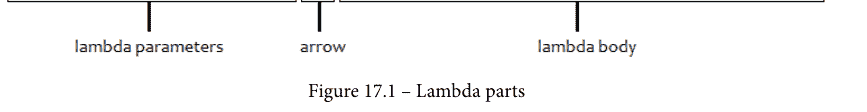
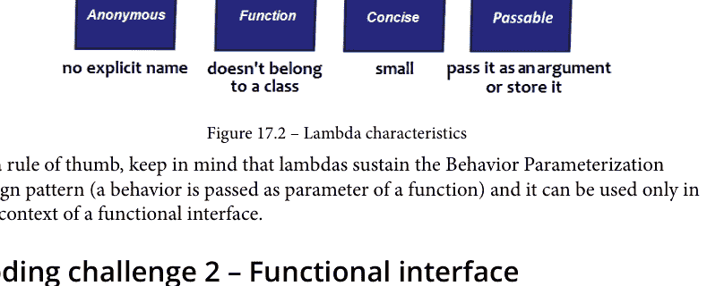

## 17 函数式编程

你可能知道，Java 并不是像 Haskell 那样纯粹的函数式编程语言，但从版本 8 开始，Java 增加了对函数式风格的一些支持。这一支持取得了成功，函数式风格的代码被开发者和公司广泛采用。函数式编程让代码更易于理解、维护和测试。然而，以函数式风格编写 Java 代码需要对 lambda、Stream API、Optional、函数式接口等有扎实的了解。所有这些函数式编程主题都可能成为面试话题，在本章中，我们将涵盖一些常规 Java 面试中必须知道的热门问题。我们的议程包括以下主题：

- Java 函数式编程速览
- 问题和编码挑战

让我们开始吧！

### Java 函数式编程速览

和往常一样，本节旨在突出并刷新我们主题的主要概念，并为回答技术面试中可能遇到的基本问题提供全面的资源。

### 函数式编程的关键概念

函数式编程的关键概念包括：

- 函数作为一等对象
- 纯函数
- 高阶函数

让我们简要深入探讨这些概念。

### 函数作为一等对象

说函数是一等对象，意味着我们可以创建函数的一个*实例*，并让变量引用该函数实例。这就像引用 `String`、`List` 或任何其他对象一样。此外，函数可以作为参数传递给其他函数。然而，Java 方法并不是一等对象。我们所能做的最好的事情就是依赖 Java 的 lambda 表达式。

### 纯函数

*纯*函数是指执行时没有*副作用*，且返回值仅取决于其输入参数的函数。以下 Java 方法就是一个纯函数：

```
public class Calculator {

    public int sum(int x, int y) {
        return x + y;
    }
}
```

如果方法使用了成员变量或修改了成员变量的状态，那么它就不是*纯*函数。

### 高阶函数

高阶函数接收一个或多个函数作为参数，和/或返回另一个函数作为结果。Java 通过 lambda 表达式来模拟高阶函数。换句话说，在 Java 中，高阶函数是将一个（或多个）lambda 表达式作为参数和/或返回另一个 lambda 表达式的方法。

例如，`Collections.sort()` 方法将 `Comparator` 作为参数，就是一个高阶函数：

```
Collections.sort(list, (String x, String y) -> {
    return x.compareTo(y);
});
```

`Collections.sort()` 的第一个参数是 `List`，第二个参数是一个 lambda 表达式。正是这个 lambda 表达式参数使得 `Collections.sort()` 成为高阶函数。

### 纯函数式编程规则

现在，让我们简要讨论纯函数式编程的规则。纯函数式编程也有一组需要遵循的规则。如下所示：

- 无状态
- 无副作用
- 不可变变量
- 偏好递归而非循环

让我们简要深入探讨每一条规则。

### 无状态

这里所说的无状态，并不是指函数式编程消除了状态。通常，无状态意味着函数没有外部状态。换句话说，函数可以使用包含临时状态的局部变量，但不能引用它所属类/对象的任何成员变量。

### 无副作用

对于*无副作用*，我们应该理解为函数不能改变（修改）函数外部（函数作用域之外）的任何状态。函数外部的状态包括：

- 包含该函数的类/对象中的成员变量
- 作为参数传递给该函数的成员变量
- 或外部系统中的状态（例如，数据库或文件）。

### 不可变变量

函数式编程鼓励并支持使用不可变变量。依赖不可变变量有助于我们以更简单、更直观的方式避免*副作用*。

### 偏好递归而非循环

由于递归依赖于重复的函数调用来模拟循环，代码因此变得更加函数式。这意味着函数式编程不鼓励下面这种计算阶乘的迭代方式：

```
static long factorial(long n) {
    long result = 1;
    for (; n > 0; n--) {
        result *= n;
    }
    return result;
}
```

函数式编程鼓励下面这种递归方式：

```
static long factorial(long n) {
    return n == 1 ? 1 : n * factorial(n - 1);
}
```

我们使用尾递归来改善性能损失，因为在前面的示例中，每次函数调用都会作为帧保存在递归栈中。当存在大量递归调用时，尾递归是首选。在尾递归中，函数将递归调用作为最后一步执行，因此编译器不需要将函数调用作为帧保存在递归栈中。大多数编译器会优化尾递归，从而避免性能损失：

```
static long factorialTail(long n) {
	return factorial(1, n);
}
```

```
static long factorial(long acc, long v) {
	return v == 1 ? acc : factorial(acc * v, v - 1);
}
```

另外，循环也可以通过 Java Stream API 实现，该 API 受到函数式思想的启发：

```
static long factorial(long n) {
	return LongStream.rangeClosed(1, n)
	.reduce(1, (n1, n2) -> n1 * n2);
}
```

现在，是时候练习一些问题和编码挑战了。

### 问题和编码挑战

### 编码挑战 1 – Lambda 的组成

问题：描述 Java 中 lambda 表达式的组成部分。此外，lambda 表达式有何特征？


**Solution:** 如以下图表所示，一个 lambda 有三个主要部分：



Figure 17.1 – Lambda parts

lambda 表达式的各部分如下：

- 箭头左侧是该 lambda 在 lambda 主体中使用的参数。在本例中，这些是 FilenameFilter.accept(File folder, String fileName) 方法的参数。
- 箭头右侧是 lambda 主体。在本例中，lambda 主体检查找到文件 fileName 的文件夹 folder 是否可读，以及该文件名的后缀是否为 .pdf 字符串。
- 位于参数列表和 lambda 主体之间的箭头充当分隔符。

接下来，让我们谈谈 lambda 表达式的特征。因此，如果我们写出前面图表中 lambda 的匿名类版本，则如下所示：

```
FilenameFilter filter = new FilenameFilter() {

    @Override
    public boolean accept(File folder, String fileName) {
        return folder.canRead() && fileName.endsWith(".pdf");
    }
};
```

现在，如果我们比较匿名版本和 lambda 表达式，就会注意到 lambda 表达式是一个简洁的匿名函数，可以作为参数传递给方法或保存在变量中。

以下图表中显示的四个词描述了 lambda 表达式：



Figure 17.2 – Lambda characteristics

作为经验法则，请记住 lambda 保持了行为参数化设计模式（行为作为函数的参数传递），并且只能在函数式接口的上下文中使用。

## Coding challenge 2 – Functional interface

Problem: What is a functional interface?

Solution: In Java, a functional interface is an interface that contains only one abstract method. In other words, a functional interface contains only one method that is not implemented. So, a functional interface wraps a function as an interface and the function is represented by a single abstract method on the interface.

Optionally, besides this abstract method, a functional interface can have default and/or static methods as well. Commonly, a functional interface is annotated with @FunctionalInterface. This is just an informative annotation type that's used to mark a functional interface.

Here is an example of a functional interface:

```
@FunctionalInterface
public interface Callable<V> {
	V call() throws Exception;
}
```

As a rule of thumb, if an interface has more methods without implementation (that is, abstract methods), then it is no longer a functional interface. This means that such an interface cannot be implemented by a Java lambda expression.

## Coding challenge 3 – Collections versus streams

**Problem:** What are the main differences between collections and streams?

**Solution:** Collections and streams are quite different. Some of the differences are as follows:

- **Conceptual differences:** The main difference between collections and streams consists of the fact that they are conceptually two different things. While collections are meant to store data (for example, `List`, `Set`, and `Map`), streams are meant to apply operations (for example, *filtering*, *mapping*, and *matching*) on that data. In other words, streams apply complex operations on a view/source represented by data stored on a collection. Moreover, any modification/change performed on a stream is not reflected in the original collection.
- **Data modification:** While we can add/remove elements from a collection, we cannot add/remove elements from a stream. Practically, a stream consumes a view/source, performs operations on it, and returns a result without modifying the view/source.
- **Iteration:** While a stream consumes a view/source, it automatically and internally performs the iteration of that view/source. The iteration takes place depending on the chosen operations that should be applied to the view/source. On the other hand, collections must be iterated externally.
- **Traversal:** While collections can be traversed multiple times, streams can be traversed only once. So, by default, Java streams cannot be reused. Attempting to traverse a stream twice will lead to an error reading *Stream has already been operated on or closed.*
- **Construction:** Collections are eagerly constructed (all the elements are present right from the beginning). On the other hand, streams are lazily constructed (the so-called *intermediate* operations are not evaluated until a *terminal* operation is invoked).

## Coding challenge 4 – The map() function

**Problem:** What does the `map()` function do and why would you use it?

Solution: The map() function is an intermediate operation named mapping and available via the Stream API. It is used to transform a type of object to other type by simply applying the given function. So, map() traverses the given stream and transforms each element in a new version of it by applying the given function and accumulating the results in a new Stream. The given Stream is not modified. For example, transforming a List<String> into a List<Integer> via Stream#map() can be done as follows:

```
List<String> strList = Arrays.asList("1", "2", "3");
List<Integer> intList = strList.stream()
    .map(Integer::parseInt)
    .collect(Collectors.toList());
```

Challenge yourself to practice more examples. Try to apply map() to transform an array into another array.

## Coding challenge 5 – The flatMap() function

Problem: What does the flatMap() function do and why would you use it?

Solution: The flatMap() function is an intermediate operation named flattening and is available via the Stream API. This function is an extension of map(), meaning that apart from transforming the given object into another type of object, it can also flatten it. For example, having a List<List<Object>>, we can turn it into a List<Object> via Stream#flatMap() as follows:

```
List<List<Object>> list = ...
List<Object> flatList = list.stream()
    .flatMap(List::stream)
    .collect(Collectors.toList());
```

The next coding challenge is related to this one, so consider this as well.

## Coding challenge 6 – map() versus flatMap()

Problem: What's the difference between map() and flatMap() functions?

Solution: Both of these functions are intermediate operations capable of transforming a given type of object into another type of object by applying the given function. In addition, the flatMap() function is capable of flattening the given object as well. In other words, flatMap() can also flatten a Stream object.

Why does this matter? Well, map() knows how to wrap a sequence of elements in a Stream, right? This means that map() can produce streams such as Stream<String[]>, Stream<List<String>>, Stream<Set<String>>, or even Stream<Stream<R>>. But the problem is that these kinds of streams cannot be manipulated successfully (that is, as we expected) by stream operations such as sum(), distinct(), and filter().

For example, let's consider the following List:

```
List<List<String>> melonLists = Arrays.asList(
    Arrays.asList("Gac", "Cantaloupe"),
    Arrays.asList("Hemi", "Gac", "Apollo"),
    Arrays.asList("Gac", "Hemi", "Cantaloupe"));
```

We try to obtain the distinct names of melons from this list. If wrapping an array into a stream can be done via Arrays.stream(), for a collection, we have Collection.stream(). Therefore, the first attempt may look as follows:

```
melonLists.stream()
    .map(Collection::stream) // Stream<Stream<String>>
    .distinct();
```

But this will not work because map() will return Stream<Stream<String>>. The solution is provided by flatMap(), as follows:

```
List<String> distinctNames = melonLists.stream()
    .flatMap(Collection::stream) // Stream<String>
    .distinct()
    .collect(Collectors.toList());
```

The output is as follows: Gac, Cantaloupe, Hemi, Apollo.

Moreover, if you find trouble understanding these functional programming methods, then I strongly recommend you to read my other book, Java Coding Problems, available from Packt (https://www.packtpub.com/programming/java-coding-problems). That book contains two comprehensive chapters about Java functional-style programming that provide detailed explanations, diagrams, and applications useful for deep diving into this topic.


## 编程挑战 7 – filter() 函数

**问题：** `filter()` 函数做什么以及为什么会使用它？

**解答：** `filter()` 函数是可通过 `Stream` API 获得的名为 *filtering* 的中间操作。它用于过滤满足特定条件的 `Stream` 元素。条件是通过 `java.util.function.Predicate` 函数指定的。该谓词函数只是一个以 `Object` 作为参数并返回 `boolean` 的函数。

假设我们有以下整数 `List`：

```
List<Integer> ints
  = Arrays.asList(1, 2, -4, 0, 2, 0, -1, 14, 0, -1);
```

对该列表进行流式处理并仅提取非零元素可以按如下方式完成：

```
List<Integer> result = ints.stream()
  .filter(i -> i != 0)
  .collect(Collectors.toList());
```

结果列表将包含以下元素：1, 2, -4, 2, -1, 14, -1。

请注意，对于一些常见操作，Java `Stream` API 已经提供了开箱即用的中间操作。例如，对于以下操作就没有必要使用 `filter()` 并定义 `Predicate`：

- `distinct()`：从流中删除重复项
- `skip(n)`：丢弃前 n 个元素
- `limit(s)`：将流截断为长度不超过 s
- `sorted()`：根据自然顺序对流进行排序
- `sorted(Comparator<? super T> comparator)`：根据给定的 Comparator 对流进行排序

所有这些函数都已内置于 `Stream` API 中。

## 编程挑战 8 – 中间操作与终端操作

**问题：** 中间操作和终端操作的主要区别是什么？

**解答：** 中间操作返回另一个 Stream，而终端操作产生除 Stream 之外的结果（例如，集合或标量值）。换句话说，中间操作允许我们在名为管道的查询类型中链接/调用多个操作。

中间操作在调用终端操作之前不会执行。这意味着中间操作是惰性的。主要来说，它们在实际需要某些处理的结果时才执行。终端操作触发 Stream 的遍历，并且管道被执行。

- map(), flatMap(), filter(), limit(), 和 skip()
- sum(), min(), max(), count(), 和 collect()

## 编程挑战 9 – peek() 函数

**问题：** peek() 函数做什么以及为什么会使用它？

**解答：** peek() 函数是可通过 Stream API 获得的名为 peeking 的中间操作。它允许我们透视 Stream 管道。主要来说，peek() 应该对当前元素执行某个非干扰操作并将元素转发到管道中的下一个操作。通常，此操作包括在控制台上打印有意义的消息。换句话说，peek() 是调试与流和 lambda 表达式处理相关问题的好选择。

例如，假设我们有以下地址列表：

```
addresses.stream()
.peek(p -> System.out.println("\tstream(): " + p))
.filter(s -> s.startsWith("c"))
.sorted()
.peek(p -> System.out.println("\tsorted(): " + p))
.collect(Collectors.toList());
```

必须提到的是，即使 peek() 可用于突变状态（修改流的数据源），它也代表看，但不要碰。通过 peek() 突变状态在并行流管道的情况下可能成为一个真正的问题，因为突变操作可能在上游操作使元素可用时的任何时间、在任何线程中被调用。因此，如果操作修改共享状态，它就有责任提供所需的同步。

作为经验法则，在使用 peek() 突变状态之前三思而后行。此外，要意识到这种做法在开发者之间存在争议，可以归类为不良实践甚至反模式范畴。

## 编程挑战 10 – 惰性流

**问题：** 说一个流是惰性的是什么意思？

**解答：** 说一个流是惰性的意味着流定义了一系列中间操作，这些操作仅在管道遇到终端操作时才执行。此问题与本章的编程挑战 8 相关。

## 编程挑战 11 – 函数式接口与常规接口

**问题：** 函数式接口和常规接口的主要区别是什么？

**解答：** 函数式接口和常规接口的主要区别在于，常规接口可以包含任意数量的抽象方法，而函数式接口只能有一个抽象方法。

你可以查阅本书的编程挑战 2 以获得更深入的理解。

## 编程挑战 12 – Supplier 与 Consumer

**问题：** Supplier 和 Consumer 的主要区别是什么？

**解答：** Supplier 和 Consumer 是两个内置的函数式接口。Supplier 充当工厂方法或 new 关键字。换句话说，Supplier 定义了一个名为 get() 的方法，它不接受参数并返回类型为 T 的对象。因此，Supplier 用于提供某个值。

请注意，取决于流的源和中间操作，流可能具有或不具有定义的 encounter order。

## 编程挑战 15 – 将数组转换为流

**问题：** 你将如何将数组转换为流？

**解答：** 将对象数组转换为流至少可以通过以下三种方式完成：

1. 第一种是通过 Arrays#stream()：
2. 第二，我们可以使用 Stream#of()：
3. 最后一个技术是通过 List#stream()：

```
public static <T> Stream<T> toStream(T[] arr) {
    return Arrays.stream(arr);
}
```

```
public static <T> Stream<T> toStream(T[] arr) {
    return Stream.of(arr);
}
```

```
public static <T> Stream<T> toStream(T[] arr) {
    return Arrays.asList(arr).stream();
}
```

将原始类型数组（例如，整数）转换为流至少可以通过以下两种方式完成：

1. 首先，通过 Arrays#stream()：

```
public static IntStream toStream(int[] arr) {
    return Arrays.stream(arr);
}
```

2. 其次，通过使用 IntStream#of()：

```
public static IntStream toStream(int[] arr) {
    return IntStream.of(arr);
}
```

当然，对于 long，你可以使用 LongStream，对于 double，你可以使用 DoubleStream。

## 编程挑战 16 – 并行流

**问题：** 什么是并行流？

**解答：** 并行流是可以使用多个线程并行化执行的流。例如，你可能需要过滤一个包含 1000 万个整数的流以找到小于某个值的整数。不是使用单个线程顺序遍历流，你可以使用并行流。这意味着多个线程将并发地在流的不同部分中搜索这些整数，然后合并结果。

## 编程挑战 17 – 方法引用

**问题：** 什么是方法引用？

**解答：** 简而言之，*方法引用* 是 lambda 表达式的快捷方式。主要来说，方法引用是一种按名称调用方法而不是按调用方式描述的技术。主要好处是可读性。方法引用是通过在分隔符 `::` 之前放置目标引用并在其后提供方法名称来编写的。我们有以下引用：

- 对静态方法的引用：Class::staticMethod（例如，Math::max 等价于 Math.max(x, y)）
- 对构造函数的引用：Class::new（例如，AtomicInteger::new 等价于 new AtomicInteger(x)）
- 对实例的实例方法的引用：object::instanceMethod（System.out::println 等价于 System.out.println(foo)）
- 对类类型的实例方法的引用：Class::instanceMethod（String::length 等价于 str.length()）


### 编程挑战 18 – 默认方法

问题：什么是默认方法？

默认方法是在 Java 8 中添加的，主要用于为接口提供支持，以便它们能够超越抽象契约而演进（即仅包含抽象方法）。该功能对于编写库并希望以兼容的方式演进 API 的人员非常有用。通过默认方法，可以在不破坏现有实现的情况下丰富接口。

默认方法是在接口中直接实现的，并以 default 关键字识别。例如，以下接口定义了一个名为 area() 的抽象方法和一个名为 perimeter() 的默认方法：

```
public interface Polygon {
	public double area();
	default double perimeter(double... segments) {
		return Arrays.stream(segments)
			.sum();
	}
}
```

由于 Polygon 只有一个抽象方法，它也是一个函数式接口。因此，它可以用 @FunctionalInterface 进行注解。

### 编程挑战 19 – Iterator 与 Spliterator

问题：Iterator 和 Spliterator 的主要区别是什么？

Iterator 是为 Collection API 创建的，而 Spliterator 是为 Stream API 创建的。

通过分析它们的名称，我们注意到 Spliterator = Splittable Iterator。因此，Spliterator 可以分割给定的数据源，并且也可以迭代它。分割对于并行处理是必要的。换句话说，Iterator 可以顺序地迭代 Collection 中的元素，而 Spliterator 可以并行或顺序地迭代流的元素。

Iterator 只能通过 hasNext()/next() 来遍历集合的元素，因为它没有大小。另一方面，Spliterator 可以通过 estimateSize() 近似提供集合的大小，或通过 getExactSizeIfKnown() 精确提供。

Spliterator 可以使用多个标志来在内部禁用不必要的操作（例如，CONCURRENT、DISTINCT 和 IMMUTABLE）。Iterator 没有此类标志。

最后，你可以按如下方式在 Iterator 周围创建一个 Spliterator：

```
Spliterators.spliteratorUnknownSize(
    your_Iterator, your_Properties);
```

在书籍 Java Coding Problems (https://www.amazon.com/gp/product/B07Y9BPV4W/) 中，你可以找到有关此主题的更多详细信息，包括编写自定义 Spliterator 的完整指南。

### 编程挑战 20 – Optional

问题：Optional 类是什么？

解答：受 Haskell 和 Scala 的启发，Optional 类在 Java 8 中引入，主要目的是减轻/避免 NullPointerException。Java 语言架构师 Brian Goetz 的定义如下：

> Optional 旨在为库方法返回类型提供一种有限的机制，在其中需要一种明确表示无结果的方式，而使用 null 来表示这种情况极有可能导致错误。

简而言之，你可以将 Optional 视为一个单值容器，它包含一个值或为空。例如，一个空的 Optional 看起来像这样：

```
Optional<User> userOptional = Optional.empty();
```

而一个非空的 Optional 看起来像这样：

```
User user = new User();
Optional<User> userOptional = Optional.of(user);
```

在 Java Coding Problems (https://www.amazon.com/gp/product/B07Y9BPV4W/) 中，你可以找到一个专门介绍使用 Optional 的最佳实践的完整章节。这是任何 Java 开发者必读的章节。

### 编程挑战 21 - String::valueOf

**问题：** `String::valueOf` 的含义是什么？

**解答：** `String::valueOf` 是对 `String` 类的 `valueOf` 静态方法的引用。建议阅读 *Coding challenge 17* 以获取更多信息。

### 总结

在本章中，我们涵盖了有关 Java 中函数式编程风格的几个热门话题。虽然该主题相当广泛，有许多书籍专门介绍它，但这里涵盖的问题足以通过一次涵盖 Java 8 语言主要特性的常规 Java 面试。

在下一章中，我们将讨论与扩展相关的问答。
