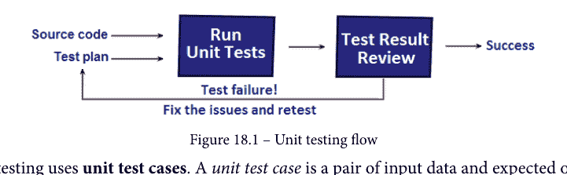
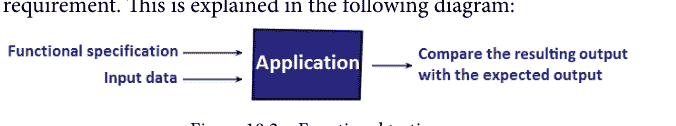
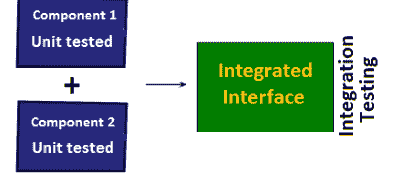

## 18 单元测试

作为一名开发者（或软件工程师），你也必须具备测试领域的技能。例如，开发者负责编写其代码的单元测试（例如，使用 JUnit 或 TestNG）。很可能，不包含单元测试的拉取请求也不会被接受。

在本章中，我们将介绍你在申请开发者或软件工程师职位时可能遇到的单元测试面试问题。当然，如果你正在寻找测试员（手动/自动化）职位，那么本章可能只是测试的另一个视角，因此不要期望在这里看到针对手动/自动化测试员职位特定问题的提问。本章将涵盖以下主题：

- 单元测试概览
- 问题和编程题

让我们开始吧！

### 技术要求

本章使用的代码可以在 GitHub 上找到：https://github.com/PacktPublishing/The-Complete-Coding-Interview-Guide-in-Java/tree/master/Chapter18

### 单元测试概览

测试应用程序的过程包含多个测试层。其中一层是 *单元测试* 层。

主要来说，一个应用程序是由称为单元的小功能部件构建的（例如，一个普通的 Java 方法可以被视为一个单元）。在特定输入/条件/约束下测试这些单元的功能和正确性称为单元测试。

这些单元测试由开发者使用源代码和测试计划编写。理想情况下，每个开发者都应该能够编写测试/验证其代码的单元测试。单元测试应有意义并提供可接受的代码覆盖率。

如果单元测试失败，则开发者负责修复问题并再次执行单元测试。以下图表描述了这一陈述：



单元测试使用 **单元测试用例**。*单元测试用例* 是输入数据和预期输出的配对，用于为特定功能构建测试。

如果你参加的面试要求你了解单元测试，不要惊讶如果你被问到功能测试和/或集成测试的问题。因此，建议你也为这些问题准备好答案。

**功能测试** 是关于根据给定输入和产生的输出（行为）来测试功能需求，该输出（行为）需要与预期输出（行为）进行比较。每个功能测试都使用功能规范来验证代表该功能需求实现的组件（或一组组件）的正确性。这在以下图表中进行了说明：



**集成测试** 的目标是在软件组件以迭代增量的方式集成时发现缺陷。换句话说，已经进行单元测试的模块被集成（分组或聚合）并按照集成计划进行测试。这在以下图表中有所体现：



图 18.3 – 集成测试

经常向面试候选人提出的一个关于单元测试和集成测试的问题是关于突出这两者之间的主要区别。以下表格将帮助你准备对此问题的回答：

| 单元测试 | 集成测试 |
|---|---|
| 通常对开发者有用。 | 对 QA、DevOps 和 Help Desk 也很有用 |
| 结果仅取决于 Java 代码。 | 结果可能取决于外部系统。 |
| 相当容易编写。 | 设置起来可能相当复杂 |
| 单元被隔离测试。 | 测试一个或多个组件。 |
| 可以为依赖项使用模拟。 | 应避免模拟。 |
| 仅测试代码的实现。 | 测试组件的实现及其之间的互连行为 |
| 使用 JUnit/TestNG。 | 使用 Arquillian 和 DbUnit 等工具的真实环境。 |
| 测试失败是一个回归问题。 | 测试失败可能是由环境变化引起的 |
| 此类测试不应花费太长时间运行。 | 此类测试可能需要很长时间（例如，1 小时） |

图 18.4 – 单元测试与集成测试的比较

一个优秀的测试人员能够在不做任何关于输入的假设或约束的情况下，对测试对象进行压力测试和滥用测试。这同样适用于单元测试。现在我们已经涉及了单元测试，让我们来看一些关于单元测试的编程挑战和问题。


## 问题与编码挑战

在本节中，我们将介绍 15 个与单元测试相关的、面试中非常热门的问题和编码挑战。让我们开始吧！

## 编码挑战 1 – AAA

**Problem:** 单元测试中的 AAA 是什么？

**Solution:** AAA 首字母缩写代表 [A]rrange、[A]ct、[A]ssert，它代表了一种构建测试以保持代码整洁和可读性的方法。如今，AAA 已成为业界几乎标准的测试模式。以下代码片段不言自明：

```
@Test
public void givenStreamWhenSumThenEquals6() {

    // Arrange
    Stream<Integer> theStream = Stream.of(1, 2, 3);

    // Act
    int sum = theStream.mapToInt(i -> i).sum();

    // Assert
    assertEquals(6, sum);
}
```

**Arrange section:** 在此部分，我们准备或设置测试。例如，在前面的代码中，我们准备了一个整数流，其元素为 1、2 和 3。

**Act section:** 在此部分，我们执行必要的操作以获得测试结果。例如，在前面的代码中，我们对流的元素求和并将结果存储在整数变量中。

**Assert section:** 在此部分，我们检查单元测试的结果是否与预期结果匹配。这是通过断言完成的。例如，在前面的代码中，我们检查元素的和是否等于 6。

你可以在名为 *junit5/ArrangeActAssert* 的应用程序中找到这段代码。

## 编码挑战 2 – FIRST

**Problem**: 单元测试中的 FIRST 是什么？

**Solution**: 良好的测试人员使用 FIRST 来避免单元测试中遇到的许多陷阱。**FIRST** 首字母缩写代表 **[F]ast、[I]solated、[R]epeatable、[S]elf-validating、[T]imely。** 让我们看看它们各自的含义：

**Fast**: 建议编写运行速度快的单元测试。快速是一个任意的概念，取决于你有多少单元测试、运行频率以及你愿意等待它们运行多长时间。例如，如果每个单元测试的平均完成时间为 200 ms，并且你运行 5,000 个单元测试，那么你将等待约 17 分钟。通常，单元测试之所以缓慢，是因为它们访问外部资源（例如数据库和文件）。

**Isolated**: 理想情况下，你应该能够在任何时间、任何顺序运行任何测试。如果你的单元测试是隔离的并且专注于小的代码片段，则可以实现这一点。良好的单元测试不依赖于其他单元测试，但这并不总是可实现的。尽管如此，仍应努力避免依赖链，因为当出现问题时它们很邪恶，你将不得不调试。

**Repeatable**: 单元测试应该是可重复的。这意味着单元测试的断言每次运行都应产生相同的结果。换句话说，单元测试不应依赖可能导致断言结果可变的任何事物。

**Self-validating**: 单元测试应该是自验证的。这意味着你不应手动验证测试结果。这耗时且表明断言没有发挥作用。努力编写断言使其按预期工作。

**Timely**: 不应推迟编写单元测试很重要。推迟得越久，你会遇到越多缺陷。你会发现你找不到时间回来编写单元测试。想想如果我们不断推迟倒垃圾会发生什么。我们推迟得越久，处理起来就越困难，并且我们会危害健康。我说过什么关于气味的事吗？所以，及时编写单元测试。这是一个好习惯！

## 编码挑战 3 – 测试夹具

**Problem**: 什么是测试夹具？

**Solution**: 所谓测试夹具，我们指的是任何存在于该测试之外并用于设置应用程序使其处于固定状态的测试数据。应用程序的固定状态允许测试在恒定且已知的环境中运行。

## 编码挑战 4 – 异常测试

**Problem:** 在 JUnit 中测试异常的常见方法有哪些？

**Solution:** 在 JUnit 4 中，我们通常通过 try/catch 惯用法、@Test 的 expected 元素以及 ExpectedException 规则来测试异常。

try/catch 惯用法在 JUnit 3.x 中占主导地位，可按如下方式使用：

```java
@Test
public void givenStreamWhenGetThenException() {
    Stream<Integer> theStream = Stream.of();
    try {
        theStream.findAny().get();
        fail("Expected a NoSuchElementException to be thrown");
    } catch (NoSuchElementException ex) {
        assertThat(ex.getMessage(), is("No value present"));
    }
}
```

由于 fail() 抛出 AssertionError，因此它不能用于测试此错误类型。

从 JUnit 4 开始，我们可以使用 @Test 注解的 expected 元素。此元素的值是预期异常的类型（Throwable 的子类）。请查看以下使用 expected 编写的示例：

```java
@Test(expected = NoSuchElementException.class)
public void givenStreamWhenGetThenException() {
    Stream<Integer> theStream = Stream.of();
    theStream.findAny().get();
}
```

只要你不想测试异常消息的值，这种方法就没问题。此外，请注意，如果 NoSuchElementException 由代码的任何一行抛出，测试就会通过。你可能期望此异常由特定行代码引起，而实际上它可能由其他代码引起。

另一种方法依赖于 ExpectedException 规则。此方法从 JUnit 4.13 开始被弃用。让我们看一下代码：

```
@Rule
public ExpectedException thrown = ExpectedException.none();

@Test
public void givenStreamWhenGetThenException()
    throws NoSuchElementException {

    Stream<Integer> theStream = Stream.of();

    thrown.expect(NoSuchElementException.class);
    thrown.expectMessage("No value present");

    theStream.findAny().get();
}
```

通过这种方法，你可以测试异常消息的值。这些示例已分组到名为 junit4/TestingExceptions 的应用程序中。

从 JUnit5 开始，我们可以使用两种方法来测试异常。它们都依赖于 assertThrows() 方法。此方法允许我们断言给定的函数调用（作为 lambda 表达式甚至方法引用传递）会导致抛出预期的异常类型。以下示例不言自明：

```
@Test
public void givenStreamWhenGetThenException() {

    assertThrows(NoSuchElementException.class, () -> {
        Stream<Integer> theStream = Stream.of();
        theStream.findAny().get();
    });
}
```

此示例仅验证异常的类型。然而，由于异常已被抛出，我们可以断言更多被抛出的异常的细节。例如，我们可以按如下方式断言异常消息的值：

```
@Test
public void givenStreamWhenGetThenException() {

    Throwable ex = assertThrows(
        NoSuchElementException.class, () -> {
            Stream<Integer> theStream = Stream.of();
            theStream.findAny().get();
        });

    assertEquals(ex.getMessage(), "No value present");
}
```

只需使用 ex 对象断言你认为从 Throwable 有用的任何内容。每当你不需要断言异常的细节时，请依赖 assertThrows()，而不捕获返回值。这两个示例已分组到名为 junit5/TestingExceptions 的应用程序中。

## 编码挑战 5 - 开发者或测试员

**Problem:** 谁应该使用 JUnit – 开发者还是测试员？

**Solution:** 通常，JUnit 由开发者用于在 Java 中编写单元测试。编写单元测试是一个测试应用程序代码的编码过程。JUnit 不是测试过程。然而，许多测试员愿意学习并使用 JUnit 进行单元测试。

## 编码挑战 6 - JUnit 扩展

**Problem:** 你知道/使用哪些有用的 JUnit 扩展？

**Solution:** 最广泛使用的 JUnit 扩展是 JWebUnit（用于 Web 应用程序的基于 Java 的测试框架）、XMLUnit（用于测试 XML 的单个 JUnit 扩展类）、Cactus（用于测试服务器端 Java 代码的简单测试框架）以及 MockObject（一个模拟框架）。你需要对其中每一个说几句话。


## 编程挑战 7 – @Before* 和 @After* 注解

**问题：** 你知道/使用哪些 @Before*/@After* 注解？

**解答：** 在 JUnit 4 中，我们有 `@Before`、`@BeforeClass`、`@After` 和 `@AfterClass`。

在每个测试前执行方法时，我们用 `@Before` 注解进行标注。这对于在运行测试前执行一段通用代码很有用（例如，我们可能需要在每个测试前执行一些重新初始化）。在每个测试后清理环境时，我们用 `@After` 注解标注一个方法。

在所有测试前仅执行一次方法时，我们用 `@BeforeClass` 注解进行标注。该方法必须是 `static`。这对于全局且耗时的设置很有用，例如打开数据库连接。在所有测试完成后清理环境时，我们用 `@AfterClass` 注解标注一个 `static` 方法；例如，关闭数据库连接。

你可以在名为 *junit4/BeforeAfterAnnotations* 的示例下找到一个简单示例。

从 JUnit 5 开始，我们有 `@BeforeEach` 作为 `@Before` 的等价物，以及 `@BeforeAll` 作为 `@BeforeClass` 的等价物。实际上，`@Before` 和 `@BeforeClass` 被重命名为更具提示性的名称以避免混淆。

你可以在名为 *junit5/BeforeAfterAnnotations* 的示例下找到一个简单示例。

## 编程挑战 8 – Mocking 和 stubbing

**问题：** 什么是 mocking 和 stubbing？

**解答：** Mocking 是一种用于创建模拟/模仿真实对象的技术。这些对象可以预先编程（或预设或预配置）期望值，我们可以检查它们是否被调用。在最广泛使用的 mocking 框架中，我们有 Mockito 和 EasyMock。

Stubbing 类似于 mocking，只是我们无法检查它们是否被调用。Stub 会被预先配置为对特定输入返回特定输出。

## 编程挑战 9 – 测试套件

**问题：** 什么是测试套件？

**解答：** 测试套件是将分布在多个测试类和包中的多个测试聚合在一起的概念，以便它们一起运行。

在 JUnit 4 中，我们可以通过 `org.junit.runners.Suite` runner 和 `@SuiteClasses(...)` 注解来定义测试套件。例如，以下代码片段是一个聚合了三个测试（`TestConnect.class`、`TestHeartbeat.class` 和 `TestDisconnect.class`）的测试套件：

```java
@RunWith(Suite.class)
@Suite.SuiteClasses({
  TestConnect.class,
  TestHeartbeat.class,
  TestDisconnect.class
})

public class TestSuite {
  // this class was intentionally left empty
}
```

完整代码称为 junit4/TestSuite。

在 JUnit 5 中，我们可以通过 `@SelectPackages` 和 `@SelectClasses` 注解来定义测试套件。

`@SelectPackages` 注解对于聚合不同包中的测试很有用。我们只需指定包名，如以下示例所示：

```java
@RunWith(JUnitPlatform.class)
@SuiteDisplayName("TEST LOGIN AND CONNECTION")
@SelectPackages({
  "coding.challenge.connection.test",
  "coding.challenge.login.test"
})

public class TestLoginSuite {
  // this class was intentionally left empty
}
```

`@SelectClasses` 注解对于通过类名聚合测试很有用：

```java
@RunWith(JUnitPlatform.class)
@SuiteDisplayName("TEST CONNECTION")
@SelectClasses({
    TestConnect.class,
    TestHeartbeat.class,
    TestDisconnect.class
})

public class TestConnectionSuite {
    // this class was intentionally left empty
}
```

完整代码称为 junit5/TestSuite。

此外，可以通过以下注解过滤测试包、测试类和测试方法：

- 过滤包：@IncludePackages 和 @ExcludePackages
- 过滤测试类：@IncludeClassNamePatterns 和 @ExcludeClassNamePatterns
- 过滤测试方法：@IncludeTags 和 @ExcludeTags

## 编程挑战 10 – 忽略测试方法

**问题：** 我们如何忽略一个测试？

**解答：** 在 JUnit 4 中，我们可以通过用 `@Ignore` 注解标注测试方法来忽略它。在 JUnit 5 中，我们可以通过 `@Disable` 注解实现同样的功能。

忽略测试方法在我们提前编写了一些测试，并且希望在不运行这些特定测试的情况下运行当前测试时很有用。

## 编程挑战 11 – 假设

**问题：** 什么是假设？

**解答：** 假设用于在满足指定条件时执行测试。它们通常用于处理测试正确执行所需的外部条件，但这些条件不在我们控制之下和/或与正在测试的内容没有直接关系。

在 JUnit 4 中，假设是可以在 `org.junit.Assume` 类中找到的静态方法。其中包括 `assumeThat()`、`assumeTrue()` 和 `assumeFalse()`。以下代码片段示例了 `assumeThat()` 的使用：

```java
@Test
public void givenFolderWhenGetAbsolutePathThenSuccess() {

    assumeThat(File.separatorChar, is('/'));
    assertThat(new File(".").getAbsolutePath(),
        is("C:/SBPBP/GitHub/Chapter18/junit4"));
}
```

如果 `assumeThat()` 不满足给定条件，则测试将被跳过。完整应用程序称为 junit4/Assumptions。

在 JUnit 5 中，假设是可以在 `org.junit.jupiter.api.Assumptions` 类中找到的静态方法。其中包括 `assumingThat()`、`assumeTrue()` 和 `assumeFalse()`。这三者都有不同的变体。以下代码片段示例了 `assumingThat()` 的使用：

```java
@Test
public void givenFolderWhenGetAbsolutePathThenSuccess() {

    assumingThat(File.separatorChar == '/',
        () -> {
            assertThat(new File(".").getAbsolutePath(),
                is("C:/SBPBP/GitHub/Chapter18/junit5"));
        });

    // run these assertions always, just like normal test
    assertTrue(true);
}
```

请注意，测试方法（`assertThat()`）只有在假设满足时才会执行。lambda 之后的所有内容都将执行，而与假设是否有效无关。完整应用程序称为 junit5/Assumptions。

## 编程挑战 12 – @Rule

**问题：** 什么是 @Rule？

**解答：** JUnit 通过所谓的规则提供了高度的灵活性。规则允许我们创建和隔离对象（代码）并在多个测试类中重用此代码。主要地，我们通过可重用的规则增强测试。JUnit 带有内置规则，并提供 API 用于编写自定义规则。

## 编程挑战 13 – 方法测试返回类型

**问题：** 我们能否让 JUnit 测试方法返回 void 以外的类型？

**解答：** 可以，我们可以将测试方法的返回类型从 void 改为其他类型，但 JUnit 将不会将其识别为测试方法，因此在测试执行期间会被忽略。

## 编程挑战 14 – 动态测试

**问题：** 我们能否在 JUnit 中编写动态测试（运行时生成的测试）？

**解答：** 直到 JUnit 5，所有测试都是静态的。换句话说，所有用 `@Test` 标注的测试都是在编译时完全定义的静态测试。JUnit 5 引入了动态测试——动态测试是在运行时生成的。

动态测试通过工厂方法生成，该方法是用 `@TestFactory` 注解标注的方法。此类方法可以返回 `Iterator`、`Iterable`、`Collection` 或 `Stream` 的 `DynamicTest` 实例。工厂方法没有用 `@Test` 标注，并且不是 private 或 static。此外，动态测试无法利用生命周期回调（例如，`@BeforeEach` 和 `@AfterEach` 被忽略）。

让我们看一个简单示例：

```java
1: @TestFactory
2: Stream<DynamicTest> dynamicTestsExample() {
3: 
4: List<Integer> items = Arrays.asList(1, 2, 3, 4, 5);
5: 
6: List<DynamicTest> dynamicTests = new ArrayList<>();
7: 
8: for (int item : items) {
9: DynamicTest dynamicTest = dynamicTest(
```

```java
log.info("Execute test2() ...");
}
}
}
```

完整示例称为 junit5/NestedTests。

## 总结

在本章中，我们涵盖了关于通过 JUnit 4 和 JUnit 5 进行单元测试的几个热门问题和编程挑战。重要的是不要忽视这个主题。很可能，在 Java 开发人员或软件工程师职位面试的最后一部分，你会得到几个与测试相关的问题。而且，这些问题将与单元测试和 JUnit 相关。

在下一章中，我们将讨论扩展和与扩展相关的面试问题。


# 19
